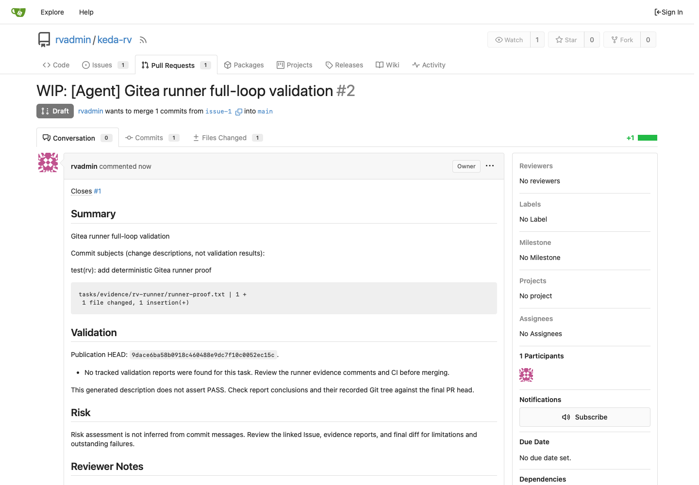
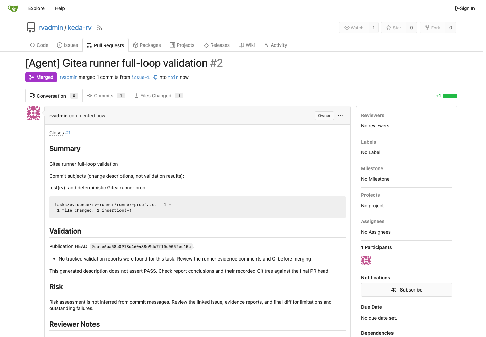
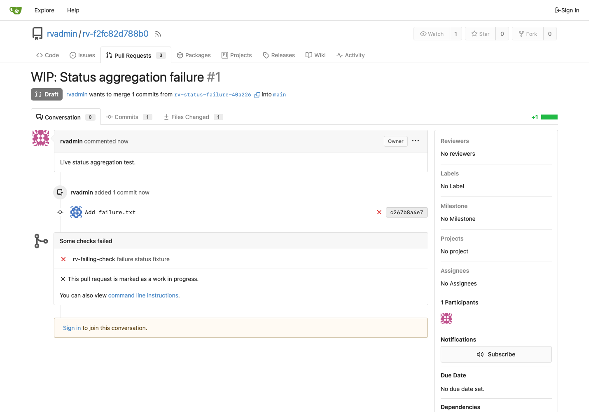

## 人审导航 / Human Review Navigation

本地图片，GitHub 上不显示（证据目录只提交 `.md`，原图在证据分支 `kc-evidence/issue-416`）。打开整份审阅入口：`just prd review tasks/archive/P2-FEAT-20261120-170035-gitea-platform-client.md`。

| # | 人需要看的结果 | 呈递物与打开方式 | 精确自查 | PR / CI | 执行器已交叉核对 |
|---|---|---|---|---|---|
| 1 | Gitea 上从 Issue、标签到 WIP PR、转正式和合并（决策二） | 下方两张截图；录屏 `open tasks/evidence/P2-FEAT-20261120-170035-gitea-platform-client/rv-1-demo.mp4` | 截图一标题以 `WIP: ` 开头、状态 Draft；截图二标题无前缀、状态 Merged | [PR #422](https://github.com/ZataZhang/keda/pull/422)（已合并）；[Issue #416](https://github.com/ZataZhang/keda/issues/416) | 同一轮 `RESULT=PASS`，独立 API 复读 `merged=true`，`gh_invocations=0` |
| 2 | 未登记主机收不到令牌或请求（决策一） | [rv-2 终端证据](rv-2-unregistered-host.txt)：`open tasks/evidence/P2-FEAT-20261120-170035-gitea-platform-client/rv-2-unregistered-host.txt` | `UNREGISTERED_EXIT_CODE=1 requests=0`；负对照 `requests=1` | 同上 | 最终代码复跑 PASSED |
| 3 | Gitea 检查状态汇总 | 下方第三张截图；`open tasks/evidence/P2-FEAT-20261120-170035-gitea-platform-client/rv-5-gitea-status.png` | 页面显示 `Some checks failed` 与 `rv-failing-check` | 同上 | API 复读 `state=failure contexts=["rv-failing-check:failure"]` |

本地图片，GitHub 上不显示：`open tasks/evidence/P2-FEAT-20261120-170035-gitea-platform-client/rv-1-gitea-pr-wip.png`

本地图片，GitHub 上不显示：`open tasks/evidence/P2-FEAT-20261120-170035-gitea-platform-client/rv-1-gitea-pr-merged.png`

本地图片，GitHub 上不显示：`open tasks/evidence/P2-FEAT-20261120-170035-gitea-platform-client/rv-5-gitea-status.png`

## Delivery Summary

- Acceptance status: `🧍 待人工验收` — all executor-owned items carry final-tree evidence; the 3 Human-Confirmed items remain for the maintainer.
- Final-tree recheck (2026-11-24, merge commit `59429463`, tree `bbf6fce0`): rv-2/3/4/6/7/8 passed via `kc evidence check`; rv-5 passed and captured the real status page with WebKit; rv-1 passed when run directly (`RESULT=PASS`, codex shim invoked 3 times, `gh` 0 times) and captured both PR pages plus the demo. See [final-tree-recheck.txt](final-tree-recheck.txt), [rv-1-gitea-full-loop.txt](rv-1-gitea-full-loop.txt), [rv-5-status.txt](rv-5-status.txt).
- `rv-2` through `rv-4` and `rv-6` through `rv-8` have item-specific evidence files and executed negative controls. RV-6 was rerun against Gitea 1.21 after its Git test helper disabled the ambient `osxkeychain` credential helper; invalid-token control returned 401 and both live tests passed. The rv-5 Gitea status tests and negative control passed, but its screenshot-format marker remains unsatisfied; `rv-5-browser-capture.txt` records the renderer failure. RV-7 reran the full `tests/` collection with testmon disabled: 5663 node ids were assigned once across four file-preserving shards, resulting in 5660 passed and 3 skipped; the longest shard took 196.67s, under the runner's 300s command cap. Reuse lint and full lint passed after the changes.
- The rv-3 script searched the complete evidence directory for the local Gitea test token value and found no match; the token value is not printed or included in this report.
- The initial `just lint --reuse` attempt used the user's default uv cache and failed because that path was not accessible in the filesystem sandbox. Rerunning with `UV_CACHE_DIR=/private/tmp/issue416-uv-cache` passed.
- Strict MkDocs build passed. It printed existing navigation notices for pages already outside `mkdocs.yml` navigation.

## Evidence and Provenance

- Structured manifest: [evidence.json](evidence.json)
- Final-tree recheck: [final-tree-recheck.txt](final-tree-recheck.txt) — commit `59429463edb1a6dac6f71a75c181d6cd547d2c62`, `HEAD^{tree}` `bbf6fce00232d163a2783136c0650f9ba984220d`
- Architecture checks compare the merge commit against its first parent (dependency manifests, `IGitHubClient`, GitHub client files all unchanged); the original `arch_search.sh` compared the working tree with HEAD, which cannot fail on a clean checkout.
- Swagger check: [swagger-check.txt](swagger-check.txt)
- All Gitea test data lives in a disposable local `gitea/gitea:1.21` container on `127.0.0.1:3300`; no external business system was used. The local Gitea token was scanned for in all logs and evidence files: zero matches.

## 4. 对 Gitea 接口推断的核实结果（swagger）

- 来源：容器自带 `http://127.0.0.1:3300/swagger.v1.json`（Gitea 1.21.11）。
- 结果：`gitea_client.py` 与 `gitea_pr_ops.py` 实际调用的 22 个接口（方法 + 路径）全部存在于 swagger，无路径或方法差异 → [swagger-check.txt](swagger-check.txt)。
- 行为差异：WIP 标题期间 `mergeable=false`，适配器视为未知并在去掉前缀后重读（见下方 Reconciliation Notes），不影响决策二。

## Reconciliation Notes

- The CLI does not print the created PR URL. After real `kc run`, rv-1 obtains the PR from a fresh `GET /pulls` filtered by the run's head branch and WIP title, then independently rereads the PR by number.
- `kc init` selects Gitea when the publishing remote matches a machine-local registration so initial label sync follows the same platform path.
- Gitea 1.21 reports `mergeable=false` for its WIP PR state. The adapter maps that draft-only value to unknown and reads mergeability again after the title prefix is removed.

## Final-Tree Recheck Notes

- The evidence branch stored the executor shims `scripts/codex` and `scripts/gh` as `100644`. Without the executable bit, `PATH` lookup fell through to the real `codex` CLI and the runner then fell back to real `claude`/`kimi`. That first recheck run was stopped and discarded; the shims were made executable and rv-1 was rerun.
- rv-1 with browser capture took 769s on this machine (video encoding dominates), above the 300s cap of `kc evidence check`. rv-1 therefore passed by direct execution, not through the re-exec gate; a future gate re-run of item 1 will time out unless the capture step is made faster or split out.
