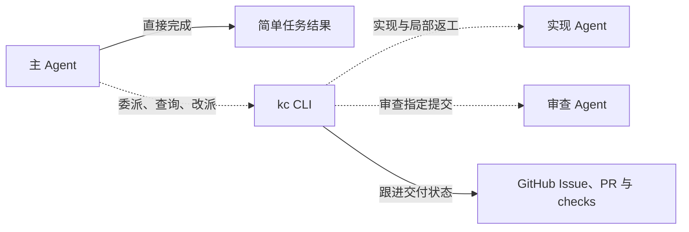

# Roadmap

KedaCode 的方向是把 `kc` 做成主 Agent 按需调用的协作 CLI。简单任务由主 Agent 直接完成。需要委派实现、独立审查或跨工具交接时，主 Agent 通过 `kc` 调用 Claude、Codex 等子 Agent，并在执行中调整分工。衡量收益的标准是 **在验收通过率相当的前提下，降低每次合格交付的成本**。

更新于 2026-11-23。下图虚线表示首个场景要验证的能力。

## 现在 · 在 GitHub 交付链中验证中途改派

复用现有的 [Issue 到 PR 交付链][runner]。主 Agent 决定由谁实现、何时审查、哪些工作需要重做。代码负责记录任务与提交的对应关系、等待 checks、处理重复事件和传递结果。内置 [Console][console-delivery] 继续作为默认前端，独立前端可以调用同一套 CLI。

用一个真实 Issue 走通以下过程：

1. 主 Agent 委派实现。实现 Agent 开 PR 后，独立的审查 Agent 针对指定提交给出意见。
2. 审查期间，用户追加一条需求。主 Agent 能随时查询进度、补充要求或改派，并能确认调整在当前运行中生效，还是由下一次交接接收。
3. 实现 Agent 保留仍然适用的改动，针对受影响部分返工。新提交触发对应的复审，PR 上可以核对新增要求、修复提交和最终审查结论。

## 下一步 · 用配对评测决定是否扩大使用

沿用[现有 Claude 配对评测][comparison]的题集和判分方法，在真实 GitHub 任务上另测中途追加需求的场景，按[评测方案][improvement]记录费用。两组使用同一份 PRD、相同的模型选择、工具权限和时间上限，在相同阶段收到同一条追加需求，按相同标准验收。原生 Claude 或 Codex 组也可使用自己的子 Agent。

**每次合格交付的模型成本 = 同批全部尝试的模型费用 ÷ 合格交付数。** 费用计入主 Agent 协调、子 Agent 实现与审查、失败、重试和返工。报告费用覆盖率，费用缺失时单列已知费用。另报端到端耗时、人工接管次数和人工处理时间。只有在重复任务中通过率相当、单位成本稳定下降，且等待和人工投入均可接受时，才扩大使用范围。

## 后续 · 通过 FreshAI 验证跨仓库复用

首条流程验证成本收益、且 FreshAI 的 Worker Contract 稳定后，再推进[本机执行器连接器][freshai]。FreshAI 管理工作项与评审，Keda 负责本机执行与结果回传。首个复用目标是让第二个仓库能采用同一套实现、审查和改派流程，无需重新编写交接逻辑。再根据实际复用情况决定是否扩展流程分发。

[产品边界与候选方向][boundaries] · [路线历史][history]

[runner]: docs/guides/agent-runner.md
[comparison]: tasks/pending/P1-FEAT-20261019-180938-m13-keda-vs-claude-workflow-evaluation.md
[console-delivery]: tasks/archive/P1-FEAT-20260910-111901-iar-console-bundled-web-terminal.md
[improvement]: docs/project/agent-improvement.md
[freshai]: tasks/pending/P2-FEAT-20261107-162227-freshai-local-executor-connector.md
[boundaries]: docs/project/product-boundaries.md
[history]: docs/project/roadmap-history.md
