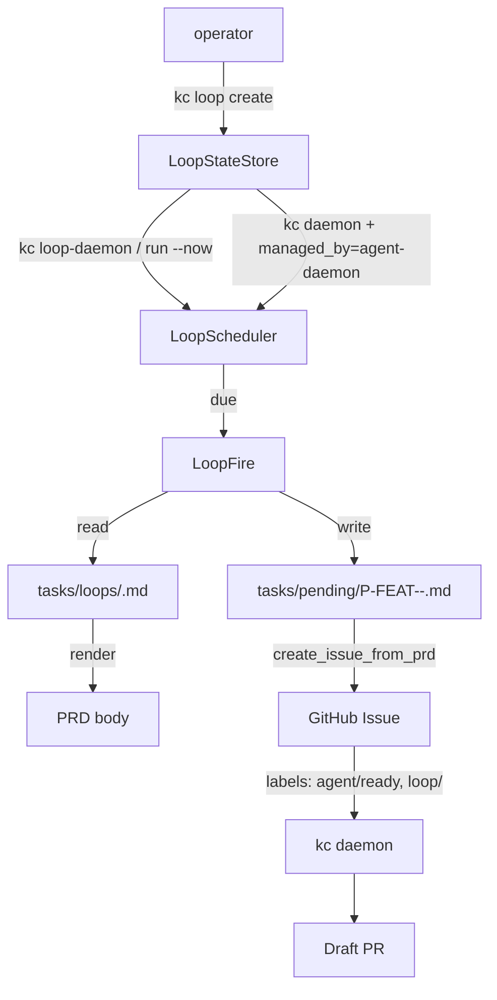

# KedaCode Loop — 定时循环任务

> Issue #110 交付物。`kc loop` 子系统让运维者把 GitHub Issue 的“造票”变成
> 定时任务，每天/每小时自动生成一份 PRD + Issue，交给现有 runner 流转到 PR。

## 为什么需要 Loop

`kc` 已经能把单条 Issue 跑成 PR，但运维场景里很多任务是**周期性的**：

- 每天早上 8 点抓取 GitHub Trending，写入知识库；
- 每周一汇总上周 PR 漏测项；
- 每月 1 日扫描依赖过期版本。

之前只能依赖外部 cron 调 `kc issue create`，既没有配方管理，也无法
复用 KedaCode 的 Acceptance Checklist / Worktree / Draft PR 闭环。`kc loop`
就是为了把这种“定时造票”正式接入 KedaCode 主流程。

## 与 Claude `/loop` 的差异：Persistent vs Session

Claude Code 的 `/loop` 是**会话级**的（随终端关闭而消失，最长 3 天，
最多 50 条）。KedaCode 是面向**无人值守**的 runner，loop 必须能在机器/会话
关闭后继续执行，所以本 PRD **只实现 persistent loop**：

| 维度 | Claude `/loop` | KedaCode Loop（persistent） |
|---|---|---|
| 生命周期 | 当前会话 | 持久化到 `~/.kedacode/loop-state.json` |
| 最大时长 | 3 天 | 任意（无过期） |
| 数量上限 | 50 / 会话 | 无硬上限 |
| 调度 | `5m`/`1h`/`1d` interval | cron (`0 8 * * *`) 或 interval (`10m`/`1h`)；`--every 1d` 隐式对齐到 `0 0 * * *` |
| 配方 | 自然语言 / 命令 | 仓库内 Markdown + YAML frontmatter |
| 执行 | Claude 在当前终端 | 现有 `kc daemon` / `kc run` |

后续可扩展 `kc loop --session`（会话级监控），但当前 PRD **不包含**。

## 配方格式（Recipe）

Loop 配方是仓库内的 Markdown 文件，建议存放在 `tasks/loops/<id>.md`。
配方由 **YAML frontmatter**（调度元数据）和 **Markdown body**（PRD 模板）组成。

### 完整 frontmatter 字段说明

| 字段 | 必填 | 类型 | 默认 | 说明 |
|---|---|---|---|---|
| `id` | ✅ | string | — | loop 唯一标识，kebab-case（如 `github-trending`）。必须与文件 `kc loop create <id>` 一致。 |
| `schedule` | ✅ | string | — | 5 字段 cron 表达式（使用 `timezone` 指定的时区），或 interval 简写 `10m` / `1h` / `1d`（`1d` 自动按 `0 0 * * *` 解析）。 |
| `repo_id` | ✅ | string | — | 目标仓库在 `config.toml` 中的注册 ID。 |
| `issue_type` |  | enum | `feature` | `feature` / `refactor` / `bug`，决定初始 `type/*` 标签。 |
| `agent` |  | enum | `auto` | 合法值由 agent 注册表派生：`auto`（按标签路由）或任一已注册 agent 名（如 `claude` / `codex` / `kimi` / `pi`，以及 `[agent_runner.agents.<name>]` 里自定义注册的 agent）。 |
| `labels` |  | list | `[]` | 除默认 `loop/<id>` 外附加的 GitHub labels。 |
| `publish_prd` |  | bool | `true` | 创建 Issue 前是否 commit/push PRD。 |
| `output` |  | enum | `issue` | 每次触发的产出：`issue`（默认）**不生成任何 PRD**，配方正文原文直接作为普通 Issue 的正文（`publish_prd` 在此模式下无意义）；`prd` 渲染一份带时间戳的 PRD 并与 Issue 一一绑定（走完整 PRD 生命周期，`publish_prd: true` 时还会提交并推送到 base 分支）。已经登记过、状态文件里没有该字段的旧 loop 仍按 `prd` 运行，不受默认值变化影响；重新登记旧配方时才会换成新默认值，需要旧行为请显式写 `output: prd`。 |
| `queue_ready` |  | bool | `true` | 是否贴 `agent/ready` 标签让 runner 认领。 |
| `run_now` |  | bool | `false` | 造票后是否立即调用 `run_agent_repositories_once`。 |
| `pre_command` |  | string | `null` | 触发前执行的 shell 命令，stdout 中 `KEY=value` 行会被注入模板变量。 |
| `timezone` |  | string | UTC | IANA 时区名（如 `Asia/Shanghai`），用于 cron 调度。 |
| `managed_by` |  | enum | `loop-daemon` | `loop-daemon` 由独立 loop daemon 推进；`agent-daemon` 由普通 `kc daemon` 在每轮前置阶段推进。 |
| `priority` |  | string | `P2` | 生成 PRD 文件名前缀（`P0`–`P3`）。 |
| `slug` |  | string | `<id>` | 生成 PRD 文件名中的 slug。 |

`managed_by: agent-daemon` 是需要与现有 Issue runner 串起来的循环任务的推荐模式。
普通 daemon 停止时不会创建下一轮 Issue；到期但上一轮 `loop/<id>` Issue **仍是开放状态**
（不论处于 `agent/running`、`agent/failed`，还是“PR 已建、等人工审核”的
`agent/automated-review-passed` / `human/awaiting-review`）时，本轮会暂停且保留原
`next_fire_at`。只有上一轮 Issue 被关闭（交付 PR 合并后 `Closes #N` 自动关闭）才会补发
一次，所以未合并的修复 PR 不会被下一轮重复劳动。未声明 `managed_by` 的旧 recipe 继续由
`kc loop-daemon` 推进，未声明 `managed_by` 的旧 recipe 继续由 `kc loop-daemon` 推进，
不会被普通 daemon 重复触发。

`output: issue` 适合“每天重复做同一件事”的 loop（如夜间巡检 CI）：PRD 是一次性的生命周期
（完成后归档、与 Issue 一对一链接、证据按 PRD 分目录），并不适合每晚复用。该模式下触发只会
创建一个不带 `PRD path:` 锚点的普通 Issue，因此不会生成 PRD 文件、不往 `main` 推送、也不会
留下需要清理的本地文件；agent 在 Issue 正文里拿到的是配方的完整规则，证据目录按
`issue-<N>` 走，Issue 不会出现在按 PRD 扫描的 Backlog 页面里。代价是没有 PRD 的验收清单与
证据 manifest，交付是否合格由 PR 上的 CI 把关。

`skip_when` 可让 loop 在“无事可做”时不造票，例如 `skip_when: last_ci_status=success,none`：
触发时先执行 `pre_command`，变量命中列表就跳过本次（不建 Issue、不消耗 agent），并把
`next_fire_at` 推进到下一个调度点。变量缺失视为不命中，照常触发。`kc loop list` 会在对应行
下显示“最近未造票”的原因（条件跳过，或因上一轮 Issue 仍未关闭而暂停），成功触发后清空。

所有调度计算使用 recipe 的 `timezone`；状态文件中的 `created_at`、`last_fire_at` 和
`next_fire_at` 仍以带 `+00:00` 偏移的 UTC 保存，模板里的日期和 Issue 标题使用 recipe
时区的本地日期。

### 模板变量

Body 中支持 `{{name}}` 占位符，触发时渲染：

| 变量 | 渲染为 | 示例 |
|---|---|---|
| `{{date}}` | `YYYY-MM-DD` | `2026-06-23` |
| `{{timestamp}}` | `YYYYMMDD-HHMMSS` | `20260623-080000` |
| `{{datetime}}` | ISO-8601 本地时间 | `2026-06-23T08:00:00+08:00` |
| `{{loop_id}}` | recipe id | `github-trending` |
| `{{repo_id}}` | 目标仓库 id | `keda` |

`pre_command` 输出的 `KEY=value` 行会被合并到同一变量集合。

### 示例：`tasks/loops/github-trending.md`

```markdown
---
id: github-trending
schedule: "0 8 * * *"
repo_id: keda
priority: P2
issue_type: feature
agent: auto
labels:
  - area/discovery
# 本例是 PRD 风格（带验收清单）；不写 output 则默认 issue
output: prd
publish_prd: true
queue_ready: true
run_now: false
timezone: Asia/Shanghai
slug: github-trending
---

# PRD: Daily GitHub Trending digest

Tracked implementation task for **Daily GitHub Trending digest**.

## Goal

Every morning, scan GitHub Trending, summarize top repos for {{date}}.

## Acceptance Checklist

- [ ] Fetch today's GitHub Trending list.
- [ ] Write digest to `docs/trending/{{date}}.md`.
- [ ] Open a draft PR linking this Issue.

## Reference data

- Loop id: {{loop_id}}
- Target repository: {{repo_id}}
```

## CLI 用法

`kc loop` 子命令模仿 Claude Code 的 `/loop` 词汇，但语义对齐 KedaCode 持久化需求。

### `kc loop create`

```bash
kc loop create github-trending \
    --recipe tasks/loops/github-trending.md \
    --cron "0 8 * * *"
```

- `--cron "<expr>"` 或 `--every <interval>` 二选一，缺省使用配方内 schedule。
- `--repo-id <id>` / `--repo <path>` 临时覆盖配方中的目标仓库。
- `--force` 覆盖已存在的同名 loop。
- 注册成功后写入 `~/.kedacode/loop-state.json`，并计算 `next_fire_at`。

### `kc loop list`

打印所有 loop 的 id / repo_id / schedule / enabled / next_fire 表格：

```
id                       repo_id                   schedule                     enabled     next_fire
---------------------------------------------------------------------------------------------------------
github-trending          keda                      cron:0 8 * * *               yes         2026-06-23T08:00:00+08:00
```

- `next_fire` 等时间列按**执行机器本地时区**显示并带本地偏移；账本与 `--json` 机器输出仍是 UTC（`+00:00`）原文，不受显示影响。

### `kc loop cancel <id>`

从 `~/.kedacode/loop-state.json` 删除条目；不影响已生成的 Issue / PRD / PR。

### `kc loop run --now <id>`

立即触发一次。常用于手动测试，触发后 `next_fire_at` 会重新计算。

### `kc loop run --now <id> --dry-run`

仅渲染 PRD、报告**将要**生成的文件路径和 Issue 标题，不写盘、不调 GitHub、
不更新状态。**建议每次配置新 loop 时先用 `--dry-run` 验证一次。**

### `kc loop-daemon [--interval <seconds>] [--dry-run]`

常驻调度进程，按 `--interval`（默认 60 秒，可通过 `KEDACODE_LOOP_DAEMON_INTERVAL`
覆盖）轮询 `~/.kedacode/loop-state.json`：

- 到点的 loop 会调用 `fire_loop`，复用 `create_issue_from_prd` 创建 Issue。
- `loop/<id>` 标签 + recipe `labels` 会附加到 Issue。
- 异常被 `try/except` 捕获并记录，daemon 不退出。
- 同一天同一 loop 已有未关闭的 `loop/<id>` Issue 时，**跳过**重复创建。
- `--dry-run` 只跑一个 pass，打印 next fire 时间后退出，零副作用。

### 普通 `kc daemon` 承载 loop

将 recipe 的 `managed_by` 设为 `agent-daemon` 后，使用普通 runner daemon：

```bash
kc loop create nightly-main-ci --recipe tasks/loops/nightly-main-ci.md
kc daemon --repo-id keda
```

普通 daemon 每轮会先检查该仓库到期的 `agent-daemon` loop，再进入现有的
deliberation / PRD rework / ready Issue 执行阶段。因此新建的 loop Issue 可以在同一轮被
runner 认领。上一轮 Issue 仍在活动状态时不会重复造票；daemon 停止期间也不会偷偷补建
下一天的 Issue，恢复运行后按保存的 UTC `next_fire_at` 做一次补发。

## 一次触发（fire）的完整流程



## 已知风险与限制

- **并发 daemon**：写入状态文件时持有旁路 `.lock` 的排他锁，并在持锁后重新读盘再合并，
  `kc loop-daemon` 与 `kc daemon` 同时推进各自的 loop 不会互相覆盖。每个 loop 仍应只由
  一个 daemon 负责（由 `managed_by` 决定）。
- **时区**：cron 默认 UTC 兼容行为；需要固定墙钟时应填写 IANA `timezone`，例如
  `Asia/Shanghai`。状态账本仍保存 UTC。
- **pre_command 失败**：`_run_pre_command()` 只在命令**退出码非 0** 时打一条 warning，异常本身
  也被吞掉换成空变量集返回，daemon 不中断。它**不会**把原因写进 loop-state.json：模型里的
  `last_error` 字段目前没有任何写入方，只有序列化代码在读它。
- **同一天去重**：通过 `loop/<id>` 标签 + Issue 标题日期判断；手动改 Issue 标题可能绕过去重。

### 巡查计数显示 `unknown` 时先查什么

`tasks/loops/keda-blocker-monitor-30m.md` 用 pre_command 里的两次 `gh issue list` 统计
`agent/blocked` / `agent/failed`，失败时把值替换成字面量 `unknown`。这条路径有两个后果：

- 哨兵分支仍然 `printf` 三行 `KEY=unknown` 并**以 0 退出**，所以既不会触发上面那条 warning，
  也不会写 `last_error`；而 `skip_when: needs_attention=0` 按字面比较，`unknown ≠ 0`，于是照常
  建巡查 Issue，把 `unknown` 写进正文。这正是 Issue #310 顶部三个计数都是 `unknown` 的来源。
- `gh` 的报错在 shell 侧被 `2>/dev/null` 丢弃，循环侧又没有失败记录，因此事后无法从 Issue 正文、
  loop-state.json 或 daemon 日志复原那一次到底是认证失败、PATH 里找不到 `gh`、还是限流。
  同一次运行的 fresh read（runner 自己的 GitHub 读取）成功并读到 blocked 0 / failed 0，
  说明故障属于触发前那次 `gh` 调用的局部/瞬时问题，不是 GitHub 整体不可读。

排查顺序：先在触发所在的机器上手跑 recipe 里的同一条 pre_command（把 `2>/dev/null` 去掉），
再看 `gh auth status` 与 daemon 进程的 PATH。要让下一轮自动带上原因，需要改 recipe 保留
stderr 并新增一个 `state_read_error` 变量（模板占位符必须与 pre_command 输出一一对应），
已按想法收件箱记录，未在本轮改动在跑的巡查配方。

## 后续规划

- 自然语言 schedule（`every morning at 8am`）。
- 会话级 `kc loop --session`，对齐 Claude `/loop` 心智。
- 文件锁或迁移到 SQLite，避免多 daemon 并发写。

## Triage 决策树 Recipe 编写指南

> Issue #120 落地物。当 loop 每晚只发 1 个 Issue，但 Issue body 内置多类
> scope 的"今晚做哪个"决策树时，agent 在 worktree 内按 body 选 1 个最高
> ROI 的 scope 即可。本节给出这种 **triage decision tree recipe** 的
> 写作约定，示例见 `tasks/loops/nightly-cleanup-keda.md` 与
> `tasks/loops/nightly-cleanup-product.md`。

### 何时用 triage 决策树

当满足以下任一条件时，把多类 scope 写进同一份 recipe 的 body，比开多份
recipe / 多发 Issue 更划算：

- 多个 scope 彼此互斥或优先级固定（同一晚只做 1 个，强行并行 = 噪声）。
- 各 scope 每天的 ROI 波动大（某晚只 1 类有事、其他 3 类空跑）。
- 想给维护者每天 0–N 个 draft PR（N ≤ scope 数），按当日真实工作量浮动。

反例：scope 之间有依赖（必须按顺序做）→ 拆多份 recipe，每份强约束前一晚的
产物落地。

### Body 结构模板

recipe body 用以下骨架：

```text
# 任务总览 — {{date}}
（介绍 loop 频率 / 错峰策略 / 预期产出）

- 触发变量：last_ci_status={{last_ci_status}} 等
- 目标仓库：{{repo_id}}

## 1. <Scope A>（触发条件 / 行动指引 / 无事可做判定）
## 2. <Scope B>
## 3. <Scope C>
## 4. <Scope D>

## Triage 优先级
（明确当晚只做 1 个、CI > refactor > docs > deps 等优先级）
（明示 4 类都无事可做时：gh issue close <N> --comment "..." 收尾，不出 PR）
（明示 scope 标注命令：gh issue edit <N> --add-label scope/<x>）
```

每个 scope 段必须含三段式：

1. **触发条件** — 用 pre_command 注入变量 / 命令输出作为"今晚要不要做这件事"
   的判定输入（例：`last_ci_status != success`）。
2. **行动指引** — 给 agent 具体的文件路径 / 命令 / skill 引用（例：
   `uv run pylint --disable=all --enable=duplicate-code src/backend/`）。
3. **无事可做判定** — 显式给出"什么情况下跳过这个 scope"，避免 agent 强行
   找事出 PR。

### `scope/<x>` Label 约定

agent 选完 scope 后，用 `gh issue edit` 给 Issue 补标 `scope/<x>`，
其中 `x ∈ {ci, refactor, docs, deps}`。这 4 个 label 命名空间独立于
`loop/<id>`，可被非 nightly-cleanup 的其他 loop 复用。

**首次启用时**需要确保仓库里有这 4 个 label（`kc labels sync` 会自动创建
已知的 `agent/*` / `type/*` label，但 `scope/*` 命名空间是 Issue #120 新引入的，
可能需要手工 `gh label create` 或后续在 kc 内置 label 清单里加上）：

```bash
gh label create scope/ci       --color 5319E7 --description "Nightly cleanup: CI failure fix"
gh label create scope/refactor --color 1D76DB --description "Nightly cleanup: duplicate code merge"
gh label create scope/docs     --color 0E8A16 --description "Nightly cleanup: docs / mkdocs sync"
gh label create scope/deps     --color FBCA04 --description "Nightly cleanup: dependency upgrade"
```

PR 标题前缀对应 `cleanup(<scope>): <一句话描述>`，便于维护者用
`gh pr list --label scope/ci` 或 `gh pr list --search "cleanup(ci):"` 过滤。

### Frontmatter 必填项

triage 决策树 recipe 与普通 recipe 字段集完全一致（见上方"完整 frontmatter
字段说明"表），不引入新字段。本类 recipe 的典型设置：

```yaml
---
id: nightly-cleanup-<scope-coverage-name>
# 或 "30 2 * * *" 等错峰时间
schedule: "0 2 * * *"
repo_id: <registered-repo-id>
# P1 适合需要长期稳定运行的整理 loop
priority: P1
issue_type: feature
agent: auto
labels:
  # 默认 loop/<id> 自动加，这里只加额外 label
  - loop/cleanup
# PRD 风格；不写 output 则默认 issue
output: prd
publish_prd: true
queue_ready: true
# 当晚就让 agent runner 接管，不排队
run_now: true
timezone: Asia/Shanghai
slug: nightly-cleanup-<scope-coverage-name>
pre_command: "<单行 shell 命令，stdout 输出 KEY=value 行>"
---
```

`pre_command` 输出 `KEY=value` 行的变量集合必须与 body 内 `{{...}}` 占位符
一一对应（参考 `parse_pre_command_output` 的 `KEY=value` 解析规则）。注意
当前 frontmatter 用的是 MVP 版简单 YAML 解析器，**不支持** `|` / `>` 多行
block scalar，pre_command 必须写成单行 shell（用 `;` / `&&` 链接多步）。

### 错峰策略

多 recipe 同时跑时，建议错开 30 分钟（keda 02:00 / product 02:30 等）以
避免：

- GitHub API 配额短时间内集中消耗（`create_issue_from_prd` 一次 1+ 次 REST 调用）。
- `~/.kedacode/loop-state.json` 多个条目并发 upsert（虽然 loop 归档 PRD 已有
  "only one daemon" 约定，但错峰是更进一步的防御）。

### 失败兜底

- `pre_command` 失败 → 记一条 warning、按「没有 pre_command 变量」继续：`skip_when` 不命中就
  照常建 Issue，只有模板引用了未提供的 `{{var}}` 才在渲染时报错，daemon 不退出，下次 cron 再试。
- 当晚 4 类 scope 都无事可做 → agent 在 worktree 内执行
  `gh issue close <N> --comment "no actionable cleanup tonight"`，**不**出 PR。
- `scope/<x>` label 不存在 → `gh issue edit --add-label` 报错，agent 应
  停下来报告 reviewer，不要硬创 label（避免 label 命名空间失控）。

### 验收要点

新加一份 triage decision tree recipe 后，至少跑通以下命令：

```bash
# 1. 解析：recipe 通过 parse_loop_recipe
uv run pytest -o addopts="" tests/test_nightly_cleanup_recipe.py -v

# 2. 干跑：dry-run 不写文件、不建 Issue
uv run kc loop run --now nightly-cleanup-keda --dry-run
ls tasks/pending/                # 应无新文件
gh issue list --label loop/cleanup  # 应无新 Issue

# 3. 真实 fire：mock GitHub client 后跑（见 test_loop_fire.py 既有测试）
uv run pytest -o addopts="" tests/test_loop_fire.py -v
```

详见 `tests/test_nightly_cleanup_recipe.py`（覆盖 frontmatter 必填项、
4 类 scope 二级标题、pre_command 变量渲染、PR 标题前缀说明等）。
