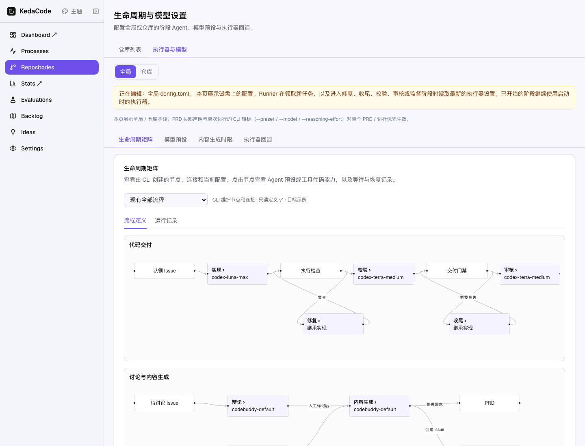
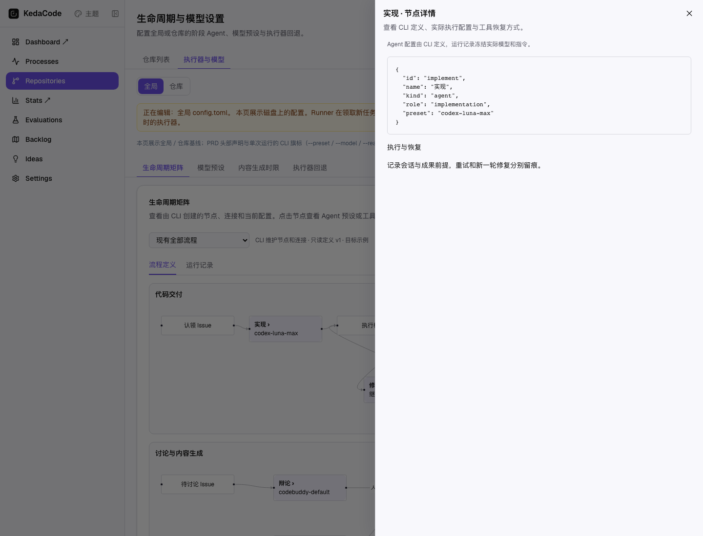
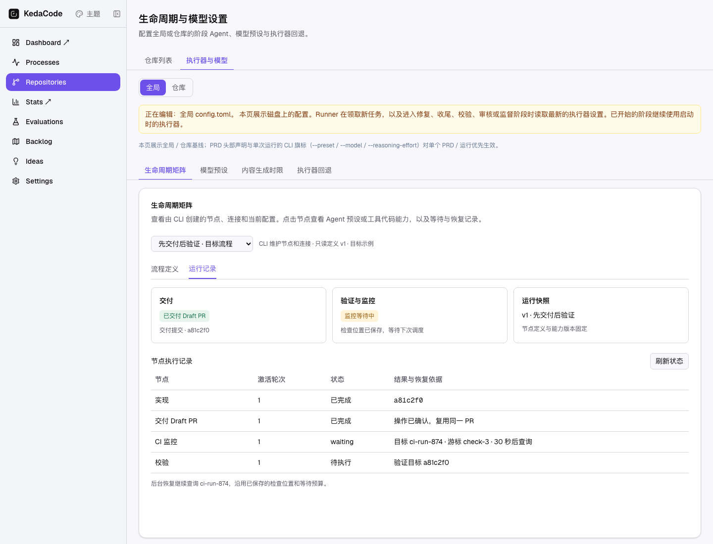

# 基于实际 Console 的工作流原型

原型以当前真实入口 `/app/repositories/lifecycle/` 为底稿，复用浏览器渲染的 AppShell、AppSidebar、字体与样式、页面标题、仓库工作区导航、全局／仓库范围条、设置页签和生命周期矩阵卡片。初始两条流程直接使用当前页面的 React Flow DOM。

形式为 code-native。验证层级为 `interactive prototype / component preview`。节点详情沿用实际 Sheet 标题结构与右侧抽屉外观，通过原型自己的 dialog 演示交互。

从 [Prototype Hub](../hub.html) 的“CLI 可配置节点与可恢复工作流”条目进入，或打开 [原型页面](index.html)。Hub 中名称和缩略图直开，行内其他区域显示详情。底部评审 Dock 提供返回、说明、热点、重置和场景切换。

当前实施范围以 `P1-FEAT-20261126-214529-configurable-durable-workflows` PRD 为准。原型保留的“先交付后验证”探索画面只对应想法收件箱中的后续构想，不属于本次实施或验收要求。

## 基于实际页面的改动位置

- 完整保留生命周期设置页的已有布局与当前全局范围背景，原型新增内容集中于生命周期矩阵卡片。
- 初始“现有全部流程”保留真实页面中的代码交付、讨论与内容生成，以及独立问答入口。
- 在矩阵卡片中增加工作流选择和定义／运行记录切换。节点和连接由 CLI 管理，页面只读查看。
- 点击 Agent、工具或产物节点，打开右侧详情。工具节点显示代码能力、输入、checkpoint 和恢复方式。
- “CLI 添加节点后”演示定义变化后的图形。“监控等待与接续”演示持久目标、游标和下次检查时间。

侧栏 Dashboard 和 Stats 从 Hub 的同一 registry 解析关联原型入口，带有跨页标记。Repositories 返回当前原型。与本次流程无关的原页面背景控件采用禁用或静态呈现，页面状态固定为采集时的全局设置。

## 资产与来源

- `../assets/console-page-shell.html` 为唯一共享产品外壳快照，直接来自实际 AppShell 和 AppSidebar。
- `../assets/console-page-shell/` 保存实际构建 CSS、字体和正式 App 图标。
- `assets/lifecycle-settings-frame.html` 为真实页面内容框架，仅在矩阵内容区设置原型挂载点。
- `assets/actual-workflow-graphs.html` 为真实页面初始两条流程与独立问答 DOM。
- `assets/actual-sheet-header.html` 为实际右侧 Sheet 的标题结构。
- `page-shell.js` 加载外壳、框架和样式，`prototype.js` 提供目标态数据与交互。

采集依据为 `frontend-public/components/layout/app-shell.tsx`、`app-sidebar.tsx`、`components/agent-runner/lifecycle-settings-page.tsx`、`lifecycle-workflow-graphs.tsx` 与相应页面路由。底稿从当前后端托管的 Console 静态构建读取，日期为 2026-11-26。所有正式截图都有同名 `.source.md`。

## 覆盖与限制

九个现有 Agent 角色、原图工具和产物端点均可查看。新流程中的工具能力 ID、CLI 新增节点、运行记录和恢复结果为示例。实际页面框架和初始图来自真实页面，工作流扩展部分未连接生产 CLI、API、Agent、GitHub、SQLite 或 daemon。完整节点迁移与工具恢复仍按 PRD §7.1a 和 §7.6 验证。

源页面当前采用全局范围，原型保留该背景。窄屏沿用实际 AppSidebar 的顶部导航布局，页面和图形各自滚动。原型抽屉需要验证关闭、Escape、焦点返回及窄屏显示。此原型呈现生产页面结构，验证层级保持 component preview。

## 目标画面

## 本地预览

在仓库根运行 `uv run python -m http.server 8769 --bind 127.0.0.1`，打开 `http://127.0.0.1:8769/docs/prototypes/hub.html`。此原型通过相对路径加载共享外壳和页面框架，需要 HTTP 预览。

2026-11-26 使用 Chromium / Playwright 在桌面 1440 × 1100 和窄屏 390 × 844 检查实际页面外壳、九个 Agent 角色与工具节点点击、监控 checkpoint、抽屉关闭与 Escape、跨原型导航和 Hub 返回。页面与抽屉无横向溢出，零 pageerror。已重截全部 11 张目标图和两张实际页面参考图。
