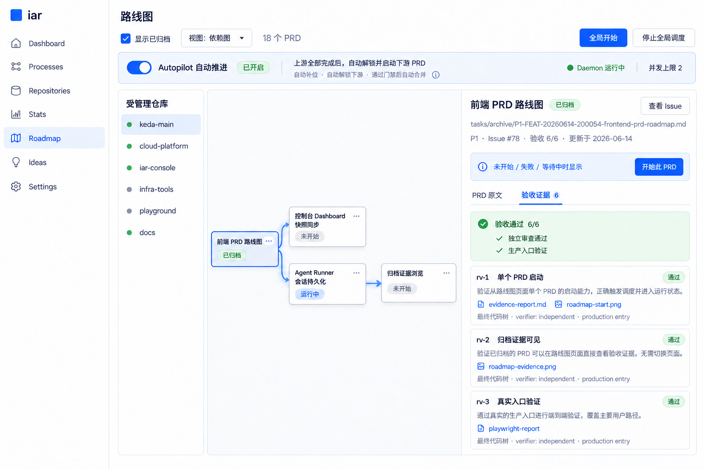
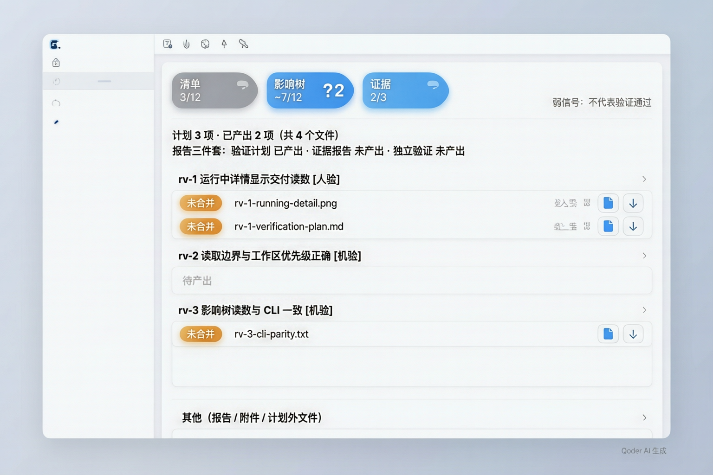

# Roadmap 单 PRD 控制、验收证据与 Autopilot 草图

本页归档 `tasks/pending/P1-FEAT-20260916-122645-roadmap-prd-controls-evidence-autopilot.md` 的视觉草图与 ImageGen 提示词。草图用于确认信息架构和交互含义，不是像素级实现规范；正式实现继续复用 `frontend-public` 当前的 shadcn/Tailwind 组件与布局。

从 [Prototype Hub](hub.html) 可继续打开相关的 CI/CD 监控与 PRD 生命周期原型；Hub 的关系入口由 registry 维护。

## 最终草图

最终稿保留真实项目的白色 `iar` 侧栏、受管理仓库列表、紧凑依赖节点和同页 master-detail 详情，并增加仓库级 `Autopilot 自动推进` 开关、daemon 状态、并发上限、自动合并影响说明与验收证据入口。

## 交付进度信号目标态（v2.0 · P1-FEAT-20261010-093054）

单 PRD 详情升级为「头部三读数 + 按验证条目分组的验收证据」。三个读数一律是**弱信号**：
`清单 a/b`（勾选不代表通过）、`影响树 ~触达/可判定 ?无法判定`（触碰不代表改对）、
`证据 已产出/计划`（文件归属不代表验证通过）。确认无数据用 `-`，读取不可用单独显示
「暂不可用」，绝不混成零。以下三态为验收关键状态的 `design intent` 目标图：

- 运行中：详情来自真实执行工作区。头部显示「清单 3/12」「影响树 ~7/12 ?2」「证据 2/3」；
  证据标签汇总「计划 3 项 · 已产出 2 项（共 4 个文件）」，rv-1 / rv-3 分组列出工作区文件并标注
  「未合并」，rv-2 显示「待产出」占位。生成提示词见
  [`assets/roadmap-prd-controls-evidence-autopilot-progress-running.prompt.md`](assets/roadmap-prd-controls-evidence-autopilot-progress-running.prompt.md)。

- 已归档：主仓库已归档副本是终态事实来源，即便残留工作区也只读主仓库；证据来源回落主仓库、
  不显示「未合并」，影响树读数显示 `-` 并说明归档不参与分支比较。生成提示词见
  [`assets/roadmap-prd-controls-evidence-autopilot-progress-archived.prompt.md`](assets/roadmap-prd-controls-evidence-autopilot-progress-archived.prompt.md)。

- 无计划 / 降级：旧 PRD 无验证计划、无工作区或无有效比较基准时，三个读数显示 `-`（不伪造
  计划 0 项、不显示 `~0/y`），证据标签仍如实列出可读文件数与报告三件套状态；工作区发现失败
  或多重匹配时以「暂不可用」呈现，与「确认无文件」的空态分开。同一降级样式亦用于无基准状态。
  生成提示词见
  [`assets/roadmap-prd-controls-evidence-autopilot-progress-degraded.prompt.md`](assets/roadmap-prd-controls-evidence-autopilot-progress-degraded.prompt.md)。

## 生成方式

- 工具：OpenAI 内置 ImageGen
- 用例分类：`precise-object-edit`
- 画布：1536 × 1024 PNG

## 最终编辑提示词

最终编辑提示词全文保存在同名旁车文件 [`assets/roadmap-prd-controls-evidence-autopilot.prompt.md`](assets/roadmap-prd-controls-evidence-autopilot.prompt.md)，本页只保留设计说明，避免图片与提示词记录分离。

## 实现解释

图中“通过门禁后自动合并”是现有能力的影响说明，不表示这个 Roadmap 开关会同时修改 `safety.auto_merge`。正式实现按 PRD 决策：开关只修改当前仓库的 `autopilot.enabled`，并单独展示 daemon 与自动合并门禁状态。
