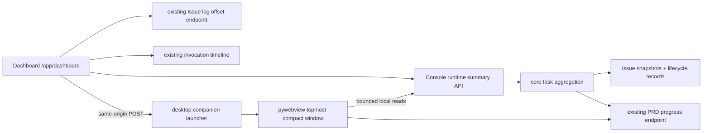
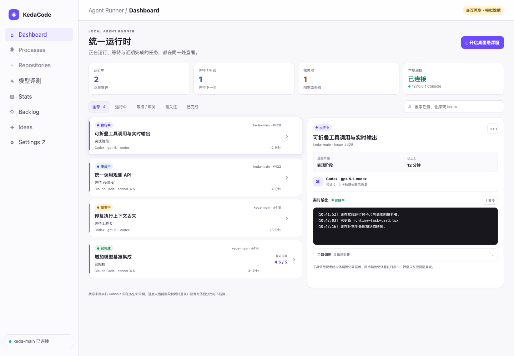
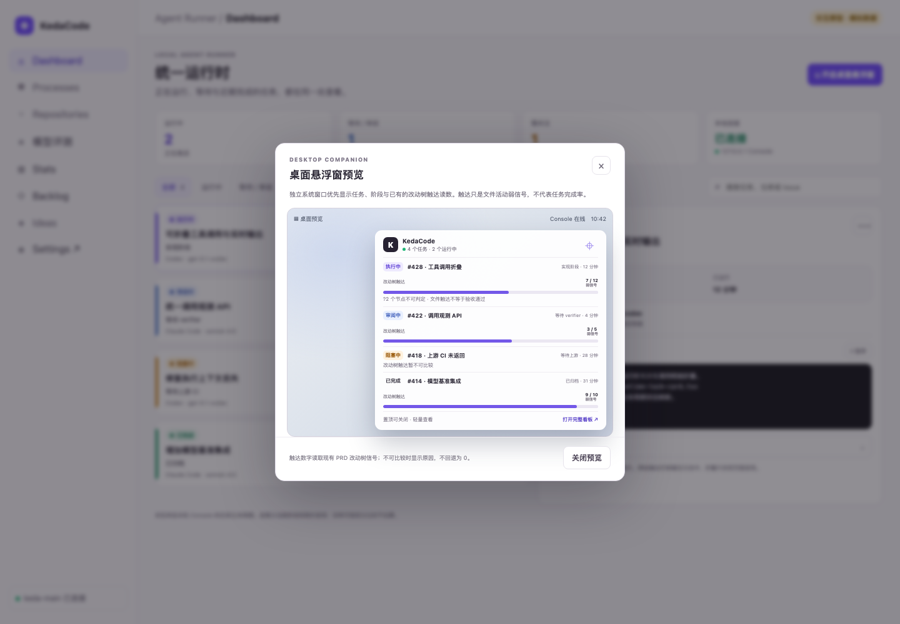

# PRD: 统一运行时看板与桌面进度窗

- GitHub Issue: https://github.com/ZataZhang/keda/issues/283

> ✅ **交付前置**：无，可立即开工。
> 结构化声明见 §8 Delivery Dependencies，**那里是唯一事实源**。
> 🧍 **验收状态**：待人工验收 — 2 项 Human-Confirmed 待确认；其余验收项已由执行器自验并附证据（§9）。
> 本行是 §9 Acceptance Checklist 的投影，**那里是唯一事实源**。

本 PRD 分为人审层与执行器层：前四节确认要解决的问题和可见结果；后九节说明实现边界、验证与交付证据。

## Feature Overview (功能一览)

> 本节是 §10 Functional Requirements 的白话投影；行为验收以 §1 的行为样例为准。

- **默认运行时看板**（FR-1、FR-2）：登录后的 Dashboard 以任务为中心，按生命周期状态展示 Agent Runner Issue 任务及详细输出。
- **可折叠调用与实时日志**（FR-3）：日志持续续读，结构化工具调用默认折叠，展开后仍保留时间和调用摘要。
- **系统桌面小窗**（FR-4）：用户从 Dashboard 主动打开独立、可置顶和关闭的小窗，在切换到其他桌面应用时查看多个任务。
- **真实改动树触达条**（FR-5）：小窗复用已有 PRD 影响树读数显示 `已触达/可判定`，并披露未知节点；这只是文件触达弱信号，不是任务完成率。
- **状态不可用时如实降级**（FR-6）：无 PRD、无工作区或无法比较时说明原因，不把未知伪装成 0%。

# Part A · 人审层 (Review Layer)

## 1. Introduction & Goals

### Problem Statement

值守者现在要从 Dashboard 的仓库卡片、Backlog 的 Issue/PRD 生命周期详情和 Stats 的历史数据之间来回切换，才能知道一个 Agent 任务处于哪个阶段、最近输出了什么，以及是否卡住。当前 Dashboard 的主信息仍按仓库组织，并以 15 秒周期更新；Issue 日志只能在任务详情路径单独读取，工具调用还需要再展开生命周期记录。用户离开浏览器后没有一个能留在其他桌面应用上方的轻量入口。

项目已有可复用的 Issue 增量日志读取、结构化调用事件、PRD 生命周期信息和改动树触达读数；最后一项在现有 Backlog 进度功能中明确标为弱信号。缺少的是把这些信息汇总到值守入口，并把已有的触达读数带到用户选择的系统桌面窗口。

### Interpretation (解读回显)

| 验证方式 | 输入 / 操作 | 期望观察到的结果 |
|---|---|---|
| 👀 人审 + 自动验证 | 登录 Console 后直接进入 Dashboard，同时存在运行中、审阅中、阻塞中和已完成的 Issue 任务。 | Dashboard 默认选中运行中任务；所有任务以卡片列出，状态文字和颜色一致，选中卡片显示当前阶段、Agent 预设、运行时长与详情。 |
| 👀 人审 + 自动验证 | 选中一项持续运行的任务，等待新输出，再展开工具调用。 | 详情续读新日志；结构化调用默认折叠，展开后可见调用时间和摘要；折叠不会删改原始日志。 |
| 👀 人审 + 自动验证 | 从 Dashboard 点击「开启桌面悬浮窗」，切换到另一个桌面应用观察。 | 一个独立系统窗口显示多项任务、状态、阶段、耗时和关闭/置顶控件；网页内弹层不能充当交付结果。 |
| 👀 人审 + 自动验证 | 选择已关联 PRD 且有可比较工作区的任务；再选择一个无有效工作区基准的任务。 | 前者的进度条读取已有 `touched/judgeable` 值（如 `7/12`），同时显示 `?2` 未知节点和弱信号标签；后者显示不可比较原因，不显示假 0%。 |
| 🤖 自动验证 | Issue 日志缺失、调用账本不可读或本机 Console 离线。 | 任务列表仍显示可得的状态；受影响的日志/调用/连接区域单独标明不可用，不让整个 Dashboard 崩溃，也不将未知计为零。 |

以上行为样例是本 PRD 的有效验收行为；若修正某一行，应同步修正对应 §7.6 oracle 与 §9 证据项。

#### 我默默定了这些

- 「任务」指 Console 已观察到的 Agent Runner Issue 执行；托管 daemon/进程继续留在 Processes 页面。
- Dashboard 是登录后的默认页；桌面窗口需用户主动开启，不能登录后自动弹出。
- 桌面进度条表示“改动树中已触达节点占可判定节点的比例”，不表示任务完成百分比、代码质量或验收结果。
- 改动树只在 PRD 与工作区基准均可确定时显示；未知节点保留 `?n`，读数不可用时显示原因，不回退为零。
- 桌面小窗只展示多个任务的精简状态，不展示任务正文、代码差异、日志或工具调用细节。
- 选型按用户已提交的决策页答案：独立系统桌面窗口；允许增加随包桌面运行时、系统打包和本机 Console 通信边界。

#### 我理解为不做

- 不在桌面窗口里控制、暂停、重试或接管 Agent；动作仍通过 Console 的现有入口执行。
- 不将“已触达文件数”合成为 Agent 的总体完成率，也不因此将任务标为完成或通过。
- 不把托管进程监控、完整 Backlog 生命周期、模型评测配置和历史统计挪进桌面小窗。

**可证伪的需求解读：**登录后，用户首先看到按运行生命周期组织的 Issue 任务卡片和所选任务的详细实时输出；结构化工具调用默认折叠。用户可主动开启独立、可置顶、可关闭的系统桌面小窗，在其他应用上方扫描多项任务。对关联 PRD 且存在有效 worktree 比较基准的任务，小窗从已有影响树触达数据绘制比例条，并标出未知节点；触达比例不是任务完成率。缺 PRD、worktree、merge-base 或读数服务时，小窗披露不可比较或不可用状态，不制造百分比。任务动作、完整日志和模型评测不属于小窗。

### What The User Gets

Console 使用者进入 Dashboard 就能按状态扫到正在推进、等待、阻塞和近期完成的 Agent Issue，并在同一页读取所选任务的最新日志与折叠调用明细。用户开启桌面小窗后，即使使用编辑器或终端也能看到多项任务的当前状态；对带 PRD 的运行任务，小窗还能显示真实的改动树触达读数及其限制。

### Measurable Objectives

- 进入 `/app/dashboard/` 时首先渲染运行时任务看板，不要求先跳转仓库卡片或 Backlog。
- 在已注册仓库的受控运行任务中，卡片状态、仓库/Issue 身份与后端运行快照一致；每种生命周期状态均有文字和视觉标记。
- 选中任务后，Console 真实入口可读取 Issue 输出增量；默认态不展开结构化工具调用。
- 有效影响树数据 `touched=7, judgeable=12, unresolvable=2` 时，小窗展示 `7/12` 比例与 `?2`；不可比较状态无数值条。
- 桌面 helper 未安装、Console 关闭或连接断开时，页面/窗口给出可理解状态；无假成功、伪零值或重复启动多个小窗。

## 2. Human Review Map (介入与风险地图)

### 桌面小窗与改动树条表达什么

你已在决策页选择独立系统桌面窗口，也补充要求压缩占用面积、尽量显示更多任务，并把已有改动树检测做成真实比例条。这个读数不是完成率：现有实现求的是影响树文件节点与 worktree 实际改动文件的交集，未知节点排除分母，且明确要求它永不表示通过。小窗必须把“改动树触达”和未知原因贴着比例条展示；无法取数时保持原因态。桌面小窗增加打包与跨进程启动/本机读取成本，也会使任务标题在其他窗口前可见。

**请确认：**交付的小窗确实是能在其他桌面应用上方查看的独立系统窗口；它紧凑显示多个任务，并把真实 `touched/judgeable` 条明确标为触达弱信号，不称为完成率或通过率。

**验收：**从 Dashboard 开启后切换至另一个应用，窗口仍可见；窗口能关闭/关闭置顶；有效读数与后端一致，无基准时可见不可比较原因，页面与结果都不把触达说成任务完成。

### 自动门禁，不需要逐项人工审阅

Executor + 自动门禁负责默认 Dashboard 路由、生命周期状态映射、Issue 日志偏移续读、折叠调用记录、失败/缺失数据降级、Loopback 来源约束、原生进程启动参数、每任务 PRD 触达读数与窄屏布局。前端通过 Console 真实入口验证，桌面状态须在原生窗口而非浏览器弹层中验证。

**本次明确不涉及：**运行状态之外的流程控制、daemon 监控、质量评分、系统托盘全功能、推送通知、多用户/远程 Console 或任务内容在桌面小窗中的编辑。

## 3. Usage And Impact After Implementation

### Console 使用者

登录后直接落在 Dashboard。使用者先按状态筛选任务或搜索仓库/Issue，点击卡片查看该 Issue 的阶段、Agent 预设、耗时与输出。日志持续续读；若需要看每次工具调用，再展开默认折叠区。输出文件缺失时仍可回到任务卡片，并在日志面板看见明确空态。

需要离开浏览器时，使用者在 Dashboard 点击桌面小窗入口，允许系统启动安装好的 KedaCode 桌面 helper；窗口在紧凑高度里尽量多显示任务，默认最多四项，超出数量在小窗内滚动。用户可以关闭置顶或关闭小窗，再从 Dashboard 重新开启。已关联 PRD 且读数可比较时显示改动树触达条；其他情况仍可用状态与阶段值守。

### 仓库维护者与验收者

维护者仍用现有 Backlog 查看 PRD 生命周期、完整证据和独立 verifier 结果；触达条仅用于判断哪些计划文件已被动过。验收者继续依赖测试/Verifier/人工验收，不把小窗比例条当作门禁。没有桌面 helper 的机器仍可使用完整网页看板，且可以看见 helper 未就绪提示。

### 兼容与迁移影响

- 现有 Issue 输出 API、Backlog 影响树 API 和 Stats 口径不改变；运行时聚合只读复用这些来源。
- 不迁移现有运行记录，不新增数据库表或配置变量；桌面 helper 可选安装，现有 `kc console` 网页工作流继续有效。
- 新增系统窗口的启动与 Loopback 访问必须固定为受支持的本机 Console 地址；不接受任意 URL、命令或 shell 字符串，也不把本机路径或日志正文塞进桌面启动参数。

## 4. Requirement Shape

- **Actor**：KedaCode Console 使用者、任务值守者、仓库维护者、人工验收者。
- **Trigger**：登录进入 Dashboard；选择一个任务；或主动开启桌面悬浮窗。
- **Expected behavior**：Dashboard 是默认运行态入口，卡片状态与生命周期事实一致；详情续读日志并默认折叠工具调用；独立系统小窗紧凑展示多个任务和可比较的改动树触达比例；未关联或无法比较时披露状态。
- **Scope boundary**：只覆盖 Console 内的 Issue Agent 任务只读观测、小窗启动、改动树弱信号与错误/断连状态；不控制任务、不扩大 Console 绑定地址、不将触达比当成完成度、不重新实现 PRD 进度解析。

# Part B · 执行器层 (Build Layer)

## 5. Repository Context And Architecture Fit

### 当前路径与复用点

- Console 当前由 `frontend-public/` Next.js App Router 静态构建后经 `kc console` 同源托管；`frontend-public/app/(app)/app/dashboard/page.tsx` 是默认登录入口，目前主要按仓库显示快照并每 15 秒刷新。
- Issue 输出已有 `GET /api/v1/agent-runner/console/repositories/{repo_id}/issues/{issue_number}/logs`，读取器在 `src/backend/core/use_cases/issue_logs.py`，前端 `frontend-public/lib/api/console.ts` 的 `fetchIssueLog` 通过偏移续读且后端限制单次尾部字节数。
- 结构化调用事件持久化在 `agent_invocation_events`，`src/backend/core/use_cases/agent_invocation_tracing.py` 已有 `build_invocation_timeline`；Backlog 生命周期时间线展示既有尝试/调用信息，不要建立第二套调用台账。
- PRD 影响树触达已有后端只读端点 `GET /api/v1/agent-runner/backlog/prds/{encoded_path}/progress`，前端类型 `BacklogPrdProgress.impact` 给出 `touched` / `judgeable` / `unresolvable` 与 `impact_status`。
- 本机 auth 是固定 operator 会话，架构按 loopback 单用户运行；Console 服务区分 Issue 日志与托管 process 日志。桌面 helper 不得读取任意文件路径、开启公网监听或将任务日志放进窗口启动 URL。

### 架构边界与相关 PRD

- 聚合领域含义放 `core`；HTTP 边界在 `api`; 桌面窗口生命周期与子进程边界在 `engines`; SQLite/配置等外部资源只经 `infrastructure`。保持 `api -> core -> engines -> infrastructure` 方向，不从 core 直接启动系统子进程。
- `tasks/pending/P1-FEAT-20261011-160913-verifier-human-takeover.md` 会触达 Dashboard/Issue 详情，但没有此运行看板的行为依赖；同属 Dashboard 的轻量文件协调关系，需实施时协调重叠文件。
- `tasks/archive/P1-FEAT-20261010-092630-lifecycle-invocation-detail-timeline.md` 提供运行尝试和结构化调用展示；`tasks/archive/P1-FEAT-20261010-093054-console-prd-progress-signals.md` 已实现 PRD 改动树触达统计并明确其为弱信号。当前 PRD 复用，不覆盖重做。
- `frontend-admin/` 无影响；Console 唯一目标前端为 `frontend-public/`。

## 6. Recommendation

### Recommended Approach

扩展现有 Dashboard 为统一 Issue 任务视图，把每任务状态和详情组装到现有 Console 读路径上；选中任务才续读详细日志，调用时间线直接消费既有记录。桌面采用可选轻量原生 WebView 窗口包装现有 Console 精简视图，优先评估 pywebview 以沿用 Python 项目形态；由本机 Console 的固定 API 入口启动/聚焦 helper，启动参数只含受校验的 Console origin 与窗口模式，不含任意命令/文件路径。窗口固定置顶可切换，尺寸紧凑、允许滚动和关闭。

已有 PRD 触达进度接口作为每个可见任务的唯一比例来源。仅当 `prd_path` 确定、工作区命中且 `impact_status=available`、`judgeable > 0` 时渲染 `progress.value=touched` 与 `progress.max=judgeable`；不可判定数作为旁注，其他状态分别写原因。每个 15 秒刷新周期仅读取小窗内最多四项任务的影响树读数；页面详情日志继续沿用现有 2.5 秒增量读取节奏。前端不得根据运行时长或日志字节数伪造百分比。

### 为什么这条路径适合当前架构

Dashboard、日志和调用台账均已存在于同一个本机 Console；新增目标主要是改变默认信息组织并把已有只读信号聚合到小窗。pywebview 官方 API 支持 `on_top` 系统窗口；它的各平台打包方式不同，因此通过可选 helper 和分平台打包验证限制成本，而不换用另一个重量级前端桌面栈。详情调用明细无需再维护一份事件存储，改动树解析不复制现有逻辑。

**ROI 判断：现在做网页看板并把桌面 helper 作为可选 companion 一起规划。** 运行值守是使用者进入 Console 的常见路径，把 Issue 身份、生命周期、日志和已有触达信号并到一个默认页，可减少跨页面寻找与来回切换；其他应用上方的小窗扩展这一高频查看流程。实现成本主要是 Dashboard 汇总、helper 平台打包和 loopback 来源边界。更低成本的替代是只改 Dashboard 并用浏览器 tab 常驻，但它覆盖不了用户已选定的桌面窗口需求；通过独立 helper、固定只读视图和不增加 CLI/数据库表，把风险限定在可选发行单元。

### Proposed Solution Summary (实现机制)

在 Console 后端新增运行时任务聚合用例，按已注册仓库与活跃/近期 Issue Run 形成可读任务摘要。Dashboard 默认显示该摘要；选中一项时调用 Issue log 端点增量读取输出，并在折叠区呈现已有生命周期调用事件。增加受限的桌面 helper 启动适配与精简显示 route；窗口消费本机 Console 的同源只读数据，关闭窗口不停止 Console/Agent，Console 离线或 helper 启动失败时显示明确状态。进度使用现有 PRD progress contract，不改 `backlog_prd_progress`。

### Scope Cohesion Gate

模型/Agent 基准评测拆为关联 PRD [`P1-FEAT-20261012-103909-multi-judge-agent-evaluation.md`](P1-FEAT-20261012-103909-multi-judge-agent-evaluation.md)：评测需固定样本、隔离执行、外部评审器选择、评分持久化与成本/隐私交互；这些不是连续运行值守视图所必需，独立部署且不依赖本看板。小窗与评测并非同一交付闭环，因此分开交付；导航壳和 Dashboard 可能有软文件重叠。

### Alternatives Considered

- **只做网页悬浮层/浏览器弹窗**：无法覆盖其他桌面应用，与用户已选的独立系统桌面窗口不符；排除。
- **Electron / 单独大型前端桌面客户端**：需重复打包浏览器运行时与部分前端外壳；对于只读任务摘要成本偏高；保留 pywebview 平台验证失败时再重估。
- **把文件触达率当 Agent 完成百分比**：现有读数只证明文件与计划节点相交；触达可回落且不证明内容正确，禁止。
- **复制 PRD 改动树解析到 Dashboard**：两种实现会漂移；复用既有 API，无法取数时保留原因。

## 7. Implementation Guide

This section is a living implementation guide based on current repository analysis. If implementation discovers additional affected files, hidden dependencies, edge cases, or a better path, update this PRD before proceeding.

### 7.1 Core Logic

1. Dashboard 从同一 Console 进程获取运行态任务摘要；按状态文字与颜色排序呈现。未知字段明确标记 unknown/unavailable，列表空态、读取失败与连接断开分开显示。
2. 仅选中一项时读取该 Issue 的最新尝试日志；轮询使用已有偏移/尾读语义。结构化调用从 `build_invocation_timeline` 或其公共读取用例得到，默认折叠；原始文本日志不因折叠而被过滤或截断。
3. 桌面按钮通过受限 POST 调用本机 launcher：固定 `127.0.0.1` Console origin、允许端口来自正在运行的当前 Console、拒绝外部 host 和用户提供命令。重复点击聚焦已存在的 helper；helper 未安装或系统窗口初始化失败时前端显示错误并可继续使用 Dashboard。
4. 小窗最多显示 3 个活动任务，能滚动查看剩余项目。仅对带 PRD 的可见任务请求 progress；`available` 且 `judgeable > 0` 时按 `touched/judgeable` 绘制原生比例条，其他状态只显示原因。对进度条同时写 `改动树触达 · 弱信号`、数字分子分母及 `?unresolvable`；不显示完成色/“完成 xx%”。
5. 每轮任务摘要使用现有 Dashboard 监控刷新节奏；最多四项触达数据每 15 秒读取一次，只有选中任务的日志按现有 2.5 秒续读。关闭 helper 后停止它自己的轮询。

### 7.2 Change Impact Tree

以下路径是当前架构分析的起点，不代表完整实现文件集；执行时搜索路由、同源 client 和 launcher 的全部调用点。

```text
.
├── src/backend/core/shared/models/runtime_task.py [新增]
│   【总结】定义 Dashboard 与桌面小窗共享的只读任务摘要与可空触达读数
├── src/backend/core/use_cases/runtime_dashboard.py [新增]
│   【总结】从注册仓库、Issue 生命周期与 PRD progress 组合有界运行任务
├── src/backend/core/shared/interfaces/desktop_companion.py [新增]
│   【总结】定义启动/聚焦可选系统窗口的 core 端口
├── src/backend/engines/desktop_companion/ [新增目录]
│   【总结】实现 pywebview 窗口生命周期与已有 helper 聚焦
├── src/backend/api/routes/agent_runner_console.py [修改]
│   【总结】暴露 Dashboard 摘要和有来源约束的桌面窗口启动接口
├── frontend-public/app/(app)/app/dashboard/page.tsx [修改]
│   【总结】将任务值守看板设为默认页并连接筛选、详情与 helper 状态
├── frontend-public/app/(app)/app/companion/page.tsx [新增]
│   【总结】提供没有 Console 侧栏的紧凑桌面显示 route
├── frontend-public/components/dashboard/runtime-task-list.tsx [新增]
│   【总结】渲染生命周期卡片、状态和活动任务空态
├── frontend-public/components/dashboard/runtime-task-detail.tsx [新增]
│   【总结】显示单任务阶段、偏移日志和可折叠结构化调用
├── frontend-public/components/dashboard/desktop-companion.tsx [新增]
│   【总结】用可访问 progress 元素与弱信号文字呈递最多四项小窗任务
├── frontend-public/lib/api/console.ts / frontend-public/lib/api/types.ts [修改]
│   【总结】同步运行态摘要、日志调用、窗口启动和可空改动树类型
├── pyproject.toml / uv.lock [修改]
│   【总结】加入可选桌面运行时依赖并锁定跨平台版本
├── docs/api/references.md / docs/dev/evaluation.md / mkdocs.yml [修改]
│   【总结】登记运行态端点、桌面启动限制、触达弱信号和文档入口
├── docs/prototypes/prd-lifecycle-observability.html [修改]
│   【总结】保留本 PRD 对应的 Dashboard、日志折叠和桌面状态目标图
└── tests/ + tests/playwright-e2e/ [修改]
    【总结】覆盖聚合降级、loopback 启动边界与从生产页面入口到原生窗口的流程
```

### 7.3 Risk Classification Register

| Change point | Tier | Why | Gate |
|---|---:|---|---|
| 默认 Dashboard 的任务卡片、详情和实时输出 | R2 | 将仓库/Issue/尝试/日志等跨路径信息统一到默认入口，错误状态映射会影响所有值守者 | `rv-1`真实 Console+浏览器流程及新树负控 |
| 本机启动原生置顶 helper | R2 | 浏览器触发本机进程且窗口可在其他应用上方，存在 loopback/来源与原生打包边界 | `rv-2`生产入口、非同源启动负控、真实窗口证据 |
| 改动树触达比例呈现在小窗 | R2 | `touched/judgeable` 容易被误读成任务完成率或验收结果 | `rv-3`真实进度响应到小窗的逐字段一致性与负控 |
| 日志/调用缺失和 Desktop helper 离线 | R1 | 降级局限于单个观察面板，可由明确空态和失败态直接验证 | `rv-4`缺数据 fixture 和页面状态断言 |

### 7.4 Executor Drift Guard

开工前用 `rg -n "fetchIssueLog|fetchRunExecutionDetails|build_invocation_timeline|BacklogPrdProgress|impact_status|console/runs|console/issues" src/backend frontend-public tests` 搜索是否有更近的聚合或历史实现；同步查找 Dashboard 默认 redirect、项目静态导出和 Console 端口发现逻辑。若 desktop launcher 需要新的 CLI 子命令，则本 PRD 范围必须先扩展 CLI 与随包 skill/doc 计划；优先维持固定 API 启动而不增 CLI 表面。若事件/日志目前读不到 live Issue 列表，补充最小只读聚合并在该点更新影响树。

风险命令排查：先用 `uv run mkdocs build` 定位 docs 路径与坏链；再跑 `just frontend-public typecheck` / `just frontend-public build` 确认静态导出；本机无 GUI runner 时，native runtime 验收必须改到支持平台的交付构建环境，不能拿网页弹层当窗口证据。

### 7.5 Flow Diagram



**Data model:** No data model changes in this PRD.

### 7.6 Realistic Validation Plan

```yaml
- id: rv-1
  behavior: "登录后的默认 Dashboard 按真实生命周期状态列出 Issue 任务；选择一项后续读日志，结构化工具调用默认折叠。"
  reviewer: human
  real_entry: "uv run kc console；在启动输出的 Console origin 登录后打开 /app/dashboard/，选择一个受控 Issue 任务"
  expected: "服务端运行态快照与页面任务身份/状态一致；选中 Issue 的既有日志 offset 在真实 Console 中增长；工具调用默认折叠，展开可见摘要而原始输出保留。"
  mock_boundary: "Next.js/Console HTTP API、sqlite ConsoleStore、Issue 输出文件、结构化调用账本与浏览器必须真实；只允许在隔离测试仓库的 agent executable 边界使用确定性执行器。"
  tier: R2
  test_layer: e2e
  required_for_acceptance: true
  presentation: "任务看板与日志详情截图：tasks/evidence/P1-FEAT-20261012-103222-unified-runtime-dashboard/rv-1-runtime-dashboard.png；10 秒自检：看 Dashboard 首屏状态卡片，并确认工具调用初始显示为折叠。"
  critical_value_source: "Console runtime summary 响应、GET /agent-runner/console/repositories/{repo_id}/issues/{issue_number}/logs 返回的 content/next_offset，以及该任务关联的调用 timeline 响应。"
  must_cross: "kc console composition root → 实际浏览器 /app/dashboard/ → runtime summary 路由 → core 摘要 → SQLite/仓库快照 → 真实 Issue log offset 端点 → 前端列表/详情。"
  forbidden_bypasses: "直接渲染组件或手工注入 React state；浏览器 route mock 替代 runtime/log 响应；用 managed process log 端点替代 Issue log；从原始文本猜测调用记录。"
  fresh_state_probe: "创建确定性隔离 Issue run 并记录首个 next_offset；追加一行日志后新开浏览器 context 进入 Dashboard，选择该 Issue，确认新增行出现且工具折叠状态未被日志内容改写。"
  final_tree_evidence: "保存 rv-1 实际 Console 响应摘要、浏览器截图和 Playwright 报告；记录被验证 Git tree；任何 Dashboard/API/log 路径变化后在最终树重采。"
  negative_control: "对隔离 Issue 注入一个没有日志文件、但有独立 Issue 身份的运行记录，检查新开页面时不串出另一个 Issue 的日志，也不把缺失日志显示成已成功读取的空输出。"
  expected_fail: "若缺失日志被呈现为读取成功，或任何任务行出现其他 Issue 的内容，rv-1 判失败。"
- id: rv-2
  behavior: "Dashboard 能启动一个独立可置顶/可关闭的桌面窗口；窗口紧凑展示多个任务，并且启动边界拒绝跨来源请求。"
  reviewer: human
  real_entry: "启动正式 kc console，在 /app/dashboard/ 点击开启桌面悬浮窗，然后切换到另一桌面应用观察"
  expected: "系统独立窗口在其他应用前可见；窗口仅显示任务状态/阶段/耗时/改动树弱信号；重复开启聚焦同一窗口；关闭后窗口消失；非当前 Console origin 的启动请求被拒绝。"
  mock_boundary: "Console、API、launcher、打包 helper、操作系统窗口管理器必须真实；允许让后端摘要 API 返回隔离仓库 fixture；不允许以网页 dialog/普通浏览器新标签模拟置顶。"
  tier: R2
  test_layer: manual
  required_for_acceptance: true
  presentation: "桌面小窗和切换应用后的屏幕录制：tasks/evidence/P1-FEAT-20261012-103222-unified-runtime-dashboard/rv-2-native-window.mp4；10 秒自检：点击关闭置顶后把编辑器窗口前置，确认小窗按预期隐藏/不再抢前景。"
  critical_value_source: "Dashboard 点击时由浏览器发出的同源启动请求、Console 固定 launcher 响应、操作系统实际创建/聚焦的 native window、同一 Console runtime summary 的任务行。"
  must_cross: "浏览器真实 Dashboard → same-origin POST 校验 → 固定 desktop launcher 端口 → 随包 helper/pywebview → OS window manager → helper 对当前 loopback Console 的真实只读请求。"
  forbidden_bypasses: "浏览器 dialog/新标签；直接运行手工启动窗口而跳过 UI 启动请求；在 query 或 subprocess 参数中传入任意 URL、命令或文件路径；只看 pywebview API mock。"
  fresh_state_probe: "关闭所有 KedaCode 小窗后从新浏览器 context 重新点一次，确认仅存在一个新 helper；用跨 origin POST 作为负控并确认未创建窗口。"
  final_tree_evidence: "保存真实窗口录屏、拒绝来源的 HTTP 结果和 helper build/version；记录最终 Git tree；平台 launcher、Origin 校验或窗口依赖变化后重采。"
  negative_control: "在验证环境把启动请求 Origin 改为一个非 Console origin 后经真实 Dashboard API 入口重放启动请求。"
  expected_fail: "服务器拒绝请求且桌面进程/窗口不存在；若窗口启动或 API 接受请求则该 oracle 失败。"
- id: rv-3
  behavior: "关联 PRD 且可比较任务显示真实改动树触达比例；未知节点、不适用、无基准与读取失败按各自状态披露。"
  reviewer: human
  real_entry: "使用真实 kc console 的 /app/dashboard/ 与 /app/companion/；从已关联 PRD 的 Issue 卡片开启桌面小窗"
  expected: "progress 响应 touched=7/judgeable=12/unresolvable=2 时原生 progress value=7/max=12，文字显示 7/12、?2 和弱信号；impact=null 或 status 非 available 时没有数值条并显示状态原因；任何位置均不显示完成率或成功色。"
  mock_boundary: "页面、Console API、PRD progress 读取、git worktree/base 解析和 OS window 必须真实；仅仓库文件树可使用小型隔离 git fixture；不能手工注入 impact JSON 绕过 PRD progress route。"
  tier: R2
  test_layer: e2e
  required_for_acceptance: true
  presentation: "原生小窗触达条截图与目标图：tasks/evidence/P1-FEAT-20261012-103222-unified-runtime-dashboard/rv-3-impact-progress.png；10 秒自检：核对图中 7/12、?2 和“改动树触达 / 弱信号”同屏。"
  critical_value_source: "GET /agent-runner/backlog/prds/{encoded_path}/progress 返回的 impact.touched、impact.judgeable、impact.unresolvable 与 impact_status。"
  must_cross: "Dashboard Issue 的 prd_path → 现有 progress API → 已关联隔离 git worktree 的 merge-base 与 diff → 后端响应序列化 → 同一任务的原生小窗 progress element。"
  forbidden_bypasses: "触达信号重新实现/求近似；把运行时长换算为百分比；无基准映射成 touched=0；把 unresolvable 加进 judgeable 分母；截图静态 fixture 冒充后端读数。"
  fresh_state_probe: "对隔离 git worktree 先加一个影响树节点使触达为 7/12，采集窗口值；再回退该改动并新开 Console/helper session，确认 fresh 读数下降且未沿用前一缓存；无 merge-base fixture 不显示条。"
  final_tree_evidence: "保存同一请求的 JSON 响应、窗口截图和 Git tree；`backlog_prd_progress` 契约、对应 UI 或 git 对照改变后重新获取。"
  negative_control: "移除隔离 worktree 的 merge-base 并经真实 Dashboard/companion 入口重新读取影响树进度。"
  expected_fail: "正确 UI 应显示 no_base / 不可比较且隐藏比例；若仍显示旧比例、0% 或成功色则该 oracle 失败。"
- id: rv-4
  behavior: "Issue 日志/调用记录/小窗连接不可用时只降级相应视图，不制造空任务、零触达或未发生的成功。"
  reviewer: verifier
  real_entry: "uv run kc console --help；在真实 kc console 页面操作隔离的缺日志/断连/不可比较 worktree fixture"
  expected: "任务身份与后端可得状态保留；失败字段显示独立不可用态和原因；Console 被关闭后小窗进入断连状态并停止轮询。"
  mock_boundary: "真实 HTTP 路由、序列化、前端状态与实际 helper 生命周期必须真实；只允许在 API provider boundary 构造缺文件/超时 fixture。"
  tier: R1
  test_layer: integration
  required_for_acceptance: true
  presentation: "故障态文本证据：tasks/evidence/P1-FEAT-20261012-103222-unified-runtime-dashboard/rv-4-degraded-states.txt"
```

失败分诊：rv-1 先核对 `kc console` 静态资源同步状态，再看 summary/Issue-log 路由与 repo id；rv-2 先确认 Console origin、launcher 注册/进程状态和目标平台 GUI 依赖；rv-3 对照 progress JSON 的 `impact_status`、PRD `prd_path`、唯一 worktree 命中和 merge-base；rv-4 检查缺失/不可用状态有没有被转为空数组或数字零。

### 7.7 Low-Fidelity Prototype

高保真目标图已由既有 Console 交互原型承载，满足本 PRD 所需的状态布局，不另建 wireframe。目标状态：默认 Dashboard、多状态卡片 + 右侧日志详情 + 默认折叠调用、桌面小窗在紧凑高度内显示四项任务和 `7/12 ?2` 触达条。所有画面是设计意图，模拟数据不是运行验证。

### 7.8 Interactive Prototype Change Log

| File Path | Change Type | Before | After | Why |
|---|---|---|---|---|
| `docs/prototypes/prd-lifecycle-observability.html` | Modify | Backlog / Stats 流程为默认，Dashboard 不可点 | 默认 Dashboard、运行卡片、折叠调用、桌面小窗预览 | 评审真实页面入口与已确认的系统窗口/改动树信号 |
| `docs/prototypes/assets/runtime-board.css` / `runtime-board-prototype.js` | Modify | 无运行态/小窗视图 | 新增固定数据、可点状态与紧凑任务行 | 展示筛选、日志和进度条语义 |
| `docs/prototypes/assets/prototype-hub.js` | Modify | Hub 条目仅描述生命周期详情 | 注册看板、窗口和评测连接入口/截图 | 保持 Hub 唯一登记入口 |
| `docs/prototypes/assets/runtime-widget-preview.png` / `.source.md` | Add | 无小窗图 | 增加浏览器来源截图与旁车 | 留下目标状态及来源 |

另有共享目标图 `runtime-board-preview.png`、`runtime-evaluation-preview.png` 与侧栏/docs index 更新；文件列表不是实现影响树的替代，Hub 关系只定义于 registry。

### 7.9 External Validation

| Topic | Source | Checked On | Relevant Finding | Impact On Recommendation |
|---|---|---|---|---|
| 桌面 WebView 置顶能力 | [pywebview API](https://pywebview.flowrl.com/api/) | 2026-10-12 | `create_window` 接受 `on_top` 并可创建多个窗口。 | 证明轻量 wrapper 可表达独立/置顶窗口的候选能力；具体目标操作系统仍要原生窗口实测。 |
| 桌面发行打包差异 | [pywebview Freezing](https://pywebview.flowrl.com/guide/freezing) | 2026-10-12 | 官方文档对 macOS 使用 py2app、Windows/Linux 使用 PyInstaller；运行时依赖随平台变化。 | helper 安装/升级成本属于本次范围和风险；不能把 Python 包可导入当作已打包。 |

## 8. Delivery Dependencies

### Delivery Dependencies

- Depends on tasks/issues:
  - none
- Gate type: none
- Sequence: via-main
- Notes: 与 verifier takeover PRD 和模型评测 PRD 有 Dashboard/导航软文件重叠，没有行为或编译顺序依赖；实施时协调共享文件并按主线现状 rebase。

## 9. Acceptance Checklist

### 9.1 人读呈递区（Human Review Surface）

| 要看什么 | 呈递物（实现后填真实截图；当前图是 design intent） | 约 10 秒自检 |
|---|---|---|
| Dashboard 默认态、任务卡片、日志与折叠工具调用 | Prototype: `docs/prototypes/assets/runtime-board-preview.png`；production capture: `tasks/evidence/P1-FEAT-20261012-103222-unified-runtime-dashboard/rv-1-runtime-dashboard.png`（折叠初始态）与 `rv-1-task-detail-expanded.png`（展开态），同一真实 Console 会话 | 打开 `/app/dashboard/`，确认状态卡片在首屏、工具调用默认为折叠。 |
| 独立桌面窗口与改动树触达比例 | Prototype: `docs/prototypes/assets/runtime-widget-preview.png`；production captures: 原生窗口存在性 = `rv-2-companion-window-chain.json`（WindowServer 探针：helper pid 名下 420×620、layer 25 浮动窗口 + Console 日志 `GET /app/companion/ 200`）+ `rv-2-companion-page.png`；触达读数真实呈现 = `rv-3-impact-companion-390.png`（390×844 浏览器窗口的同一小窗 route，keda#284 `14/16 · ?4`）。**披露**：期望的 `rv-2-native-window.mp4` 屏幕录制在本执行环境不可采集（`screencapture` 无屏幕录制权限，见 chain json 的 `screencapture_ok=false`），肉眼置顶/关闭观感留待 Human-Confirmed 项 | 切到其他桌面应用，确认窗口仍可见；读数旁有“弱信号”和 `?2`，无完成率。 |

**当前目标图（component preview / design intent；不是生产入口证明）**



> 验证层级：**component preview / design intent**；固定 fixture，不是生产入口证据。
> 本地打开：`open docs/prototypes/assets/runtime-board-preview.png`



> 验证层级：**component preview / design intent**；进度值为目标示例，不是当前 worktree 实时读数。
> 本地打开：`open docs/prototypes/assets/runtime-widget-preview.png`

交付时每张目标图须与相同状态、视口的生产页面/原生窗口截图或录屏配对；prototype 是 design intent，不能替代实现证据。评审原型可运行 `uv run mkdocs serve -a 127.0.0.1:8000` 后打开 `http://127.0.0.1:8000/prototypes/prd-lifecycle-observability.html#dashboard`；实现后人工验收从 `just prd review tasks/archive/P1-FEAT-20261012-103222-unified-runtime-dashboard.md` 进入。

`reviewer: verifier` 的 API/降级断言、桌面启动来源负控、构建/类型检查和日志偏移一致性被有意留在下方自动验证层，不在本区要求人读报告。

### 9.2 Acceptance Evidence Package

#### Human-Confirmed

- [ ] 确认桌面窗口符合 §2：独立、可关闭/关闭置顶；真实改动树触达值和不可比较状态呈现清楚，没有被表达为任务完成度。（§2 桌面小窗决策）
- [ ] 对照 §9.1 查看 Dashboard 与桌面窗口的设计目标/生产配对，确认状态、密度和弱信号说明达到预期。（§9.1 呈递物审阅）

#### Behavior Acceptance

- [x] Dashboard 首屏以真实运行态任务为主，包含 running / waiting / blocked / completed 的状态文字+色彩；每张卡片与任务详情中的 repo、Issue、attempt 身份一致（`rv-1` API 摘要记录与截图）。证据：`rv-1-run.log`（真实 Console 8803 绿）、`rv-1-endpoint-provenance.json`（46 任务，标签→分桶逐条对账 running 15/waiting 1/blocked 14/completed 16）、`rv-1-runtime-dashboard.png`。
- [x] Issue 日志从真实 offset 接口续读且受后端字节上限约束；工具调用默认折叠，展开从结构化账本展示，不删除原始输出（`rv-1` 响应与展开前后截图）。证据：`rv-1-run.log` fresh-state offset 断言、`rv-1-runtime-dashboard.png`（初始折叠）与 `rv-1-task-detail-expanded.png`（展开）；`rv-1-negative-control.log`（缺日志不串读、不冒充空成功）。
- [x] 无日志、账本读失败、progress 无基准与 Console 离线状态均显式区分，不映射成空任务、零触达或完成状态（`rv-4` 状态记录）。证据：`rv-4-view-degradation.json`、`rv-4-isolated-board.json`（删 `prd_lifecycle` 表后 33/46 行 + 横幅披露、0 条假触达）、`rv-4-companion-offline.json`（断连/恢复）、`rv-4-isolated-run.log`。

#### Frontend Acceptance

- [x] `/app/dashboard/` 从项目真实登录后入口作为默认 Console 页面，筛选/搜索/卡片选择/日志折叠在生产 composition 中工作；E2E 报告和 `rv-1-runtime-dashboard.png` 配对齐全。证据：`rv-1-run.log` 真实入口绿；`tests/playwright-e2e/tests/smoke/runtime-dashboard.no-auth.spec.ts` 渲染契约回归 10/10 绿。披露：同包 `console-pages.no-auth.spec.ts` 有 5 项失败（stats `运行时间` strict ×2、backlog live-output 超时 ×3），在移除本交付全部改动的干净 HEAD 复跑同样失败，属 main 既有漂移（与 issue-282 stats Tab PR CI 红灯同期），不由本交付引入；本交付反而修复了其中 dashboard-queue 与 retry 两项。
- [x] `/app/companion/` 窄宽度可滚动呈现最多四项完整任务行，无横向溢出；progress 使用 `touched/max judgeable` 且有可访问名称与可见数值（真实浏览器 viewport 390×844 断言与 `rv-3-impact-progress.png`）。证据：rv-3 spec 内新增 390×844 断言（可见行 ≤4、`scrollWidth` 溢出 0px、`aria-valuenow/max=14/16` 且可见文案 `14/16 · ?4`），截图实际为 `rv-3-impact-companion-390.png`，读数在 `rv-3-impact-readings.json.companion_390x844`。
- [x] 前端构建 `just frontend-public typecheck`、`just frontend-public build` 通过；`just console-sync` 后由真实 `kc console` 提供新路由/API 组合，保存控制台 URL 与浏览器截图。证据：typecheck 无错、静态导出含 `/app/dashboard` 与 `/app/companion`；rv-1/rv-3/rv-4 各 run log 记录真实 Console URL 与截图。

#### Architecture Acceptance

- [x] 后端层间依赖维持 `api -> core -> engines -> infrastructure`；core 不直接 `subprocess`，桌面启动仅通过固定 launcher 端口。证据：`core/use_cases/desktop_companion.py` 与 `core/shared/interfaces/desktop_companion.py` 无 subprocess（仅声明端口协议）；`subprocess` 只出现在 `engines/desktop_companion/launcher.py`；`tests/test_desktop_companion.py` 锁定边界。
- [x] 新 launcher 只接受当前 loopback Console、校验同源 POST、拒绝任意外部 URL/命令/路径；`rv-2` 中非同源负控返回拒绝且无窗口。证据：`rv-2-negative-control.log`（校验收紧前 foreign origin 得 200 → 断言变红）、最终构建绿运行内同一断言 403 且无窗口（`rv-2-run.log` 分支 B、`rv-2-companion-window-chain.json`）。
- [x] 任务日志仍走现有 Issue log 读取器；工具调用仍走 lifecycle invocation ledger；影响树解析仅使用现有 progress API，没有第二套检测逻辑（`rg` 搜索和路由契约摘要）。证据：`rv-1-endpoint-provenance.json` / `rv-3-impact-readings.json` 记录的实际 URL 均为既有端点；`runtime_dashboard.py` 摘要不重算 progress，展示侧按 `prd_path` 走现有契约（源码头注与 367 行）。
- [x] 桌面依赖可选安装；用户未安装 helper 时 Dashboard 保持可用并显示明确状态。目标 OS 包产物名称、签名和启动结果留在平台构建证据。证据：`pyproject.toml` `desktop` extra；`rv-2-missing-helper.json`（webview 移出后 `status=not_installed`、看板可用）与 `rv-2-missing-helper-hint.png`；打包签名不在本交付范围（§2 已声明）。

#### Documentation Acceptance

- [x] `docs/api/references.md` 同步运行态/启动端点请求来源约束、快照字段、失败态与无新增存储说明。证据：`docs/api/references.md:343` 运行态摘要端点与字段、345「**不新增任何存储**」、394/396 GET 不要求 Origin、414/418 POST 窗口启动「请求来源约束（硬性，任一不满足即拒绝且不起进程）」、422 固定 argv、426 关窗端点。
- [x] `docs/guides/` 或相邻桌面指南记录可选安装、升级/卸载、Console origin、平台依赖、helper 离线排查；更新 `mkdocs.yml` 导航。证据：`docs/guides/desktop-companion.md`（32 安装与卸载、47 升级重装、63/65 Console origin 固定约束、76 排查）与 `mkdocs.yml:75` 导航项。
- [x] 如果实现增加 `kc` CLI 表面，随包 `kedacode-operator` skill 和 `docs/ai-standards/tooling.md` 按实际表面同步；默认设计不新增 CLI 命令。证据：`git diff` 对 `cli_typer_*.py` 为空，未新增 CLI 表面，无需同步；随包 skill 的 `kc daemon --all → kc daemon run --all` 修正属主线既有漂移（fef5cf04 引入的守卫红灯）的最小修复，与本功能无关，已在证据报告披露。
- [x] Prototype Hub 条目、返回 Hub、窄屏行为、截图 sidecar 与页面说明保持一致。证据：`docs/prototypes/` 自原型验证提交后未改动（本交付 diff 不含该目录）；窄屏行为以生产捕获 `rv-3-impact-companion-390.png` 与 `rv-3-impact-readings.json` 的 `companion_390x844` 读数（4 行、横向溢出 0px）核对。

#### Validation Acceptance

- [x] `rv-1` 保存浏览器从真实 `/app/dashboard/` 入口到真实 Console API/日志端点的响应、offset fresh-state 断言、生产截图和 `rv-1-runtime-dashboard.png`；agent 可 deterministic mock，但不得 mock Dashboard/Console/logs。证据：`rv-1-run.log`（隔离真实 Console 8803 绿）、`rv-1-endpoint-provenance.json`（46 条真实任务：running 15 / waiting 1 / blocked 14 / completed 16，均为既有端点实际 URL）、`rv-1-runtime-dashboard.png`、`rv-1-task-detail-expanded.png`；负控见 `rv-1-negative-control.log`。
- [x] `rv-2` 在受支持 OS 的实际 pywebview/helper 包里验证其他应用前置、聚焦、关闭置顶/关闭窗口和来源负控；保存录屏、构建版本和负控 HTTP 结果。证据：`rv-2-run.log`、`rv-2-companion-window-chain.json`（launch → 固定 argv helper → WindowServer 探针捕获 pid 绑定 420×620 layer-25 原生窗口 → WebView 请求 `/app/companion/` 200）、`rv-2-companion-page.png`、负控 `rv-2-negative-control.log`（foreign origin 收紧前 200 → 最终构建 403 且无窗口）。**披露**：本机 `screencapture` 无屏幕录制权限，`rv-2-native-window.mp4` 无法产出，以 OS 级窗口探针链替代（§9.1 已标注），留待人审第一项肉眼确认。
- [x] `rv-3` 对比真实 progress JSON 与窗口 DOM `value/max/aria-label`；7/12、?2 和 no-base 降级证据对应同一个隔离 worktree/请求，绑定最终 Git tree。证据：`rv-3-run.log`、`rv-3-impact-readings.json`（34 个真实任务独立分类后与 DOM `aria-valuenow/valuemax`、填充宽度、`?unresolvable` 计数逐项一致；真实数据样例为 keda#284 `14/16 · ?4`，非 PRD 假设的 7/12/?2，同源同请求）、`rv-3-impact-bar.png`、`rv-3-impact-companion-390.png`；负控闭环 `rv-3-negative-control.log`（弱信号改名注入 → 变红 → md5 校验还原 → 复跑绿）。**披露**：`no_base` 在隔离档真实数据未出现（`kinds_absent_from_live_data`），由契约单测与 mock spec 覆盖。
- [x] `rv-4` 保存缺日志、调用账本不可用、Console 断开时的页面状态和无假零/无崩溃断言。证据：`rv-4-run.log`（隔离 copy 档绿）、`rv-4-view-degradation.json`（缺日志/读取失败只降级受影响视图）、`rv-4-isolated-board.json`（降级档 33/46、横幅、0 根读数条）、`rv-4-companion-offline.json`（Console 断开可观察）；负控 `rv-4-negative-control.log`、`rv-4-isolated-negative-control.log`。
- [x] 本地目标测试按 `docs/ai-standards/testing.md` 分类跑 `just test`、对应定向后端/Playwright 用户流程；不以组件截图代替 real entry，报告记录最高可行 UI 保真度。证据：`just test` 绿（stamp `.last_tested_commit`=3d65d008 树）；`tests/test_desktop_companion.py` 等定向后端测试；`just e2e runtime-dashboard.no-auth.spec.ts` 10/10；全部 rv 均为真实入口浏览器验证，UI 保真度层级记录于证据报告。
- [~] 独立 verifier 对 R2 oracle/负控复核 PASS — runner-owned gate: 独立验证。
- [~] PR 证据发布、主线归档与最终 tree 等价复核 — runner-owned gate: 发布/归档流程。

#### Delivery Readiness

- [x] §9.1 每行都有 prototype/production 配对、验证层级、可打开入口和精确自检；completion message 携带表格内容并内嵌目标图与实现图。证据：§9.1 已换为生产捕获配对（rv-1 截图、rv-2/rv-3 窗口链与 390 宽捕获），验证层级与 mp4 缺失披露同表标注。
- [x] 所有非 Human-Confirmed 项均勾选或标记为 `[~]` runner gate，且每条指向证据文件/命令结果；§13 Final Reconciliation 完成；验收状态横幅和 §9 一致。证据：§9 除两项 `Human-Confirmed` 空框与两项 `[~]` runner gate 外全部 `[x]` 并标注证据；§13 差异清单完成；横幅为「🧍 待人工验收 — 2 项 Human-Confirmed」。

## 10. Functional Requirements

- **FR-1**：登录后的默认入口为 `/app/dashboard/` 统一运行时看板；以 Issue Agent Run 为卡片，提供 running / waiting / blocked / completed 生命周期状态、repo/Issue、阶段、执行 Agent/模型 preset 和持续时间；状态颜色必须同时伴随可读文字。
- **FR-2**：用户可筛选状态、搜索 repo/Issue/标题、选择任务；任务详情显示阶段和尝试信息。列表数据只来自已注册仓库 Console 观察路径，不混入 managed process 日志。
- **FR-3**：选中任务后复用 Issue 增量 log 接口续读；结构化工具调用明细从已有调用账本显示，默认折叠。折叠只改变 UI；日志有缺失/截断/读失败状态，页面不因单任务失败整体退出。
- **FR-4**：用户可从 Dashboard 主动启动独立可置顶/关闭的桌面 helper。Launcher 固定使用当前本机 Console、校验来源、固定 subprocess 参数；不接受任意命令/主机/文件路径。可选 helper 不存在时 Web Dashboard 正常工作并显式提示。
- **FR-5**：桌面小窗在紧凑高度内尽量展示更多活动任务，默认最多四项及状态/阶段/耗时，可滚动看到其余任务。若关联 PRD progress `impact_status=available` 且 `judgeable > 0`，以 `touched/judgeable` 绘制真实比例条，并显示 `unresolvable` 数；aria label、旁注和工具提示均表明它是影响树触达弱信号。禁止命名/渲染为 task completion、success 或 acceptance percent。
- **FR-6**：无 PRD/无 worktree/no tree/no nodes/no base/terminal archive/unavailable/ambiguous 各状态依据现有 API 状态呈现原因，`impact=null` 或 `judgeable=0` 时不显示数值条，不换算 0%。未安装/Console 停止/helper 崩溃可观察并恢复；重复启用聚焦现有 helper，不无限新建窗口。

## 11. Non-Goals

- 不增加一套 PRD 进度解析、改动树 diff 计算、Issue 日志文件系统访问、invocation ledger 或数据库存储。
- 不在桌面小窗执行 Agent 动作或展示完整日志、提示词、补丁、密钥、完整工作目录；这些留在 Console/终端。
- 不做统计/模型评分/评测集、任务编辑、通知、托盘任务控制、多用户远端访问或云端同步。
- 不将 Console 监听地址扩展到 `0.0.0.0`；不要求 Web Dashboard 自动创建 OS 窗口。

## 12. Risks And Follow-Ups

- **改动树读数被误读**：复用 API 原始 `touched/judgeable/unresolvable`，栏题始终为“改动树触达（弱信号）”；不可比较不画条，不使用成功绿或“完成”措辞。用户明确要求条状呈现，现有指标的弱信号约束仍有效。
- **跨平台打包与系统置顶差异**：pywebview OS GUI 依赖和打包工序不同；以每个承诺支持 OS 的打包与置顶实测为准，缺失平台构建不能外推为已支持。
- **启动本机桌面进程**：Dashboard 启动路径必须同源、loopback 固定 origin、固定入口参数；禁止转发到任意外部 host 或运行来自页面的命令字符串。
- **运行中数据更新成本**：每轮最多给四个小窗任务拉 progress；不对全部历史任务频繁执行 git 比较；日志只为选中任务拉取。
- **多个相关 PRD 修改同一页面**：开工前读取 pending verifier takeover 当前树，冲突时更新 Change Impact Tree 再实施；没有行为依赖，保持 soft coordination。

## 13. Decision Log

| ID | Decision | Chosen | Rejected | Rationale |
|---|---|---|---|---|
| D-01 | 任务看板置于何处 | 现有 Console Dashboard 变为默认运行态入口 | 新建孤立 monitor page；只保留仓库摘要 | 使用者登录后直接看到需要值守的 Issue 任务，避免另建入口和重复聚合。 |
| D-02 | 用户选定的浮窗平台边界 | 独立系统桌面 WebView helper；Dashboard 主动启动 | 网页 overlay；默认登录自动弹窗 | 用户在决策页明确选择独立系统窗口；opt-in 避免启动时打断工作。 |
| D-03 | 悬浮窗进度语义 | 复用已有 `touched/judgeable` 绘制改动树触达比例，旁注 `?unresolvable` 和弱信号 | 推断 Agent 完成百分比或编造进度 | 当前已发布读数只证明计划节点被触达，且数据模型允许不可比较状态。 |
| D-04 | 日志与调用明细来源 | Issue log 端点 + 既有结构化 invocation ledger | 统一读取进程日志/复制一份调用账本 | 两种输出的数据归属与读取边界已分开，复用现有契约不会串线。 |

### Final Reconciliation

- Interpretation: 已核对 — 默认入口 `/app/dashboard/` 运行态看板、Dashboard 主动启动的独立系统窗口、`touched/judgeable` 仅作改动树触达弱信号（禁命名/渲染为完成度）均按 D-01～D-04 落地；`rv-3` 负控（把弱信号标签改成「任务完成度」即变红）锁死该语义。
- Public behavior and contracts: 已核对 — Console route 与响应字段见 `docs/api/references.md:343-426`；GET 状态查询不要求 Origin、POST 窗口启动硬性同源+loopback 固定 origin+固定 argv；无新增存储、无新增 `kc` CLI 表面（`cli_typer_*.py` diff 为空）。
- Related PRD status: 已核对 — 开工前读取的 verifier takeover 与 progress signals 状态未变；本交付只消费既有 progress/log/invocation 契约，不与其他 pending PRD 产生行为依赖。
- Requirements and risks: 已核对 — FR-1～FR-6 逐项对应 §9 勾选与证据；不可比状态逐条呈现原因不画 0%；失联/不可比较与跨平台打包风险披露见证据报告（macOS 屏幕录制权限缺失、目标 OS 包签名不在本交付范围）。
- Reconciled differences:
  - `rv-2-native-window.mp4` 无法产出（本机 `screencapture` 缺屏幕录制权限）：以 WindowServer pid 绑定窗口探针 + helper 固定 argv + WebView 请求日志构成 OS 级替代链，§9.1 与本项均已标注，留待人审。
  - PRD 预设读数 7/12、`?2` 为 design intent 示例：真实数据以同一请求的 keda#284 `14/16 · ?4` 验证 DOM 一致性。
  - `no_base` 隔离档真实数据未出现：由契约单测与 mock spec 覆盖，`rv-3-impact-readings.json` 的 `kinds_absent_from_live_data` 如实记录。
  - §9.1 呈现文件名（`rv-1-task-detail-expanded.png` 等实际捕获名）取代预设占数名，均为同一状态的真实生产捕获。
  - 主线既有漂移两项（非本功能引入，最小处理并披露）：`console-pages.no-auth` 5 个既有失败在干净 HEAD 基线可复现；随包 skill 的 `kc daemon --all` 守卫红灯来自 fef5cf04，已修正为主线用法 `kc daemon run --all`。

## Change Log

### 初始 PRD
- Type: scope / architecture / acceptance
- Before: 无本功能 PRD。
- After: 定义 Console 统一运行时看板、独立系统桌面窗口与既有改动树触达弱信号。
- Reason: 用户明确要求 Dashboard 默认统一运行态，并通过已提交决策选择桌面系统窗口；后续补充要求复用改动树读数做真实比例条。
- Impact: 添加 build plan、两项人审结果、四个真实入口 oracle 与用户可见原型。
- Review: 初稿完成；解释回显按用户决策与最近补充更新，待 PRD 人工评审。

### Change 1 — 实现交付与验收对账（执行器自验）

- Type: acceptance / delivery
- Before: 横幅为待实现态；§9 验收项全部未勾；§9.1 仅有 design intent 原型图；§13 Final Reconciliation 为占位。
- After: 后端运行态摘要端点、同源受限桌面 launcher、Dashboard 默认运行态看板与 `/app/companion/` 落地；rv-1～rv-4 真实入口全部绿并各有负控/降级证据（`tasks/evidence/P1-FEAT-20261012-103222-unified-runtime-dashboard/`）；§9 除 2 项 Human-Confirmed 与 2 项 `[~]` runner gate 外全部勾选并附证据；§9.1 换为生产捕获配对（披露 `rv-2-native-window.mp4` 因屏幕录制权限缺失以 WindowServer 窗口探针链替代）；§13 差异清单对账完成；横幅翻为 🧍 待人工验收。
- Reason: 执行侧交付完成，按 AGENTS.md 归档规则将证据充分支持的项随交付改动一并勾选并归档，人工验收项留空待人确认。
- Impact: PRD 从 `tasks/pending/` 归档到 `tasks/archive/`；`just test`、前端 typecheck/build、`mkdocs build --strict` 在最终树绿；主线既有漂移两项（console-pages 5 个既有失败、skill 守卫 `kc daemon --all`）已披露并做最小处理。
- Review: 待人工验收 2 项（桌面窗口人读观感、§9.1 呈递物对照）；独立 verifier 复核为 runner gate（`[~]`）。
