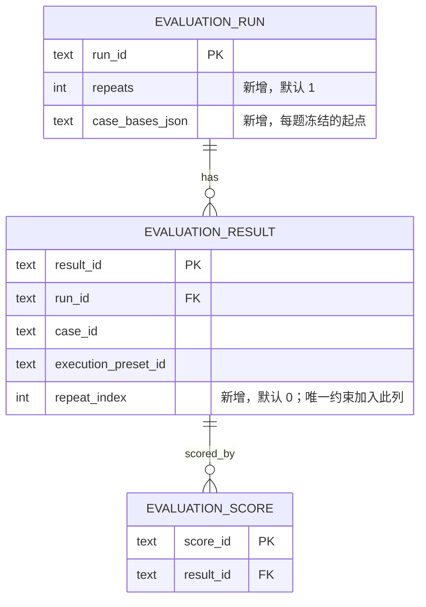
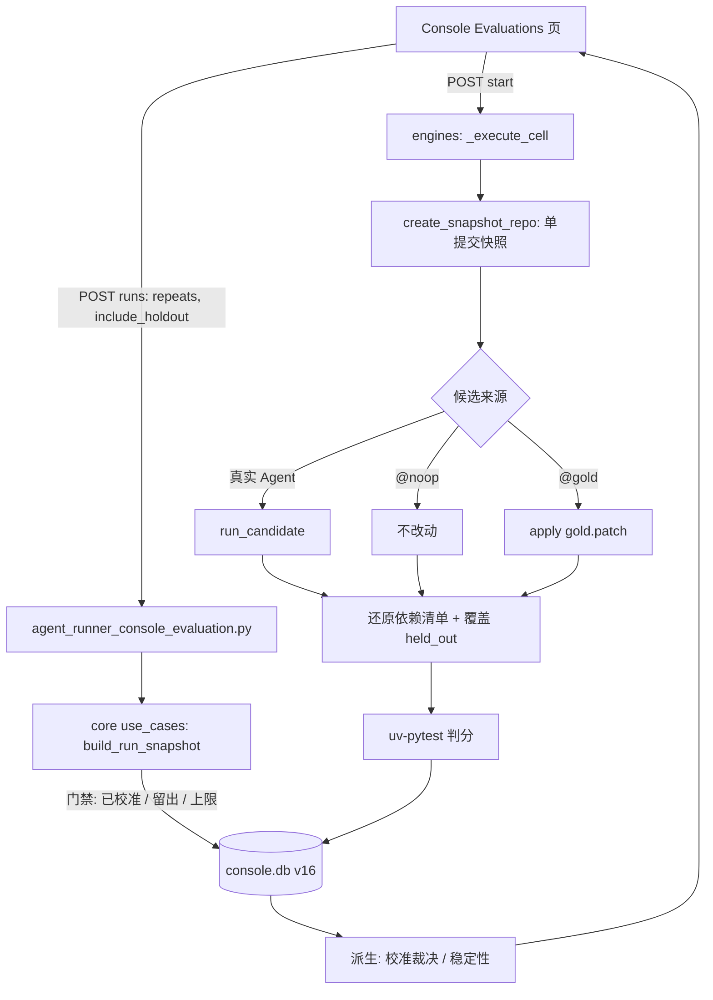

# PRD: M13 黄金评测集与可复现的基线 harness（防泄题、判分校准、重复运行方差）

- GitHub Issue: https://github.com/ZataZhang/keda/issues/334

> ✅ **交付前置**：无，可立即开工。（它建立在已合并的多评审模型评测 `P1-FEAT-20261012-103909` 之上；该 PRD 的代码已在主线，仅其人工验收记录未回填，不构成阻塞。）
> 结构化声明见 §8 Delivery Dependencies，**那里是唯一事实源**。

> 🧍 **验收状态**：待人工验收；执行侧验证与证据已完成，§9 Human-Confirmed 项仍待 reviewer 回答。
> 本行是 §9 Acceptance Checklist 的投影，**那里是唯一事实源**。

> 本 PRD 分两个 altitude，分别服务不同读者，自上而下阅读：
>
> - **Part A · 人审层 (Review Layer)** — 需求方 / 验收人读这部分，决定"该不该做、做得对不对"，并通过风险地图知道**哪些地方必须亲自确认**。Part A 不出现实现机制、文件路径、命令。
> - **Part B · 执行器层 (Build Layer)** — 实现者（人或 Agent）读这部分动手。人只在 Part A 风险地图**点名处**下钻审查，其余默认交执行器 + 自动门禁。

## Feature Overview (功能一览)

> 本节是 §10 Functional Requirements 的白话投影；行为验收以 §1 的行为样例为准。

- **每道题自带"修复前的起点"和"判分材料"**（FR-1）：评测集里的每个任务各自记录它的起始提交、开发集/留出集归属、判分用的测试和原始修复；老格式的评测集继续可用。
- **Agent 在只有起点的干净仓库里干活**（FR-2）：工作目录里没有任何后续提交，也没有判分测试，Agent 无法通过翻 git 历史"看到答案"。
- **干完活之后才判分**（FR-3）：判分测试在 Agent 结束后才放进去；Agent 改过的判分测试文件和依赖清单会被还原，再用固定的测试命令判分。
- **不调用模型的两个校准候选**（FR-4）：一个"什么都不改"，一个"应用原始修复"，用来验证每道题本身判得对不对。
- **校准不过的题不让用**（FR-5）：每道题的校准结论可见；没校准通过的题、以及留出集（除非显式勾选）不能用来跑 Agent。
- **同一道题重复跑，并有用量上限**（FR-6）：创建评测时可选重复次数，创建时就告知将发生多少次候选执行，超过上限直接拒绝。
- **如实展示稳定与不稳定**（FR-7）：每道题每个预设显示几次通过，三次结论不一致的单列为"不稳定"；基础设施故障与判分失败分开计数；不折算总分，不设阈值。
- **从已有数据集选出首批 12 道基准题**（FR-8）：复用已有归档、描述补全与离线校准，筛选 keda 已合并的历史修复（8 道开发集 + 4 道留出集），在最终评测流程中全部校准通过；12 是首批基准规模，不是数据集总量。
- **本地账本升级**（FR-9）：保存重复次数与每题冻结的起点；已有评测记录原样保留。
- **文档与路线图同步**（FR-10）。

---

# Part A · 人审层 (Review Layer)

## 1. Introduction & Goals

### Problem Statement

ROADMAP 把 M13 定为 2026-10-16 起的主线：先有可信的评测基线，才谈得上"改 prompt / 换模型之后是变好还是变坏"。现有的多评审模型评测（Console「Evaluations」页）已经能让多个执行预设在同一份评测集上各跑一遍，但它还不能当基线用，原因都可以在仓库里直接核实：

- **每道题共用同一个起点**。评测集只有一个全局 `base_ref`，而"冻结到修复前一刻"的历史任务各有各的修复前提交，现有格式装不下。
- **Agent 能看到答案**。候选在 `git worktree add --detach` 出来的工作目录里运行，它与主仓库共享整个 git 对象库，Agent 执行 `git log --all` 或 `git show <修复提交>` 就能读到当年的修复和测试。ROADMAP 评测集隔离规则要求"工作树里不含修复之后的历史"，现状不满足。
- **判分是否有效没人验证**。判分只会整仓跑一遍固定的测试命令（`python3 -m pytest`），没有任何手段证明"不改动时判分会失败、应用正确修复后判分会通过"；一道无效的题要等烧完 API 额度才会暴露。
- **每个组合只跑一次**。同一个任务、同一个预设只有一条结果，看不出结论是稳定的还是碰巧的。

### Interpretation (解读回显)

**2026-10-28 范围校正**：任务数据集、描述补全与离线判分校准工具已经建立，本次优先复用这些成果。已有校准用于筛题，不能直接代替最终冻结材料在 Console 中的三次重复校准；本次主要补齐隔离执行、重复账本和结果展示。

这是你**前置批准**的对象，也是唯一能拦住"解读错了"的关卡——oracle 和实现都是同一份解读的产物，解读错了它们会互相印证，下游检查全绿在错的行为上。散文没法逐条否证，所以先给可以逐格改的具体样例。

| 验证方式 | 输入 / 操作 | 期望观察到的结果 |
|---|---|---|
| 👀 人审 + 自动验证 | 在评测页选 `keda-history-v1` 评测集，执行预设勾选两个"校准候选"（不改动 / 应用原始修复），重复次数选 3，创建并启动。 | 全部 12 道题各显示"校准通过"：不改动的判分三次都失败，应用原始修复的判分三次都通过；整个过程没有任何模型调用，评测集头部显示"12/12 已校准"。 |
| 👀 人审 + 自动验证 | 评测集已全部校准后，选一个真实 Agent 预设，重复次数选 3，只跑开发集并启动。 | 每道题显示三次里几次判分通过；三次结论完全一致的显示"稳定"，不一致的显示"不稳定"并单列；页面上看不到合成的总分，也没有"合格/不合格"的阈值判定。 |
| 🤖 自动验证 | 候选 Agent 在它的工作目录里执行 `git log --all`、`git cat-file -e <修复提交>`，并尝试找判分测试文件。 | 只能看到一个基线提交；修复提交对象不存在；工作目录里没有判分测试文件。 |
| 🤖 自动验证 | 候选 Agent 修改了某个判分测试文件，或改了依赖清单（`pyproject.toml`、`uv.lock`）。 | 判分前这些文件被还原为判分版本 / 基线版本；判分结论只取决于 Agent 改动的其余源码。 |
| 🤖 自动验证 | 创建真实 Agent run 时选了未校准通过的题；或选了留出集题但没有显式勾选；或总执行次数超过上限。 | 创建被拒绝并逐条说明原因；没有任何候选执行，也没有任何模型调用。校准 run 自动覆盖开发集与留出集。 |
| 🤖 自动验证 | 某次候选超时、Agent 进程崩溃或工作目录创建失败。 | 该次记为"执行故障"，与"判分失败"分开计数；同一道题的其他重复不受影响；不被折算成判分失败。 |
| 🤖 自动验证 | 使用没有任何新字段的旧格式评测集（如 `example.yaml`）创建并运行。 | 校验仍然通过；运行行为与升级前一致（重复次数默认为 1，不要求校准）。 |

上表中仍然成立的行为行就是 §7.6 的验收 oracle：改某一格的预期，等于改验收标准。

**我默默定了这些**（没问你、我自己定的歧义点）

- **判分材料的放入方式 → 整文件覆盖，不做补丁合并**：原 PR 里涉及的测试文件，以修复提交时的完整内容覆盖到候选目录；这样 Agent 自己改了同一个测试文件也不会冲突，代价是它写在这些文件里的测试不参与判分。
- **依赖清单 → 判分前还原为基线版本**：`pyproject.toml` 与 `uv.lock` 不是判分对象，还原后再用冻结的锁文件运行，避免 Agent 通过改依赖影响判分环境。
- **判分命令 → 新增一个固定的 `uv-pytest` 配方**：判分在干净快照里需要项目依赖，现有 `python3 -m pytest` 在 keda 上跑不起来；新配方仍属白名单，不允许 suite 写任意命令。
- **评测集里的仓库路径 → 允许写 `.` 表示"当前 keda 检出根"**：这样提交进仓库的评测集在不同机器上都能用；老评测集的绝对路径写法不变。
- **"已校准"的裁决 → 从已完成的校准运行里派生，不单独建表**：评测集内容（含判分材料）任何变化，内容指纹就变，旧的校准结论自动失效，必须重新校准。
- **"稳定"的含义 → 同一道题、同一个预设重复 N 次，判分结论（通过/失败）全部相同**；不一致即"不稳定"。不稳定的题只标出，不自动剔除，也不设数字阈值（ROADMAP：先测基线再定目标）。
- **用量上限 → 按候选执行次数卡，不按金额卡**：调用模型的候选执行最多 48 次、校准（不调模型）最多 144 次；金额无法可靠计量（主力执行器的 Token 上报覆盖率约 3%），所以不假装按钱限制。
- **"极小模板仓冒烟" → 读成测试里现建的一个小 fixture 仓库**，不依赖本机某个模板目录。
- **题目描述的写法 → 只写问题与期望行为，不写解法，也不照抄原 PR 描述**，避免把答案提示写进 prompt。
- **题目来源 → 从已有数据集筛选**：优先复用已通过离线校准的候选和已复核的描述补全，不重新采集一套数据。旧校准结论不直接写入 Console，最终仍走同一执行流程三次校准。
- **留出资格 → 逐题核对使用记录**：已用于调 prompt、skill、预设或流程的题只能作开发集；使用情况不明的题不能默认当留出集，不能靠改标签恢复留出资格。
- **本里程碑不改评审打分**：评审模型与打分口径保持现状，评审仍然是可选的、逐次授权的。

**我理解为不做**（你可能想要、但我读成不在范围内的）

- **"用 Keda"那一组对比**：现有候选执行只是单次调用 Agent，不经过 Keda 的"实现→验证→review→修复"流水线；本 PRD 交付的是可信的"不用 Keda"基线，对比组另开 PRD。
- **三项核心指标的真实数据入账**（合并结果、人工介入事件、Token 上报覆盖率）：与评测集是独立的两条线，另开 PRD；冻结任务上自动运行本来就没有人工介入，"人工介入时长"在这里恒为 0，没有意义。
- **新增 `kc` 命令、前端任务、私有仓库任务、"改动前后对比"视图与合并前门禁**：都不在首个里程碑内。

读成：**把现有评测升级成一把"能证明自己可靠"的尺子**——每道题自带起点和判分材料，Agent 看不到答案，判分有效性靠不调模型的校准来证明，结论的稳定性靠重复运行如实展示；而不是：新做一个评测系统、比较模型优劣、或引入 Keda 对比组。成立的强制路径是"Agent 先在干净快照里完成 → 之后才放入判分材料 → 再判分"；禁止的旁路是"在共享对象库的工作树里运行"、"判分材料在 Agent 运行期间可见"、"用 Agent 改过的依赖清单判分"、"把未校准的题当基线"。

### What The User Gets

评测的维护者与运行者拿到一份**可当基线用的评测集**和一页**能看出结论稳不稳**的结果：评测集里每道题都标明校准是否通过；用真实 Agent 跑完后，每道题每个预设显示"几次通过 / 稳定还是不稳定"；任何一道会"漏题"或"判分失效"的题，在花一分钱模型额度之前就被校准挡在门外。已有的评测记录和评审打分流程保持不变。

### Measurable Objectives

- 首批评测集 12 道题全部通过校准：每道题"不改动"判分 3/3 失败、"应用原始修复"判分 3/3 通过。
- 候选工作目录内无法读到任何基线之后的提交，也读不到判分测试文件（探针 Agent 的检查结果为"不存在"）。
- 同一道题、同一预设重复 3 次的结果在页面上可见，"不稳定"的题单列；页面不出现合成总分或合格阈值。
- 旧格式评测集与已有评测记录升级后原样可用，既有评测相关测试全部通过。
- 超过上限、未校准、留出集未勾选的创建请求被拒绝，且被拒绝时零候选执行。

---

## 2. Human Review Map (介入与风险地图)

这一节只列需要人判断的决策。文件移动、代码检查、构建和回归测试由执行器完成，不要求 reviewer 逐项阅读实现细节。

### 决策一：Agent 不能看到答案——工作目录隔离与判分时机

建议把候选的工作目录从"与主仓库共享历史的工作树"改成"导出基线文件后新建的单提交仓库"，并且把判分材料推迟到 Agent 结束之后才放入；判分前再把判分测试文件和依赖清单还原一遍。这是整份评测可信度的根：被测的一方一旦能接触答案，所有分数都失去意义，而且这种污染是静默的——结果看起来完全正常。

必须保持的边界：Agent 运行期间，工作目录里没有基线之后的任何提交、没有判分测试文件、没有原始修复；判分只能发生在 Agent 结束之后。已知无法消除的风险需要照实写明而不是假装堵死：keda 是公开仓库，Agent 若能联网仍可能去 GitHub 看到已合并的修复，模型也可能记住它；因此对留出集只用"相对变化"下结论，不用绝对分数。

**请确认：** 是否同意"新建单提交仓库 + 判分材料延后放入 + 判分前还原依赖清单"，并接受"公开仓库的网络泄漏与模型记忆无法消除，只披露不假装解决"？

**验收：** 用一个会主动翻历史、找测试文件的探针 Agent 真实跑一轮：它只看到一个提交，修复提交与判分测试都不存在；它改过的判分测试和依赖清单在判分前被还原。

### 决策二：本地账本的数据库迁移

重复运行需要同一道题、同一预设能有多条结果，现有结果表的唯一约束（每个"评测 × 题 × 预设"只允许一行）必须放宽；每道题冻结的起点也要有地方存。这是数据库结构变化，按规矩必须你确认。方案是纯增量：结果表增加"第几次重复"（已有行记为第 0 次），评测表增加"重复次数"与"每题冻结的起点"，旧记录全部保留并保持可读；迁移不可逆地改写了结果表的唯一约束，这是本次唯一的结构风险。



**请确认：** 是否同意只做这三处增量改动，并接受"结果表的唯一约束重建后不再原样回退"？

**验收：** 在一份带有已有评测记录的升级前账本上执行迁移：旧记录全部还在、页面照常打开；之后同一道题同一预设能写入三条重复结果。

### 决策三：首个里程碑的范围与"可靠"的验收口径

建议只做单 Agent 一组（即"不用 Keda"的基线），"用 Keda"流水线对比组和三项核心指标的数据入账各另开 PRD；"可靠"分两层验收——先用两个不调模型的校准候选证明每道题判得对（零成本、可重复），再用真实 Agent 重复 3 次如实展示稳定性，不设数字阈值。首批任务取 keda 自己已合并的 12 个后端修复（8 开发 + 4 留出），只含用 pytest 判分的题，前端与私有仓库任务不做。

**请确认：** 是否接受"首期只有基线一组、不出现'Keda 比原生 Agent 强多少'的结论"，以及上面的验收口径与 12 道任务的范围？

**验收：** 评测页上 12 道题全部"校准通过"；必需的三次重复展示通过受控探针验证，真实 Agent 效果实验为 opt-in，显示实际结果、不要求出现不稳定；本 PRD 的交付物里没有任何对比组结论。

### 自动门禁，不需要逐项人工审阅

- 旧格式评测集与已有评测记录继续可用（既有评测测试全绿 + 一份旧格式评测集的真实创建/运行对照）。
- 创建时的拒绝规则：未校准的题、未勾选的留出集、超过用量上限，都在零候选执行的前提下被拒绝。
- 执行故障（超时、崩溃、工作目录失败）与判分失败分开计数，不互相污染。
- 页面新增的列与开关（重复次数、是否包含留出集、校准与稳定性展示）通过现有前端端到端用例与一次真实页面运行确认。
- 现有评审授权、外发预览、取消与清理行为不变。

### 本次明确不涉及

鉴权、计费、破坏性数据操作、并发语义、对外 HTTP/CLI 接口的破坏性变化均不涉及；评审模型的打分口径与授权流程不改；不新增 `kc` 命令；账本仅做上面决策二列出的增量变化。

---

## 3. Usage And Impact After Implementation

### 评测维护者（维护评测集的人）

在评测集目录里按新格式写题：每道题带起点、开发/留出归属、判分用的测试和原始修复。保存后在 Console「Evaluations」页的评测集清单里看到逐题的校验结果与"已校准 x/y"。想让一道新题入集：先建一个校准 run（执行预设选两个校准候选、重复 3 次），全部通过才可用。评测集内容一变，旧的校准结论自动作废，需要重新校准。

### 评测运行者（在 Console 上发起评测的人）

仍然从「Evaluations」页进入：选评测集、选执行预设，新增"重复次数"与"包含留出集"两个选项。校准候选会自动选择全部题目；真实 Agent run 默认只选开发集，纳入留出集需显式勾选。创建时页面告知将发生多少次候选执行；超过上限、选了未校准的题或真实 Agent run 没勾选就选留出集会被拒绝并给出原因。跑完后详情页按题展示"几次通过 / 稳定或不稳定"，执行故障单独计数；不出现合成总分。评审打分仍是可选的、逐次授权的，行为不变。

### 其他使用方

- 终端用户与 `kc` CLI / API 调用者：评测与 Issue 执行链路互不相通，**不受影响**；本 PRD 不新增 `kc` 命令，随包 operator skill 无需同步。
- 开发者 / 运维：评测集可以引用 `.` 作为仓库路径；判分需要本机有 `uv`（与项目日常开发环境一致）。

### Impact On Existing Behavior

- 旧格式评测集（无新字段）继续有效；重复次数默认 1，不要求校准，行为与升级前一致。
- 已有评测记录与评审打分在迁移后原样可读；页面对"第 0 次"重复的老记录不显示重复信息。
- 评审外发授权、payload 预览、取消、删除与清理语义不变。
- 新增选项均有默认值（重复 1、不含留出集），不勾选即与旧行为相同。

---

## 4. Requirement Shape

- Actor: 评测维护者；评测运行者（Console 用户）；开发者 / 运维（本机需有 `uv`）。其余角色的入口不经过本次修改流程，保持不变。
- Trigger: 维护者提交新格式评测集或发起校准；运行者在评测页创建并启动含重复次数的评测。
- Expected behavior: 候选在无后续历史的干净快照里运行，结束后才放入判分材料并判分；校准候选证明每题有效；重复运行的结果按题展示稳定性；未校准或超限的请求被拒绝。
- Scope boundary: 不含 Keda 流水线对比组、三项核心指标入账、新 `kc` 命令、前端与私有仓库任务、改动前后对比视图与合并前门禁、评审器校准、自进化。

---

# Part B · 执行器层 (Build Layer)

> 以下供实现者（人或 Agent）使用。人只在 Part A 风险地图点名处下钻审查；其余默认交执行器 + 自动门禁。

## 5. Repository Context And Architecture Fit

- **已有数据资产（2026-10-28 本机只读盘点快照，非验收目标）**：独立私有仓库 `keda-datasets` 的 `MANIFEST.json` 与 `raw/` 共 580 条样本（`git_commit` 346、`github_pr` 85、`keda_run` 149）；原始归档的 `labels.eval_ready=true` 共 35 条，尚未重新叠加 curation。`calibration/` 有 37 条记录：`calibrated` 16、`coupled_to_new_symbols` 12、`no_tests` 8、`no_fail_to_pass` 1；`curation/` 有 42 行补全记录。数量随归档变化，执行时重新盘点；16 条不保证全部属于 keda 或满足本 PRD 的输入、范围与留出要求。
- **已有工具与职责**：`scripts/dataset_export` 已支持 Issue/PR/commit 样本导出、原始输入来源标记、raw 归档和 curation 叠加；`scripts/dataset_export/calibrate.py` 的 `plan_calibration`、`materialize_tree`、`overlay_tests`、`parse_junit` 已实现判分材料发现、快照导出、测试辅助文件覆盖及删除、行为失败与新增符号耦合分类。维护说明见 `docs/guides/dataset-export.md`。该工具的 `calibrated` 是单次前后对照事实，不是 Console 的三次校准。
- **复用边界**：不重建采集、归档、补全或离线校准系统；沿用现有工具选题，整理成固定版本的 suite 发布物。Console 不扫描私有数据仓库，不自动同步，不直接导入旧校准结论；engines 不反向导入开发脚本。如需共享实现，先按四层边界提取最小公共能力并更新本文，不复制粘贴现有实现。

- Existing path：评测引擎 `src/backend/engines/model_evaluation/`（`execution.py` 的 `_execute_cell` 编排"worktree → Agent → diff → check"，`workspace.py` 的 `create_detached_worktree`，`checks.py` 的 `run_check_recipe`，`agent_adapter.py` 的 `run_candidate`）；领域模型与规则在 `src/backend/core/shared/models/model_evaluation.py`（`parse_evaluation_suite`、`CHECK_RECIPES`）与 `src/backend/core/use_cases/model_evaluation.py`（`build_run_snapshot`，`MAX_EVALUATION_MATRIX_CELLS = 32`）；账本在 `src/backend/infrastructure/persistence/console_store_evaluation.py`（`evaluation_result` 含 `UNIQUE (run_id, case_id, execution_preset_id)`）与 `console_store.py`（`_SCHEMA_VERSION = 15`，`PRAGMA user_version` 就地迁移）；API 在 `src/backend/api/routes/agent_runner_console_evaluation.py`；页面在 `frontend-public/app/(app)/app/evaluations/page.tsx` 与 `frontend-public/components/evaluations/`。
- Reuse candidates：现有 run 快照冻结与"执行前 live 预设与快照一致性守卫"、`workspace.worktree_tree_hash` 同基线断言、`checks.py` 的最小环境变量白名单与超时/输出上限、`_host_gate` 进程级并发闸门、现有汇总函数 `build_evaluation_summary`、Playwright 用例 `console-evaluations.no-auth.spec.ts`。
- Architecture pattern to preserve：`api → core → engines → infrastructure` 单向依赖；core 只放纯数据与规则，进程/文件/git/SQLite 都在 engines/infrastructure，经 `evaluation_store` 端口访问；`api` 只导入 `core`。
- Frontend impact：`frontend-public`（Next.js，Console 管理终端）。改动页面 `app/(app)/app/evaluations/page.tsx`（新增"重复次数""包含留出集"与预计执行次数提示）、`components/evaluations/run-detail-panel.tsx`（校准与稳定性展示）、`components/evaluations/evaluation-format.ts`、`lib/api/console.ts` 与 `lib/api/types.ts`（请求/响应字段同步）。运行：`just` 栈的 dev 模式；端到端：`tests/playwright-e2e` 下 `npm run test:no-auth -- console-evaluations`。
- Existing PRD relationship：`tasks/pending/` 现有 3 个 PRD（`kc-hosted-runner-deployment`、`two-stage-prd-generation`、`kc-tailscale-machine-onboarding`）与评测无关，**独立**。`tasks/archive/P1-FEAT-20261012-103909-multi-judge-agent-evaluation.md` 是本 PRD 的直接基础（评测引擎、suite 注册表、评审授权），本 PRD 在其上扩展而不重做；`P2-FEAT-20261009-171037-agent-preset-performance-stats`（按预设的 attempt 统计）与本 PRD 口径互补、不重叠。
- Redundancy risks：不得为"校准候选"另建一套执行引擎，必须走同一个 `_execute_cell`；不得为"稳定性"另建聚合存储，必须从逐条结果派生（与现有汇总同口径）；不得为判分材料新增第二套 suite 注册表。

## 6. Recommendation

### Recommended Approach

- **先复用数据，再补运行能力**：从已有 raw、叠加后的 curation 与 calibration 筛题，优先复核离线校准通过的候选；冻结后经 Console 的同一 `_execute_cell` 完成三次校准。已有工具承担样本准备，本次承担生产评测入口与重复运行。避免重复建设采集和校准平台；首批仍保留 12 题以证明最终 harness 可靠。

- Approach：在现有评测引擎上做**增量升级**：suite 格式增加每题可选字段；候选工作目录创建改为"导出基线快照 + 全新单提交仓库"；`_execute_cell` 在 Agent 结束后放入判分材料再判分；用两个保留名预设（`@noop`、`@gold`）作为不调模型的校准候选，走同一条执行路径；矩阵增加 `repeat_index` 维度；校准裁决与稳定性都从逐条结果派生。
- Why this is the best fit：复用已有的快照冻结、守卫、清理、并发闸门与汇总口径；core 仍只放纯规则，新增副作用都在 engines/infrastructure；不引入新服务、新依赖、新命令面。
- Rejected redundancy：不新建评测引擎或第二套 suite 目录；不新建"校准结论"表（从完成的校准 run 派生）；不新增 `kc eval` 命令；不为"Keda 流水线对比组"预留抽象（本 PRD 不做）；不做补丁合并式判分。

### Proposed Solution Summary (实现机制)

1. **suite 格式 v2（向后兼容）**：顶层 `repo_path` 允许 `.`（解析为注册表所在仓库的检出根）。每道题新增可选字段：`base_ref`（缺省用顶层）、`split: dev|holdout`（缺省 `dev`）、`check_targets`（传给判分配方的测试路径/节点 id，须通过安全字符校验且不得以 `-` 开头）、`held_out`（相对 case 资料目录的判分测试文件树）、`candidate_hidden`（基线中已存在、但会泄露题目答案的文件路径；Agent 运行期间移除，判分后恢复基线版本）、`gold_patch`（原始修复的非测试部分）。case 资料放在评测集 YAML 同级目录 `<yaml 文件名去掉后缀>.d/<case_id>/`（`gold.patch`、`held_out/<仓库相对路径>`）。`content_hash` 改为覆盖 YAML 文本与全部资料文件的摘要，任何资料变化都改变评测集身份。无新字段的旧 suite 完全沿用旧语义。
2. **判分配方 `uv-pytest`**：固定 argv 前缀为 `uv run --frozen pytest -q -o addopts=` + `check_targets`，加入 `CHECK_RECIPES` 白名单；沿用最小环境变量白名单（`PATH/HOME/LANG/TMPDIR/LC_ALL`）。已在真实历史任务上验证可行（见 §7.9）。
3. **快照工作目录（防泄题）**：`workspace` 新增 `create_snapshot_repo(repo_path, commit, dest)`：用临时 `GIT_INDEX_FILE` 做 `read-tree` + `checkout-index --prefix` 导出基线文件，在 `dest` 内 `git init`、`git add -f -A`、以固定身份提交一次；随后断言新仓库 HEAD 的 tree hash 等于冻结的基线 tree hash（现有断言复用），不等即失败。候选目录里不再有主仓库的 `.git` 对象库。
4. **判分材料延后放入**：Agent 结束（或伪候选完成）后才执行：①恢复 `held_out` 与 `candidate_hidden` 在基线中的版本，并把 `pyproject.toml`、`uv.lock` 还原为基线版本；②把 `held_out/` 文件树整文件覆盖到候选目录；③以 `check_targets` 运行判分配方。`@gold` 在②之前先 `git apply gold.patch`；`@noop` 不改动，仅做②③。
5. **校准候选**：保留名预设 `@noop`、`@gold` 出现在预设清单里并标注 `kind: calibration`、不可选作评审、不会触发任何模型调用；在 `execute_cell` 中以"候选来源"分支实现，不改 `agent_adapter`。
6. **校准裁决与入集门禁（派生）**：某题"已校准"当且仅当存在一个已完成的、`suite_hash` 与当前一致、`repeats ≥ 3` 的 run，其中该题的 `@noop` 结果全部为判分失败，`@gold` 结果全部为判分通过。校准 run 自动覆盖当前 suite 的全部题目（含 holdout），且不受“显式包含留出集”门禁限制。创建含真实预设的 run 时，所选题必须均已校准，`holdout` 题须显式 `include_holdout=true`；否则拒绝（400）并逐条说明。
7. **重复与上限**：`create_run` 新增 `repeats`（1–5；校准 run 要求 ≥3）与 `include_holdout`；校准 run 自动包含 suite 全部题目（包括 holdout），真实模型 run 仍须显式设置 `include_holdout=true` 才会纳入留出题。矩阵格数 = 题数 × 预设数 × 重复数；含模型调用的格 ≤ 48，纯校准格 ≤ 144，超限拒绝并说明。创建响应带"预计候选执行次数"。启动仍是显式动作。
8. **稳定性汇总（派生）**：`build_evaluation_summary` 同族新增纯函数，按（题 × 预设）统计重复次数 n、判分通过次数、执行故障次数（`failed`/`timeout`/取消，不含判分失败）；n 次判分结论全部相同为"稳定"，否则"不稳定"。不产生总分、不设阈值。
9. **账本迁移 v16**：`evaluation_result` 增加 `repeat_index INTEGER NOT NULL DEFAULT 0`，唯一约束改为 `(run_id, case_id, execution_preset_id, repeat_index)`（SQLite 需重建表并保留外键级联）；`evaluation_run` 增加 `repeats INTEGER NOT NULL DEFAULT 1` 与 `case_bases_json TEXT`（每题冻结的 `{base_ref, commit, tree}`）；`_SCHEMA_VERSION` 15 → 16，沿用现有就地迁移机制。
10. **首批评测集**：从已有数据集筛选并冻结 `keda-history-v1`，12 题（8 dev + 4 holdout），均为 keda 已合并的后端修复，判分仅 pytest。复用补全与离线校准，README 保留来源映射和复核记录；私有归档只读，公开发布物不复制完整原始记录。入选标准见 §7.1。

### Alternatives Considered (Only When Useful)

- Alternative：沿用 detached worktree，只在 prompt 里要求不要查看历史。
- Why not chosen：等于没有隔离，基线不可信；决策一已确认不采用。
- Alternative：用 `git clone --depth 1` 浅克隆作为快照。
- Why not chosen：浅克隆仍带 remote 与可能的 promisor 配置，Agent 可 `git fetch` 取回历史；导出文件后新建仓库没有 remote，更彻底。
- Alternative：把"校准结论"存成独立表。
- Why not chosen：结论可从已完成 run 精确派生，独立表会引入与 `suite_hash` 同步的新状态。

---

## 7. Implementation Guide

This section is a living implementation guide based on current repository analysis. If implementation discovers additional affected files, hidden dependencies, edge cases, or a better path, update this PRD before proceeding.

### 7.1 Core Logic

```text
创建 run（API）
  → load_suite → 校验 v2 字段 → 解析每题 base（probe_base）并冻结到 case_bases_json
  → 门禁：repeats / include_holdout / 已校准派生检查 / 矩阵上限（含重复）
  → 启动：对每个（题 × 预设 × 重复）格：
      快照仓库（tree hash 与冻结基线一致）
      → 候选来源：真实 Agent | @noop | @gold(apply gold.patch)
      → 还原隐藏文件与依赖清单 → 覆盖 held_out → uv-pytest 判分
      → 记录 result（repeat_index）→ 清理快照
  → 汇总：从逐条结果派生 校准裁决 / 稳定性
```

**首批 12 道任务的入选与冻结流程**（12 是首批基准规模，不是数据集容量限制）：

1. 用现有导出器叠加 curation，按稳定 `sample_id` 对应 raw 与 calibration；记录数据源 Git commit，若有未提交变化则同时记录所用文件摘要。重新统计候选，优先复核 `calibrated`，不把快照中的 16 条当作必然合格。
2. 仅选 keda 主线上已合并的后端开发任务（2026-09 以来），有真实 `base_sha` / `final_sha` 与 pytest 判分。按任务完整提交范围提取修复，不默认一题一个 commit；确认没有夹带无关改动。触及源码文件 ≤ 6 个，无网络与凭据依赖，不依赖前端构建。
3. 复用可信任务原文或经人复核的描述补全；输入偏弱、被排除或 Agent 补全未复核的题不能直接入集。prompt 只描述问题与期望行为，不写解法、不照抄 PR 描述。需要补全时继续使用现有只追加的 curation，不改原始记录。
4. 核对既有校准的 base/final 与任务一致，至少有一条黑盒 `fail_to_pass`；仅因新增符号、fixture 或 conftest 导入失败的题不能冒充行为判分。依据已有 `plan_calibration` / `overlay_tests` 核对测试及辅助文件范围；需要测试删除操作而当前覆盖格式无法表达的候选暂不入选，不能静默忽略。旧校准只用于筛题，最终 recipe 与依赖环境仍须重验。
5. 逐题核对使用记录后划分 8 dev + 4 holdout；已用于 prompt、skill、预设或流程优化的题只能作 dev，使用情况不明的不能默认当 holdout。冻结后留出题不用于迭代，不进入 Agent 的记忆/skill 来源。
6. 冻结 YAML、源码 gold patch 和判分材料；README 记录 case id → sample id、base/final SHA、输入来源与复核状态、离线校准记录标识/摘要、split 及理由。候选工作目录不得携带答案或溯源材料。已有私有归档只读，公开发布物仅含经审查允许公开的 keda 题目材料，不复制其他仓库样本、未经审查的原始输入或本机路径。
7. 冻结后经 Console/API 完成 `@noop` 与 `@gold` 各三次校准，达到 12/12；不把旧 calibration 状态直接灌入账本。材料变化后重新校准。

候选不足 12 道时，先沿现有工具补全、复核或补校准其他已归档的 keda 样本；仍不足则记录缺口并更新 PRD 范围，不能降低输入、判分或留出要求来凑数，不为本次选题新增采集系统。

参考：提交 `d3e5b616`（fix(loop)）符合标准，已验证其校准特性（§7.9）。

### 7.2 Change Impact Tree

```text
.
├── Domain (src/backend/core/)
│   ├── src/backend/core/shared/models/model_evaluation.py
│   │   [修改]
│   │   【总结】suite v2 解析（每题 base_ref/split/check_targets/held_out/candidate_hidden/gold_patch、`.` 仓库路径）、资料感知的内容哈希、`uv-pytest` 白名单配方与保留预设名常量。
│   │
│   │   ├── EvaluationSuiteCase 增加可选字段；parse_evaluation_suite 校验安全相对路径、check_targets 字符集与 split 取值
│   │   ├── compute_suite_content_hash 覆盖资料文件（路径+内容摘要）
│   │   ├── CHECK_RECIPES 增加 "uv-pytest"；新增 CALIBRATION_PRESET_NOOP / GOLD 常量
│   │   └── EvaluationResultRecord / EvaluationRunRecord 增加 repeat_index、repeats、case_bases
│   ├── src/backend/core/use_cases/model_evaluation.py
│   │   [修改]
│   │   【总结】build_run_snapshot 支持重复次数、每题冻结起点、入集门禁与上限；新增校准裁决与稳定性的纯函数。
│   │
│   │   ├── build_run_snapshot：repeats / include_holdout 参数；矩阵上限按"含模型调用 48 / 纯校准 144"计
│   │   ├── derive_case_calibration(runs, results, suite_hash) 纯函数
│   │   └── build_stability_summary(results) 纯函数（稳定/不稳定、执行故障计数）
│   └── src/backend/core/shared/interfaces/evaluation_store.py
│       [修改]
│       【总结】端口增加 repeat_index / repeats / case_bases 字段，保持 core 不依赖 SQLite。
│
├── Engines (src/backend/engines/model_evaluation/)
│   ├── src/backend/engines/model_evaluation/workspace.py
│   │   [修改]
│   │   【总结】新增快照仓库创建、依赖清单还原与判分材料覆盖；候选路径不再使用 detached worktree。
│   │
│   │   ├── create_snapshot_repo(repo_path, commit, dest)
│   │   ├── restore_dependency_manifests(dest, base_commit_files)
│   │   ├── overlay_held_out(dest, held_out_dir)；apply_gold_patch(dest, patch_path)
│   │   └── create_detached_worktree：候选路径不再引用；确认无其他引用后删除
│   ├── src/backend/engines/model_evaluation/execution.py
│   │   [修改]
│   │   【总结】_execute_cell 按（题 × 预设 × 重复）运行，快照 → 候选来源分支 → 还原/覆盖 → 判分，并区分执行故障与判分失败。
│   │
│   │   ├── 矩阵展开加入 repeat_index；result_id 与 worktree 目录名包含重复序号
│   │   ├── 候选来源分支：真实 Agent / @noop / @gold（均不进入 judge 流程）
│   │   └── 基线 tree hash 断言改用 case_bases 中该题冻结的 tree
│   ├── src/backend/engines/model_evaluation/checks.py
│   │   [修改]
│   │   【总结】判分配方支持 check_targets 追加参数（经校验、无 shell），保持最小环境变量白名单。
│   └── src/backend/engines/model_evaluation/service.py
│       [修改]
│       【总结】create_run 接收 repeats / include_holdout；list_suites 返回逐题校准状态；list_preset_options 暴露校准候选；get_run_detail 附带稳定性汇总。
│
├── Infrastructure
│   ├── src/backend/infrastructure/persistence/console_store.py
│   │   [修改]
│   │   【总结】`_SCHEMA_VERSION` 15 → 16，加入 v16 迁移步骤。
│   └── src/backend/infrastructure/persistence/console_store_evaluation.py
│       [修改]
│       【总结】结果表加 repeat_index 并重建唯一约束，运行表加 repeats / case_bases_json，行镜像与读写 SQL 同步。
│
├── API
│   └── src/backend/api/routes/agent_runner_console_evaluation.py
│       [修改]
│       【总结】CreateRunRequest 增加 repeats、include_holdout；响应带预计执行次数、校准状态与稳定性汇总。
│
├── Frontend (frontend-public)
│   ├── frontend-public/app/(app)/app/evaluations/page.tsx
│   │   [修改]
│   │   【总结】创建表单增加"重复次数""包含留出集"与预计候选执行次数提示；校准候选以"校准用"标记呈现。
│   ├── frontend-public/components/evaluations/run-detail-panel.tsx
│   │   [修改]
│   │   【总结】结果区按（题 × 预设）展示"n 次中通过几次 / 稳定·不稳定 / 执行故障数"，校准 run 展示逐题校准结论。
│   ├── frontend-public/components/evaluations/evaluation-format.ts
│   │   [修改]
│   │   【总结】稳定性与校准状态的展示文案与徽标。
│   └── frontend-public/lib/api/console.ts / types.ts
│       [修改]
│       【总结】请求/响应类型与客户端调用同步新增字段。
│
├── Tasks (评测集)
│   ├── tasks/evaluation-suites/keda-history-v1.yaml
│   │   [新增]
│   │   【总结】首批 12 题评测集（8 dev + 4 holdout）。
│   ├── tasks/evaluation-suites/keda-history-v1.d/
│   │   [新增]
│   │   【总结】每题的 gold.patch 与 held_out 判分测试文件树。
│   └── tasks/evaluation-suites/README.md
│       [修改]
│       【总结】v2 字段规范、已有数据集选题与冻结流程、12 题来源映射、输入复核和留出依据、最终校准要求。
│
├── Tests
│   ├── tests/test_model_evaluation_domain.py
│   │   [修改]
│   │   【总结】suite v2 解析、v1 兼容、资料感知哈希、校准裁决与稳定性纯函数。
│   ├── tests/test_model_evaluation_execution.py
│   │   [修改]
│   │   【总结】快照隔离、判分延后、依赖清单还原、伪候选、重复与执行故障分类。
│   ├── tests/test_console_evaluation_store.py
│   │   [修改]
│   │   【总结】v15 → v16 迁移与 repeat_index 唯一约束镜像断言。
│   ├── tests/test_console_evaluation_api.py
│   │   [修改]
│   │   【总结】创建门禁（未校准 / 留出 / 上限）与响应字段。
│   └── tests/playwright-e2e/tests/workflows/console-evaluations.no-auth.spec.ts
│       [修改]
│       【总结】新增重复次数、留出开关、校准与稳定性展示的页面流程断言。
│
└── Docs
    ├── docs/dev/evaluation.md
    │   [修改]
    │   【总结】写入 suite v2、快照隔离、校准、重复与稳定性口径，以及公开仓库泄漏的已知限制。
    └── ROADMAP.md
        [修改]
        【总结】M13 状态与"近期顺序 1"链接本 PRD，注明对比组与核心指标入账另开 PRD。
```

文件清单是起点而非穷举，见 §7.3。`mkdocs.yml` 导航不变（`docs/dev/evaluation.md` 已在导航中）。

### 7.3 Executor Drift Guard

| Check | Command | Expected Result | If It Fails, Inspect First |
|---|---|---|---|
| 旧候选路径已不使用 detached worktree | `rg -n "create_detached_worktree\|worktree add --detach" src tests` | 候选执行路径无引用（函数已删除或仅测试替身中提及） | `execution.py` 的 `_execute_cell`、`workspace.py` |
| 旧唯一约束已被替换 | `rg -n "UNIQUE \(run_id, case_id, execution_preset_id\)" src tests` | 无结果（新约束含 `repeat_index`） | `console_store_evaluation.py` 建表 SQL 与 v16 迁移 |
| 新配方与保留预设有定义且被引用 | `rg -n "uv-pytest\|CALIBRATION_PRESET" src tests docs` | 定义在 core，使用在 engines/tests/docs | `CHECK_RECIPES`、`list_preset_options` |
| 矩阵上限的所有引用都已更新 | `rg -n "MAX_EVALUATION_MATRIX_CELLS" src tests frontend-public docs` | 常量与测试、文档口径一致 | `model_evaluation.py` 与前端的提示文案 |
| 隐藏入口：其他调用 `run_check_recipe` 或创建 worktree 的位置 | `rg -n "run_check_recipe\|create_snapshot_repo\|overlay_held_out" src` | 仅 `execution.py` 与 `workspace.py`、`checks.py` | 是否有绕过快照与还原顺序的路径 |
| 前端与后端字段同步 | `rg -n "repeats\|include_holdout\|repeat_index" src frontend-public --glob '!node_modules'` | 后端 DTO、前端类型、页面三处一致 | `lib/api/types.ts`、路由 `CreateRunRequest` |

### 7.4 Flow Or Architecture Diagram



### 7.5 ER Diagram (Only When Data Model Changes)

见 Part A §2 决策二的 ER 图（该图是人审依据）。补充：`evaluation_score` 经 `result_id` 外键引用 `evaluation_result`，重建结果表时必须保持 `ON DELETE CASCADE` 与已有行的 `result_id` 不变。

### 7.6 Realistic Validation Plan (Oracle 块)

**受控验证与真实实验**：rv-3 的交替通过/失败、始终通过和超时由 Agent CLI 边界的探针产生可判分代码或执行行为，最终状态由真实判分器记录，不直接写结果。真实 Agent 的三次成败、是否出现不稳定均不可预设；opt-in 实验只要求完整记录并按实际判分核对统计与展示，全通过或全失败都可成立，不反复重跑凑分布。`@noop` / `@gold` 是确定性候选，三次失败/通过仍是题目校准要求，与随机 Agent 效果实验不同。

**探针与隔离边界**：探针按 `(case_id, execution_preset_id, repeat_index)` 固定行为，不按全局调用计数或进程启动顺序分配结果。单提交快照保证候选仓库内无后续对象、无 remote、不预置判分材料；不提供同用户跨目录读取或网络访问的系统级隔离。探针可检查这些限制，但不能把它们记录成已被阻止。

```yaml
- id: rv-1
  behavior: 候选 Agent 在运行期间看不到任何基线之后的提交与判分测试文件；Agent 改过的判分测试与依赖清单在判分前被还原。
  reviewer: verifier
  real_entry: "本机启动 console 后端，对一个临时 fixture git 仓库（含一个后续修复提交与判分测试）依次调用 POST /api/v1/agent-runner/console/evaluation/runs 与 /start；执行预设使用探针 Agent（在候选目录内执行 git log --all、git cat-file -e <修复提交>、查找判分测试文件、改写判分测试与 uv.lock 后退出）"
  expected: "探针记录：仅 1 个提交、修复提交对象不存在、判分测试文件不存在；判分日志显示被改写的判分测试与 uv.lock 已被还原，判分结论只取决于探针对其余源码的改动。"
  mock_boundary: "只有外部 Agent CLI 可替换为探针（沿用 tests/test_model_evaluation_execution.py 中替换 run_candidate 的同一接缝）；git、快照创建、覆盖、uv-pytest 判分、API、账本必须真实。"
  tier: R3
  test_layer: e2e
  required_for_acceptance: true
  critical_value_source: "修复提交 SHA 取自 fixture 仓库的真实 git 日志；探针观察结果取自探针写到候选目录之外的记录文件，不由测试断言重建。"
  must_cross: "API 创建 → 冻结每题起点 → 启动 → create_snapshot_repo → 探针 → 还原/覆盖 → uv-pytest → 账本落库 → 详情接口读取"
  forbidden_bypasses: "直接调用 _execute_cell；在候选目录里手工放置期望状态；用 detached worktree；在探针运行前就放入 held_out 文件。"
  fresh_state_probe: "运行结束后由新进程读取 evaluation_result 行与探针记录文件，核对 check_status、repeat_index 与 tree hash。"
  final_tree_evidence: "证据文件记录被验证实现的 git tree hash；任何 workspace.py / execution.py / checks.py 变更后必须重跑。"
  negative_control: "not needed — 实现前候选目录是共享对象库的 detached worktree，探针的 `git cat-file -e <修复提交>` 必然成功，同一 oracle 在实现前先跑红。"

- id: rv-2
  behavior: 评测集 keda-history-v1 的 12 道题全部通过校准（不改动判分 3/3 失败、应用原始修复判分 3/3 通过），整个过程没有模型调用。
  reviewer: human
  real_entry: "Console「Evaluations」页（或等价的 API 调用）：选 keda-history-v1，执行预设选 @noop 与 @gold，重复次数 3，创建并启动；跑完后打开评测集清单与该 run 详情页。"
  expected: "评测集头部显示“12/12 已校准”；详情页逐题显示校准通过；账本里该 run 的所有候选执行均无模型调用记录（usage 为空且无 provider 调用）。"
  mock_boundary: "全部真实：真实 keda 历史提交、真实快照、真实 uv-pytest；本 oracle 不涉及任何 Agent CLI。"
  tier: R2
  test_layer: e2e
  required_for_acceptance: true
  presentation: "tasks/evidence/<prd-stem>/rv-2-calibration-console.png（评测集清单头部 + 逐题校准列的真实页面截图）与 tasks/evidence/<prd-stem>/rv-2-seed-selection.json（12 题清单：提交、split、prompt）；自验：打开评测页，评测集 keda-history-v1 的头部应读到 “12/12 已校准”，任选一题详情应看到 @noop 三次“判分失败”、@gold 三次“判分通过”。"
  critical_value_source: "12 题通过既有数据集 sample id、数据源版本或文件摘要追溯到真实 base/final 与判分材料；补全和旧离线校准仅作筛选依据。校准结论取自本次详情接口返回的逐条 result，禁止直接导入私有数据集 calibration 状态。"
  must_cross: "评测页/API 创建 → 冻结每题起点 → 启动 → create_snapshot_repo → @noop/@gold → 覆盖 held_out → uv-pytest → 账本 → 详情页"
  forbidden_bypasses: "跳过快照直接在主仓库检出目录判分；手工改写 check_status；复用上一次的结果；用 mock 的详情接口截图。"
  fresh_state_probe: "运行结束后由新进程查询 evaluation_result，按（题 × @noop/@gold）核对 repeat_index 0–2 全部到齐且结论与页面一致。"
  final_tree_evidence: "证据记录被验证实现的 git tree hash 与 keda-history-v1 的内容哈希；评测集资料或 workspace/checks 变更后必须重跑。"
  negative_control: "not needed — 比较的是具体结论值（@noop 为失败、@gold 为通过），任一题的判分失效都会使对应值不符；实现前 @noop/@gold 预设不存在，入口本身即为红。"

- id: rv-3
  behavior: 同一题同一预设重复运行的结果按“几次通过 / 稳定或不稳定”展示，不稳定的题单列，且没有合成总分与合格阈值。
  reviewer: human
  real_entry: "真实 FastAPI Console 页面；由 node tasks/evidence/<prd-stem>/scripts/rv3_e2e_real_entry.mjs 启动隔离 FastAPI 服务，并逐项调用 tests/playwright-e2e 的 test:no-auth 入口验证校准表单、创建/启动与授权流程。稳定性状态经生产 FastAPI API、快照仓库和 uv-pytest 探针 run 创建并在详情页读取。可选 opt-in：把预设换成真实 Agent 预设（需本机 Agent 凭据）。"
  expected: "始终通过的题显示“3/3 通过 · 稳定”；交替题显示“不稳定”并出现在单列区域；页面不出现总分、合格/不合格或阈值字样；执行故障（如预设超时）显示在“执行故障”计数里而不是判分失败里。"
  mock_boundary: "外部 Agent CLI 用探针预设替换；Console 页面、API、快照、判分、账本均真实。无凭据时探针预设即为完整 fallback，真实 Agent 为 opt-in。"
  tier: R1
  test_layer: e2e
  required_for_acceptance: true
  presentation: "tasks/evidence/<prd-stem>/rv-3-stability-console.png（真实页面截图，并与 tasks/evidence/<prd-stem>/rv-3-prototype-variance-view.png 目标图成对呈现）；辅助输出 tasks/evidence/<prd-stem>/rv-3-playwright-e2e.txt；自验：打开详情页，“稳定”那题应读到 3/3，“不稳定”题应出现在单独区域，页面全文搜不到“总分”。"

- id: rv-4
  behavior: 账本从 v15 迁移到 v16 后，已有评测记录全部保留可读，同一题同一预设可写入多条重复结果。
  reviewer: verifier
  real_entry: "对一份升级前的真实 v15 console.db 副本（含已有评测 run / result / score 行）启动 console 后端触发就地迁移，然后调用详情接口读取旧 run，并创建 repeats=3 的新 run 写入三条重复结果。"
  expected: "迁移后 PRAGMA user_version 为 16；旧 run 的 result 与 score 行数不变、详情接口可读；新 run 对同一（题 × 预设）有 repeat_index 0/1/2 三条；对同一 repeat_index 再写一次被唯一约束拒绝；外键级联删除仍使 score 随 result 删除。"
  mock_boundary: "SQLite 与迁移代码必须真实；不得用内存新建库代替升级前副本。"
  tier: R3
  test_layer: integration
  required_for_acceptance: true
  critical_value_source: "旧行计数与内容摘要取自迁移前副本的 SQL 查询，迁移后再次由 SQL 查询比对。"
  must_cross: "旧库副本 → 后端启动触发迁移 → 详情 API 读取旧 run → 创建/启动新 run → 重复结果落库 → fresh 连接查询"
  forbidden_bypasses: "用全新空库跑迁移；直接执行手写 SQL 代替真实迁移；跳过 score 外键级联检查。"
  fresh_state_probe: "迁移与写入完成后用一个新的 SQLite 连接核对 user_version、行数、唯一约束与级联删除。"
  final_tree_evidence: "证据记录被验证实现的 git tree hash 与旧库副本的 sha256；console_store 迁移步骤变更后必须重跑。"
  negative_control: "not needed — 实现前 evaluation_result 没有 repeat_index 列、user_version 为 15，同一 oracle 实现前必然失败。"

- id: rv-5
  behavior: 创建门禁与旧格式兼容：未校准题、未勾选的留出集、超过上限都被拒绝且零候选执行；旧格式评测集行为不变。
  reviewer: verifier
  real_entry: "通过创建 API 分别提交未校准题、真实模型预设下未明确包含的 holdout 题、不可达 base_ref；另用 5/6/7 道已校准 dev fixture 题 × 2 个有效模型候选预设 × 4 次重复构造 40/48/56 格，其他配置均合法。再提交旧格式 example 风格评测集，查询 API 与账本。"
  expected: "未校准、holdout 未确认、不可达基线和 56 格请求返回 400，逐条说明原因且无新 run、无候选调用；40 格和 48 格均接受。旧格式创建成功，缺省 repeats=1 且不要求校准。创建成功本身不启动候选。"
  mock_boundary: "API、校验、账本真实；Agent CLI 可替换为探针（本 oracle 不依赖其行为）。"
  tier: R1
  test_layer: integration
  required_for_acceptance: true

- id: rv-6
  behavior: 执行故障（超时、Agent 崩溃、快照创建失败）与判分失败分开计数，且不影响同题其他重复。
  reviewer: verifier
  real_entry: "通过 API 创建并启动 repeats=3 的 run，探针按 repeat_index 0/1/2 分别写出正确代码、阻塞超过候选超时、以非零码退出，不依赖启动顺序。另一个独立场景使用有效且已冻结的基线，在 tests/ 下的 Git 子进程替身边界仅让指定格的快照导出命令失败；其余命令走真实 Git，API、调度、故障处理、清理与账本均真实。无效引用的创建拒绝另见 rv-5。"
  expected: "详情接口的稳定性汇总中，执行故障计数为 2、判分通过为 1、判分失败为 0；快照失败的题标为执行故障并说明原因；同一题的其他重复结果完整保留。"
  mock_boundary: "超时与崩溃只替换外部 Agent CLI；快照失败子场景额外允许 tests/ 下替换 Git 导出子进程的结果，并明确标注该边界，不宣称该命令的真实 Git 执行已验证。禁止直接写终态或新增生产故障开关。"
  tier: R1
  test_layer: integration
  required_for_acceptance: true
```

Failure triage：
- `rv-1`/`rv-2` 跑挂，先查快照 tree hash 断言（`create_snapshot_repo` 之后的基线 tree 比对）与 `uv run --frozen` 是否在干净快照里能联通本机 uv 缓存；`.gitignore` 命中的已跟踪文件需用 `git add -f -A`。
- `rv-2` 个别题校准失败：先用 §7.9 的手工探测流程单独复现该题（导出基线 → 覆盖判分测试 → 跑一次），确认是题本身无判别力还是 harness 问题；题无判别力则剔除该题并补选，不修改判分逻辑迁就它。
- `rv-4` 失败，先查 SQLite 重建结果表时是否关闭了外键检查并在完成后恢复，以及 `console_store.py` 里既有表改名迁移的写法（参考其中的 `ALTER TABLE ... RENAME TO` 注释）。
- 真实 Agent、联网与凭据依赖项均为 opt-in / post-merge；无凭据时探针预设是完整 fallback。
- 禁止为了让 oracle 变红去改生产代码（故障注入开关、测试专用配置项、计数器）；红的来源只能是实现前的运行、测试边界替身，或 `tests/` 下的 fake。
- RV 脚本一律放 `tasks/evidence/<prd-stem>/scripts/`，不得进入代码 diff；harness 的隔离场景写法参考 `references/rv-harness-cookbook.md`。

### 7.7 Low-Fidelity Prototype (Only When Required)

页面是对现有「Evaluations」详情页的增量改动。`tasks/evidence/<prd-stem>/rv-3-prototype-variance-view.png` 由下面的线框渲染（作为证据附件，不是 `docs/prototypes/` 下的文件），用于与真实页面截图成对呈现：

```text
+--------------------------------------------------------------------+
| 评测集 keda-history-v1 · 12/12 已校准                              |
+--------------------------------------------------------------------+
| 创建评测:  执行预设 [x]agent-a [ ]@noop(校准用) [ ]@gold(校准用)    |
|            重复次数 [3]   [ ] 包含留出集                            |
|            预计候选执行 24 次（上限 48）          [创建]            |
+--------------------------------------------------------------------+
| 题              预设     通过/次数  稳定性     执行故障              |
| stable-outcome  @noop    3/3        稳定       0                    |
| stable-outcome  @gold    3/3        稳定       0                    |
| repeat-outcome  @noop    2/3        不稳定 ⚠   0                    |
| repeat-outcome  @gold    2/3        不稳定 ⚠   0                    |
| ── 不稳定的题 (1) ──────────────────────────────────────────────    |
| repeat-outcome  [pass, fail, pass]                                    |
+--------------------------------------------------------------------+
```

需配对的验收关键状态：①含"重复次数/包含留出集"的创建表单（含预计执行次数提示）；②含稳定/不稳定与执行故障列的详情页。视口取桌面宽度；数据取同一份探针运行结果。

### 7.8 Interactive Prototype Change Log (Only When Files Actually Changed)

- Updated `docs/prototypes/prd-lifecycle-observability.html`, `assets/runtime-board.css`, and the shared prototype scripts to add a M13 baseline view in the existing Console shell. The view switches between real-Agent and calibration modes, estimates candidate executions, and shows stable / unstable outcomes with a separate execution-fault column.
- Updated the existing Prototype Hub registry entry, image provenance, prototype guide, index, and MkDocs navigation. Existing Dashboard, multi-judge evaluation, consent, Backlog, and Stats views remain reachable.
- Validation: opened from Prototype Hub and returned to Hub at desktop and 390px width; no page errors or horizontal overflow. Target image is `tasks/evidence/<prd-stem>/rv-3-prototype-variance-view.png`, paired with the real Console screenshot `rv-3-stability-console.png`.
- Prototype limitations: fixed sample data only; no API, ledger writes, candidate execution, or model calls.

### 7.9 External Validation (Only When Web Research Was Used)

- `No external validation required; repository evidence was sufficient.`

**落地性预检（2026-10-19，本机，未联网）**：以提交 `d3e5b616`（fix(loop)）为样本，导出其父提交到空目录（约 49MB、秒级），在仅保留 `PATH/HOME/LANG` 的最小环境里执行 `uv run pytest -q -o addopts=`：①仅覆盖该提交的 3 个判分测试文件 → `5 failed, 49 passed`（"不改动"判分失败，题有判别力）；②再应用该提交的 `src` 部分（134 行补丁）→ `54 passed`（"应用原始修复"判分通过）；单次耗时约 10 秒。结论：校准前提与 `uv-pytest` 配方在 keda 上可行。

### 7.10 Risk Classification Register

| 变更点 | 档位 | 决定性维度 / 覆盖规则 | 介入 | oracle / 门禁 |
|---|---|---|---|---|
| 快照隔离 + 判分材料延后放入 + 依赖清单还原 | R3 | 正确性：泄题是静默失效，污染整个基线；信任边界：判分在 Agent 改过的目录里执行 | 人工确认（决策一） | rv-1 |
| 账本迁移 v16（重建结果表唯一约束） | R3 | 固定区：数据库结构 / 迁移；回滚需协调修复 | 人工确认（决策二） | rv-4 |
| 校准裁决派生 + 入集门禁 | R2 | 正确性：判分有效性与"已校准"语义；评测集指纹变化须使旧结论失效 | 执行器 + 强 oracle（范围由决策三确认） | rv-2、rv-5 |
| suite v2 格式与 `.` 仓库路径、资料感知哈希 | R2 | 兼容：旧格式必须不变；哈希口径影响历史 run 的解释 | 执行器 + 强 oracle | rv-5、既有 `test_model_evaluation_domain.py` |
| `uv-pytest` 白名单配方与 `check_targets` | R2 | 安全：仍须是固定 argv，禁止注入；运行的是 Agent 改过的代码 | 执行器 + 负向测试 | `check_targets` 非法值拒绝测试、rv-1 |
| 保留名校准候选（@noop/@gold） | R1 | 局部：只影响候选来源分支，不调用模型 | 执行器 + 判别性测试 | rv-2 |
| 重复次数与矩阵上限 | R1 | 局部：创建时拒绝，零执行 | 执行器 + 判别性测试 | rv-5 |
| 稳定性汇总与执行故障分类 | R1 | 局部：从逐条结果派生，不落库 | 执行器 + 判别性测试 | rv-3、rv-6 |
| 页面新增表单项与展示列 | R1 | 局部：可见、可回退 | 执行器 + 端到端 | rv-3、Playwright 用例 |
| 文档与 ROADMAP 同步 | R0 | 仅文字 | 执行器 | 文档验收项与 `rg` 检查 |

人工确认集合仅含上表前两行（固定区 / R3）与决策三的范围确认；其余走执行器 + 自动门禁。R2/R3 oracle 共 3 条（rv-1、rv-2、rv-4），未超过"超过三条即为范围信号"的上限。

---

## 8. Delivery Dependencies

- Depends on tasks/issues:
  - none
- Gate type: none
- Sequence: via-main
- Notes: 建立在已合并的多评审模型评测（`P1-FEAT-20261012-103909`，Issue #284）代码之上；"Keda 流水线对比组"与"核心指标数据入账"是本 PRD 之后各自独立的 PRD，不阻塞本 PRD。

---

## 9. Acceptance Checklist

本节分两层读者：**9.1 是给人看的**——验收时只看这一层，几分钟内看完；**9.2 起是给 verifier 和未来回溯用的机器证据**，默认不用打开。

### 9.1 人读呈递区（Human Review Surface）

| # | 你要看什么（对应 oracle） | 呈递物 | 想自己复核？ |
|---|---|---|---|
| 1 | 12 道任务全部校准通过，且整个校准过程没有模型调用（rv-2） | `../evidence/P1-FEAT-20261019-140531-m13-golden-eval-baseline/rv-2-calibration-console.png`、`../evidence/P1-FEAT-20261019-140531-m13-golden-eval-baseline/rv-2-calibration-12of12.txt`、`../evidence/P1-FEAT-20261019-140531-m13-golden-eval-baseline/rv-2-seed-selection.json`。 **本地图片，GitHub 上不显示。** 打开截图：`open "tasks/evidence/P1-FEAT-20261019-140531-m13-golden-eval-baseline/rv-2-calibration-console.png"`；复核来源：`open "tasks/evidence/P1-FEAT-20261019-140531-m13-golden-eval-baseline/rv-2-seed-selection.json"`。 | 截图中评测集头部应见“12/12 已校准”，run 详情逐题显示 @noop 三次判分失败、@gold 三次判分通过。终端输出应见 72 格、usage rows=0、provider probe=0。 |
| 2 | 重复运行的稳定/不稳定展示，无合成总分与阈值；目标图与真实页面成对（rv-3） | 目标态（`component preview`）：`../evidence/P1-FEAT-20261019-140531-m13-golden-eval-baseline/rv-3-prototype-variance-view.png`；真实入口（FastAPI Console 页面，生产数据与真实重复 run）：`../evidence/P1-FEAT-20261019-140531-m13-golden-eval-baseline/rv-3-stability-console.png`；API 输出与 Playwright E2E：`../evidence/P1-FEAT-20261019-140531-m13-golden-eval-baseline/rv-3-stability-api.txt`、`../evidence/P1-FEAT-20261019-140531-m13-golden-eval-baseline/rv-3-playwright-e2e.txt`。 **本地图片，GitHub 上不显示。** 打开目标图：`open "tasks/evidence/P1-FEAT-20261019-140531-m13-golden-eval-baseline/rv-3-prototype-variance-view.png"`。 **本地图片，GitHub 上不显示。** 打开真实页面截图：`open "tasks/evidence/P1-FEAT-20261019-140531-m13-golden-eval-baseline/rv-3-stability-console.png"`。 | 两图应显示相同数据：`stable-outcome` 对 @noop / @gold 为 3/3 稳定；`repeat-outcome` 为 2/3 不稳定，并在不稳定区列出。真实页面应有执行故障列，不出现合成总分或通过阈值。 |
| 3 | 12 道任务来自已有数据集，描述无解法泄漏，留出资格有依据（来自 §7.1） | 来源与筛选证据：`../evidence/P1-FEAT-20261019-140531-m13-golden-eval-baseline/rv-2-seed-selection.json`；公开 suite 来源映射：`../evaluation-suites/README.md`。打开证据：`open "tasks/evidence/P1-FEAT-20261019-140531-m13-golden-eval-baseline/rv-2-seed-selection.json"`。 | 随机抽 3 题，核对 sample id、base/final、输入来源复核、旧校准记录与 split 使用依据；prompt 只描述问题和期望行为，不写解法；留出题使用依据有明确记录。 |

**以下项不需要你看**（`reviewer: verifier`，agent 自验 + verifier 复核，挂了会自己红）：rv-1 隔离与判分延后、rv-4 账本迁移、rv-5 创建门禁与旧格式兼容、rv-6 执行故障分类；以及构建、类型检查、架构依赖方向、既有评测测试回归。它们的证据在 §9.2。

### 9.2 Acceptance Evidence Package（机器证据 · verifier 入口，人默认跳过）

1. **人审项与 R3 的 oracle 证据（先看）**：rv-1（隔离，R3）、rv-4（迁移，R3）、rv-2（校准，R2）、rv-3：各自证据文件与最终 tree hash。
2. **verifier-only 项结果**：rv-5、rv-6 输出。
3. **风险地图对账 Predicted → Reconciled**：见下方 Risk Classification Register，实现中未预测到的高风险面如何处理。
4. **对抗自检**：修改评测集内容后旧校准应失效；候选仓库 `git remote -v` 应为空，无 remote 的默认 fetch 不应取回历史，本地后续对象与判分材料不存在。显式指定源仓库路径、网络地址或读取上级目录不属于本方案可阻止的能力，不得据此宣称系统级沙箱隔离。
5. **对锁定契约的 diff**：旧格式评测集、既有 API 响应字段、评审授权流程相对升级前无破坏性变化。
6. **低风险门禁结果（折叠）**：lint、类型检查、架构依赖方向、既有测试。

### Human-Confirmed (来自 Part A 风险地图)

> Part A 第 2 节每个"必须人工确认"的决策点，这里都有对应的确认项；oracle 跑绿是机器层前提，**不是**人工勾选对象。
> 本组条目归**人**回答：在你回复之前它们一直保持 `- [ ]`，执行工具不得代勾、也不得改写成 `[~]`。
> 本组**不拦归档**：归档只要求本组之外的条目全部 `[x]`/`[~]`；本组仍有空框时 PRD 带着 🧍 归档，人确认后才勾选并把横幅改为 ✅ 已验收。

- [ ] 决策一：已确认采用"新建单提交快照 + 判分材料延后放入 + 判分前还原依赖清单"，并接受公开仓库的网络泄漏与模型记忆只披露、不假装解决
- [ ] 决策二：已确认账本迁移只做三处增量改动，并接受结果表唯一约束重建后不再原样回退
- [ ] 决策三：已确认首期只有"不用 Keda"基线一组、验收口径为"校准 + 重复展示（无阈值）"、12 道后端 pytest 任务的范围
- [ ] §9.1 呈递区各项已亲眼看过（截图 / 自验，二选一或都做）

### Architecture Acceptance

- [x] 评测引擎的新增副作用（快照、覆盖、判分、保留预设分支）只在 `src/backend/engines/model_evaluation/`；core 只增加纯数据与规则；`api` 只导入 `core`（`rg -n "from backend\.(engines|infrastructure)" src/backend/api/routes/agent_runner_console_evaluation.py` 无结果）。证据：API 导入扫描通过；快照、判分与候选实现位于 engines，SQLite 位于 infrastructure，纯规则位于 core；见 `.verification-plan.md`。
- [x] 校准候选与真实 Agent 走同一个 `_execute_cell`；没有新建第二套执行引擎或第二套 suite 注册表。证据：`execution.py` 共用 cell 执行分支；真实校准与隔离探针见 `rv-1-isolation-restore.txt`、`rv-2-calibration-12of12.txt`。

### Dependency Acceptance

- [x] 未新增 Python 或前端依赖（`git diff --stat -- pyproject.toml uv.lock frontend-public/package.json` 无变化）。证据：该命令确认无 manifest 变化，见 `.verification-plan.md`。
- [x] 新的判分配方仍是 core 白名单内的固定 argv，suite 无法提供任意命令或 shell 拼接；`check_targets` 的非法字符与以 `-` 开头的值被拒绝（有负向测试）。证据：`tests/test_model_evaluation_v2.py` 负向用例、core `CHECK_RECIPES` 固定 argv 与 suite 解析器；评测执行通过真实 `uv-pytest`，见 `rv-1-isolation-restore.txt`、`rv-2-calibration-12of12.txt`。

### Behavior Acceptance

- [x] 旧格式评测集与已有评测记录升级后原样可用；评审授权、payload 预览、取消、删除与清理语义不变（既有评测相关测试全部通过）。证据：迁移与旧 suite API 检查见 `rv-4-v15-migration.txt`、`rv-5-gates-legacy.txt`；聚焦评测测试 38 passed，见 `.verification-plan.md`。
- [x] 校准裁决在评测集内容（含判分材料）变化后自动失效；不稳定的题只标注、不自动剔除；页面与接口不产生合成总分或合格阈值。证据：suite hash / 校准派生逻辑及 v2 负向测试；`rv-3-stability-api.txt` 展示 2/3 不稳定题单列且无总分/阈值，`rv-2-calibration-12of12.txt` 展示校准结果。

### Frontend Acceptance (When A Frontend App Changes)

- [x] `frontend-public/app/(app)/app/evaluations/page.tsx` 与 `components/evaluations/run-detail-panel.tsx` 按 §7.7 渲染"重复次数""包含留出集""预计执行次数""稳定/不稳定""执行故障"。证据：`rv-2-calibration-console.png`、`rv-3-stability-console.png` 和 4/4 页面流程，见 `rv-3-playwright-e2e.txt`。
- [x] 前端调用 `POST …/evaluation/runs` 时携带 `repeats` 与 `include_holdout`，类型在 `lib/api/types.ts` 同步，与后端 DTO 一致（§7.3 同步检查通过）。证据：前端调用与 DTO 静态核对，真实创建/启动页面流程 4/4 通过，见 `rv-3-playwright-e2e.txt`。

### Documentation Acceptance

- [x] 12 题的 README 与 rv-2 选题证据记录来源 sample id、数据源版本/摘要、base/final、输入复核、旧校准记录与 split 使用依据；公开材料经审查，私有原始归档未改写。数量快照不作为固定验收值。证据：`tasks/evaluation-suites/README.md` 来源表与 `rv-2-seed-selection.json`；运行时 12 题全校准见 `rv-2-calibration-12of12.txt`。

- [x] `docs/dev/evaluation.md` 与 `tasks/evaluation-suites/README.md` 记录 suite v2 字段、校准流程、快照隔离与"公开仓库泄漏为已知限制"。证据：两份文档的内容扫描结果记于 `.verification-plan.md`。
- [x] `ROADMAP.md` 的 M13 状态与"近期顺序 1"已链接本 PRD，并注明对比组与核心指标入账另开 PRD；未改动 `kc` CLI，随包 operator skill 无需同步（`git diff --stat -- src/backend/engines/agent_runner/templates/skills/kedacode-operator` 无变化）。证据：ROADMAP 引用扫描、operator skill diff 检查，见 `.verification-plan.md`。

### Validation Acceptance

- [x] rv-1：探针 Agent 在真实 API 链路上看不到修复提交与判分测试，被改写的判分测试与依赖清单已还原；证据取自探针写出的记录文件，经 fresh 进程核对 `evaluation_result`，并记录最终 tree hash。证据：`rv-1-isolation-restore.txt`。
  - [x] rv-2：`keda-history-v1` 12/12 校准通过，证据来自真实页面与详情接口返回，无模型调用记录；校准自动覆盖留出题，操作无需额外启用“包含留出集”。证据：`rv-2-calibration-12of12.txt`、`rv-2-calibration-console.png`、`evidence.json`。
- [x] rv-3：真实页面运行显示稳定/不稳定与执行故障分列；在隔离 FastAPI Console 服务上由 `node tasks/evidence/P1-FEAT-20261019-140531-m13-golden-eval-baseline/scripts/rv3_e2e_real_entry.mjs` 启动 FastAPI 并逐项执行现有 no-auth Playwright 真实页面流程，4/4 用例通过；同单进程 Chromium 模式下整文件连续启动曾遇到浏览器进程关闭，因此每个既有用例独立启动，记录在 `tasks/evidence/P1-FEAT-20261019-140531-m13-golden-eval-baseline/rv-3-playwright-e2e.txt`。证据：另见 `rv-3-stability-api.txt`、生产页面截图与 `rv-3-playwright-e2e.txt`。
- [x] rv-4：v15 → v16 迁移在真实旧库副本上保留旧记录、允许重复结果、拒绝同序号重复写入、外键级联仍然生效。证据：`rv-4-v15-migration.txt`。
- [x] rv-5 与 rv-6 通过；证据产物均在 `tasks/evidence/<prd-stem>/` 下，且在最后一次相关改动后重新采集。证据：`rv-5-gates-legacy.txt`、`rv-6-execution-faults.txt`。
- [x] `rg -n "create_detached_worktree|worktree add --detach" src` 确认候选路径无旧入口；`rg -n "uv-pytest|include_holdout|repeat_index" src frontend-public --glob '!node_modules'` 确认新目标引用都在各自归属文件中。证据：旧入口扫描无结果；新增字段分别位于 core/API/engine/infra/frontend 对应层，扫描见 `.verification-plan.md`。

### Delivery Readiness

- [~] 推荐方案完整实现，没有未获批准的并行抽象；无遗留的回归与上线阻塞项。— runner-owned gate: runner 独立 verifier 与必需 CI 通过后确认无交付阻塞。当前已采集的 RV、聚焦测试与前端构建记录见 `.verification-plan.md`；执行器未将自查报告冒充独立 PASS。
- [x] §9.1 呈递区的呈递物路径已全部回填，且完成回复已原样带上呈递表内容（只给 evidence 目录链接不算交付）。证据：本次交付回复原样呈递 §9.1 表格。
- [x] 每个呈递物都带可直接执行的打开方式（`just prd review <prd-file>` 或仓库相对路径 + `open` 命令，或可点 URL）与逐项期望值；提交进仓库的内容不含本机绝对路径。证据：§9.1 与 `human-review-checklist.md`；绝对路径只出现在本地证据报告的执行命令中。
- [x] 每张证据静态图都在 PRD 与证据报告里用 `` 就地嵌入，并标注「本地图片，GitHub 上不显示」。证据：三张静态图均见 §9.1 与 `.evidence-report.md`。
- [x] 证据报告首节是同一份「人审导航」，含就地嵌图、打开命令、逐项期望值、PR/CI 链接与"已替你核对过什么"。证据：`P1-FEAT-20261019-140531-m13-golden-eval-baseline.evidence-report.md`。
- [~] 若交付走 PR：PR 正文唯一链接本 PRD 并声明"合并即验收"的后果，证据评论发布 9.1 呈递内容、verifier 结论、必需门禁与已验证 tree 标识；前端截图与 §7.7 目标图成对呈现。— runner-owned gate: 当前执行范围明确禁止创建 PR；由 runner 按发布流程发布 PR/evidence surface。

---

## 10. Functional Requirements

- FR-1: 评测集格式升级为 v2：每题可选 `base_ref`、`split`（`dev`/`holdout`，缺省 `dev`）、`check_targets`、`held_out` 判分测试文件树、`candidate_hidden` 基线泄题文件路径与 `gold_patch`；顶层 `repo_path` 允许 `.`；内容哈希覆盖全部资料文件；无新字段的旧格式评测集语义与行为不变。
- FR-2: 候选（含校准候选）在"导出基线文件后新建的单提交仓库"中运行；仓库没有 remote、没有基线之后的任何提交、没有判分测试文件或 suite 声明的已知泄题文件；仓库 HEAD 的 tree hash 必须等于冻结的基线 tree，不等则该次执行失败并说明原因。
- FR-3: 判分材料只在候选结束之后放入：先还原 `held_out` 与 `candidate_hidden` 在基线中的版本，再把 `pyproject.toml` 与 `uv.lock` 还原为基线版本；之后以整文件覆盖放入 `held_out` 文件树，最后用固定白名单配方 `uv-pytest`（`uv run --frozen pytest -q -o addopts=` + 已校验的 `check_targets`，最小环境变量）判分；判分失败、超时与执行故障分别记录。
- FR-4: 提供两个不调用模型的保留名校准候选：`@noop`（不改动，仅放入判分材料）与 `@gold`（先应用 `gold_patch` 再放入判分材料）；它们走同一条执行路径、不触发任何模型调用、不可被选作评审。
- FR-5: 某题"已校准"当且仅当存在一个已完成的、评测集内容指纹一致且重复次数不少于 3 的校准 run，其 `@noop` 结果全部为判分失败、`@gold` 结果全部为判分通过；校准 run 自动覆盖开发集与留出集；创建含真实预设的 run 时，所选题必须均已校准，留出集题必须显式 `include_holdout=true`，否则创建被拒绝并逐条说明，且零候选执行；评测集清单展示逐题与整体校准状态。
- FR-6: 创建评测时可选重复次数 `repeats`（1–5，校准 run 须 ≥3）；矩阵格数为题数 × 预设数 × 重复数；含模型调用的格数上限 48、纯校准格数上限 144，超限拒绝；创建响应给出预计候选执行次数；启动仍是显式动作；评测不改动任何 Agent 配置。
- FR-7: 详情页与接口按（题 × 预设）展示重复次数、判分通过次数与执行故障次数；同一题同一预设全部重复的判分结论一致为"稳定"，否则为"不稳定"并单列；不产生合成总分，不设合格/不合格阈值；执行故障与判分失败分开计数。
- FR-8: 复用已有数据集 raw/curation/calibration，筛选并冻结首批 `keda-history-v1`：12 道 keda 已合并的后端任务（8 道 dev + 4 道 holdout，仅 pytest 判分）。12 是首批规模，不限制总数据量。README 记录来源 sample id、数据源版本/摘要、base/final、输入复核、旧校准记录与 split 使用依据；私有归档只读，公开材料须审查。旧校准用于筛题，全部题仍经最终 Console/API 完成三次校准；不足时按 §7.1 处理。另在测试中提供极小 fixture 仓库作 harness 冒烟。
- FR-9: 本地账本迁移到 v16：结果表增加 `repeat_index`（默认 0）并以 `(run_id, case_id, execution_preset_id, repeat_index)` 为唯一约束，运行表增加 `repeats`（默认 1）与每题冻结的起点；已有评测记录全部保留且可读，外键级联保持。
- FR-10: 同步 `docs/dev/evaluation.md`、`tasks/evaluation-suites/README.md` 与 `ROADMAP.md`（M13 状态与近期顺序），在文档中写明"公开仓库泄漏与模型记忆无法消除"的已知限制。

---

## 11. Non-Goals

- 不重建已有样本采集、raw 归档、curation 补全与离线判分校准系统；不新增私有数据集同步服务，不直接把旧校准结论写入 Console 账本。

- 不做"用 Keda 流水线 vs 原生 Agent"的对比组；不新建绕开 GitHub 的流水线驱动。
- 不做 M13「前置：度量数据完整性」的三项（合并结果入账、人工事件入账、Token 上报覆盖）。
- 不新增 `kc` 命令；不改随包 operator skill。
- 不含前端（node-test）任务、私有仓库（如 freshai）任务、跨仓库评测集。
- 不做"改动前后对比视图"、合并前门禁、评审器校准、评测驱动的路由与自进化（M13 后续与 M14）。
- 不改评审模型的打分口径、rubric 与授权流程。
- 不设置数字阈值，不计算合成总分，不按金额设上限。

## 12. Risks And Follow-Ups

- **已有候选不等于合格题**：`eval_ready` 是候选筛选，`calibrated` 是单次判分事实，均不证明描述充分、三次稳定性或留出资格；16 条校准通过不保证足够选出 12 题，按 §7.1 处理缺口。
- **留出污染与发布范围**：既有题可能已用于优化，私有数据仓库还含其他项目原始输入；逐题复核使用记录，只公开经审查的 keda 材料，不能通过改 split 标签把已用于迭代的题变成留出题。

- **公开仓库泄漏与模型记忆无法消除**：快照隔离只能堵住"工作目录里的答案"；联网读取已合并 PR 与模型预训练记忆是已知限制。缓解：对留出集只用相对变化下结论；后续可评估用私有仓库历史任务作留出集（需显式授权，本 PRD 不做）。
- **账本迁移不可逆**：结果表唯一约束重建后不再原样回退；缓解：迁移前在旧库副本上验证（rv-4），迁移保持纯增量并保留全部旧行。
- **keda 历史任务的判分稳定性**：个别任务的测试可能对环境敏感；缓解：入选标准要求本机连续 3 次一致，校准不过的题剔除并补选，不改判分逻辑迁就它。
- **`uv run --frozen` 依赖本机 uv 缓存与网络**：干净快照首次解析依赖较慢；缓解：校准 run 计入 144 格上限与 `check` 超时上限；失败归入执行故障而非判分失败。
- **已批准的后续项（不阻塞）**：①"用 Keda"流水线对比组 PRD；②核心指标数据入账 PRD（合并结果、人工事件、Token 上报）；③回归前后对比视图。

---

## 13. Decision Log

| # | 决策问题 | 选择 | 放弃的方案 | 理由 |
|---|---|---|---|---|
| D-01 | 本 PRD 是否包含 M13「度量数据完整性」前置 | 拆开，本 PRD 只做评测集 + harness | 合并成一个 PRD 做完整个首个里程碑 | 三项前置各自可独立实现、回滚、验证，且 harness 的价值不依赖它们；冻结任务上自动运行本就没有人工介入。 |
| D-02 | 是否同时跑"用 Keda / 不用 Keda"两组 | 只做单 Agent 一组（"不用 Keda"基线） | 本 PRD 内新造"Keda 流水线离线入口" | 现有候选执行不经过 Keda 流水线；判分未校准就比较没有可信度，ROADMAP 也要求首个里程碑先证明 harness 可靠。 |
| D-03 | 评测集来源与规模 | 从已有数据集筛选 keda 后端任务 12 题（8 dev + 4 holdout），仅 pytest 判分 | 从零采集；把全部原始样本当基准题 | 复用已有归档、补全与校准；12 仅是首批规模，输入复核、留出资格与最终三次校准仍须证明。 |
| D-04 | 防泄题方式 | 导出基线文件 + 新建单提交仓库，判分材料延后放入 | 沿用 detached worktree；浅克隆 | detached worktree 共享对象库，Agent 可直接读到修复；浅克隆保留 remote 可取回历史。 |
| D-05 | "可靠"的验收口径 | 零成本校准（@noop 3/3 失败、@gold 3/3 通过）+ 真实 Agent 重复 3 次如实展示，无阈值 | 只做重复方差；设一致率硬阈值 | 校准把判分有效性变成确定、可重复、零成本的检查；没有基线的数字阈值是拍脑袋，ROADMAP 明确反对。 |
| D-06 | 入口 | 扩展现有 API 与 Console 页 | 新增 `kc eval` 命令 | 最小改动，复用现有入口与端到端用例，不开新的对外命令面。 |
| D-07 | 判分材料放入方式与判分命令 | 整文件覆盖 + 依赖清单还原 + 新增白名单配方 `uv-pytest` | 补丁合并；沿用 `python3 -m pytest` | 补丁在 Agent 改过同一测试文件时会冲突；`python3 -m pytest` 在 keda 上缺依赖跑不起来（已实测可行性）。 |
| D-08 | 校准结论的存放 | 从已完成校准 run 派生，不建表 | 独立"校准结论"表 | 可由 `suite_hash` 与逐条结果精确派生，独立表要额外同步状态。 |
| D-09 | 用量上限口径 | 按候选执行次数卡（模型调用 48 / 校准 144） | 按金额或 Token 卡 | 主力执行器 Token 上报覆盖率约 3%，金额无法可靠计量。 |
| D-10 | 旧离线校准与最终校准的关系 | 复用候选和运行事实，冻结材料后走最终入口三次校准 | 重建采集工具；直接导入旧 calibrated 状态 | 2026-10-28 用户确认复用已有数据资产；单次离线校准不能证明最终 recipe、suite 指纹与重复执行有效。 |

### Final Reconciliation

- Interpretation: corrected — 校准 run 自动包含 suite 的开发集与留出集；真实 Agent run 仍须显式选择包含留出集。该语义已同步到 Part A 行为样例、FR-5、执行说明、验证计划与真实 Console 表单。
- Public behavior and contracts: confirmed — API 请求新增 `repeats` / `include_holdout`，响应新增重复、逐题起点、校准与稳定性字段；旧 suite 默认重复 1 且无需校准；评审评分、授权、取消与删除流程保持原有路径。Console 页面真实截图、4 个 Playwright 页面流程、后端迁移与 API 证据已回填。
- Related PRD status: confirmed — `P1-FEAT-20261012-103909-multi-judge-agent-evaluation` 的实现已合并；其人工验收记录尚未回填但不构成本 PRD 的依赖。本次没有创建 PR，发布与 verifier 判定由 runner 后续处理。
- Requirements and risks: confirmed — 12 题的公开 keda suite 与来源审计已提交；公开仓库联网泄题、模型记忆、账本唯一约束不可逆及真实 Agent 结果需 opt-in 的风险均保留披露。完整 `just lint --repo` 检查中 5,132 项通过、64 项因本机默认状态目录写入权限失败、1 项跳过；相关聚焦测试 38 项、前端类型检查/构建与 Console E2E 通过。
- Reconciled differences:
  - 校准默认不再依赖 `include_holdout` 开关即可覆盖 12 题；该行为差异已记录在 §14 Change Log 并同步所有相关说明。
  - 浏览器环境无法稳定连续复用 `--single-process` Chromium；现有 4 个 E2E 用例分别独立启动并全部通过，命令与输出已记录在 `rv-3-playwright-e2e.txt`。
  - 本地验证未执行真实 Agent 效果实验；该实验在 PRD 中明确为 opt-in，本次以确定性探针验证统计与展示。

## 14. Change Log

- **2026-10-28**：按用户确认收紧隔离承诺，区分创建时无效基线与运行时快照故障；执行次数边界改为实际可构造的 40/48/56 格；探针按重复标识固定行为，故障由测试依赖边界触发，不直接指定终态。

- **2026-10-28**：区分探针控制的固定成败分布与真实 Agent 效果实验；真实三次运行不要求出现波动或固定成败次数，确定性 noop/gold 的题目校准要求保留。

- **2026-10-28**：按用户确认更新规划，补充已有数据集与导出、补全、校准工具的能力及数量快照；将首批 12 题改为从已有候选筛选冻结，增加来源映射、输入复核、留出资格、发布边界及候选不足时的处理。旧校准用于筛题，最终 Console 三次校准仍保留。此次仅修改 PRD，功能状态保持未开工，原人工验收项未代勾。

### 校准运行自动覆盖留出集
- Type: behavior
- Before: 校准 run 的入选题目受 `include_holdout` 默认值影响，需显式纳入留出集才能覆盖整份 suite。
- After: 校准 run 自动包含全部 suite 题目；`include_holdout` 的显式选择仍只约束真实 Agent run。
- Reason: §1 行为样例要求用默认校准流程验证 `keda-history-v1` 全部 12 题；操作上不应要求用户额外发现并切换留出集选项。
- Impact: 校准候选按全 suite 计算执行次数与校准裁决；真实 Agent 留出集门禁、次数上限与其他验收范围不变。该路径经真实 API 以 `include_holdout=false` 运行并观察到 12 题 72 格。
- Review: 已将语义同步到本节、FR-5、使用说明及真实 Console 表单；独立 verifier 与人工决策仍待 runner / reviewer。

### 完成真实入口 E2E 与人工审阅呈递
- Type: evidence
- Before: rv-3 的真实 Console 页面与重复 API 证据已就绪，但端到端用户流程输出和最终人工审阅材料尚未回填。
- After: 在 FastAPI 托管的 Console 页面上逐项运行现有 4 个 no-auth Playwright 流程并全部通过；完成 §9.1 可操作路径、原型/真实页面配对图、人工审阅 Markdown/HTML 与最终叙事对账。
- Reason: 交付前必须以真实页面入口检查前端交互，并为尚待用户确认的 Part A 决策提供完整、可见的验收材料。
- Impact: rv-3 的复现命令/输出与 evidence manifest 已更新；人工确认项仍未勾选，代码实现范围、校准和账本行为不变。
- Review: HTML 已由真实 Chromium 打开并验证首张卡片、4 步导航、末页 Markdown、图片加载与零 pageerror；独立 verifier 与最终人工决定仍由 runner / reviewer 完成。

### 补充基线中已知答案文件的候选隔离
- Type: scope
- Before: Agent 运行期间移除判分材料；其余基线文件默认可见。
- After: suite v2 增加 `candidate_hidden` 路径列表，候选运行期间移除这些基线文件，并在判分前恢复其冻结版本；仅用于已确认会泄露对应任务答案的基线文件。
- Reason: 选题审计发现部分历史修复前基线已包含相关任务 PRD 或其他答案材料，单独移除判分测试仍会泄题。
- Impact: 加强既定隔离要求；不改变候选提示、判分口径、留出资格或旧格式 suite 行为，并在 suite 与恢复顺序中增加测试及 rv-1 证据。
- Review: 执行器安全性补充；Part A 对快照隔离、判分延后与公开仓库限制的人工确认项保持未勾选。

### 完成 M13 验证与交付证据包
- Type: evidence
- Before: RV1–RV6 的执行结果已采集，但最终实现 tree 标识、逐项验证报告、独立审阅状态与人工审阅入口尚未汇总到交付包。
- After: 六项 RV 文本证据与结构化 manifest 绑定 verified source tree；补齐验证计划、首节为人审导航的证据报告、执行器复核报告及交互式 human review checklist。rv-3 命令指向隔离 FastAPI 自启动 harness，4/4 no-auth Playwright 流程通过。
- Reason: 发布前须让评审者从 §9.1 直接看到页面、知道预期值并能打开证据，同时让 verifier 能从 manifest 复现 negative control 与绿控。
- Impact: 交付状态仍为 `🧍 待人工验收`；决策一至三与 §9.1 人工确认保持未勾选。独立 verifier、CI、PR 与归档均由 runner 后续执行；本报告没有把执行器自查称为独立 PASS。
- Review: source tree=`9c4253e1249b4d730bc4be7528cd4c0636c1ce80`（排除 PRD、证据与 runner 交付记录）；证据/清单结构检查通过。真实模型实验为 opt-in，`just lint --repo` 存有本机状态目录写权限导致的 64 项失败，详细限制见验证报告。

### 校准 run 的创建门禁
- Type: behavior
- Before: 旧格式 suite（无 v2 字段）或缺少 `gold_patch` 的题目也能创建 `@noop` / `@gold` 校准 run；`@gold` 在运行时才因缺少补丁落执行故障，浪费候选执行且结论注定无法通过。
- After: `build_run_snapshot` 在创建阶段拒绝"校准候选 + 无 v2 判分材料的 suite"与"校准题目缺少 `gold_patch`"两类请求，逐条给出原因且零候选执行；新增负向测试覆盖。
- Reason: 校准是 v2 题目的有效性门禁；不可校准的请求应在花任何候选执行之前被挡住，而不是等到运行时失败。
- Impact: 仅收紧校准 run 的创建条件；真实模型 run、旧格式 suite 的校验与运行行为、判分口径与留出集规则均不变。
- Review: core 规则变更（workspace/execution/checks 与 suite 材料未变）；RV-2 与 RV-5 已在 verified tree `257da6a287b2ffc4df327186bcad66022a0fb4e3` 上复跑通过，证据与验证计划已更新。
