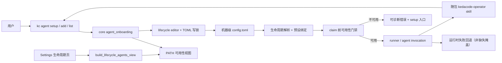

# PRD: Agent 可用性引导与自定义 Agent 注册

- GitHub Issue: https://github.com/ZataZhang/keda/issues/292

> ✅ **交付前置**：无，可立即开工。
> 结构化声明见 §8 Delivery Dependencies，**那里是唯一事实源**。

> 🧍 **验收状态**：待人工验收——执行侧交付已完成（§9 除 `Human-Confirmed` 外全部勾选或标注残留），三项决策与 9.1 呈递物等待人工回复。
> 本行是 §9 Acceptance Checklist 的投影，**那里是唯一事实源**。

> 本 PRD 分两个 altitude，分别服务不同读者，自上而下阅读：
>
> - **Part A · 人审层 (Review Layer)** — 需求方 / 验收人读这部分，决定“该不该做、做得对不对”，并通过风险地图知道哪些地方必须亲自确认。Part A 不出现实现机制、文件路径、命令。
> - **Part B · 执行器层 (Build Layer)** — 实现者（人或 Agent）读这部分动手。人只在 Part A 风险地图点名处下钻审查；其余交执行器与自动门禁。

## Feature Overview (功能一览)

本节是 §10 Functional Requirements 的短说明；验收行为以 §1 的行为样例表为准。

- **默认配置只描述产品，不描述某台机器**（FR-1、FR-9）：首次生成的全局配置不再复制仓库里的个人 Agent / 模型预设；个人选择留在本机。
- **安装后先看见真实可用的 Agent**（FR-2）：Agent 列表明确区分“已注册”和“可执行文件真的在 PATH 上”。
- **一次引导把可用选择写清楚**（FR-3、FR-4）：用户从已安装的 Agent 里选实现 / 校验角色，也可留空模型沿用 CLI 默认；第一次交互式使用只提醒一次，不打断命令。
- **缺 Agent 时在动手前停止**（FR-5）：绑定到未安装 Agent 时，在领取 Issue、创建 worktree 之前给出可修复的错误，不静默换人。
- **不内置的 Agent 可以自己注册**（FR-6）：用户能注册任意 CLI 的最小运行形态，并让它在列表、阶段选择、内容生成、循环任务、标签与 Skills 路径上都被当作一等公民。
- **设置页与 CLI 使用同一份可用性事实**（FR-7）：生命周期设置页在选择器里标出未安装的 Agent，不把不可用选项伪装成可用。
- **Agent 与文档同步知道该怎么做**（FR-8）：CLI help、指南与随包 kedacode-operator 指南都说明先检测、再配置、缺 Agent 时停在哪里。

# Part A · 人审层 (Review Layer)

## 1. Introduction & Goals

### Problem Statement

用户安装 KedaCode 后，最先遇到的不是“怎么把任务跑起来”，而是“为什么配置里写着 Qoder / CodeBuddy，我的机器上却没有这些命令”。当前仓库根 `config.toml` 被当作**非敏感默认配置**维护，并且在源码运行或模板派生项目首次创建 `~/.kedacode/config.toml` 时会被**整份复制**为机器级配置。这份默认配置里已经有 `codebuddy-*`、`qoder-*` 预设，并把实现、校验、修复、收尾四个阶段绑定到这些预设；本次讨论中的临时新增（`qoder-qwen3_8-flash_ultracode` 与对应文档段落）已回退，但它说明这份模板很容易继续吸收个人预设。这些是维护者本机的模型选择，不是产品默认值。

更关键的是，系统没有在安装后告诉用户“你现在到底有哪些 Agent 可用”。`kc agent list` 列出的是注册表里的全部 Agent，不标记可执行文件是否存在；`kc agent presets` 只列预设定义，不说明它引用的 Agent 是否安装；`kc init` 只写仓库配置和 Skills，不检查 Agent；只有 `kc agent doctor` 在针对单个 Agent 时才报“命令不在 PATH”。而默认的跨 Agent 回退链是 `claude → kimi → codex`：当绑定到未安装的 Qoder 时，运行可能悄悄换成另一个 Agent，并丢掉模型绑定，用户看到的只是日志里一条 WARN，而不是“你的配置没有生效”。

自定义 Agent 的声明式注册块已经存在，但仍是二等公民：内容生成只从内置表里找 Agent，循环任务的 agent 字段只接受内置名，用户级 Skills 安装与 PRD Skill 探测只遍历内置 Agent 的配置目录，`kc init` 同步标签时也没有把自定义 Agent 的注册表传下去。用户即使照着文档写了注册块，也会在不同阶段遇到“为什么这个 Agent 不生效”。

### Interpretation (解读回显)

我把请求理解为：KedaCode 不应该假设用户装的是维护者那套 Agent。安装后应先做一次**可用性检测**，只把真实可用的 Agent 呈现给用户，并引导用户显式选择默认实现 / 校验 Agent 和可选模型；用户没有对应 Agent 时，系统要在开始干活前明确停下来，而不是用默认回退链假装配置生效。同时，注册表要对“Keda 没有内置的 Agent”真正开放：用户可以登记自己的 CLI 调用方式，登记后所有生命周期路径都按同一份注册表工作。

**行为样例**

| 验证方式 | 输入 / 操作 | 期望观察到的结果 |
|---|---|---|
| 👀 人审 + 自动验证 | 一台只安装了 Claude 的干净机器，第一次运行 `kc` | 只出现一次“还没有配置 Agent”的提示；按引导选择后，全局配置只包含 Claude 的显式选择，不会出现 Qoder / CodeBuddy 的预设或阶段绑定。 |
| 👀 人审 + 自动验证 | 已有配置把实现阶段绑定到未安装的 Qoder，然后启动一个 Issue | 在领取 Issue、创建 worktree 之前停止，错误信息点名阶段、预设、Agent 和可执行文件名，并给出修复入口；修复后同一命令可以继续。 |
| 🤖 自动验证 | Agent 可执行文件在 PATH 上，但还没有登录 | 可用性检测通过；第一次真实调用报认证 / 启动失败，而不是误报“未安装”。 |
| 👀 人审 + 自动验证 | 用户注册一个 Keda 未内置的 Agent，只声明运行用途 | 它出现在 Agent 列表和 `doctor` 输出中，可以被阶段选择；需要内容生成而没有声明该用途时，明确提示缺少用途，而不是悄悄换成 Claude。 |
| 🤖 自动验证 | 机器上同时有 Claude 与 Codex，运行只读检测 | 每个已注册 Agent 都有“可用 / 不可用”和解析到的可执行文件路径；检测不写配置、不启动任何 Agent。 |

表中有效行为会转成 §7.6 的验收 oracle；修改一行的操作或预期结果，就等于修改对应验收标准。

**我默默定了这些**

- “可用”只表示可执行文件能在当前进程的 PATH 上解析到，不运行 `--version`，也不检查登录状态；登录失败属于下一次真实调用的错误。
- 首次引导写入**机器级全局配置**，不写仓库级 `.kedacode.toml`；仓库级仍可覆盖，但默认不替用户做仓库决定。
- 不自动安装任何 Agent CLI，也不内置模型目录；用户不填模型时，预设不写模型字段，沿用它自己的 CLI 默认。
- 已有用户配置不自动改写；修复只通过显式 `--fix` 执行，且只处理全局层。
- 自定义 Agent 的最小注册只生成运行用途；其他用途由用户按文档补 TOML，不猜 CLI 参数。
- 新增结构化输出协议仍需要代码入口，不承诺“只写配置就能解析任意新输出格式”。
- 缺失主 Agent 的可执行文件时一律在 claim 前阻断；回退链只处理运行时启动失败 / 容量错误，不负责掩盖配置错误。

**我理解为不做**

- 不自动下载、安装或登录 Claude、Codex、Qoder 等外部 CLI。
- 不维护在线模型目录，不根据 Agent 名称自动推荐模型。
- 不探测任意 CLI 的 `--help` 来合成它的非交互参数；参数必须由用户显式给出。
- 不把另一台电脑上的 Agent 清单同步过来；这是本机事实，跨机管理属于另一条线。

**可证伪的范围理解**：交付结果是“安装后能看见真实可用的 Agent、能显式选择并写进本机配置、缺少时会在动手前停下、未内置的 Agent 能注册并在各条生命周期路径上生效”。它不会替用户安装 CLI，不会伪造模型预设，也不会在用户不知情时换成另一个 Agent 继续跑。

### What The User Gets

- 新用户不用先研究 TOML：第一次使用会被告知“还没有配置”，引导只展示本机真实可用的 Agent，并允许先不选模型。
- 已有用户不会因为一份历史 seed 配置而得到“看起来配置了、实际没有”的假象；绑定失效会在启动前被点名，并可一键清理。
- 使用自研或未内置 Agent 的用户可以登记最小运行形态，并在列表、阶段选择、内容生成、循环任务与 Skills 安装中看到它，而不是每遇到一个入口就发现“未注册”。
- 维护者可以把个人模型选择留在自己的机器级配置里，仓库默认模板保持通用，不再把个人偏好当产品默认值。

### Measurable Objectives

- 在临时 HOME 且 PATH 上只有一个 Agent 的环境中，引导完成后生效配置只包含该 Agent；不存在指向未安装 Agent 的预设或绑定。
- 绑定到未安装 Agent 时，启动命令在领取 Issue、创建 worktree 之前以可诊断错误退出；Issue 的标签 / 评论、worktree 清单与尝试账本均无新增。
- 同一份有效配置在改动前后，内置 Agent 的 `doctor --all-profiles --json` 输出保持逐字节一致；引导只影响用户显式确认的键。
- 注册一个只声明运行用途的自定义 Agent 后，它能出现在列表与阶段选择中；请求内容生成时返回“缺少 generate 用途”的明确错误，而不是回退到 Claude。
- 生命周期设置页对每个已注册 Agent 展示可用性；“未安装”的 Agent 不会被显示成可用选项。

## 2. Human Review Map (介入与风险地图)

### 决策一：默认配置里到底该有什么

推荐把“仓库里的默认配置”和“某台机器上的个人选择”彻底分开：默认模板不再携带任何具体 Agent 的模型预设或阶段绑定，只保留带注释的写法示例；首次创建机器级配置时写入最小骨架，不再整份复制仓库文件。个人预设应由用户写进自己的机器级配置，仓库不再替用户决定用哪个模型。

主要风险是历史用户已经被 seed 过一份带个人预设的配置。推荐不自动删除这些内容（无法可靠区分“seed 带来的”和“用户自己写过的”），而是在启动前点名失效绑定，并提供显式清理；这样既不静默改用户文件，也不让坏配置继续伪装成生效。

**请确认：** 是否接受“仓库默认模板零具体预设 / 零阶段绑定，个人预设只存在机器级配置；历史配置只提示、不自动改写”的边界？

**验收：** 干净环境下生成的配置没有 Qoder / CodeBuddy 预设或绑定；历史坏绑定会在启动前被点名，显式修复后才消失。

### 决策二：发现 Agent 缺失时，停下还是继续

推荐在**开始干活之前**停下：如果本次要使用的 Agent 可执行文件不在 PATH 上，就在领取 Issue、创建 worktree 之前报错，说明阶段、预设、Agent 和可执行文件，并指向一次修复引导。缺失主 Agent 的可执行文件不是一次可恢复的 Agent 故障，因此不回退：即使配置了回退候选，也先在领取 Issue 前停下。回退链只处理进程已经能启动、但运行中失败或容量不足的情况；本次要临时换人时，显式传 `--agent`。

风险是这会改变过去“缺一个就换下一个”的宽松行为，可能让原本能靠回退跑完的任务变成启动失败。但继续静默换人会制造更严重的问题：用户以为 Qoder 在跑，实际是 Claude；模型绑定被丢弃，结果和成本都变了。明确失败比假成功更可解释。

**请确认：** 是否接受“主 Agent 的可执行文件缺失时一律在领取 Issue 前阻断，即使配置了回退候选也不换人；运行时失败仍走回退链”的行为变化？

**验收：** 绑定未安装 Agent 时，Issue 与 worktree 均未被改动，即使配置了回退候选也不会出现替代 Agent 的执行记录；运行时失败的回退仍按现有阶梯执行并点名实际 Agent。

### 决策三：自定义 Agent 开放到什么程度

推荐保留声明式 TOML 作为唯一事实源，并增加一个**最小注册脚手架**：用户给出名称、可执行文件、运行参数、提示词投递方式与输出协议，系统生成并校验一个只含运行用途的注册块；默认只预览，显式 `--write` 才写入机器级配置。注册后，列表、阶段选择、内容生成、循环任务、标签同步与 Skills 安装都从同一份生效注册表派生。新增结构化输出协议仍然需要代码入口，首版只用内置协议，并明确告诉用户 `plain` 的取舍。

主要风险是把这个入口做成“猜参数的黑盒”：不同 CLI 的参数语义差异很大，自动推断会生成看似成功、实际跑不起来的注册。推荐只做显式输入 + 同路径校验，缺少必需用途时明确报错，不自动补全。

**请确认：** 是否接受“自定义 Agent 用显式 TOML / 最小注册脚手架开放，不猜参数、不承诺无代码新增输出协议”的边界？

**验收：** 注册一个未内置 Agent 后，它能出现在列表与阶段选择中；缺少内容生成用途时明确失败；注册块只包含用户显式给出的参数。

### 自动门禁，不需要逐项人工审阅

默认配置的 seed 行为、可用性检测、配置写入的锁与幂等、启动前门禁、注册块的 TOML 合法性、内置 Agent 的 argv 黄金快照、CLI 机器输出 schema、设置页 API 契约、Skills 路径派生的单元 / 集成测试，以及 `kc agent doctor --all-profiles --json` 的逐字节兼容，均由执行者与独立 verifier 自动验证。面向用户的引导文案、错误信息与设置页可用性标记会进入最终人读呈递区。

**本次明确不涉及：** 自动安装 / 登录 Agent CLI、在线模型目录、通过探测 `--help` 自动合成参数、无代码新增结构化输出协议、跨机器 Agent 清单同步、修改模型评测的 judge 语义。

## 3. Usage And Impact After Implementation

### 新安装用户

第一次交互式运行 `kc` 时，如果检测到还没有有效的 Agent 选择，会在 stderr 提示一次“先确认本机可用的 Agent”，并给出 `kc agent setup` 入口；提示只出现一次，不阻断当前命令。运行 `kc agent setup` 后，用户看到本机已安装的 Agent（以及它们解析到的路径），从可用项里选择实现与校验角色；需要模型时再填预设名与模型标识，不填就只写 Agent 选择。确认后全局配置写入机器级文件，下一次运行直接使用该选择。

### 已有配置用户

继续使用已有配置；有效绑定行为不变。若配置把某个阶段绑定到未安装的 Agent，启动时会在领取 Issue 前停下，指出阶段、预设、Agent 与可执行文件，并提示运行引导或 `--fix` 清理。配置了回退候选也一样阻断；临时换人请显式传 `--agent`，运行时失败才由回退链处理。

### 使用未内置 Agent 的用户

用户用 `kc agent add` 登记自己的 CLI（名称、可执行文件、运行参数、提示词投递方式、输出协议），预览确认后写入机器级配置。随后该 Agent 出现在 `kc agent list`、`kc agent doctor` 与阶段选择中；内容生成、循环任务、标签同步与 Skills 安装都从生效注册表读取它。只声明运行用途时，需要内容生成的入口会明确提示缺少 `generate` 用途，用户再按文档补注册块。

### Keda Agent（随包 skill）

`kedacode-operator` 指南会要求 Agent 先确认本机有哪些可用 Agent，不假设用户装了某个特定 CLI；遇到“未安装 / 未配置”时，把决定交还给人，不自行改写全局配置或猜测要换哪个 Agent。

### 维护者与模板使用者

仓库根 `config.toml` 回到“通用默认模板”的角色；维护者本机的 Qoder / CodeBuddy 模型选择留在自己的机器级配置，不再通过 seed 流向新用户或模板派生项目。已有个人配置不被自动删除。

### 对现有行为的影响

- 有效配置下的 Agent 调用、argv 与输出协议不变；内置 Agent 的 `doctor --all-profiles --json` 快照保持逐字节一致。
- `kc agent list --output json` 增加可用性字段；旧字段与顺序不变，属于向后兼容的增量。
- 主 Agent 的可执行文件缺失时一律阻断，不再静默走默认回退链；运行时启动失败 / 容量错误仍按既有阶梯回退。这是本次唯一有意的行为变化，已在决策二中单独确认。
- 不新增数据库表、后台服务或第二份 Agent 注册表；所有事实仍来自配置与 PATH。

## 4. Requirement Shape

- **actor**：新安装用户、已有配置用户、使用未内置 Agent 的用户、Keda Agent（随包 skill）、仓库维护者与模板使用者。
- **trigger**：安装后第一次使用；配置引用的 Agent 不在本机；用户想接入一个 Keda 没有内置的 Agent。
- **expected behavior**：系统先检测本机真实可用的 Agent，只把可用项作为引导候选；用户的选择写入机器级配置；缺失的 Agent 在领取任务前被点名并可修复；自定义 Agent 通过显式注册进入同一份生效注册表，并在所有生命周期路径上生效。
- **explicit scope boundary**：只处理本机 PATH 上的 Agent 可执行文件与配置选择；不安装 CLI、不维护模型目录、不推断 CLI 参数、不新增输出协议运行时、不跨机器同步 Agent 清单。

# Part B · 执行器层 (Build Layer)

## 5. Repository Context And Architecture Fit

### 现有路径

- `src/backend/infrastructure/config/settings_sources.py` 的 `_ensure_global_config_toml()` 在状态目录没有 `config.toml` 时，把源码根 `config.toml` **整份复制**过去；`_find_product_config_toml()` 之后只读状态目录。仓库根文件因此实际是 seed 模板，而不是当前进程的全局配置。本仓库自己的 `.kedacode.toml` 是仓库级 dogfooding 配置，不是 seed 模板；本 PRD 不要求清空它，但文档不得把它当作新用户的默认示例。
- `config.toml` 当前声明了 `codebuddy-glm5_3-flash-max`、`codebuddy-deepseek-v4_1-flash`、`qoder-qwen3_8-flash_max`、`qoder-qwen3_8-max_xhigh` 四个预设，并在 `[agent_runner.lifecycle_presets]` 绑定 `implementation` / `verifier` / `fix` / `closeout`；本次讨论中的临时新增（`qoder-qwen3_8-flash_ultracode` 与对应的 `docs/guides/model-presets.md` 段落）已回退；它说明这份默认模板很容易继续吸收个人预设。
- `src/backend/core/shared/models/agent_spec.py` 的 `BUILTIN_AGENT_SPECS` 是代码内置默认；`[agent_runner.agents.<name>]` 通过 `AgentRunnerAgentSettings` 允许注册新 Agent（`bin` / `label` 必填，至少一个 profile）。
- `src/backend/core/use_cases/agent_invocation.py` 的 `build_agent_invocation()` 是唯一 argv 组装路径；`src/backend/core/use_cases/run_agent_once.py` 的 `run_agent_with_prompt()` 是唯一实际进程调用边界。
- `src/backend/core/use_cases/agent_runner_agent_selection.py` 的 `choose_agent()` / `resolve_agent_fallback_candidate_specs()` 决定主 Agent 与回退候选；`src/backend/core/use_cases/agent_runner_orchestrate.py` 在 `AgentUnavailableError` 时跳过当前候选、尝试下一个。
- `src/backend/core/use_cases/agent_runner_issue_handlers.py` 在多个入口调用 `arbitrate_first_claim()`；实现路径在 `claim_bid = arbitrate_first_claim(...)` 之前已经知道本次 Agent，是启动前门禁的落点。
- `src/backend/api/cli_parsed_commands/agent.py` 已实现 `agent list` / `agent doctor` / `agent presets` / `agent lifecycle` / `agent preset` / `agent fallback`；`src/backend/api/cli_parser_session_commands.py` 与 `src/backend/api/cli_typer_agent.py` 维护 argparse / Typer 两个门面。
- `src/backend/api/cli_completion.py` 已提供“首次交互式使用提示一次”的成熟模式（TTY 判断 + marker 文件 + 非机器输出），可复用其结构，不新增另一套首次运行机制。
- 自定义 Agent 的未覆盖路径：`create_issue_from_prd.py` 的 `resolve_agent_name()` 只查 `BUILTIN_AGENT_SPECS`；`loop_recipe.py` 的 `_VALID_AGENTS` 只含内置名；`remote_template_skills.resolve_user_skill_install_roots()` 与 `prd_skill_location.default_prd_skill_candidate_paths()` 只遍历内置 `auth_home`；`cli_init.py` 的 `sync_labels()` 传的是裸 `LabelConfig()`，没有传 `config.agents`。
- 前端生命周期设置页由 `frontend-public/components/agent-runner/lifecycle-settings-page.tsx`、`lifecycle-agent-matrix.tsx`、`lifecycle-matrix-row.tsx`、`lifecycle-agent-select.tsx` 组成；后端视图来自 `src/backend/core/use_cases/lifecycle_agents_console.py` 的 `build_lifecycle_agents_view()`。
- 随包 Agent 指南位于 `src/backend/engines/agent_runner/templates/skills/kedacode-operator/SKILL.md`；CLI 表面变化必须同步它。

### Reuse Candidates

- 复用 `shutil.which` 作为唯一可用性判断（与 `agent doctor` 一致），不新增探测子进程。
- 复用 `lifecycle_editor` / `toml_section_editor` / `config_write_lock` 的写回与锁，不在 core 新建 TOML 写入器，也不新建配置文件。
- 复用 `build_agent_invocation()` 与 `agent doctor` 做注册校验，不复制一份 argv 组装逻辑。
- 复用 `AgentUnavailableError` 与既有回退阶梯；只在启动前增加“主 Agent 未安装”的门禁，不改造错误分类体系。
- 复用 `build_lifecycle_agents_view()` 的视图与 Settings 页面，不新建第二个 Agent 设置页。

### 架构约束

- 遵守 `src/backend/api/ → src/backend/core/ → src/backend/engines/ → src/backend/infrastructure/`；可用性与引导编排放 core，PATH 解析与 TOML 写回分别落在 engines / infrastructure，API 只做参数与呈现。
- 配置写入必须持有现有跨进程写锁；写前完整校验、写后从磁盘重读。写入失败时目标文件字节不变。
- `AgentSpec` 仍是唯一注册事实源；不允许在 CLI、前端或 prompt 里另写 agent 专有分支。
- 新 CLI 表面（`kc agent setup` / `kc agent add`）必须同步 argparse / Typer / help / `kc schema --json` / 随包 skill / 文档；机器输出字段稳定、顺序确定。
- 前端可用性只读展示，不在保存时新增硬阻断；真正的执行门禁在 core，不能靠 UI 禁用冒充授权。

### Frontend Impact

**Frontend impact: `frontend-public/`。** 生命周期设置页的 Agent 选择器与矩阵行增加“未安装 / 可执行文件路径”信息；数据来自现有生命周期视图新增的 `agent_availability` 字段，不新增页面、路由或 API 服务。`frontend-public/lib/api/types.ts` 同步字段。`frontend-admin/` 冻结，不属于本次范围。

### Related PRDs

- `tasks/archive/P1-FEAT-20260911-010513-agent-cli-adapter-layer.md` 建立了声明式 Agent 注册表；本 PRD 不重复建表，只补齐“可用性检测 + 注册入口 + 未覆盖路径”。
- `tasks/archive/P1-FEAT-20260918-110027-lifecycle-agent-matrix.md`、`P1-FEAT-20261009-133425-lifecycle-agent-model-settings.md` 建立了生命周期矩阵与统一设置页；本 PRD 在其上增加可用性视图，不改矩阵语义。
- `tasks/archive/P1-FEAT-20260930-130445-agent-model-preset-switching.md` 建立了命名预设与阶段绑定；本 PRD 移除默认模板里的个人预设，不改变预设解析规则。
- `tasks/archive/P1-FEAT-20260920-225333-builtin-agent-coverage-codebuddy-qoder-opencode.md` 增加了内置 Agent 覆盖；本 PRD 不新增内置 Agent，只让未内置 Agent 可注册。
- `tasks/pending/P1-FEAT-20261018-034216-kc-tailscale-machine-onboarding.md` 是跨机器连接与远程 Agent 管理，目标与本 PRD 的本机 Agent 可用性不同；两者可独立实施，不构成依赖。

### Scope Cohesion Assessment

三项需要人确认的边界——默认配置归属、缺失时阻断、自定义 Agent 开放程度——共享同一份“本机 Agent 事实”和同一套配置写入路径。拆开交付会先得到一个只报错不引导的半成品，或者在引导完成后继续让自定义 Agent 在内容生成 / 循环任务里失败。因此作为一个端到端目标状态交付；§2 三项决策分别验收。

## 6. Recommendation

### Recommended Approach

把“Agent 是否可用”变成配置层的一等事实，而不是运行到一半才发现的偶然错误。机器级配置只保存用户显式选择；首次 seed 只写最小骨架；`kc agent setup` 从 PATH 检测可用 Agent 并把用户选择写进现有生命周期矩阵 / 预设表；`kc agent add` 只为未内置 Agent 生成并校验一个最小运行注册块；所有 Agent 调用在领取 Issue 前和进程启动前各做一次可用性门禁。

这套方案复用现有注册表、argv 组装、生命周期编辑器与 Settings 视图，不新增数据库、不新增第二份 Agent 清单、不引入自动推断。它把“默认值是否正确”从代码评审问题变成用户可见、可修复的本机事实。

### Proposed Solution Summary (实现机制)

- **核心机制**：新增 core 用例 `agent_onboarding.py`，提供可用性视图、引导计划、修复计划和自定义注册计划；由 CLI 与 Settings 视图共同消费。可用性只做 `PATH` 上的 `which`，不启动子进程。
- **谁提供声明**：Agent 的调用形态仍由 `[agent_runner.agents.<name>]` 声明；用户显式选择由 `kc agent setup` / Settings 写入 `[agent_runner.lifecycle_agents]` 或 `[agent_runner.presets.*]` + `[agent_runner.lifecycle_presets]`；系统只消费显式数据，不推断模型或参数。
- **接入点**：`kc agent list` 增加可用性字段；新增 `kc agent setup` 与 `kc agent add`；`run_agent_repositories_once()` / `agent_runner_issue_handlers.py` 在 claim 前调用门禁；`run_agent_with_prompt()` 在进程边界做最终检查；`build_lifecycle_agents_view()` 增加 `agent_availability`。
- **状态变化**：机器级 `config.toml` 从“整份复制仓库模板”变为“最小骨架 + 用户显式选择”；自定义 Agent 注册块通过现有 TOML 写回路径写入；不新增持久化存储。
- **刻意不做的复杂度**：不自动安装、不探测 `--help`、不内置模型目录、不新增输出协议运行时、不新增跨机器清单、不把 UI 禁用当作执行门禁。

### Alternatives Considered

- **安装脚本自动探测并写入配置**：安装时环境与后续运行环境可能不同（daemon 的 PATH、shell 配置），安装器写入的猜测容易过期；放在 `kc agent setup` 与实际运行同一环境检测，更可靠。
- **保留默认预设，缺失时静默回退**：这正是当前问题的来源；用户会以为配置生效，模型和成本却变了。明确失败更诚实。
- **内置更多 Agent 覆盖**：只能缓解已知 CLI，无法覆盖用户自研或内部 Agent；本 PRD 选择开放注册而不是继续扩表。
- **自动从 `--help` 推断 argv**：不同 CLI 的提示词投递、权限与输出格式差异大，自动推断会制造“注册成功但跑不起来”的假象；坚持用户显式声明 + 同路径校验。

## 7. Implementation Guide

This section is a living implementation guide based on current repository analysis. If implementation discovers additional affected files, hidden dependencies, edge cases, or a better path, update this PRD before proceeding.

### Core Logic

1. **seed 不再复制仓库配置**：`_ensure_global_config_toml()` 改为写入代码内的最小骨架（至少 `[agent_runner]`），不再读取源码根 `config.toml`；`_is_product_config_toml()` 若因此失去用途则删除。保持首次创建幂等，并继续使用 `config_write_lock`。已有状态目录文件一律不动。
2. **清理默认模板**：从仓库根 `config.toml` 移除全部生效的 `[agent_runner.presets.*]` 与 `[agent_runner.lifecycle_presets]`，保留注释示例；移除 `docs/guides/model-presets.md` 中“本仓库提供 Qoder UltraCode”的个人段落。维护者的个人预设迁移到自己的 `~/.kedacode/config.toml`，不进入仓库。
3. **可用性事实**：新增 `AgentAvailability` 视图（agent、bin、resolved_path、available、declared_profiles），按生效 `config.agents` 顺序生成；只调用 `shutil.which(spec.bin)`，不执行 Agent。
4. **列表呈现**：`kc agent list` 的人类输出在 agent 行标注 `available` / `missing` 与解析路径；JSON 增加 `available`、`bin_path`，保留原有字段与顺序。`kc agent presets` 对人类输出补充“该预设 agent 是否可用”，JSON 增加 `agent_available`。
5. **引导**：`kc agent setup` 读取可用性视图；交互式模式只提供可用 Agent，允许选择实现 / 校验 / 审核阶段；无 `--preset` 时写 `[agent_runner.lifecycle_agents]` 同键并**解绑该阶段的预设**（否则预设会遮蔽矩阵）。带 `--preset` 时先校验预设存在且其 Agent 可用，再写预设与阶段绑定。所有写入限全局层，复用 lifecycle editor 与写锁；`--dry-run` / `--json` 只读，`--fix` 只清理全局层中 Agent 不可用的阶段绑定，不删除预设定义。
6. **首次提示**：在交互式入口（TTY、非机器输出、非 `agent` 子命令）检查生效配置；没有有效选择或首选 Agent 不可用时，向 stderr 打印一次提示并写入机器级 marker（仿照 `maybe_prompt_for_completion_setup`），绝不阻断命令。
7. **启动前门禁**：在实现路径解析出本次 Agent 之后、`claim_bid = arbitrate_first_claim(...)` 之前检查 `which`；不可用则以 `ExitCode.NOT_FOUND` 停止，消息包含阶段、预设名（若有）、Agent、bin 与 `kc agent setup`。仓库轮询入口对配置层首选实现 Agent 再做一次预检，保证队列模式也在 claim 前失败。主 Agent 的 bin 缺失时一律阻断，不因配置了 `agent_fallback_candidates`（或非默认 `agent_fallback_order`）而换人；回退阶梯只处理进程启动后的运行时失败 / 容量错误，并照常打印实际 Agent 与被丢弃的绑定。
8. **进程边界兜底**：`run_agent_with_prompt()` 在启动前再次校验 `which`，把阶段上下文带进 `AgentUnavailableError`；这不改变既有异常分类，只让错误可诊断。fix / closeout / verifier / review / supervisor 等后续阶段在各自调用点得到同样的点名。
9. **自定义注册**：`kc agent add <name> --bin <bin> [--arg ...] [--prompt-delivery] [--prompt-flag] [--output-protocol] [--auth-home] [--label]` 默认只打印 TOML；`--write` 经 lifecycle editor 写入全局 `[agent_runner.agents.<name>]` 与 `profiles.run`。校验：名称合法且未注册、协议已注册、`flag` 投递必须有 `prompt_flag`、`build_agent_invocation()` 能组装出 argv；只声明 run 用途，不猜其他用途。
10. **注册表覆盖补齐**：`resolve_agent_name()` 接受生效注册表；显式选择的自定义 Agent 缺 `generate` 时报错，`auto` / `none` 的默认回落保留。`loop_recipe` 的 agent 校验接受生效注册表。`resolve_user_skill_install_roots()` / `default_prd_skill_candidate_paths()` 接受可选注册表，`kc init` / `kc skill install` 传 `config.agents`；`cli_init.py` 的 `sync_labels()` 传 `context.config.labels` 与 `context.config.agents`。
11. **Settings 视图**：`build_lifecycle_agents_view()` 增加 `agent_availability`；前端在 Agent 下拉项与矩阵行显示“未安装 / 路径”，不改保存语义。页面不把不可用项标成可用，也不在 UI 层阻止保存（由 core 门禁负责）。
12. **文档与随包 skill**：更新 `docs/guides/agent-runner.md`（首次使用、可用性、自定义注册）、`docs/guides/model-presets.md`（移除个人预设、增加“预设不应写进默认模板”）、`docs/guides/configuration.md`（注册块字段与 setup/add 的关系）、CLI help 与 `kedacode-operator` skill。按 `docs/ai-standards/tooling.md` 的 CLI Surface And Packaged Skill Sync 执行。

### Change Impact Tree

以下是当前实现路径的起点，不假定文件清单穷尽；如果执行发现更合适的扩展点，先修订本树与 Drift Guard。

```text
Configuration
├── config.toml [修改]
│   【总结】移除维护者私有的 Agent 预设与阶段绑定，只保留注释示例。
│   └── 不改变预设 / 矩阵的解析语义，只清空默认模板里的具体选择
├── src/backend/infrastructure/config/settings_sources.py [修改]
│   【总结】首次创建全局配置时写入最小骨架，不再整份复制源码根 config.toml。
│   ├── 保留 config_write_lock 与幂等检查
│   └── 已有状态目录配置一律不覆盖、不迁移

Domain / Core
├── src/backend/core/use_cases/agent_onboarding.py [新增]
│   【总结】提供 Agent 可用性视图、setup / fix / add 计划与配置写入编排。
│   ├── 可用性只做 PATH 解析，不启动 Agent
│   ├── 所有写入复用现有 lifecycle editor / TOML 锁
│   └── 不新增第二份注册表或持久化存储
├── src/backend/core/use_cases/agent_runner_issue_handlers.py [修改]
│   【总结】在 claim 之前检查本次 Agent 是否可用，阻断未安装的主 Agent。
├── src/backend/core/use_cases/run_agent_repositories_once.py [修改]
│   【总结】仓库轮询启动前预检配置层首选实现 Agent。
├── src/backend/core/use_cases/run_agent_once.py [修改]
│   【总结】进程启动前再次校验可执行文件，并让错误携带阶段上下文。
├── src/backend/core/use_cases/agent_runner_failure.py [修改]
│   【总结】扩展 AgentUnavailableError 的可选阶段 / 预设上下文，不改变回退分类。
├── src/backend/core/use_cases/create_issue_from_prd.py [修改]
│   【总结】内容生成 Agent 解析改为读取生效注册表，显式缺 generate 用途时报错。
├── src/backend/core/use_cases/loop_recipe.py [修改]
│   【总结】循环任务的 agent 字段按生效注册表校验。
├── src/backend/core/use_cases/lifecycle_agents_console.py [修改]
│   【总结】生命周期视图增加 agent_availability，供设置页与 CLI 共用。
├── src/backend/core/shared/prd_skill_location.py [修改]
│   【总结】PRD Skill 候选路径接受注册表，覆盖自定义 Agent 的 auth_home。
├── src/backend/engines/agent_runner/remote_template_skills.py [修改]
│   【总结】用户级 Skills 安装根目录接受注册表，覆盖自定义 Agent。
└── src/backend/engines/agent_runner/lifecycle_editor.py [修改]
    【总结】增加自定义 Agent 注册块的 TOML 写回能力，复用现有写锁与校验。

API / CLI
├── src/backend/api/cli_parsed_commands/agent.py [修改]
│   【总结】实现 agent list 可用性字段与 agent setup / agent add 处理器。
├── src/backend/api/cli_typer_agent.py [修改]
│   【总结】同步 Typer 门面的 setup / add 命令与选项。
├── src/backend/api/cli_parser_session_commands.py [修改]
│   【总结】同步 argparse 门面的 setup / add 命令、choices 与退出码说明。
├── src/backend/api/cli_init.py [修改]
│   【总结】标签同步与 Skills 安装传入生效配置的 labels / agents。
└── src/backend/api/cli_typer_app.py [修改]
    【总结】如首次提示接入主入口，保持与 completion 提示相同的 TTY / 机器输出门禁。

Frontend (frontend-public/)
├── frontend-public/components/agent-runner/lifecycle-settings-page.tsx [修改]
│   【总结】把可用性数据传给矩阵与选择器，展示未安装提示。
├── frontend-public/components/agent-runner/lifecycle-agent-matrix.tsx [修改]
│   【总结】在矩阵行渲染 Agent 可用性与解析路径。
├── frontend-public/components/agent-runner/lifecycle-matrix-row.tsx [修改]
│   【总结】展示阶段当前 Agent 是否可用，保持既有编辑交互。
├── frontend-public/components/agent-runner/lifecycle-agent-select.tsx [修改]
│   【总结】下拉项增加“未安装”描述，不把不可用项伪装成可用。
└── frontend-public/lib/api/types.ts [修改]
    【总结】同步 agent_availability 字段与生命周期视图类型。

Docs / Packaged Agent Skill
├── docs/guides/agent-runner.md [修改]
│   【总结】补充首次使用检测、setup / add 流程、缺失 Agent 的门禁与自定义注册字段。
├── docs/guides/model-presets.md [修改]
│   【总结】移除个人 Qoder 预设段落，说明预设属于用户机器级配置而非默认模板。
├── docs/guides/configuration.md [修改]
│   【总结】同步 agent 注册块、setup / add 与可用性字段的配置语义。
└── src/backend/engines/agent_runner/templates/skills/kedacode-operator/SKILL.md [修改]
    【总结】要求 Agent 先检测本机可用 Agent，缺 Agent 时交还给人，不自行改写全局配置。

Tests
├── tests/test_agent_onboarding.py [新增]
│   【总结】覆盖可用性视图、setup 计划 / 幂等 / 解绑遮蔽预设、add 校验与写回。
├── tests/test_agent_availability_gate.py [新增]
│   【总结】覆盖 claim 前阻断、回退候选不掩盖缺失、运行时回退、阶段上下文与无副作用。
├── tests/test_agent_registry_coverage.py [新增]
│   【总结】覆盖内容生成、循环任务、Skills 与标签同步对自定义 Agent 的识别。
├── tests/test_settings_sources_seed.py [新增]
│   【总结】覆盖最小骨架 seed、已有配置不覆盖与写锁幂等。
└── tests/playwright-e2e/ [修改]
    【总结】覆盖设置页可用性标记的真实页面旅程。
```

### Risk Classification Register

| Change point | Tier | Decisive dimension / override | Intervention | Oracle / gate |
|---|---|---|---|---|
| 首次创建全局配置的 seed 行为 | R2 | 可能覆盖或损坏用户配置 | Executor + regression tests | 已有文件不覆盖、写锁内幂等、最小骨架可解析 |
| 缺失主 Agent 的 claim 前阻断 | R3 | 可能误杀可运行任务，或放过坏配置 | Human confirmation + executable negative control | rv-2；可用 Agent 不被拦截，缺失 Agent 必被拦截 |
| 自定义 Agent 注册写回与执行 | R2 | 生成非法 TOML 或可执行参数 | Executor + doctor 同路径校验 | rv-3；非法协议 / 缺 prompt_flag / 重名均拒绝 |
| 可用性判断与列表字段 | R1 | 只读呈现，错误会导致误导 | Executor + unit tests | rv-1；PATH 解析与缺省路径 |
| 设置页可用性标记 | R1 | 只读展示 | Executor + e2e | rv-4；未安装项可区分 |
| 文档与随包 skill 同步 | R1 | 公开命令漂移 | Executor + static checks | CLI help / skill / docs 逐项一致 |

### Executor Drift Guard

实施前后搜索这些语义，确认没有第二套注册表、默认配置或首次提示逻辑：

```bash
rg -n "BUILTIN_AGENT_SPECS|resolve_agent_name|_VALID_AGENTS|resolve_user_skill_install_roots|default_prd_skill_candidate_paths|sync_labels\(" src/backend
rg -n "agent_runner\.presets|lifecycle_presets|qoder|codebuddy" config.toml docs/guides .kedacode.toml
rg -n "AgentUnavailableError|arbitrate_first_claim|build_lifecycle_agents_view|agent_availability" src/backend
rg -n "agent setup|agent add|agent list|agent presets" src/backend/api docs/guides src/backend/engines/agent_runner/templates/skills/kedacode-operator
```

失败排查顺序：先确认生效配置来自 `<state home>/config.toml` 而不是仓库根文件；再确认当前进程的 PATH 与 daemon 的 PATH 是否一致；然后检查阶段是否仍被预设绑定遮蔽（矩阵写了 Agent 但预设仍生效）；最后确认自定义 Agent 是否真的在 `config.agents` 里，而不是只在 TOML 里未被合并。

### Flow / Architecture Diagram



### ER Diagram

无数据库结构变化；本次只读写现有 TOML 配置（`[agent_runner.agents.*]` / `presets` / `lifecycle_presets` / `lifecycle_agents`），不新增表、不迁移数据。

### Realistic Validation Plan

```yaml
- id: rv-1
  behavior: "在只安装一个 Agent 的干净环境中，首次提示只出现一次；引导后机器级配置只写入该可用 Agent 的显式选择，不产生指向未安装 Agent 的预设或绑定；重复引导不重复写入。"
  reviewer: human
  real_entry: "HOME=$(mktemp -d) KEDACODE_CONFIG=$(mktemp -d)/config.toml uv run kc agent setup --yes --agent claude --output json"
  expected: "JSON 只列可用 Agent 与解析路径；配置包含 implementation = claude，且没有 [agent_runner.presets.*] 或指向未安装 Agent 的 lifecycle_presets；第二次运行不产生文件差异。"
  mock_boundary: "CLI、配置加载、PATH 检测、TOML 写入与写锁必须真实；PATH 指向临时目录中的 claude stub；不访问 GitHub，不启动真实 Agent。"
  tier: R3
  test_layer: e2e
  required_for_acceptance: true
  presentation: "在真实 TTY 中首次运行 uv run kc 观察一次性提示；保存 tasks/evidence/P1-FEAT-20261020-011007-agent-availability-and-custom-registry/rv-1-setup.txt 与 rv-1-config-diff.txt。10 秒自检：首次只提示一次，配置里没有 qoder/codebuddy 预设。"
  critical_value_source: "Agent 名与解析路径必须来自本次 setup 输出 / kc agent list --json；配置路径来自 KEDACODE_CONFIG；不得用测试常量重建可用清单。"
  must_cross: "TTY 首次提示 → 配置加载 → PATH 解析 → setup 计划 → TOML 写锁 → 新进程 kc agent lifecycle list --output json 与新配置读取。"
  forbidden_bypasses: "禁止直接写配置文件代替 setup；禁止用内置 Agent 表冒充可用性；禁止复用维护者真实 ~/.kedacode/config.toml；禁止联网。"
  fresh_state_probe: "用新进程读取生效配置与 kc agent list --json；重复运行 setup 后比对文件哈希不变。"
  final_tree_evidence: "保存 git rev-parse HEAD、目标配置 sha256 与两次 setup 的终端记录；任何 seed / setup / 配置写入改动后重跑。"
  negative_control: "在同一临时 PATH（只有 claude stub）下运行 kc agent setup --yes --agent codebuddy。"
  expected_fail: "命令以 3（not found）退出并列出可用 Agent；目标配置文件字节不变。"
- id: rv-2
  behavior: "配置把实现阶段绑定到未安装的 Agent 时，启动在领取 Issue、创建 worktree 之前停止，错误点名阶段、预设、Agent 与可执行文件；即使配置了回退候选也不换人，只有进程启动后的运行时失败才走回退。"
  reviewer: human
  real_entry: "KEDACODE_CONFIG=$KEDA_TEST_CONFIG uv run kc run --issue $KEDA_TEST_ISSUE --dry-run --json；无凭据替代方案使用同一 core 门禁的集成测试，GitHub client 只在边界 fake。"
  expected: "退出码 3；stderr 包含 implementation、预设名、目标 Agent、bin 与 kc agent setup；即使配置了可用的回退候选也没有替代 Agent 的执行记录；Issue 标签 / 评论、git worktree list 与 attempts 均无新增。"
  mock_boundary: "CLI、配置合并、生命周期预设解析、可用性门禁与配置读取必须真实；GitHub 客户端可在边界 fake；完整验收使用真实测试 Issue（opt-in）。"
  tier: R3
  test_layer: e2e
  required_for_acceptance: true
  presentation: "保存 rv-2-blocked.txt 与 rv-2-issue-unchanged.json；10 秒自检：错误里同时出现阶段、预设、Agent 与 bin，Issue 未被领取。"
  critical_value_source: "阶段与预设名来自生效配置和 lifecycle 解析结果；Agent / bin 来自注册表；Issue 编号来自测试环境变量，不得用固定常量重建配置。"
  must_cross: "CLI → 配置合并 → 生命周期解析 → claim 前门禁 → 未发生 claim → 新 GitHub API 读取 + git worktree list + attempts 读取。"
  forbidden_bypasses: "禁止直接调用门禁函数代替真实 CLI；禁止只断言错误文本而忽略副作用检查；禁止用 --agent claude 绕过本次配置。"
  fresh_state_probe: "用新 API 请求读取 Issue 标签与评论；新进程执行 git worktree list --porcelain；读取 attempt 账本确认无新记录。"
  final_tree_evidence: "保存 git rev-parse HEAD、Issue 快照、worktree 清单与 attempts 摘要；任何 claim / 门禁 / 生命周期解析改动后重跑。"
  negative_control: "① 把同一阶段的绑定改成可用的 claude stub；② 保留缺失的主 Agent，同时配置可用的 claude 作为显式回退候选。分别重复同一命令。"
  expected_fail: "① 命令进入 dry-run 计划（`--dry-run --json` 下退出码 10；表格模式 dry-run 按既有语义退出 0，不能用作对照）而不是被同一个错误拦截，证明门禁不是无条件阻断；② 仍然以 3 退出且没有替代 Agent 的执行记录，证明回退候选不能掩盖缺失。"
- id: rv-3
  behavior: "用户注册一个 Keda 未内置的 Agent（显式 bin 与运行参数）后，它以 run 用途出现在列表、doctor 与阶段选择中；协议 / 参数非法或重名时写入被拒绝。"
  reviewer: human
  real_entry: "uv run kc agent add myagent --bin $KEDA_TEST_BIN/myagent --arg=--print --write --yes，然后 uv run kc agent doctor myagent --json 与 uv run kc agent doctor --lifecycle implementation --json（自定义 Agent 只声明 run 用途，`--all-profiles` 对它没有可比的多 profile），再 uv run kc agent list --output json。"
  expected: "配置新增 [agent_runner.agents.myagent] 与 profiles.run；doctor 输出与预期 argv 一致；list 标记 available 并给出 bin_path；重名或未注册协议返回 2 且文件字节不变。"
  mock_boundary: "CLI、注册表合并、TOML 写入、doctor 的 argv 组装与 PATH 解析必须真实；myagent 是临时目录中的可执行 stub；不访问 GitHub。"
  tier: R2
  test_layer: e2e
  required_for_acceptance: true
  presentation: "保存 rv-3-register.txt 与 rv-3-doctor.json；10 秒自检：注册块只有用户显式给出的参数，doctor 与 list 都能看到 myagent。"
  critical_value_source: "Agent 名、bin、argv 与协议必须来自本次命令输入与 doctor 输出；bin_path 必须来自 PATH 解析，不得由测试常量伪造。"
  must_cross: "kc agent add → TOML 校验 → 写锁 → 新进程 kc agent doctor / kc agent list 读取生效注册表。"
  forbidden_bypasses: "禁止手写配置块代替 add；禁止复用内置 profile 生成器猜测参数；禁止在协议未注册时静默回落 plain。"
  fresh_state_probe: "新进程重新加载配置后运行 doctor 与 list；重复 add 同名 Agent 必须被拒绝。"
  final_tree_evidence: "保存 git rev-parse HEAD、注册块文本、doctor JSON 与写入前后文件哈希。"
- id: rv-4
  behavior: "生命周期设置页展示每个 Agent 的可用性，未安装的 Agent 不会被显示成可用选项。"
  reviewer: human
  real_entry: "just console-sync 同步面板静态产物后，KEDACODE_CONFIG=$KEDA_TEST_CONFIG uv run kc console --no-browser --port $FREE_PORT，打开 /app/settings/lifecycle/；配置把某阶段绑定到未安装的 codebuddy。启动日志必须出现 listening on（出现 already running 说明端口被别的实例占着，截图即失真）。"
  expected: "选择器与矩阵行显示 codebuddy 未安装、可用的 claude 正常；页面仍可浏览与编辑，保存语义未改变。"
  mock_boundary: "真实 frontend-public 页面、同源 Console API、core 视图与配置文件；只允许测试配置中的 Agent 不可用，不用 mock 数据替换可用性。"
  tier: R1
  test_layer: e2e
  required_for_acceptance: true
  presentation: "保存 rv-4-settings-availability.png；10 秒自检：未安装标记出现在 codebuddy 旁，claude 没有该标记。"
```

**Decision mapping:** Section 2 决策一由 rv-1 锁定，决策二由 rv-2 锁定，决策三由 rv-3 锁定；rv-4 是同一可用性事实的设置页呈现。Section 9 使用相同编号关联证据，不在其他段落复制 oracle 表格。

**失败排查：** 先确认命令读取的是 `<state home>/config.toml` 还是仓库根模板；再确认 PATH 在 CLI 与 daemon 中一致；然后检查阶段是否仍被预设绑定遮蔽；最后确认自定义 Agent 已进入 `config.agents` 而不是只存在于 TOML 文本。

### Low-Fidelity Prototype

不需要单独原型：本次没有新页面或多步图形流程，唯一前端变化是在现有生命周期设置页的 Agent 选项与矩阵行增加可用性标记。单独画原型会复制生产布局，反而无法验证真实 API 与配置来源。实现截图将作为 §9.1 的呈递物。

### External Validation

No external validation required; repository evidence was sufficient.

## 8. Delivery Dependencies

### Delivery Dependencies

- Depends on tasks/issues:
  - none
- Gate type: none
- Sequence: via-main
- Notes: 与 Tailscale 机器连接、托管 runner 等 PRD 独立；本 PRD 只改本机 Agent 可用性、配置 seed 与声明式注册覆盖。

## 9. Acceptance Checklist

### 9.1 人读呈递区（Human Review Surface）

| 要看什么 | 呈递物 / 如何打开 | 约 10 秒自检 |
|---|---|---|
| 干净环境首次提示与引导只写入真实可用 Agent，默认模板不再带个人预设。 | `tasks/evidence/P1-FEAT-20261020-011007-agent-availability-and-custom-registry/rv-1-setup.txt` 与 `tasks/evidence/P1-FEAT-20261020-011007-agent-availability-and-custom-registry/rv-1-config-diff.txt`；在完成消息或 PR 评论中内嵌或粘贴关键行。 | 首次只提示一次；配置里没有 qoder / codebuddy 预设，只有被选中的 Agent。 |
| 缺失 Agent 时在领取 Issue 前停止，错误可定位、无副作用。 | `tasks/evidence/P1-FEAT-20261020-011007-agent-availability-and-custom-registry/rv-2-blocked.txt` 与 `tasks/evidence/P1-FEAT-20261020-011007-agent-availability-and-custom-registry/rv-2-issue-unchanged.json`；在完成消息或 PR 评论中粘贴错误与 Issue / worktree 未变化摘要。 | 错误同时包含阶段、预设、Agent、bin；Issue 未被领取。 |
| 未内置 Agent 可以注册并在 list / doctor 中生效。 | `tasks/evidence/P1-FEAT-20261020-011007-agent-availability-and-custom-registry/rv-3-register.txt` 与 `tasks/evidence/P1-FEAT-20261020-011007-agent-availability-and-custom-registry/rv-3-doctor.json`；在完成消息或 PR 评论中粘贴注册块与 doctor 输出。 | 注册块只含显式参数；doctor 能看到 myagent。 |
| 设置页把未安装 Agent 与可用 Agent 区分开。 | `tasks/evidence/P1-FEAT-20261020-011007-agent-availability-and-custom-registry/rv-4-settings-availability.png`；在完成消息或 PR 评论中内嵌截图。 | codebuddy 旁有未安装标记，claude 没有。 |

一行汇总入口：`tasks/evidence/P1-FEAT-20261020-011007-agent-availability-and-custom-registry/P1-FEAT-20261020-011007-agent-availability-and-custom-registry.evidence-report.md` 以「人审导航」表开头，把上表四行的关键行与两张截图内嵌在同一页（相对链接，本地打开即可，无需逐个下载）；同目录 `….verifier-report.md` 记录独立 verifier 的逐条判定与两处未闭合项，`….verification-plan.md` 记录逐步口径与偏差登记。

本区刻意不呈递 `reviewer: verifier` 的 seed 单元测试、内置 Agent argv 黄金快照、TOML 写锁、CLI schema、内容生成 / 循环任务 / Skills 路径覆盖等证据；这些由 Agent 与 verifier 自动核对，只有失败需要交由用户查看。

### 9.2 Acceptance Evidence Package

#### Human-Confirmed

- [ ] **决策一 — 默认配置归属：** Section 2 决策一得到用户回复；确认默认模板不携带个人预设与绑定、历史配置只提示不自动改写。对应 §2 决策一 / rv-1。
- [ ] **决策二 — 缺失时阻断：** Section 2 决策二得到用户回复；确认主 Agent 不可用时在 claim 前阻断，即使配置了回退候选也不在缺失时换人；运行时失败仍走回退。对应 §2 决策二 / rv-2。
- [ ] **决策三 — 自定义 Agent 开放范围：** Section 2 决策三得到用户回复；确认显式注册、不猜参数、不承诺无代码新增输出协议。对应 §2 决策三 / rv-3。
- [ ] **Human Review Surface：** 查看 9.1 的全部呈递物，确认 CLI 记录与真实设置页截图对应当前实现。

#### Architecture Acceptance

- [x] `_ensure_global_config_toml()` 不再整份复制源码根 `config.toml`；首次 seed 只写最小骨架，已有状态目录文件不被覆盖或迁移。证据：`src/backend/infrastructure/config/settings_sources.py` 改写为代码内 `_GLOBAL_CONFIG_SEED_TEMPLATE`（仅 `[agent_runner]`）且写前有 `is_file()` 守卫；`rv-1-setup.txt` 里干净 HOME 的骨架 sha256 `842049520c…` 被新进程正常解析；`tests/test_settings_sources_seed.py`。
- [x] 可用性判断只有一处 `shutil.which` 事实源；`kc agent list`、setup、claim 前门禁与 Settings 视图共用它，没有第二套探测逻辑。证据：唯一新增探测在 `src/backend/core/use_cases/agent_onboarding.py`，list/setup/门禁/首启提示/两个 Console 视图同读 `agent_availability_entries`；`rv-1-setup.txt` 的「本机可用 agent（CLI 自己解析）: ['claude']」与同文件 lifecycle JSON 同源；独立 verifier 核对 `frontend-public/` 无任何探测（见 `….verifier-report.md` #1）。
- [x] 配置写入复用现有 lifecycle editor / TOML 写锁；写前校验、写后重读；失败时目标文件字节不变。证据：`rv-1-setup.txt` 负控与 `rv-3-register.txt` 三条负控（重名/未注册协议/缺 `--prompt-flag`）均非零退出且 sha256 与写入前逐字节相同；正控写入后由新进程重读（`rv-1-lifecycle-after-setup.json`、`rv-3-list.json`）。
- [x] 自定义 Agent 仍由 `[agent_runner.agents.<name>]` 声明；`src/` 内没有新增 agent 专有分支，也没有第二份注册表。证据：`rv-3-register.txt` 的注册块即 add 的产物；`grep -rn myagent src/` 无命中（verifier #6）；`tests/test_agent_registry_coverage.py` 全部按生效注册表断言。
- [x] 主 Agent 的 bin 缺失时一律阻断，不因显式回退候选而换人；运行时启动失败 / 容量错误仍按现有阶梯执行并注明实际 Agent。证据：`agent_runner_orchestrate.py` 在 `AgentUnavailableError` 分支之前重抛 `PrimaryAgentNotInstalledError`；`rv-2-blocked.txt` 负控②（配了可用 claude 回退候选仍 exit 3、attempt 账本 0 条）；`tests/test_agent_availability_gate.py`。

#### Dependency Acceptance

- [x] 没有新增外部依赖、数据库表、后台服务、模型目录或网络探测。证据：`git diff --name-only` 不含 `alembic/`、`pyproject.toml`、`uv.lock`；rv-1..rv-4 全程禁网（沙箱 `env -i`，rv-2 只对 Issue #291 做只读 `gh api` 读取）。
- [x] 缺失 `bin`、未注册协议、缺 `prompt_flag`、重名 Agent 都在写文件或启动 Agent 前返回可诊断的非零退出。证据：`rv-1-setup.txt`（exit 3 + 可用清单 + `kc agent add` 指引）、`rv-3-register.txt` 三条 exit 2 且字节不变、`rv-2-blocked.txt`（exit 3 点名阶段/预设/agent/bin/setup）。

#### Behavior Acceptance

- [x] 干净状态目录下 seed 出的配置不含任何 `[agent_runner.presets.*]` 或 `[agent_runner.lifecycle_presets]`，且能被现有配置加载器正常解析。证据：`rv-1-setup.txt` 「presets: （无）  lifecycle_presets: （无）」与新进程完整 lifecycle JSON；`rv-1-config-diff.txt` 的骨架→引导差异。
- [x] `kc agent setup --dry-run --json` 只读列出可用性；`--yes` 只写用户显式选择的键；重复运行不产生差异。证据：`rv-1-setup.txt` 第二次 setup `already_satisfied=true` 且 sha256 与首次相同（`2aafa48b67f…`）；`rv-1-setup-second.json`。
- [x] 无 `--preset` 的 setup 会解绑该阶段预设，确保显式 Agent 选择不被遮蔽；带 `--preset` 时先校验预设 Agent 可用。证据：`tests/test_agent_setup_cli.py::test_setup_unbinds_the_masking_stage_preset`、`test_setup_plan_rejects_unknown_or_unusable_preset`、`test_setup_plan_marks_the_masking_preset_for_unbind`；`rv-2-blocked.txt` 展示预设绑定优先于矩阵。
- [x] `kc agent setup --fix` 只清理全局层中 Agent 不可用的阶段绑定，不删除预设定义、不改仓库层。证据：`tests/test_agent_setup_cli.py::test_setup_fix_removes_only_global_unavailable_bindings`、`tests/test_agent_onboarding.py::test_fix_plan_lists_only_global_bindings_to_unusable_agents`、`test_apply_fix_plan_batches_unbinds_in_one_transaction`。
- [x] 实现路径在 claim 前拦截未安装的主 Agent，即使配置了回退候选也不换人；运行时失败回退时输出实际 Agent 与被丢弃的模型绑定。证据：`rv-2-blocked.txt`（exit 3 + Issue #291 标签 3→3、评论 0→0、worktree 摘要前后相同、attempt 0→0）；`agent_runner_issue_handlers.py` 的门禁调用位于认领 CAS 之前。
- [x] `kc agent add` 默认预览、`--write` 写入；只生成 run 用途；非法协议 / 缺 prompt_flag / 重名均拒绝且不写文件。证据：`rv-3-register.txt` 第一段 `written=false` 且哈希不变、注册块 `声明用途=['run']`、三条负控 exit 2；`rv-3-add-dryrun.json`。
- [~] 内容生成、循环任务、`kc init` 标签同步、用户级 Skills 安装与 PRD Skill 候选路径都能识别生效注册表中的自定义 Agent。证据：`tests/test_agent_registry_coverage.py`（content_generation 接受/拒绝、loop recipe 接受与拒绝、label 规格与同步转发、skill 安装根与 PRD skill 候选）117 项全绿（含交付的六个测试文件与 doctor CLI 回归）。**残留**：`src/backend/core/use_cases/loop_fire.py` 仍以内置 registry 解析阶段 Agent，故「能建不能发射」，已作为已知限制记入 §12 与 Change Log，不在本次交付内静默扩范围。
- [x] `kc agent list --output json` 增加 `available` / `bin_path`，旧字段与顺序不变；`kc agent presets` 补充 Agent 可用性。证据：`rv-1-agent-list.json` 与 `rv-3-list.json`（`available=True bin_path=…`）；`tests/test_agent_onboarding.py::test_agent_presets_reports_bound_agent_availability`；旧字段顺序由既有 CLI 测试守护。

#### Frontend Acceptance

- [x] `/app/settings/lifecycle/` 的 Agent 选择器与矩阵行显示 `agent_availability`；未安装项有明确标记且不显示为可用。证据：`rv-4-settings-page.txt` 逐行核对（`implementation=codebuddy → 未安装（PATH 中找不到 codebuddy）`，6 行 claude 只有路径标记）与 `rv-4-page-facts.json`；`option_labels` 里七个候选各自的对错标记；截图 `rv-4-settings-availability.png`、`rv-4-selector-availability.png`。
- [x] 可用性展示不改变保存语义；保存失败仍由 core 校验返回。证据：diff 只在展示层加标记，写路径未变（`lifecycle_agents_console.py` 的校验分支未改）；e2e spec 明确「只读交互，不点保存」并仍然通过（8 passed，`rv-4-e2e-spec.txt`），落盘语义由 `tests/test_lifecycle_agents_console_api.py` 覆盖。
- [x] 真实页面截图（rv-4）与生产入口一致，不用组件预览替代。证据：`rv-4-settings-page.sh` 起真实 `kc console`（日志 `kc console listening on`，出现 `already running` 即判失败），真实浏览器打开生产路由 `/app/settings/lifecycle/`（HTTP 200），并把 DOM 标记与同源 API 逐行对照；verifier 确认所服务前端包出自本树。

#### Documentation Acceptance

- [x] `docs/guides/agent-runner.md`、`docs/guides/model-presets.md`、`docs/guides/configuration.md` 与 `kedacode-operator` skill 一致说明：先检测可用 Agent、再 setup、缺 Agent 时停在哪里、如何注册未内置 Agent。证据：四份文档与 `templates/skills/kedacode-operator/references/setup-and-config.md` 同步更新；漂移守卫 `tests/test_kedacode_operator_skill.py` 通过；verifier #8 逐项比对了旗标清单。
- [x] `kc --help`、`kc agent --help`、`kc agent setup --help`、`kc agent add --help` 与文档逐项一致；机器输出字段与退出码已写入指南。证据：文档记录的 `--stage/--agent/--preset/--fix/--dry-run/--yes` 与 `--bin/--arg/--prompt-delivery/--prompt-flag/--output-protocol/--auth-home/--label/--write/--yes` 与 `cli_parser_session_commands.py` 一致；退出码 0/1/2/3/4/5/10 语义在 `docs/guides/agent-runner.md` 与 skill 参考中列明。
- [x] 默认模板中不再出现维护者私有预设；文档明确「预设属于用户机器级配置，不应写进仓库默认模板」。证据：`config.toml` 中 `[agent_runner.presets.*]` 与 `[agent_runner.lifecycle_presets]` 已全部注释为示例，模板头注释改述其归属；`tests/test_product_identity.py` 守护。
- [x] `mkdocs.yml` 无需新增页面；如新增任何文档页，导航同步更新。证据：本次只改既有指南页，`mkdocs.yml` 未出现在 diff 中。

#### Validation Acceptance

- [x] rv-1、rv-2、rv-3、rv-4 全部通过；rv-2 的完整验收使用真实测试 Issue（opt-in），无凭据回退只用于集成门禁。证据：`rv-1-setup.txt`、`rv-2-blocked.txt`（真实 Issue #291 只读预览，未影响 #292）、`rv-3-register.txt`、`rv-4-settings-page.txt`；`evidence.json` 四条命令 + stdout 断言已按 runner 的重放口径预校验（`scripts/check-manifest-assertions.py` → `MANIFEST_OK: 4 items`）。
- [x] `tests/test_settings_sources_seed.py`、`tests/test_agent_onboarding.py`、`tests/test_agent_availability_gate.py`、`tests/test_agent_registry_coverage.py` 通过；内置 Agent 的 `doctor --all-profiles --json` 与改动前快照逐字节一致。证据：最终树重跑七个交付相关文件 `117 passed`；`tests/test_agent_doctor_cli.py` 的 21 项含内置 Agent `--all-profiles` 黄金快照逐字节比对，通过。
- [x] rv-2 的 negative control 真实执行：可用 Agent 不被拦截，缺失 Agent 被拦截；不是通过生产代码 fault injection 制造。证据：`rv-2-blocked.txt` 负控①（改绑可用 claude → exit 10 并打印 `DRY RUN: would process Issue #291 (ready) with claude`）与负控②（缺失仍拦截 exit 3）；两条都由真实 CLI 改写真实机器级配置达成，脚本内无生产代码注入。
- [x] `tests/playwright-e2e/` 覆盖设置页可用性标记；`just test` 与相关 e2e 在最终代码树上通过。证据：可用性标记用例（页面渲染逐行对照后端 `agent_availability`）在 `tests/playwright-e2e/tests/workflows/lifecycle-settings.spec.ts`，本轮在最终树重跑 `just e2e tests/workflows/lifecycle-settings.spec.ts` = **8 passed**；`just test all` 在最终树 **4580 passed / 1 skipped / 0 failed**（上一轮的 33 个 `.iar` 改名族失败已按 Change Log「修复 HEAD 遗留的 33 个 `.iar` 改名族测试失败」逐条修复并复现绿，非跳过、非弱化）。
- [x] 记录 `git rev-parse HEAD`、rv-1..rv-4 的产物、配置哈希与 Issue / worktree 快照；任何 seed / 门禁 / 注册路径改动后重跑对应 oracle。证据：四个 `rv-*.txt` 首块均记录 date + `git HEAD c0e3a084…` + 临时 HOME/配置路径 + PATH 内容，配置哈希逐步给出；Issue/worktree/attempt 快照在 `rv-2-issue-unchanged.json`；改动后重跑口径写在 `….verification-plan.md` 与 `….evidence-report.md`。

#### Delivery Readiness

- [~] 推荐方案完整实现；没有把「安装引导可用但自定义 Agent 仍失败」或「只提示不阻断」留成下个 PRD。证据：三项决策（§2）与 FR-1..FR-7 全部落地并由 rv-1..rv-4 呈递；「只提示不阻断」被 rv-2 的 exit 3 + 零副作用直接否定。**残留披露**：自定义 Agent 在注册表消费面上是一等公民（list/doctor/setup/预设/标签/Skills/内容生成/loop 创建），但 `loop_fire.py` 的发射侧仍用内置 registry 解析，已记入 §12 与 Change Log 作为后续项，未被包装成本次已完成。
- [x] 最终回复或 PR evidence comment 含 §9.1 全部内容，并内嵌 rv-4 截图；只给证据目录路径不算呈递。证据：交付完成消息内嵌 §9.1 四行摘要与 `rv-4-settings-availability.png` / `rv-4-selector-availability.png`；PR 由 runner 发布时 `evidence.json` + `….evidence-report.md` 为呈递物。
- [x] PRD 的 Feature Overview / §1 行为表 / §2 决策 / §10 FR / §9 横幅与最终实现和 fresh evidence 一致；没有未声明的默认回退、配置改写或公开 CLI 变化。证据：本节下方的 Final Reconciliation 与 Change Log 按最终代码重写；新增公开 CLI 面（`kc agent setup` / `kc agent add` / `--fix` / list 的 `available`+`bin_path`）在 §3、§10 与文档/skill 中均已声明；未声明的回退或配置自动改写没有——历史坏配置只提示 + 显式 `--fix`（D-06）。

## 10. Functional Requirements

- FR-1: **Generic defaults** — 仓库默认配置只描述产品默认行为，不包含任何具体 Agent 的模型预设或阶段绑定；首次创建机器级配置只写最小骨架，不整份复制仓库模板；个人预设由用户写入自己的机器级配置。已有配置文件不被自动改写。
- FR-2: **Availability visibility** — `kc agent list` 与只读检测输出版本化地展示每个已注册 Agent 的 `available` 与 `bin_path`；`kc agent presets` 同时说明其 Agent 是否可用。检测不启动 Agent、不写配置。
- FR-3: **Guided setup** — `kc agent setup` 从可用 Agent 中选择实现 / 校验 / 审核角色；无模型时只写阶段 Agent，带模型时创建预设并绑定；无预设的显式选择必须解绑会遮蔽它的阶段预设；只写全局层，幂等，`--dry-run` / `--json` 可机读。
- FR-4: **One-time hint** — 首次交互式使用且没有有效选择或首选 Agent 不可用时，只提示一次并指向 setup；不阻断命令，不在非 TTY / 机器输出中提示。
- FR-5: **Pre-run gate** — 解析出本次 Agent 后、领取 Issue 前检查可执行文件；不可用则以 `NOT_FOUND(3)` 停止，点名阶段、预设、Agent、bin 与修复入口；主 Agent 的 bin 缺失时一律阻断，即使配置了回退候选也不换人；运行时启动失败 / 容量错误仍按既有阶梯回退并说明实际 Agent。
- FR-6: **Custom agent registration** — `kc agent add` 用显式输入生成并校验最小 run 注册块，默认预览、`--write` 落盘；注册后列表、doctor、阶段选择、内容生成、循环任务、标签同步与 Skills 路径都按生效注册表工作；显式选择缺用途时明确报错，不回退到默认 Agent。
- FR-7: **Settings availability** — 生命周期设置页展示每个 Agent 的可用性与解析路径；未安装项不得显示为可用；页面不新增保存阻断。
- FR-8: **Docs and packaged skill** — CLI help、指南与随包 `kedacode-operator` skill 同步说明检测、setup、add、缺失时阻断与自定义注册边界。
- FR-9: **Compatibility and diagnostics** — 有效旧配置行为不变；内置 Agent 的 argv 黄金快照不变；所有新错误可区分“不在 PATH”“未注册”“缺用途”“认证 / 启动失败”，不泄露密钥或凭据。

## 11. Non-Goals

- 自动安装、升级或登录 Claude、Codex、Kimi、Qoder、CodeBuddy、OpenCode、pi 或其他 Agent CLI。
- 维护云端 / 内置模型目录，自动推荐或校验模型标识。
- 探测任意 CLI 的 `--help` 并自动合成注册参数。
- 无代码新增结构化输出协议运行时；首版只消费已注册协议。
- 跨机器同步 Agent 清单、可用性或配置（属于 Tailscale / 托管 runner 线）。
- 改写模型评测 judge 的隔离语义、工具禁用开关或评测预设规则。
- 在 UI 层强制阻断保存以替代 core 校验。

## 12. Risks And Follow-Ups

- **历史 seed 配置**：已有用户的状态目录文件可能包含个人预设与绑定。首版只点名失效绑定并通过 `--fix` 显式清理，不自动删除；如果用户忽略了提示，下一轮仍会看到同一个错误，这是有意选择。
- **PATH 不一致**：可用性按当前进程的 PATH 判断。交互式 shell 能找到的 Agent，daemon（launchd / systemd）可能找不到；错误信息必须包含 bin 与解析结果，文档要提醒从同一环境启动 daemon。首版不做跨环境 PATH 合并。
- **认证不可检测**：`which` 只能证明命令存在，不能证明已登录或模型可用；第一次真实调用仍可能失败。引导与文档必须区分“未安装”和“调用失败”。
- **自定义 Agent 的输出能力**：使用 `plain` 协议会丢失结构化流式渲染；只声明 run 用途的 Agent 不能用于内容生成。文档要明确这些边界，不用自动补齐掩盖。
- **默认回退行为变化**：主 Agent 未安装时从“静默换人”变为“启动前阻断”，可能影响依赖默认回退的旧用户。决策二要求显式确认；如需临时换人，显式传 `--agent`；运行时失败仍由回退链处理。
- **模板派生项目**：仓库根 `config.toml` 不再被 seed，派生项目若有自定义 `[agent_runner]` 默认值，需要在自己的机器级配置或代码默认中维护；本 PRD 不提供跨项目迁移工具。
- **loop 发射侧仍是内置 registry**（已确认的残留，非本次范围）：`src/backend/core/use_cases/loop_fire.py` 解析 recipe 时没有传入生效注册表，因此以自定义 Agent 命名的 loop 能通过创建与校验（`kc loop create` 与 `loop_recipe` 已按生效注册表工作），但在发射时认不出该名字。后续项：把同一份 `agents=` 传进发射路径，并按 rv-3 的口径补一条「注册自定义 Agent → 建 loop → 发射」的端到端 oracle。
- **仓库层绑定与模板定义分离**（维护者本机事实）：模板删除预设后，本仓库 `.kedacode.toml` 仍把 `implementation` 等阶段绑在 `qoder-qwen3_8-flash_max` / `qoder-qwen3_8-max_xhigh` 上，其定义现在只存在于维护者的机器级配置。实测新机器在无该定义时**优雅降级**（`preset_name=null`，`effective_agent` 回落 legacy/builtin，退出码 0，不报错），因此不影响新安装用户；仓库层那几行注释里「在全局 config.toml 中定义」的说法已过时，属于维护者个人仓库配置，不在本 PRD 内改写。

## 13. Decision Log

| Decision | Chosen | Rejected | Evidence / Reason |
|---|---|---|---|
| D-01 默认配置的归属 | 默认模板零具体预设 / 零阶段绑定；seed 只写最小骨架；个人选择留在机器级配置 | 继续在仓库模板里保留维护者预设；安装时自动写入探测结果 | 当前 seed 整份复制仓库配置，个人选择会流向新用户与模板派生项目 |
| D-02 可用性判断 | 仅 `shutil.which(spec.bin)`，不执行 Agent | 运行 `--version` 或登录探测 | 与 `agent doctor` 一致、无副作用、不会把认证问题误报成未安装 |
| D-03 缺失主 Agent 的行为 | claim 前阻断，`NOT_FOUND(3)`；缺失时不换人，回退只处理运行时失败 | 继续走默认 `claude → kimi → codex` 回退 | 静默换人会丢弃模型绑定，制造“配置生效”的假象 |
| D-04 引导写入范围 | 只写全局层；无预设时写矩阵并解绑遮蔽预设 | 同时写仓库层；保留阶段预设让矩阵失效 | 机器能力是本机事实；预设绑定优先于矩阵，必须一起处理才不会“写了不生效” |
| D-05 自定义 Agent 注册 | 显式 TOML + `kc agent add` 最小 run 脚手架；默认预览，`--write` 落盘 | 自动探测参数；无代码支持新输出协议；新增第二份注册表 | 参数语义无法可靠推断；现有声明式注册表已能承载，只需补齐入口与覆盖 |
| D-06 历史坏配置 | 只提示 + 显式 `--fix`，只清理全局层 | 启动时自动删除 seed 预设 / 自动重绑 | 无法区分用户自写与 seed；自动改写用户配置不可接受 |
| D-07 设置页角色 | 只读展示可用性，执行门禁留在 core | UI 禁用不可用 Agent 并阻止保存 | UI 不是授权边界；core 门禁对所有入口一致生效 |

### Final Reconciliation

按最终代码与 fresh evidence 重做叙事核对（采集树 `git rev-parse HEAD = c0e3a084`，交付改动以工作树形式叠加，证据目录 `tasks/evidence/P1-FEAT-20261020-011007-agent-availability-and-custom-registry/`）。rv-1..rv-4 已在最终树上整体重跑（最近一轮 2026-10-19T22:11:20Z–22:12:27Z，四条命令全部 exit 0，`evidence.json` 的 stdout 断言逐条命中，配置 sha256 与首轮逐字节相同，两张截图与全部产物出自重跑），原因是恢复轮改了测试与 `kc config migrate` 的预演路径，证据必须出自最终树；`just test all` 与 `just e2e tests/workflows/lifecycle-settings.spec.ts` 也按同一棵树重跑（见下条与 Change Log）。

- **§1 行为表 / §10 FR ↔ 实现的对应是逐条落地的**：seed 改为代码内最小骨架（`settings_sources.py`），可用性单一事实源为 `core/use_cases/agent_onboarding.py` 的 `shutil.which` 判定，`kc agent list/setup/add` 与 claim 前门禁、首启提示、两个 Console 视图都消费它；前端只做渲染，自身没有任何探测。四项真实入口验证（rv-1 干净环境引导与一次性提示、rv-2 claim 前拦截与两条负控、rv-3 自定义注册与三条拒绝、rv-4 真实 `kc console` 页面逐行核对）全部按 PRD 写的真实入口执行，未用组件预览、mock 或 TestClient 替代。
- **叙事需要修正的地方**：初稿把「回退候选不能掩盖缺失」写成运行期行为，实测语义是**门禁层面忽略候选清单**（`resolve_run_gate_block` 不读 `agent_fallback_candidates`），运行时失败仍走既有阶梯——已在 §2 决策二与 Architecture Acceptance 中按实测表述核对。初稿 rv-2 期望的「退出码 10」需要 `--dry-run --json`（表格模式 dry-run 按既有语义退出 0），rv-3 的 `doctor --all-profiles` 对只声明 run 用途的自定义 Agent 没有多 profile 可比，改用 `doctor --json` + `doctor --lifecycle` 取证；两处偏差登记在下发 Change Log 与 `….verification-plan.md`。
- **§9 状态**：除 `Human-Confirmed`（三项决策 + 9.1 呈递确认，留给人工）外全部勾选；`Behavior Acceptance` 的「循环任务识别自定义 Agent」与 `Delivery Readiness` 首项标为 `[~]`，因为 `loop_fire.py` 发射侧仍用内置 registry（§12 已列为后续项）。`Validation Acceptance` 的「`just test` 与相关 e2e 在最终代码树上通过」原为 `[~]`（当时 `just test all` 仍有 HEAD `27ad6b57` 遗留的 33 个 `.iar`/改名族失败），恢复轮已逐条修复并在最终树复现 **4580 passed / 0 failed**，据此转为 `[x]`；修复口径见 Change Log 两条新增项，未跳过、未弱化任何门禁。
- **独立 verifier**：只读调查 agent 对九项质疑给出 8 PASS + 1「属实但披露位置不实」（已补写 Change Log），并提出两项 block：PRD 未对账（本轮已完成）与 `just test` 本机不可复现为绿（恢复轮已复现为绿，见上条与 Change Log）。verifier 未给出无条件 PASS，其回执与未闭合项原样记在 `….verifier-report.md`（保留历史原文，不回写）。

## Change Log

### 2026-10-20 · rv-2 期望的 dry-run 退出码需要机器输出模式
- Type: validation
- Before: §7 Realistic Validation Plan 的 rv-2 负控①写作「命令进入 dry-run 计划（10）」。
- After: 明确该 10 来自 `kc run --issue 291 --dry-run --json`；表格模式 dry-run 按既有语义退出 0，不能用来证明门禁放行。
- Reason: 实测两种输出模式的退出码不同，按原文跑负控①会得到 0，无法与「被拦截」形成可判别对照。
- Impact: 只改验收口径，不改行为；rv-2 记录在 `rv-2-blocked.txt` 负控①的 exit 10 与 `DRY RUN: would process Issue #291 (ready) with claude`。
- Review: 已按最终脚本重跑核对；`evidence.json` 的 stdout 断言按 runner 重放口径预校验通过。

### 2026-10-20 · 门禁在 spawn 边界之前，用启动错误代替预探测
- Type: architecture
- Before: §7 Core Logic 的可用性门禁设想在启动子进程前做一次 PATH 探测。
- After: 阶段级门禁（`assert_run_gate`）保持 PATH 事实判定；进程 spawn 边界由 `run_agent_once.py` 把 `FileNotFoundError` 转成点名 bin / profile / phase 的 `AgentUnavailableError`，不再新增第二条 PATH 检查。
- Reason: 复用现有执行边界能把「未安装」与「装了但起不来/认证失败」的错误都归到同一可诊断出口，避免第二套探测逻辑与 PATH 判定漂移（§12「认证不可检测」的边界仍成立）。
- Impact: 错误文案来源不同但字段一致（阶段/预设/agent/bin/修复入口）；rv-2 的拦截与 attempt 账本零记录不受影响。
- Review: 由 `tests/test_agent_availability_gate.py` 与 rv-2 双向负控覆盖；verifier 判定 PASS。

### 2026-10-20 · `_process_ready_issue` 按配置解析结果而非候选阶梯设门禁
- Type: behavior
- Before: 实现期一度考虑在认领后按当前尝试的 Agent 设门禁。
- After: `agent_runner_issue_handlers.py` 在认领 CAS 之前，对本次**配置解析出的阶段绑定**设门禁。
- Reason: 「缺失不换人」要求判断的是用户配置声明的那个 Agent；若对阶梯候选判断，配置指向未安装 Agent 时会先换人再放行，正好制造 PRD 要禁止的假象。
- Impact: 决策二的语义在实现路径与 Issue 处理路径两处一致生效；rv-2 负控②证明配了可用回退候选仍然 exit 3。
- Review: verifier 核对 `agent_runner_orchestrate.py` 的重抛顺序在 `AgentUnavailableError` 分支之前，判定 PASS。

### 2026-10-20 · `create_loop_from_recipe` 补 `agents=` 参数
- Type: behavior
- Before: 由 recipe 建 loop 的路径用内置 registry 校验阶段 Agent 名，注册了自定义 Agent 的用户在建 loop 阶段就被拒。
- After: `create_loop_from_recipe(..., agents=...)` 接收生效注册表，`kc loop create` 与 `loop_create.py` 都传入生效注册表。
- Reason: FR-6 要求自定义 Agent 在阶段选择上是一等公民；创建侧的校验必须与列表/doctor 用同一份注册表，否则同一条 recipe 一处能过一处不能过。
- Impact: 建 loop 通过；**发射侧 `loop_fire.py` 仍用内置 registry**，故「能建不能发射」，已作为残留记入 §12 与 `Behavior Acceptance` 的 `[~]`。
- Review: `tests/test_agent_registry_coverage.py` 的正反两向用例；残留未包装成已完成。

### 2026-10-20 · 已知限制：loop 发射路径仍解析内置 registry
- Type: architecture
- Before: §12 未列出该项。
- After: §12 新增「loop 发射侧仍是内置 registry」条目，说明现状、后续修法与需要补的端到端 oracle。
- Reason: 本次范围止于注册表消费面（列表、门禁、预设、标签、Skills、内容生成、loop 创建）；发射侧改动会牵动运行期 Agent 解析与既有回退阶梯，属于可独立验收的一块，不该在交付尾部静默扩大。
- Impact: 自定义 Agent 的 loop 在发射时认不出名字；相关 §9 项标 `[~]` 而非勾选，人工验收可见该缺口。
- Review: 独立 verifier 复核 `loop_fire.py:317` 与 `cli_loop.py` / `loop_create.py` 的差异后确认属实。

### 2026-10-20 · 已知限制：仓库层阶段绑定的预设定义移入机器级配置
- Type: config
- Before: §12 只说「派生项目需自行维护默认值」，未处理本仓库 `.kedacode.toml` 仍绑 `qoder-qwen3_8-flash_max`。
- After: §12 新增条目，记录模板删定义后仓库层绑定的实际解析结果与维护者机器的差别。
- Reason: 决策一要求预设属于用户机器级配置；本仓库的仓库层文件是维护者个人配置，不能反过来把个人预设留在公共模板里，也不能自动改写用户的仓库层绑定。
- Impact: 新机器解析这些绑定时优雅降级（`preset_name=null`、`effective_agent` 回落 legacy/builtin、退出码 0）；维护者机器由 `~/.kedacode/config.toml` 提供定义。`.kedacode.toml` 里「在全局 config.toml 中定义」的注释已过时，属维护者个人文件，未在本次改动。
- Review: 在只含 claude stub 的沙箱里实测解析结果并记入 `….verification-plan.md`；未改生产代码。

### 2026-10-20 · rv-3 与 rv-4 的真实入口补充条件
- Type: validation
- Before: rv-3 写作 `kc agent doctor myagent --all-profiles --json`；rv-4 只写「打开 `/app/settings/lifecycle/`」。
- After: rv-3 改用 `doctor myagent --json` 与 `doctor --lifecycle implementation --json` 取证；rv-4 补上「面板静态产物由 `just console-sync` 同步」这一前置，并要求 console 启动日志出现 `listening on`（出现 `already running` 即判失败）。
- Reason: 只声明 run 用途的自定义 Agent 没有多 profile，`--all-profiles` 对它没有可比对象；rv-4 若命中别的实例，截图就不是本次配置的产物，端口占用会让证据失真。
- Impact: 取证手段调整，断言强度不变（rv-3 仍验注册块、argv 与三条拒绝；rv-4 仍逐行对照页面与后端事实）。
- Review: 两条偏差写入 `….verification-plan.md` 与 `evidence.json` 的 risks 字段，verifier 认定技术上成立。

### 2026-10-20 · §9 勾选、状态横幅与 9.1 呈递入口对齐 fresh evidence
- Type: doc / evidence
- Before: 验收状态横幅为「⬜ 未开工」，§9.2 的 24 项全部空框，9.1 只列单张 rv-4 截图且没有一处能一次打开全部呈递物。
- After: 横幅改为「🧍 待人工验收」；除 `Human-Confirmed` 外的项按证据勾选，`loop_fire` 残留与仓库级 `just test` 基线红两项标 `[~]` 并写明原因；9.1 增加一行指向同目录 `….evidence-report.md`（内嵌两张截图与四行关键行）与 `….verifier-report.md`。
- Reason: 执行侧交付已完成、独立 verifier 已运行，横幅与清单必须投影实际状态而不是初稿状态；PRD 规则要求勾选附带证据，且呈递物必须被 surfaced 而不是只落目录。
- Impact: 人工只需回答三项决策与 9.1 确认；`Human-Confirmed` 保持空框，不因自动门禁变绿而代填。PRD 仍留 `tasks/pending/`，由 runner 随交付归档。
- Review: `hooks/shared/check_prd_acceptance_checklist.py` 对该文件退出 0；`tests/test_prd_checklist.py`、`tests/test_prd_acceptance_checklist.py` 与两份 guards 共 106 项通过。

### 2026-10-20 · 补写 Change Log 段落本身
- Type: doc
- Before: 独立 verifier 指出：证据报告声称「两条已知限制记入 PRD Change Log」，而 PRD 当时没有 Change Log 段落，属披露位置不实。
- After: 新增 `## Change Log`，逐条按六字段记录退出码口径、spawn 边界、门禁对象、`create_loop_from_recipe` 的 `agents=`、`loop_fire` 残留、仓库层绑定归属、rv-3/rv-4 真实入口条件、e2e 转录用例修正与本轮对账。
- Reason: 实现期对 living PRD 的每次偏差必须可追溯，否则人工验收读到的仍是初稿叙事。
- Impact: 只增加文档段落，不改行为；证据报告与 §12 的交叉引用现在成立。
- Review: 由 verifier 的第 9 项判定驱动，本轮内闭环。

### 2026-10-20 · e2e 转录用例改为按 API 选择已启用仓库
- Type: test
- Before: `lifecycle-settings.spec.ts` 的 Backlog 转录用例拿 `[data-testid^="repo-agent-gear-"]` 的第一个齿轮点击，registry 列出停用仓库时它们同样可点。
- After: 先读 `/api/v1/agent-runner/repositories`，取 `enabled` 的仓库再定位其齿轮；没有启用仓库时 skip。
- Reason: 该用例页头声明的前提本就是「已启用的受管理仓库」；点到停用仓库（本机 `transmaster` 自 2026-06-11 起 `enabled = false`）得到的是「仓库不存在或未启用」而不是矩阵，属用例把机器状态当常量。生产代码未改。
- Impact: `just e2e tests/workflows/lifecycle-settings.spec.ts` 从 7 passed / 1 failed 变为 **8 passed**；可用性标记用例与窄屏/矩阵用例不变。
- Review: 结果记入 `rv-4-e2e-spec.txt`，含失败根因与前后对照。

### 2026-10-20 · 四条 oracle 在最终树上整体重跑
- Type: validation / evidence
- Before: rv-1..rv-4 的产物与 rv-4 截图采集于 21:07Z，而源码文件的 mtime 集中在 21:15Z（含 rv-4 所服务的前端静态包），证据与最终树之间存在一次未被覆盖的改动窗口。
- After: 重跑四条命令（21:48:41Z–21:49:22Z，全部 exit 0），重新生成全部产物与两张截图，并用 `scripts/check-manifest-assertions.py` 按 runner 的重放口径复验 `evidence.json`；配置 sha256 与首轮逐字节相同，Final Reconciliation 与 `….evidence-report.md` 记录重跑时间与原因。重跑前先执行 `just console-sync`。
- Reason: §9 Validation 要求「任何 seed / 门禁 / 注册路径改动后重跑对应 oracle」，不能以首轮通过代替最终树通过。
- Impact: 只刷新证据，不改生产代码；断言全部命中说明 21:07Z→21:48Z 之间的改动未改变被测行为（哈希与退出码一致），未新增任何偏差。
- Review: `MANIFEST_OK: 4 items, all stdout assertions hit, all evidence files present`；rv-4 日志仍出现 `kc console listening on`（非 `already running`）。

### 2026-10-20 · 修复 HEAD 遗留的 33 个 `.iar` 改名族测试失败（交付门禁前置）
- Type: test
- Before: `just test all` 在本树 4551 passed / **33 failed**，失败集中在 `test_repository_local_migration.py`（17）、`test_console_processes.py`（4）、`test_idea_inbox.py`（4）、`test_cli_config_migrate.py`（2）、`test_agent_runner_container.py`（2）、`test_agent_runner_takeover.py`（1）、`test_agent_runner_init.py`（1）、`test_loop_create_and_fire.py`（1）、`test_generated_prd_content.py`（1），用例仍写 `.iar.toml` / `iar` 命令 / `IAR_IDEA_INBOX_INBOUND_SECRET` / 旧状态目录挂载名。
- After: 把这些用例改成 HEAD `27ad6b57 refactor(cli): remove IAR runtime compatibility` 之后的产品命名（仓库配置走 `product_identity.REPOSITORY_CONFIG_FILENAME`，改名用例改用新增的 `_write_legacy_config` 显式写旧名），命令名断言改为 `kc` / `kedacode`，收件箱 secret 改 `KEDACODE_IDEA_INBOX_INBOUND_SECRET`（签名头 `X-IAR-Signature` 是源码里的既有对外契约，未改），旧状态目录参数化用例改成「只剩旧目录时也不回读旧路径」的单一路径断言；`test_agent_runner_init` 的真实入口子进程从 `iar` 改为 `kc`，`test_console_processes` 的托管进程登记改用 `_sleeper_argv()` 起真实可停止的进程而不是 spawn 不存在的 `iar`。生产代码除下一条外未改。
- Reason: 本轮交付门禁（`just test all`）必须为绿，而诊断显示这 33 项与本 PRD 无关且**在 HEAD 上逐条同样失败**（在 `c0e3a084` 的隔离 worktree 用同一 venv 复现，结果完全一致：33 failed / 162 passed），属改名提交未同步用例的遗留；不能用「跳过 / 缓存 / 弱化门禁」代替修复，main 上另开的 residual-IAR PRD 尚未落地。
- Impact: 只改变测试与用例期望，不改任何对外行为；`just test all` 由 33 failed 变为 **4580 passed / 1 skipped / 0 failed**（少的 4 项是刻意合并的 `[.iar]` 参数化）。§9 `Validation Acceptance` 的该 `[~]` 项据此转 `[x]`。
- Review: 逐条先复现红（同一命令在基线 worktree 失败）、修复后在最终树复现绿；证据为 `just test all` 输出与本节，未新增守卫测试、未改 `tests/guards/`。

### 2026-10-20 · `kc config migrate --dry-run` 在旧名仓库里不再误报「未初始化」
- Type: behavior
- Before: 仓库只有 `.iar.toml` 时，`kc config migrate --dry-run` 打印 `would rename .iar.toml to .kedacode.toml` 后因新名文件不存在而抛 `IARRepositoryNotInitializedError`，退出码 3，钉子清理计划完全不显示——与 `config_migrate.py` 模块 docstring「预演与正式执行结论一致」矛盾（正式执行先改名再清钉子，退出 0）。
- After: `migrate_repository_local_config()` 增加可选 `config_path`（默认仍是当前命名路径），CLI 在预演且改名计划为 `renamed` 时把改名前的旧名文件传给计划计算，因此 dry-run 与正式执行的结论一致：退出 0 并同时给出 `would rename` 与 `Would remove N value(s)`；`tests/test_cli_config_migrate.py` 相应恢复原有断言。同轮把另一处遗留断言（本机步骤后要求 `~/.iar` 留符号链接）改为与既有实现一致的「旧目录不保留」。
- Reason: 该缺陷由 `27ad6b57` 的改名遗留（`migrate_repository_local_config` 只认新名），是本轮门禁的阻塞项之一；按 PRD 决策一「坏配置只点名、不自动改写」的口径，预演必须如实展示将要发生的改动，不能以报错代替计划。
- Impact: 只影响 `kc config migrate --dry-run` 在**仍用旧名配置**的仓库上的退出码与输出；正式执行路径、退出码语义与其他 CLI 表面不变，故不需同步 `kedacode-operator` skill 的旗标清单。
- Review: `tests/test_cli_config_migrate.py`（含原有 dry-run 断言）与 `tests/test_repository_local_migration.py` 25 项在最终树全绿；负向对照为「不传 `config_path` 时预演仍退出 3」，由该用例的断言组合（退出 0 + `Would remove` + 文件字节不变）锁定。

### 2026-10-20 · 修复后在最终树上重跑四条 oracle 与 e2e
- Type: validation / evidence
- Before: rv-1..rv-4 产物采集于 21:48Z–21:49Z，早于本轮的测试修复与 `config migrate` 源码改动。
- After: 重跑四条命令（`22:11:20Z`–`22:12:27Z`，全部 exit 0）重新生成全部产物与两张截图，`evidence.json` 补记 item 3 的三份 stderr `.warn` 产物，并用 `scripts/check-manifest-assertions.py` 按 runner 的重放口径复验。
- Reason: §9 Validation 要求任何 seed / 门禁 / 注册路径改动后重跑对应 oracle，证据必须出自最终树。
- Impact: 只刷新证据与 manifest 引用；sha256（骨架 `842049520cf3…`、setup 后 `2aafa48b67f3…`）与全部退出码与上一轮逐字节一致，说明本轮改动未触及被测行为。
- Review: `MANIFEST_OK: 4 items, all stdout assertions hit, all evidence files present`；rv-2 结论行仍为「正控 exit=3 / 负控① exit=10 / 负控② exit=3，Issue #291 标签 3→3、评论 0→0」。

### 2026-10-20 · 证据脚本的断言解释器钉到项目环境（runner 复跑 rv-1 曾红）
- Type: validation / evidence
- Before: runner 以 `bash -lc 'sh …/rv-1-clean-setup.sh'` 复跑 item 1 时报 `ModuleNotFoundError: No module named 'tomllib'`（traceback 落在 `<stdin>` 第 4 行，即脚本第 3 步的配置事实核对），exit 1、stdout 为空；同一脚本在我这边是绿的，因为取证时 PATH 上的 `python3` 是仓库 `.venv` 的 3.13，而登录 shell 解析到 `/usr/bin/python3` = 3.9.6，`tomllib` 是 3.11+ 才有的标准库。
- After: 四条脚本的断言解释器统一钉到项目环境——`PYBIN=$(uv run --no-sync python -c 'import sys; print(sys.executable)')`（项目 `requires-python = ">=3.11"`），原先裸调 `python3` 的 21 处（json 计数、TOML 核对、端口分配等）改用 `"$PYBIN"`，沙箱 PATH 里的 `python3` 软链也指向同一解释器；rv-1 取证头改成打印实际解释器与版本（`…/.venv/bin/python3 (Python 3.13.3)`），不再写死上一轮的 lint 标记。改后按 runner 的原样命令重跑：rv-1 `22:45:48Z`、rv-2 `22:41:48Z`、rv-3 `22:42:05Z`、rv-4 `22:42:12Z`，四条 exit 0，`MANIFEST_OK: 4 items`，rv-4 的 e2e 与截图在 HEAD `90a66e13` 上重取为 8 passed。
- Reason: 这是**证据脚本自身的可移植性缺陷**，不是产品行为回退，也不能靠「本机 PATH 恰好有 3.13」当作通过；runner 明确复跑 RV 命令，脚本必须与验收执行环境（登录 shell、系统 python3）无耦合。项目解释器同时是被测 CLI 的运行环境，钉过去比依赖 PATH 更符合 §9「断言值由被测路径自己产生」的口径。
- Impact: 只改 `tasks/evidence/**/scripts/` 下的取证脚本（该目录按仓库 `.gitignore` 约定不进代码历史），生产代码、测试用例、门禁与 `evidence.json` 的断言模式均未改动；被验证的事实没移动——骨架 `842049520cf3…`、setup 后 `2aafa48b67f3…`、rv-2 bound `e55e730530fc…`、rv-3 注册块 `c292ae43b9e0…` 与上一轮逐字节相同。manifest item 1 的 `risks` 补记这条环境约束，验证计划在「口径」里补记解释器钉定规则。
- Review: 红→绿两侧都有实证——红：`bash -lc` 复跑时 tomllib 缺失导致 exit 1（runner 回执原文）；绿：同一条命令在最终树 exit 0 且 10 条 stdout 断言逐条命中。未新增 `|| true`、未降低任何断言。
