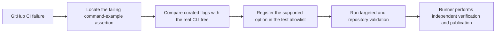

# PRD: Nightly cleanup (CI / duplicated code / docs / dependencies) — 2026-11-13

> ✅ **交付前置 / Delivery Gate**：无依赖（见 §8）。
> 本行是 §8 Delivery Dependencies 的投影，**那里是唯一事实源**。
> 🧍 **验收状态 / Acceptance Status**：待人工验收 — 独立 verifier 已对最终实现 SHA `525a3549ead8a4ada725b7916c694ba215fb8fa8` 完成 `rv-1` 并通过；人工确认仍未完成。
> 本行是 §9 Acceptance Checklist 的投影，**那里是唯一事实源**。

This PRD records one nightly cleanup round for repository maintainers. The complete scope trigger and priority rules are preserved in Appendix A.

## Feature Overview (功能一览)

本节是 §10 Functional Requirements 的简要投影；验收以 §1 行为样例与 §10 为准。

- **修正 CI 对受支持命令示例的误报**（FR-1）
- **准确记录本轮只执行最高优先级 scope**（FR-2）
- **保留未确认的文档检查范围，不丢弃待查历史**（FR-2）

# Part A · 人审层 (Review Layer)

## 1. Introduction & Goals

### Problem Statement

本轮 Nightly Cleanup 在仓库主分支发现一条真实 CI 失败：命令示例校验把 CLI 已支持的本地选项报成无效，导致完整 CI 不能通过。仓库维护者需要一份范围单一、证据明确的修复；同一晚其他整理类别必须服从 CI 优先级，不能挤入这次改动。

### Interpretation (解读回显)

| 验证方式 | 输入 / 操作 | 期望观察到的结果 |
|---|---|---|
| 🤖 自动验证 | 最新主分支 CI 报告失败，且失败来自命令示例检查 | 本轮选择 CI 修复；较低优先级的重复代码、文档与依赖工作不并入本轮。 |
| 🤖 自动验证 | CI 没有失败，重复扫描发现达到触发阈值且收益明确的重复 | 按既定优先级选择 refactor；低收益重复不触发改动。 |
| 🤖 自动验证 | 文档检查点记录缺失或不再是固定上限的祖先 | 文档范围标记为未确认，不冒充首次运行，也不推进检查点。 |

**我默默定了这些**

- 2026-11-13 的 CI 值是 Issue 生成时的快照；本轮决策使用固定的 2026-11-19 主分支 SHA 和对应的最新 CI 结果。
- 本轮按 `CI > refactor > docs > deps` 只执行一个 scope。
- 这轮的修复对象是测试对 CLI 旗标的登记；CLI 本身的支持行为保持不变。

**我理解为不做**

- 本轮不扫描或合并历史重复代码，不做文档范围审计，也不升级依赖。
- 不改变用户实际使用的 CLI 行为、公开 API、配置、数据或界面。
- 不把缺少文档检查点解释成“旧历史已检查且无差异”。

本轮应修复主分支 CI 中对有效命令选项的误报，并保留未知选项仍会失败的约束。它不应顺手改变命令行为或扩成多个维护 scope。文档检查未执行，原因是 CI 优先；其未确认范围留给后续夜间轮次继续检查。

- [ ] 我确认这段解读与行为样例准确表达了我的需求。

### What The User Gets

仓库维护者收到一份单一的 CI 修复交付：已支持的命令示例不再导致 CI 假失败，未知选项仍会被检查发现。本轮的文档检查范围和未执行工作也会如实记录，便于下一轮接续。

### Measurable Objectives

- 当前固定主分支 SHA 上的 CI 失败能由仓库本地目标测试复现，并在最小修正后通过。
- 本轮只选择 CI scope；其他 scope 和文档检查点状态都有明确记录。
- 用户 CLI 行为保持不变。

## 2. Human Review Map

本轮没有需要在实现开始前由人决定的产品、架构、数据或安全取舍；用户已直接要求完成该 Issue。自动门禁验证目标测试、项目测试与文档构建。交付后只需审阅 §9.1 中的代码差异和本轮记录，确认修复范围与未完成文档范围表达准确。

**自动门禁，不需要逐项人工审阅：** focused pytest、`just test`、reuse/full lint、`git diff --check` 和严格 MkDocs 构建。

**本次明确不涉及：** 生产 CLI 行为、前端界面、数据模型、依赖升级、历史重复代码整理或完整 docs-sync 扫描。

## 3. Usage And Impact After Implementation

- **仓库维护者：** 在 CI 失败后能看到修复合入前的验证证据；CLI 行为与使用方法保持不变。
- **operator skill 维护者：** 新增有效命令选项后，测试白名单要与真实命令树同步；未知选项依然会触发测试失败。
- **后续 nightly 执行者：** 能读取本轮文档 checkpoint 未确认的原因，并从原有进度问题继续处理，而不是把缺失记录当成新一轮起点。

无 API、配置、数据或界面兼容性变化。修复只改变仓库内部对测试预期的描述。

## 4. Requirement Shape

- **Actor:** KedaCode 仓库维护者、维护随包 operator skill 的开发者、后续 nightly cleanup 执行者。
- **Trigger:** 固定上限主分支的最新 CI 结果为失败，且失败来自命令示例检查。
- **Expected behavior:** 让检查承认 CLI 当前支持的选项，同时继续拒绝未登记选项；只执行 CI scope，并记录低优先级工作的状态。
- **Scope boundary:** 仅修复本轮 CI 失败；不改变生产 CLI、不实施 refactor/docs/deps，不把文档检查范围标成已完成。

# Part B · 执行器层 (Build Layer)

## 5. Repository Context And Architecture Fit

- Workflow test `tests/test_kedacode_operator_skill.py` keeps a curated list of flags used in the packaged skill. Its runtime-schema test compares that allowlist with the actual Typer command tree.
- `agent_setup_command` in `src/backend/api/cli_typer_agent.py` already exposes `--local`; the legacy parser in `src/backend/api/cli_parser_session_commands.py` also supports it. Packaged `references/setup-and-config.md` began using this valid option in commit `9454dcf79fcd0dd5c3394868f70a02dc65aa2586`, but the test allowlist remained stale.
- This is a test-expectation correction, not a backend feature. No frontend app is affected.

## 6. Recommendation

Add `--local` to the `("agent", "setup")` entry in the curated test allowlist. Keep runtime-schema matching and command-example validation intact. Do not remove the option from the skill or change the CLI to satisfy stale test metadata; the implementation confirms that the option is supported.

## 7. Implementation Guide

This section is a living implementation guide based on current repository analysis. If implementation discovers additional affected files, hidden dependencies, edge cases, or a better path, update this PRD before proceeding.

### Core Logic

The current CLI command tree defines the valid options. The packaged-skill test compares each documented example against the allowlist, while a separate test ensures allowlisted flags exist in the runtime schema. Adding the supported option to that allowlist resolves the observed CI failure without changing command execution.

### Change Impact Tree

```text
.
├── tests/test_kedacode_operator_skill.py [修改]
│   【总结】把真实 CLI 已支持的 --local 纳入测试允许旗标集合。
├── tasks/archive/P1-FEAT-20261113-121113-nightly-cleanup-keda.md [修改]
│   【总结】补齐当前 PRD 格式并记录本轮 scope、验证和未确认的 docs checkpoint。
└── tasks/evidence/P1-FEAT-20261113-121113-nightly-cleanup-keda/ [新增]
    ├── P1-FEAT-20261113-121113-nightly-cleanup-keda.verification-plan.md
    │   【总结】记录可复现的验证入口与 CI 优先级选择。
    ├── P1-FEAT-20261113-121113-nightly-cleanup-keda.evidence-report.md
    │   【总结】汇总固定 SHA、失败根因、真实验证结果和 docs 范围状态。
    ├── P1-FEAT-20261113-121113-nightly-cleanup-keda.verifier-report.md
    │   【总结】记录独立 rv-1 与关联 runtime-schema 检查均 PASS。
    └── human-review-checklist.md
        【总结】集中呈递留给人审阅的单项确认。
```

### Risk Classification Register

| Change point | Tier | Decisive dimension | Intervention | Failure-discriminating oracle/gate |
|---|---|---|---|---|
| Test allowlist entry | R1 | Internal CI test expectation; no public behavior change | Executor + automated gate | `rv-1` focused test fails before and passes after the supported option is registered. |
| Nightly round record | R1 | Scope/progress record for later maintenance | Executor + human review | Compare the recorded SHA/run and unconfirmed checkpoint against the linked source evidence. |

### Executor Drift Guard

Before changing the allowlist, inspect `agent_setup_command` and the runtime schema. If the runtime command tree does not expose `--local`, stop and re-triage the actual CLI contract; do not change product behavior to silence the test. No obsolete flag reference is being removed.

### Flow Diagram



No frontend impact: this change only updates a Python test allowlist; neither `frontend-admin/` nor `frontend-public/` is touched. No data model changes in this PRD. No interactive prototype file changes in this PRD. No external validation required; repository and GitHub Actions evidence were sufficient.

### 7.6 Realistic Validation Plan

```yaml
- id: rv-1
  behavior: "A packaged operator-skill example using --local is accepted because the current CLI supports it, while unknown flags remain rejected."
  reviewer: verifier
  real_entry: "uv run pytest tests/test_kedacode_operator_skill.py::test_packaged_skill_command_examples_match_cli_help -v"
  expected: "The pre-fix run fails on --local; the post-fix run passes, and the allowlist remains checked against the runtime CLI schema."
  mock_boundary: "No external service is used; the packaged skill text and Typer command schema are loaded from the real repository code."
  tier: R1
  test_layer: integration
  required_for_acceptance: true
```

Failure triage: inspect the reported packaged-skill file and option first, then compare the test allowlist with `agent_setup_command` and the runtime-schema assertion. Raw post-fix outputs are `tasks/evidence/P1-FEAT-20261113-121113-nightly-cleanup-keda/rv-1-cli-skill-flag-check.txt` and `rv-1-cli-schema-check.txt`. They remain local and ignored by Git; the runner must publish them to `kc-evidence/issue-366` and present them in the PR evidence comment before human review.

## 8. Delivery Dependencies

### Delivery Dependencies

- Depends on tasks/issues:
  - none
- Gate type: none
- Sequence: via-main
- Notes: the runner publishes the CI cleanup PR after independent verification.

## 9. Acceptance Checklist

### 9.1 人读呈递区（Human Review Surface）

无主演示：本轮只修正测试对现有 CLI 选项的白名单，不改变产品行为或界面。

| 审阅内容 | 呈递入口 | 预期结果 |
|---|---|---|
| 检查修复范围和本轮记录 | [代码差异](../../tests/test_kedacode_operator_skill.py)、[证据报告](../evidence/P1-FEAT-20261113-121113-nightly-cleanup-keda/P1-FEAT-20261113-121113-nightly-cleanup-keda.evidence-report.md)、[CI run](https://github.com/ZataZhang/keda/actions/runs/44548773786)；命令：`open tasks/evidence/P1-FEAT-20261113-121113-nightly-cleanup-keda/human-review-checklist.md` | 差异只加上 CLI 已支持的 `--local`；记录将本轮选为 CI，且明确 docs 未执行、checkpoint 未推进。 |

Verifier-only result: `rv-1` and all test/lint/build results stay in §9.2 and are deliberately not presented as human decisions.

### 9.2 Acceptance Evidence Package

#### Behavior Acceptance

- [x] CI run `44548773786` at fixed base SHA `4c58ad0df1b1437ea2336303a64d486ada00ea89` failed on `test_packaged_skill_command_examples_match_cli_help` because the real CLI `--local` option was absent from the allowlist; the source and exact failure are in the evidence report.
- [x] `tests/test_kedacode_operator_skill.py` now registers `--local` for `("agent", "setup")`; pre-fix red and post-fix green outputs are recorded, the independent rv-1 rerun passed on implementation SHA `525a3549ead8a4ada725b7916c694ba215fb8fa8`, and the runtime-schema test independently passed.

#### Validation Acceptance

- [x] Required validation passed: `just lint --reuse`, `just test` (5517 passed, 1 skipped, 1 deselected), final `just lint --full`, `git diff --check`, and `uv run mkdocs build --strict`; see the evidence report.
- [x] Lower-priority scopes are recorded as not executed, and the docs checkpoint is unconfirmed with no `checked_through_sha` advancement; see the evidence report and this round record.

#### Delivery Readiness

- [x] Independent verifier returned `PASS` for rv-1 on implementation SHA `525a3549ead8a4ada725b7916c694ba215fb8fa8`; see the verifier report.
- [~] Refresh draft PR #404 title/description and publish the raw rv-1 outputs to `kc-evidence/issue-366` plus a PR evidence comment. GitHub connector writes were blocked because they require approval and the active approval policy is `never`; the no-push instruction also prevents evidence-branch publication in this worktree.
- [~] Issue round comment and `scope/ci` label — runner-owned Issue metadata; the executor did not mutate the Issue.

#### Human-Confirmed

- [ ] Review the §9.1 code/evidence presentation and accept that this round fixes only the CI test allowlist while preserving the docs backlog as unconfirmed.

## 10. Functional Requirements

- **FR-1:** The packaged-skill command example test accepts the CLI's existing `--local` option for `kc agent setup` and continues to reject options absent from the supported allowlist/runtime schema.
- **FR-2:** Each round records the fixed base SHA, selected single scope, lower-priority skipped scopes, docs checkpoint status, and actual validation. A missing checkpoint stays unconfirmed and is never advanced by an unchecked range.

## 11. Non-Goals

- Do not change CLI behavior, command options, APIs, frontend, configuration, persistence, or dependency versions.
- Do not perform refactor, docs-sync, or dependency scope work in this round; the priority tree permits only one selected scope.
- Do not claim the docs range was checked, reset it to a date-based first run, or mark it in sync.
- Do not modify GitHub Issue metadata or publish a PR from the executor worktree; the runner owns those actions.

## 12. Risks And Follow-Ups

The previous closed nightly-cleanup Issue #325 contains no doc-check record or valid checkpoint. This round therefore leaves the docs range unconfirmed through the fixed `head_sha`; a later nightly round must resolve the checkpoint history or continue with the range explicitly marked unconfirmed. No docs discrepancy is claimed because the range was not inspected.

## 13. Decision Log

| ID | Decision question | Chosen | Rejected | Rationale |
|---|---|---|---|---|
| D-01 | Which nightly cleanup scope runs? | CI | Refactor, docs, dependencies for this round | The fixed base SHA has a failed CI run, and the triage priority requires CI to win over every lower scope. |
| D-02 | How is the `--local` mismatch corrected? | Add the already-supported option to the test allowlist | Remove the valid option from the packaged skill or change CLI behavior | The live CLI and runtime schema already support `--local`, so aligning test metadata is the smallest correct fix. |

### Final Reconciliation

- Interpretation: confirmed — the final change only repairs a stale test allowlist and records the selected CI round; no product behavior changed.
- Public behavior and contracts: confirmed — the CLI already exposed `--local`; no public API, CLI, configuration, UI, or persistence contract changed.
- Related PRD status: confirmed — no linked PRD was modified; the latest closed nightly-cleanup Issue #325 had no usable docs checkpoint record.
- Requirements and risks: confirmed — all four original trigger definitions and the one-scope priority remain in Appendix A; docs work is explicitly unexecuted and its range remains unconfirmed.
- Reconciled differences: the original PRD's `Last CI status: success` and `Outdated dependency count: 78` are retained as 2026-11-13 trigger-time snapshots; the current round is governed by the later fixed base SHA and failed run.
- Verification reconciliation: independent rv-1 verification passed against implementation SHA `525a3549ead8a4ada725b7916c694ba215fb8fa8`. The verifier re-opened the diff, confirmed the test change is limited to the supported `--local` allowlist entry, reran the required focused test with testmon disabled (`1 passed`), and passed the related runtime-schema check (`1 passed`). Evidence-backed non-human checklist items are checked; Human-Confirmed remains unchecked.
- Remaining delivery follow-up: refresh PR #404 metadata, publish the raw outputs to `kc-evidence/issue-366` and present them in a PR evidence comment, then add the runner-owned Issue comment and `scope/ci` label. GitHub metadata/comment writes were rejected by the approval gate; evidence-branch publication is also outside the no-push scope. Human acceptance remains pending.

## Round Record — 2026-11-19

- `head_sha`: `4c58ad0df1b1437ea2336303a64d486ada00ea89` (full `main` SHA captured before editing; fixed upper bound for this round).
- Trigger check: the latest `CI` workflow for this SHA failed in `Validate Template`; run [44548773786](https://github.com/ZataZhang/keda/actions/runs/44548773786). `tests/test_kedacode_operator_skill.py::test_packaged_skill_command_examples_match_cli_help` rejected `--local` in the packaged `references/setup-and-config.md` example.
- Selected scope: `CI`, the highest-priority actionable scope. The code change adds the already-supported `--local` option to the test's curated allowed-flag set; it does not change CLI behavior.
- Duplicated-code scan and dependency review: not executed because the CI trigger selected the single scope for this round.
- Docs sync: not executed because CI took priority. The most recently closed nightly-cleanup Issue, [#325](https://github.com/ZataZhang/keda/issues/325), has no doc-check record or `checked_through_sha` in its comment. Therefore the range is **unconfirmed**, not a first run: `checked_through_sha` was not advanced, no commits are claimed checked, and the remaining range is unconfirmed through `head_sha`. The issue comment is not written from this worktree under the execution rule to modify only worktree files; this record is included here for the runner to publish.
- Scope label: `scope/ci` was not added from this worktree because that would modify GitHub Issue metadata outside the allowed worktree. The runner owns publication.
- Time spent: approximately 25 minutes wall-clock from the runner claim to this record; `just test` took 11m21s because this worktree had no testmon selection baseline.

## Appendix A — Nightly Scope Decision Tree

The following trigger, priority, and delivery rules are retained from the original canonical PRD. They remain the decision source for later nightly rounds.

### 1. CI failure

- **Trigger**: `last_ci_status` parses to `failure` / `timed_out` / `cancelled` / `action_required` — any value other than `success` / `none`.
- **Steps**:
  1. Pull the failing log with `gh run view <id> --log-failed`;
  2. Reproduce the failure inside the worktree (`uv run pytest <path> -v`);
  3. Fix the code / tests / configuration, then get `just test` fully green;
  4. Open a draft PR with the `cleanup(ci):` title prefix.
- **Not actionable when**: `last_ci_status` is `success` / `none`, or one fix attempt still fails regression tests for reasons unrelated to the failure.

### 2. Duplicated code

- **Trigger**: a similarity scan of helper-style functions under `src/backend/` (`pylint --disable=all --enable=duplicate-code` or `jscpd`) finds ≥ 2 duplicated blocks / near-identical functions.
- **Steps**:
  1. Pick the highest-ROI duplicate (prefer many call sites plus recent maintainer churn);
  2. Extract a shared helper / merge into a single function and replace every call site;
  3. Run `just test` to confirm no regression;
  4. Open a draft PR with the `cleanup(refactor):` title prefix.
- **Not actionable when**: the scan is empty, or every duplicate has low ROI (< 5 lines / 1–2 call sites).

### 3. Docs sync

The goal is filling gaps: feature changes must still update docs, so the night only follows recent diffs to check affected explanations and does not rewrite the whole docs tree.
A passing build only proves the build layer works; it does not prove the described behaviour matches the code.

#### Scope and progress

1. At the start of this round, record the full commit SHA of the target base branch in this Issue's comment as the fixed upper bound `head_sha`.
   Read the doc-check record of the loop's most recently closed Issue to find the latest valid `checked_through_sha`;
   it must be an ancestor of `head_sha`. Do not treat closing the Issue or merging the PR as completing the doc check.
2. With a valid checkpoint, check forward from it in the base branch's first-parent order up to the fixed upper bound;
   use commit diffs that include merge results (relative to the first parent) so changes brought in by merge commits are not missed.
   On the first run with no checkpoint, use the last 7 days as the initial range and disclose that older history is not covered.
   If the record cannot be read or the checkpoint is no longer an ancestor, mark the range as unconfirmed instead of silently resetting progress as a first run.
3. Check at most the earliest 20 pending commits per round. Inspect each diff, then follow the changed symbols, entry points, config keys and direct callers to the relevant docs; a large commit may be checked feature by feature, but the checkpoint must not advance past it before it is finished.
   Do not assume the docs are in sync just because code and docs landed in the same commit, and do not decide no update is needed just because no doc shares the name.
4. Advance `checked_through_sha` only to the last consecutively fully checked commit; record the remaining range and continue next round.
   When findings exist but are not fixed yet, you may record the checked progress, but must carry the unresolved items and their Issues/PRs, and verify first next round whether they were fixed or are tracked by an open task, so problems are neither lost nor fixed twice in duplicate PRs.

#### Checking and fixing

- **Trigger**: a source-backed behavioural omission or contradiction is found — for example entry points, parameters and defaults, config sources, state transitions, persistence, request scope, cache and refresh cadence, permissions or failure handling are described incorrectly; or the related docs have dead paths, symbols, links, or a formal page missing from navigation.
- **Steps**:
  1. Trace the current implementation from the production entry point. Maintain existing guides or feature maps the way feature-docs does; when the skill is unavailable, still follow this section and never treat historical PRDs, old docs or test doubles as implementation facts.
  2. For each finding, write "commit/changed symbol → doc location → current description or gap → implementation evidence → impact", prioritising issues that mislead usage, operations or code changes; do not manufacture edits for wording preference.
  3. Fix the authoritative docs and references; update `mkdocs.yml` only when a formal page is added, moved, or genuinely missing from navigation.
     Do not change production code to match old docs, and do not expand into unrelated doc tidying.
  4. Run `git diff --check` and `uv run mkdocs build --strict`, then re-read the changed behaviour descriptions against the source; a docs-only change does not claim product-behaviour verification. Open a draft PR with the `cleanup(docs):` title prefix.
- **Not actionable when**: the declared range has been behaviourally checked, no doc difference holds that is not already tracked by another task, and the applicable link, navigation and build checks are done. A passing build alone, a skipped check or unavailable dependencies do not mean there is no difference.

#### Per-round record

Whether or not anything is found, leave a doc-check record on this Issue: `head_sha`, the starting point and first-run coverage limits,
`checked_through_sha` (not advanced when unchecked), commits checked and related docs, findings with source evidence, unresolved items and
tracking links, remaining range, actual verification results, and time spent. If no doc applies, still summarise the basis for that judgement.
Distinguish "checked, no difference", "found, pending fix", "partially checked" and "not executed"; never fabricate coverage.

### 4. Dependency upgrades

- **Trigger**: `outdated_count` > 5 (inclusive), or minor (patch) versions in 0.0 ≤ X < 1.0 accumulate to ≥ 10.
- **Steps**:
  1. Upgrade the whole lockfile with `uv lock --upgrade`, or hand-pick a few high-ROI direct dependencies (heavily imported here, tight security advisories);
  2. Run `just test` to confirm compatibility;
  3. On failure, narrow to a safe range (patch only) and retry;
  4. Open a draft PR with the `cleanup(deps):` title prefix.
- **Not actionable when**: the `outdated_count` threshold is not met; or the last upgrade was within 7 days (avoid nightly PR churn).

### Triage priority

- **Only one scope per night**, priority: `CI > refactor > docs > deps`.
- **Decision flow**:
  1. Judge each trigger above in order (CI via `last_ci_status` → refactor via the scan → docs via the recent-diff behaviour check and build → deps via `outdated_count`).
  2. The highest-priority hit is the night's target; skip the lower ones. When docs is skipped, still record "not executed" and why,
     do not advance the doc checkpoint, and keep accumulating the range next round instead of dropping backlog by a date window.
  3. No hit in any of the four → `gh issue close <N> --comment "no actionable cleanup tonight"` and **do not** open a PR.
- **Scope label**: once a scope is chosen, run inside the worktree:
  ```bash
  gh issue edit <N> --add-label scope/<x>
  ```
  where `x ∈ {ci, refactor, docs, deps}`. The four `scope/<x>` labels must first be created in the repository with
  `kc labels sync` (see `docs/guides/loop.md`).

### Delivery Notes

- Recommended branch: `task/<issue-number>-prd-nightly-cleanup-keda-2026-11-13`
- Worktree command: `iar worktree create --branch issue-<issue-number> --base-branch main`
- PR should include: `Closes #<issue-number>`
- Draft PR title prefix: `cleanup(<scope>): <one-line description>`

## Change Log

### Align the legacy nightly PRD and record the 2026-11-19 CI round
- Type: evidence / test / documentation
- Before: The PRD held only the 2026-11-13 trigger snapshot and original triage tree; it lacked the current Part A / Part B structure, a structured validation oracle, an evidence-bearing Acceptance Checklist, and a per-round result.
- After: The original four-scope triggers and priority are preserved in Appendix A; current CI selection, validation, skipped scopes, and unconfirmed docs progress are recorded; the standard PRD sections and separate Acceptance Checklist are present.
- Reason: Current CI for the fixed base SHA failed, and the PRD checker identified the legacy format gap before runner archival.
- Impact: The implementation remains limited to the test allowlist. No product behavior, security boundary, scope trigger, or validation requirement was weakened; verifier and human gates remain open.
- Review: Executor checks completed; independent verifier and human review are pending.

### Keep acceptance items open until independent verification
- Type: evidence / acceptance
- Before: Executor acceptance items were ticked and the banner said `🧍 待人工验收` while the verifier report was still pending.
- After: Executor items remain unchecked, the banner is `⏸️ 验证阻塞`, and Final Reconciliation records the verifier follow-up; human acceptance remains unchecked.
- Reason: Repository PRD workflow requires an independent verifier `PASS` before executor-owned checklist items are ticked.
- Impact: The implementation and collected evidence are unchanged; archive readiness is explicitly blocked until the runner completes verification.
- Review: Executor state corrected; runner verifier must resolve the blocker.

### Complete independent rv-1 verification
- Type: evidence / acceptance
- Before: The verifier report was `PENDING`, the acceptance banner said `⏸️ 验证阻塞`, and evidence-backed executor items remained unchecked.
- After: The verifier report records `PASS` against implementation SHA `525a3549ead8a4ada725b7916c694ba215fb8fa8`; rv-1 and the runtime-schema check each passed independently, evidence-backed non-human checklist items are checked, and the banner is `🧍 待人工验收`.
- Reason: Reviewer finding required a fresh focused rerun on the final implementation tree before human acceptance.
- Impact: No implementation code changed in this repair. Human acceptance remains unchecked; runner-owned GitHub publication gates remain pending.
- Review: Independent diff review and focused tests passed; see the verifier report and evidence report.
