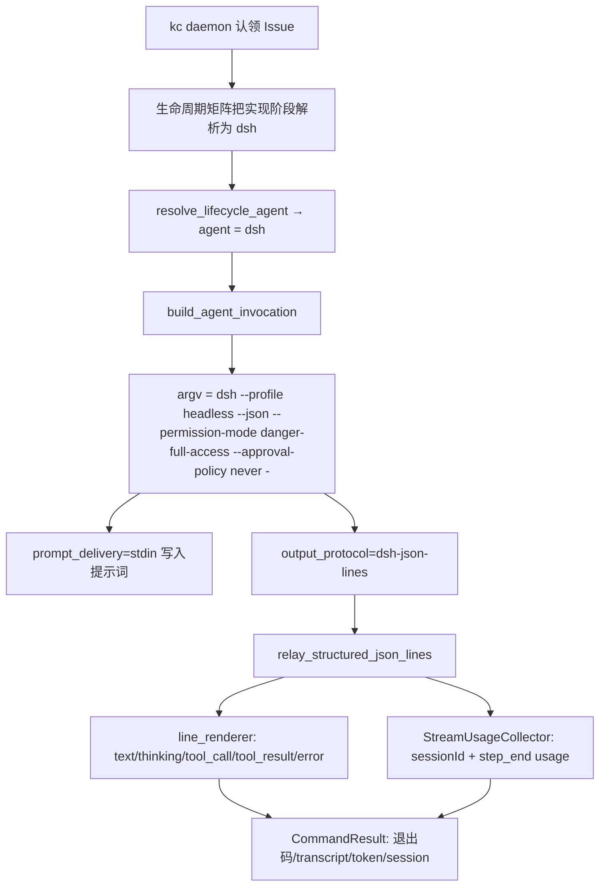

# PRD: 扩展内置 agent 覆盖——dsh（DeepSeek Harness）

> ✅ **交付前置**：无，可立即开工。
> 结构化声明见 §8 Delivery Dependencies，**那里是唯一事实源**。

> ✅ **验收状态**：已验收（2026-11-18）——§2 两项决策与 §9.1 呈递面已按用户 12:39 的聊天回复记录确认；执行侧证据完成，独立 verifier 最终 PASS。§9 Acceptance Checklist 是唯一事实源。

本文档分两个高度：**Part A（§1–§4）** 给人看，用来确认"要不要做、做成什么样"，不含实现机制与命令；**Part B（§5–§13）** 给执行者看，包含机制、改动树与验证命令。

## Feature Overview (功能一览)

> 本块是第 10 节 Functional Requirements 的通俗投影，不是第二事实来源；行为验收以第 1 节的行为样例表为准。

- **`dsh` 进入内置注册表**（FR-1、FR-2、FR-3）：`dsh`（DeepSeek Harness CLI）与现有 `codex` / `claude` / `kimi` / `pi` / `codebuddy` / `qoder` / `opencode` / `mcode` 并列，开箱即用、无需手写注册块。
- **新增 `dsh-json-lines` 输出协议**（FR-4）：`dsh --profile headless --json` 的事件词汇（`session` / `status` / `text` / `thinking` / `tool_call` / `tool_result` / `final` / `error`）与现有五种协议都不同形，需要一个新协议把正文、思考、工具调用渲染成可读 transcript。
- **补齐用量观测**（FR-5）：dsh 把 token 用量放在 `status` + `phase=step_end` 的 `usage` 里（camelCase），现有解析器只认 `assistant` / `result` / `turn.completed`，不改就恒为空。
- **无人值守执行档**（FR-6）：`run` / `deliberate` / `repl` 用 `--permission-mode danger-full-access` + `--approval-policy never`，`generate` 用 `--permission-mode read-only`；提示词经 stdin（`-`）投递，避免长 prompt 撑爆 argv。
- **出厂注册块与守卫同步**（FR-7）：`config.toml` 追加与代码内默认逐字段一致的 dsh 块，注册表守卫继续锁死两处不漂移。
- **文档、原型、随包 skill、测试枚举补全**（FR-8）：所有列举内置 agent 的位置补 dsh，并顺手修掉 mcode 遗留的两处枚举漂移。
- **不动任何既有默认值与行为**（FR-9）：`default_agent`、回退链、既有 8 个 agent 的 spec 与 argv 一律不变。

---

# Part A · 人审层 (Review Layer)

## 1. Introduction & Goals

### Problem Statement

`mcode` 那轮 PRD 在 Non-Goals 里明确把 `dsh` 排除在外，理由有两条：**developer preview**、**没有命令行权限开关**。这两条前提现在都不成立了：

1. 本机 `dsh` 是 `0.2.2-rc.1`，已有稳定的 `headless` profile：一条命令跑完一个任务、退出码区分完成/失败、`--json` 输出按行事件流、`--session-id` 续传。
2. 权限与审批已有显式 CLI 开关：`--permission-mode read-only|workspace-write|danger-full-access` 与 `--approval-policy ask|never`（本机实测 `danger-full-access` + `never` 被接受并真实产出事件流）。
3. 但 kc 的 `BUILTIN_AGENT_SPECS` 仍然只有 8 个：`kc agent list` 看不到 dsh，console 生命周期矩阵的下拉选不到，`kc ask --agent` 也选不到；用户要把 dsh 交给 kc 托管，只能手写一份注册块，且 **仍然没有可用的输出协议**（`plain` 只能把 NDJSON 原样倒进 transcript）。

换句话说：能跑 dsh 的 CLI 条件已经具备，缺的是 kc 侧的"纯数据注册 + 一种事件协议 + 观测字段识别"。同时，随包 `kedacode-operator` skill 已经装进了 `~/.dsh/skills`（手工），但注册表里没有 dsh，两边的"内置 agent 能力描述"因此会继续漂移。

### Interpretation (解读回显)

下表每一行都会**原样**变成 §7 的验收 oracle，所以改表里的一格就等于改验收标准——值得逐行读。

| # | 输入 / 操作 | 期望观察到的结果 | 验证方式 |
|---|---|---|---|
| 1 | 不写任何配置，运行 `kc agent list` | 列表末尾出现 `dsh`，原有 8 个名字与顺序不变 | 🤖 自动验证 |
| 2 | 运行 `kc agent doctor dsh --all-profiles` | 对未声明的 `judge` fail-fast 并指名已声明用途，不静默回落 | 🤖 自动验证 |
| 3 | 用 `build_agent_invocation` 打印 dsh 四条用途的真实 argv | `dsh --profile headless --json --permission-mode <档> --approval-policy never -`（续传时在 `-` 前多 `--session-id <id>`），`prompt_delivery=stdin`，`output_protocol=dsh-json-lines` | 🤖 自动验证 |
| 4 | 真实跑一次 `dsh --profile headless --json`，把同一份 stdout 交给 kc 的协议与观测器 | session id 与事件里的 `sessionId` 逐字相等；退出码与 `final.reason` 自洽；非法权限档的 `error` 事件被渲染成 `[agent error]`（`final` 不重复渲染正文） | 🤖 自动验证 |
| 5 | 真实跑一次 `dsh` 并让它做一次工具调用（需要模型凭据） | transcript 里能看到 agent 正文、思考与工具调用三类行；`final.text` 不重复渲染 | 👀 人审 + 自动验证 |
| 6 | 让 dsh 承担 `judge` 用途 | fail-fast 并指名该 agent 不提供此用途 | 🤖 自动验证 |
| 7 | 在 console 生命周期矩阵里选一次 `dsh` 并保存 | 下拉能选到 dsh，保存后写回对应文件，其余内容不变 | 👀 人审 + 自动验证 |

**我默默定了这些**（未提问、直接选定的）：

- 注册名与可执行文件名都用 `dsh`，标签 `agent/dsh`，标签色 `4D6BFE`（与既有 8 个不重复）。
- 注册顺序追加在 `BUILTIN_AGENT_SPECS` **末尾**：dict 顺序即标签匹配优先级，插队会改变既有 agent 的路由。
- `auth_home` 取 dsh 真实的配置根 `~/.dsh`；容器认证导入只带 `skills`（见"我理解为不做"）。
- `project_skills_dir` 留空：dsh 是否读项目级 skills 本轮未核实，宁可留空也不写一个没证据的路径。
- 四个用途的提示词全部走 stdin + `-`（dsh 的 `-` 是唯一的 stdin 标记，且必须是唯一任务参数）。
- 不声明 `model_args` / `reasoning_effort_args`：headless 没有 CLI 模型旗标，模型来自 profile 的默认选择，假装支持会让模型绑定变成静默无效。

**我理解为不做**：

- 不把 `dsh` 加进 `agent_fallback_order` / fallback candidates（回退链是既有默认行为，改它会影响所有仓库）。
- 不给 runner 容器镜像预装 dsh、不把 `~/.dsh` 的凭据或 profiles 带进容器（CLI 不在镜像里，带凭据只会扩大密钥面）。
- 不改任何既有 agent 的 spec、argv、默认用途与前端代码。
- 不接 dsh 的 `web` / `tui` 表层，不做交互式会话；只接 `headless` profile。

**可证伪的读法**：本 PRD 理解为"把 dsh 作为**第九个内置 agent**接入，新增一种输出协议与用量识别，其余一切默认值保持逐字节不变"，而不是"改造注册表结构/引入按用途环境变量注入/接入 dsh 的全部表层"。

- [x] 我确认上述解读与 7 行行为样例符合预期（2026-11-18 聊天确认；Agent 仅转录，未改动表格）

### What The User Gets

运维者在 `kc agent list`、console 生命周期矩阵与 `kc ask --agent` 里能直接选到 `dsh`；在装了 DeepSeek Harness 的机器上，把某个阶段指到 dsh 就能托管执行，transcript 里能看到正文、思考与工具调用，token 用量与 session id 被正常观测，不需要写注册块、也不需要自己写协议插件。

### Measurable Objectives

- `kc agent list` 的输出包含 `dsh`，原有 8 个名字与顺序逐字不变。
- `kc agent doctor dsh --all-profiles` 对 `judge` fail-fast，消息里点名 dsh 与已声明的四个用途。
- 既有 8 个 agent 的命令行黄金快照**零 diff**。
- 真实 `dsh --profile headless --json` 的事件流经 kc 协议后，session id 与原始事件逐字相等，`error` / `final.reason` 能区分成功与失败，退出码原样传播。
- 全量测试与 lint 在最终树上通过。

## 2. Human Review Map (介入与风险地图)

**决策一：dsh 的模型凭据由 kc 进程环境提供（继承），可以接受吗？**
dsh 的 `headless` profile 在凭据缺失时会在模型调用前失败，并明确报 `MISSING_CREDENTIAL`（本机实测：省略 `DEEPSEEK_API_KEY` 时得到该错误，事件流仍然完整、退出码 1）。kc 的 agent 子进程环境走**净化档**：以当前进程环境为底，只剔除 `AGENT_CHILD_ENV_DENYLIST` 里的会话私有变量（CodeBuddy 的一组会话变量与 `SERVER__PORT`），`DEEPSEEK_API_KEY` 这类凭据变量**原样透传**；本机正在运行的 `kc console` 进程环境里已经有 `DEEPSEEK_API_KEY`，因此"kc 继承环境"这条路径不需要任何代码改动。代价是：**凭据必须存在于启动 kc 的那个环境里**，而不是由 kc 自己从配置文件注入。备选方案是给注册表新增"按用途注入环境变量"能力（从 `config.toml` 的 `api_key_env` 读取并注入子进程）——那是独立的能力扩展，`mcode` 那轮已把它列为后续项。**推荐：接受环境继承，把这个前置条件写进文档与排障路径。** **请确认：** 选"环境继承"还是"本次一并做按用途环境变量注入"？**验收：** 在无凭据环境里跑 dsh，得到 `MISSING_CREDENTIAL` 的失败而不是挂起或空成功；有凭据时能真正执行。

- [x] 环境继承（推荐，零代码改动，文档写明前置条件）——2026-11-18 12:39 聊天确认，Agent 仅转录
- [ ] 本次新增按用途环境变量注入能力（更大范围，需要额外设计与测试）

> **人工确认（2026-11-18 12:39，聊天回复）**：选择 **A 环境继承**。

**决策二（已确认：乐观档）：dsh 按 provider 沙箱声明强制只读，并声明续传。**
两个能力点的取舍：

- **只读**：`generate` 用 dsh 的 `--permission-mode read-only` 沙箱预设，并声明 `read_only_enforced = true`——与 `codex` 的 `--sandbox read-only` 同类，依据是 provider 自己的沙箱开关，而不是提示词约定。真机证据：CLI 接受该预设，会话日志记录 `sandbox/mode = read-only`；「让 agent 实际写文件并被拒绝」仍需有模型凭据时补验（§12）。
- **judge**：dsh 没有任何"禁用全部内置工具"的开关，`read-only` 仍然允许读工具，因此**不声明 `judge`**，宁缺勿假（该项与档位无关）。
- **续传**：声明 `supports_resume = true` 与 `--session-id`。真机证据：对既有会话续传时 `sessionId` 保持不变、`turn_start.turn = 2`。约束是同 cwd / 同 agent preset / 无存活 owner；跨 worktree 或换 preset 的恢复会在任务运行前 fail-fast。

**可选方案**：A 保守档（`read_only_enforced=false`、不声明续传）本轮未采用；B 乐观档已在 2026-11-18 12:39 的聊天回复中确认。**验收：** 续传接管成立、`sandbox/mode=read-only` 被真实应用；`generate` 的 `read_only_enforced=true`；`judge` 仍 fail-fast。

- [ ] A 保守档（未采用）
- [x] B 乐观档——2026-11-18 12:39 聊天确认，Agent 仅转录

**自动门禁，不需要逐项人工审阅**：`config.toml` 出厂块与代码内默认的一致性守卫、既有 8 条命令行黄金快照零 diff、协议注册表一致性、用量解析单测、文档/原型/skill 枚举检查、`just lint`、`just test` 与 `just test all`。

**本次明确不涉及**：数据库表结构无变化；不改前端代码（下拉数据来自接口）；不改子进程环境构建；不改任何默认 agent / 回退链 / 既有 spec。

## 3. Usage And Impact After Implementation

**运维者（CLI）**：入口 `kc agent list`、`kc agent doctor dsh --all-profiles`、`kc ask --agent dsh`、`kc run`。`dsh` 出现在列表末尾；doctor 对已声明用途打印 argv、对 `judge` 报错；`kc ask --agent dsh` 可被选中（README 的 planner 只读门禁只看 `generate.read_only`，dsh 满足）。

**运维者（console）**：入口 `just run` 打开 frontend-public → 生命周期矩阵。agent 下拉里多一个 `dsh`；选择与保存的语义、来源层标注、写回文件的行为**完全不变**（下拉由接口数据驱动，前端零改动）。

**runner / 流水线**：被路由到 dsh 的阶段，命令行来自新注册块；除 dsh 外的一切行为不变。凭据缺失时 dsh 在模型调用前失败，runner 按既有失败语义处理（不会挂起、不会空成功）。

**开发者 / 集成者**：接入新 agent 仍然只需要注册块 +（若事件形状是新的）一个协议实现；本轮新增 `dsh-json-lines` 是最后一种内置协议，不改注册表字段、不改调用层。

## 4. Requirement Shape

- **Actor**：运维者（CLI 与 console）、runner 流水线（按阶段启动 agent 子进程）、开发者/集成者（新增协议实现）。
- **Trigger**：配置加载时（注册表构建与三层合并）；`kc agent doctor` 自检时；console 读取矩阵视图时；agent 子进程输出中继时。
- **Expected behavior**：dsh 与既有 8 个并列可用；dsh 的 `--json` 事件流被正确渲染；dsh 自报的 session id 与用量被正确观测；未声明用途 fail-fast 且不回落；不写任何配置时行为与今天完全一致。
- **Scope boundary**：只覆盖"内置注册表里有哪些 agent"与"dsh 的输出如何被渲染与观测"。注册表字段与能力、调用形态、子进程环境、生命周期矩阵语义、标签路由、回退链、状态机、前端代码、数据库结构全部不变。

---

# Part B · 执行器层 (Build Layer)

## 5. Repository Context And Architecture Fit

**现有相关模块**：

- `src/backend/core/shared/models/agent_spec.py`：`BUILTIN_AGENT_SPECS`（注册表唯一代码内默认来源，现含 codex / claude / kimi / pi / codebuddy / qoder / opencode / mcode）、`AgentProfileSpec`、`AgentSpec`、用途闭集、提示词投递闭集、协议 id 常量。**本 PRD 只追加一个 spec 与一个协议 id 常量，不动任何字段。**
- `src/backend/engines/agent_runner/output_protocols/`：协议实现目录（`plain` / `claude_stream_json` / `pi_json_lines` / `codex_json_lines` / `opencode_json_lines` / `mcode_json_lines`）；`structured_json_lines.py` 提供共用中继 `relay_structured_json_lines`、`render_jsonl_object`、`render_item_completed`。**本 PRD 新增 `dsh_json_lines.py`，复用现有 helper，不重构它们。**
- `output_protocols/__init__.py`：`BUILTIN_PROTOCOL_MODULE_NAMES` 与 entry point 发现（`kedacode.agent_output_protocols`）。**本 PRD 追加一个模块名。**
- `src/backend/core/shared/interfaces/agent_output_protocol.py`：协议接口与 id 常量再导出。**本 PRD 再导出新常量。**
- `src/backend/infrastructure/agent_stream_usage.py`：`_extract_stream_usage_event`（识别 `assistant` / `result` / `turn.completed`）与 `extract_session_id_event`（已识别 `sessionId`）。**本 PRD 只补 usage 的新信封分支；session id 不用改。**
- `pyproject.toml`：`[project.entry-points."kedacode.agent_output_protocols"]`。**本 PRD 新增一行。**
- `config.toml`：`[agent_runner.agents.<name>]` 出厂注册块（被守卫锁死与代码默认一致）。**本 PRD 追加 dsh 块。**
- `src/backend/engines/agent_runner/container_auth.py`：从注册表派生容器认证导入规格（`auth_home` → 目标子目录）。**不改代码**，注册表一变 `kc container auth import` 会多出 `dsh` 目录。
- `tests/test_agent_spec_config.py` / `tests/test_agent_invocation_golden.py` / `tests/test_output_protocol_registry.py` / `tests/test_container_auth.py` / `tests/test_agent_config_consistency.py` / `tests/test_agent_stream_usage.py`：写死的 agent 名与协议 id 清单、黄金快照、用量解析测试。
- `scripts/shared/template/sync_template.sh`：模板 skill 同步的适配器清单（names / dirs / auto-detect 三个等长数组）。
- `docs/guides/agent-runner.md`、`docs/guides/configuration.md`、`docs/guides/lifecycle-agent-matrix.md`、`docs/prototypes/lifecycle-agent-matrix.{html,md}`、随包 `kedacode-operator` skill 的 `references/setup-and-config.md`：枚举内置 agent 的位置。

**既有架构模式**：agent 的调用差异全部沉淀为纯数据（`AgentSpec` / `AgentProfileSpec`），`src/` 下没有 agent 专有分支；配置三层逐字段合并；输出协议经 entry point group 注册，内置与第三方插件走同一条路径；注册顺序即标签匹配优先级，新 agent 追加在末尾。

**架构约束**：四层依赖方向 `api -> core -> engines -> infrastructure`；协议 id 常量定义在 `core/shared/models/agent_spec.py`（叶子模块，避免循环导入），接口层按需再导出；Python 文本 I/O 显式 `encoding="utf-8"`；单文件非空行目标 <500。

**Frontend Impact**：**无前端代码改动**。理由：console 生命周期矩阵的 agent 选项由接口返回的已注册 agent 列表经既有映射生成，前端没有硬编码名单。但**用户可见面确实变了**（下拉多一个选项），因此 §7 仍安排一条真实前端入口的验收。

**Existing PRD Relationship**：`tasks/archive/P1-FEAT-20261116-120000-mcode-builtin-agent.md` 是本 PRD 的直接先例（纯数据注册 + 新协议 + 观测层补齐 + 文档/测试同步），其 Non-Goals 明确排除 dsh 的两条理由已被现状推翻（`0.2.2-rc.1` 的 headless 与显式权限/审批开关）。`tasks/pending/` 现有 PRD 与本 PRD 无重叠、无依赖。**无重复工作，可独立交付。**

## 6. Recommendation

### Recommended Approach

把 `dsh` 作为**第九个内置 agent**追加进 `BUILTIN_AGENT_SPECS`，同时新增 `dsh-json-lines` 输出协议（id 常量放 `agent_spec.py`，实现放 `engines/agent_runner/output_protocols/`，经 `pyproject.toml` entry point 注册），并在 `agent_stream_usage.py` 补 `status` + `step_end` 的用量分支。

调用形态（注册块，四个用途全部 `--profile headless --json` + stdin 提示词）：

```toml
[agent_runner.agents.dsh]
bin = "dsh"
label = "agent/dsh"
label_color = "4D6BFE"
label_description = "Use DeepSeek Harness for local runner execution."
auth_home = "~/.dsh"
auth_include = ["skills"]

[agent_runner.agents.dsh.profiles.run]
args = ["--profile", "headless", "--json", "--permission-mode", "danger-full-access", "--approval-policy", "never"]
tail_args = ["-"]
prompt_delivery = "stdin"
output_protocol = "dsh-json-lines"

[agent_runner.agents.dsh.profiles.deliberate]
args = ["--profile", "headless", "--json", "--permission-mode", "danger-full-access", "--approval-policy", "never"]
tail_args = ["-"]
prompt_delivery = "stdin"
output_protocol = "dsh-json-lines"
read_only = true

[agent_runner.agents.dsh.profiles.generate]
args = ["--profile", "headless", "--json", "--permission-mode", "read-only", "--approval-policy", "never"]
tail_args = ["-"]
prompt_delivery = "stdin"
output_protocol = "dsh-json-lines"
read_only = true

[agent_runner.agents.dsh.profiles.repl]
args = ["--profile", "headless", "--json", "--permission-mode", "danger-full-access", "--approval-policy", "never"]
tail_args = ["-"]
prompt_delivery = "stdin"
output_protocol = "dsh-json-lines"
```

argv 组装顺序是 `[bin] + args + resume_args + expanders + tail_args`，因此真实命令行为
`dsh --profile headless --json --permission-mode danger-full-access --approval-policy never -`，提示词随后写入 stdin。`-` 必须是唯一任务参数（dsh 把 `-` 与其他词混用视为用法错误）。

### Proposed Solution Summary (实现机制)

**FR-1/FR-2/FR-3 — 内置注册表追加 dsh**：在 `BUILTIN_AGENT_SPECS` 末尾追加 `"dsh"` 键（追加在末尾是硬要求）。声明 `run` / `deliberate` / `generate` / `repl`，不声明 `judge`；`deliberate` / `generate` 的 `read_only = true`，`generate` 的 `read_only_enforced = true`；声明 `supports_resume = true` 与 `resume_args = ["--session-id", "{session_id}"]`（决策二：乐观档）。

**FR-4 — 新增 `dsh-json-lines` 协议**：

1. `core/shared/models/agent_spec.py` 加 `DSH_JSON_LINES_PROTOCOL_ID = "dsh-json-lines"`，`core/shared/interfaces/agent_output_protocol.py` 再导出。
2. 新建 `output_protocols/dsh_json_lines.py`，复用 `relay_structured_json_lines` + `render_jsonl_object`，实现 `_render_line`：
   - `text` → 正文原样输出（dsh 的 `text` 是已提交的 assistant 文本块）。
   - `thinking` → `\n[agent thinking] <text>\n`。
   - `tool_call` → `\n[agent tool] <tool>: <detail>\n`，detail 依次取 `input` 里的 `command` / `path` / `file_path` / `description`（`input` 可能是对象或字符串）。
   - `tool_result` → 仅在 `status == "error"` 时输出 `\n[agent tool error] <result>\n`；成功结果不输出，避免 transcript 噪音。
   - `error` → `\n[agent error] <message>\n`（用法错误与 runner 直驱失败都会发这个事件）。
   - `status` / `session` / `final` → 不输出正文（`final.text` 与最后一个 `text` 重复，渲染它会重复一遍）。
   - 未知事件返回 `""`（与既有协议一致）；事件可能因 8 KiB / 32 KiB 上限带 `truncated: true`，渲染时按现有字段读，不假设结构完整。

**FR-5 — 用量与 session 观测**：`session` 事件已在 `extract_session_id_event` 的 `sessionId` 分支覆盖，不需要改；`_extract_stream_usage_event` 新增分支：`type == "status"` 且 `phase == "step_end"` 且 `usage` 为对象时，按 dsh 的 camelCase 键做 1:1 映射（`inputTokens` → `input_tokens`、`outputTokens` → `output_tokens`、`cacheReadTokens` → `cache_read_input_tokens`、`cacheWriteTokens` → `cache_creation_input_tokens`）。语义依据：dsh 的 `TokenUsage` 文档写明三者互斥（`inputTokens` 不含缓存命中），与 Anthropic 口径一致。

**FR-6 — 权限与投递**：`run` / `deliberate` / `repl` 用 `danger-full-access` + `--approval-policy never`；`generate` 用 `read-only` + `never`；全部 `--json` + `stdin`。

**FR-7/FR-8 — 出厂块与枚举同步**：`config.toml` 追加 dsh 块与四个 profile 子表；文档、原型、随包 skill、`sync_template.sh` 适配器、六处写死清单同步。

### Alternatives Considered

**A. 退回 `plain` 协议，不写新协议。** 零代码，但 live 面板只能看到原始 NDJSON；`plain` 路径下结构化中继的会话/用量采集不生效，token 与 session 观测全空。**否决**：dsh 已经有稳定事件流，写协议的成本低于"给用户看 JSON"。

**B. 复用 `codex-json-lines` 或 `claude-stream-json`。** dsh 的信封是 `session` / `status` / `text` / `thinking` / `tool_call` / `tool_result` / `final` / `error`，与两者都不同形（codex 是 `item.completed`，claude 是 `stream_event`）。塞进去要给既有渲染器加 `or` 分支，污染所有 provider 的渲染路径。**否决**：跟随"一个 provider 一个实现"的既有惯例。

**C. 只写用户自己的 `config.toml`，不进内置。** 配置只能引用已注册协议 id，`dsh-json-lines` 仍必须先在 kc 里存在；且每个用户都要手抄一遍注册块。**否决**：与"内置默认 agent"的目标矛盾。

**D. 走 dsh 的 `web` 或 `tui` 表层。** 那是常驻服务/交互界面，与 kc"一条命令跑完并中继输出"的调用模型不匹配，需要新的进程交互协议。**否决**：本期只接 `headless`。

## 7. Implementation Guide

本节的坐标会随实现漂移；执行时以语义锚点与 `rg` 搜索为准，不要依赖行号。

### Core Logic

**协议渲染映射**（以 dsh 产出侧为准；`--json` 投影的事件词汇见 §7 External Validation）：

| dsh 事件 | 关键字段 | 渲染 |
|---|---|---|
| `session` | `sessionId`, `cwd` | 不输出正文；供 session id 采集 |
| `status` + `turn_start` / `step_start` / `turn_end` | `turn`, `step`, `reason` | 不输出正文 |
| `status` + `step_end` | `usage?`（camelCase，可能缺省） | 不输出正文；供用量采集 |
| `thinking` | `text` | `[agent thinking] <text>` |
| `text` | `text` | `<text>` |
| `tool_call` | `callId`, `tool`, `input` | `[agent tool] <tool>: <detail>` |
| `tool_result` | `callId`, `status`, `result`, `error?` | 仅 `status == "error"` 时输出 `[agent tool error] <result>` |
| `final` | `sessionId`, `reason`, `text` | 不输出正文（避免与最后一个 `text` 重复） |
| `error` | `message` | `[agent error] <message>` |

**用量分支**（`agent_stream_usage.py` 的 `_extract_stream_usage_event`）：新增 `status` 信封分支，必须与既有 `turn.completed` 分支互斥；`usage` 里的键名即可区分 dsh（camelCase + `inputTokens`）与 codex（snake_case + `input_tokens`）。

### Change Impact Tree

```
src/backend/core/shared/models/agent_spec.py                 # 【注册表】+1 协议 id 常量（DSH_JSON_LINES_PROTOCOL_ID）、+1 内置 spec（第九个，追加末尾；4 个 profile，无 judge；声明续传与强制只读）
src/backend/core/shared/interfaces/agent_output_protocol.py  # 【接口再导出】把新协议 id 加入导入与 __all__，core 侧只依赖本接口
src/backend/engines/agent_runner/output_protocols/dsh_json_lines.py  # 【新协议】按 §7 映射渲染 text/thinking/tool_call/tool_result/error，复用既有 JSONL 中继与 model-config 观测装饰器
src/backend/engines/agent_runner/output_protocols/__init__.py        # 【注册发现】BUILTIN_PROTOCOL_MODULE_NAMES 追加模块名，协议清单 docstring 同步
pyproject.toml                                                # 【entry point】kedacode.agent_output_protocols 追加 dsh-json-lines 映射
src/backend/infrastructure/agent_stream_usage.py              # 【观测层】status+step_end 的 camelCase usage 1:1 映射；不得与 codex/mcode 分支混算
config.toml                                                   # 【出厂配置】追加 [agent_runner.agents.dsh] 与四个 profile 子表，逐字段与代码默认一致
scripts/shared/template/sync_template.sh                      # 【模板同步】三个等长适配器数组追加 DSH 与 ~/.dsh/skills、~/.dsh
scripts/shared/... 以外不新增脚本；证据探针放 tasks/evidence/<stem>/scripts/
src/backend/engines/agent_runner/templates/skills/kedacode-operator/references/setup-and-config.md  # 【随包 skill】能力段落补 dsh 的四个用途/无 judge/只读约定
docs/guides/agent-runner.md                                   # 【文档】内置枚举、--agent 取值、planner 只读名单、本机前置、容器认证派生、协议清单、形态速查补 dsh；顺带修 mcode 遗留漂移
docs/guides/configuration.md                                  # 【文档】三层合并的内置默认名单、无 judge 形态、planner/REPL 支持值补 dsh
docs/guides/lifecycle-agent-matrix.md                         # 【文档】已注册 agent 名补 dsh
docs/prototypes/lifecycle-agent-matrix.md / .html             # 【原型】REGISTERED_AGENTS 与标签默认补 dsh（同时补 mcode 的标签默认漂移）
tests/test_dsh_output_protocol.py                             # 【新测试】渲染映射、截断事件容错、最终不重复渲染
tests/test_agent_stream_usage.py                              # 【测试】step_end 用量 1:1 映射、与 codex/mcode 不混算
tests/test_agent_invocation_golden.py                         # 【快照】dsh 四条 argv + 无 judge 负路径；既有 8 条零 diff
tests/test_agent_spec_config.py                               # 【守卫】自动跟随；docstring 数字顺带修正
tests/test_output_protocol_registry.py                        # 【守卫】协议 id 清单补 dsh-json-lines（软断言，仍应补）
tests/test_container_auth.py                                  # 【守卫】agent 名清单末尾追加 dsh（硬断言）
tests/test_agent_config_consistency.py                        # 【测试】planner 支持名单补 dsh（声明了 generate）
```

### Risk Classification Register

| 变更点 | Tier | 决定性维度 | 介入 | 失败判据 / Oracle |
|---|---|---|---|---|
| 注册表追加 dsh spec | R1 | 只追加、不改默认值 | 自动门禁 | `kc agent list` 与黄金快照：rv-1、rv-2 |
| 新协议模块 + entry point | R2 | 新代码路径，事件 schema 来自外部 CLI | 自动门禁 + 真实事件流 | rv-3、rv-7；schema 漂移必须由真实事件流暴露 |
| 共享用量解析新增分支 | R2 | 共享解析器，可能污染既有 provider 口径 | 自动门禁 + 隔离断言 | rv-6；codex/mcode 既有用例必须零 diff |
| `config.toml` 出厂块 | R1 | 配置与代码必须逐字段一致 | 守卫 | rv-1 |
| 文档 / 原型 / skill / sync 适配器 | R0 | 纯文本枚举 | 自动门禁 | rv-8 |
| console 下拉出现 dsh | R1 | 数据驱动，无前端代码 | 真实前端入口 | rv-4 |
| 凭据前置（无代码） | R1 | 运行环境约束 | 文档 + 负路径 oracle | rv-3 无凭据失败、rv-10 有凭据可选 |

### Executor Drift Guard

- 注册表守卫：`tests/test_agent_spec_config.py` 断言 `config.toml` 的 agents 块与 `BUILTIN_AGENT_SPECS` 逐字段一致——**新增 spec 必须同步 `config.toml`，否则守卫红**；不要通过修改守卫来"修复"。
- 协议守卫：`tests/test_output_protocol_registry.py` 的 `BUILTIN_PROTOCOL_IDS` 必须含 `dsh-json-lines`；entry point 改动后需重装（`uv sync` 或 `just refresh-kc`），否则已安装元数据里看不到新协议。
- 观测守卫：`tests/test_agent_stream_usage.py` 既有 codex/mcode 用例必须零 diff；新增分支只按 `status` 信封进入。
- 快照守卫：既有 8 个 agent 的 argv 黄金快照零 diff 是硬门槛。
- 枚举守卫：`rg -n 'codex.*claude.*kimi.*pi' docs config.toml` 与 `sync_template.sh` 的三个数组必须同时出现 dsh（等长校验）。
- 未声明用途守卫：dsh 不声明 `judge`，被要求时必须 fail-fast 指名。

### Flow or Architecture Diagram



### ER Diagram

不适用（无数据库表结构变化）。

### Realistic Validation Plan

```yaml
- id: rv-1
  behavior: config.toml 的 dsh 出厂块与代码内默认逐字段一致，注册表集合不漂移
  reviewer: verifier
  real_entry: "uv run pytest -o addopts='' tests/test_agent_spec_config.py -q"
  expected: "set(config.toml 的 agents 块) == set(BUILTIN_AGENT_SPECS)（含 dsh，共九个）；dsh 的每个 profile 字段逐一相等；既有 8 个块不受影响"
  mock_boundary: "不 mock：真实读取仓库根 config.toml 并真实导入内置注册表"
  tier: R1
  test_layer: unit
  required_for_acceptance: true
- id: rv-2
  behavior: dsh 四条用途的 argv 与设计一致，既有 8 个 agent 的命令行逐字节不变
  reviewer: verifier
  real_entry: "uv run pytest -o addopts='' tests/test_agent_invocation_golden.py -q"
  expected: "dsh 的 run/deliberate/repl 为 `dsh --profile headless --json --permission-mode danger-full-access --approval-policy never -`，generate 为 `... --permission-mode read-only --approval-policy never -`，续传时在 `-` 前注入 `--session-id <id>`；generate 的 `read_only_enforced=true`；prompt_delivery=stdin、output_protocol=dsh-json-lines；既有 codex/claude/kimi/pi/codebuddy/qoder/opencode/mcode 快照零 diff"
  mock_boundary: "不 mock：真实 AppConfig 与真实 build_agent_invocation"
  tier: R1
  test_layer: unit
  required_for_acceptance: true
- id: rv-3
  behavior: 真实 dsh 进程的 --json 事件流被 kc 正确解析：session id、失败原因与退出码三项一致
  reviewer: verifier
  real_entry: "uv run python tasks/evidence/P1-FEAT-20261118-113234-dsh-builtin-agent/scripts/probe_dsh_protocol.py"
  expected: "探针以 kc 的真实 argv 形态启动 `dsh --profile headless --json --permission-mode danger-full-access --approval-policy never -`（本机无凭据时走 MISSING_CREDENTIAL 失败路径），把同一份 stdout 同时交给观测器与渲染器：观测 session_id 与原始 `session.sessionId` 逐字相等；`final.reason.kind` 与退出码自洽（error→1）；stderr 带 `dsh:` 诊断；真实非法权限档触发 `error` 事件并被渲染为 `[agent error]`；relay 复跑得到的新 session id 与 raw 不同（fresh state）且退出码一致。环境有凭据时改为断言退出码 0 与正文行"
  mock_boundary: "不 mock：真实 dsh 二进制、真实子进程、真实 stdout 事件流；唯一变量是环境里是否存在模型凭据"
  tier: R2
  test_layer: integration
  required_for_acceptance: true
  critical_value_source: "dsh 自身写出的 stdout NDJSON（`session.sessionId` / `final.sessionId` / `final.reason` / 进程退出码）；事件词汇以本机 dsh 0.2.2-rc.1 的 `@deepseek-ai/dsh-headless/src/json-stream.ts` 为权威"
  must_cross: "kc 进程 → build_agent_invocation 组装的 argv → dsh 子进程 → stdout NDJSON → DshJsonLinesOutputProtocol.relay → StreamUsageCollector → CommandResult"
  forbidden_bypasses: "不得用合成事件替代真实进程输出；不得直接调用渲染函数跳过子进程；不得只看退出码不看事件内容"
  fresh_state_probe: "连续跑两次，两次 `session.sessionId` 不同（新会话），且都不复用上一次的 id"
  final_tree_evidence: "证据报告记录交付树标识（PRD 与证据目录之外的文件树哈希）与探针脚本、协议实现、注册块三处文件哈希"
- id: rv-4
  behavior: console 生命周期矩阵的 agent 下拉出现 dsh，且保存被接受
  reviewer: human
  real_entry: "uv run kc console --no-browser --port 54667，浏览器打开 console → 生命周期矩阵，展开某阶段的 agent 下拉并选择一个值"
  expected: "全局层：Agent 下拉含 dsh；新建 agent=dsh 的预设并绑定到 implementation 后保存，两次 PATCH /v1/agent-runner/lifecycle-settings 均返回 200，config.toml 只新增该预设与实现阶段绑定、其余内容不变，保存后页面生效 AGENT 变为 dsh；随后恢复原文件并校验 SHA-256 与保存前一致。仓库层（选中 keda）的 Agent 下拉同样含 dsh（只读采集，不写真实仓库文件）"
  mock_boundary: "不 mock 前后端：真实起服、真实接口返回的注册表、真实写盘"
  tier: R1
  test_layer: manual
  required_for_acceptance: true
  presentation: "tasks/evidence/P1-FEAT-20261118-113234-dsh-builtin-agent/ 下的 rv-4-console-agents.png（全局下拉含 dsh）、rv-4-console-saved.png（保存后实现/修复/收尾生效 AGENT=dsh 且 toast 显示已保存）、rv-4-console-repo-scope.png（仓库层下拉同样含 dsh）与 rv-4-console-agents.txt（两次 PATCH 200、绑定候选、config.toml 写回 diff、恢复前后 SHA-256）"
- id: rv-5
  behavior: 未声明 judge 时 fail-fast 并指名，不回落；非法权限档被 dsh 自身拒绝且事件被渲染
  reviewer: verifier
  real_entry: "uv run kc agent doctor dsh --all-profiles"
  expected: "命令以非零退出并指名 dsh 不提供 judge，列出已声明的四个用途；不出现改用 run 用途的回退。另以 `dsh --profile headless --json --permission-mode bogus -` 的真实输出验证 `error` 事件被渲染为 `[agent error]`"
  mock_boundary: "不 mock：真实 CLI 与真实注册表"
  tier: R1
  test_layer: smoke
  required_for_acceptance: true
  negative_control: "把同一命令换成已声明用途（`--profile run`）时必须成功打印 argv；两者对比证明失败来自 judge 缺失而非命令写错"
  expected_fail: "`kc agent doctor dsh --all-profiles` 非零退出且错误文本点名 judge"
- id: rv-6
  behavior: dsh 的 step_end 用量按互斥口径 1:1 映射，且不与 codex/mcode 混算
  reviewer: verifier
  real_entry: "uv run pytest -o addopts='' tests/test_agent_stream_usage.py -q"
  expected: "对 `{type: status, phase: step_end, usage: {inputTokens: 11, outputTokens: 7, cacheReadTokens: 5, cacheWriteTokens: 3}}`，平台观测为 input_tokens=11 / output_tokens=7 / cache_read_input_tokens=5 / cache_creation_input_tokens=3；codex 的 `turn.completed` snake_case 与 mcode 的 camelCase 用例输出与改动前一致"
  mock_boundary: "不 mock 解析器与聚合器；事件行是字面 fixture，字段名来自 dsh 产出侧源码"
  tier: R2
  test_layer: unit
  required_for_acceptance: true
  critical_value_source: "dsh 的 `@deepseek-ai/dsh-llm/src/types.ts` 对 TokenUsage 的互斥口径说明，以及 `@deepseek-ai/dsh-headless/src/json-stream.ts` 的 step_end 投影代码"
  must_cross: "StreamUsageCollector → _extract_stream_usage_event → build_token_usage → TokenUsage"
  forbidden_bypasses: "不得直接调用 build_token_usage 绕过事件分支；不得改 codex/mcode 既有断言来让新分支通过"
  fresh_state_probe: "同一进程内依次喂 codex / mcode / dsh 三种样本，断言三者观测互不污染"
  final_tree_evidence: "证据报告记录 agent_stream_usage.py 与测试文件的哈希"
- id: rv-7
  behavior: 协议把 text / thinking / tool_call / tool_result(error) / error 渲染成可读行，且不重复渲染 final.text
  reviewer: verifier
  real_entry: "uv run pytest -o addopts='' tests/test_dsh_output_protocol.py -q"
  expected: "逐事件断言渲染文本；`tool_call.input` 为对象与字符串两种形态都能给出 detail；带 `truncated: true` 的事件不抛异常；`final` 不产生正文行"
  mock_boundary: "不 mock 渲染函数；事件 fixture 逐字段照抄 dsh 产出侧源码中的投影形状"
  tier: R1
  test_layer: unit
  required_for_acceptance: true
- id: rv-8
  behavior: 文档、原型、随包 skill、模板同步适配器里的内置 agent 枚举补全
  reviewer: verifier
  real_entry: "rg -n 'codex.*claude.*kimi.*pi' docs config.toml scripts/shared/template/sync_template.sh && rg -n 'REGISTERED_AGENTS' docs/prototypes/lifecycle-agent-matrix.html && rg -n 'mcode' src/backend/engines/agent_runner/templates/skills/kedacode-operator/references/setup-and-config.md"
  expected: "每一处列举内置 agent 的位置都含 dsh；原型 REGISTERED_AGENTS 含 dsh；三个 sync 适配器数组等长且含 DSH；随包 skill 能力段落含 dsh"
  mock_boundary: "不 mock：对仓库真实文件做文本断言"
  tier: R0
  test_layer: unit
  required_for_acceptance: true
- id: rv-9
  behavior: 全量测试与 lint 在最终树上通过
  reviewer: verifier
  real_entry: "just test all"
  expected: "全量用例通过；`just lint --full` 通过；`uv run mkdocs build --strict` 通过"
  mock_boundary: "不 mock：真实测试套件与真实钩子"
  tier: R1
  test_layer: e2e
  required_for_acceptance: true
  note: "不要加 `CI=true`（会让 just 在 lint 阶段自锁）。新增 .py 会变更 test 树指纹，需重跑 `just test all` 才能让 `just lint` 通过。"
- id: rv-10
  behavior: 有模型凭据时，dsh 的真实端到端运行可用（正文/思考/工具调用渲染、退出码 0）
  reviewer: verifier
  real_entry: "KEDA_DSH_REAL_RUN=1 uv run python tasks/evidence/P1-FEAT-20261118-113234-dsh-builtin-agent/scripts/probe_dsh_real_run.py"
  expected: "进程退出码 0；transcript 含 agent 正文；若任务触发工具调用，含 `[agent tool]` 行；session id 与 `final.sessionId` 相等"
  mock_boundary: "不 mock：真实 dsh + 真实模型调用；由环境变量显式开启"
  tier: R1
  test_layer: integration
  required_for_acceptance: false
  note: "需要模型凭据，本轮执行环境不具备；无凭据时该 oracle 记为 skipped（不是 PASS）。用户已于 2026-11-18 决定跳过该项补验；rv-3 已在无凭据下覆盖真实进程、事件解析与失败语义，rv-11/rv-12 补齐续传与只读沙箱证据。"
- id: rv-11
  behavior: dsh 的 --session-id 能沿用既有持久化会话（续传声明有真实行为支撑）
  reviewer: verifier
  real_entry: "cd /tmp && dsh --profile headless --json --session-id session-bec2522c-3715-4ba9-a2b1-d59555c687fe \"hi\""
  expected: "开头 session 事件的 sessionId 与传入 id 逐字相等；turn_start.turn=2（沿用既有会话第 2 轮而非新会话第 1 轮）；失败点为 MISSING_CREDENTIAL（模型凭据缺失），不是会话不存在或 cwd/preset 不匹配"
  mock_boundary: "不 mock：真实 dsh 二进制、真实持久化会话目录、真实子进程"
  tier: R1
  test_layer: integration
  required_for_acceptance: true
  note: "无凭据时只能验证到会话接管与轮次编号；完整上下文续跑由 rv-10 在有凭据环境补验。"
- id: rv-12
  behavior: dsh 的 read-only 权限预设被 CLI 应用为 sandbox read-only（read_only_enforced 的依据）
  reviewer: verifier
  real_entry: "cd /tmp && dsh --profile headless --json --permission-mode read-only --approval-policy never \"hi\"，随后解压该会话的 session.v4.jsonl.zstd 读取 permission/preset 与 sandbox/mode"
  expected: "会话日志记录 permission/preset = read-only、sandbox/mode = read-only、approval/policy = never；进程因 MISSING_CREDENTIAL 退出 1（不是权限配置错误）"
  mock_boundary: "不 mock：真实 CLI + 真实会话日志"
  tier: R1
  test_layer: integration
  required_for_acceptance: true
  note: "「让 agent 实际写文件并被拒绝」需要模型凭据，未在本轮执行；按既有语义，read_only_enforced 的依据是 provider 自己的沙箱开关（与 codex 的 --sandbox read-only 同类），运行时模式已证实被应用。"
```

### Low-Fidelity Prototype

- `No interactive prototype file changes in this PRD.` 用户可见变化是"下拉多一个选项"，由接口数据驱动、无新布局与新交互；不新建原型文件，仅按 FR-8 同步原型里的 agent 名字常量。

### Interactive Prototype Change Log

- `No interactive prototype file changes in this PRD.`

### External Validation

| Topic | Source | Checked On | Relevant Finding | Impact On Recommendation |
|---|---|---|---|---|
| dsh CLI 形态与版本 | `dsh --version`、`dsh --help`、`dsh headless --help`（本机 0.2.2-rc.1） | 2026-11-18 | 启动器为 `dsh [--profile] <name> [app-args]`；`headless` 支持 `--json`、`--session-id`、`--permission-mode`、`--approval-policy`、`--add-dir`；任务省略或为 `-` 时从 stdin 读 | 注册块用 `--profile headless --json`；提示词走 stdin + `-` |
| 权限档与审批策略 | `dsh headless --permission-mode bogus` 的真实报错 | 2026-11-18 | 合法预设为 `read-only` / `workspace-write` / `danger-full-access`；`--approval-policy ask|never`，`never` 拒绝需要人工审批的调用；headless 没有实时审批通道 | `run` 用 `danger-full-access` + `never`；`generate` 用 `read-only` + `never` |
| `--json` 事件词汇 | 本机安装包内 `@deepseek-ai/dsh-headless/src/json-stream.ts` 与 `README.zh.md`（asar 内提取，0.2.2-rc.1） | 2026-11-18 | `session` / `status(turn_start,step_start,step_end,turn_end)` / `thinking` / `text` / `tool_call(callId,tool,input)` / `tool_result(callId,status,result,error?)` / `final(sessionId,reason,text)`；直驱失败另发 `error(message)` 且无 `final` | 必须新写协议；`final.text` 不重复渲染 |
| 事件限长 | 同上 `json-stream.ts` 的 `MAX_STRING_BYTES=8KiB`、`MAX_EVENT_BYTES=32KiB` | 2026-11-18 | 除 `final` 外每个字符串/键上限 8 KiB，超长事件丢结构化字段并标 `truncated: true`；`final` 不限长 | 渲染器不得假设字段齐全；不把长工具输出当完整证据 |
| 退出码语义 | `dsh headless --json` 实测 + README | 2026-11-18 | `turn/end` 完成 → 0；aborted/error/无轮次 → 1；`error` 事件与 stderr `dsh: <code>: <message>` 并存 | kc 沿用既有失败语义，不做特殊映射 |
| 会话 id 与续传 | 实测未知 id + 对既有会话 `--session-id` 续传；README 续传章节 | 2026-11-18 | 未知 id 在任务运行前失败并发 `error` 事件；对既有会话续传时 `sessionId` 不变、`turn_start.turn=2`；续传要求同 cwd、同 agent preset、无存活 owner | 声明续传（决策二 B）；session id 由 `sessionId` 提取（解析器已支持） |
| 用量字段与口径 | `@deepseek-ai/dsh-llm/src/types.ts` 的 TokenUsage 注释；`json-stream.ts` 的 step_end 聚合 | 2026-11-18 | 用量在 `status(step_end).usage`，camelCase：`inputTokens` / `outputTokens` / `totalTokens` / `cacheReadTokens` / `cacheWriteTokens` / `reasoningTokens`；注释明确三类互斥（`inputTokens` 不含缓存命中） | 1:1 映射到 kc 的四个字段，无需换算 |
| 凭据前置 | 本机实测 `dsh --profile headless --json ...`；`src/backend/infrastructure/child_env.py` 的 `build_sanitized_child_env` 与 `AGENT_CHILD_ENV_DENYLIST` | 2026-11-18 | 无 `DEEPSEEK_API_KEY` 时报 `MISSING_CREDENTIAL`（route `deepseek-official`），事件流仍完整、退出码 1；kc 的 agent 子进程环境是 `os.environ` 剔除 denylist（不含凭据变量），正在运行的 kc console 进程环境里已有该变量 | 凭据由 kc 进程环境继承；文档写明前置条件（决策一） |
| 配置根 | `ls ~/.dsh` | 2026-11-18 | `profiles/`（各表层的 bundle 与 patch）、`skills/`（用户级 skill）、`sessions/`、`storages/`、`attachments/`、`llm-deepseek/`、`.credentials.yaml` | `auth_home=~/.dsh`；容器导入只带 `skills`（CLI 不在镜像里，凭据与 profiles 属机器本地） |

## 8. Delivery Dependencies

### Delivery Dependencies

- Depends on tasks/issues: none
- Gate type: none
- Sequence: via-main
- Notes: 与 `tasks/pending/` 中既有 PRD 无重叠、无顺序依赖；`tasks/archive/P1-FEAT-20261116-120000-mcode-builtin-agent.md` 是本 PRD 的先例与模板。FR 之间除 FR-4→FR-5（协议先于观测解析生效）外无先后依赖。

## 9. Acceptance Checklist

### 9.1 人读呈递区（Human Review Surface）

**主演示脚本（5 步）**：

1. 运行 `uv run kc agent list`，看末尾出现 `dsh`，原 8 个名字与顺序不变。
2. 运行 `uv run kc agent doctor dsh --all-profiles`，看它只对 `judge` 报错、并列出 dsh 已声明的四个用途。
3. 运行证据探针 `probe_dsh_protocol.py`，看真实 dsh 进程的事件流被解析：session id 一致、失败原因与退出码一致。
4. 运行 `uv run kc console --no-browser --port 54667`，打开生命周期矩阵，展开 agent 下拉看到 dsh，选择并保存。
5. （可选，需凭据）`KEDA_DSH_REAL_RUN=1` 跑真实端到端，看正文/工具调用行与退出码 0。

- [x] `rv-4` 的 console 证据已呈递：`rv-4-console-agents.png`（全局下拉含 dsh）、`rv-4-console-saved.png`（保存后生效 AGENT=dsh）、`rv-4-console-repo-scope.png`（仓库层下拉含 dsh）与 `rv-4-console-agents.txt`（两次 PATCH 200、写回 diff、恢复 SHA-256）
- [x] `rv-3` 的真实事件流证据已呈递：`rv-3-dsh-protocol.txt`（原始事件首尾、观测值、逐字段对照、退出码）
- [x] `rv-10`（凭据可选）的状态已如实呈递：通过则给 `rv-10-dsh-real-run.txt`；缺凭据则明确写 skipped 与补验条件，不伪装通过

> `reviewer: verifier` 的 rv-1、rv-2、rv-5、rv-6、rv-7、rv-8、rv-9 不进入人审呈递区，由 Agent 自验与独立 verifier 复核。

### 9.2 Acceptance Evidence Package

- [x] `rv-1`…`rv-9` 的真实入口均已执行并留证（证据目录 `tasks/evidence/P1-FEAT-20261118-113234-dsh-builtin-agent/`）
- [x] `rv-3` 的证据写明 session id、`final.reason` 与退出码的逐字段对照，并记录本次 dsh 版本
- [x] `rv-11` / `rv-12` 的真实入口证据：会话接管（同 id、turn=2）与 `sandbox/mode=read-only` 会话日志
- [x] `rv-6` 的证据写明 dsh 用量到 `TokenUsage` 的映射依据（dsh 产出侧源码符号），以及与 codex/mcode 的互斥断言
- [x] 隔离 worktree（HEAD + 本交付 23 文件）`just test all`：5400 passed / 1 skipped + `just lint --full`；`uv run mkdocs build --strict` 通过
- [x] 证据报告以 `## 人审导航 / Human Review Navigation` 开头，静态图内嵌渲染并给出打开命令

### Human-Confirmed (来自 Part A 风险地图)

- [x] §2 决策一已确认（2026-11-18 12:39 聊天回复：A 环境继承）。
- [x] §2 决策二已确认（2026-11-18 12:39 聊天回复：B 乐观档——`read_only_enforced=true` + 声明续传；`judge` 仍不声明）。
- [x] §9.1 的三项呈递物已确认（聊天回复：「确认，呈递面符合预期」）。

### 9.3 执行结果概览

| rv | 状态 | 备注 |
|---|---|---|
| rv-1 | ✅ | 18 passed；出厂块与内置 spec 逐字段一致 |
| rv-2 | ✅ | 45 passed；dsh 四条 argv + 续传形态，既有八条零 diff |
| rv-3 | ✅ | 真实 dsh 进程 9 项断言全 PASS（session id 同源、退出码自洽、error 渲染、fresh state） |
| rv-4 | ✅ | 两次 PATCH 200 + config.toml 写回 diff + 恢复 SHA-256；仓库层下拉只读复核 |
| rv-5 | ✅ | doctor exit 3 指名 judge；run profile exit 0；非法权限档发 error 事件 |
| rv-6 | ✅ | 65 passed；step_end 用量 1:1 映射且与 codex/mcode 互斥 |
| rv-7 | ✅ | 19 passed；渲染映射与截断容错 |
| rv-8 | ✅ | 35 条逐处枚举断言全 PASS |
| rv-9 | ✅ | 隔离 worktree `just test all` 5400 passed / 1 skipped + lint --full + mkdocs strict |
| rv-10 | ⏭️ | 按用户 2026-11-18 决定跳过（本机无 DEEPSEEK_API_KEY），不冒充 PASS |
| rv-11 | ✅ | 对既有会话续传：sessionId 不变、turn_start.turn=2 |
| rv-12 | ✅ | 会话日志 sandbox/mode=read-only、approval=never；写入拦截待凭据补验 |

## 10. Functional Requirements

- **FR-1**：`dsh` 必须作为内置默认 agent 出现在 `BUILTIN_AGENT_SPECS` 中，**追加在注册表末尾**，不改变任何既有 agent 的注册顺序。
- **FR-2**：`dsh` 必须声明 `run` / `deliberate` / `generate` / `repl` 四个用途，**不声明 `judge`**；被要求 `judge` 时必须 fail-fast 并指名已声明用途，不静默回落。
- **FR-3**：注册块必须声明 `bin = "dsh"`、`label = "agent/dsh"`、`auth_home = "~/.dsh"`；声明 `supports_resume = true` 与 `resume_args = ["--session-id", "{session_id}"]`，不声明 `model_args` / `reasoning_effort_args`；`deliberate` / `generate` 的 `read_only = true`，`generate` 额外声明 `read_only_enforced = true`（按人工确认的乐观档）。
- **FR-4**：必须新增 `dsh-json-lines` 输出协议（id 常量定义在 `core/shared/models/agent_spec.py`，实现放 `engines/agent_runner/output_protocols/`，经 `pyproject.toml` entry point 注册），按 §7 映射渲染正文、思考、工具调用与错误，且不重复渲染 `final.text`。
- **FR-5**：`_extract_stream_usage_event` 必须识别 `status` + `phase=step_end` 的 camelCase 用量并 1:1 映射（`inputTokens`/`outputTokens`/`cacheReadTokens`/`cacheWriteTokens`），且不得与 codex 的 snake_case、mcode 的 `turn.completed` 分支混算；session id 继续走既有 `sessionId` 识别。
- **FR-6**：`run` / `deliberate` / `repl` 必须使用 `--permission-mode danger-full-access` 与 `--approval-policy never`；`generate` 必须使用 `--permission-mode read-only` 与 `--approval-policy never`；四个用途都必须 `--profile headless --json`，提示词经 stdin（`prompt_delivery = "stdin"`，`tail_args = ["-"]`）。
- **FR-7**：`config.toml` 必须包含与 `BUILTIN_AGENT_SPECS` 逐字段一致的 dsh 出厂注册块与四个 profile 子表。
- **FR-8**：文档（agent-runner / configuration / lifecycle-agent-matrix）、原型（`lifecycle-agent-matrix.{html,md}`）、模板 skill 同步清单（`sync_template.sh` 三个数组）、随包 skill（`references/setup-and-config.md`）与测试中的内置 agent / 协议枚举必须同步补全 dsh，并顺带修正 mcode 遗留的两处枚举漂移（续传名单、协议清单）。
- **FR-9**：不得改动任何既有默认值（`default_agent`、`agent_fallback_order`、fallback candidates、deliberation 默认 profile、任何既有 agent 的 spec 字段与 argv）。

## 11. Non-Goals

- 不改 `default_agent`、`agent_fallback_order` 与 `[[agent_runner.runner.agent_fallback_candidates]]`（dsh 刻意不进回退链）。
- 不改任何既有 agent 的 spec 字段与 argv。
- 不给注册表新增任何字段（不引入按用途注入环境变量——本 PRD 没有消费者，决策一）。
- 不声明 `judge`（无禁用全部工具的开关）。
- 不接 dsh 的 `web` / `tui` 表层以外的会话形态；续传只走 `--session-id`，不做跨 worktree/preset 迁移。
- 不接 dsh 的 `web` / `tui` 表层，不做交互式会话。
- 不给 runner 容器镜像预装 dsh，不把 `~/.dsh` 的凭据或 profiles 带进容器。
- 不改前端代码（agent 下拉由接口数据驱动）。
- 不改数据库表结构。
- 不新增 `kc` 子命令、旗标或退出码。

## 12. Risks And Follow-Ups

- **凭据前置（已知限制，按用户决定不再补验）**：本轮执行环境没有模型凭据，rv-10 记 skipped；用户 2026-11-18 决定跳过该项补验。后果是"dsh 真正完成一次任务"未被端到端观察——文档与 PRD 必须保留这条限制，不得宣称端到端已验证；若日后在有 `DEEPSEEK_API_KEY` 的环境使用，可直接跑 rv-10 探针补证。
- **事件 schema 随 dsh 版本漂移**：渲染器对未知事件宽容跳过；文档记录本轮锁定的版本 `0.2.2-rc.1` 与复核方法（重跑 rv-3 探针，对照事件类型清单）。
- **read-only 的实际写入拦截尚未用模型真机验证**：已有证据是 CLI 接受 `read-only` 预设、会话日志记录 `sandbox/mode=read-only`（rv-12）；补验条件：在有 `DEEPSEEK_API_KEY` 的环境让 agent 尝试写文件并断言被拒绝。
- **续传的 cwd/preset 约束**：真实接管已验证（同 id、turn=2，rv-11），但跨 worktree 或换 preset 会在任务运行前失败；kc 的续传记录按 worktree+阶段隔离，属于 fail-fast 而非静默串会话。
- **项目级 skills 未核实**：`project_skills_dir` 留空；若确认 dsh 读取项目级 skills，再补路径。
- **容器认证导入的副作用**：注册表一变，`kc container auth import` 的产物会多出 `dsh/skills` 目录；这是既有派生逻辑的自然结果，本 PRD 不改代码、不预装 CLI。
- **后续项（不在本 PRD）**：按用途注入环境变量能力；有凭据环境下的 read-only 写入拦截真机验证；`web`/`tui` 表层接入。

## 13. Decision Log

| ID | 决策 | Chosen | Rejected | Rationale |
|---|---|---|---|---|
| D-01 | 模型凭据由谁提供 | kc 进程环境继承 | 新增按用途环境变量注入 | 零代码改动；本机 kc console 进程已带 `DEEPSEEK_API_KEY`；注入能力是独立特性（mcode 轮已列为后续项） |
| D-02 | 能力声明档位 | 乐观档（`read_only_enforced=true` + 声明续传；无 judge） | 保守档（只读约定、不声明续传） | 人工确认（2026-11-18 12:39）选择 B；rv-12 证明 read-only 沙箱预设被真实应用，rv-11 证明会话接管成立；写入拦截的真机验证列为后续补验 |
| D-03 | 输出协议 | 新增 `dsh-json-lines` | 复用 codex / claude 协议；退回 plain | 事件信封不同形；plain 丢失正文/工具/观测 |
| D-04 | 提示词投递 | stdin + `-` | argv 位置参数 | 长 prompt 有 argv 长度上限风险；dsh 支持 `-` 且要求它是唯一任务参数 |
| D-05 | 容器认证白名单 | 只带 `skills` | 带 profiles / 凭据 | CLI 不在镜像里；凭据与 profiles 是机器本地资产，带进容器只扩大密钥面 |

### Final Reconciliation

- Interpretation: 实现按 §1 的解读落地；§2 两项决策按用户 2026-11-18 12:39 的聊天回复记录为决策一 A（环境继承）、决策二 B（乐观档），Agent 仅转录人工确认，未代替判断。
- Public behavior and contracts: `kc agent list` / `kc agent doctor` / `kc ask --agent` 与 console 生命周期矩阵均可见 dsh；新协议 `dsh-json-lines` 经 entry point 注册；既有 8 个 agent 的 spec、argv 与默认值零 diff。
- Related PRD status: 先例 `P1-FEAT-20261116-120000-mcode-builtin-agent` 已归档，其排除 dsh 的前提（无 headless / 无权限开关）已被 `0.2.2-rc.1` 推翻；本 PRD 与其无依赖。
- Requirements and risks: FR-1..FR-9 已落地；rv-10（真实模型端到端）因本机无凭据 skipped，且用户已决定跳过补验（已知限制见 §12）；按人工确认采用乐观档：`read_only_enforced=true`（rv-12 证明沙箱模式被应用）、声明续传（rv-11 证明会话接管）。
- Reconciled differences: rv-3 原写"渲染输出含 `[agent error]`"与无凭据路径不符，已改为"退出码/final.reason 自洽 + 非法权限档验证 error 事件"；doctor 对 dsh 仍有沙箱提示，属检测器只认 `--sandbox`/`--ask-for-approval` 的既有口径，已在文档注明；容器认证白名单只带 `skills`。
- Independent verifier: PASS（第三/四轮发现的 PRD 一致性与计数问题已修复；最终报告见 `tasks/evidence/P1-FEAT-20261118-113234-dsh-builtin-agent/verifier-report.md`）。

## 14. Change Log

### 初稿生成

- Type: Initial draft
- Before: 无
- After: 形成 dsh 内置 agent 的完整 PRD（Part A/B、oracle、证据计划）
- Reason: 用户选择"走 PRD 完整接入"
- Impact: 待人审确认两项决策
- Review: 待第一触点确认

- 全部 dsh CLI 契约均在本机 `0.2.2-rc.1` 上实测或从安装包内产出侧源码核对，见 §7 External Validation。

### 实施：注册表 + 协议 + 观测 + 同步

- Type: Implementation
- Before: 注册表只有 8 个 agent；没有 `dsh-json-lines` 协议，dsh 的 `--json` 事件流无法渲染；step_end 的 camelCase 用量不被识别
- After: 注册表追加第九个 agent `dsh`（四用途、无 judge；按人工确认声明续传与强制只读）；新增 `dsh-json-lines` 协议与 entry point；`agent_stream_usage` 支持 status+step_end 用量；config.toml / docs / 原型 / 随包 skill / sync_template / 测试同步
- Reason: 落地 PRD FR-1..FR-9
- Impact: console 与 CLI 多一个 dsh 选项；既有 8 个 agent 的 spec、argv、默认值零改动
- Review: 独立 verifier PASS（首轮 FAIL 的两项已修复）

### 签署解读、跳过 rv-10 与归档

- Type: Acceptance record
- Before: §1 解读签署框为空；rv-10 记为待凭据补验；PRD 位于 tasks/pending
- After: §1 已按用户确认勾选；rv-10 按用户决定跳过（保留为已知限制）；PRD 归档到 tasks/archive
- Reason: 用户 13:09 明确\“我确认勾选\”，并指示 rv-10 跳过
- Impact: PRD 状态与仓库生命周期一致；无代码变更
- Review: 用户聊天确认；归档检查器通过

### 人审选择乐观档（B）：强制只读 + 声明续传

- Type: Requirement change
- Before: `generate` 的 `read_only_enforced=false`；不声明 `supports_resume`
- After: `generate` 的 `read_only_enforced=true`（依据 dsh `--permission-mode read-only` 沙箱）；声明 `supports_resume=true` 与 `resume_args=["--session-id","{session_id}"]`；config/docs/skill/测试同步
- Reason: 用户 2026-11-18 12:39 聊天确认决策一 A、决策二 B、呈递面确认
- Impact: dsh 可作为强制只读的 planner/诊断 agent；续传在 cwd/preset 不匹配时 fail-fast
- Review: 证据 rv-11（会话接管、turn=2）与 rv-12（sandbox/mode=read-only）；写入拦截真机验证留作有凭据环境的补验，见 §12

### 验证与证据

- Type: Validation
- Before: 无 dsh 相关验证记录
- After: rv-1..rv-9 真实入口留证（含两次真实 PATCH 200 与 config.toml 写回/恢复、真实 dsh 进程探针、5353 passed 全量测试）；rv-10 因无凭据记 skipped
- Reason: PRD §7 Realistic Validation Plan 与执行侧验收
- Impact: 证据目录 `tasks/evidence/P1-FEAT-20261118-113234-dsh-builtin-agent/`；人审清单 md/html 已生成并在浏览器验证零 pageerror
- Review: `verifier-report.md`；Human-Confirmed 已按 2026-11-18 12:39 聊天回复记录

### 凭据继承的机制表述校正

- Type: Correction
- Before: 决策一把 kc 的子进程环境写成"原样继承自身环境"
- After: 明确为"净化档：以 `os.environ` 为底剔除 `AGENT_CHILD_ENV_DENYLIST`；`DEEPSEEK_API_KEY` 不在名单内，原样透传"，并补上代码出处
- Reason: 执行前核对 `build_sanitized_child_env` 发现默认档是 denylist 净化而非无条件继承，避免决策依据说不准
- Impact: 决策一的结论不变（仍是零代码改动的环境继承），但依据更精确；§7 External Validation 同行同步
- Review: 待人审确认
