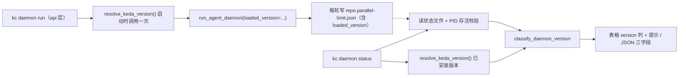

# PRD: `kc daemon status` 显示 daemon 实际运行的版本，并在与已安装版本不一致时提示重启

> ✅ **交付前置**：无，可立即开工。
> 结构化声明见 §8 Delivery Dependencies，**那里是唯一事实源**。

> 🧍 **验收状态**：待人工验收。
> 本行是 §9 Acceptance Checklist 的投影，**那里是唯一事实源**。

> 本 PRD 分两个 altitude，分别服务不同读者，自上而下阅读：
>
> - **Part A · 人审层 (Review Layer)** — 需求方 / 验收人读这部分，决定"该不该做、做得对不对"，并通过风险地图知道**哪些地方必须亲自确认**。Part A 不出现实现机制、文件路径、命令。
> - **Part B · 执行器层 (Build Layer)** — 实现者（人或 Agent）读这部分动手。人只在 Part A 风险地图**点名处**下钻审查，其余默认交执行器 + 自动门禁。

## Feature Overview (功能一览)

本节是 §10 Functional Requirements 的白话投影，不是第二事实源；行为验收以 §1 的行为样例表为准。

- **daemon 记下自己启动时的版本**（FR-1）：daemon 启动时记录当时加载的 KedaCode 版本，运行期间不变，即使中途升级了 kc 也不变。
- **status 显示运行版本**（FR-2）：`kc daemon status` 表格多一列版本；`--json` 每行多出“运行版本 / 已安装版本 / 版本状态”三个字段。
- **不一致就提示重启**（FR-3）：运行版本和已安装版本不一致，或 daemon 没有上报版本（升级前启动的旧进程），表格下方给出提示和重启命令。
- **只提示，不改退出码**（FR-4）：版本不一致时命令仍返回成功，机器输出仍是纯 JSON。
- **旧数据兼容**（FR-5）：读到旧 daemon 写的状态（没有版本字段）不报错，显示为“未知”。
- **文档与 operator skill 同步**（FR-6）：使用指南和随包 `kedacode-operator` skill 写明新字段与提示。
- **本次只覆盖 daemon**（§11）：独立的 supervise-daemon、管理终端页面暂不显示版本。

---

# Part A · 人审层 (Review Layer)

## 1. Introduction & Goals

### Problem Statement

常驻的 daemon 一旦启动，会一直按启动那一刻加载的代码运行。用户升级 kc 之后，如果忘了重启 daemon，它会继续跑旧代码，而 `kc daemon status` 只显示进程号和启动时间，看不出它跑的是哪个版本。

2026-10-15 的持续 GitHub 限流，根因就是这样一个一直没重启、仍跑旧代码的 daemon（见 Roadmap“维护带”里“常驻 daemon 的版本可见性”一条）。Roadmap 把这一项列为运行可靠性里的高优先级，但代码里还没有实现：`kc daemon status` 的表格和 `--json` 输出都没有任何版本字段。

### Interpretation (解读回显)

**行为样例**（下例假设已安装 0.9.1）

| 验证方式 | 输入 / 操作 | 期望观察到的结果 |
|---|---|---|
| 👀 人审 + 自动验证 | daemon 是 0.9.0 时启动的，之后升级到 0.9.1；运行 `kc daemon status` | 表格版本列显示 `0.9.0 (installed 0.9.1)`；表格下方黄色提示：该 daemon 运行的版本与已安装版本不一致，请重启，并按托管 / 手动两种情况给出重启命令；退出码 0 |
| 🤖 自动验证 | 同上，运行 `kc daemon status --json` | 该行 `loaded_version: "0.9.0"`、`installed_version: "0.9.1"`、`version_status: "mismatch"`；stdout 是合法 JSON，不夹杂提示文字；退出码 0 |
| 🤖 自动验证 | daemon 版本与已安装版本相同 | 版本列显示 `0.9.1`；无提示；`version_status: "current"` |
| 🤖 自动验证（边界） | daemon 是本功能上线前启动的，没有上报版本 | 版本列显示 `unknown`；提示“无法确认版本，可能是升级前启动的旧进程，建议重启”；JSON 中 `loaded_version: null`、`version_status: "unknown"` |
| 🤖 自动验证（边界） | daemon 运行期间执行了升级（磁盘上已是 0.9.1） | daemon 上报的仍是启动时的 `0.9.0`，不会跟着磁盘变成 0.9.1 |
| 🤖 自动验证 | 列表里的 supervise-daemon 行 | 版本列显示 `-`；不提示；JSON 中 `loaded_version` 与 `version_status` 为 `null` |

上表的行就是验收 oracle：改表里某一格，就等于改验收标准。

**我默默定了这些**

- 比较规则是“**不相等**”就提示，不区分升级和降级：两种情况都意味着 daemon 跑的不是你装的那版。
- 读不到已安装版本（例如直接在源码树里运行、版本回退为 `0.0.0+unknown`）时，`version_status` 为 `unknown`，**不提示重启**，避免误报。
- 重启提示分两种情况：托管进程用 `kc registry stop --repo-id <id>` 后 `kc registry start --repo-id <id>`；手动启动的前台进程提示“结束该进程后重新运行 `kc daemon`”。
- 版本只在 daemon 启动时记录一次，之后每轮轮询原样写出。
- 开发者的可编辑安装（editable）里改了代码但版本号没变，本功能看不出差别；这不在目标内。
- daemon 刚启动、还没完成第一轮轮询时，会短暂显示为 `unknown`（与现有“并行上限”字段同样的时机）。

**我理解为不做**

- 不自动重启 daemon。
- 管理终端（网页）的 daemon 信息和 `kc registry list` 不显示版本。
- 独立的 supervise-daemon 不上报版本（daemon 已内置 PR 值守，supervise-daemon 默认不再启动）。

**解读**：本 PRD 读作“让 daemon 上报启动时的版本，`kc daemon status` 把它和当前已安装版本对比、显示并提示”，**不是**自动升级或重启机制，也**不是**在每次命令执行时扫描进程版本。daemon 上报的必须是**启动时**的版本，**不得**在运行中重新读取磁盘上的版本（那样会在升级后谎报为新版本，正好掩盖要发现的问题）。

- [ ] 我确认这段解读与行为样例准确表达了我的需求。

### What The User Gets

升级 kc 后运行 `kc daemon status`，一眼就能看到哪个 daemon 还在跑旧版本，并直接拿到重启命令。外部 Agent 用 `--json` 读 `version_status` 字段，可以自己判断是否需要提醒用户重启。

### Measurable Objectives

- 运行版本与已安装版本不一致时，`--json` 对应行的 `version_status == "mismatch"`，且表格模式输出包含重启提示。
- daemon 运行中磁盘版本变化后，上报的 `loaded_version` 仍等于启动时的版本。
- 不一致时退出码仍为 0，`--json` 的 stdout 能被 JSON 解析器完整解析。

## 2. Human Review Map (介入与风险地图)

### 版本不一致时只提示，还是让命令“失败”

`kc daemon status` 是只读查询，现有脚本和外部 Agent 都按“退出码 0 = 查询成功”使用它。我建议版本不一致时只在表格下方提示、在 JSON 里给出 `version_status`，退出码保持 0。另一种做法是返回非零退出码，逼脚本注意，但这会把“查询成功，只是版本旧”误报为“查询失败”，可能打断现有自动化流程。

**请确认：** 版本不一致时，是否只提示、退出码保持 0？

- [ ] 确认：只提示，退出码保持 0（推荐）

**验收：** 在版本不一致的场景下运行 `kc daemon status` 和 `kc daemon status --json`，两者退出码都是 0；前者有提示文字，后者 `version_status` 为 `mismatch`。

**自动门禁，不需要逐项人工审阅：**

- 启动时记录版本、运行中不变：由 daemon 单轮执行的测试断言。
- 旧状态文件兼容：由状态文件读写测试覆盖。
- 表格列、提示文案、JSON 字段：由命令测试和隔离环境下的真实 `kc` 子进程验证。
- 文档与 operator skill 同步：用检索断言确认。

**本次明确不涉及：** 不改数据库结构，不改 daemon 的单实例锁格式，不改任何现有 JSON 字段（只新增）。

## 3. Usage And Impact After Implementation

- **运维 / 本机使用者**：升级后运行 `kc daemon status`，表格新增 `version` 列。版本不一致或未知时，表格下方出现黄色提示和重启命令。
- **外部 Agent / 脚本（`--json` 调用方）**：每行新增 `loaded_version`、`installed_version`、`version_status` 三个字段，现有字段不变，退出码语义不变。operator skill 会告诉 Agent：`version_status` 为 `mismatch` 或 `unknown` 时提示用户重启。
- **管理终端（网页）用户**：没有变化。它读取的同一份状态文件多了一个字段，读取方不受影响。
- **对现有行为的影响**：
  - 升级后，旧 daemon 写出的状态文件没有版本字段，显示为 `unknown`，并提示重启（这正是要发现的情况）。
  - 若有人回退到旧版 kc，而 daemon 是新版启动的，旧版 `kc daemon status` 可能读不出并行上限列（显示 `-`）；重启 daemon 后恢复。
  - 不新增配置项。

## 4. Requirement Shape

- **actor**：本机运维者；通过 `--json` 读取状态的外部 Agent 或脚本。
- **trigger**：运行 `kc daemon status`（可带 `--json`、`--repo-id`、`--all`）。
- **expected behavior**：每个 daemon 行显示它启动时加载的版本，并与当前已安装版本对比；版本不一致或未知时给出提示，退出码不变。
- **explicit scope boundary**：只覆盖 `daemon` 类进程和 `kc daemon status` 命令；不自动重启，不改管理终端页面，不改锁文件格式。

---

# Part B · 执行器层 (Build Layer)

## 5. Repository Context And Architecture Fit

- **最近的现有路径（照抄其模式）**：“并行上限”状态文件（已归档 PRD `tasks/archive/P1-REFACTOR-20261024-232740-unified-parallel-limit-and-backfill-daemon.md`）。
  - daemon 每轮轮询把 `DaemonParallelLimitStatus` 写到 `<daemon-locks>/<repo_id>.parallel-limit.json`。
  - 读取方 `read_daemon_parallel_limit_status` 只在文件里的 PID 正是该仓库单实例锁的存活持有者时才采信。
  - `kc daemon status` 通过 `parallel_limit_status_fields` 和 `describe_parallel_limit_status` 渲染。
  - 本 PRD 在同一文件、同一读写函数上加一个字段，不新增文件。
  - 相关代码在 `src/backend/core/use_cases/daemon_parallel_limit_status.py`；写入点在 `src/backend/core/use_cases/run_agent_daemon.py`（`rg -n "write_daemon_parallel_limit_status\(" src/backend`）。
- **请求参数传递**：`AgentDaemonLoopRequest.parallel_limit_status_dir`（`src/backend/core/use_cases/agent_daemon_loops.py`）由 `run_agent_daemon(..., parallel_limit_status_dir=...)` 传入；调用方是 `src/backend/api/cli_parsed_commands/runner.py` 的 `run_daemon_command`（`rg -n "parallel_limit_status_dir=" src/backend`）。
- **版本来源**：`src/backend/api/version_info.py` 的 `resolve_keda_version()`（`kc --version` 与 console 共用）。它**每次调用都读磁盘上的发行版元数据**，所以必须在 daemon 启动时调用一次并保存结果，不能在轮询中调用。
- **status 渲染**：`src/backend/api/cli_registry.py` 的 `_run_daemon_status_command`（`rg -n "def _run_daemon_status_command" src/backend`）。它分别渲染 rich 表格和 `emit([...])` 的 JSON 行。
- **架构约束**：
  - 四层方向 `api → core → engines → infrastructure`：`core` 不能导入 `api/version_info.py`，所以版本由 `api` 层解析后作为字符串参数传入 `core`。
  - Python 文件 I/O 显式写 `encoding="utf-8"`。
  - 改 CLI 表面须同步 `kedacode-operator` skill 与 `docs/`（`docs/ai-standards/tooling.md` 的 CLI Surface And Packaged Skill Sync）。
  - 时间展示约定不受影响（本次不新增时间字段）。
- **平台**：`kc daemon` 在 Windows 上不支持（依赖 POSIX 进程组），真实 daemon 验证需在 macOS 或 Linux 上进行；`kc daemon status` 本身的渲染与平台无关。
- **Frontend Impact**：`No frontend impact` — 只改 CLI 输出与 daemon 写出的状态文件。管理终端读取同一文件（`src/backend/api/routes/agent_runner_backlog.py`），新增字段对它透明，页面不显示版本。
- **相关 PRD**：`tasks/pending/` 中没有涉及 `daemon status` 或并行上限状态文件的 PRD（已用 `rg -l "daemon status|parallel-limit" tasks/pending` 确认为空）。`P1-FEAT-20261024-162357-agent-interruption-recovery` 涉及 daemon 恢复，但不触及状态输出，可独立执行。

## 6. Recommendation

### Recommended Approach

1. 给 `DaemonParallelLimitStatus` 增加可选字段 `loaded_version: str | None = None`。
2. `run_daemon_command` 在启动 daemon 前调用一次 `resolve_keda_version()`，经 `run_agent_daemon(loaded_version=...)` 和 `AgentDaemonLoopRequest.loaded_version` 传到写入点，每轮原样写出。
3. `_run_daemon_status_command` 用当前进程的 `resolve_keda_version()` 作为已安装版本做对比：渲染 `version` 列和 JSON 三字段；表格模式下，若有 `mismatch` 或 `unknown`（需要提示的那种），在表格后打印提示。
4. 读取函数改为只取已知字段，忽略未知键，以便今后再加字段时旧读取方不报错。

### Why this fits

“daemon 自报、status 读取并校验 PID”这条通道已经存在，还处理好了强杀后残留文件不被采信的问题。新增一个字段即可复用全部存活校验，不需要新文件、新清理逻辑。

### Rejecting redundant abstractions

- **不把版本写进单实例锁文件**：锁文件只存 PID，新旧版本的 kc 会互相解析对方的锁；改它的格式可能让旧版把活锁误判为坏锁。
- **不在 status 时扫描进程**：读取别的进程实际加载了哪个版本，跨平台不可靠。
- **不新建 `<repo>.version.json`**：会多出一套写入、清理和 PID 校验，与现有状态文件重复。

### Proposed Solution Summary (实现机制)

- **核心机制**：daemon 自报版本，写进现有的每轮状态文件；`kc daemon status` 对比后展示。
- **输入**：版本由 daemon 进程在启动时自行解析（不推断）；已安装版本由执行 `status` 的 kc 进程解析。
- **接入点**：`run_daemon_command` → `run_agent_daemon` → 每轮 `write_daemon_parallel_limit_status`；`_run_daemon_status_command` 读取。
- **可见变化**：表格新增 `version` 列和提示；JSON 新增三字段。
- **刻意避免**：不改锁文件、不新增状态文件、不改退出码、不改管理终端页面。

### Alternatives Considered

给 `kc daemon status` 在版本不一致时返回非零退出码。待 §2 确认，推荐不采用（理由见 §2）。

## 7. Implementation Guide

> This section is a living implementation guide based on current repository analysis. If implementation discovers additional affected files, hidden dependencies, edge cases, or a better path, update this PRD before proceeding.

### 7.1 Core Logic

```text
classify_daemon_version(loaded, installed) -> "current" | "mismatch" | "unknown"
  loaded is None                       -> "unknown"   (需要提示：可能是旧进程)
  installed == "0.0.0+unknown"         -> "unknown"   (不提示：已安装版本不可知)
  loaded == installed                  -> "current"
  否则                                  -> "mismatch"  (需要提示)
```

- `version_status` 只对 `kind == daemon` 的行计算；supervise-daemon 行的 `loaded_version` 和 `version_status` 为 `null`，`installed_version` 照常给出。
- daemon 行读不到状态文件时（尚未完成首轮轮询、旧进程、文件损坏），`loaded_version = None`，即为 `unknown`，需要提示。
- 是否提示：`mismatch`，或 `loaded_version is None` 的 `unknown`。为避免两处各写一套判断，提示函数应复用同一个分类结果，并带上“是否提示”的标志。
- **提示文案**（表格模式，所有需提示的行汇总后打印一次）：

  ```
  ⚠ daemon (<repo_id>, pid <pid>) 运行的版本 <loaded|未知> 与已安装版本 <installed> 不一致，请重启：
    托管进程：kc registry stop --repo-id <repo_id> && kc registry start --repo-id <repo_id>
    手动启动：结束该进程后重新运行 kc daemon
  ```

  按行的 `managed` 只给出对应的那一条命令；版本未知时，前半句换成“无法确认版本，可能是升级前启动的旧进程，建议重启”。
- JSON 模式不打印提示，stdout 只输出 JSON。退出码始终保持现状（0）。

### 7.2 Change Impact Tree

```text
.
├── src/backend/core/use_cases/daemon_parallel_limit_status.py
│   [修改]
│   【总结】状态文件新增启动版本字段，读取忽略未知键，并提供版本分类与 JSON 字段生成
│
│   ├── DaemonParallelLimitStatus 增加 loaded_version: str | None = None（docstring 说明“启动时版本，运行中不变”）
│   ├── read_daemon_parallel_limit_status 只取 dataclass 已知字段构造，缺字段走默认值
│   ├── 新增 classify_daemon_version(loaded, installed) 与 daemon_version_status_fields(...)
│   └── 模块 docstring 补充版本用途；__all__ 同步
│
├── src/backend/core/use_cases/agent_daemon_loops.py
│   [修改]
│   【总结】_AgentDaemonLoopRequest 增加 loaded_version: str | None = None
│
├── src/backend/core/use_cases/run_agent_daemon.py
│   [修改]
│   【总结】run_agent_daemon 新增 loaded_version 参数，透传进请求并写入每轮状态文件
│
├── src/backend/api/cli_parsed_commands/runner.py
│   [修改]
│   【总结】run_daemon_command 在启动前调用一次 resolve_keda_version() 并传给 run_agent_daemon
│
├── src/backend/api/cli_registry.py
│   [修改]
│   【总结】_run_daemon_status_command 新增 version 列、三个 JSON 字段和表格模式下的重启提示
│
├── tests/test_daemon_parallel_limit_status.py
│   [修改]
│   【总结】覆盖带 / 不带 loaded_version 的读写往返、未知键容忍、版本分类，以及 daemon 单轮原样写出启动版本
│
├── tests/test_agent_runner_cli.py
│   [修改]
│   【总结】断言 kc daemon 入口启动时只解析一次版本并把它传给 run_agent_daemon
│
├── tests/test_cli_registry.py
│   [修改]
│   【总结】status 表格版本列、提示文案（托管 / 手动 / 未知）、JSON 字段、supervise-daemon 行与退出码 0
│
├── docs/guides/agent-runner.md
│   [修改]
│   【总结】“查看 daemon 进程明细”一节的示例与字段说明加入 version 列、三字段和重启提示
│
├── src/backend/engines/agent_runner/templates/skills/kedacode-operator/references/daemon.md
│   [修改]
│   【总结】status --json 字段说明加入 loaded_version / installed_version / version_status，以及 mismatch/unknown 时提示用户重启
│
└── ROADMAP.md
    [修改]
    【总结】维护带“常驻 daemon 的版本可见性”一条标注已由本 PRD 承接
```

### 7.3 Risk Classification Register

| change point | tier | decisive dimension/override | intervention | oracle/gate |
|---|---|---|---|---|
| 不一致时退出码保持 0 | R1 | 外部调用方契约（保持不变） | 人工确认（§2） | rv-2 |
| 启动时记录版本、运行中不变 | R1 | 正确性：若每轮读磁盘会谎报新版本 | 执行器 + 单元测试 | rv-3 |
| 状态文件新增字段与读取容忍 | R1 | 兼容：新旧文件互读 | 执行器 + 单元测试 | rv-4 |
| status 表格 / JSON / 提示 | R1 | 单命令输出，新增字段 | 执行器 + 真实 CLI 子进程 | rv-1、rv-2 |
| 文档 / skill / Roadmap | R0 | 纯文档 | 检索断言 | Documentation Acceptance |

### 7.4 Executor Drift Guard

- `rg -n "DaemonParallelLimitStatus\(" src tests`：所有构造点（含测试）都要兼容新字段；它有默认值，构造点无需改动，但要确认没有按位置传参。
- `rg -n "parallel_limit_status_fields|describe_parallel_limit_status" src`：确认管理终端读取路径（`agent_runner_backlog.py`）不受影响。
- `rg -n "def run_agent_daemon" -A40 src/backend/core/use_cases/run_agent_daemon.py`：确认新参数加在关键字参数区，并更新 docstring 的 Args。
- `rg -n "daemon status" docs src/backend/engines/agent_runner/templates/skills`：找出所有描述输出字段的位置并逐一同步。上面列出的文件只是起点，不保证穷尽。

### 7.5 Flow Diagram



ER Diagram：不涉及数据库变化。状态文件是本机 JSON，只新增一个可选键。

低保真原型：不适用（无前端）。

### 7.6 Realistic Validation Plan

```yaml
- id: rv-1
  behavior: 已安装版本与 daemon 上报版本不一致时，表格显示两者并提示重启（托管进程给出 registry stop/start 命令）
  reviewer: human
  real_entry: "隔离 HOME 下的真实 kc 子进程：HOME=<tmp> uv run kc daemon status --repo-id rv-demo（预置：registry 记录一个托管 daemon，其 pid 指向一个存活的占位进程；同 pid 的单实例锁；状态文件 loaded_version='0.0.1'）"
  expected: "退出码 0；表格 version 列含 '0.0.1 (installed <当前版本>)'；表格后出现提示，含 'kc registry stop --repo-id rv-demo' 与 'kc registry start --repo-id rv-demo'"
  mock_boundary: "只用存活的占位进程顶替真实 daemon（daemon 需要 GitHub 认证，且 Windows 不支持）；kc 入口、registry 读取、锁文件 PID 校验、状态文件读取与渲染都是生产代码"
  tier: R1
  test_layer: smoke
  required_for_acceptance: true
  presentation: "tasks/evidence/P1-FEAT-20261120-145339-daemon-loaded-version-visibility/rv-1-status-mismatch.txt（真实终端输出）；10 秒自检：version 列为 '0.0.1 (installed …)'，下方有黄色提示和两条命令"
  negative_control: "实现前在同一预置场景运行同一命令"
  expected_fail: "表格没有 version 列、没有提示，断言 'installed' 子串失败"
- id: rv-2
  behavior: --json 输出新增三个字段，stdout 为纯 JSON，版本不一致时退出码仍为 0（§2）
  reviewer: verifier
  real_entry: "同 rv-1 预置场景：HOME=<tmp> uv run kc daemon status --repo-id rv-demo --json"
  expected: "json.loads(stdout) 成功；该行 loaded_version=='0.0.1'、installed_version==<当前版本>、version_status=='mismatch'；退出码 0；再把状态文件改为与当前版本一致后 version_status=='current'；删去 loaded_version 键后为 null/'unknown'"
  mock_boundary: "同 rv-1"
  tier: R1
  test_layer: smoke
  required_for_acceptance: true
  negative_control: "not needed — 断言具体字段值与退出码 0，实现前字段不存在必然失败；退出码另有 tests/test_cli_registry.py 的断言"
- id: rv-3
  behavior: daemon 上报的是启动时版本，运行中磁盘版本变化不影响上报值
  reviewer: verifier
  real_entry: "uv run pytest tests/test_daemon_parallel_limit_status.py -k loaded_version tests/test_agent_runner_cli.py -k version_resolved_once -q（daemon 以 loaded_version='0.9.0' 跑一轮，同时把磁盘版本解析改为 '0.9.1'；入口测试断言启动时只解析一次并原样传入）"
  expected: "状态文件中 loaded_version == '0.9.0'；kc daemon 入口对 resolve_keda_version 恰好调用 1 次，且 run_agent_daemon 收到 loaded_version='0.9.0'"
  mock_boundary: "GitHub 客户端与 agent 执行用现有测试替身；状态文件真实写入 tmp 目录；POSIX 进程组守卫在测试里绕过以便 Windows 运行"
  tier: R1
  test_layer: integration
  required_for_acceptance: true
  negative_control: "not needed — core 层没有导入版本解析（架构检查保证 core 不能导入 api/version_info），运行中重新解析在结构上不可达；入口测试断言具体调用次数与传入值"
- id: rv-4
  behavior: 新旧状态文件互读兼容
  reviewer: verifier
  real_entry: "uv run pytest tests/test_daemon_parallel_limit_status.py -q"
  expected: "无 loaded_version 的旧文件读出 loaded_version=None；带未知额外键的文件仍可读出；PID 不匹配时仍返回 None"
  mock_boundary: "无；真实文件读写"
  tier: R1
  test_layer: unit
  required_for_acceptance: true
- id: rv-5
  behavior: 真实 daemon 升级后不重启，status 显示 mismatch（opt-in）
  reviewer: human
  real_entry: "macOS/Linux、已 gh auth：kc registry start --repo-id <id> → 升级或切换 kc 版本 → kc daemon status --repo-id <id>"
  expected: "version 列显示旧版本 (installed 新版本) 并提示重启；按提示重启后显示一致、无提示"
  mock_boundary: "无 mock"
  tier: R1
  test_layer: manual
  required_for_acceptance: false
  presentation: "tasks/evidence/P1-FEAT-20261120-145339-daemon-loaded-version-visibility/rv-5-real-daemon.txt（opt-in，post-merge 可补）"
```

**故障排查**：

- rv-1/rv-2 显示 “No running daemon processes”：先检查隔离 HOME 下 `.kedacode/processes.json` 的记录是否被进程监管器判为 running（PID 存活、kind 为 `daemon`），以及 `--repo-id` 能否被 `resolve_repository_targets` 解析（registry 条目或已 `kc init` 的临时仓库）。
- 版本列为 `unknown`：检查锁文件 `.kedacode/daemon-locks/<repo_id>.lock` 中的 PID 是否与状态文件里的 `pid` 一致。
- Windows 上 `HOME` 不影响 `Path.home()`，应改设 `USERPROFILE`，或在 POSIX 环境运行。

## 8. Delivery Dependencies

### Delivery Dependencies

- Depends on tasks/issues:
  - none
- Gate type: none
- Sequence: via-main
- Notes: 只扩展现有并行上限状态文件与 `kc daemon status` 输出，不依赖其它 pending PRD；从最新 main 开分支即可。

## 9. Acceptance Checklist

### 9.1 人读呈递区（Human Review Surface）

**无主演示录屏**：这是纯 CLI 输出变化，看终端输出原文即可。

| 看什么 | 呈递物 | 10 秒自检 |
|---|---|---|
| 版本不一致时的表格与提示 | `tasks/evidence/P1-FEAT-20261120-145339-daemon-loaded-version-visibility/rv-1-status-mismatch.txt`（交付时内联关键行；或 `just prd review <prd-file>`） | version 列为 `0.0.1 (installed …)`，下方有提示和 `kc registry stop/start --repo-id rv-demo` |
| 真实 daemon（opt-in） | `rv-5-real-daemon.txt` | 重启前提示、重启后无提示 |

未展示、由验证者复核：rv-2（JSON 字段与退出码）、rv-3（启动时版本不漂移）、rv-4（新旧文件兼容），以及 lint / 架构检查 / 文档检索断言。

### 9.2 Acceptance Evidence Package

按风险排序：rv-2（§2 决策：退出码）→ rv-3 → rv-1 → rv-4 → lint / 架构 / 文档门禁。

### Human-Confirmed (来自 Part A 风险地图)

- [ ] §2“版本不一致时只提示、退出码保持 0”：实际行为符合确认结果（证据：rv-2 输出）
- [ ] 已查看 9.1 呈递区，表格版本列与提示文案清楚可用

### Behavior Acceptance

- [x] 不一致：表格版本列与提示正确，退出码 0（rv-1）
- [x] JSON：三字段齐全，`mismatch` / `current` / `unknown` 三态正确，stdout 可被解析（rv-2）
- [x] 启动时版本不随磁盘变化（rv-3）
- [x] supervise-daemon 行版本列为 `-`，JSON 中 `loaded_version` / `version_status` 为 null（表格经代码核对和直接调用确认，见 verifier 报告 C11；JSON 由 `tests/test_cli_registry.py` 断言）

### Architecture Acceptance

- [x] `core/` 不导入 `api/`：`rg -n "from backend.api" src/backend/core` 无输出；`just lint` 通过（输出存证）
- [x] 锁文件格式未改：`git diff main -- src/backend/core/use_cases/daemon_single_instance.py` 为空

### Documentation Acceptance

- [x] `rg -n "version_status" docs/guides/agent-runner.md src/backend/engines/agent_runner/templates/skills/kedacode-operator/references/daemon.md` 两个文件均有命中
- ~~`ROADMAP.md` 维护带对应条目已指向本 PRD~~ 不适用。`ROADMAP.md` 已于 2026-11-23 由 `10ca36c7` 重写为不列逐条条目的结构，任务状态以 PRD 为准（见 `docs/project/roadmap-history.md`）。见 Change Log「归档前复核」。

### Validation Acceptance

- [x] 真实 `kc` 子进程验证 rv-1、rv-2 通过（终端输出存为 `rv-1-status-mismatch.txt`、`rv-2-status-json.txt`）
- [x] 负向对照：实现前 rv-1 为红（输出存证）
- [x] `uv run pytest tests/test_daemon_parallel_limit_status.py tests/test_cli_registry.py tests/test_agent_runner_cli.py -q` 中本 PRD 新增用例全部通过，且失败集合与改动前基线一致（无新增失败）

### Delivery Readiness

- [x] PR 证据评论或完成消息原样携带 9.1 内容（rv-1 关键行内联）（归档完成消息原样内联 rv-1 表格行与提示两行）
- [x] 独立 verifier 判定 PASS（`P1-FEAT-20261120-145339-daemon-loaded-version-visibility.verifier-report.md`）

## 10. Functional Requirements

- **FR-1**：daemon 启动时解析一次 KedaCode 版本，作为 `loaded_version` 在每轮写入现有状态文件；运行期间不重新解析。
- **FR-2**：`kc daemon status` 表格新增 `version` 列（daemon 行为运行版本，不一致时附 `(installed X)`，未知为 `unknown`，supervise-daemon 行为 `-`）；`--json` 每行新增 `loaded_version`、`installed_version`、`version_status`（`current` / `mismatch` / `unknown` / null）。
- **FR-3**：表格模式下，对 `mismatch` 或未上报版本的 daemon 行，在表格后打印重启提示，按托管 / 手动给出对应命令；已安装版本不可知时不提示。
- **FR-4**：版本相关结果不改变退出码；`--json` 模式 stdout 只含 JSON。
- **FR-5**：状态文件读取兼容缺少 `loaded_version` 的旧文件，并忽略未知键；现有 PID 存活校验不变。
- **FR-6**：同步 `docs/guides/agent-runner.md`、随包 operator skill 的 `references/daemon.md` 和 `ROADMAP.md` 维护带条目。

## 11. Non-Goals

- 自动重启或自动升级 daemon。
- 管理终端页面、`kc registry list` 显示版本。
- supervise-daemon 上报版本。
- 识别 editable 安装中“版本号未变但代码已改”的情况。

## 12. Risks And Follow-Ups

- 回退到旧版 kc 时，读取新版 daemon 写出的状态文件会失败，表现为并行上限列显示 `-`；重启 daemon 即恢复。已在 §3 写明，可以接受。
- daemon 启动后、首轮轮询完成前会短暂显示 `unknown` 并提示，与现有并行上限字段的时机一致；提示文案用“可能”措辞。

## 13. Decision Log

| ID | 决策问题 | Chosen | Rejected | Rationale |
|---|---|---|---|---|
| D-01 | 版本写在哪里 | 现有每轮状态文件新增可选字段 | 写进单实例锁文件 / 新建 version.json | 复用现有 PID 存活校验与退出清理；锁文件改格式有新旧版本互相误判的风险 |
| D-02 | 何时解析版本 | daemon 启动时一次 | 每轮轮询时调用 resolve_keda_version() | 该函数读磁盘元数据，升级后会谎报新版本，恰好掩盖问题 |
| D-03 | 不一致时的退出码 | 保持 0，只提示 + JSON 字段 | 返回非零退出码 | status 是只读查询，非零会把“版本旧”误报为“查询失败”，打断现有自动化 |
| D-04 | 比较规则 | 字符串不相等即 mismatch | 按语义版本只在“落后”时提示 | 降级同样意味着 daemon 跑的不是已安装版本，判断更简单 |

### Final Reconciliation (Archive Only)

- Interpretation: 与 §1 解读一致；版本不一致只提示、退出码保持 0（§2 推荐方案，用户 2026-11-20 聊天确认）。
- Public behavior and contracts: `kc daemon status` 表格新增 `version` 列；`--json` 每行新增 `loaded_version`、`installed_version`、`version_status`（`current` / `mismatch` / `unknown` / null）；表格模式对 `mismatch` 或未上报版本的 daemon 打印重启提示；退出码与锁文件格式不变。
- Related PRD status: 无关联 pending PRD。
- Requirements and risks: FR-1 至 FR-5 由 rv-1 至 rv-4 证明；FR-6 的文档与 operator skill 部分已同步，ROADMAP 部分不适用（见下）。rv-5（真实 daemon，opt-in）未采集，不阻塞归档。
- Reconciled differences:
  - 归档前于 main `616d0ea7` 重跑：rv-1/rv-2 冒烟脚本 PASS；rv-3 3 passed；目标三文件 10 failed / 200 passed，失败集合与合并前 `e328acbe^` 逐行一致（均为 Windows 既有失败：POSIX 进程组、zsh 补全、路径等），无新增失败。证据在 `tasks/evidence/P1-FEAT-20261120-145339-daemon-loaded-version-visibility/rerun-616d0ea7/`。Change Log「执行侧实现完成」写的 14 个基线失败以本次数字为准。
  - 合并后重启提示函数从 `cli_registry.py` 移到 `src/backend/api/cli_process_display.py` 的公开函数 `daemon_restart_hint`，行为与文案不变。
  - `ROADMAP.md` 维护带条目不适用：ROADMAP 已在 `10ca36c7` 重写，不再列逐条条目。
  - verifier 记录的非阻塞问题留作后续：supervise-daemon 行表格 `-` 无专门断言（JSON null 已测）；`references/daemon.md` 新段落插在“读取实际生效值”列表中间；指南对“已安装版本未知不提示”的措辞未覆盖“daemon 未上报版本仍提示”的情况。

## Change Log

### 用户在聊天中确认按推荐方案开工
- Type: scope
- Before: §1 解读与 §2 决策等待用户在 PRD 中勾选
- After: 用户于 2026-11-20 在聊天中回复“开始完成”，按推荐方案执行：版本不一致只提示、退出码保持 0。PRD 内的勾选框仍留给用户本人，未代勾
- Reason: 用户以聊天回复代替在文件中勾选（PRD 流程允许的回退方式）
- Impact: 实现按 §6 推荐方案进行，无范围变化
- Review: 待用户在 PRD 中补勾或在验收时确认

### 执行侧实现完成，修正实现中发现的文档偏差
- Type: evidence
- Before: 变更树写 AgentDaemonLoopRequest 与 tests/test_agent_daemon_loops.py；rv-3 设想在 daemon 测试中篡改磁盘版本并设负向对照
- After: 实际类名为 _AgentDaemonLoopRequest；启动版本相关测试落在 tests/test_daemon_parallel_limit_status.py 与 tests/test_agent_runner_cli.py；rv-3 负向对照改为 not needed（core 不能导入版本解析，运行中重新解析在结构上不可达）
- Reason: 实现时按真实代码结构落点
- Impact: 证据：rv-1/rv-2 隔离环境真实 kc 子进程 PASS（tasks/evidence/P1-FEAT-20261120-145339-daemon-loaded-version-visibility/rv-1-status-mismatch.txt、rv-2-status-json.txt），实现前同一脚本 FAIL（negative-control/）；目标测试文件改动前后失败集合一致（均为 14 个 Windows 环境既有失败：POSIX 进程组、TOML 反斜杠路径等）；pre-commit（ruff、架构检查）与 mkdocs --strict 通过。独立 verifier 尚未运行，§9 勾选与归档待其 PASS 后进行
- Review: 待独立 verifier 与用户验收

### 归档前复核
- Type: evidence
- Before: §9 全部未勾；横幅为“未开工”；独立 verifier 未运行
- After: 在 main `616d0ea7` 重跑 rv-1 至 rv-4 并对比合并前失败基线；独立 verifier 判定 PASS；勾选有证据的执行侧条目，横幅改为“待人工验收”并归档。`ROADMAP.md` 条目一项改为不适用并保留原文删除线
- Reason: 代码已随 #426 合并，PRD 未收尾；ROADMAP 已在 `10ca36c7` 重写为不列逐条条目的结构
- Impact: Human-Confirmed 两项仍留给用户；rv-5 opt-in 未采集
- Review: 待用户人工验收，并确认 ROADMAP 一项按不适用处理
