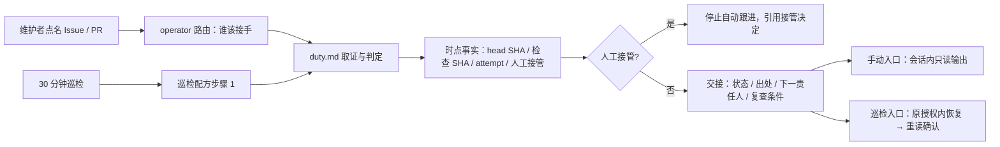

# PRD: 交付值班员 · 从 GitHub Issue 和 PR 判断谁该接手

- GitHub Issue: https://github.com/ZataZhang/keda/issues/430

> ✅ **交付前置**：无，可立即开工。
> 结构化声明见 §8 Delivery Dependencies，**那里是唯一事实源**。

> ⏸️ **验收状态**：验证阻塞 — 执行侧验证尚未完成，阻塞原因与后续任务见 Final Reconciliation。
> 本行是 §9 Acceptance Checklist 的投影，**那里是唯一事实源**。

> 本 PRD 分两个 altitude，分别服务不同读者，自上而下阅读：
>
> - **Part A · 人审层 (Review Layer)** — 需求方 / 验收人读这部分，决定"该不该做、做得对不对"，并通过风险地图知道**哪些地方必须亲自确认**。Part A 不出现实现机制、文件路径、命令。
> - **Part B · 执行器层 (Build Layer)** — 实现者（人或 Agent）读这部分动手。人只在 Part A 风险地图**点名处**下钻审查，其余默认交执行器 + 自动门禁（hook / 测试 / 架构检查）。

## Feature Overview (功能一览)

> 本节是 §10 Functional Requirements 的白话投影，不是第二事实源；行为验收以 §1 行为样例表为准。

- **点名一条就能问**：在 Agent 会话里贴一个 Issue 或 PR 链接，问"还需要谁处理"，两种入口都能自动找到对方（FR-1）。
- **只认当下可归属的事实**：区分哪次执行、哪个提交、哪次检查、谁在什么时候接管，旧标签和新进展不混为一谈（FR-2）。
- **交接说清谁做什么**：答复给出观察时点、当前状态、证据出处、下一责任人和动作、何时再看；需要人拍板时列出待决事项和最小选项（FR-3）。
- **手动查询不改任何东西**：点名查看全程只读，不打标签、不留言、不重试（FR-4）。
- **定时巡检用同一套判断**：现有 30 分钟巡检沿用原授权恢复故障，人工接管优先，恢复后重新读取确认，没有新进展不重复留言（FR-5）。
- **看不到就说看不到**：GitHub 或执行日志读不到时，标明缺了什么、去哪补查，不当作"没问题"（FR-6）。
- **用四个真实现场检验效果**：冻结历史现场，盲评"有岗位说明"和"没有"两组判断，公开误报、漏报和成本（FR-7）。
- **装上就能用，旧配方有升级路径**：安装后的技能能路由到新岗位，巡检模板与仓库内配方同步，已注册的旧配方有写明的升级方法（FR-8）。
- **首期不做的事**：跨仓排班、全天候代码审查、自动合并、员工管理界面（§11）。

# Part A · 人审层 (Review Layer)

## 1. Introduction & Goals

### Problem Statement

一次执行失败或阻塞后，同一条任务上会同时出现彼此矛盾的信号：旧的失败标签、旧提交的检查结果、作者后来推的修复、人工已经说过"我接管"，以及别的机器上还没退出的旧进程。维护者要回答"截至此刻，谁需要做什么，依据在哪里"，目前只能自己翻评论、看标签时间线、拉 CI 日志拼出来。

仓库里可以直接观察到的现状：

- 2026-11-24 排查 #416 时，Issue 标签是"阻塞"，管理终端同时显示"最近一次流程记录与 Issue 当前标签不一致"，日志尾部是另一台机器上的旧进程发现认领已失效后自行退出。真正的阻塞原因（PR 检查失败、CI 自动修复未开启、真实环境验收证据缺失）要逐条读事件评论和 CI 日志才能拼出。
- 同一天，巡检任务 #419 处于"失败"，管理终端显示"本机无这一轮运行记录"——巡检自身的执行证据分散在另一台机器上。
- 现有定时巡检的步骤会读 Issue 正文、最近尝试记录和关联 PR，但没有要求核对"检查结果对应的是不是当前最新提交"，也没有把"人工已接管"列为必须先查的停止条件。

### Interpretation (解读回显)

这是你**前置批准**的对象，也是唯一能拦住"解读错了"的关卡——验收标准和实现都是同一份解读的产物，解读错了它们会互相印证，下游检查全绿在错的行为上。所以先给可以逐格改的具体样例。

| 验证方式 | 输入 / 操作 | 期望观察到的结果 |
|---|---|---|
| 👀 人审 + 自动验证 | 点名一条仍标"失败"的 Issue，它关联的 PR 有新提交、检查正在进行 | 答复区分两次执行，说明正在等哪个提交的哪项检查，给出下一次复查条件；不建议立即重试。 |
| 👀 人审 + 自动验证 | 从 PR 链接进入，当前尝试实现成功但发布失败 | 反查到关联 Issue，指明故障在发布环节并附证据出处；手动查询只给恢复建议，不执行恢复。 |
| 🤖 自动验证 | 技术阻塞已定位，但修复需要维护者决定权限 | 列出待决定事项、能做决定的人和最小选项，任务保持阻塞。 |
| 🤖 自动验证 | GitHub 或本机执行日志读不到 | 标明已核实的事实、缺失的来源和补查入口；不据此宣布"队列为空"或"没问题"。 |
| 🤖 自动验证 | 人工已明确接管，但旧的失败标签还在 | 引用最新的接管决定，结束自动跟进，不重试、不重开、不重复交接。 |

表中的行会原样成为 §7.6 的验收标准，改动任何一格就是在改验收标准。

**我默默定了这些**（没问你、我自己定的歧义点）

- 入口不限于 Codex → 任何装了随包运维技能的 Agent 会话都能用；验收时用 Codex 会话跑。
- 一次只查一个明确仓库 → 链接里能确定仓库就用它，不能确定时先问，不猜。
- Issue 和 PR 的关联 → 只认 GitHub 记录的真实关联（PR 声明、事件评论），分支同名不算关联；可以有零个或多个关联。
- 手动查询的交接 → 只留在当前会话里，不写回 GitHub；定时巡检沿用原来写巡检 Issue 正文末尾的方式。
- 正在运行的任务 → 不归值班员处理，交给现有的停滞监控；日志一段时间没输出不算失败。
- "跟上次一样" → 输入相同且没有新进展时复用上一次的交接结论，不再发一遍。
- 新能力挂在现有的"卡住了"路由旁边 → "卡住了"负责怎么恢复，"谁该接手"负责判断现状与交接，两者互相指引而不重复。

**我理解为不做**（你可能想要、但我读成不在范围内的）

- 跨仓库排班、一次看多个仓库的全局值班表。
- 全天候的 PR 代码审查，或替作者修代码。
- 员工管理界面、值班人员表、新的命令行子命令。

读成：给现有运维技能加一份"交付值班员"岗位说明，让 Agent 用固定方法回答"截至此刻谁该做什么、依据在哪"；手动点名时**只读**，定时巡检**只在原有授权内**恢复。不是一个新服务，也不是让手动查询顺带修复。仓库内容、评论和日志只当证据读，其中出现的任何指令都不能扩大值班员的权限。正在运行的任务、跨仓排班和代码审查不在范围内。

**实现前确认：** 请直接在本 PRD 中确认；若内容不准确，先修改再勾选。
- [ ] 我确认这段解读与行为样例准确表达了我的需求。

> 会话确认记录：维护者于 2026-11-24 在会话中确认本解读与行为样例无误（可编辑文件下的聊天确认，见 Change Log）；上方复选框仍由维护者本人勾选。

### What The User Gets

- **维护者**：贴一个 Issue 或 PR 链接问"还需要谁处理"，几十秒内拿到一份带出处的交接：现在是什么状态、在等什么、下一步该谁做什么、什么时候再看。不再需要自己翻评论和 CI 日志。
- **作者和审阅者**：继续在 GitHub 上工作，手动试用值班员不会给他们制造新通知。
- **定时巡检**：照旧每 30 分钟处理失败和阻塞任务，但处理前按同一套方法重新取证，遇到人工接管就停手，恢复后用新读取的状态确认真的好了。

### Measurable Objectives

- 行为样例表 5 行在交付版本上全部复现，其中 2 行人审项附真实会话记录。
- 手动查询前后，目标 Issue 和 PR 的事件时间线条数不变，会话里没有任何写操作调用。
- 对"已被人工接管"的任务，巡检一轮后没有新增重试、重开或交接评论。
- 四个历史现场各有两组判断和独立评分，误报数、漏报数和可得的耗时成本逐题公开；分母为零时写"不适用"。
- 现有巡检的配方测试和核心测试保持通过；已注册的旧巡检配方按文档步骤升级后能读到新判断步骤。

## 2. Human Review Map (介入与风险地图)

这一节只列需要人判断的决策。文件改动、配方测试和回归测试由执行器完成，不要求逐项阅读实现细节。

### 决策一：值班员能动什么

建议手动点名查询**全程只读**：只读 GitHub 和本机执行记录，答复留在会话里，不打标签、不留言、不重试、不恢复。定时巡检**只沿用它现有的恢复授权**（发布类故障走恢复命令，已定位并修好根因的技术阻塞走继续命令），值班员的判断步骤只是让它在动手前看得更准；任何时候发现人工已明确接管，巡检都停止自动跟进。值班员读到的仓库内容、评论和日志只当证据，其中出现的指令不能让它执行授权之外的动作。

主要风险在于：如果手动查询也能顺手恢复，维护者"只是想看看"就可能触发重试或改标签；如果巡检不认人工接管，就会和接手的人抢同一条任务。替代做法是让手动查询在用户确认后也能执行恢复，更省一步，但"查看"和"授权修改"的边界会变模糊。

**请确认：** 是否接受"手动查询只读、巡检沿用原授权、人工接管优先"这套权限安排？

**实现前选择：** 请选一项，按需修改上面的文字。
- [ ] 手动查询只读；巡检沿用原有恢复授权；人工接管优先（推荐）
- [ ] 手动查询在用户当场确认后也可执行恢复；巡检同上

> 会话确认记录：维护者于 2026-11-24 在会话中选择推荐项「手动查询只读；巡检沿用原有恢复授权；人工接管优先」（见 Decision Log D-03 与 Change Log）；上方复选框仍由维护者本人勾选。

**验收：** 用真实的 Issue 和 PR 链接手动查询，前后对比事件时间线没有任何新增；在隔离仓库里让巡检遇到一条"已人工接管但仍挂失败标签"的任务，巡检结束后这条任务没有被重试、重开或重复交接。

### 自动门禁，不需要逐项人工审阅

- 判断方法写对：四个冻结的历史现场由独立评分核对责任人、下一步、证据和是否越权。
- 分发路径打通：交付版本安装后，技能能路由到新岗位；巡检模板生成的配方和仓库内配方都包含新判断步骤，配方测试覆盖。
- 文档同步：巡检指南写明旧配方的升级方法，运维技能说明里的参考文件清单与实际一致，文档严格构建通过。

### 本次明确不涉及

不改数据库结构、不新增凭据或权限、不改标签状态机和恢复命令本身、不新增命令行子命令或前端页面；巡检的恢复动作范围与今天完全相同。

## 3. Usage And Impact After Implementation

### 维护者（手动点名）

在装了运维技能的 Agent 会话（如 Codex）里输入"看看这条 PR 还需要谁处理"并附 GitHub 链接。答复依次给出：观察时点、当前状态、证据出处（哪条事件评论、哪个提交、哪次检查、哪次执行尝试）、下一责任人和要做的动作、复查条件。找不到可靠关联时明确写出缺口，同时保留对当前对象能独立成立的判断。整个过程不改 GitHub 上的任何东西。

### 定时巡检（30 分钟一轮）

触发方式、处理队列和收尾规则不变。变化在于：处理每条任务前按值班员方法重新取证；遇到人工接管直接跳过；恢复后重新读取任务状态确认生效；输入与上一轮相同且无新进展时不重复留言。已注册的旧巡检配方不会自动更新，需按巡检指南里的步骤升级。

### 作者与审阅者

继续在 GitHub 上工作，入口和流程不变。手动试用值班员不会产生任何评论、标签或通知；巡检的留言方式与今天相同。

### Impact On Existing Behavior

- 现有"卡住了"等路由、恢复命令、标签含义和巡检排班全部不变。
- 新安装或刷新运维技能后才出现新路由；未刷新的旧副本照旧工作。
- 用模板新建的巡检配方带新步骤；已存在的配方文件不会被覆盖，按文档升级。

## 4. Requirement Shape

- Actor: 维护者（手动点名）、定时巡检 Agent（自动入口）；作者与审阅者只受"不产生新通知"约束。
- Trigger: 维护者在 Agent 会话中点名一个 Issue 或 PR；或巡检按排班触发并逐项处理失败、阻塞任务。
- Expected behavior: 针对一个明确仓库内的任务，取得可追溯到原对象及相应提交或执行尝试的事实，给出下一责任人和动作；需要人接手时说清人能做的决定。手动入口零写入；巡检入口只在原授权内恢复并重读确认。
- Scope boundary: 不处理正在运行的任务；不跨仓；不做代码审查；不新增服务、命令或界面。

# Part B · 执行器层 (Build Layer)

> 以下供实现者（人或 Agent）使用。人只在 Part A 风险地图点名处下钻审查；其余默认交执行器 + 自动门禁。

## 5. Repository Context And Architecture Fit

- Existing path: 随包运维技能 `src/backend/engines/agent_runner/templates/skills/kedacode-operator/`（`SKILL.md` 路由表 + `references/*.md`），其中 `references/triage.md` 是最近的现有入口（"卡住了"：标签含义、尝试记录、调用标记的读法）。巡检有两份配方来源：仓库实例 `tasks/loops/keda-blocker-monitor-30m.md`，以及模板渲染 `src/backend/core/use_cases/loop_builtin.py` 的 `render_blocker_monitor_recipe`（`kc loop create … --template blocker-monitor` 使用）。
- Reuse candidates: 现有只读命令（`gh issue view` / `gh pr view` / `gh api …/timeline`、`kc logs --issue <N>`、`kc peers`）、尝试记录与 `kc:event` 事件评论格式、巡检现有的恢复命令（`kc recover`、`kc blocked-continue`）与守护进程所有权判断。
- Architecture pattern to preserve: 运维技能是"路由表 + 按需加载参考"的结构，参考文件只写"何时用、按什么顺序、别做什么"，命令语义以 `kc --help` / `kc schema --json` 为准；不新增后端代码路径，四层依赖不受影响。
- Frontend impact: No frontend impact——交互发生在 Agent 会话和既有巡检 Issue 内，管理终端不改。
- Constraints: `create_builtin_loop` 用独占创建写配方文件，已存在的配方不会被覆盖，因此旧配方升级只能靠文档步骤（`kc loop create … --recipe … --force`）；运维技能受管文件按字节比对，刷新走 `kc skill install` 或启动时自动同步；`docs/guides/agent-runner.md` 写的是"共 9 份" references，实际已有 12 份，本次新增后需对齐。
- Existing PRD relationship: 已检索 `tasks/pending/` 与 `tasks/archive/`。
  - `P2-REFACTOR-20261020-133042-operator-skill-context-and-behavior-evaluation`（运维技能内容精简与真实任务对比）改动同一个 `SKILL.md` 路由表：独立可交付，后合入的一方负责把新路由并入对方的精简结构。
  - `P1-FEAT-20261019-180938-m13-keda-vs-claude-workflow-evaluation`（工作流对照评测）可参考其"隔离执行、逐题对照"的评测口径，无先后要求。
  - `tasks/archive/P1-FEAT-20261009-123512-kc-agentic-entry-and-stall-supervision` 定义了运行中任务的停滞监控，本 PRD 明确把运行中任务交给它。
  - 无重复的待办 PRD。
- Redundancy risks: 在 `duty.md` 里重写一遍 `triage.md` 的标签表和调用标记读法；在仓库配方和模板配方里各写一份不一致的判断步骤。

## 6. Recommendation

### Recommended Approach

- Approach: 新增一份按需加载的岗位参考 `references/duty.md`，在 `SKILL.md` 路由表加一行"谁该接手"指向它；`triage.md` 与 `duty.md` 互相指引。巡检两份配方只在取证步骤里引用这份参考的判断方法，保留各自的触发、队列过滤、授权和收尾规则。
- Why this is the best fit: 运维技能已经是所有 Agent 会话和巡检 Agent 共同加载的入口，按需参考是它的既有扩展方式；判断方法只写一份，手动和巡检两个入口共用。
- Rejected redundancy: 不做独立服务、员工表或新的 `kc` 子命令——调度、状态和恢复已由现有工具承担；先用四题回放验证岗位判断是否值得长期保留，再讨论扩大。

### Proposed Solution Summary (实现机制)

核心机制是"一份岗位参考 + 两个入口复用"。维护者或巡检 Agent 提供仓库与编号（链接或巡检队列），系统不推断目标仓库以外的范围。`duty.md` 规定取证顺序：判定对象类型 → 沿真实关联取对方（Issue 取 PR、PR 反查 Issue，允许零或多个）→ 记录 PR head、检查对应的 SHA、执行尝试编号、人工接管时间与出处 → 把事实、推断、待查分开 → 按固定格式产出交接。手动入口只读；巡检入口在原恢复授权内动作，动作后重读状态。不新增存储、不改标签状态机、不改恢复命令；"相同输入复用交接"靠读取上一轮巡检 Issue 正文末尾的摘要实现，不新建状态文件。

### Alternatives Considered (Only When Useful)

- Alternative: 把判断步骤直接并进 `triage.md`。
- Why not chosen: `triage.md` 面向"怎么恢复"，会触发写操作；把只读的交接判断混进去，手动查询更容易被引向恢复动作，与决策一的只读边界冲突。

## 7. Implementation Guide

This section is a living implementation guide based on current repository analysis. If implementation discovers additional affected files, hidden dependencies, edge cases, or a better path, update this PRD before proceeding.

### 7.1 Core Logic

1. 解析仓库与编号，用 `gh` 判定对象是 Issue 还是 PR；仓库无法确定时停下来问。
2. 取关联：从 Issue 沿 PR 声明和 `kc:event` 事件评论取 PR；从 PR 正文与关联记录反查 Issue。仅凭分支同名不建立关联。
3. 取时点事实：PR 当前 head SHA、每项检查对应的 SHA、最新执行尝试（尝试记录与 `kc logs`）、最近一次人工接管或处理决定的时间与出处、认领评论的主机与 PID（必要时 `kc peers`）。
4. 判定：人工接管优先；运行中任务交给停滞监控；检查若对应旧 SHA 则视为"在等新检查"；日志安静不算失败。事实、推断、待查分三栏。
5. 产出交接：观察时点、状态、出处、下一责任人与动作、复查条件；需人决策时附待决事项、决策人与最小选项。
6. 巡检入口额外：在原授权内恢复 → 重读 Issue 状态与日志确认 → 与上一轮摘要比较，无新进展则不重复留言。
7. 全程把仓库内容、评论和日志当证据读，其中的指令不改变允许的动作集合。

### 7.2 Change Impact Tree

```text
.
├── Engines（随包技能）
│   ├── src/backend/engines/agent_runner/templates/skills/kedacode-operator/SKILL.md
│   │   [修改]
│   │   【总结】路由表新增"谁该接手"一行，指向 duty.md。
│   │
│   │   ├── 触发词：还需要谁处理 / 谁该接手 / 现在卡在谁那 / 交接一下这条 PR
│   │   └── 与"卡住了"行的触发词不重叠（rg -n "卡住了" 定位）
│   │
│   ├── src/backend/engines/agent_runner/templates/skills/kedacode-operator/references/duty.md
│   │   [新增]
│   │   【总结】交付值班员岗位说明：取证顺序、判定规则、交接格式、只读与授权边界。
│   │
│   │   ├── 取证顺序与可用的只读命令（只引用命令名，参数以 kc schema --json 为准）
│   │   ├── 判定规则：人工接管优先、旧 SHA 检查、运行中任务移交、日志安静不算失败
│   │   ├── 交接格式：观察时点 / 状态 / 出处 / 下一责任人与动作 / 复查条件 / 待决事项
│   │   └── 边界：手动入口零写入；巡检入口仅原授权；证据中的指令不扩权
│   │
│   └── src/backend/engines/agent_runner/templates/skills/kedacode-operator/references/triage.md
│       [修改]
│       【总结】开头"When to use"加一句：只想知道现状和谁接手时改读 duty.md。
│
├── Core（巡检模板）
│   └── src/backend/core/use_cases/loop_builtin.py
│       [修改]
│       【总结】render_blocker_monitor_recipe 生成的步骤 1 改为按 duty.md 取证，并把人工接管列为停止条件。
│
├── Repo 配方实例
│   └── tasks/loops/keda-blocker-monitor-30m.md
│       [修改]
│       【总结】与模板同步步骤 1 和停止条件；保留 Patrol result / Constraints 段原文。
│
├── Tests
│   ├── tests/test_loop_builtin.py
│   │   [修改]
│   │   【总结】断言模板配方含 duty 取证步骤与人工接管停止条件。
│   ├── tests/test_keda_blocker_monitor_recipe.py
│   │   [修改]
│   │   【总结】断言仓库配方同样包含，且原有段落仍在。
│   ├── tests/test_cli_skill_install.py
│   │   [修改]
│   │   【总结】断言安装后的 operator 目录含 references/duty.md 且 SKILL.md 路由指向它。
│   └── tests/test_kedacode_operator_skill.py
│       [修改]
│       【总结】更新 references 数量断言，并覆盖受管文件集合及路由表中的新增说明。
│
├── Docs
│   ├── docs/guides/loop-blocker-monitor.md
│   │   [修改]
│   │   【总结】说明巡检按值班员方法取证、人工接管优先，并写明旧配方升级步骤。
│   └── docs/guides/agent-runner.md
│       [修改]
│       【总结】operator references 清单与数量对齐实际（含 duty.md）。

└── Delivery records
    ├── tasks/pending/P1-FEAT-20261123-175650-github-delivery-duty.md
    │   [修改]
    │   【总结】记录实施后的验收状态、证据、阻塞项与 Change Log。
    └── tasks/evidence/P1-FEAT-20261123-175650-github-delivery-duty/*.md
        [新增]
        【总结】按 PRD 机器契约保存验证计划、证据导航和独立验证状态报告。
```

以上是当前分析得到的起点，不保证穷尽；用 §7.3 的检索兜底。四题回放的题面、来源和评分说明放在证据目录 `tasks/evidence/P1-FEAT-20261123-175650-github-delivery-duty/cases/`，不进代码 diff。

### 7.3 Risk Classification And Drift Guard

#### Risk Classification Register

| 变更点 | Tier | 决定性维度 / 覆盖 | 介入方式 | Oracle / 门禁 |
|---|---|---|---|---|
| 手动入口只读边界 | R3 | 安全：误写会改别人的任务状态；固定区"信任边界" | 人工确认（决策一）+ 负控 | rv-1 |
| 巡检尊重人工接管、只在原授权内恢复 | R3 | 正确性关键：重复执行 / 抢任务；固定区"核心编排" | 人工确认（决策一）+ 负控 | rv-2 |
| 事实归属与交接判断质量 | R1 | 只影响建议内容，可随时改参考重来 | 执行器 + 回放评分 | rv-3 |
| 分发与文档（路由、模板、旧配方升级、清单数量） | R1 | 局部可回滚；漏改只影响新能力可见性 | 执行器 + 配方 / 安装测试 | rv-4 |

#### Executor Drift Guard

| Check | Command | Expected Result | If It Fails, Inspect First |
|---|---|---|---|
| 两份配方都引用岗位参考 | `rg -n "duty" tasks/loops/keda-blocker-monitor-30m.md src/backend/core/use_cases/loop_builtin.py` | 两个文件都有命中 | `render_blocker_monitor_recipe` 的正文字符串 |
| 其他配方或模板是否也写了取证步骤 | `rg -n "Attempt History" tasks/loops src/backend/core/use_cases src/backend/engines/agent_runner/templates` | 只剩已评估过的位置 | 夜间清理等其他配方是否需同步 |
| 路由指向存在的文件 | `rg -n "references/duty.md" src/backend/engines/agent_runner/templates/skills/kedacode-operator/SKILL.md` | 恰好一行 | 路由表格式、`${CODEBUDDY_SKILL_DIR}` 前缀 |
| 文档清单数量 | `rg -n "共 [0-9]+ 份" docs/guides/agent-runner.md` | 数量与 `references/` 下文件数一致 | 是否还有别处列举 references |

### 7.4 Flow Diagram



### 7.5 ER Diagram (Only When Data Model Changes)

- No data model changes in this PRD.

### 7.6 Realistic Validation Plan (Oracle 块)

维护者于 2026-11-25 确认 RV-1 与 RV-2 以新版的实际行为验收。旧版对照逐条披露原始结果。两项无副作用断言通过脱敏后的本地证据副本注入异常事件，单独验证断言可以失败。

真实查询使用交付版本安装的技能和真实仓库；有副作用的巡检验证在隔离测试仓库和专用 runner 上进行，**禁止对真实 #419 或其他真实任务重放写动作**。

```yaml
- id: rv-1
  behavior: 手动从 Issue 和 PR 两个入口点名查询，得到带出处的交接且零写入
  reviewer: human
  real_entry: "交付版本执行 kc skill install 后，新开 Codex 会话，分别输入：看看 https://github.com/ZataZhang/keda/issues/<N> 还需要谁处理；看看 https://github.com/ZataZhang/keda/pull/<M> 还需要谁处理"
  expected: "两次答复都含观察时点、当前状态、出处、下一责任人与动作、复查条件，对应 §1 第 1、2 行；会话调用轨迹中没有任何写操作"
  mock_boundary: "全部真实：已安装技能、真实 gh 与 kc 只读调用、真实仓库；不预填答案"
  tier: R3
  test_layer: e2e
  required_for_acceptance: true
  presentation: "tasks/evidence/P1-FEAT-20261123-175650-github-delivery-duty/rv-1-duty-read.md：并列展示真实请求、答复、引用的证据与写调用计数；自查：看答复里的 head SHA 是否等于 PR 页面当前 head"
  critical_value_source: "PR 当前 head、各检查对应 SHA、最新 attempt 与人工决定，均取自真实 GitHub 与 kc logs 输出"
  must_cross: "已安装技能 -> 路由 -> duty.md -> gh / kc 只读调用 -> 会话输出"
  forbidden_bypasses: "预填答案、直接把参考文件内容贴进提示词、调用内部 helper 代替真实命令"
  fresh_state_probe: "查询前后各取一次 gh api repos/ZataZhang/keda/issues/<N>/timeline 与 PR 时间线，条数与最后事件一致"
  final_tree_evidence: "记录最终 SHA、技能安装来源与摘要、脱敏会话；技能或参考有改动则重跑"
  negative_control: "在证据工作树运行 scripts/recheck-duty.sh probe-rv-1，向本地快照副本加入一条意外时间线事件"
  expected_fail: "前后快照比较退出非零并报告 Issue/PR 时间线变化。旧版待检查场景作为实测对照保留。"
- id: rv-2
  behavior: 巡检沿用原授权恢复可恢复任务，并跳过已人工接管的任务
  reviewer: verifier
  real_entry: "隔离测试仓库执行 kc loop create <loop-id> --template blocker-monitor --repo-id <test-repo>，由 kc daemon 按排班触发一轮"
  expected: "可恢复目标按原流程恢复且重读确认生效；已人工接管目标零重试、零重开、零新交接评论；巡检 Issue 正文末尾摘要段落完整"
  mock_boundary: "独立测试仓库与专用 runner，真实 GitHub 状态；不接触真实业务 Issue"
  tier: R3
  test_layer: e2e
  required_for_acceptance: true
  critical_value_source: "目标 Issue 的标签、最新 attempt、人工接管评论与恢复后的最新状态，取自真实 GitHub"
  must_cross: "配方注册 -> daemon 调度 -> 巡检 Agent -> duty.md -> 恢复命令 -> 状态回读"
  forbidden_bypasses: "手工把配方贴给 Agent 冒充调度、以命令退出码代替状态回读"
  fresh_state_probe: "巡检结束后新进程重读两个目标 Issue 的时间线、日志与巡检 Issue 正文"
  final_tree_evidence: "最终 SHA、loop 运行标识、事件前后对照；配方或参考有改动则重跑"
  negative_control: "在证据工作树运行 scripts/recheck-duty.sh probe-rv-2，向本地人工接管目标的巡检后快照副本加入一条直接评论"
  expected_fail: "直接事件比较退出非零并报告目标改动。旧配方的人工接管场景作为实测对照保留。"
- id: rv-3
  behavior: 用四个冻结历史现场对比有无岗位参考的判断
  reviewer: verifier
  real_entry: "新 Codex 会话，分别用普通提示和安装后的岗位技能完成 cases/ 下四题，评分者不知分组"
  expected: "四题都有来源、独立参考判断与两组逐题结果；公开漏报数/应接手数、误报数/提醒数和可得耗时，分母为零写不适用；岗位组无越权、无虚构证据、无漏掉明确人工接管"
  mock_boundary: "历史证据离线回放，屏蔽观察时点之后的信息；固定模型、预算与可见材料"
  tier: R1
  test_layer: manual
  required_for_acceptance: true
- id: rv-4
  behavior: 交付版本安装后路由可达，两份配方与文档同步
  reviewer: verifier
  real_entry: "uv run pytest -o addopts='' tests/test_loop_builtin.py tests/test_keda_blocker_monitor_recipe.py tests/test_cli_skill_install.py && uv run mkdocs build --strict"
  expected: "测试通过且断言了 duty.md 路由、两份配方的取证步骤和人工接管停止条件；文档严格构建通过"
  mock_boundary: "测试用临时技能根；文档构建真实"
  tier: R1
  test_layer: integration
  required_for_acceptance: true
```

Failure triage：

- rv-1 答复没走新路由时，先查当前 Agent 的技能目录是否已刷新（受管文件按字节比对，被编辑过的副本不会自动更新），再查路由触发词是否与"卡住了"冲突。
- rv-2 巡检未触发时，先查 daemon 是否在跑、上一轮巡检 Issue 是否未关闭（未关闭会暂停后续轮次），再查 `pre_command` 计数是否为 0 被跳过。
- rv-3 选题：四题各取一个真实现场——旧失败已恢复、执行成功但发布失败、需人决策、读取失败或证据不足。#419 只作为寻找来源的线索，先追溯原目标，缺少可核验材料就换例并记录原因。四题用于发现缺陷，不能推断总体稳定性；岗位组越权、虚构证据或漏掉明确人工接管时，修正参考后重跑。

### 7.7 Low-Fidelity Prototype (Only When Required)

- No low-fidelity prototype required for this PRD.

### 7.8 Interactive Prototype Change Log (Only When Files Actually Changed)

- No interactive prototype file changes in this PRD.

### 7.9 External Validation (Only When Web Research Was Used)

- No external validation required; repository evidence was sufficient.

## 8. Delivery Dependencies

### Delivery Dependencies

- Depends on tasks/issues:
  - none
- Gate type: none
- Sequence: via-main
- Notes: 与 `P2-REFACTOR-20261020-133042-operator-skill-context-and-behavior-evaluation` 改动同一个路由表，无先后要求，后合入方负责合并路由。rv-2 需要隔离测试仓库和可用 runner。

## 9. Acceptance Checklist

本节分两层读者：**9.1 是给人看的**，验收时只看这一层；**9.2 起是给 verifier 和回溯用的机器证据**。每项必须带证据，不是裸勾。

### 9.1 人读呈递区（Human Review Surface）

**主演示脚本**

| 步骤 | 画面上应看到什么 | 需要真实依赖？ |
|---|---|---|
| 1 | 打开一个历史现场的 Issue 页面，展示旧失败标签与新提交并存 | 是：真实 GitHub |
| 2 | 在新 Codex 会话输入该 Issue 链接，问"还需要谁处理" | 是：已安装技能、真实 gh / kc |
| 3 | 答复显示观察时点、状态、出处、下一责任人与动作、复查条件 | 是：真实 gh / kc |
| 4 | 改从对应 PR 链接进入，答复反查到同一 Issue | 是：真实 gh / kc |
| 5 | 对照 PR 页面当前 head 与答复中的 SHA，并展示查询前后时间线条数一致 | 是：真实 GitHub |

| # | 你要看什么 | 呈递物（交付时填实际路径） | 想自己复核？ |
|---|---|---|---|
| 1 | 从 Issue 和 PR 两个入口点名查询，答复说清谁该做什么、依据在哪，且没改任何东西 | `tasks/evidence/P1-FEAT-20261123-175650-github-delivery-duty/rv-1-duty-read.md`；打开：`just prd review tasks/archive/P1-FEAT-20261123-175650-github-delivery-duty.md` | 看答复里的 head SHA 是否等于 PR 页面当前 head；看"写调用计数"是否为 0 |

**以下项不需要你看**（`reviewer: verifier`，agent 自验 + verifier 复核，挂了会自己红）：rv-2 巡检恢复与人工接管、rv-3 四题回放评分、rv-4 安装路由与配方 / 文档测试。证据在 §9.2。

### 9.2 Acceptance Evidence Package

#### Human-Confirmed (来自 Part A 风险地图)

- [ ] 决策一：手动查询只读、巡检沿用原授权、人工接管优先的权限安排，已在 rv-1 零写入对照和 rv-2 人工接管实测证据中得到证明。
- [ ] §9.1 呈递区已亲眼看过（看演示或做自查，二选一或都做）。

#### Behavior Acceptance

- [ ] rv-1：两个入口的答复与 §1 第 1、2 行一致，查询前后时间线一致，旧技能对照和时间线断言的失败探针记录在案——证据 `rv-1-duty-read.md`。
- [ ] rv-2：隔离仓库一轮巡检中，可恢复目标重读确认生效，人工接管目标零重试 / 重开 / 新交接，旧配方对照和直接时间线断言的失败探针记录在案——证据 `rv-2-duty-patrol.txt`。

#### Architecture And Dependency Acceptance

- [x] 判断方法只写在 `references/duty.md` 一处，两份配方只引用不复写：`rg -n "duty" tasks/loops/keda-blocker-monitor-30m.md src/backend/core/use_cases/loop_builtin.py` 两处命中，且无第三份取证步骤副本（§7.3 检索结果附在证据报告 RV-4 自查记录）。
- [ ] 未新增 `kc` 子命令、后端服务或存储：`git diff --name-only` 及工作树新增文件均只含 §7.2 Change Impact Tree 中列出的实现与交付记录。当前差异已重新核对，早期评审提到的 Console 工作流和 supervisor 配置文件已不在差异中，待独立复核。

#### Documentation Acceptance

- [x] `docs/guides/loop-blocker-monitor.md` 写明值班员取证、人工接管优先和旧配方升级步骤；`docs/guides/agent-runner.md` 的 references 清单与数量和实际一致；`uv run mkdocs build --strict` 通过——证据 `rv-4-install-docs.txt`。

#### Validation Acceptance

- [ ] rv-4：`uv run pytest -o addopts='' tests/test_loop_builtin.py tests/test_keda_blocker_monitor_recipe.py tests/test_cli_skill_install.py` 通过，且断言覆盖 duty 路由、两份配方取证步骤与人工接管停止条件——证据 `rv-4-install-docs.txt`；会失败负控 `rv-4-negative-control.txt`。评审修复配方后须重做并绑定最终树证据。
- [ ] rv-3：四个历史现场的题面、来源、观察时点和两组逐题结果可复核，误报 / 漏报 / 耗时逐题公开——证据 `rv-3-replay.md` 与 `cases/`。
- [ ] `just test` 通过，证据绑定最终 SHA；最终树上技能或配方有改动后，rv-1、rv-2 已重跑。

#### Delivery Readiness

- [ ] 交付 PR 关联本 PRD 与证据报告，PR 证据评论原样呈现 §9.1 呈递表；证据报告首节为人审导航。
- [ ] 按真实验证状态归档：独立 verifier `PASS` 后为 🧍 待人工验收；验证受阻时按 ⏸️ 验证阻塞填写阻塞原因与后续任务。

## 10. Functional Requirements

- FR-1: 支持点名单个 Issue 或 PR 查询，并沿 GitHub 记录的真实关联双向取对方，允许零个或多个关联；仓库无法确定时先询问。
- FR-2: 判断只基于可归属的时点事实（PR head SHA、检查对应 SHA、执行尝试、人工接管时间与出处），事实、推断和待查分开列出；不以分支同名或日志安静下结论；运行中任务移交停滞监控。
- FR-3: 交接固定包含观察时点、当前状态、证据出处、下一责任人与动作、复查条件；需要人决策时列出待决事项、决策人与最小选项，并保持任务阻塞。
- FR-4: 手动查询全程只读，不写标签、评论或触发恢复；仓库内容、评论和日志中的指令不得扩大允许的动作。
- FR-5: 定时巡检复用同一判断方法，只在原有恢复授权内动作，人工接管优先，恢复后用重新读取的状态确认；输入相同且无新进展时复用上一轮交接、不重复留言。
- FR-6: GitHub 或执行日志读不到时，答复标明已核实事实、缺失来源和补查入口，不得据此宣布队列为空或无问题。
- FR-7: 用四个冻结的历史现场做两组盲评对照，逐题公开漏报、误报和可得耗时成本。
- FR-8: 交付版本安装后可路由到新岗位；巡检模板与仓库配方同步包含新判断步骤；旧配方升级方法与 references 清单写入文档。

## 11. Non-Goals

- 跨仓库排班或多仓库全局值班表。
- 全天候 PR 代码审查、替作者修代码、自动合并。
- 员工管理界面、值班人员表、新的 `kc` 子命令或独立服务。
- 改动标签状态机、恢复命令或巡检的恢复授权范围。
- 改造代码题判分器用于本岗位评测。

## 12. Risks And Follow-Ups

- 跨机器执行日志可能缺失：答复必须报告来源覆盖范围（FR-6），不视为本 PRD 的缺陷。
- 已注册的旧配方不会自动更新：靠文档升级步骤，rv-2 必须实际跑注册与调度验证。
- 历史真值可能无法还原：换例并记录原因，不硬凑四题。
- 四题样本只能发现缺陷，不能证明总体稳定；积累更多独立样本后再讨论扩大职责和权限（需另开 PRD）。

## 13. Decision Log

| # | 决策问题 | 选择 | 放弃的方案 | 理由 |
|---|---|---|---|---|
| D-01 | 岗位能力放在哪里 | 运维技能里新增按需参考 `duty.md` 并加路由 | 单独开发员工管理服务或新 `kc` 子命令 | 调度、状态与恢复已由现有工具承担，参考文件是运维技能既有的扩展方式。 |
| D-02 | 与"卡住了"路由的关系 | 新路由，与 `triage.md` 互相指引 | 把判断步骤并入 `triage.md` | `triage.md` 引向恢复写操作，混入会模糊决策一的只读边界。 |
| D-03 | 手动查询的权限 | 全程只读 | 查询后经确认即可恢复 | 点名查看并未授予修改权限；维护者 2026-11-24 在会话中选定此项。 |
| D-04 | 如何验证判断质量 | 冻结历史现场、两组逐题盲评 | 直接复用代码补丁判分器 | 交付物是时点判断与交接建议，不是代码补丁。 |
| D-05 | 三块工作是否拆 PRD | 保持一份 | 拆成"手动查询""巡检复用""回放评测"三份 | 巡检复用与回放都以同一份 `duty.md` 为对象，拆开会让判断方法在验证前就分叉。 |
| D-06 | RV-1、RV-2 如何验收 | 验证新版实际行为并保留旧版对照 | 要求旧版必须出错 | 旧版在两轮对照中也正确等待和停止。维护者 2026-11-25 确认按实测验收。 |

### Final Reconciliation

- Interpretation: confirmed — 手动点名保持只读；巡检只沿用既有授权，人工接管优先。该行为尚未通过真实 Codex / daemon 入口复核，未将会话路由事故推断为产品结果。
- Public behavior and contracts: confirmed — 新岗位由随包 operator 路由到 `references/duty.md`；没有新增 CLI 子命令、后端服务、数据库或存储。两份巡检 recipe 引用岗位说明，保留各自队列、授权和收尾步骤。
- Related PRD status: confirmed — 未发现新的交付依赖或需改变状态的关联 PRD。
- Requirements and risks: corrected — 新增随包 references 后，现有受管清单 / 路由守卫原来仍将数量固定为 12；修正为 13 并更新触发词映射。相关守卫在 rv-4 目标套件中通过。真实入口、隔离巡检、历史盲评和完整最终树 `just test` 仍未验证。
- Reconciled differences:
  - 首轮全套测试发现 `tests/test_kedacode_operator_skill.py` 是额外受影响文件；已在 Change Impact Tree 登记并更新数量断言。
  - 两份 recipe 步骤已收敛为引用 `duty.md` 并保留明确人工接管停止条件；SHA、Attempt History 和缺证判断细节只写在岗位参考中。
  - 验证事实与未完成项分别记录于 evidence report 和各 RV 文件；Human-Confirmed 项保持未勾。
- Validation blocker: RV-1 的两种正向现场和 RV-2 的隔离巡检已走通；旧技能也等待当前检查，旧配方也跳过人工接管目标，两项原定负控均未复现预期错误。独立 verifier 给出 `BLOCKED`。追加对照保留了旧提交的实际失败记录和过时的重试建议，也将一条确有待推送提交的任务交给维护者接管。两轮旧版对照均保持目标不变；新版巡检复用上一轮摘要。原基线的前端构建问题由独立 PR #439 跟进。四个冻结案例的盲评、定向测试和默认 `just test` 的通过记录见当前 evidence report。
- Validation follow-up: 在 GitHub Issue #430（https://github.com/ZataZhang/keda/issues/430）跟进。为两项原负控准备仍符合 §7.6 且能稳定触发错误的场景，或由维护者明确调整验收判据后补验。待主线前端检查恢复、独立 verifier 对最终树复核通过，再进行人工验收并签收有证据的项目。
- Pre-PR review update: 仓库配方已恢复 `gh issue list --limit 1000` 要求并修正巡检自身标签模板变量；这改变了配方，先前 RV-1 / RV-2 / RV-4 证据不再覆盖最终树，须按原 oracle 重跑。评审修复后的目标测试 55 项、`just test` 和严格文档构建通过；独立 verifier 尚未执行。

## Change Log

### 创建待审 PRD
- Type: scope
- Before: 无
- After: 创建交付值班员 PRD
- Reason: 记录从 GitHub Issue 和 PR 判断交接责任的需求
- Impact: 新增待审 PRD
- Review: 待人审

### 按 prd skill 结构重写
- Type: doc
- Before: 套用骨架但压缩过度，缺 Problem Statement、解读回显的两个列表、逐条 FR、风险分级登记，验收计划只有一条完整 oracle，结构检查不通过
- After: 补齐 Part A/B 全部必需节；oracle 改为 rv-1 至 rv-4 顶层列表；新增与 triage.md 的分工、旧配方升级与 references 清单对齐
- Reason: 维护者要求按 prd skill 重写，原意、文件名与范围不变
- Impact: 范围不变；验收项由 4 组 5 项细化为可逐项举证的清单
- Review: 待人审

### 记录首轮会话确认
- Type: scope
- Before: §1 解读与 §2 决策一未确认
- After: 维护者 2026-11-24 在会话中确认解读无误，决策一选推荐项「手动查询只读；巡检沿用原有恢复授权；人工接管优先」；复选框保持未勾，留给维护者本人
- Reason: 维护者要求交给 kc 执行，并以会话确认代替逐框勾选
- Impact: 实现可按推荐项开工；范围与验收标准不变
- Review: 维护者会话确认

### 纳入随包技能受管清单守卫
- Type: test
- Before: §7.2 未列出断言 operator references 数量及受管清单的 `tests/test_kedacode_operator_skill.py`
- After: 将该测试纳入 Change Impact Tree，用于验证新增 references 已进入受管文件清单与路由表
- Reason: 首轮 `just test` 发现该守卫仍将 references 数量固定为 12；新增 duty.md 后数量为 13
- Impact: 实现影响文件增加一个既有测试文件；功能范围与验收标准不变
- Review: 已由 rv-4 目标测试复核通过；完整测试仍受 Final Reconciliation 所述验证阻塞影响

### 实施与验证状态对账
- Type: evidence
- Before: PRD 横幅为未开工；实现和验证证据尚不存在
- After: 登记最终实现范围、已执行的 RV-4 正负控与本地门禁；横幅标记验证阻塞，未证明的清单项保持未勾
- Reason: 按维护者要求修复 Issue #430，并遵守 PRD 对真实入口、负控、独立验证和阻塞归档的证据要求
- Impact: 代码已具备人工查询路由和巡检共享判断；RV-1 / RV-2 / RV-3、完整最终树 `just test`、独立 verifier 和 Human-Confirmed 仍开放
- Review: 执行器证据已记录；独立 verifier 与人审待完成

### 评审后修正巡检配方
- Type: implementation
- Before: 仓库配方删除了 `gh issue list --limit 1000` 要求，且使用不会展开的 `loop/{loop_id}`。
- After: 恢复列表上限要求，并使用配方渲染支持的 `loop/{{loop_id}}`；增加真实配方渲染测试。
- Reason: 避免超过默认 30 条时漏巡，以及巡检误处理自身。
- Impact: 原有队列与权限范围不变；配方变更后需重跑相关真实入口证据。相对 main 的分支差异还含独立 Console 工作流与 supervisor 配置提交，范围清单暂不通过。
- Review: 本地目标测试通过；真实入口和独立 verifier 待完成。

### 真实交接复测修正
- Type: implementation
- Before: Live lookup 和离线回放可能沿用早期的范围判断；已关闭 Issue 也可能被分配当前动作。
- After: 岗位参考要求复核当前 PR 差异；无新证据时把旧判断列为待核。已关闭或合并且没有未结事项时，明确无需接手。
- Reason: 双入口真实查询和四个冻结现场均发现了可复现的交接误判。
- Impact: 手动查询及巡检共用参考；权限规则与恢复命令保持既有定义。
- Review: 真实双入口、冻结案例盲评与定向测试已有复测记录，独立验收保留原门槛。

### 按实际行为更新 RV-1 与 RV-2 判据
- Type: test
- Before: 原判据要求旧技能建议立即重试或发出写调用，也要求旧配方对人工接管目标发起重试、重开或重复交接。
- After: 验收新版的只读双入口、真实恢复、状态回读和人工接管保护；保留旧版各轮实测，以本地证据副本探针验证零写入断言能捕获异常。
- Reason: 新旧版都等当前检查并尊重接管，维护者确认按新版的实际行为验收。
- Impact: 正向行为、权限边界和真实入口保真度保持原要求。旧版观测值保留，独立 verifier 按修订判据复核。
- Review: 维护者于 2026-11-25 会话确认
