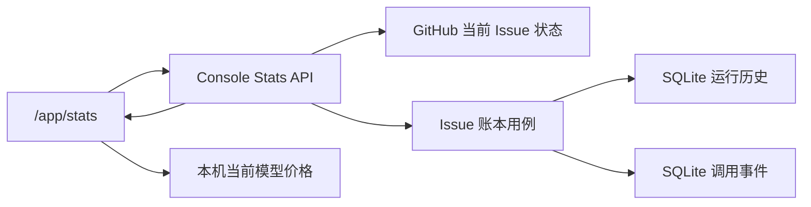
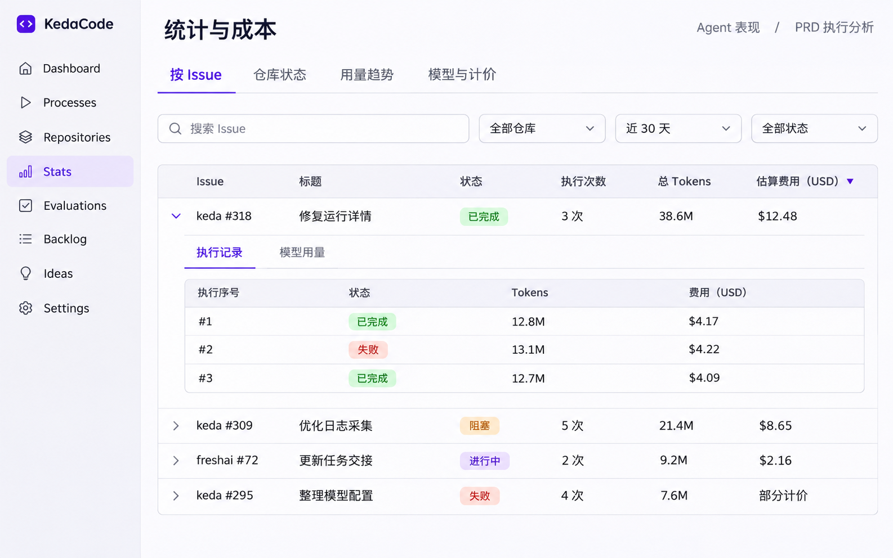
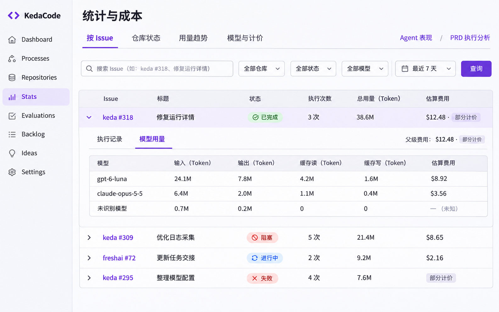
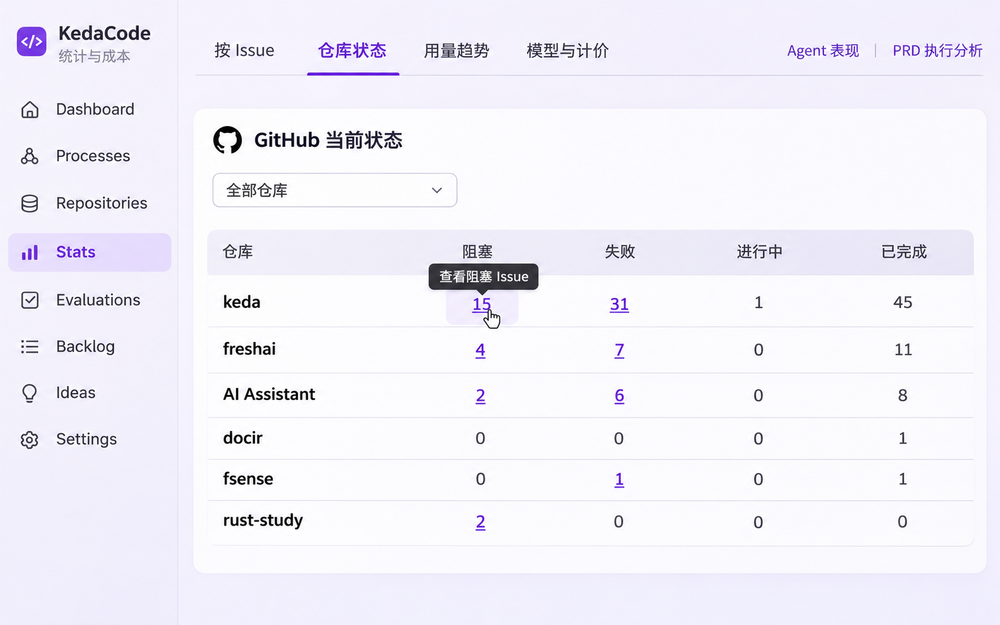
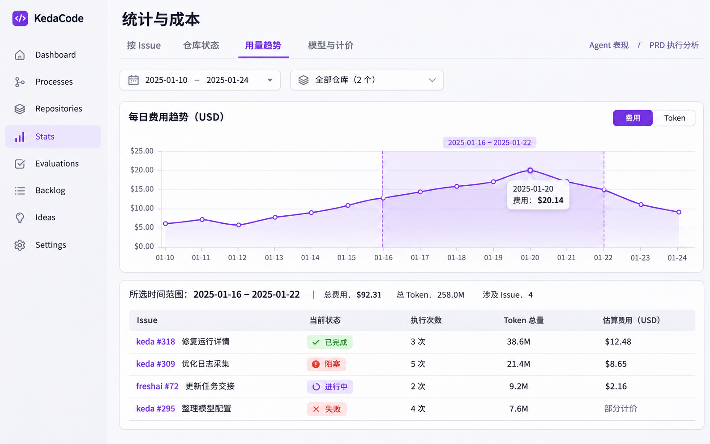
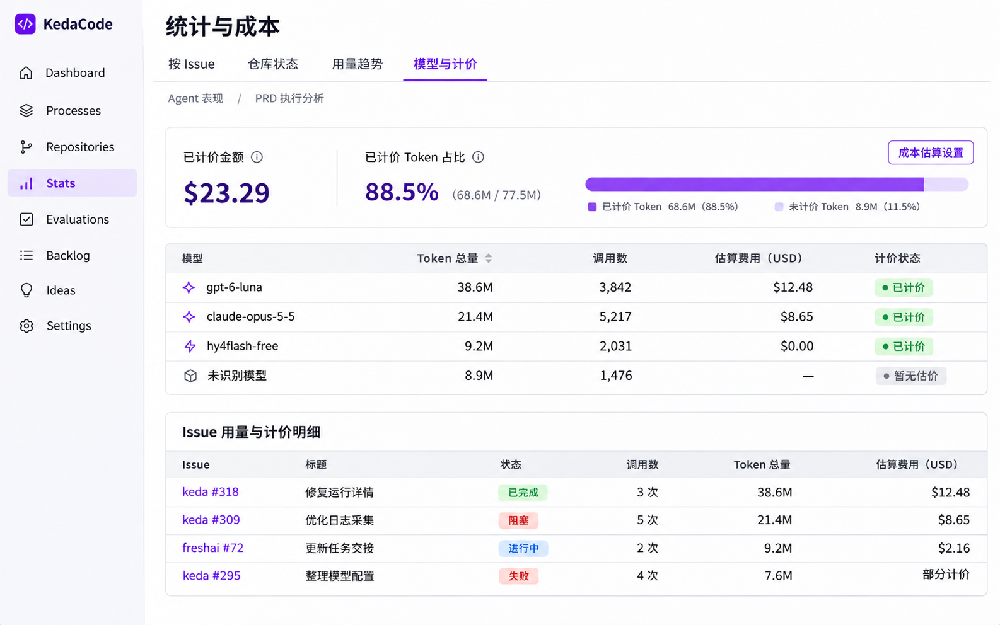

# PRD: Console 统计与成本按 Issue 汇总

- GitHub Issue: https://github.com/ZataZhang/keda/issues/449

> ✅ **交付前置**：无，可立即开工。
>
> 🧍 **验收状态**：待人工验收。

## Feature Overview (功能一览)

- 按 Issue 查看执行次数、Token 和美元估价，展开核对执行和模型明细。
- 仓库状态、用量趋势与模型计价各有独立入口。保留 Agent 表现与 PRD 执行分析。

# Part A · 人审层 (Review Layer)

## 1. Introduction & Goals

### Interpretation (解读回显)

用户已在会话批准采用原型 10 的行内展开设计、融合其他方案并交由 KC 实现。统计页默认打开 Issue 账本。当前状态来自 GitHub，期间开销来自本机账本。

| 场景 | 可验收结果 |
|---|---|
| 同一 Issue 执行三次，其中一次失败 | 表中一行；执行、Token、费用均纳入失败尝试 |
| 两个仓库有同号 Issue | 独立显示，链接到各自的 GitHub Issue |
| 缩小日期范围 | 期间次数、Token 与费用更新；当前状态保持 GitHub 口径 |
| 费用有缺项或已知免费 | 显示已知金额并标「部分计价」、显示「暂无估价」或显示确认的 $0 |
| GitHub 状态读取失败 | 当前状态显示未知；可读取的本机运行与用量仍保留 |

日期窗口按 UTC 日历日选择执行开始时间；执行跨过日期边界时，该执行关联的调用仍随执行进入同一统计期间。GitHub 当前状态不受日期筛选影响。

## 2. Human Review Map (介入与风险地图)

- 已确认的产品决定：以全宽 Issue 表为默认入口，用行内页签核对执行与模型用量；仓库状态、用量趋势、模型与计价作为独立视图。
- 最终人工确认点：真实页面是否保留原型 10 的主表层级，并让两个展开状态与三个辅助视图清晰可用。判错会让用户无法核对费用来源；验收时应比较五张定稿图和对应真实页面。
- 自动门禁负责账本归属、UTC 日期边界、部分计价与旧 Stats 调用方兼容；不需要逐项人工审阅。
- 本次明确不涉及供应商真实账单、历史价格版本、单位合格交付成本和 frontend-admin。

## 3. Usage And Impact After Implementation

Console 使用者进入 Stats 后可按 Issue 查标题、状态、期间执行与用量；仓库状态视图可直接跳到某个仓库和状态的 Issue 集合，用量趋势及模型计价视图复用相同日期范围。Console 操作者仍可查看 Agent 表现与 PRD 生命周期分析。现有 Stats 读接口继续兼容原有 `days` 调用方式。

## 4. Requirement Shape

主表可按 Issue 标题或编号搜索，按仓库、日期和状态筛选，支持按最近执行、费用、Token 和执行次数排序。首次默认按最近执行降序。显示仓库、可跳到 GitHub 的 Issue 编号、标题、当前状态、期间执行次数、Token 总量和估算金额。展开可查看每次执行的结果、Token 和费用，以及模型输入、输出、缓存读写、估价和计价状态。

# Part B · 执行器层 (Build Layer)

## 5. Repository Context And Architecture Fit

Full-stack Console。真实入口为 frontend-public 的 `/app/stats`，页面源码位于 `frontend-public/app/(app)/app/stats/page.tsx`；组件、API 客户端和类型位于 `frontend-public/components/stats/` 与 `frontend-public/lib/api/`。后端复用 Console SQLite 调用账本、运行历史、GitHub Issue 状态与生命周期统计用例。当前接口无法同时提供仓库加 Issue、UTC 期间切片和单次执行归属，因此新增只读聚合接口，并为现有 Agent / PRD 诊断接口增加可选日期范围；遵守 api → core → engines → infrastructure 边界。保留旧数据与既有 `days` 调用者的可用行为。frontend-admin 不在范围。检查现有计划后未发现硬前置。

No data model changes in this PRD.

## 6. Recommendation

复用现有用量归属、费用算法和价格配置，避免衍生第二套费用账本。以仓库 ID 和 Issue 号为汇总键。未经关联的记录不分摊到 Issue，显示覆盖缺失；同一次调用只计算一次。

## 7. Implementation Guide

### 7.1 Core Logic

- 执行明细保留有运行但无 usage 的行。旧记录缺模型、缺价格、没有 usage 或发生截断时，按可用事实披露；不得构造美元数或把未知记为免费。
- GitHub 状态与日期独立。仓库入口跳转应能看到匹配当前状态但期间无运行的 Issue，正确标示无期间数据。获取失败时显示未知状态。
- 趋势按同一期间口径汇总，选择日期区间后 Issue 表按该区间更新；同一日期边界走项目现有时区规则。
- 期间由执行开始时间确定；调用时间窗只用于把调用唯一归属到执行，因此跨 UTC 日期边界的调用仍计入其执行所在期间。
- 模型计价页展示以 Token 数为分母的计价覆盖率，并保留现有价格设置入口。仓库完成率进度条退出默认首屏。

### 7.2 Change Impact Tree

```text
.
├── src/backend/infrastructure/persistence/console_store_history.py [修改]
│   【总结】按仓库和 UTC 开始时间窗口读取 SQLite 运行记录。
├── src/backend/core/shared/interfaces/runner_console.py [修改]
│   【总结】为运行历史端口补充期间查询契约。
├── src/backend/core/use_cases/agent_runner_invocation_token_stats.py [修改]
│   【总结】公开复用已有调用时间和模型解析规则。
├── src/backend/core/use_cases/console_stats.py [修改]
│   【总结】复用 GitHub workflow Issue 查询并返回当前状态。
├── src/backend/core/use_cases/issue_cost_stats.py [新增]
│   【总结】把期间运行与调用账本按仓库及 Issue 关联聚合。
├── src/backend/api/routes/agent_runner_console.py [修改]
│   【总结】新增 Issue 账本读接口并支持现有诊断接口的明确日期范围。
├── frontend-public/app/(app)/app/stats/page.tsx [修改]
│   【总结】将 Stats 首页改为 Issue 账本并组织四个辅助视图。
├── frontend-public/next.config.ts [修改]
│   【总结】限制 Turbopack 扫描范围到当前仓库，支持嵌套 worktree 的真实路由开发验证。
├── frontend-public/components/stats/issue-cost-ledger-section.tsx [新增]
│   【总结】实现 Issue 搜索、筛选、排序和行内明细。
├── frontend-public/components/stats/issue-cost-views.tsx [新增]
│   【总结】实现仓库状态、用量趋势与模型计价视图。
├── frontend-public/lib/api/console.ts [修改]
│   【总结】接入 Issue 账本并共享日期范围参数构造。
├── frontend-public/lib/api/types.ts [修改]
│   【总结】声明 Issue 执行、模型用量及汇总接口类型。
├── frontend-public/lib/token-usage.ts [新增]
│   【总结】集中复用前端 Token 汇总转换。
├── tests/test_agent_runner_console_api.py [修改]
│   【总结】用临时 SQLite 和真实 Console HTTP 路由验证账本聚合。
├── tests/playwright-e2e/tests/smoke/stats-issue-cost-ledger.no-auth.spec.ts [新增]
│   【总结】从生产 Stats 页面入口验证用户筛选、展开和辅助视图。
├── tests/playwright-e2e/tests/smoke/stats-token-usage-by-prd.spec.ts [修改]
│   【总结】将原 Token 用量流程定位到新的模型与计价视图。
└── docs/guides/agent-runner.md [修改]
    【总结】说明 Stats 入口、期间口径、状态来源和估价覆盖。
```



### 7.3 Risk Classification Register

| 风险 | 等级 | 证据 |
|---|---|---|
| 归属错误、重复计费、部分计价显示为免费 | R2 | rv-1 |
| 真实页面筛选、页签、展开或仓库跳转错误 | R1 | rv-2 |
| 趋势选区或覆盖率展示偏离口径 | R1 | rv-3 |

### 7.6 Realistic Validation Plan

```yaml
- id: rv-1
  behavior: Console HTTP 返回按 repo_id + Issue 号隔离的期间运行与调用账本。
  reviewer: verifier
  real_entry: "uv run pytest tests/test_agent_runner_console_api.py::test_issue_cost_stats_reads_sqlite_and_console_http_with_repo_issue_key -q"
  expected: "同仓 Issue #7 的三次执行含一次失败，共 320 Token；model-a 为 290、unknown 为 30；跨仓同号 Issue #7 为独立的 10 Token 行。无 usage 的运行仍保留，边界日跨午夜调用跟随执行开始日，期间外运行不计入。重复 HTTP 请求返回相同 JSON。"
  mock_boundary: "只替换 GitHub 网络客户端；使用真实临时 SQLite store、真实 Console HTTP 路由、参数校验和 JSON 序列化。"
  tier: R2
  test_layer: integration
  required_for_acceptance: true
  critical_value_source: "测试通过 Console SQLite store 写入 run_records 和 agent_invocation_events；固定 usage 字段与时间戳来自测试内的独立手算夹具。"
  must_cross: "SQLite 写入提交 -> create_console_store 读取 -> FastAPI Console stats/issues 路由 -> JSON 响应 -> 第二个新 HTTP 请求重新读取。"
  forbidden_bypasses: "不得直接调用 build_issue_cost_ledger 代替 HTTP 路由；不得用内存 store 或 mock SQLite / 汇总逻辑 / HTTP 路由；只有 GitHub 网络边界可替换。"
  fresh_state_probe: "对同一期间发起第二次 HTTP 请求并逐字段比较 JSON；再用单日范围核对期间外运行被排除、跨 UTC 午夜但仍处于执行时间窗内的调用保留。"
  final_tree_evidence: "保存 rv-1-cost-api.txt，并记录排除 PRD 与 evidence delivery-record 路径后的最终实现树 SHA-256；任何账本查询、归属、API 或断言变化后重跑。"
- id: rv-2
  behavior: Stats 真实页面支持 Issue 搜索、费用排序、状态过滤、展开两个明细页签及从仓库状态跳转。
  reviewer: human
  real_entry: "just e2e tests/smoke/stats-issue-cost-ledger.no-auth.spec.ts"
  expected: "默认按最近执行排序；标题和编号搜索、费用排序及状态筛选作用于行；两个行内页签展示执行与模型明细；状态数跳转后可看到无期间数据 Issue。"
  mock_boundary: "仅替换 Console HTTP API 响应；真实 Next.js /app/stats 路由、AppShell、页面组件、浏览器交互和视口保持生产路径。"
  tier: R1
  test_layer: e2e
  required_for_acceptance: true
  presentation: "tasks/evidence/P1-FEAT-20261125-175656-console-issue-cost-stats/rv-2-issue-stats.png、rv-2-issue-models.png、rv-2-repository-status.png；和 docs/prototypes/issue-cost-stats/assets/01-issue-runs.png、05-issue-models.png、02-repository-status.png 配对。"
  execution_status: REVIEW_INCIDENT / INCONCLUSIVE
  execution_observation: "开发模式在嵌套 worktree 报 EMFILE 且未生成 Stats 页面；生产静态导出成功，/app/stats 返回 HTTP 200，但 Chromium 在测试体执行前因 macOS bootstrap Mach 服务 Permission denied (1100) 退出。三项页面断言未执行，未生成生产截图。"
- id: rv-3
  behavior: 日期范围同时筛选 Issue 账本和趋势；模型计价覆盖率以全部已记录 Token 为分母。
  reviewer: human
  real_entry: "just e2e tests/smoke/stats-issue-cost-ledger.no-auth.spec.ts"
  expected: "选择 2026-11-23 后请求和趋势仅显示该 UTC 日；对应账本含 2,000,000 个未识别模型 Token，计价覆盖率为 0%，不生成美元估价，模型价格入口仍可用。"
  mock_boundary: "仅替换 Console HTTP 响应；日期输入、API URL 生成、生产 Stats 路由和趋势/计价组件均真实运行。单日账本响应使用固定 API fixture；其后端日期切片另由 rv-1 的真实 SQLite + HTTP 请求证明。"
  tier: R1
  test_layer: e2e
  required_for_acceptance: true
  presentation: "tasks/evidence/P1-FEAT-20261125-175656-console-issue-cost-stats/rv-3-trend-and-coverage-trend.png、rv-3-trend-and-coverage-pricing.png；和 docs/prototypes/issue-cost-stats/assets/03-usage-trend.png、04-model-pricing.png 配对。"
  execution_status: REVIEW_INCIDENT / INCONCLUSIVE
  execution_observation: "与 rv-2 相同的浏览器启动阻塞；日期控件、趋势区间与价格覆盖率断言均未执行，未生成生产截图。不得将静态页面 HTTP 200 视为交互验收通过。"
```

失败分诊：rv-1 总量不符时先检查执行开始 UTC 窗口及 invocation_finished 时间窗关联；rv-2 / rv-3 页面失败时先核对真实 `/app/stats` 请求参数、响应 fixture 与生产组件渲染。

执行观察：RV-1 的 SQLite + Console HTTP 集成断言通过（见 `rv-1-cost-api.txt`）；前端静态导出包含 `/app/stats` 且本地 HTTP 返回 200。RV-2 / RV-3 当前为 `REVIEW_INCIDENT / INCONCLUSIVE`：Next 开发服务器遇到 `EMFILE`，静态产物的 Chromium Playwright 在进入测试体前因 macOS sandbox 的 bootstrap 权限错误启动失败；未采集页面截图，产品交互 oracle 仍待在可用浏览器环境重跑。

### 7.7 Low-Fidelity Prototype

[五张定稿图和来源](../../docs/prototypes/issue-cost-stats/prototype.md)，[图集](../../docs/prototypes/issue-cost-stats/index.html)。01 和 05 为同一行的两个展开状态。示意数字、跨图筛选控件差异及多出的表格不是产品要求。

## 8. Delivery Dependencies

### Delivery Dependencies

- Depends on tasks/issues:
  - none
- Gate type: none
- Sequence: via-main
- Notes: 使用现有 Stats 和账本能力。

## 9. Acceptance Checklist

### 9.1 人读呈递区（Human Review Surface）

进入真实 Stats，查 Issue 汇总与两个行内页签；从仓库阻塞数跳转，再检查趋势选区与计价覆盖。以下是目标原型和当前自检值；本次没有生产页面截图，不能据此完成人工验收。

| 人读呈递 | 原型与打开方式 | 自检位置与预期值 |
|---|---|---|
| RV-2：Issue 主表、执行与模型页签、仓库状态跳转 | [打开原型图集](../../docs/prototypes/issue-cost-stats/index.html)；在仓库根目录运行 `open "docs/prototypes/issue-cost-stats/index.html"`。本次 `rv-2-issue-stats.png`、`rv-2-issue-models.png`、`rv-2-repository-status.png` 未生成。<br><br><br><br> | 在生产 Stats 页面按 Issue 查 `keda-main#318`：3 次执行含 1 次失败、3,000,000 Token、已知金额 `$2.000000 · 部分计价`；跨仓同号独立。确认免费模型为 `$0.000000`、纯未计价模型为「暂无估价」，仓库阻塞数可打开无期间运行的 Issue。**当前页面截图缺失，待 runner 浏览器重跑。** |
| RV-3：UTC 趋势选区与 Token 计价覆盖 | [打开原型图集](../../docs/prototypes/issue-cost-stats/index.html)；在仓库根目录运行 `open "docs/prototypes/issue-cost-stats/index.html"`。本次 `rv-3-trend-and-coverage-trend.png`、`rv-3-trend-and-coverage-pricing.png` 未生成。<br><br><br> | 选择 `2026-11-23` 后账本与趋势仅含该 UTC 日；Issue #318 为 1 次执行、2,000,000 Token；模型页覆盖率为 `0%`、显示「暂无估价」，且仍可打开 `/app/settings/` 价格设置。**当前页面截图缺失，待 runner 浏览器重跑。** |

PR/CI：Draft PR 与 CI 由 runner 创建，本次没有生成 PR/CI 链接。当前实现与验证状态见 [GitHub Issue #449](https://github.com/ZataZhang/keda/issues/449) 和本目录 `.evidence-report.md`。原型已核对为已确认视觉目标；它们不替代未生成的生产页面截图。

### 9.2 Acceptance Evidence Package

按 rv-1、rv-2、rv-3 风险顺序呈递，记录最终 Git 树与验证边界。

### Human-Confirmed

- [ ] 已看主表、两个行内页签及三个辅助视图的对照，认可产品呈现。

### Behavior Acceptance

- [x] rv-1 证明跨仓 Issue 隔离、重试纳入、期间切片与计价完整性。真实 SQLite/HTTP 响应贯穿生产计价，见补验报告。

### Architecture Acceptance

- [x] 复用现有账本和计价语义，保留旧记录及既有 Stats 调用方。

### Frontend Acceptance

- [x] rv-2 与 rv-3 证明真实路由的搜索、筛选、排序、展开、仓库跳转、趋势选区和覆盖率。

### Documentation Acceptance

- [x] 控制台指南说明统计范围、计价状态和入口变化。

### Validation Acceptance

- [x] 最终树的验证证据已归档并取得独立 verifier PASS。

### Delivery Readiness

- [x] Draft PR 包含验证证据和人工验收入口。

## 10. Functional Requirements

- FR-1 Issue 账本与行内执行、模型明细。
- FR-2 GitHub 状态视图及仓库状态跳转。
- FR-3 期间趋势及选区过滤。
- FR-4 模型计价、覆盖率和已有诊断入口。

## 11. Non-Goals

不做真实供应商账单、价格历史账本、单位合格交付成本、无法归属的历史补账或自动合并。

## 12. Risks And Follow-Ups

若账本缺失执行关联，显示可证明的覆盖范围；用可验证的降级交付，避免重建未知记录。

## 13. Decision Log

用户在会话选择方案 10 和融合视图，并批准发布交接材料、建 Issue、点名启动 KC。

### Final Reconciliation

- Interpretation: 保留批准的默认 Issue 账本、三个辅助视图、旧诊断入口与本机当前价格口径。
- Public behavior/contracts: 点击趋势图日期，下方账本按 UTC 当日刷新。日期输入继续支持多日区间。生产计价沿用已有价格设置。
- Related PRD status: 无前置依赖。已进入人工验收，合并仍需 GitHub 必需检查通过。
- Requirements/risks: SQLite/HTTP 1 条和生产 Console 浏览器 4 条通过。独立复核 PASS。全套 E2E 类型检查仅余既有 idea-inbox.spec.ts 类型错误。
- Reconciled differences: 通过静态生产构建和 kc console 完成浏览器补验。RV-1 将真实 SQLite 驱动的 HTTP 响应与保存价格送入生产页面计价。详见 [补验报告](../evidence/P1-FEAT-20261125-175656-console-issue-cost-stats/2026-11-26-browser-revalidation.md)。
- Verified tree: `27ace7be56801ff9dc0886a13e96c9fc9bec9fe9`（排除本 PRD 及证据目录）。

## Change Log

### 创建 PRD
- Type: scope
- Before: Stats 首页以仓库完成率为主，Issue 费用在明细底部。
- After: 以 Issue 账本为默认入口，融合三个辅助视图。
- Reason: 查清每个 Issue 的执行结果与开销。
- Impact: FR-1 至 FR-4，新增五张视觉基准。
- Review: 会话已确认方案与交接，交付验收待完成。

### 明确嵌套 worktree 的前端验证根目录
- Type: clarification
- Before: Next.js 自动选择位于 worktree 外层的 `pnpm-workspace.yaml` 作为 Turbopack 根目录；本地 Stats 路由请求持续返回 404，无法执行真实路由验收。
- After: `frontend-public/next.config.ts` 将 Turbopack 根目录固定为当前 worktree 根目录；验证入口仍为真实 `/app/stats` 页面。
- Reason: 在当前嵌套 worktree 中恢复前端路由发现，减少对外层仓库文件的扫描。
- Impact: 开发服务器配置与 Console 维护文档；不改变生产静态导出路由或功能范围。
- Review: 执行期发现并记录；未弱化任何产品、权限或真实验证要求。

### 记录真实页面验证环境阻塞
- Type: evidence
- Before: RV-2 / RV-3 计划以真实 Stats 路由和浏览器交互截图证明页面验收。
- After: 记录静态导出及 `/app/stats` HTTP 200；Playwright Chromium 在测试体前因 macOS bootstrap 权限错误退出，RV-2 / RV-3 标记 `REVIEW_INCIDENT / INCONCLUSIVE`，目标截图保留为未生成。
- Reason: 准确区分页面产物可提供与用户交互已验证；不把环境问题误写成产品缺陷或通过。
- Impact: 无产品、范围或安全要求变更；RV-2 / RV-3 与关联执行侧验收项继续开放，Banner 进入 `⏸️ 验证阻塞`。
- Review: 证据与失败阶段已核对；待 runner 在可启动浏览器的环境补验及独立 verifier 审核。


### 补齐趋势联动及真实账本计价验收
- Type: validation
- Before: 浏览器环境阻塞，趋势选区联动与真实账本美元计价证据缺失。
- After: 生产 Console 上的日期联动和三层计价均已通过独立复核。
- Reason: 补齐原始 PRD 的真实入口验收要求。
- Impact: RV-1 至 RV-3，证据见补验报告。
- Review: 独立复核 PASS，人工验收仍待确认。
