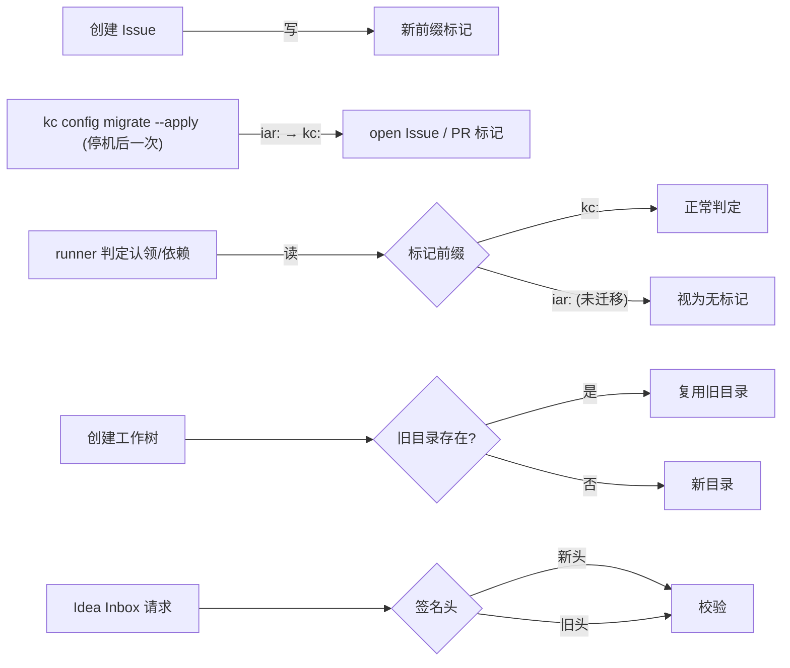

# PRD: 清除残留 IAR 命名 —— 协议标记、工作树目录与代码标识符统一到 kc

- GitHub Issue: https://github.com/ZataZhang/keda/issues/313

> ✅ **交付前置**：无，可立即开工。
> 结构化声明见 §8 Delivery Dependencies，**那里是唯一事实源**。

> 🧍 **验收状态**：待人工验收；3 项 Human-Confirmed 仍未勾选。
> 本行是 §9 Acceptance Checklist 的投影，**那里是唯一事实源**。

> 本 PRD 分两个 altitude，自上而下阅读：
> - **Part A · 人审层 (Review Layer)** — 需求方 / 验收人读这部分，决定"该不该做、做得对不对"，并通过风险地图知道**哪些地方必须亲自确认**。Part A 不出现实现机制、文件路径、命令。
> - **Part B · 执行器层 (Build Layer)** — 执行器读这部分做实现、跑验证、收集证据。

## Feature Overview (功能一览)

> 本节是 §10 Functional Requirements 的**平实语言投影**，不是第二事实源；行为验收以 §1 的行为样例表为准。

- **协作标记统一换成 `kc:`，旧 `iar:` 不再识别**（FR-1、FR-2）：新写出的 Issue / PR 标记一律用 `kc:` 前缀，Agent 执行标记换成 `KC_EXEC`；读取端只认新名。
- **升级时一次性迁移在途标记**（FR-10）：`kc config migrate` 把 open Issue / PR 正文与评论里的 `iar:` 标记改写成 `kc:`，先预演再执行，之后仓库里不再需要识别旧名。
- **外部签名头新名生效、旧名继续可收**（FR-3）：GitHub Webhook 发送方可以在自己方便的时候切换。
- **工作树与仓库内状态目录改用新名**（FR-4、FR-5）：新仓库看到的是新目录名，已有目录原样继续用、不搬家。
- **代码里的旧名标识符清零**（FR-6）：异常类、解析函数、常量名与模块导出不再让人误以为存在另一套运行时。
- **证据分支与文档同步换名**（FR-7、FR-8）：新证据分支用新前缀，文档与路线图不再出现旧命令示例。
- **回潮被机械挡住**（FR-9）：白名单之外再出现旧名会让守卫测试失败，而不是靠人记得。
- **不动的部分**（§11）：历史 Issue / PR 正文、已有远程证据分支、已有工作树目录、包名与仓库名维持原样。

# Part A · 人审层 (Review Layer)

## 1. Introduction & Goals

### Problem Statement

产品已经改名为 KedaCode、命令是 `kc`，"把 iar 都移除"的改动（提交 `refactor(cli): remove IAR runtime compatibility`）也已经落地：`iar` 命令别名没了，`IAR_*` 环境变量兼容层没了。但改名的收尾没有走完，残留集中在三处，用户仍然能在日常路径上撞见旧名：

- 新建 Issue 时，正文末尾会写上一行 `<!-- iar:depends-on #292 -->`。这是当下最容易看见的一处：任何人打开刚创建的 Issue 都能看到 `iar`，并合理怀疑"说好的改名到底做完了没有"。
- 工作树目录仍叫 `.iar-worktrees/`，仓库内状态目录默认值仍是 `.iar/state`，证据分支仍叫 `iar-evidence/<issue>`。
- 代码里仍有 `IARRepositoryNotInitializedError`、`require_iar_repository_initialized`、`parse_iar_exec_markers`、`<<IAR_EXEC>>`、`IAR_GITIGNORE_SECTIONS` 这类标识符，以及约 30 种 `iar:` 标记常量分散在 `core/use_cases` 的十几个模块里。

已经归档的改名 PRD（`tasks/archive/P1-REFACTOR-20261007-013512-rename-product-surface-to-single-new-name.md`）当初把标记与目录列为"永久保留"，理由是跨版本协议。但后续的兼容层移除已经单方面放弃了新旧混跑，这条理由不再成立：现在既没有 `iar` 命令，也不读 `IAR_*`，旧版本 runner 与当前版本本来就不能协同工作。保留旧前缀只剩成本，没有收益。

### Interpretation (解读回显)

| 验证方式 | 输入 / 操作 | 期望观察到的结果 |
|---|---|---|
| 🤖 自动验证 | 用 `kc issue create` 创建一个带依赖的 Issue，然后读取正文 | 正文里出现 `<!-- kc:depends-on #292 -->`，不出现任何 `iar:` 标记 |
| 👀 人审 + 自动验证 | 仓库里有一条正在执行的 Issue，其认领评论含 `<!-- iar:claim ... -->`；所有 runner 停止后运行 `kc config migrate`（先预演、再 `--apply`） | 预演列出将被改写的 Issue / 评论及条数且不写 GitHub；执行后该评论里的标记变成 `<!-- kc:claim ... -->`，其余文字不变；升级后的 runner 把这条 Issue 判为"已被占用"，不重复认领；再次执行迁移改写 0 处 |
| 🤖 自动验证 | 没有迁移，直接让升级后的 runner 读取一条只含 `iar:claim` 的 Issue | `iar:` 标记不再被识别（等同于没有标记）；这是预期行为，升级说明要求先迁移 |
| 🤖 自动验证 | 一台 runner 仍在运行时执行 `kc config migrate --apply` | 拒绝执行并说明需要先停掉 runner，不改写任何评论 |
| 🤖 自动验证 | 在一个已有 `.iar-worktrees/` 目录的仓库执行工作树创建 | 复用旧目录，不新建平行目录、不搬动已有工作树 |
| 👀 人审 + 自动验证 | 在一个干净仓库执行工作树创建并查看仓库根目录 | 出现新名工作树目录，目录里是该 Issue 的工作树，git 状态正常 |
| 🤖 自动验证 | 向 Idea Inbox 接口发送请求，分别只带旧签名头、只带新签名头 | 两种都能通过签名校验；两者都缺时仍然拒绝 |
| 🤖 自动验证 | 对代码与文档执行机械检查 | 白名单之外没有遗留旧名；白名单项逐条存在 |
| 🤖 自动验证 | 触发一次 Agent 会话，其中包含一条可执行命令 | 命令以 `<<KC_EXEC>>` 标记被识别并执行，结果回填；旧写法 `<<IAR_EXEC>>` 不再被解析 |

表中仍成立的行为行即 §7.6 的验收 oracle；修正任一行即修正对应验收标准。

**我默默定了这些**

- 新前缀定为 `kc:`（与命令名一致）：`iar:claim` → `kc:claim`、`iar:depends-on` → `kc:depends-on`，其余标记同理，只换前缀、不改标记名和属性；执行标记 `<<IAR_EXEC>>` → `<<KC_EXEC>>`，结果标签同理。
- 协作标记与执行标记的旧名**不再识别**（用户 2026-10-24 决定）：读取端只认 `kc:`。为了不让在途 Issue 变成"没人认领"，升级时用一次性迁移命令把 open Issue / PR 里的旧标记改写成新标记。
- 迁移默认只覆盖 **open** 的 Issue 与 PR（正文和全部评论）；closed 的需要显式加 `--include-closed`。迁移只做前缀替换，不碰标记以外的文字。
- 工作树目录与签名头不在"不再识别"范围内：已有 `.iar-worktrees/` 目录、`X-IAR-Signature` 头继续按决策二与 FR-3 兼容（它们是磁盘布局和外部发送方，不能靠改写 GitHub 评论迁移）。
- 白名单按"文件 + 行内容特征"判定，而不是按目录整体豁免；避免整个目录变成回潮避风港。
- 历史 PRD、`tasks/archive/`、`tasks/evidence/` 与已归档原型不改写：它们是历史记录，改写反而破坏证据链。
- `site/` 等构建产物不纳入检查：它们由文档源重新生成。
- 证据分支只对**新建**分支换前缀；已推送的 `iar-evidence/*` 远程分支不重命名。
- 不改 GitHub 仓库名、PyPI 包名与已发布的 Homebrew formula。

**我理解为不做**

- 不在升级时自动改写 GitHub 上的标记：改写只在用户显式执行 `kc config migrate --apply` 时发生；closed Issue / PR 默认不改写。
- 不把用户磁盘上已有的 `.iar-worktrees/`、`.iar/` 自动改名；迁移只在显式命令下发生。
- 不重新引入与旧版本 runner 混跑的能力（不双写旧标记）。

### 读作"旧名退场"，不是"字符串全局替换"

目标是：**新产生的东西一律用新名；GitHub 上的旧标记通过一次显式迁移变成新名，此后代码不再识别 `iar:`；磁盘目录和外部签名头保留读取方向的兼容。**

边界条件——漏掉任何一条都会让实现走偏：

- 协作标记和执行标记**不留任何读取兼容**：解析只认 `kc:` 与 `KC_EXEC`。在途数据靠迁移命令转换，不靠双读。
- 读取兼容只保留给识别旧目录、接受旧签名头。任何**写**路径都必须只产出新名，否则"清除"没有终点。
- 迁移命令是唯一会改写 GitHub 评论的入口：必须先预演，有 runner 在跑时拒绝执行，可以重复执行而不产生额外改动，并且只替换标记前缀。
- 新旧混跑不是目标：如果为了同时讨好旧版本而双写标记，本 PRD 的核心收益（新 Issue 里看不到 `iar`）立刻归零。
- 目录迁移不能有副作用：改名一个正在被 git 使用的工作树目录会破坏 worktree 元数据，因此已有目录"只认不搬"，只有在显式迁移命令且没有活动工作树时才允许改名。
- 回潮必须机械可判：新增一个 `iar:` 标记常量而没有人发现，是本 PRD 最可能失败的方式，因此要有守卫测试。

## 2. Human Review Map (介入与风险地图)

### 决策一：标记只用 `kc:`，旧 `iar:` 不再识别，升级时一次性迁移

新写入的 Issue / PR 标记统一用 `kc:` 前缀，执行标记用 `KC_EXEC`；读取端只认新名，不双写，也不双读（用户 2026-10-24 已决定"iar 改成不认"）。

不再识别旧名之后，GitHub 上已有的 `iar:` 标记对升级后的 runner 来说等于不存在。对 closed 的历史 Issue 影响不大，但对在途 Issue 是数据损坏级别的后果：一条正在执行的 Issue 会被当成"没人认领"而被重复执行，一条声明了前置依赖的 Issue 会不等前置完成就开跑，恢复次数等计数会归零。所以升级必须按固定顺序：**所有电脑先停掉 runner → 升级 kc → 在任一台电脑运行一次 `kc config migrate` 迁移 open Issue / PR 的标记 → 再启动 runner**。迁移命令只能检查本机有没有 runner 在跑，看不到别的电脑，因此"所有电脑先停"要写进升级说明，由人来保证。

与旧版本混跑同样不再支持：旧版读不到 `kc:` 标记，新版读不到 `iar:` 标记，两边会互相看不见对方的认领。

**请确认：** 接受"只认 `kc:` + 升级时停机迁移 open Issue / PR"，以及"closed 的历史 Issue 默认不迁移，其中的旧标记从此不再被识别"，可以吗？

**验收：** 新建 Issue 的正文只含 `kc:` 标记；一条认领评论含 `iar:claim` 的在途 Issue，迁移预演只列出、不改写；执行迁移后它变成 `kc:claim` 并被 runner 判为已占用；第二次迁移改写 0 处；runner 运行时执行迁移会被拒绝。

### 决策二：目录换默认名、已有目录只认不搬

建议工作树目录默认值改为新名，仓库内状态目录默认值同样改新名；检测到旧目录存在时继续使用旧目录，不自动搬家，也不在旁新建一个空的新目录。显式迁移命令可以把当前仓库的旧目录改名，但前提是没有活动的 git 工作树——工作树目录被 git 记录了绝对路径，改名会让 `git worktree` 立刻失效。替代方案是"升级即自动改名"，它会在用户没准备的时候破坏正在跑的工作树，代价远大于收益。

**请确认：** 接受"新仓库用新目录名、老仓库沿用旧目录、只在显式迁移命令且无活动工作树时改名"，可以吗？

**验收：** 干净仓库创建工作树后仓库根出现新名目录且 git 状态正常；已有旧目录的仓库再创建工作树时复用旧目录，没有出现平行目录。

### 自动门禁，不需要逐项人工审阅

- Python 标识符与常量重命名：由 `just lint`、类型检查与全量测试兜住；纯内部改名，无对外契约。
- 文档与路线图文本更新：由文档构建（mkdocs）与机械检查兜住。
- 守卫测试本身：新增白名单检查，任何白名单外的旧名出现即失败。
- 证据分支前缀：仅影响新建分支，由结构化证据测试覆盖。

**本次明确不涉及**：没有数据库结构或迁移变更（工作树目录与状态目录是文件系统布局，不动任何表）；没有安全或权限边界变更（签名头只是新增接受的名称，校验算法与密钥不变）；没有计费；不改 GitHub 仓库名、PyPI 包名与任何已发布产物。

## 3. Usage And Impact After Implementation

### 用 `kc` 建 Issue 的人

新建 Issue 的正文里不会再出现 `iar`，依赖声明、认领标记、证据格式标记都以 `kc:` 前缀书写。命令与参数完全不变。

### 升级这一版的人（每个仓库做一次）

1. 在**所有**跑 kc 的电脑上停掉 daemon 和正在执行的 `kc run`。
2. 升级 kc。
3. 在任意一台电脑的仓库目录运行 `kc config migrate` 查看预演结果（会列出哪些 Issue / PR、多少处标记要改），确认后运行 `kc config migrate --apply`。
4. 重新启动 runner。

跳过第 3 步的后果是：在途 Issue 会被当成没人认领、依赖声明失效。closed 的历史 Issue 不迁移也不影响后续运行；需要的话可以加 `--include-closed` 一起迁移。

### 已有仓库与已有工作树的人

仓库里已经存在 `.iar-worktrees/` 的，继续用这个目录——新的工作树仍然建在里面，不会多出一个平行目录；想换名就显式执行迁移命令，命令会先检查有没有活动工作树。

### 旧版本留下的历史数据

已迁移的 open Issue / PR 照常工作；未迁移的 closed Issue 里的旧标记不再被识别（只影响回看历史，不影响运行）。已经推送的 `iar-evidence/*` 远程分支继续可读；旧路径下的状态目录继续被使用。

### 接收 Idea Inbox Webhook 的集成方

签名头有了新名字，旧名字继续被接受，因此现有发送方不需要同步升级；想切换到新名字可以随时做，切换期间两种都有效。

### Keda Agent（随包 skill 与执行标记）

Agent 侧看到与写出的执行标记改为 `<<KC_EXEC>>`；旧写法 `<<IAR_EXEC>>` 不再被解析，用旧写法的历史会话回放时其中的命令不会被执行。随包 `kedacode-operator` skill 里的示例同步更新。

### 维护者

代码里不再需要向新人解释"`iar` 是什么、为什么还在"；文档与路线图不再出现已经失效的 `iar init` 这类示例。

### 对现有行为的影响

唯一可能被感知的行为变化是：若有人手工依赖旧标记字符串做自己的脚本匹配，新写入的正文将不再匹配；这是本 PRD 的预期结果，且在 §12 记录为已知影响。其余行为（命令、退出码、标签语义、签名校验算法、工作树布局）不变。

## 4. Requirement Shape

- **actor**：使用 `kc` 建 Issue / 跑 Issue 的开发者；消费执行标记的 Agent；接收 Idea Inbox Webhook 的集成方；维护本仓库的人。
- **trigger**：创建 Issue（标记写入）、runner 判定认领与依赖（标记读取）、创建工作树、Agent 会话中的可执行命令、Idea Inbox 收到签名请求。
- **expected behavior**：写入路径只产出新名；协作标记与执行标记的读取只认新名；显式迁移命令把 open Issue / PR 的旧标记改写为新标记；文件系统默认值改为新名且旧目录继续可用；文档与路线图不再出现失效旧名；机械检查能挡住回潮。
- **explicit scope boundary**：只在显式迁移命令下改写 GitHub 标记，closed 默认不改；不双写也不双读旧标记；不自动搬迁已有目录；不改包名/仓库名。

# Part B · 执行器层 (Build Layer)

## 5. Repository Context And Architecture Fit

### 现有路径

- 标记常量分布在 `src/backend/core/use_cases/` 的十余个模块中，例如 `agent_runner_pr_body_contract.py:50`（`MERGE_ACCEPTANCE_MARKER_TEXT`）、`agent_runner_validation_checklist.py:17`（`_CHECKLIST_END_MARKER`）。依赖标记在 `agent_runner_dependencies.py` 一带物化 `iar:depends-on`。
- Agent 执行标记在 `src/backend/core/use_cases/repl_session.py:51-53`：`IAR_EXEC_OPEN_MARKER`、`IAR_EXEC_CLOSE_MARKER`、`IAR_EXEC_RESULT_OPEN_TAG`，解析函数同为该模块的责任。
- Webhook 签名头在 `src/backend/api/routes/agent_runner_idea_inbox.py:62`：`INBOUND_SIGNATURE_HEADER = "X-IAR-Signature"`，路由参数以 `Header(alias=...)` 绑定。
- 工作树目录默认值在 `src/backend/core/use_cases/worktree_cleanup.py:14`（`DEFAULT_WORKTREE_DIR_NAME`），另在 `worktree_env.py`、`worktree_frontend.py`、`backlog_prd_worktree.py`、`engines/agent_runner/repository_gitignore.py` 出现同名字面量。
- 仓库内状态目录默认值在 `src/backend/core/shared/models/agent_runner.py:881` 与 `src/backend/infrastructure/config/agent_runner_settings_models.py:704`（`findings_artifact_dir = ".iar/state"`）。
- 环境变量前缀与仓库配置文件名**已经**是新名：`product_identity.py:56` 的 `ENV_PREFIX = "KEDACODE_"`、`:53` 的 `REPOSITORY_CONFIG_FILENAME = ".kedacode.toml"`，旧名仅在 `repository_local_migration.py` 作为迁移来源出现。这一层不需要再改，只需在文档与守卫中确认。

### Reuse Candidates

- 迁移能力复用 `src/backend/engines/agent_runner/repository_local_migration.py` 与 `src/backend/api/cli_parsed_commands/config_migrate.py`：目录改名应并入既有 `kc config migrate`，不新增命令。
- 标记解析已有集中入口（各 use case 模块自身的解析函数），只需把前缀换成 `kc:`，不需要新的抽象层。
- GitHub 读写复用 `IGitHubClient` 现有的 `list_issues_by_label` / `list_issue_comment_entries` / `edit_issue_body` / `edit_issue_comment`；列出 open Issue 与 PR 如缺少接口，在 `IGitHubClient` 上补最小方法，不在迁移代码里直接拼 `gh` 命令。
- 守卫测试复用 `tests/guards/` 的既有约定（`tests/guards/README.md` 描述了写法），不新建测试框架。

### 架构约束

- 标记属于**跨进程契约**：写入方（runner）与读取方（同一 runner 的不同次运行、其他电脑上的 runner、以及用户脚本）不在同一进程内。读取端去掉 `iar:` 后，升级版与未升级版、迁移前与迁移后的数据都互不兼容，因此升级说明必须要求"全部停机 → 升级 → 迁移 → 启动"，迁移命令随同一版本发布。
- 迁移命令会改写 GitHub 上别人可见的评论：只替换 `<!-- iar:` 这类标记前缀，评论里的其他文字逐字节不变；编辑评论不发通知。
- 工作树目录属于**git 拥有**的状态：目录名被记录在 `.git/worktrees/*/gitdir` 里，任何改名都必须先确认无活动工作树。
- 迁移命令属于**破坏性操作**：必须保留既有约定（有 runner 在跑就拒绝、预演不写盘、重复执行无副作用）。

### Frontend Impact

No frontend impact。前端只渲染 Issue / PR 正文与运行记录，标记名称变化对它是透明的；本次不新增页面、不改组件。唯一可能被看到的是设置页里展示的"配置来源文件"文本，而该文件名已经是 `.kedacode.toml`。

### Related PRDs

- `tasks/archive/P1-REFACTOR-20261007-013512-rename-product-surface-to-single-new-name.md`：本次是它的收尾。该 PRD 的 FR-6（"跨进程契约一个字节都不变"）与 FR-7（目录永久保留）被本 PRD 明确取代，取代理由见 §1 与 §13。
- `tasks/pending/P1-FEAT-20261020-011007-agent-availability-and-custom-registry.md`（#292）：改的是 `config.toml` 的 seed 行为与 Agent 注册，与本 PRD 无文件重叠，可并行。
- GitHub #293（console 静态产物）与 #294（`config.toml` 个人仓库路径）：同属"收尾清理"的话题族，但文件与验收互不重叠。

### Scope Cohesion Assessment

独立可批准的决定有三个（标记协议、目录默认值、代码标识符）。它们共享同一个目标状态——"新写入只产出新名"——且任一单独交付都会留下自相矛盾的表面（例如目录换了名但代码里仍叫 `iar`），因此保留为单一 PRD；若拆分，需要为中间状态写临时的兼容说明，反而增加维护成本。

## 6. Recommendation

### Recommended Approach

四件事一次做完：(0) 在 `kc config migrate` 里加入"GitHub 标记迁移"步骤，把 open Issue / PR 的 `iar:` 标记改写成 `kc:`；(1) 把所有**写入**和**读取**路径的标记常量与解析统一改为 `kc:`，不保留旧前缀；(2) 把目录默认值改为新名，并把旧目录识别并入现有解析入口，迁移并入 `kc config migrate`；(3) 重命名遗留的 Python 标识符与模块导出，并用守卫测试锁住白名单。

### Proposed Solution Summary (实现机制)

- **核心机制**：标记常量直接改名改值为 `kc:`，解析函数只匹配新前缀，读写两侧都没有兼容分支。旧数据由迁移命令一次性转换：预演时列出 open Issue / PR 正文与评论中所有 `<!-- iar:<name>` 与 `<<IAR_EXEC` 类标记的位置和数量；`--apply` 时逐条把前缀替换为 `kc:` / `KC_EXEC` 后写回。迁移前检查本机是否有 runner 在运行（复用 `kc config migrate` 已有的检查），有则拒绝。
- **谁提供声明**：新前缀由代码内常量决定，不引入配置项；不做"可配置标记前缀"，因为不存在真实的多样化需求。
- **接入点**：Issue / PR 标记在 `core/use_cases` 现有拼接点；执行标记在 `repl_session.py` 的解析函数；签名头在 `agent_runner_idea_inbox.py` 的路由参数；工作树目录在 `worktree_cleanup.py` 等四处字面量收拢为一个常量；状态目录默认值在两处 dataclass 默认值。
- **主要状态/输出变化**：新写入的 Issue / PR 正文、新建工作树目录名、新产生的证据分支名、Webhook 接受的头名称集合。
- **刻意避免的复杂度**：不新增标记注册表或前缀协商机制；不双写；不改数据库；不引入新的迁移命令入口。

### Alternatives Considered

- **保留旧前缀不动（现状）**：成本是持续的解释负担与错误的"未完成"信号；且兼容层已拆，保留已无收益。否决。
- **双写新旧标记**：可以让旧版本"看见"新 Issue，但前提是旧版本还能运行——`iar` 命令与 `IAR_*` 已移除，前提不成立。且双写会让本 PRD 目标归零。否决。
- **只写新名、永久双读旧名**（本 PRD 初稿方案）：不需要停机迁移，但旧前缀的解析代码要永远留在仓库里，"清除 iar"永远做不完。用户 2026-10-24 选择不再识别旧名，改为一次性迁移。否决。
- **升级即自动改名目录**：会破坏正在运行的工作树与 daemon 的文件句柄。否决，改为显式迁移。

## 7. Implementation Guide

### Core Logic

1. **标记常量换值**：把 `iar:` 前缀的常量值改成 `kc:`，解析正则同步只匹配 `kc:`；不保留任何旧前缀常量或兼容集合。前缀本身定义为一个常量（如 `MARKER_PREFIX = "kc:"`），各标记由它拼出，避免再散落字面量。
2. **执行标记**：`repl_session.py` 的三个标记常量改名换值为 `KC_EXEC` 系列，解析函数只识别新标记；提示文本同步。
2a. **GitHub 标记迁移**：在 `kc config migrate` 中新增一步。预演（默认）时，枚举 open Issue 与 open PR（`--include-closed` 时包括 closed），读取正文与全部评论，统计含旧标记的位置，输出"Issue/PR 编号 · 正文或评论 ID · 标记名 · 次数"清单，不写 GitHub。`--apply` 时，对每处用正则只替换标记前缀（`<!--\s*iar:` → `<!-- kc:`，`<<IAR_EXEC` → `<<KC_EXEC`，`<</IAR_EXEC` 等同理），经 `edit_issue_body` / `edit_issue_comment` 写回，逐条打印结果。任一条失败继续处理其余条目，最后以非零退出码汇总失败项；重跑只处理剩余的旧标记。本机有 runner 在运行时拒绝 `--apply`。迁移对 API 用量的估算（条目数 × 1 次编辑）在预演中一并给出。
3. **签名头**：路由同时接受新头与旧头（两个 `Header` 参数，前者优先，后者兜底），校验逻辑不变。
4. **工作树目录**：把散落的 `.iar-worktrees` 字面量收拢为一个常量（新名），并提供一个"检测旧目录存在则用旧目录"的解析函数；`.gitignore` 托管块同时包含新旧两行，避免老仓库忽略失效。
5. **状态目录默认值**：`findings_artifact_dir` 等默认值改为新名；读取时若旧目录存在则沿用，逻辑与工作树一致。
6. **标识符重命名**：`IARRepositoryNotInitializedError` → `RepositoryNotInitializedError`（或带产品前缀的等价名）、`require_iar_repository_initialized`、`parse_iar_exec_markers`、`cleanup_iar_worktrees`、`_write_local_iar_config`、`has_local_iar_repo`、`IAR_GITIGNORE_SECTIONS`、`IarExecRequest` 一并改名，并同步 `__all__` 与 re-export 链。
7. **文档**：`docs/guides/agent-runner.md`、`ROADMAP.md`、`docs/guides/migrating-from-iar.md`（保留历史说明但把"当前用法"改为新名）、`mkdocs.yml` 导航文本。
8. **守卫**：新增 `tests/guards/test_residual_iar_naming_guard.py`，扫描代码与文档，白名单（历史标记读取、迁移来源、历史 PRD）之外的旧名命中即失败。

### Change Impact Tree

```
src/backend/
├── core/use_cases/
│   ├── repl_session.py                    [改] 执行标记常量与解析
│   ├── agent_runner_pr_body_contract.py   [改] 合并验收标记
│   ├── agent_runner_dependencies.py       [改] 依赖标记写入/读取
│   ├── agent_runner_validation_checklist.py [改] 清单结束标记
│   ├── agent_runner_structured_evidence.py  [改] 证据标记
│   ├── worktree_cleanup.py                [改] 工作树目录常量
│   ├── worktree_env.py / worktree_frontend.py / backlog_prd_worktree.py [改] 字面量收拢
│   └── pr_supervisor_findings.py          [改] 状态目录解析
├── core/shared/models/
│   ├── agent_runner.py                    [改] findings_artifact_dir 默认值
│   └── product_identity.py                [不改] 已是新名
├── core/use_cases/
│   └── github_marker_migration.py         [新增] open Issue / PR 旧标记扫描、预演清单与前缀替换（唯一允许出现 iar: 字面量的生产模块）
├── core/shared/interfaces/
│   └── agent_runner.py                    [改] 如缺少，补列出 open Issue / PR 的最小方法
├── engines/agent_runner/
│   ├── repository_gitignore.py            [改] 托管块加入新目录名
│   └── repository_local_migration.py      [改] 目录改名步骤
├── api/
│   ├── routes/agent_runner_idea_inbox.py  [改] 双签名头
│   ├── cli_parsed_commands/config_migrate.py [改] 目录改名与 GitHub 标记迁移接入（预演 / --apply / --include-closed）
│   └── cli_typer_config.py                [改] 帮助文本
└── infrastructure/config/
    └── agent_runner_settings_models.py    [改] 默认值

tests/
├── guards/test_residual_iar_naming_guard.py [新增]
└── test_*.py（约 15 个）                    [改] 断言随标记与目录新名更新

docs/ 与 ROADMAP.md                            [改] 旧命令示例清零
tasks/archive/**, tasks/evidence/**           [不改] 历史记录
```

### Risk Classification Register

| change point | tier | decisive dimension/override | intervention | oracle/gate |
|---|---|---|---|---|
| 标记写入改新前缀 | R2 | 跨组件契约；写错会让新 Issue 失去依赖门禁 | human（决策一） | rv-1 |
| 标记读取只认 `kc:` + GitHub 标记迁移 | R3 | 正确性：未迁移或迁移错误会让在途 Issue 被重复执行；改写他人可见评论 | human（决策一） | rv-2 |
| 工作树目录默认值与迁移 | R2 | 持久状态；改名破坏 git worktree 元数据 | human（决策二） | rv-3、rv-4 |
| 状态目录默认值 | R1 | 单组件、可回滚 | executor | rv-4 |
| 签名头双接受 | R1 | 单适配器、失败可观测 | executor | rv-5 |
| Python 标识符重命名 | R0 | 纯内部、机械可检 | executor | `just lint` + 全量测试 |
| 文档与路线图 | R0 | 呈现层 | executor | 守卫测试 |

### Executor Drift Guard

- 起点文件清单不是全集：以 `grep -rn "iar:" src/backend`、`grep -rn "IAR_" src/backend`、`grep -rn "\.iar" src/backend` 三组搜索结果为准。
- 不要按行号定位，按符号名与常量名定位。
- 任何**写**和**读**路径都不允许保留 `iar:` 分支；发现需要"为了兼容而读旧值"的地方，先停下来核对决策一。唯一允许出现 `iar:` 字面量的生产代码是迁移命令里的"被替换的旧前缀"。
- 动手前列出所有"会读取 closed Issue / PR 标记"的消费者（数据集导出、统计、证据回看等）：`rg -n "closed|CLOSED" src/backend/core/use_cases | rg -i "marker|comment"`。如有消费者依赖 closed Issue 的旧标记，把清单写进本 PRD §12，并在 Human-Confirmed 中说明影响，而不是悄悄加回双读。
- 迁移相关改动必须保持既有四规则（有 runner 运行则拒绝、预演不写盘、幂等、失败不留半迁移状态）。

### Flow / Architecture Diagram



### ER Diagram

无数据库结构变更，不涉及。

### Realistic Validation Plan

```yaml
- id: rv-1
  behavior: 新创建的 Issue 正文只含新前缀标记，依赖门禁仍生效
  reviewer: verifier
  real_entry: uv run kc issue create --from-prompt "<一句话需求>" --depends-on 292（在测试仓库，opt-in GH_TOKEN）
  expected: 正文出现新前缀依赖标记；不出现新写入的旧前缀标记
  mock_boundary: 无 mock；未提供 GH_TOKEN 时该 oracle 标记为 post-merge，不回退为单元测试冒充
  tier: R2
  test_layer: cli-real
  required_for_acceptance: true
  critical_value_source: 新标记前缀来自代码内常量，不是测试内硬编码字符串
  must_cross: 进程内拼接 → GitHub API → 读回正文
  forbidden_bypasses: 不允许直接断言内部函数返回值或 mock gh 调用
  fresh_state_probe: 用全新创建的 Issue 读取正文，而非复用已存在 Issue
  final_tree_evidence: 证据记录 commit sha，并在该 tree 上重跑一次读取
  negative_control: 用改名前 commit 复现同一命令，正文出现旧前缀
- id: rv-2
  behavior: "迁移把在途 Issue 的 iar:claim 改写为 kc:claim 后仍被判为已占用；预演不写、重跑无改动、runner 运行时拒绝；未迁移的 iar: 标记不再被识别"
  reviewer: human
  real_entry: "uv run kc config migrate → uv run kc config migrate --apply → uv run kc run --dry-run → 再次 uv run kc config migrate（对一个预置了 open Issue、其认领评论含 <!-- iar:claim ... --> 且标签为 agent/running 的测试仓库；opt-in GH_TOKEN + KC_RV_SANDBOX_REPO，无凭据时用 PATH 上的文件型假 gh）"
  expected: "预演输出列出该 Issue 的评论 ID 与 1 处 claim 标记，GitHub 评论未变；--apply 后评论中标记变为 <!-- kc:claim ... -->，其余文字逐字节不变；kc run --dry-run 不把该 Issue 列为候选；第二次预演报告 0 处；本机启动 daemon 后执行 --apply 返回拒绝且评论未变；另一条未迁移的 iar:claim Issue 被 dry-run 当作无认领"
  presentation: "tasks/evidence/<prd-stem>/rv-2-marker-migration.txt（预演清单、apply 结果、迁移前后评论正文 diff、dry-run 判定）；自检：diff 中只有 iar: → kc: 一处变化"
  mock_boundary: "只在无凭据时替换 gh；kc CLI、迁移步骤、认领判定全部真实"
  tier: R3
  test_layer: e2e
  required_for_acceptance: true
  critical_value_source: "GitHub（或假 gh 存储）中该评论迁移前后的原始正文"
  must_cross: "kc config migrate → IGitHubClient(list + edit_issue_comment) → GitHub → kc run --dry-run 认领判定"
  forbidden_bypasses: "直接调用替换函数代替 CLI；在测试里手写迁移后的正文；保留任何 iar: 双读分支让判定通过"
  fresh_state_probe: "--apply 结束后用新进程重新读取评论正文与 dry-run 判定"
  final_tree_evidence: "证据记录 git rev-parse HEAD^{tree}；迁移或标记解析代码改动后重跑"
  negative_control: "跳过 --apply 直接执行 kc run --dry-run：该 Issue 被当作无认领进入候选"
  expected_fail: "断言'不把该 Issue 列为候选'失败"
- id: rv-3
  behavior: 干净仓库创建工作树后仓库根出现新名目录，工作树可用
  reviewer: human
  real_entry: uv run kc worktree create <branch>（干净临时 git 仓库）
  expected: 仓库根出现新名工作树目录；git worktree list 可见该工作树
  presentation: 终端 ls -la 与 git worktree list 原始输出截图
  mock_boundary: 无 mock，使用真实 git 仓库
  tier: R2
  test_layer: cli-real
  required_for_acceptance: true
  critical_value_source: 目录名常量在代码中唯一定义，命令行输出直接来自它
  must_cross: CLI → 仓库根目录写盘 → git worktree 元数据
  forbidden_bypasses: 不允许用单元测试里的临时目录断言代替真实仓库布局
  fresh_state_probe: 使用全新初始化仓库，确认创建前不存在同名目录
  final_tree_evidence: 证据附 commit sha 与创建后目录树
  negative_control: 改回旧常量后目录名回落旧名
- id: rv-4
  behavior: 已有旧名工作树目录的仓库继续复用旧目录，不新建平行目录
  reviewer: verifier
  real_entry: uv run kc worktree create <branch>（预置 .iar-worktrees/ 的仓库）
  expected: 新工作树建在旧目录内；仓库根没有出现新名平行目录
  mock_boundary: 无 mock
  tier: R1
  test_layer: cli-real
  required_for_acceptance: true
- id: rv-5
  behavior: Idea Inbox 签名校验同时接受新旧头，缺头仍拒绝
  reviewer: verifier
  real_entry: FastAPI TestClient 走真实路由 POST /api/inbox/...（opt-in 签名密钥）
  expected: 只带旧头通过；只带新头通过；两者都缺返回 401
  mock_boundary: 签名密钥由测试环境变量注入，不 mock 校验算法
  tier: R1
  test_layer: api-route
  required_for_acceptance: true
- id: rv-6
  behavior: 白名单外的旧名残留会让守卫测试失败
  reviewer: verifier
  real_entry: uv run pytest tests/guards/test_residual_iar_naming_guard.py
  expected: 正常通过；人为插入一个旧前缀常量后失败
  mock_boundary: 无 mock
  tier: R0
  test_layer: guard
  required_for_acceptance: true
```

失败处置：rv-1 需要 `GH_TOKEN`，缺失时标记 post-merge 并在证据中说明，不得用单元测试替代；rv-3 的仓库必须是全新初始化，复用旧仓库会让"创建前不存在"的前置条件失真。

### Low-Fidelity Prototype

不适用：本次没有用户可见的布局或交互变化，按 §5 的 Frontend Impact 声明为无前端影响，故豁免原型图。

### External Validation

无需外部服务；rv-1 的 GitHub 调用为 opt-in，无凭据时使用本地样本回退。

## 8. Delivery Dependencies

### Delivery Dependencies

```yaml
delivery_dependencies:
  hard: []
  soft:
    - prd: P1-FEAT-20261020-011007-agent-availability-and-custom-registry
      reason: 同属改名收尾话题族，但文件不重叠，可并行
  blocks: []
```

## 9. Acceptance Checklist

### 9.1 人读呈递区（Human Review Surface）

| 人审决定 | 证据路径与打开命令 | 预期值 |
|---|---|---|
| 决策一：标记只用 `kc:`、旧名不再识别、升级时停机迁移 | `tasks/evidence/P1-REFACTOR-20261020-021715-purge-residual-iar-naming/rv-1-github-post-merge.txt` — `open "tasks/evidence/P1-REFACTOR-20261020-021715-purge-residual-iar-naming/rv-1-github-post-merge.txt"`；`tasks/evidence/P1-REFACTOR-20261020-021715-purge-residual-iar-naming/rv-2-marker-migration.txt` — `open "tasks/evidence/P1-REFACTOR-20261020-021715-purge-residual-iar-naming/rv-2-marker-migration.txt"` | 新 Issue 正文应含 `<!-- kc:depends-on #292 -->`。迁移评论只改变 `iar:` → `kc:`，其余字节不变；迁移后仍是活跃认领，复跑 0 处。RV-1 等 GitHub 凭据，RV-2 等可枚举本机进程的验证环境；两项目前未报告为通过。 |
| 决策二：目录换默认名、已有目录只认不搬 | `tasks/evidence/P1-REFACTOR-20261020-021715-purge-residual-iar-naming/rv-3-clean-repository.txt` — `open "tasks/evidence/P1-REFACTOR-20261020-021715-purge-residual-iar-naming/rv-3-clean-repository.txt"`；`tasks/evidence/P1-REFACTOR-20261020-021715-purge-residual-iar-naming/rv-4-legacy-directory.txt` — `open "tasks/evidence/P1-REFACTOR-20261020-021715-purge-residual-iar-naming/rv-4-legacy-directory.txt"` | 干净仓库中工作树在 `.kc-worktrees/<branch>`，`git worktree list` 可见且 `git status --short` 为空；旧目录场景继续使用 `.iar-worktrees/<branch>`，根目录不出现平行 `.kc-worktrees`。 |

### 9.2 Acceptance Evidence Package

**Machine-Confirmed**

- [~] 新创建的 Issue 正文只含新前缀标记（rv-1） — runner-owned gate: post-merge opt-in GitHub create/readback and pre-refactor negative control; requires `GH_TOKEN` and `KC_RV_SANDBOX_REPO`.
- [~] 迁移预演不写、`--apply` 只替换前缀、迁移后仍判为已占用、重跑 0 处、runner 运行时拒绝（rv-2） — runner-owned gate: rerun the isolated fake-gh CLI scenario where `psutil.process_iter()` can enumerate processes; do not bypass the fail-closed check.
- [x] 生产代码中 `iar:` 字面量只出现在迁移命令的"旧前缀"定义里：`rg -n "iar:" src/backend` 的命中全部位于迁移模块
- [x] 干净仓库创建工作树后使用新名目录（rv-3）
- [x] 已有旧目录的仓库复用旧目录（rv-4）
- [x] 双签名头都通过、缺头被拒（rv-5）
- [x] 守卫测试在白名单外命中旧名时失败（rv-6）
- [~] `just test`、`just lint`、文档构建通过 — runner-owned gate: 本轮 `just test all`（包含完整 lint）已通过；证据报告与 manifest staged 后，仍由 runner 在最终 staged tree 重跑 `just test`、`just lint` 与 MkDocs build。此前 standalone lint 被 `check-test-flag` 拒绝，因为 pre-commit 暂存期间会隐藏未跟踪的 evidence 文件。
- [x] `docs/` 与 `ROADMAP.md` 中已失效的旧命令示例清零

**Human-Confirmed**

- [ ] 🧍 决策一已确认：接受只认 `kc:`、停机迁移 open Issue / PR、closed 默认不迁移
- [ ] 🧍 决策二已确认：接受目录只认不搬与显式迁移
- [ ] 🧍 9.1 人审导航已核对：已查看决策一的标记迁移证据及决策二的 Git 工作树目录证据

## 10. Functional Requirements

- **FR-1**：写入 Issue / PR 的协作标记使用 `kc:` 前缀（只换前缀，标记名与属性不变）；读取只识别 `kc:`，不再识别 `iar:`。
- **FR-2**：Agent 执行标记改用 `KC_EXEC` 系列，解析只识别新标记。
- **FR-3**：Idea Inbox 签名头接受新名，同时继续接受 `X-IAR-Signature`。
- **FR-4**：工作树目录默认使用新名；存在旧目录时复用旧目录，不新建平行目录。
- **FR-5**：仓库内状态目录（findings / evidence 等）默认使用新名；旧目录继续可用。
- **FR-6**：遗留 Python 标识符、常量与导出名去掉旧前缀，re-export 链同步。
- **FR-7**：新建证据分支使用新前缀；已推送的旧前缀分支不改名、继续可读。
- **FR-8**：文档、路线图、随包 skill 文本中已失效的旧命令示例清零，历史 PRD 与 evidence 不改。
- **FR-9**：新增守卫测试锁定白名单，白名单外出现旧名即失败。
- **FR-10**：`kc config migrate` 新增 GitHub 标记迁移步骤：默认预演，列出 open Issue / PR 正文与评论中的旧标记位置、数量和预计 API 调用数；`--apply` 只把标记前缀替换为新名并写回，逐条报告结果，部分失败以非零退出码汇总；重复执行只处理剩余旧标记；`--include-closed` 时包括 closed；本机有 runner 运行时拒绝 `--apply`。升级说明写明"所有电脑停机 → 升级 → 迁移 → 启动"。

## 11. Non-Goals

- 不在升级时自动改写 GitHub 上的标记；closed Issue / PR 默认不迁移。
- 不检测别的电脑上是否还有 runner 在跑（只能检查本机，由升级说明约束）。
- 不重命名已推送的 `iar-evidence/*` 分支。
- 不自动搬迁已有工作树目录或状态目录。
- 不恢复与旧版本 runner 的混跑能力，不双写旧标记。
- 不改 GitHub 仓库名、PyPI 包名、Homebrew formula。
- 不改数据库结构。

## 12. Risks And Follow-Ups

- **用户脚本依赖旧标记字符串**：新写入的正文不再匹配，属预期变化；在 release notes 中说明。
- **没迁移就启动**：升级后不跑迁移、或别的电脑还没停就启动，在途 Issue 会被当成没人认领而被重复执行，依赖声明失效。由升级说明、`kc config migrate` 的预演输出与 release notes 显著提示兜住；系统无法检测其他电脑。
- **closed Issue 的旧标记失效**：默认不迁移的 closed Issue 中，旧标记不再被识别；如有回看历史的功能依赖它们，见 Executor Drift Guard 的清单要求，必要时用 `--include-closed` 迁移。
- **迁移的 API 用量**：每处旧标记一次编辑调用，评论多的仓库可能达到数百上千次；预演给出估算，迁移遇到限流时中止并可重跑续做。
- **迁移破坏工作树**：由"无活动工作树才改名"的既有规则兜住；若迁移中途失败，保持旧目录不变（不做半迁移）。
- **白名单过宽**：守卫测试可能因白名单过宽而失去意义；白名单需逐条带注释说明原因。

## 13. Decision Log

| 决策 | 结论 | 依据 |
|---|---|---|
| 新前缀是什么 | `kc:`；执行标记 `KC_EXEC` | 与命令名一致，也与跨机器租约 PRD 的 `kc:lease` / `kc:presence` 一致 |
| 旧前缀是否继续可读 | 否，改为停机后一次性迁移 open Issue / PR | 用户 2026-10-24 决定"iar 改成不认"；双读会让旧前缀代码永远留在仓库里，迁移把在途数据转换后即可彻底删除 |
| 迁移是否覆盖 closed | 默认否，`--include-closed` 可选 | closed Issue 不参与运行判定，全量迁移的 API 用量与改写面过大 |
| 是否双写 | 否 | 兼容层已拆，混跑前提不存在 |
| 目录是否自动改名 | 否 | 破坏 git worktree 元数据 |
| 是否新增标记注册表 | 否 | 无真实多样化需求，避免过度抽象 |
| 历史 PRD 是否改写 | 否 | 破坏证据链 |

### Final Reconciliation

执行侧已按当前实现回核 FR-1 至 FR-10：协作标记与 Agent 执行标记只读写 `kc:` / `KC_EXEC`；旧 GitHub 标记仅由显式迁移器改写；新工作树目录使用 `.kc-worktrees` 并复用已有 `.iar-worktrees`；Webhook 接受新旧签名头；历史 PRD 与证据不参与扫描。`rg -n "iar:" src/backend` 仅命中 `github_marker_migration.py`；文档命令扫描未发现 `iar init`、`iar run`、`iar issue`、`<<IAR_EXEC>>` 或 `<!-- iar:` 示例。

验证结果：RV-3 至 RV-6 的负控先于绿测重跑并保留逐项原始输出；最终代码修复后的定向后端套件以 `--no-testmon` 运行并通过（153 passed）。本轮完整 `UV_CACHE_DIR=.uv-cache just test all` 先通过完整 lint，再运行全量 pytest，最终为 4963 passed、1 skipped（454.72s）；同时更新本地 test 与 full-lint 标记。前一次完整运行曾在 `tests/test_backlog_api.py::test_force_refresh_requests_rescan_and_reports_stale` 偶发失败：测试的 mock builder 缺少生产快照契约要求的 `scanned_at`，后台扫描若先于请求读回完成，会落下无效快照并触发第二次扫描。相关 backlog 实现和该测试在基线 `f3bc2da3` 未变化；基线单次重跑通过。修复是让 mock 返回带时区的 `scanned_at`，目标用例连续 6 次通过，且不改变生产行为。`just lint --reuse` 与 MkDocs build 的既有验证通过。单独运行 `just lint` 曾被 `check-test-flag` 拒绝：pre-commit 暂存未跟踪文件时会暂时隐藏 untracked `evidence.json`，使计算的测试树与工作区标记不一致；没有跳过检查，runner 仍须在最终 staged tree 重跑相关门禁。RV-1 因缺少 `GH_TOKEN` / `KC_RV_SANDBOX_REPO` 留作 PRD 明确的 post-merge gate。RV-2 预演已列出待迁移评论且未写入；`--apply` 因当前 sandbox 拒绝 `psutil.process_iter()` 的 sysctl 进程枚举而 fail-closed，未伪称迁移成功。独立 verifier 与提交后 Git tree 仍由 runner 最终复核；Human-Confirmed 决策与 9.1 导航审阅保持未勾选。本执行器不归档 PRD。

## Change Log

### 标记前缀定为 kc:，旧 iar: 改为不再识别并新增一次性迁移
- Type: scope
- Before: 协作标记"只写新名 + 永久双读旧名"，新前缀未具体命名；执行标记解析兼容旧写法；不改写任何历史 Issue / PR。
- After: 新前缀定为 `kc:`（执行标记 `KC_EXEC`）；读取端只认新名；`kc config migrate` 新增 GitHub 标记迁移（默认预演、`--apply` 只替换前缀、默认只迁移 open Issue / PR、`--include-closed` 可选、runner 运行时拒绝）；升级说明要求所有电脑停机 → 升级 → 迁移 → 启动。工作树目录与签名头的读取兼容不变。
- Reason: 用户 2026-10-24 明确要求"iar 就改成不认了"，并要求补上新前缀的具体名字；永久双读会让旧前缀代码永远留在仓库里。
- Impact: 决策一、FR-1、FR-2 改写，新增 FR-10；rv-2 改为迁移场景并升为 R3；新增 `github_marker_migration.py`；未迁移的在途 Issue 会被当作无认领，风险写入 §12。
- Review: 待用户确认决策一（新版文本）。

### 收集执行证据并标识 runner-owned 验证门
- Type: evidence
- Before: 验收清单全部未勾选，9.1 只有待呈递事项，且最终对账未填写。
- After: rv-3 至 rv-6 已收集负控与绿测证据；rv-1 因真实 GitHub 凭据缺失、rv-2 因沙箱拒绝进程枚举被标记为 runner-owned gate；新增 9.1 可执行呈递路径及独立人审项，Human-Confirmed 项仍未勾选。
- Reason: 延续已提交实现并完成当前环境可执行的真实入口验证，同时如实保留外部凭据与进程安全边界造成的未完成验证。
- Impact: 不改变功能范围或验收 oracle；增加证据 manifest 与三份报告，明确 RV-1/RV-2 未获绿测且需由 runner 在最终 tree 复验。
- Review: 待独立 verifier 复核 runner-owned gates；决策一、决策二与 9.1 呈递仍待人工确认。

### 将未完成的最终 tree 检查留给 runner 并修正状态横幅
- Type: evidence
- Before: rv-1 在 checklist 中重复出现一条未勾选项；最终 `just test` / `just lint` / 文档构建仍标为 executor 未完成项；验收状态横幅显示待人工验收，尽管独立 verifier 与真实入口门禁尚未完成。
- After: 合并重复的 rv-1 checklist 行并保留其 runner-owned gate；将最终 staged-tree 检查明确标为 runner-owned gate；横幅恢复为 `⬜ 未开工`，表示执行与验证尚在进行。RV-1/RV-2 的实际状态及所有 Human-Confirmed 项不变。
- Reason: 使清单、横幅和原始证据一致，并避免执行器将未运行的最终 tree 验证声明为通过。
- Impact: 未改变范围、行为或现实验证 oracle；runner 仍须运行最终验证并取得独立 verifier verdict，之后才能归档 PRD。
- Review: 待 runner 最终 tree 验证及独立 verifier；人工决策与 9.1 导航审阅保持待确认。

### 重跑定向验证并固定 worktree oracle 的负控顺序
- Type: evidence
- Before: RV-3 / RV-4 的 manifest 命令只指向绿测，未在单个可复现命令中显式表达负控先于绿测；Final Reconciliation 没有记录最后一次 `just test`、lint gate 和最终 no-testmon 套件的精确结果。
- After: RV-3 / RV-4 命令先运行负控再运行真实 CLI 绿测；最终定向套件记录为 153 passed；`just test` 记录完整 lint 通过、testmon 无新增测试；standalone `just lint` 的 unstaged-evidence 标记冲突仍由 runner 在 staged tree 复验。
- Reason: 让红绿证据的顺序可由 manifest 复现，并准确区分实际通过的 checks 与仍需最终 staged-tree 验证的 gate。
- Impact: 不改变验收行为、范围或验证边界；RV-1/RV-2 和最终 staged-tree check 仍未被宣称通过，所有 Human-Confirmed 项保持未勾选。
- Review: 待 runner 的 staged-tree 验证和独立 verifier；决策一、决策二与 9.1 导航仍待人工确认。

### 修复 backlog 快照测试替身并重跑完整验证
- Type: test
- Before: `just test all` 的一次完整运行在 `test_force_refresh_requests_rescan_and_reports_stale` 失败；该测试的 mock builder 缺少快照必需的 `scanned_at` 字段，异步扫描时序可能导致无效快照被再次排队。
- After: mock builder 返回与生产 builder 契约一致、带 UTC 时区的 `scanned_at`；目标用例连续 6 次通过，完整 `just test all` lint 阶段通过且全量 pytest 为 4963 passed、1 skipped。
- Reason: 让测试替身满足被测快照接口的既有结构，消除调度时序造成的重复扫描误报。
- Impact: 仅修改测试夹具，无生产行为、验收范围或 realistic validation oracle 变化；最终 staged-tree gate、RV-1/RV-2、独立 verifier 与 Human-Confirmed 项仍保持开放。
- Review: 当前工作树中已执行定向重复测试与完整 `just test all`；最终 staged-tree 验证和独立 verifier 待 runner 完成。

### 将验收状态横幅与人工确认清单对齐
- Type: evidence
- Before: 验收状态横幅为 `⬜ 未开工`，但 3 个 Human-Confirmed 项仍未勾选。
- After: 横幅改为 `🧍 待人工验收`，并注明 3 个 Human-Confirmed 项仍未勾选；验收清单保持原样。
- Reason: 让横幅准确投影 §9 中仍待人工确认的状态。
- Impact: 仅更新验收状态横幅并记录本次变更；未改动任何验收清单项。
- Review: 已核对 §9 中 3 个 Human-Confirmed 项仍为未勾选；其他清单项未触碰。
