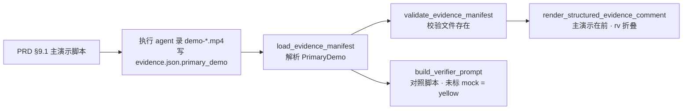

# PRD: Runner 证据增加「给人看的主演示录屏」

> ✅ **交付前置**：无，可立即开工。
> 结构化声明见 §8 Delivery Dependencies，**那里是唯一事实源**。

> 🧍 **验收状态**：待人工验收 — 执行侧已完成，仅剩 3 项 Human-Confirmed 未确认，证据包见 §9。
> 本行是 §9 Acceptance Checklist 的投影，**那里是唯一事实源**。

本 PRD 分两层：Part A 给人审（要什么、要拍板什么），Part B 给执行者（怎么改、怎么验）。

## Feature Overview (功能一览)

> 本节是 §10 Functional Requirements 的白话投影，不是第二事实源；行为验收以 §1 行为样例表为准。

- **PRD 里写明「演示什么」**（FR-1）：PRD 的人读呈递区开头多一段「主演示脚本」，3–6 步，每步写画面上应看到什么、是否必须用真实依赖。
- **一个 PR 只有一段主录屏**（FR-2、FR-3）：执行者照脚本单独录一段给人看的录屏，与回归 e2e 分开；每步有画面字幕、结果停留可读。
- **mock 不再藏起来**（FR-3、FR-5）：某步要证明的是外部系统行为却拿不到真实依赖时，画面字幕与结论都写明「mock，未验证」；verifier 发现未标注的 mock 记为 finding。
- **PR 证据评论第一屏就是主录屏**（FR-4）：评论顶部是主录屏链接 + 每步一句结论，rv 逐项证据折叠到下面。
- **旧任务不受影响**（FR-2、FR-4、§11）：`primary_demo` 是可选字段，没有它时评论与门禁行为完全不变；不新增录屏质量门禁。

# Part A · 人审层 (Review Layer)

## 1. Introduction & Goals

### Problem Statement

keda 交付的证据是给机器校验组织的，人看不出重点。以 freshai PR #39（Issue #37，对话通用附件）为例：

- PR 证据评论把 rv-1 到 rv-5 平铺，证据分支 444 个文件，审阅者要自己拼出「这个功能做成了什么」。
- 唯一的前端录屏 `rv-4-chat-attachments.mp4` 是 e2e 回归用例顺带录的：模型是本地 mock，回复固定为 `rv-4 mock provider reply`，上传的图是 1×1 PNG，整段约 5 秒、没有解说。
- 这个功能的核心价值是「能看图的模型真的收到图片」，录屏里完全看不到；mock 模型的 `supports_vision` 还是关的，连那条代码路径都没走到。画面和评论都没有说明这里是 mock。
- 现有视频门禁（`agent_runner_video_evidence.py`）只检查编码、时长 ≥1 秒、非全黑、已内嵌进报告，上述录屏全部通过。

### Interpretation (解读回显)

**行为样例**

| 验证方式 | 输入 / 操作 | 期望观察到的结果 |
|---|---|---|
| 👀 人审 + 自动验证 | 执行者交付的 `evidence.json` 带 `primary_demo`（录屏文件名 + 每步一句结论），keda 发布 PR 证据评论 | 评论标题下第一块是「主演示」：录屏链接与按顺序列出的每步结论；rv 逐项证据收进一个折叠块 |
| 🤖 自动验证 | `evidence.json` 不带 `primary_demo`（所有旧任务） | 评论内容与改动前逐字一致，门禁结果不变 |
| 🤖 自动验证 | `primary_demo` 指向的录屏文件不在证据目录 | 证据门禁报错，指出缺的文件名，进入既有 recovery |
| 🤖 自动验证 | `primary_demo` 某步标了 mock（`mock: true`） | 评论里该步结论带「⚠️ mock，未验证」字样 |
| 🤖 自动验证 | manifest 带 `primary_demo` 时生成 verifier 提示词 | 提示词列出主演示各步，并要求对照 PRD 演示脚本、把未标注的 mock 记为 finding |

上表的行将原样转成 §7.6 的验收 oracle；改表里的格子就是改验收标准。

**我默默定了这些**

- `primary_demo` 是 manifest 顶层的可选字段，只有一段录屏；不支持多段。
- 未标注 mock 由 verifier 判断，记为 yellow finding，不由程序检测。
- 主演示录屏文件名不受 `rv-<n>-` 命名约束（它不属于某一个 rv 项），建议用 `demo-<slug>.mp4`。
- 字幕的实现方式写在给执行者的指令里（Playwright 里注入一个固定定位的字幕层），不提供共享 helper 文件。
- PRD 模板的改动先落在上游模板仓库 `zata_code_template`，keda 与 freshai 通过 `just sync-template` 获得。

**我理解为不做**

- 不加任何录屏质量门禁（时长、字幕、内容完整性）。
- 不强制要求每个任务都有 `primary_demo`，前端改动也不强制。
- 不改 freshai PR #39 的现有证据。

**解读**：本 PRD 读作「在现有证据流程上加一层给人看的主演示：PRD 定义脚本、执行者照着录、发布时放在最前面」，**不是**「重做证据体系或用程序评判录屏质量」。rv 逐项证据、负控、视频健全性门禁全部保持不变。

- [ ] 我确认这段解读与行为样例准确表达了我的需求。

### What The User Gets

- **审阅 PR 的人**：打开证据评论，第一屏就是一段按步骤讲清楚的录屏和每步结论，知道这个功能做成了什么、哪一步没有用真实依赖。
- **写 PRD 的人**：在 §9.1 写 3–6 步演示脚本，就决定了交付时给人看什么。
- **执行任务的 agent**：拿到明确的录制约定（照脚本、字幕、停留、真实依赖或标明 mock）。
- **verifier**：多一个对照目标——录屏是否覆盖脚本、mock 是否如实标注。

### Measurable Objectives

- 带 `primary_demo` 的证据评论中，「主演示」块位于第一个 rv 小节之前，rv 小节全部位于 `<details>` 内。
- 不带 `primary_demo` 的证据评论与改动前输出逐字相同（回归用例比对）。
- `primary_demo.file` 不存在时证据门禁失败，错误信息含该文件名。
- executor 指令（中英两版）包含录制约定；verifier 提示词在有 `primary_demo` 时包含对照与 mock 规则。
- 模板 PRD 的 §9.1 带「主演示脚本」骨架。

## 2. Human Review Map (介入与风险地图)

### 决定 1：主演示是可选的，不新增门禁

建议 `primary_demo` 做成可选字段，有就放在评论最前面，没有就保持现状；不检查录屏时长、字幕或内容。理由是仓库规范明确不为「让 agent 遵守规范」加校验器，这里缺的是指令而不是门禁。代价是执行者仍可能不交主演示，这时评论退回现在的平铺样子。

**请确认：** 采用「可选字段 + 指令约定、不加门禁」？

- [ ] 采用（推荐）
- [ ] 改为前端改动必须交主演示（需另加门禁）

**验收：** 旧格式 manifest 的评论与门禁结果不变；带 `primary_demo` 的评论顶部出现主演示块。

### 决定 2：未标注的 mock 记为 yellow，而不是 red

某步要证明外部系统行为（真实模型、真实沙箱等）却用了 mock，又没有在画面和结论里标明时，建议 verifier 记一条 yellow finding：主流程可能是好的，但证据在误导人。不判 red，因为 mock 本身合法（拿不到凭据时只能这样），问题在于没有说出来。

**请确认：** 未标注 mock 记为 yellow finding？

- [ ] 确认 yellow（推荐）
- [ ] 改为 red（阻塞自动合并）

**验收：** 带 `primary_demo` 的 verifier 提示词包含这条规则与 yellow 判定。

**自动门禁，不需要逐项人工审阅：** manifest 解析与缺文件报错、评论渲染顺序与折叠、旧格式兼容、executor 与 verifier 提示词文本，都由 pytest 与 `kc evidence check` 真实 CLI 把关。

**本次明确不涉及：** 数据库结构、CLI 参数、授权与安全边界、视频健全性门禁。

## 3. Usage And Impact After Implementation

- **PRD 作者**：在 §9.1 开头填「主演示脚本」表：`步骤 | 画面上应看到什么 | 需要真实依赖？`。纯后端任务可以写「无主演示，理由：…」。
- **执行 agent**：除 rv 证据外，按脚本单独录一段 `demo-<slug>.mp4` 放在证据目录，并在 `evidence.json` 顶层写：

  ```json
  "primary_demo": {
    "file": "demo-chat-attachments.mp4",
    "steps": [
      {"caption": "选择 .exe 被前端拒绝", "result": "红字提示，未发上传请求"},
      {"caption": "能看图的模型读出图中暗号", "result": "回复含 PURPLE-7", "mock": false}
    ]
  }
  ```

- **PR 审阅者**：证据评论第一块是「主演示」，点开录屏，对照每步结论；标了 ⚠️ mock 的步骤知道没有真实验证。rv 详情展开折叠块查看。
- **verifier**：提示词多出主演示各步，按决定 2 处理未标注 mock。
- **不受影响**：没有 `primary_demo` 的任务、`kc evidence check` 的既有输出、视频门禁。

## 4. Requirement Shape

- **actor**：PRD 作者、执行 agent、verifier agent、PR 审阅者。
- **trigger**：执行 agent 写 `evidence.json`；keda 发布证据评论与启动 verifier。
- **expected behavior**：有 `primary_demo` 时，解析并校验录屏文件存在；评论顶部渲染主演示，rv 折叠；verifier 提示词带对照规则。没有时一切照旧。
- **scope boundary**：只改指令、manifest 可选字段、评论渲染与 verifier 提示词；不加门禁、不改视频健全性检查。

# Part B · 执行器层 (Build Layer)

## 5. Repository Context And Architecture Fit

- **manifest**：`src/backend/core/use_cases/agent_runner_structured_evidence.py`——`EvidenceManifest` / `StructuredEvidenceReport` 数据类，`load_evidence_manifest` 解析顶层字段，`validate_evidence_manifest` 做文件存在与 hash 校验，`build_structured_evidence_prompt_suffix(language)` 是给执行者的 manifest 指令（中英两版）。
- **评论渲染**：`src/backend/core/use_cases/agent_runner_structured_evidence_rendering.py::render_structured_evidence_comment`，由 `agent_runner_validation_publication.py::build_evidence_comment` 在 Issue 带 `kc:structured-evidence` marker 时调用。
- **verifier 提示词**：`src/backend/core/use_cases/agent_runner_verdict.py::build_verifier_prompt(issue, builder_sha, manifest)`（`run_verifier_agent.py` 只是转发）。
- **上传**：`agent_runner_validation_publication.py::upload_evidence_branch` 上传证据目录整棵树，主录屏文件随之上传，无需改动。
- **PRD 规范**：上游 `~/code/zata_code_template/skills/prd/`（`SKILL.md`、`templates/prd-visual-template.md`、`references/pr-evidence-and-merge-acceptance.md`）；keda 自身的 `skills/prd/` 是同步副本，不直接改。
- **frontend impact**：No frontend impact——keda 的 `frontend-*` 不展示证据评论，改动只影响 PR 评论 Markdown 与 agent 提示词。
- **相关 PRD**：已检查 `tasks/pending/`（9 份），无重复或依赖。相关历史：`tasks/archive/P1-BUG-20260707-173613-runner-frontend-visual-evidence-gate.md`（前端视觉证据门禁，本 PRD 不改它）、`tasks/archive/P1-FEAT-20260930-225500-browser-e2e-verification.md`。本 PRD 独立。

## 6. Recommendation

**Recommended Approach**：在现有 manifest 上加一个可选顶层字段，在现有渲染函数开头插一块、把原有 rv 内容包进 `<details>`，在现有两段提示词里各加一段文字。

### Proposed Solution Summary (实现机制)

- 执行 agent 显式声明 `primary_demo`；keda 不推断哪段录屏是主演示。
- `load_evidence_manifest` 解析 `primary_demo`（`file` 必填字符串；`steps` 非空数组，每项 `caption`、`result` 必填，`mock` 可选布尔，默认 false）为 `PrimaryDemo` 数据类，挂在 `EvidenceManifest.primary_demo`（默认 `None`）；格式错误抛既有 `ValidationEvidenceError`。
- `validate_evidence_manifest` 校验主录屏文件存在于证据目录，并把 `primary_demo` 带进 `StructuredEvidenceReport`。
- `render_structured_evidence_comment`：`report.primary_demo` 为 `None` 时输出与现在完全一致；否则在签核提示后插入主演示块，rv 小节包进 `<details>`。
- `build_structured_evidence_prompt_suffix` 追加录制约定；`build_verifier_prompt` 在 `manifest.primary_demo` 存在时追加对照规则。
- 刻意避免：新门禁、新 helper 文件、新 CLI 参数、改视频门禁。

**为什么不加 helper / 门禁**：目标仓库的 e2e `support/` 归各项目维护，共享 helper 需要逐仓库分发；字幕写法放进指令即可。门禁见决定 1。

## 7. Implementation Guide

> This section is a living implementation guide based on current repository analysis. If implementation discovers additional affected files, hidden dependencies, edge cases, or a better path, update this PRD before proceeding.

### Core Logic



### Change Impact Tree

```text
~/code/zata_code_template/skills/prd/
├── SKILL.md [修改]【§9.1 规则与 Checklist：开头加主演示脚本】
├── templates/prd-visual-template.md [修改]【§9.1 骨架加主演示脚本表】
└── references/pr-evidence-and-merge-acceptance.md [修改]【证据评论第一屏=主录屏+每步结论，rv 折叠】

~/code/keda/
├── src/backend/core/use_cases/agent_runner_structured_evidence.py [修改]
│   【PrimaryDemo 数据类；manifest/report 字段；解析与文件校验；executor 指令加录制约定】
├── src/backend/core/use_cases/agent_runner_primary_demo.py [新增]
│   【PrimaryDemo 数据类、解析与录制约定文本；为守住单文件 1000 非空行硬上限从下方模块拆出】
├── src/backend/core/use_cases/agent_runner_structured_evidence_rendering.py [修改]
│   【主演示块 + rv 折叠；无 primary_demo 时输出不变】
├── src/backend/core/use_cases/agent_runner_verdict.py [修改]【verifier 提示词加对照规则】
├── docs/guides/agent-runner.md [修改]【视觉证据门禁一节旁补主演示说明】
├── tests/test_agent_runner_structured_evidence.py [修改]【解析、缺文件、渲染、旧格式、指令文本】
└── tests/test_run_verifier_agent.py [修改]【有/无 primary_demo 的提示词】
```

### Risk Classification Register

| change point | tier | decisive dimension | intervention | oracle/gate |
|---|---|---|---|---|
| manifest 可选字段解析与文件校验 | R1 | 正确性（单组件，旧格式兼容） | executor + test | rv-1 |
| 评论渲染顺序与折叠 | R1 | 正确性（展示） | executor + test | rv-2 |
| 无 primary_demo 时输出不变 | R1 | 兼容性 | executor + test | rv-3 |
| executor / verifier 提示词 | R0 | 文本 | executor + test | rv-4 |
| PRD 模板 §9.1 | R0 | 文档 | executor + rg | rv-5 |

### Executor Drift Guard

- 用 `rg -n "def render_structured_evidence_comment|def build_verifier_prompt|class EvidenceManifest" src/backend` 确认锚点位置；渲染实现在 `_rendering.py`，不在 `agent_runner_structured_evidence.py` 的同名转发函数。
- `StructuredEvidenceReport` 有多个构造点：`rg -n "StructuredEvidenceReport\(" src tests`，新字段必须带默认值。
- keda 的 `skills/prd/` 是同步副本，不要直接改。

### Realistic Validation Plan

```yaml
- id: rv-1
  behavior: primary_demo 解析与缺文件报错
  reviewer: verifier
  real_entry: "uv run kc evidence check --evidence <带 primary_demo 的临时证据目录>"
  expected: 合法 primary_demo 正常加载；file 指向不存在文件时 validate_evidence_manifest 报错含文件名；steps 为空时 manifest 格式错误
  mock_boundary: 无；真实 CLI 与真实文件系统
  tier: R1
  test_layer: real entry + unit
  required_for_acceptance: true
  negative_control: "删除临时目录里的 demo 录屏后重跑"
  expected_fail: "ValidationEvidenceError 提及 demo 文件名"
- id: rv-2
  behavior: 带 primary_demo 的评论顶部是主演示，rv 折叠，mock 步带警示
  reviewer: human
  presentation: "pytest 生成的评论 Markdown 原文，贴在证据报告人审导航"
  real_entry: "uv run pytest tests/test_agent_runner_structured_evidence.py -k primary_demo -q"
  expected: 主演示块位于首个 RV 小节之前；所有 RV 小节在 <details> 内；mock 步含「mock，未验证」
  mock_boundary: 经 build_evidence_comment 公共入口，真实文件与 hash
  tier: R1
  test_layer: integration
  required_for_acceptance: true
  negative_control: "在渲染函数里去掉主演示块"
  expected_fail: "断言主演示在 RV 之前失败"
- id: rv-3
  behavior: 无 primary_demo 时评论逐字不变
  reviewer: verifier
  real_entry: "uv run pytest tests/test_agent_runner_structured_evidence.py -q"
  expected: 既有渲染用例全部通过，且新增用例断言无 <details>、无主演示标题
  mock_boundary: 无
  tier: R1
  test_layer: integration
  required_for_acceptance: true
- id: rv-4
  behavior: executor 指令含录制约定；verifier 提示词在有 primary_demo 时含对照规则
  reviewer: verifier
  real_entry: "uv run pytest tests/test_run_verifier_agent.py tests/test_agent_runner_structured_evidence.py -k 'prompt' -q"
  expected: 中英指令都含 primary_demo 与 mock 标注要求；verifier 提示词有/无 primary_demo 两种情况各自正确
  mock_boundary: 无
  tier: R0
  test_layer: unit
  required_for_acceptance: true
- id: rv-5
  behavior: PRD 模板 §9.1 带主演示脚本
  reviewer: verifier
  real_entry: "rg -n '主演示脚本|primary demo' ~/code/zata_code_template/skills/prd"
  expected: SKILL.md、prd-visual-template.md、pr-evidence-and-merge-acceptance.md 均命中
  mock_boundary: 无
  tier: R0
  test_layer: static
  required_for_acceptance: true
```

## 8. Delivery Dependencies

### Delivery Dependencies

- Depends on tasks/issues:
  - none
- Gate type: none
- Sequence: via-main
- Notes: 模板仓库改动需 push 后，keda / freshai 才能用 `just sync-template` 拉到新 PRD 规范；keda 代码改动不依赖它。

## 9. Acceptance Checklist

### 9.1 人读呈递区（Human Review Surface）

| # | 你要看什么 | 呈递物（交付时填实际路径） | 想自己复核？ |
|---|---|---|---|
| 1 | 带 primary_demo 的证据评论长什么样：第一块是主演示，mock 步有警示，rv 折叠 | [rv-2 生成的评论 Markdown] | 看评论里「主演示」是否在「RV-1」之前，第 2 步是否带「mock，未验证」 |

**以下项不需要你看**（`reviewer: verifier`）：rv-1 解析与缺文件、rv-3 旧格式兼容、rv-4 提示词文本、rv-5 模板命中。证据在 §9.2。

### 9.2 Acceptance Evidence Package

1. rv-2 评论输出与 pytest 结果
2. rv-1 `kc evidence check` 真实 CLI 输出（正常与缺文件两种）
3. rv-3 / rv-4 pytest 输出，rv-5 `rg` 输出

### Behavior Acceptance

- [x] rv-1：`kc evidence check` 能加载带 `primary_demo` 的 manifest；缺录屏时 `validate_evidence_manifest` 报错含文件名 — 证据：`kc evidence check` 合法 manifest 输出 `Result: 1/1 passed`，`steps: []` 输出 `field primary_demo needs a non-empty steps array` 且未执行命令；`test_validate_evidence_manifest_rejects_missing_demo_recording` 通过
- [x] rv-2：评论主演示在前、rv 在 `<details>` 内、mock 步带警示 — 证据：`test_build_evidence_comment_puts_primary_demo_first` 通过；负控（`_render_primary_demo_lines` 返回空列表）时该用例 FAILED，恢复后通过
- [x] rv-3：无 `primary_demo` 时评论不变，既有用例全绿 — 证据：`uv run pytest tests/test_agent_runner_structured_evidence.py tests/test_run_verifier_agent.py tests/test_agent_runner_validation.py tests/test_agent_runner_video_evidence.py -q --no-testmon` 242 passed
- [x] rv-4：executor 中英指令含录制约定；verifier 提示词按有无 `primary_demo` 正确 — 证据：`test_prompt_suffix_documents_primary_demo[zh-CN|en-US]`、`test_build_verifier_prompt_lists_primary_demo_and_mock_rule`、`test_build_verifier_prompt_without_primary_demo_omits_demo_section` 通过

### Documentation Acceptance

- [x] rv-5：模板三处命中「主演示脚本」或 primary demo — 证据：`rg -n '主演示脚本|primary demo' skills/prd` 命中 SKILL.md:545/739、prd-visual-template.md:331、pr-evidence-and-merge-acceptance.md:89-90；模板 PRD 测试 135 passed
- [x] `docs/guides/agent-runner.md` 说明 `primary_demo` 字段与评论顺序 — 证据：视觉证据门禁一节新增「主演示录屏（`primary_demo`，可选）」条目

### Validation Acceptance

- [x] 相关 pytest 全绿；`just lint` 通过 — 证据：相关 4 个测试文件 242 passed；改动文件 pre-commit 通过（`check-test-flag` 除外，见 Final Reconciliation）

### Delivery Readiness

- [x] 完成回复带上 §9.1 呈递内容 — 证据：PR 正文附 rv-2 渲染出的评论样例

### Human-Confirmed (来自 Part A 风险地图)

- [ ] 决定 1：可选字段、不加门禁
- [ ] 决定 2：未标注 mock 记为 yellow
- [ ] §9.1 呈递区已看过

## 10. Functional Requirements

- FR-1：PRD 模板 §9.1 开头有「主演示脚本」：3–6 步，每步写画面应出现什么、是否需要真实依赖；PR 证据评论第一屏为主录屏 + 每步结论。
- FR-2：`evidence.json` 支持可选顶层字段 `primary_demo`（`file`、`steps[{caption, result, mock?}]`）；格式错误或文件缺失时证据门禁报错。
- FR-3：executor 指令（中英）包含录制约定：与回归 e2e 分开录、照脚本、每步字幕与停留、外部行为用真实依赖，拿不到时画面与结论都标明 mock。
- FR-4：有 `primary_demo` 时证据评论顶部渲染主演示块，rv 逐项内容折叠；没有时输出不变。
- FR-5：有 `primary_demo` 时 verifier 提示词列出各步，要求对照 PRD 脚本，未标注 mock 记 yellow finding。

## 11. Non-Goals

- 录屏质量门禁（时长、字幕、内容）。
- 强制所有任务或前端任务提供 `primary_demo`。
- 共享字幕 helper 文件、改视频健全性门禁、补 freshai PR #39 的证据。

## 12. Risks And Follow-Ups

- 执行者可能不交主演示：评论退回平铺，等同现状；若长期如此再评估决定 1。
- 真实依赖凭据不在 runner 环境时，主演示只能标 mock；这是如实披露，不是本 PRD 要解决的问题。

## 13. Decision Log

| ID | 问题 | Chosen | Rejected | Rationale |
|---|---|---|---|---|
| D-01 | 如何让人看到重点 | manifest 可选 `primary_demo` + 评论顶部渲染 | 用程序评判录屏质量 | 缺的是「给人看的那段」这个概念与指令，程序判质量会把 agent 工作流变成逐项门禁 |
| D-02 | 字幕怎么实现 | 写进 executor 指令 | 共享 `caption()` helper 文件 | 目标仓库 e2e `support/` 归项目维护，helper 需逐仓分发 |
| D-03 | 未标注 mock 的严重级别 | verifier yellow | red | mock 本身合法，问题是没披露，不应阻塞 |
| D-04 | 方向批准方式 | 用户在 2026-11-12 对话中明确同意方案与文件清单 | 另开问卷 | 对话确认是 PRD 首触的合法回退方式；§1/§2 勾选框仍留给用户 |

### Final Reconciliation

- 实现与 PRD 一致。CI 的单文件 1000 非空行硬上限要求把主演示代码拆到新模块 `agent_runner_primary_demo.py`，Change Impact Tree 已补；实现中确认 verifier 提示词实际位于 `agent_runner_verdict.py::build_verifier_prompt`（`run_verifier_agent.py` 只转发），Change Impact Tree 已按此记录。
- 本次在交互式会话中由实现 agent 自验，未经 keda 独立 verifier；人工验收以 PR 合并为准。
- `just test` 中 `test_app_config_default_registry_is_builtin` 失败为既有问题：在 `git archive HEAD` 干净副本复现，原因是用户级 `~/.kedacode/config.toml` 的 `codex-nosandbox` 泄漏进默认配置用例，与本改动无关，另行处理；提交时因此跳过 `check-test-flag`。
- 模板仓库改动经独立 PR 合入 `zata-codes-template` main。

## Change Log

### 创建
- Type: scope
- Before: 无
- After: 初版 PRD
- Reason: freshai PR #39 证据人看不出重点，用户同意新增主演示录屏
- Impact: 新增 FR-1 至 FR-5
- Review: 用户已在对话中同意方向，待勾选 §1/§2

### 实现并归档
- Type: evidence
- Before: ⬜ 未开工，位于 tasks/pending
- After: 🧍 待人工验收，执行侧验收项已附证据，归档至 tasks/archive
- Reason: keda 与模板改动完成并通过相关测试
- Impact: FR-1 至 FR-5 已落地
- Review: 待 PR 合并作为人工验收
