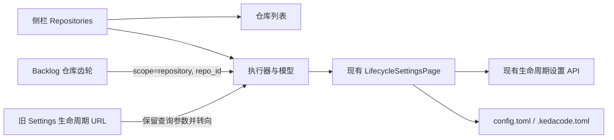

# PRD: Repositories 顶层的生命周期与模型设置入口

> ✅ **交付前置**：无硬依赖，可立即开工。
> 结构化声明见 §8 Delivery Dependencies，那里是唯一事实源。

> 🧍 **验收状态**：待人工验收。实现与本地验证已完成；PR 必需 CI 通过且合并后，按合并记录人工验收。

本文分两层：Part A 供人确认需求和可见结果；Part B 供执行器实施、验证和交付。

## Feature Overview (功能一览)

- **Repositories 增加平级入口**：`仓库列表` 与 `执行器与模型` 是同级页面标签。
- **统一设置原样迁移**：全局 / 仓库范围、九阶段 Agent、模型预设、推理深度和执行器回退仍由现有统一设置页管理。
- **已有入口平滑过渡**：Backlog 仓库齿轮进入新的 Repositories 页面并预选仓库；旧设置 URL 保留并转到新位置。
- **Settings 聚焦 Agent 标签**：移除原来通往统一设置页的卡片，不改 Agent 标签管理。

# Part A · 需求层 (Review Layer)

## 1. Introduction & Goals

### Problem Statement

管理者需要在配置执行器和仓库时查看生命周期 Agent、模型与推理深度，但当前入口位于 Settings 的 Agent 管理区，且名称为单独的统一设置页。Repositories 页面目前只呈现仓库注册与接入。这个位置关系让仓库级执行配置必须先离开仓库管理区再寻找设置入口；Backlog 仓库齿轮也跳到 Settings 下的页面。

当前代码可观察到：Settings 卡片链接到 `/app/settings/lifecycle/`，Backlog 仓库齿轮也指向该路由；`/app/repositories/` 只呈现仓库注册、发现与审计。用户已选择方案一：在 Repositories 顶层增加与仓库列表平级的“执行器与模型”标签，同时保留全局 / 仓库范围选择。

### Interpretation (解读回显)

#### 行为样例

| 验证方式 | 输入 / 操作 | 期望观察到的结果 |
|---|---|---|
| 👀 人审 + 自动验证 | 从侧栏打开 Repositories，再选择“执行器与模型” | Repositories 下出现“仓库列表”和“执行器与模型”两个平级标签；后者展示现有生命周期、模型预设、推理深度和回退设置，默认范围仍为全局。 |
| 👀 人审 + 自动验证 | 在“执行器与模型”中切换到仓库范围并选择公开仓库 `keda` | 页面仍显示九阶段和原有设置功能；配置范围指向 keda 的仓库配置，未改动的 API 与保存语义保持不变。 |
| 🤖 自动验证 | 从 Backlog 的 `keda` 仓库行点击齿轮 | 浏览器进入 Repositories 的“执行器与模型”标签，仓库范围已选中 keda。 |
| 🤖 自动验证 | 打开旧地址 `/app/settings/lifecycle/?scope=repository&repo_id=keda` | 页面转到新的 Repositories 设置地址，保留仓库范围和 `repo_id=keda`；缺少仓库参数时不静默改为写入全局配置。 |
| 🤖 自动验证 | 打开 Settings 的 Agent 管理 | Agent 标签表仍可编辑；生命周期统一设置入口卡片不再出现。 |

以上活动行为样例分别成为 §7.6 的验收 oracle；改动任一结果格即改动对应验收标准。

#### 我默默定了这些

- 设置内容和存储逻辑不变；本次只移动管理入口并保留旧 URL 兼容跳转。
- “仓库列表”仍是 Repositories 默认页面；“执行器与模型”打开时默认显示全局范围，除非入口明确携带仓库范围。
- Backlog 仓库齿轮保留，改为链接到新的 Repositories 设置页面并继续预选当前仓库。
- Settings 的 Agent 标签编辑继续保留；只删除旧的统一设置入口卡片。
- PRD 与 CLI 中的生命周期覆盖入口不变。

#### 我理解为不做

- 不改生命周期配置 API、`config.toml` / `.kedacode.toml` 数据结构或优先级。
- 不重做生命周期矩阵、模型预设、推理深度或执行器回退的表单与交互。
- 不改 Agent 标签配置、Backlog 的仓库管理能力或仓库 registry。

**可证伪的需求解读：**我把这项工作理解为把统一设置页纳入 Repositories 顶层导航，作为“仓库列表”的平级页面；页面内继续提供原有全局 / 仓库选择和全部统一设置。用户不必先打开某个仓库详情。Settings 不再放第二个入口，Backlog 仓库齿轮和旧 URL 继续可用并落到新页面。若仓库级深链缺少或携带无效仓库 ID，页面不得退回全局写入。此 PRD 不改变执行策略、配置内容、API 或 CLI。

- [ ] 我确认这段解读与行为样例准确表达了我的需求。

用户已在聊天中确认“方案一”并授权直接开工；本复选框是 PRD 内的人审记录，仍由用户填写。

### What The User Gets

管理者从侧栏进入 Repositories 后，可以在仓库列表和执行器 / 模型设置之间直接切换。设置仍可用于全局默认或指定仓库；从 Backlog 的仓库齿轮进入时，会保留目标仓库。Settings 继续管理 Agent 路由标签。

### Measurable Objectives

- Repositories 顶层可见且可用“仓库列表”与“执行器与模型”两个入口。
- 新设置入口显示现有生命周期设置页，默认全局范围；仓库深链仍准确预选其 `repo_id`。
- Backlog 入口和旧生命周期 URL 均到达新地址并保留仓库选择。
- Settings 不再显示生命周期统一设置入口，Agent 标签管理不回归。
- API 请求、配置写入目标和生命周期页面交互与迁移前保持一致。

## 2. Human Review Map (介入与风险地图)

### 将统一执行设置放到 Repositories 顶层

建议采用用户已选择的方案一：把“执行器与模型”作为 Repositories 下与“仓库列表”平级的标签，并保留全局 / 仓库范围切换。这样仓库管理者可以从执行配置所在的产品区直接进入设置。主要风险是把设置嵌进某个仓库详情，导致全局设置入口消失；原型明确要求设置不依附单个仓库。

**请确认：**是否按“仓库列表 / 执行器与模型”两个顶层标签落地？
**验收：**从 Repositories 顶层进入后可直接看到生命周期统一设置，且不必先打开某个仓库。

- [ ] 确认采用方案一：Repositories 顶层并列展示“仓库列表 / 执行器与模型”。

聊天确认记录：2026-11-13，用户回复“同意， 就方案一”，之后授权“直接开动这个prd”。

**自动门禁，不需要逐项人工审阅：**旧 URL 转向新地址且保留范围参数；Backlog 齿轮预选仓库；Settings 仍保留 Agent 标签编辑；API、配置写入与页面设置行为不变。
**本次明确不涉及：**数据库结构、后端 API、配置 schema、执行策略和 CLI 行为均不变。

## 3. Usage And Impact After Implementation

### 管理者

从侧栏选择 Repositories。默认进入“仓库列表”；选择“执行器与模型”后查看全局生命周期设置，或切换到仓库范围并选择具体仓库。设置编辑、预览和保存方式与当前页面相同。

### Backlog 使用者

点击仓库行齿轮仍可直接编辑该仓库配置；页面位置改为 Repositories 的“执行器与模型”，并预选原仓库。

### 已保存旧链接的使用者

旧 `/app/settings/lifecycle/` 地址继续有效并转向新的规范地址；`scope`、`repo_id` 参数保留。

### Settings 使用者

Agent 管理仍能配置 GitHub 路由标签。原统一设置入口卡片移除；其他 Settings 标签与内容不变。

### Impact On Existing Behavior

- 生命周期页读写、配置范围和模型解析均不变。
- 仓库列表默认入口不变；新增一个同级设置入口。
- 旧地址保留为兼容入口；Backlog 快捷入口更新目标路径。
- 无数据迁移、新配置变量或后端部署变化。

## 4. Requirement Shape

- **Actor:** 管理终端使用者、从 Backlog 跳转的仓库配置者、持有旧生命周期页书签的使用者。
- **Trigger:** 用户从 Repositories 顶层、Backlog 仓库齿轮或旧生命周期 URL 进入设置。
- **Expected behavior:** 新入口显示原统一设置；深链保留仓库范围；旧入口转发到新地址；Settings 仅保留 Agent 标签管理。
- **Scope boundary:** 仅前端导航、兼容路由、现有用户指南与选中原型同步；不改变生命周期设置本身。

# Part B · 执行器层 (Build Layer)

## 5. Repository Context And Architecture Fit

- **Existing path:** `frontend-public/app/(app)/app/repositories/page.tsx` 是仓库列表；`frontend-public/app/(app)/app/settings/lifecycle/page.tsx` 解析 `scope` / `repo_id` 并渲染统一设置；`frontend-public/components/agent-runner/lifecycle-settings-page.tsx` 是可复用设置页；Backlog 齿轮当前链接到旧路由。
- **Reuse candidates:** 复用 `LifecycleSettingsPage`、`ConsolePage` / `ConsoleSectionTabs`、现有 API 客户端与 Backlog 深链参数；新增的仓库区块导航由仓库列表页和设置页共同使用。
- **Architecture constraints:** 仅改 `frontend-public` 表现层与文档；生命周期值仍由现有 API / 后端解析和写回；不另建配置状态或调用路径。
- **Frontend impact:** `frontend-public`，Next.js 16.2.6 / React 19；本地命令 `pnpm --dir frontend-public dev`、`pnpm --dir frontend-public build`、`pnpm --dir frontend-public typecheck`。真实浏览器验证由 `just e2e <spec>` 启动项目入口；Playwright 包是仓库根下独立的 pnpm 包，细则见 `tests/playwright-e2e/README.md`。
- **Existing PRD relationship:** `tasks/pending/` 未发现本次入口迁移的重复项或前置项；已归档的 `tasks/archive/P1-FEAT-20261009-133425-lifecycle-agent-model-settings.md` 定义了当前统一设置能力，本 PRD 只调整入口，独立于其已交付实现。
- **Redundancy risks:** 不复制设置表单或 API 客户端；旧路由只做兼容转向，不保留第二套编辑页面。

## 6. Recommendation

### Recommended Approach

- **Approach:** 在 Repositories 下提供两个同级导航入口；新建 Repositories 生命周期设置路由并直接复用 `LifecycleSettingsPage`。原 Settings 生命周期路由只负责保留参数并转向新地址；Backlog 齿轮改为新地址。移除 Settings 的生命周期入口卡片。
- **Why this fits:** Repositories 已是左侧主导航中的仓库管理区；已有设置组件通过 `initialScope` / `initialRepoId` 支持复用，迁移无需改 API、后端、配置模型或状态解析。
- **Rejected redundancy:** 不复制生命周期表单；不新建 API；不在某个仓库详情中嵌套全局设置；不删除旧路由而破坏书签。

### Proposed Solution Summary (实现机制)

新增 `/app/repositories/lifecycle/` 作为规范地址。仓库列表和设置页共同呈现“仓库列表 / 执行器与模型”导航，激活态与当前页面匹配。设置路由按查询参数传递 `initialScope` / `initialRepoId`；Backlog 更新到新路由；旧 `/app/settings/lifecycle/` 路由使用 Next.js 客户端导航转向新地址并保留查询参数。Settings 中移除只负责跳转的卡片，不改 Agent 标签编辑。更新已选概念图说明、项目原型说明、生命周期操作指南与模型预设指南中的旧位置描述。

### Alternatives Considered

- **只把 Settings 卡片改成跳转到 Repositories：** 会让统一设置继续作为独立 Settings 页面，与已选的平级标签方案不一致，也让用户仍需多走一层。
- **删除旧路由：** 会破坏 Backlog 旧链接和用户书签；保留一个转向页成本低且兼容性更好。

## 7. Implementation Guide

This section is a living implementation guide based on current repository analysis. If implementation discovers additional affected files, hidden dependencies, edge cases, or a better path, update this PRD before proceeding.

### 7.1 Core Logic

1. Repositories 列表页和生命周期设置页展示同一套顶层标签。新设置页仍调用 `LifecycleSettingsPage`，默认全局范围。
2. 仓库范围的 URL 参数从 Backlog 齿轮传到原有生命周期组件；缺失或无效 `repo_id` 不得转为全局配置写入。
3. 旧生命周期路由读取当前查询参数并转到新规范地址；新地址成为所有页面链接和指南中的唯一入口。
4. 按已选概念图更新生命周期原型说明。AI 生成图继续标注为设计意图，不作为实现验证。

### 7.2 Change Impact Tree

```text
.
├── frontend-public/
│   ├── app/(app)/app/repositories/page.tsx
│   │   [修改] 增加“仓库列表 / 执行器与模型”同级导航；仓库列表维持默认入口和现有行为。
│   ├── app/(app)/app/repositories/lifecycle/page.tsx
│   │   [新增] 新规范路由，复用 LifecycleSettingsPage 并读取范围参数。
│   ├── app/(app)/app/settings/lifecycle/page.tsx
│   │   [修改] 保留旧地址并带查询参数转向新路由。
│   ├── app/(app)/app/settings/page.tsx
│   │   [修改] 删除已迁移的统一设置入口卡片，保留 Agent 标签管理。
│   ├── app/(app)/app/backlog/page.tsx
│   │   [修改] 仓库齿轮改为新规范地址，继续携带 scope 与 repo_id。
│   └── components/agent-runner/repositories-workspace-tabs.tsx
│       [新增] 两个 Repositories 页面共同复用的导航标签。
│
├── tests/playwright-e2e/tests/workflows/lifecycle-settings.spec.ts
│   [修改] 从真实路由覆盖新入口、范围预选、Backlog 深链、旧路由跳转和 Settings 卡片移除。
├── docs/guides/
│   ├── agent-runner.md
│   ├── lifecycle-agent-matrix.md
│   └── model-presets.md
│       [修改] 把入口说明更新为 Repositories 顶层并记录兼容旧 URL。
├── docs/prototypes/
│   ├── lifecycle-agent-matrix.md
│   ├── index.md
│   ├── assets/prototype-hub.js
│   └── assets/lifecycle-agent-matrix/repositories-lifecycle-settings-concept.*
│       [修改] 以已选概念图为目标，标注 HTML 设置交互原型保留历史 Settings 外壳；更新 Hub 入口描述；PNG 与提示词旁车成对保留。
└── docs/ai-standards/、AGENTS.md、mkdocs.yml、docs/prototypes/assets/README.md
    [修改] 同步用户此前要求的原型图项目规范入口和文档导航。
```

### 7.3 Risk Classification Register

| Change point | Tier | Decisive dimension / override | Intervention | Oracle / gate |
|---|---|---|---|---|
| 新 Repositories 页面入口和设置页呈现 | R1 | 单一前端导航；可通过真实页面与可见结果明确判定 | 人工确认选定的页面位置，执行器验证页面与原设置行为 | rv-1 |
| 旧设置 URL 与 Backlog 仓库深链兼容 | R2 | 兼容参数传递可能把仓库配置误读为全局配置；仓库选择是持久化写入目标 | 浏览器真实入口、查询参数断言及新页面范围观察 | rv-2 |
| 操作指南、原型说明及原型规范同步 | R1 | 文档位置可静态检查；原型图片有生成提示词旁车 | 自动检查链接、构建文档；人工可查看选中概念图 | rv-3 |

### 7.4 Executor Drift Guard

| Check | Command | Expected Result | If It Fails, Inspect First |
|---|---|---|---|
| 旧入口残留 | `rg -n '/app/settings/lifecycle/' frontend-public docs/guides docs/prototypes` | 仅旧路由实现、兼容说明或测试中的历史 URL 命中 | 入口链接、Backlog URL、指南路由说明 |
| 新入口引用 | `rg -n '/app/repositories/lifecycle/' frontend-public docs/guides docs/prototypes` | Backlog、旧路由转向、两页导航、用户指南和原型说明一致 | 页面路由、参数拼接与 Markdown 链接 |
| 重复设置实现 | `rg -n 'LifecycleSettingsPage' frontend-public/app` | 旧路由不再直接渲染第二份设置页面；新路由复用组件 | 路由装配与兼容 redirect |

### 7.5 Flow Diagram



No data model changes in this PRD.

### 7.6 Realistic Validation Plan (Oracle 块)

```yaml
- id: rv-1
  behavior: 从 Repositories 的“执行器与模型”标签进入统一设置
  real_entry: "登录后从真实管理终端左侧 Repositories 进入，再点击执行器与模型"
  expected: "两个平级标签清楚显示；设置页显示九阶段、模型预设和回退设置，默认范围为全局；仓库列表标签仍能返回原仓库列表"
  mock_boundary: "真实 Next.js 路由、LifecycleSettingsPage、认证态与后端只读 API；不调用真实模型服务；保存请求在不修改持久设置的流程中不触发"
  tier: R1
  test_layer: e2e
  required_for_acceptance: true
  reviewer: human
  presentation: "仓库列表与执行器设置同视口的真实入口截图或 primary demo；必须与已选概念图并列，标注设计意图 / 真实入口验证层级"

- id: rv-2
  behavior: Backlog 仓库齿轮与旧设置地址都能在新 Repositories 页面准确保留仓库范围
  real_entry: "登录后从 Backlog 的仓库齿轮进入；另直接打开 /app/settings/lifecycle/?scope=repository&repo_id=<enabled-repo-id>"
  expected: "两条入口最终位于 /app/repositories/lifecycle/；scope=repository 且目标 repo_id 保留并显示为当前仓库；缺失或无效 repo_id 不回退成全局写入"
  mock_boundary: "真实浏览器路由、URL 参数、认证态与仓库 / 生命周期只读 API；只允许替代外部 GitHub 服务，不能直接渲染组件、改写 URL 参数或绕过旧路由"
  tier: R2
  test_layer: e2e
  required_for_acceptance: true
  reviewer: human
  critical_value_source: "Backlog 齿轮实际 href 与地址栏；旧链接参数由实际 browser URL 取得"
  presentation: "真实 Backlog 齿轮截图、主演示与地址栏 / 范围选择器，并与已选概念图配对；标注真实入口验证层级"
  must_cross: "真实 Backlog 页面 -> 仓库齿轮 href -> Next.js 路由 -> 新生命周期页 -> 生命周期只读 API；旧 URL -> 兼容路由 -> 新地址 -> 新页面"
  forbidden_bypasses: "禁止直接渲染 LifecycleSettingsPage、跳过 Settings 旧路由、在测试中预置目标页面 URL 替代点击 Backlog 齿轮，或把仓库请求改写成 global 请求"
  fresh_state_probe: "每条入口导航后新建页面或重新加载规范地址，读取地址栏并检查仓库范围选择器显示 repo_id；确认没有全局写入请求"
  final_tree_evidence: "在记录的最终实现 Git tree 上复跑定向 Playwright；路由、href、参数解析或选择器断言变更后重跑"
  negative_control: "测试夹具将 Backlog gear href 或旧路由参数传递移除后，同一条浏览器用例必须失败"
  expected_fail: "导航未到 /app/repositories/lifecycle/ 或 repo_id 丢失 / 误落为全局"

- id: rv-3
  behavior: Settings 继续允许管理 Agent 路由标签，但不再提供生命周期统一设置卡片；公开指南使用新入口
  real_entry: "登录后从真实管理终端打开 Settings 的 Agent 管理；运行仓库文档构建与旧 / 新路由引用检查"
  expected: "Agent 标签编辑器存在、生命周期入口卡片不存在；相关指南指向 Repositories 新入口，MkDocs 严格构建通过"
  mock_boundary: "Settings 真实页面与静态文档构建；不 mock 页面内容或文档文件扫描"
  tier: R1
  test_layer: e2e
  required_for_acceptance: true
  reviewer: verifier
  negative_control: "测试中恢复 Settings 生命周期入口链接后，入口移除断言失败"
  expected_fail: "Settings 页面重新出现 lifecycle entry test id 或旧入口链接"
```

Failure triage: 路由或参数丢失时先检查规范路由与兼容跳转；不要修改生命周期 API、配置解析或默认值来适配错误的入口地址。

### 7.7 Prototype

沿用已选高保真目标图 `docs/prototypes/assets/lifecycle-agent-matrix/repositories-lifecycle-settings-concept.png`，同目录 `.prompt.md` 记录生成来源、参考图与示意数据限制。它表达设计意图；真实页面截图另行从 Repositories 实际路由采集。同步 `docs/prototypes/lifecycle-agent-matrix.md` 与现有交互原型说明，明确新入口及仍未改变的设置流程。

### 7.8 Prototype Documentation Change Log

| File Path | Change Type | Before | After | Why |
|---|---|---|---|---|
| `docs/prototypes/lifecycle-agent-matrix.md` | Modify | 页面说明仍将 Settings 描述为生命周期入口 | 记录 Repositories 顶层入口、选定概念图及设计 / 实现验证边界，并说明 HTML 设置交互仍用历史外壳 | 避免原型文档继续传播旧导航 |
| `docs/prototypes/assets/prototype-hub.js` | Modify | Hub 将 Settings 卡片列为当前原型入口 | 描述生产 Repositories 入口，并注明 HTML 交互原型只覆盖设置细节 | 让原型目录与产品状态一致 |

### 7.9 External Validation

No external validation required; repository evidence and the user-selected prototype are sufficient. Next.js 16 `useSearchParams` usage was checked against the locally installed `frontend-public/node_modules/next/dist/docs/01-app/03-api-reference/04-functions/use-search-params.md`; query-reading client components must remain under a Suspense boundary for static builds.

## 8. Delivery Dependencies

### Delivery Dependencies

- Depends on tasks/issues:
  - none
- Gate type: none
- Sequence: via-main
- Notes: 复用已归档的统一生命周期设置能力；不等待其他 pending PRD。

## 9. Acceptance Checklist

### 9.1 人读呈递区（Human Review Surface）

**主演示脚本：**

1. 从侧栏打开 Repositories，画面显示默认选中的“仓库列表”和现有仓库列表。（真实登录与本机仓库 API；无需真实模型）
2. 点击“执行器与模型”，画面显示同级标签、全局范围和九阶段设置。（真实生命周期只读 API；无需真实模型）
3. 切换仓库范围并选择公开仓库 `keda`，画面显示目标仓库与仓库配置范围。（真实仓库 / 生命周期只读 API；无需真实模型）
4. 从 Backlog 的 `keda` 仓库齿轮进入，画面仍选中 keda。（真实 Backlog 与 API；无需真实模型）

执行器交付时单独录制一份带步骤说明的短演示，不复用回归测试附带录像。演示每一步均需停留至文案可读；使用真实登录和后端数据，不调用模型服务。因仓库公开，演示选择公开仓库 `keda`；其他非公开仓库名称与本机绝对路径在呈递图像中脱敏，不改写路由、设置或 API 数据。

**人审材料：**[交互人审清单与概念图 / 真实页面配对](../evidence/P2-FEAT-20261113-140659-repositories-lifecycle-settings-entry/human-review-checklist.md) · [15.2 秒主演示](https://raw.githubusercontent.com/ZataZhang/keda/prd-evidence/tasks/evidence/P2-FEAT-20261113-140659-repositories-lifecycle-settings-entry/rv-1-primary-demo.mp4) · [PR #370](https://github.com/ZataZhang/keda/pull/370)。归档后可运行 `just prd review tasks/archive/P2-FEAT-20261113-140659-repositories-lifecycle-settings-entry.md` 打开交互清单。

| Oracle | 人要看的结果 | 呈递物（交付时填写路径 / PR 链接） | 约 10 秒自检 |
|---|---|---|---|
| rv-1 | Repositories 两个平级标签；新标签展示原统一设置，默认全局 | [人审页：概念图 / 真实入口配对与主演示](../evidence/P2-FEAT-20261113-140659-repositories-lifecycle-settings-entry/human-review-checklist.md) · [证据报告导航](../evidence/P2-FEAT-20261113-140659-repositories-lifecycle-settings-entry/P2-FEAT-20261113-140659-repositories-lifecycle-settings-entry.evidence-report.md#人审导航--human-review-navigation) | 打开 `/app/repositories/lifecycle/`，看选中标签与“配置范围：全局” |
| rv-2 | Backlog 深链和旧 URL 都带到新页面并保留仓库；缺失 / 无效 ID 不转成全局写入 | [人审页](../evidence/P2-FEAT-20261113-140659-repositories-lifecycle-settings-entry/human-review-checklist.md) 中的主演示、仓库状态截图与负向验证 | 看地址栏 `/app/repositories/lifecycle/?scope=repository&repo_id=...` 和选择器 |

刻意不呈递 `reviewer: verifier` 的静态文档引用、类型检查与构建日志；它们由执行器和独立 verifier 审阅，失败时再升级给人。

### 9.2 Acceptance Evidence Package

- 按 §7.3 风险顺序收集 rv-1、rv-2、rv-3；记录运行命令、结果和本次代码 tree。
- 独立 verifier 结论、`just test`、前端类型检查 / 构建、Playwright 真实入口结果及 MkDocs 构建写入证据报告。
- 原始截图和主演示保存在 `prd-evidence` 分支；代码 PR 只提交 PRD 与 Markdown 验证计划、验证报告、verifier 报告及人审页。

### Human-Confirmed

- [ ] 人工确认 Repositories 顶层入口位置、两个标签名称和页面层级符合已选方案一；证据为 PR 内原型 / 真实页面截图配对及主演示。
- [ ] 人工确认范围选择、Backlog 仓库深链与旧 URL 兼容表现符合预期；证据为真实入口画面和地址栏 / 仓库选择器。

### Architecture Acceptance

- [x] 新页面复用 `LifecycleSettingsPage` 与现有 lifecycle API；配置写入目标不变，代码 diff 没有新增 backend / API / schema 修改。
- [x] `just lint --reuse` 与 `git diff --check` 通过；最终 diff 没有提交证据脚本或原始截图。

### Behavior Acceptance

- [x] rv-1：真实 Repositories 页面可在仓库列表与统一设置间切换，默认列表和全局范围不变；证据为 `rv-1` Playwright 输出与真实入口截图 / 演示。
- [x] rv-2：Backlog 齿轮及旧 URL 均到规范路由并保留仓库范围；无效仓库 ID 不产生全局写入；证据为 `rv-2` Playwright 输出。
- [x] rv-3：Settings Agent 标签编辑存在且生命周期入口卡片已移除；证据为 Settings 真实入口断言。

### Frontend Acceptance

- [x] 新 Repositories 设置标签和旧 Settings 地址在窄屏 / 桌面可访问；400px Playwright 视口中九行均可读且未被裁剪。
- [x] `pnpm --dir frontend-public typecheck` 与 `pnpm --dir frontend-public build` 通过。
- [x] 真实设置页截图与已选概念图配对；真实截图标注真实入口验证层级，概念图标注设计意图。

### Documentation Acceptance

- [x] `docs/guides/agent-runner.md`、`docs/guides/lifecycle-agent-matrix.md`、`docs/guides/model-presets.md` 说明新入口和旧地址兼容。
- [x] 原型概念图保留 `.prompt.md` 旁车；原型说明不把生成图称作生产验证；项目原型规范在 `AGENTS.md`、AI 标准目录和 MkDocs 导航中可发现。
- [x] `uv run mkdocs build --strict` 通过；新路由成为相关指南中的规范入口。

### Validation Acceptance

- [x] `just e2e tests/workflows/lifecycle-settings.spec.ts` 通过并实际执行 10 条浏览器用例及认证 setup，覆盖 rv-1 / rv-2 / rv-3；以 Playwright 摘要和证据包为准，不能只引用退出码。
- [x] 核心 suite 的此前完整执行为 5,289 passed、1 skipped；本次为刷新提交标记进行的完整本地执行为 5,288 passed、1 skipped、1 个 runner 启动 marker 超时。该测试单独复跑通过，紧接着的 `just test` 复用 testmon 并执行 0 项；要求的 PR CI 完整 suite 在 Linux 上通过。lint 与 reuse 检查结果见 Evidence Report。
- [x] 独立 verifier 对实现提交 tree 给出 `PASS`。
- [x] PR 所需 CI 在当前实现 tree 上通过；PR #370 的 Frontend Build、Validate Template、Install smoke 与 Realistic Validation sign-off 全绿（证据：Evidence Report §Human Review Navigation，Actions run `43387293118`、`43387292955`、`43387293042`）。归档 PRD 的记录提交后会在同一 PR head 重跑，合并前再次核对。

### Delivery Readiness

- [x] PR 正文唯一关联归档路径 `tasks/archive/P2-FEAT-20261113-140659-repositories-lifecycle-settings-entry.md`，说明 merge 代表接受 Section 2 决策与 §9.1 用户可见结果并授权回填（证据：[PR #370](https://github.com/ZataZhang/keda/pull/370)）。
- [x] PR evidence comment 呈递 §9.1 概念图 / 真实页面配对、主演示、verifier 与 CI 结果、证据哈希和 verified tree；发布前完成密钥扫描（证据：[稳定验证评论](https://github.com/ZataZhang/keda/pull/370#issuecomment-6847125415)）。
- [x] 工程侧证据完成后将本 PRD 移入 `tasks/archive/`，横幅设为 `🧍 待人工验收`；未预勾 Human-Confirmed 项。

## 10. Functional Requirements

- **FR-1:** Repositories 页面提供同级“仓库列表”和“执行器与模型”导航，仓库列表仍是默认页。
- **FR-2:** 执行器与模型页复用原生命周期统一设置，不改变现有数据、保存目标、表单和范围语义。
- **FR-3:** Backlog 仓库齿轮进入规范的新路由并携带仓库 ID。
- **FR-4:** 旧 `/app/settings/lifecycle/` 地址转向新路由且保留所有支持的查询参数。
- **FR-5:** Settings 移除统一设置入口卡片，Agent 标签编辑、成本估算及账户内容不变。
- **FR-6:** 使用指南、原型页面和项目原型规范导航与新入口一致；生成概念图与真实验证证据分别标明来源和验证层级。

## 11. Non-Goals

- 生命周期、Agent 预设、推理深度、执行器回退的 API 或交互重构。
- 配置数据迁移、后端 schema / API / CLI 变更。
- 改变 Agent 路由标签、模型选择或任务执行顺序。
- 改动独立的 `frontend-admin` 应用。

## 12. Risks And Follow-Ups

- 旧 URL 参数处理不完整可能让仓库设置显示全局范围。由 rv-2 在 Backlog 点击与旧地址两种真实导航上分别断言 URL 与选择器，并检查没有全局写入请求。
- 用户此前的原型规范改动、原型图及旁车仍在原工作区的未提交区；实施分支只迁入本 PRD 对应的文件，不触碰同工作区内的 Agent 审核代码和 Idea Inbox 改动。
- 若未来移除兼容路由，应另行确认旧书签与外部链接不再使用；本 PRD 不移除该转向页。

## 13. Decision Log

| ID | Question | Chosen | Rejected | Rationale |
|---|---|---|---|---|
| D-01 | 统一设置入口放在哪里？ | Repositories 顶层“执行器与模型”标签，与“仓库列表”并列；保留全局 / 仓库范围 | Settings 深层卡片或单个仓库详情页 | 用户已选方案一；现有设置组件能直接复用，并使全局和仓库设置都从仓库管理区可达。 |
| D-02 | 旧 URL 如何处理？ | 保留旧路由并带查询参数转到新规范路由 | 删除旧路由或再维护一份设置页 | 保留书签与 Backlog 旧入口的兼容性，且没有重复设置实现。 |
| D-03 | 本 PR 是否改配置 / 后端？ | 不改；本次只迁移前端入口并同步指南 / 原型 | 重做接口、存储或配置结构 | 所有生命周期读写与配置语义已实现且不因入口位置变化而改变。 |

### Final Reconciliation

- Interpretation: 已按 §1 与 §2 解读交付——统一设置成为 Repositories 顶层平级标签，继续支持全局 / 仓库范围；Backlog 深链和旧 URL 保留目标仓库；Settings 继续管理 Agent 标签。行为样例和 rv-1 至 rv-3 的 oracle 一致。
- Public behavior and contracts: 新规范路由为 `/app/repositories/lifecycle/`；旧 `/app/settings/lifecycle/` 转发并保留 query 参数；Backlog 齿轮携带仓库 ID。无 API、schema、配置写入目标或 CLI 契约变化。
- Related PRD status: 所复用的生命周期统一设置能力由已归档的 `P1-FEAT-20261009-133425-lifecycle-agent-model-settings` 提供；无待完成的上游 PRD 或交付依赖。
- Requirements and risks: FR-1 至 FR-6 全部完成；§12 的仓库范围风险由真实入口 E2E、无效 ID 零写入断言与负向验证覆盖。补充 Playwright 包 typecheck 错误来自未改动文件，不属于要求的门禁。
- Reconciled differences: 实现遵循 §6 推荐方案与 §7 影响树；只增加了用户此前要求的项目级原型规范文档，未改变运行时范围。
- Validation blocker: none.
- Validation follow-up: 无实现验证待办。首轮 CI 已通过；PRD 归档记录提交后，等待 PR 必需 CI 在最终 head 重跑通过再合并。
- Delivered behavior: Repositories 顶层增加“仓库列表 / 执行器与模型”；统一设置复用原组件；Backlog 深链和旧 URL 保留范围参数；Settings 仍管理 Agent 标签；项目新增独立原型规范并保存已选概念图来源。
- Known evidence gaps: 补充检查 `pnpm --dir tests/playwright-e2e typecheck` 在未改动的 `tests/smoke/idea-inbox.spec.ts:124` 报既有类型错误，不属于该工作流或 CI 的门禁。本地完整 suite 有一个 writer marker 时序失败，孤立复跑通过；required CI 首轮全绿，归档记录提交后的最终 head 仍须完成同一门禁。
- Acceptance status: `🧍 待人工验收`.

## Change Log

### Initial PRD
- Type: scope
- Before: no pending PRD for relocating the lifecycle settings entry
- After: define a Repositories top-level entry with compatibility routing and documentation sync
- Reason: user selected prototype option one and requested implementation
- Impact: creates implementation, validation, evidence, and acceptance scope
- Review: user approved the selected navigation direction in chat on 2026-11-13

### Implementation and pre-merge validation
- Type: implementation
- Before: unified lifecycle settings were linked from Settings; no repository-wide prototype instructions described image provenance and storage.
- After: Repositories has peer list / lifecycle tabs; Backlog and old URLs preserve repository scope; the selected concept, reusable prototype instructions, and evidence reports are recorded.
- Reason: implement the user-selected scheme one and make prototype handling discoverable without relying on a Skill.
- Impact: frontend navigation and compatibility route, user guides, Prototype Hub, project standards, and Playwright coverage; no API or schema change.
- Validation: `just e2e` 11 passed including setup; frontend typecheck/build passed; an earlier complete `just test` passed 5,289 / skipped 1, while a fresh local rerun had one transient writer-start marker timeout (5,288 passed / skipped 1), and that test passed when isolated; required hosted CI and independent verifier both PASS.
- Review: see `tasks/evidence/P2-FEAT-20261113-140659-repositories-lifecycle-settings-entry/human-review-checklist.md` and related reports.

### PR and CI delivery
- Type: delivery
- Before: implementation was locally verified; PR, stable evidence comment, and required hosted CI were not yet complete.
- After: PR #370 uniquely names this archive path, states the merge-acceptance scope, includes the stable evidence comment, and the first full required CI run passed.
- Reason: complete the user's requested commit / PR / direct-merge delivery with linked review evidence.
- Impact: delivery records only; product implementation tree is unchanged.
- Validation: PR #370; Frontend Build / Validate Template run `43387293118`, Install smoke run `43387292955`, and Realistic Validation sign-off run `43387293042` all passed on implementation head `3a370a79e30c296989c9105e564f91eadcbf9f37`; final PR-head checks will rerun after this archive record commit.
- Review: merge records acceptance of §13 decisions and §9.1 visible outcomes; post-merge acceptance details will be appended after merge.
