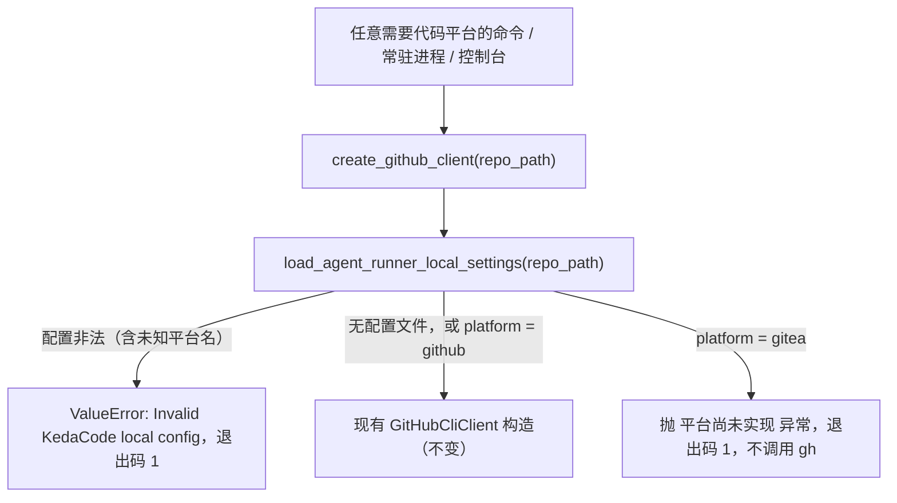

# PRD: 仓库级代码托管平台声明与分发骨架（默认 GitHub，现有行为不变）

- GitHub Issue: https://github.com/ZataZhang/keda/issues/398

> ✅ **交付前置**：无，可立即开工。
> 结构化声明见 §8 Delivery Dependencies，**那里是唯一事实源**。

> 🧍 **验收状态**：待人工验收。
> 本行是 §9 Acceptance Checklist 的投影，**那里是唯一事实源**。

> 本 PRD 分两个 altitude，分别服务不同读者，自上而下阅读：
>
> - **Part A · 人审层 (Review Layer)** — 需求方 / 验收人读这部分，决定"该不该做、做得对不对"，并通过风险地图知道**哪些地方必须亲自确认**。Part A 不出现实现机制、文件路径、命令。
> - **Part B · 执行器层 (Build Layer)** — 实现者（人或 Agent）读这部分动手。人只在 Part A 风险地图**点名处**下钻审查，其余默认交执行器 + 自动门禁。

## Feature Overview (功能一览)

本节是 §10 Functional Requirements 的白话投影，不是第二事实源；行为验收以 §1 的行为样例表为准。

- **仓库可以声明自己在哪个平台**（FR-1）：仓库配置的身份段多一个可选键 `platform`，首批取值 `github`、`gitea`；不写等于 `github`。
- **写错平台名，读配置时就报错**（FR-2）：不认识的名字、大小写不符、空字符串都会被拒绝，提示里列出允许的取值，不再被静默接受。
- **声明了还没实现的平台，会被明确告知**（FR-3）：声明 `gitea` 后，凡是需要访问代码平台的命令都会在发出任何请求之前停下，用一句话说明"这个平台尚未实现"。禁止退回去按 GitHub 处理。
- **没声明平台的仓库完全不受影响**（FR-4）：现有仓库不用改配置，命令、输出、退出码都不变。
- **不访问平台的本地命令照常可用**（FR-5）：即使声明了 `gitea`，查看配置、查看各阶段执行器这类只读本机配置的命令仍然成功。
- **文档同步**（FR-6）：配置指南写明这个键、允许的取值、默认值，以及 `gitea` 目前的状态。
- **本次不含 Gitea 的实际对接**（§11）：声明 `gitea` 的仓库在本次交付后仍然不能用，只是不会再被当成 GitHub 仓库。

---

# Part A · 人审层 (Review Layer)

## 1. Introduction & Goals

### Problem Statement

kc 现在只能对接 GitHub，而"仓库在哪个平台"这件事既没有地方声明，也没有地方检查。从仓库确认到两个现状：

1. kc 判断"这是哪个仓库"时，只取远端地址里的"所有者/仓库名"，不看主机名。把一个托管在其它平台上的仓库交给 kc，它会拿同样的名字去 GitHub 上找：要么报一个看不出原因的"找不到仓库"，要么（GitHub 上恰好有同名仓库时）对着一个无关的仓库操作。
2. 在仓库配置的身份段里写一个现在并不存在的键，例如把平台写成 `gitea`，kc 0.8.0 会照单全收、不报任何错，然后继续把这个仓库当作 GitHub 仓库处理（2026-11-19 在空仓库上实测，命令退出码为 0）。使用者得不到任何"这个平台不支持"的提示。

路线图的未决问题里有一条"是否只支持 GitHub，还是需要预留其它平台的适配层"，至今没有落点。受影响的有两类人：想把 kc 用在非 GitHub 仓库上的人，现在只会得到一个误导性的失败；之后想为其它平台写适配的贡献者，现在没有一个被认可的接入位置。

### Interpretation (解读回显)

这是你**前置批准**的对象，也是唯一能拦住"解读错了"的关卡。下面先给可以逐格修改的具体样例。

| 验证方式 | 输入 / 操作 | 期望观察到的结果 |
|---|---|---|
| 👀 人审 + 自动验证 | 仓库配置把平台声明为 `gitea`，然后执行一个需要访问代码平台的命令（例如列出 Issue） | 命令立即停止，退出码 1；提示里同时出现 `gitea`、`platform` 和 `not implemented`，并说明当前只支持 `github`、怎么改回去；不出现 Python 堆栈；没有按 GitHub 仓库继续处理 |
| 🤖 自动验证 | 仓库配置把平台声明为一个不认识的名字（例如 `gitlab`） | 读取仓库配置时就报错，退出码 1；提示指出是哪个键、收到了什么值、允许哪些值（`github`、`gitea`） |
| 🤖 自动验证 | 仓库配置完全不写平台（现有所有仓库的情况），执行访问代码平台的命令 | 与显式写 `github` 时的退出码相同；输出里不出现"平台尚未实现"或"配置非法"的提示 |
| 🤖 自动验证 | 仓库配置显式把平台声明为 `github` | 与不写时相同 |
| 🤖 自动验证 | 平台名大小写不符、两端带空格或为空字符串（例如 `GitHub`、空串） | 与"不认识的名字"相同：读配置时报错并列出允许值；不做大小写或空白的猜测与修正 |
| 🤖 自动验证 | 平台声明为 `gitea`，但只执行不访问代码平台的本地命令（例如查看各阶段用哪个执行器） | 命令照常成功，退出码 0，不因平台尚未实现而失败 |

`👀 人审 + 自动验证` 表示自动断言之外还需人查看呈递的结果；`🤖 自动验证` 表示自动断言加 verifier 复核就足够。表中每一行都会原样成为 Part B 的验收 oracle，所以改这里的一格就是改验收标准。

**我默默定了这些**（没问你、我自己定的歧义点）

- 平台名怎么比较 → 只认小写、完全相同的写法，写错就报错，不做归一。
- 不写这个键算什么 → 算 `github`。
- "平台尚未实现"用哪个退出码 → 沿用现有"仓库配置非法"的 1，不新增退出码类别；因此命令行对外表面（子命令、参数、退出码表）没有变化。
- 提示文案用什么语言 → 英文，与现有的配置报错一致。
- 谁能声明平台 → 只有仓库自己的配置文件。个人本机覆盖文件不能改它（身份段本来就不允许个人覆盖）；机器级的仓库登记条目不参与平台判断。
- 新初始化的仓库 → 生成的配置里不主动写出这个键，默认值就是 `github`。
- 控制台面板 → 不为这个键新增任何界面。

**我理解为不做**（你可能想要、但我读成不在范围内的）

- Gitea 的实际对接（建 Issue、开 PR、同步标签等）。声明 `gitea` 的仓库在本次交付后仍然不可用。
- 给"批量接管仓库"和"预览环境模板"加平台判断。它们继续只面向 GitHub。
- 把现有以 GitHub 命名的内部接口改名，或支持 GitLab 等其它平台。

读成：现在就把"仓库在哪个平台"变成一件**可声明、会校验、只有一个判断点**的事，并用默认值保证现有仓库零变化。不是：先把 Gitea 做出来再谈配置；也不是：顺手重构现有的 GitHub 对接。

四条关键边界，少了任何一条都会变成另一种实现：

1. 不声明等于 `github`，且行为不变。
2. 不认识的平台名必须在读配置时被拒绝，不能静默接受。
3. 声明了尚未实现的平台，必须在访问代码平台之前停下并说明。**禁止保留"未实现就当 GitHub 处理"的兜底**，那正是本次要消除的错误行为。
4. 不访问代码平台的本地命令不受平台声明影响。

**实现前确认：** 请直接在本 PRD 中确认；若内容不准确，先修改再勾选。
- [ ] 我确认这段解读与行为样例准确表达了我的需求。

> 确认记录：需求方已于 2026-11-19 在对话中明确确认本段解读与行为样例。因未直接编辑本文件，按对话回复记录；上方复选框保留给本人补勾，执行工具不代勾。

### What The User Gets

- **仓库维护者**：能在仓库配置里写明仓库在哪个平台。写错了，或者写了一个 kc 还不支持的平台，第一时间得到一句讲清原因和改法的提示，而不是看着 kc 去 GitHub 上找一个不存在或无关的仓库。
- **现有 GitHub 仓库的使用者**：什么都不用改，什么都不会变。
- **之后为其它平台写适配的贡献者**：有了一个被认可的接入位置，后续工作不需要再讨论"配置怎么写、在哪里分发"。

### Measurable Objectives

- 平台声明为 `gitea` 后执行访问代码平台的命令：退出码 1，输出同时包含 `gitea`、`platform`、`not implemented`，不包含 `Traceback`。
- 平台声明为未知名字：读配置即失败，退出码 1，输出包含键名、收到的值和两个允许值。
- 未声明平台与显式声明 `github`：同一条命令退出码相同，输出里都没有"平台尚未实现"或"配置非法"的提示；仓库现有的自动测试不经修改全部通过。
- 平台声明为 `gitea` 后执行只读本机配置的命令：退出码 0。
- 文档严格构建通过，配置指南里能搜到这个键及其取值。

---

## 2. Human Review Map (介入与风险地图)

这一节只列需要人判断的决策。字段校验、分发逻辑、回归测试和文档构建由执行器完成，不要求逐项阅读实现细节。

### 决策一：平台声明放在配置的哪里、叫什么

建议放在仓库配置的**身份段**，键名 `platform`，首批取值 `github` 和 `gitea`。平台和"仓库叫什么"一样属于仓库身份：它决定 Issue 和 PR 归属于哪里。身份段已有"个人本机覆盖文件不能改写"的规则，放在这里天然防止同一个仓库被不同的人声明成不同的平台。代价是以后 Gitea 自己的地址、凭据变量名要另起一段来放。

另一种做法是单独开一个平台段，把平台类型和以后的地址、凭据变量名收在一起，读起来更集中。但那一段默认可以被个人覆盖文件改写，需要另外加规则禁止改平台类型。

这个键一旦发布就是对外的配置约定，后面每个平台适配都依赖它，之后改名要走迁移，所以需要你在动手前定下来。

**请确认：** 平台声明放在仓库身份段、键名 `platform`、首批取值 `github` 和 `gitea`，是否同意？

**实现前选择：**
- [ ] （推荐）放在仓库身份段，键名 `platform`，取值 `github` / `gitea`
- [ ] 单独开一个平台段，键名 `type`，以后平台自己的地址和凭据变量名也放这一段

> 确认记录：需求方已于 2026-11-19 在对话中选择**推荐项**（仓库身份段，键名 `platform`，取值 `github` / `gitea`）。复选框保留给本人补勾，执行工具不代勾。

**验收：** 按选定的写法在仓库配置里分别声明 `gitea`、一个未知名字、以及不声明，观察到行为样例表第 1、2、3 行的结果。

### 决策二：声明了还没实现的平台，在哪一步拦下

建议**配置照常读进来，等真正要访问代码平台时才停下并说明**。这样只读本机配置的命令不受影响，后续实现 Gitea 时只需要补上对接部分，不用再改"什么时候合法"的规则。风险是：一个取值被接受了，却在使用时必然失败，容易被理解成"半成品"。所以提示必须把"尚未实现、当前只支持 `github`、怎么改回去"三件事说全。

更保守的做法是读配置时就拒绝 `gitea`，等实现完成再放开。好处是不存在"能写但不能用"的取值；代价是本次就没有可以分发的第二个平台，骨架只剩一个校验，后续还要再改一次取值规则。

无论选哪一种，都**不允许**把声明为 `gitea` 的仓库继续当作 GitHub 仓库处理。

**请确认：** 是否同意"配置能读进来，访问代码平台时才停下并说明"？

**实现前选择：**
- [ ] （推荐）配置能读进来；真正要访问代码平台时才停下并说明
- [ ] 读配置时就拒绝 `gitea`，等实现完成再放开

> 确认记录：需求方已于 2026-11-19 在对话中选择**推荐项**（配置能读进来，访问代码平台时才停下并说明）。复选框保留给本人补勾，执行工具不代勾。

**验收：** 平台声明为 `gitea` 时，访问代码平台的命令给出行为样例表第 1 行的结果，只读本机配置的命令给出第 6 行的结果。

### 自动门禁，不需要逐项人工审阅

- 平台名的合法与非法取值、默认值、从配置到判断点的传递，由自动测试逐项断言。
- "未声明时行为不变"由仓库现有测试不经修改全部通过来证明。
- 文档由严格构建检查。

### 本次明确不涉及

不涉及数据库结构、鉴权与凭据、计费与配额、破坏性数据操作、并发与事务，也不改动任何前端界面；不新增或改变任何命令的参数与退出码类别。

---

## 3. Usage And Impact After Implementation

### 仓库维护者（编写仓库配置的人）

在仓库配置的身份段里可以多写一行平台声明。不写时一切照旧。写成 `gitea` 后，列出 Issue、建 Issue、同步标签、执行任务这类要访问代码平台的命令会立即停下并提示平台尚未实现；写成不认识的名字，任何读取该仓库配置的命令都会报配置非法并列出允许的取值。

### 现有 GitHub 仓库的日常使用者

入口、命令、输出、退出码全部不变，不需要修改配置。

### 后台常驻进程的运维者

对未声明平台或声明为 `github` 的仓库，轮询行为不变。对声明为 `gitea` 的仓库，每轮访问代码平台时都会得到同一条"尚未实现"的错误；这类仓库在本次交付后本来就不可用。

### 控制台面板的使用者

面板不新增界面。面板读取声明为 `gitea` 的仓库时会遇到同一条错误，沿用面板现有的错误呈现方式；本次不为它做专门设计。

### 之后为其它平台写适配的贡献者

平台声明的写法和唯一的判断点已经确定。实现一个新平台时，在这个判断点接入自己的对接实现即可，不需要再改各个命令。

### Impact On Existing Behavior

- 现有仓库配置不需要任何修改；新键可选，默认值为 `github`。
- 个人本机覆盖文件的规则不变：身份段仍然不能被覆盖。
- 所有现有命令的参数、输出和退出码类别不变。

---

## 4. Requirement Shape

- Actor: 仓库维护者；现有 GitHub 仓库的日常使用者；后台常驻进程的运维者；控制台面板的使用者；后续平台适配的贡献者。
- Trigger: kc 读取某个仓库的配置时；以及 kc 需要为某个仓库访问代码平台时。
- Expected behavior: 读配置时校验平台声明；访问代码平台前按声明选择对接实现，`github` 走现有实现，`gitea` 明确报"尚未实现"并停止。
- Scope boundary: 不实现 Gitea 对接本身；不改批量接管与预览模板；不改内部接口命名；不涉及其它平台。

---

# Part B · 执行器层 (Build Layer)

> 以下供实现者（人或 Agent）使用。人只在 Part A 风险地图点名处下钻审查；其余默认交执行器 + 自动门禁。

## 5. Repository Context And Architecture Fit

- Existing path: 所有平台客户端都由 `create_github_client`（`src/backend/engines/agent_runner/factories/__init__.py`）构造，约 25 处调用（`rg -n "create_github_client\(" src/backend`）。它只接收仓库路径，目前无条件返回 `GitHubCliClient`。
- Reuse candidates:
  - `AgentRunnerRepositoryMetadataSettings`（`src/backend/infrastructure/config/agent_runner_repository_settings.py`）：仓库身份段的配置模型，已有 `github_repo` 字段及其 `field_validator`，是新键的直接样板。
  - `load_agent_runner_local_settings`（同文件）：读取 `.kedacode.toml` 并叠加 `.kedacode.local.toml`，校验失败时抛 `ValueError("Invalid KedaCode local config at ...")`；仓库没有配置文件时返回 `None`。
  - `tests/test_agent_runner_config.py` 中 `test_repository_metadata_github_repo_*` 与 `test_load_agent_runner_local_settings_propagates_github_repo`：新键测试的样板。
- Architecture pattern to preserve: 四层依赖 `api → core → engines → infrastructure`；`infrastructure` 可以引用 `core/shared` 的常量与类型（现状如 `github_client.py` 引用 `core/shared/interfaces/github_api_budget`）。分发属于装配，留在 `engines` 的工厂里。
- Frontend impact: `No frontend impact`。`frontend-admin`、`frontend-public` 都不读取仓库身份段的字段（`rg -n "github_repo" frontend-admin/src frontend-public/src` 无结果），本次也不新增界面。
- Existing PRD relationship: 本 PRD 独立交付，为 Gitea 客户端提供平台选择入口。它回应了[旧路线图记录的多平台问题](../../docs/project/roadmap-history.md)，当前入口见[产品边界](../../docs/project/product-boundaries.md#候选扩展)。
- Redundancy risks: 平台名字符串在校验处和分发处各写一遍会漂移，必须只定义一处；不要为"以后可能有的平台"引入注册表或插件机制。

---

## 6. Recommendation

### Recommended Approach

- Approach: 在现有仓库身份段模型上加一个带校验的可选字段；在唯一构造点 `create_github_client` 里读取它并分发。
- Why this is the best fit: 身份段模型和加载函数已经提供了"加载期校验并报配置非法"的完整路径；工厂是全部调用方的唯一入口，改这一处就覆盖所有命令、常驻进程和控制台。
- Rejected redundancy: 不新增平台注册表、不新增抽象工厂类、不新增配置段、不新增退出码类别、不改 `IGitHubClient` 接口。

### Proposed Solution Summary (实现机制)

1. 平台名词表（`github`、`gitea`、默认值）与"平台尚未实现"异常定义在 `core/shared` 的一个小模块里，供 `infrastructure` 的校验和 `engines` 的分发共用。
2. `AgentRunnerRepositoryMetadataSettings` 增加 `platform` 字段，默认 `github`，校验器仿 `_validate_github_repo_format`：不在词表里的值抛 `ValueError`，信息包含键名、收到的值和允许值。`AgentRunnerRepositorySettings` 增加同名字段，`load_agent_runner_local_settings` 把值带出来（与 `github_repo` 的传递方式相同）。
3. `create_github_client` 在构造前调用 `load_agent_runner_local_settings(repo_path)`：返回 `None`（仓库没有配置文件）或平台为 `github` 时，执行现有的 `GitHubCliClient(...)` 构造，参数原样保留；平台为 `gitea` 时抛"平台尚未实现"异常，不构造客户端、不调用 `gh`。
4. 该异常不需要 CLI 层新增处理：现有顶层错误出口会把它呈现为一行错误并以退出码 1 结束（现状参考：仓库配置非法时即为退出码 1）。实现时要确认输出中没有 `Traceback`，有的话在现有出口补上，而不是新增退出码类别。
5. 平台由配置显式声明，系统不从远端地址推断。
6. 刻意避免的复杂度：不改 `create_github_client` 的签名和返回类型标注；不改 core 侧的仓库身份数据类；不让 `kc init` 生成该键；不碰机器级 registry 的合并逻辑。

### Alternatives Considered (Only When Useful)

- Alternative: 读配置时就拒绝 `gitea`（Part A 决策二的替代项）。
- Why not chosen: 本次就没有可分发的第二个取值，后续还要再改一次取值规则。需求方已在决策二中确认采用推荐项。
- Alternative: 从远端地址的主机名自动推断平台。
- Why not chosen: 自建平台的主机名无法可靠识别，推断错了又回到"静默走错平台"的问题。

---

## 7. Implementation Guide

This section is a living implementation guide based on current repository analysis. If implementation discovers additional affected files, hidden dependencies, edge cases, or a better path, update this PRD before proceeding.

### 7.1 Core Logic

- 配置加载：`.kedacode.toml` → `_apply_local_override`（身份段不可被覆盖，现有规则）→ `AgentRunnerLocalSettings` 校验 → `repository.platform` → `AgentRunnerRepositorySettings.platform`。
- 分发：任意调用方 → `create_github_client(repo_path, ...)` → 读取该仓库的平台 → `github`：现有构造；`gitea`：抛异常。
- 没有配置文件的路径（例如 `kc takeover` 在当前目录做鉴权检查）得到 `None`，按 `github` 处理，行为不变。

### 7.2 Change Impact Tree

```text
.
├── Core
│   └── src/backend/core/shared/models/repository_platform.py
│       [新增]
│       【总结】平台名词表、默认值和"平台尚未实现"异常的唯一定义处
│
│       ├── 常量：github、gitea、默认平台、受支持取值的元组
│       └── 异常类：携带平台名与配置文件路径，信息含 not implemented、platform、当前只支持 github、如何改回
│
├── Infrastructure
│   └── src/backend/infrastructure/config/agent_runner_repository_settings.py
│       [修改]
│       【总结】仓库身份段新增可选键 platform 及加载期取值校验，并随加载结果传出
│
│       ├── AgentRunnerRepositoryMetadataSettings 增加 platform 字段与 field_validator（仿 _validate_github_repo_format）
│       ├── AgentRunnerRepositorySettings 增加同名字段与相同校验
│       └── load_agent_runner_local_settings 构造返回值时带上 repository_metadata.platform
│
├── Engines
│   └── src/backend/engines/agent_runner/factories/__init__.py
│       [修改]
│       【总结】create_github_client 在构造客户端之前按仓库声明的平台分发
│
│       ├── 读取 load_agent_runner_local_settings(repo_path)；None 或 github → 现有 GitHubCliClient 构造原样保留
│       ├── gitea → 抛"平台尚未实现"异常；此分支不得构造客户端、不得调用 process_runner
│       └── 函数签名与返回类型标注不变；docstring 补充分发说明
│
├── Tests
│   └── tests/test_repository_platform_dispatch.py
│       [新增]
│       【总结】覆盖平台校验、默认值、加载传递与工厂分发
│
│       ├── 合法值 github / gitea；非法值 gitlab、GitHub、空串、首尾空格
│       ├── 无配置文件、未声明、显式 github → 返回 GitHubCliClient
│       └── gitea → 抛"平台尚未实现"异常，且传入的假进程执行器记录的调用数为 0
│
└── Docs
    ├── docs/guides/configuration.md
    │   [修改]
    │   【总结】仓库身份段说明补充 platform 键、取值、默认值与 gitea 当前状态
    └── docs/guides/agent-runner.md
        [修改]
        【总结】github_repo 说明所在段落补充 platform 键的一句交叉引用

Frontend: No frontend impact（见 §5）。
```

该文件列表是当前分析得到的预期范围，可能不完整，见 7.3。实现时复核发现 `tests/test_agent_runner_config.py` 已有 992 个非空行；为遵守单文件 1000 行限制，平台 schema、加载与分发用例均集中在新增的 `tests/test_repository_platform_dispatch.py`，不再改动旧配置测试文件。

### 7.3 Risk Classification Register 与 Executor Drift Guard

| change point | tier | decisive dimension / override | intervention | oracle / gate |
|---|---|---|---|---|
| 身份段新增 `platform` 键及取值词表 | R1 | 影响面：新增可选键、可立即回滚；override：对外配置约定（fixed zone） | 人工确认（决策一） | rv-2、rv-5 |
| 声明 `gitea` 时的拦截时机与提示 | R1 | 影响面：仅声明了 `gitea` 的仓库；override：对外可见的失败语义（fixed zone） | 人工确认（决策二） | rv-1、rv-4 |
| 工厂分发，未声明时保持现有构造 | R1 | 正确性：有明确测试 oracle 的普通行为 | 执行器 + 自动门禁 | rv-3、rv-5 |
| 文档同步 | R0 | 仅文档 | 执行器 + 自动门禁 | rv-6 |

The file list above is the expected implementation surface from current repository analysis. During implementation, treat it as a starting point and use these repository searches to catch hidden references or drift before marking the PRD complete.

| Check | Command | Expected Result | If It Fails, Inspect First |
|---|---|---|---|
| 绕过工厂直接构造客户端 | `rg -n "GitHubCliClient\(" src/backend` | 只有工厂内一处构造 | 新出现的调用方是否应改走 `create_github_client` |
| 平台名是否只定义一处 | `rg -n "\"gitea\"" src/backend` | 只出现在 `repository_platform.py` | 校验器或工厂里是否手写了字符串 |
| 工厂调用方数量未变 | `rg -c "create_github_client\(" src/backend` | 与改动前的统计一致，本次不改任何调用方 | 是否误改了调用方签名 |
| 身份段字段的其它消费者 | `rg -n "repository_metadata\.|\.github_repo" src/backend` | 没有需要同步 `platform` 的遗漏传递点 | `merge_repository_config`、registry 编辑器 |

### 7.4 Flow Or Architecture Diagram



### 7.5 ER Diagram (Only When Data Model Changes)

- `No data model changes in this PRD.`

### 7.6 Realistic Validation Plan (Oracle 块)

所有命令在仓库根目录执行，使用 `uv run kc` 以确保运行的是当前工作树的代码，而不是全局安装的 kc。每条 `real_entry` 都自带临时仓库的搭建，不依赖网络凭据。取证脚本放在 `tasks/evidence/P2-FEAT-20261119-152718-repository-platform-selection-skeleton/scripts/`，不进入代码 diff。

```yaml
- id: rv-1
  behavior: 仓库配置把平台声明为 gitea 后，执行需要访问代码平台的命令会立即停止并说明该平台尚未实现
  reviewer: human
  real_entry: >-
    d=$(mktemp -d) && git -C "$d" init -q && printf '[agent_runner.repository]\nid = "rv1"\nplatform = "gitea"\n' > "$d/.kedacode.toml" && uv run kc --repo "$d" issue list; echo "exit=$?"
  expected: "最后一行为 exit=1；输出同时包含 gitea、platform、not implemented，并说明当前只支持 github 及如何改回；输出不包含 Traceback"
  mock_boundary: "不允许 mock：真实 CLI 入口、真实配置加载、真实工厂。命令必须在到达任何 gh 调用之前结束"
  tier: R1
  test_layer: smoke
  required_for_acceptance: true
  presentation: "tasks/evidence/P2-FEAT-20261119-152718-repository-platform-selection-skeleton/rv-1-gitea-not-implemented.txt（真实终端输出的完整捕获）。自查：在仓库根目录执行本条 real_entry，看最后一行是否为 exit=1、提示是否讲清原因和改法"
  negative_control: "同一真实入口把配置改为 platform = \"github\"，仍断言必须出现 gitea 的 not implemented 提示；该断言应失败，证明检查区分平台分发结果"
  expected_fail: "GitHub 输入正常走现有路径，输出没有 gitea 或 not implemented，且仓库身份未配置时命令以既有仓库身份错误结束"
- id: rv-2
  behavior: 仓库配置把平台声明为不认识的名字时，读取仓库配置即报错并列出允许的取值
  reviewer: verifier
  real_entry: >-
    d=$(mktemp -d) && git -C "$d" init -q && printf '[agent_runner.repository]\nid = "rv2"\nplatform = "gitlab"\n' > "$d/.kedacode.toml" && uv run kc --repo "$d" agent lifecycle list --scope repository; echo "exit=$?"
  expected: "最后一行为 exit=1；输出包含 platform、gitlab、github、gitea"
  mock_boundary: "不允许 mock：真实 CLI 入口与真实配置加载"
  tier: R1
  test_layer: smoke
  required_for_acceptance: true
  negative_control: "在变更前真实运行同一命令，配置含 platform = \"gitlab\"；检查要求的配置错误与允许值断言应失败"
  expected_fail: "命令退出码为 0，仍打印 lifecycle 配置，缺少 platform、gitlab、github、gitea 的错误信息"
- id: rv-3
  behavior: 不声明平台与显式声明 github 的仓库行为相同，且都不出现平台或配置非法的提示
  reviewer: verifier
  real_entry: >-
    a=$(mktemp -d) && b=$(mktemp -d) && git -C "$a" init -q && git -C "$b" init -q && printf '[agent_runner.repository]\nid = "rv3"\n' > "$a/.kedacode.toml" && printf '[agent_runner.repository]\nid = "rv3"\nplatform = "github"\n' > "$b/.kedacode.toml" && uv run kc --repo "$a" issue list > "$a/out.txt" 2>&1; ea=$?; uv run kc --repo "$b" issue list > "$b/out.txt" 2>&1; eb=$?; echo "exit_a=$ea exit_b=$eb"; cat "$a/out.txt" "$b/out.txt" | grep -c -i -E "not implemented|Invalid KedaCode local config"
  expected: "exit_a 与 exit_b 数值相同；最后一行计数为 0"
  mock_boundary: "不允许 mock 配置加载与工厂。两个临时仓库都没有远端，命令会沿现有 GitHub 路径以相同方式结束；不要求 GitHub 凭据"
  tier: R1
  test_layer: smoke
  required_for_acceptance: true
  negative_control: "将显式 github 的仓库配置改为 platform = \"gitea\" 后仍要求两份输出无平台提示；该断言应失败"
  expected_fail: "显式 gitea 的调用在工厂处分发并输出 not implemented，未声明仓库仍走 GitHub 路径，平台提示计数为 1"
- id: rv-4
  behavior: 平台声明为 gitea 时，只读本机配置的命令照常成功
  reviewer: verifier
  real_entry: >-
    d=$(mktemp -d) && git -C "$d" init -q && printf '[agent_runner.repository]\nid = "rv4"\nplatform = "gitea"\n' > "$d/.kedacode.toml" && uv run kc --repo "$d" agent lifecycle list --scope repository; echo "exit=$?"
  expected: "最后一行为 exit=0；输出包含 scope=repository"
  mock_boundary: "不允许 mock：真实 CLI 入口与真实配置加载"
  tier: R1
  test_layer: smoke
  required_for_acceptance: true
  negative_control: "同一个临时仓库再运行 issue list 这一平台访问入口；它应因 gitea 尚未实现而失败，作为本地命令可以继续运行的真实对照"
  expected_fail: "issue list 以退出码 1 输出包含 gitea、platform、not implemented 的提示；对照的本地 lifecycle list 必须退出码 0"
- id: rv-5
  behavior: 平台名的合法值、非法值、默认值、加载传递与工厂分发逐项成立，且仓库现有测试不经修改通过
  reviewer: verifier
  real_entry: "UV_CACHE_DIR=/private/tmp/keda-issue-398-uv-cache uv run pytest tests/test_agent_runner_config.py tests/test_repository_platform_dispatch.py -q --testmon-noselect && just test"
  expected: "两条命令退出码均为 0；非法值用例覆盖 gitlab、GitHub、空串、两端带空格；gitea 分发用例断言假进程执行器的调用数为 0"
  mock_boundary: "进程执行器使用 tests/conftest.py 的 FakeProcessRunner；配置模型、加载函数和工厂必须是真实实现"
  tier: R1
  test_layer: unit
  required_for_acceptance: true
  negative_control: "运行 UV_CACHE_DIR=/private/tmp/keda-issue-398-uv-cache uv run python -c 'from backend.core.shared.models.repository_platform import validate_repository_platform; assert validate_repository_platform(\"gitlab\") == \"gitlab\"'"
  expected_fail: "validate_repository_platform 抛出 ValueError，指出收到的 gitlab 及允许值 github、gitea"
- id: rv-6
  behavior: 配置指南写明 platform 键、取值、默认值与 gitea 当前状态，文档可严格构建
  reviewer: verifier
  real_entry: "uv run mkdocs build --strict && rg -n \"platform\" docs/guides/configuration.md"
  expected: "构建退出码 0；rg 至少命中一行同时出现 platform 与 gitea 的说明"
  mock_boundary: "无"
  tier: R0
  test_layer: smoke
  required_for_acceptance: true
  negative_control: "git show HEAD:docs/guides/configuration.md | rg -n 'platform.*gitea|gitea.*platform'"
  expected_fail: "基础版本指南不含该配置说明，rg 退出码为 1；修改后的指南应命中"
```

Failure triage:
- `uv run kc` 起不来，先在仓库根目录执行 `uv sync`，确认运行的是工作树里的代码而不是全局安装的 kc。
- rv-1 若在到达工厂之前就因别的前置检查停下（例如"仓库未初始化"），先看 `require_repository_initialized` 对最小配置的要求并补齐临时仓库；仍不行则改用另一条同样经过 `create_github_client` 的只读命令，并更新本 PRD 的 rv-1。
- rv-1 输出里出现 `Traceback`，先看 CLI 顶层错误出口如何处理未归类异常，在现有出口修正，不新增退出码类别。
- rv-3 两个退出码不同，先比较两份 `out.txt`，再检查工厂对 `None` 与 `github` 两个分支是否走了同一段构造代码。
- 本 PRD 没有需要凭据的验证项，没有 opt-in / post-merge 项。
- 禁止为了让 oracle 能变红去改生产代码。

### 7.7 Low-Fidelity Prototype (Only When Required)

- `No low-fidelity prototype required for this PRD.`

### 7.8 Interactive Prototype Change Log (Only When Files Actually Changed)

- `No interactive prototype file changes in this PRD.`

### 7.9 External Validation (Only When Web Research Was Used)

- `No external validation required; repository evidence was sufficient.`

---

## 8. Delivery Dependencies

工具中立的排期元数据，不是工具专属队列语法。

- Depends on tasks/issues:
  - none
- Gate type: none
- Sequence: via-main
- Notes: 无上游依赖，可直接从最新主线开分支。后续"Gitea 客户端实现"将依赖本 PRD 合入主线后的配置键与分发点。

---

## 9. Acceptance Checklist

本节分两层读者：**9.1 是给人看的**，验收时只看这一层；**9.2 起是给 verifier 和未来回溯用的机器证据**。每项必须带证据，不是裸勾。

### 9.1 人读呈递区（Human Review Surface）

无主演示：纯后端与配置改动，没有界面可录；人审件是 rv-1 的真实终端输出。

| # | 你要看什么（对应 oracle） | 呈递物（交付时填实际路径） | 想自己复核？ |
|---|---|---|---|
| 1 | 平台声明为 `gitea` 时，访问代码平台的命令给出的那句提示是否讲清了原因和改法（rv-1） | `tasks/evidence/P2-FEAT-20261119-152718-repository-platform-selection-skeleton/rv-1-gitea-not-implemented.txt`；打开方式：`just prd review tasks/pending/P2-FEAT-20261119-152718-repository-platform-selection-skeleton.md` | 在仓库根目录执行 §7.6 rv-1 的 `real_entry`：最后一行应为 `exit=1`，上方提示应同时出现 `gitea`、`platform`、`not implemented` |

**以下项不需要你看**（`reviewer: verifier`，agent 自验 + verifier 复核，挂了会自己红）：rv-2 未知平台名的加载期报错、rv-3 默认行为不变、rv-4 本地命令不受影响、rv-5 单元测试与现有测试回归、rv-6 文档构建。它们的证据在 §9.2。

### 9.2 Acceptance Evidence Package（机器证据 · verifier 入口，人默认跳过）

1. **人审项的 oracle 跑绿证据**：rv-1 → `rv-1-gitea-not-implemented.txt`；rv-2 → `rv-2-unknown-platform.txt`（决策一）；rv-4 → `rv-4-local-command-ok.txt`（决策二）。
2. **verifier-only 项结果**：rv-3 → `rv-3-default-unchanged.txt`；rv-5 → `rv-5-pytest.txt`；rv-6 → `rv-6-docs-build.txt`。
3. **风险地图对账 Predicted → Reconciled**：交付时填写实现中是否触达 §7.3 登记之外的改动点。
4. **对抗自检**：交付时填写对"未声明即 github""gitea 不回退到 GitHub"两条的反方检查结论。
5. **对锁定契约的 diff**：交付时列出配置键名、取值词表、提示文案与本 PRD 的差异。
6. **低风险门禁结果（折叠）**：`just lint` 结果。

### Human-Confirmed (来自 Part A 风险地图)

> 本组条目归**人**回答，执行工具不得代勾，也不得改写成 `[~]`。本组不拦归档。

- [ ] 决策一：按选定的位置与键名声明平台，观察到的未知值报错（rv-2 输出）符合预期
- [ ] 决策二：声明 `gitea` 后的拦截时机与提示（rv-1、rv-4 输出）符合预期
- [ ] §9.1 呈递区各项已亲眼看过

### Architecture Acceptance

- [x] `rg -n "GitHubCliClient\(" src/backend` 只命中工厂内一处构造，证据：`rv-5-pytest.txt`、`arch-search.txt`
- [x] `rg -n "\"gitea\"" src/backend` 只命中 `src/backend/core/shared/models/repository_platform.py`，证据：`rv-5-pytest.txt`、`arch-search.txt`

### Dependency Acceptance

- [x] `create_github_client` 的签名与返回类型标注未变，`rg -c "create_github_client\(" src/backend` 的统计与改动前一致，证据：`rv-5-pytest.txt`、`arch-search.txt`
- [x] `IGitHubClient` 接口无改动：`git diff --stat -- src/backend/core/shared/interfaces/agent_runner.py` 为空，证据：`rv-5-pytest.txt`、`arch-search.txt`

### Behavior Acceptance

- [x] 平台声明为 `gitea` 时访问代码平台的命令以退出码 1 结束并给出约定提示，证据：`rv-1-gitea-not-implemented.txt`
- [x] 平台声明为未知名字时读配置即以退出码 1 失败并列出允许值，证据：`rv-2-unknown-platform.txt`
- [x] 未声明与显式 `github` 的退出码相同且无平台相关提示，证据：`rv-3-default-unchanged.txt`
- [x] 平台声明为 `gitea` 时只读本机配置的命令退出码为 0，证据：`rv-4-local-command-ok.txt`

### Documentation Acceptance

- [x] `docs/guides/configuration.md` 写明 `platform` 键、取值、默认值与 `gitea` 当前状态，`uv run mkdocs build --strict` 通过，证据：`rv-6-docs-build.txt`
- [x] `docs/guides/agent-runner.md` 中 `github_repo` 所在段落已加入对 `platform` 的交叉引用，证据：`rv-6-docs-build.txt` 中的 `rg` 输出

### Validation Acceptance

- [x] `uv run pytest tests/test_agent_runner_config.py tests/test_repository_platform_dispatch.py -q --testmon-noselect` 通过并实际执行用例，证据：`rv-5-pytest.txt`
- [x] `just test` 通过，且 tests 工作树变更仅包含新文件 `tests/test_repository_platform_dispatch.py`（用 `git status --short -- tests` 核对；未跟踪文件不会出现在 `git diff --stat`），证据：`rv-5-pytest.txt`
- [x] rv-1 至 rv-4 均通过真实 CLI 入口 `uv run kc` 执行，未以单元测试或辅助函数替代，证据：各 `rv-*.txt` 首行记录的完整命令
- [x] 全部证据在最后一次影响相关代码的改动之后重新采集，证据报告中记录了采集时的 `git rev-parse HEAD` 与 `git rev-parse HEAD^{tree}`

### Delivery Readiness

- [x] 推荐方案完整实现，未引入注册表、插件机制等并行抽象，证据：`arch-search.txt`
- [x] §9.1 呈递表的呈递物路径已回填，完成回复原样带上了呈递表内容
- [x] 证据报告首节是「人审导航」，包含 rv-1 输出的关键行原文、打开命令与逐项期望值

---

## 10. Functional Requirements

- FR-1: 仓库配置的 `[agent_runner.repository]` 段支持可选键 `platform`，合法取值为 `github`、`gitea`（小写、完全匹配），缺省值为 `github`。
- FR-2: `platform` 为不在合法取值内的任何值（包括大小写不符、两端带空白、空字符串）时，仓库配置加载失败，错误沿用现有的 `Invalid KedaCode local config at <path>` 出口与退出码 1，信息包含键名、收到的值和全部合法取值。
- FR-3: `create_github_client` 在构造客户端之前读取目标仓库的 `platform`；为 `gitea` 时抛出"平台尚未实现"异常，信息包含 `gitea`、`platform`、`not implemented`、当前只支持 `github` 以及如何改回，命令以退出码 1 结束且不输出堆栈；该分支不得构造客户端、不得调用 `gh`，不得回退为 GitHub 处理。
- FR-4: 目标仓库没有配置文件、未声明 `platform` 或声明为 `github` 时，`create_github_client` 的行为与改动前一致：返回对象类型和构造参数相同，仓库现有测试不经修改全部通过。
- FR-5: `platform` 为 `gitea` 的仓库，其配置可以正常加载；不经过 `create_github_client` 的命令不受影响。
- FR-6: `docs/guides/configuration.md` 记录该键、取值、默认值和 `gitea` 的当前状态；`docs/guides/agent-runner.md` 的 `github_repo` 段落加入交叉引用；文档严格构建通过。

---

## 11. Non-Goals

- 不实现 Gitea 的任何对接能力（Issue、标签、评论、PR、检查结果）。
- 不为 `kc takeover` 与 preview 模板增加平台判断。
- 不改 `IGitHubClient` 的名称与方法集，不改 `create_github_client` 的签名与返回类型标注。
- 不支持 GitLab 等其它平台，不引入平台注册表或插件机制。
- 不为机器级 registry 条目提供平台声明语义，不改 `kc init` 的生成模板，不改控制台面板。

---

## 12. Risks And Follow-Ups

- **方向尚未得到维护者确认**：多平台适配列在[候选扩展](../../docs/project/product-boundaries.md#候选扩展)。若维护者不接受这个方向，本 PRD 应整体撤回，而不是改成别的形态合入。
- **"能写但不能用"的取值**：`gitea` 在后续实现合入之前只会得到"尚未实现"的错误。这是决策二推荐项的已知代价，由提示文案和文档说明承担。
- **registry 条目**：机器级 registry 条目与仓库内配置共用一部分模型。实现时要确认 registry 条目里即使写了 `platform` 也不会影响工厂判断，并在文档中写明"平台只在仓库内配置声明"；若发现 registry 层会让它生效，先更新本 PRD 再继续。
- **控制台与常驻进程的呈现**：声明 `gitea` 的仓库会在面板和每轮轮询中重复得到同一条错误，本次不做专门设计。
- **Follow-up**：Gitea 客户端实现、鉴权检查与仓库地址解析的平台化，另开 PRD，依赖本 PRD。

---

## 13. Decision Log

每条记录对应本 PRD 中做出的一个关键决策，归档后作为永久参考。

| # | 决策问题 | 选择 | 放弃的方案 | 理由 |
|---|---|---|---|---|
| D-01 | 平台声明放在哪、叫什么 | 仓库身份段 `[agent_runner.repository]`，键名 `platform`（需求方 2026-11-19 确认） | 独立平台段加 `type` 键 | 身份段已有"个人覆盖文件不可改写"的规则，平台与仓库归属同属身份信息 |
| D-02 | 声明未实现平台时在哪一步拦 | 配置可加载，在工厂构造客户端前抛异常（需求方 2026-11-19 确认） | 加载期直接拒绝 `gitea` | 不访问平台的本地命令不受影响，后续实现无需再改取值规则 |
| D-03 | "平台尚未实现"的退出码 | 沿用现有的 1 | 新增一个退出码类别 | 不改变 CLI 对外表面，因而不需要同步随包 operator skill 与退出码文档 |
| D-04 | 平台名词表定义在哪 | `core/shared` 下一处，校验与分发共用 | 在校验器和工厂里各写一遍字符串 | 两处手写会漂移，且 `infrastructure` 与 `engines` 都可以合法引用 `core/shared` |
| D-05 | 是否把工厂返回类型改为接口 | 本次不改 | 同时把返回类型标注改成 `IGitHubClient` | 本次只会返回一种实现，且 `check_auth_status` 不在接口上，改标注应与第二个实现一起做 |
| D-06 | 平台从哪里得知 | 只读仓库内配置的显式声明 | 从远端地址主机名推断 | 自建平台的主机名无法可靠识别，推断错误会回到静默走错平台的问题 |

### Final Reconciliation (Archive Only)

- Interpretation: 实现符合解读回显；仓库身份段新增可选 `platform`，未声明默认 `github`，`gitea` 仅在代码平台客户端工厂处分发失败，其他本地配置读取照常工作。
- Public behavior and contracts: 没有新增 CLI 参数或退出码类别。未知平台值沿用配置加载错误与退出码 1；`gitea` 提示包含 `platform`、`not implemented`、当前只支持 `github` 和回退设置方法。客户端工厂签名与返回类型不变。
- Related PRD status: 本次没有关联的 pending PRD；后续 Gitea 客户端对接仍是独立后续工作，本次不实现。
- Requirements and risks: FR-1 至 FR-6 均由配置测试、真实 CLI、架构搜索与严格文档构建验证。声明 `gitea` 的仓库在实际 Gitea 对接交付前仍不可执行代码托管操作，符合已确认的非目标。
- Reconciled differences:
  - 旧配置测试文件已有 992 个非空行，平台 schema、加载和分发测试集中在新文件 `tests/test_repository_platform_dispatch.py`；测试范围不变。
  - RV-5 定向 pytest 使用 `--testmon-noselect`，防止缓存把目标用例全部筛掉；真实运行通过 81 项。
  - 未触及 §7.3 之外的生产变更点；没有修改 `IGitHubClient`、`create_github_client` 调用方、命令表面或平台抽象体系。
  - 执行者自检及 evidence checker 均通过；独立 verifier 由 runner 在发布流程中执行。人审框保持未勾选，PRD 仍在 pending 路径，归档由 runner 负责。

## Change Log

### 初始版本
- Type: scope
- Before: 无
- After: 新建本 PRD，范围为平台声明键、加载期校验与工厂分发骨架
- Reason: 回应 ROADMAP 中"是否预留其它平台适配层"的未决问题，先落最小可验证的一步
- Impact: 不影响现有交付物；后续 Gitea 客户端实现依赖本 PRD
- Review: 待人在 §1 与 §2 的实现前确认框中确认

### 记录实现前确认
- Type: doc
- Before: §1 解读与 §2 两项决策均未确认；Decision Log 的 D-01、D-02 标注为待确认
- After: 在三处确认框下方各加一条确认记录；D-01、D-02 改为已确认；§6 备选方案的说明同步
- Reason: 需求方于 2026-11-19 在对话中确认解读，并对两项决策都选择推荐项；未直接编辑本文件，按对话回复记录
- Impact: 不改变范围、行为、oracle 与验收项；实现可以按推荐方案开工
- Review: 确认框本身未被勾选，保留给需求方本人补勾

### 调整测试文件范围并强化负向控制
- Type: test / evidence
- Before: 计划在 `tests/test_agent_runner_config.py` 与新分发测试文件之间拆分平台校验和工厂用例；rv-1 至 rv-4 有部分负向控制标注为无需执行
- After: 因旧测试文件已有 992 个非空行，所有平台模型、加载与分发用例集中到 `tests/test_repository_platform_dispatch.py`；为 rv-1 至 rv-6 明确记录可执行负向控制及预期失败现象，并将架构检索结果纳入 rv-5 证据
- Reason: 保持单文件行数限制，并满足本次交付要求：每个验证项都必须展示能使其变红的对照
- Impact: 功能范围和用户可见行为不变；测试文件列表、rv 负向控制和 rv-5 证据内容有调整
- Review: 执行前已由实现者按仓库行数与验证要求核对；需求方人审项保持未勾选

### 修正未跟踪测试文件的验收证据表述
- Type: evidence
- Before: 验收项要求用 `git diff --stat -- tests` 显示新建的未跟踪测试文件
- After: 验收项改为用 `git status --short -- tests` 确认唯一测试工作树变更，并说明未跟踪文件不进入 `git diff --stat`
- Reason: 按执行限制不运行 `git add`，未跟踪文件不会出现在 diff stat 中
- Impact: 不改变测试范围；只修正可执行的证据核对方式
- Review: 实现者已核对 Git 对未跟踪文件的呈现行为

### 关闭 RV-5 定向测试的 testmon 选择
- Type: test / evidence
- Before: RV-5 使用无附加参数的定向 pytest 命令
- After: 定向 pytest 增加 `--testmon-noselect`，确保测试映射缓存不会把目标文件中的全部用例筛掉
- Reason: 实际运行观察到命令退出码为 0，但显示 81 deselected；退出码不能代替用例执行证据
- Impact: 只调整验证命令；测试范围仍是原配置测试与新增平台分发测试
- Review: 根据实际输出核对并记录；后续证据必须显示目标用例实际执行

### 完成实现与执行侧证据
- Type: implementation / evidence
- Before: 功能未实现；Realistic Validation 和执行侧 Acceptance Checklist 均未完成
- After: 完成仓库平台声明、加载校验与客户端工厂分发；rv-1 至 rv-6 的证据、manifest、验证计划和人审导航已采集，执行侧 checklist 已按证据勾选
- Reason: 完成 Issue #398 的已批准交付范围，并提供可复核的真实入口结果
- Impact: 默认 GitHub 行为保持原样；未实现 Gitea 接入；三项 Human-Confirmed 保持未勾选；PRD 保留在 pending，交由 runner 完成独立 verifier 和归档流程
- Review: 执行者自检通过；独立 verifier 状态待 runner 处理；人审项尚待需求方复核
