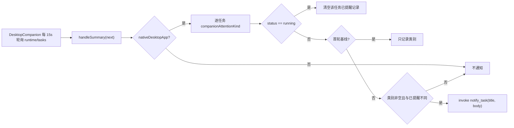

# PRD: 桌面 App 在“轮到人处理”时发系统通知（待审阅 / Issue 已关闭）

> ✅ **交付前置**：无，可立即开工。
> 结构化声明见 §8 Delivery Dependencies，**那里是唯一事实源**。

> 🧍 **验收状态**：待人工验收。
> 本行是 §9 Acceptance Checklist 的投影，**那里是唯一事实源**。

> 本 PRD 分两个 altitude，分别服务不同读者，自上而下阅读：
>
> - **Part A · 人审层 (Review Layer)** — 需求方 / 验收人读这部分，决定"该不该做、做得对不对"，并通过风险地图知道**哪些地方必须亲自确认**。Part A 不出现实现机制、文件路径、命令。
> - **Part B · 执行器层 (Build Layer)** — 实现者（人或 Agent）读这部分动手。人只在 Part A 风险地图**点名处**下钻审查，其余默认交执行器 + 自动门禁。

## Feature Overview (功能一览)

本节是 §10 Functional Requirements 的白话投影，不是第二事实源；行为验收以 §1 的行为样例表为准。

- **等你审阅时弹通知**（FR-1）：任务的 Draft PR 进入“等待人工审阅”时，桌面 App 弹一条系统通知。
- **Issue 关闭时弹通知**（FR-2）：任务对应的 Issue 被关闭（通常是 PR 合并后自动关闭）时弹一条通知，文案写“已关闭”，不写“已合并”。
- **阻塞 / 失败照旧提醒**（FR-3）：现有的阻塞、失败通知保留，文案不变。
- **不刷屏**（FR-4）：同一任务的同一类提醒，在任务重新开始运行之前只弹一次；刚打开 App 时已处于这些状态的任务不补发。
- **通知里只有最少信息**（FR-5）：只含“仓库#编号 + 状态”和 Issue 标题，不含代码、日志、PR 正文或监督摘要。
- **文档同步**（FR-6）：桌面 App 指南写明新的通知时机。
- **本次不接邮件等外部渠道**（§11）：“进入审阅时发邮件”的诉求先由本机系统通知满足。

---

# Part A · 人审层 (Review Layer)

## 1. Introduction & Goals

### Problem Statement

桌面 App（macOS 菜单栏 / Windows 托盘）目前只在任务变成“阻塞”或“失败”时弹系统通知。可是流程里最需要人动手的时刻是：Agent 已经开好 Draft PR、等人审阅。这时候 App 不提醒，用户只能自己隔一阵去看面板或 GitHub，PR 因此常常晾着。

仓库现状：

1. 桌面面板的通知逻辑只认“阻塞 / 失败”两种状态，其余状态变化一律不提示（桌面 App 指南也这样写明）。
2. 面板读到的任务数据里已经有“等待人工审阅”这个原因，后端不用改。
3. 面板数据只知道 Issue “已关闭”，**分不清是 PR 合并后自动关闭还是被人手动关闭**（后端写的关闭原因是“关闭原因未记录”）。
4. Idea Inbox 里有一条一直没处理的诉求：“当进入审阅环节时，给我发一个邮件”（2026-06-15）。

### Interpretation (解读回显)

**行为样例**

| 验证方式 | 输入 / 操作 | 期望观察到的结果 |
|---|---|---|
| 👀 人审 + 自动验证 | 桌面 App 开着；任务 `Keda Main#21` 从“运行中”变成“等待人工审阅”（Draft PR 已开，带 `human/awaiting-review` 标签） | 弹一条系统通知，标题 `Keda Main#21 待你审阅`，正文为该 Issue 标题 |
| 🤖 自动验证 | 下一轮刷新时，该任务仍是“等待人工审阅” | 不再弹 |
| 🤖 自动验证 | 该任务的 Issue 被关闭 | 弹一条通知，标题 `Keda Main#21 已关闭`，正文为 Issue 标题 |
| 🤖 自动验证（边界） | 打开 App 时，任务已经处于“等待人工审阅” | 首轮只记录现状，不弹 |
| 🤖 自动验证（边界） | 任务从“待审阅”短暂切到“等待 CI 复查”，再回到“待审阅”，期间没有重新运行 | 只弹最初那一次 |
| 🤖 自动验证 | 任务从“运行中”变成“阻塞” | 照旧弹 `Keda Main#21 已阻塞`；正文是 Issue 标题，不出现监督给出的阻塞摘要 |
| 🤖 自动验证（失败/否定） | 在普通浏览器里打开桌面面板页（不是桌面 App） | 不发任何通知，也不报错 |

上表的行就是验收 oracle：改表里某一格，就等于改验收标准。

**我默默定了这些**

- “已合并”写成“**已关闭**”：面板数据分不清合并和手动关闭，不能自称“已合并”（是否保留这条提醒见 §2）。
- 防刷屏规则：同一任务的同一类提醒，在任务**重新进入“运行中”**之前只弹一次；重新运行后再出现，才会再弹。
- 现有“阻塞 / 失败”提醒也按这条规则走。唯一的差别：任务“阻塞 → 暂缓重试 → 阻塞”且中间没有重新运行时，不再重复弹。
- 正文沿用现有规则：优先 Issue 标题，没有标题才用状态来源说明，再没有就写“打开控制台查看详情”。
- 只在桌面 App 内生效，沿用现有的“非桌面宿主不通知”判断。

**我理解为不做**

- 不发邮件，也不接 Slack、飞书、Webhook 等任何外部服务。
- 不做“点击通知跳转到 PR”。现有通知通道只支持标题和正文，加点击动作要改桌面 App 的原生部分。
- 不加通知开关或设置页。

**解读**：本 PRD 读作“在现有桌面通知判断里，加上‘等待人工审阅’和‘Issue 已关闭’两种需要人处理的时刻，并防止重复弹出”，**不是**新建一套通知系统，也不是让后端分辨“合并”和“手动关闭”。通知内容只能是仓库名、编号、状态词和 Issue 标题，**不得**带上代码、日志、PR 正文或监督摘要。

- [ ] 我确认这段解读与行为样例准确表达了我的需求。

### What The User Gets

开着桌面 App 时，Agent 交付的 PR 一进入“等你审阅”，就会收到系统通知，不用再隔一阵去翻面板或 GitHub；任务收尾（Issue 关闭）也会收到一条确认。原有的阻塞、失败提醒照旧，同一件事不会反复弹。

### Measurable Objectives

- 任务状态切到“等待人工审阅”时，桌面 App 恰好请求发出 1 条通知，标题以 `待你审阅` 结尾。
- 状态不变的后续刷新，新增通知数为 0。
- 通知的标题和正文只由仓库显示名、Issue 编号、固定状态词和 Issue 标题组成（或状态来源说明 / 固定兜底文案）。

## 2. Human Review Map (介入与风险地图)

### “Issue 已关闭”是否也要提醒

你原本想要的是“PR 已合并”时提醒。但桌面面板拿到的数据只知道 Issue 已关闭，分不清是 PR 合并后自动关闭还是被人手动关闭。我建议照样提醒，但文案写“已关闭”，不冒充“已合并”。这样做不用改后端，提醒的时刻基本对得上（合并后 Issue 会随之关闭）。代价是手动关闭 Issue 也会收到一条。另一个做法是这次干脆不做关闭提醒，只做“待审阅”。

**请确认：** 是否在 Issue 关闭时提醒，文案用“已关闭”？

- [ ] A（推荐）：提醒，标题写 `已关闭`
- [ ] B：本次不做关闭提醒，只做“待你审阅”

**验收：** 选 A 时，模拟任务关闭后恰好弹一条标题以 `已关闭` 结尾的通知；选 B 时弹 0 条。

**自动门禁，不需要逐项人工审阅：** 防刷屏规则、首轮不补发、非桌面宿主不通知、通知内容的最少信息约束，都由浏览器端到端测试逐条断言（读取 App 实际请求发出的通知内容）；另有前端类型检查和 lint。

**本次明确不涉及：** 不改后端接口和数据库结构，不改桌面 App 原生代码，不接任何外部服务。

## 3. Usage And Impact After Implementation

- **桌面 App 使用者（macOS 菜单栏 / Windows 托盘）**：像往常一样开着 App。Agent 开好 Draft PR、需要你审阅时，系统通知中心弹出 `仓库名#编号 待你审阅`；Issue 关闭时弹出 `仓库名#编号 已关闭`（若 §2 选 A）。阻塞 / 失败提醒不变。首次通知前系统会请求通知权限，这一点不变；没授权时通知被静默丢弃，面板照常显示。
- **浏览器看板用户**：没有变化，浏览器里不发系统通知。
- **CLI 用户 / 自动化调用方**：没有变化。
- **对现有行为的影响**：只有一处差别：同一任务在没有重新运行的情况下第二次进入“阻塞”或“失败”，不再重复提醒。不新增配置项。

## 4. Requirement Shape

- **actor**：开着桌面 App 的 KedaCode 使用者。
- **trigger**：面板定时刷新（现为每 15 秒）时，发现某任务进入“等待人工审阅”“已关闭”“阻塞”或“失败”，且这类提醒在该任务本轮运行后还没弹过。
- **expected behavior**：每个这样的时刻弹一条系统通知，只含仓库名、编号、状态词和 Issue 标题。
- **explicit scope boundary**：只改桌面面板页里的提醒判断和文档；不改后端、不改桌面 App 原生代码、不接外部服务。

---

# Part B · 执行器层 (Build Layer)

## 5. Repository Context And Architecture Fit

- **最近的现有路径**：`frontend-public/app/(companion)/app/companion/page.tsx` 里的 `handleSummary` 回调。它通过 `previousStatusesRef` 比较本轮和上轮的 `task.status`，只在跃迁到 `blocked` / `failed` 时调用 `invoke("notify_task", { title, body })`。用 `rg -n "handleSummary|notify_task|previousStatusesRef" "frontend-public/app/(companion)/app/companion/page.tsx"` 定位。
- **数据来源（不改）**：`DesktopCompanion`（`frontend-public/components/dashboard/desktop-companion.tsx`）每 `COMPANION_POLL_MS = 15_000` 拉一次 `GET /api/v1/agent-runner/console/runtime/tasks`，再回调 `onSummary`。任务字段见 `frontend-public/lib/api/types.ts` 的 `RuntimeTaskEntry`：
  - `status` 取值为 `running | deferred | waiting | blocked | failed | completed | closed | unknown`。
  - `waiting_reason` 取值为 `queued | human_review | recheck`。后端 `src/backend/core/use_cases/runtime_dashboard.py` 在任务带 `human/awaiting-review` 标签或最近动作是 `approve_for_human_review` 时置为 `human_review`；但最近动作若是 `wait_for_checks`，会优先置为 `recheck`。这就是“待审阅 ↔ 复查”可能来回切换的原因。
  - Issue 关闭时 `status = closed`，`status_reason = "GitHub Issue 已关闭；关闭原因未记录"`。合并与手动关闭无法区分。
- **原生通知通道（不改）**：`desktop/src-tauri/src/main.rs` 的 `notify_task(title, body)` 命令。它只接受标题和正文，并在未授权时请求权限。
- **架构约束**：本次只改 `frontend-public`，不跨后端四层；前端遵守 `docs/ai-standards/frontend-design.md`，公共函数写中文 JSDoc。
- **Frontend Impact**：Full-stack 判定为 **Frontend-only**。受影响的是 `frontend-public` 的 `/app/companion/` 页面（Next.js 16）；页面布局与交互不变，只改系统通知的触发条件。运行命令 `pnpm --dir frontend-public dev`；e2e 用 `tests/playwright-e2e`（`npm --prefix tests/playwright-e2e run test:no-auth`）。
- **相关 PRD**：
  - `tasks/pending/` 中没有涉及桌面通知或 `notify_task` 的 PRD（已用 `rg -l "notify_task|系统通知" tasks/pending` 确认为空）。
  - `tasks/archive/P1-FEAT-20260913-204531-*`（macOS 菜单栏状态面板）引入了现有的阻塞 / 失败通知，本 PRD 在其上扩展，不重复。
  - Idea Inbox `tasks/inbox/ideas.md` 2026-06-15 00:41（idea-legacy-264a22818f64-1）“进入审阅环节时发邮件”，本 PRD 以本机通知承接。
  - 结论：可独立执行。

## 6. Recommendation

### Recommended Approach

在 `page.tsx` 内把“状态跃迁”判断换成“提醒类别”判断：

1. 新增一个同文件纯函数 `companionAttentionKind(task)`，返回 `"blocked" | "failed" | "human_review" | "closed" | null`。
2. `previousStatusesRef` 改为记录**每个任务最近一次已提醒的类别**；任务回到 `running` 时清空该记录。
3. 当前类别非空、且与已提醒类别不同时，发一条通知。
4. 首轮刷新只记录各任务当前的类别，不发通知。

### Why this fits

数据早已在 `RuntimeTaskEntry` 中，原生通知通道也已存在；改动只落在一个回调里，不碰后端契约。

### Rejecting redundant abstractions

- 不新建通知服务、通知设置或队列；
- 不在后端新增“合并”状态：判断“合并”要查 PR，会增加 GitHub API 额度消耗，而 Roadmap 维护带正在控制额度；
- 不抽独立模块：`frontend-public` 没有单元测试运行器，抽出来也只能靠 e2e 验证，留在页面文件里最简单。

### Proposed Solution Summary (实现机制)

- **核心机制**：前端轮询结果上的“提醒类别 + 每任务已提醒记录”判定。
- **输入**：只读取现有字段 `status`、`waiting_reason`、`repo_display_name`、`repo_id`、`issue_number`、`issue_title`、`status_reason`，不推断新事实。
- **接入点**：`CompanionPage.handleSummary` → `invoke("notify_task")`。
- **可见变化**：新增“待你审阅”和“已关闭”两种通知；同一任务的同类提醒，在重新运行前不再重复。
- **刻意避免**：不新增存储、不改状态机、不改原生代码、不新增网络请求。

### Alternatives Considered

后端在任务关闭时查 PR 是否已合并，再给出 `merged` 状态。否决原因：每个关闭任务都要多一次 GitHub 请求，还要改后端契约；而用户要的提醒时刻，用“已关闭”已经基本对上。

## 7. Implementation Guide

> This section is a living implementation guide based on current repository analysis. If implementation discovers additional affected files, hidden dependencies, edge cases, or a better path, update this PRD before proceeding.

### 7.1 Core Logic

```text
companionAttentionKind(task):
  status == "blocked"                              -> "blocked"
  status == "failed"                               -> "failed"
  status == "waiting" && waiting_reason == "human_review" -> "human_review"
  status == "closed"                               -> "closed"   (§2 选 B 时删去此行)
  其余                                              -> null

handleSummary(next):            # 仅 nativeDesktopApp 时执行，沿用现有守卫
  isFirstRound = 尚未建立基线
  for task in next.tasks:
    key = runtimeTaskKey(task); kind = companionAttentionKind(task)
    if task.status == "running": notified.delete(key); continue
    if isFirstRound: if kind: notified.set(key, kind); continue
    if kind && notified.get(key) != kind:
      notified.set(key, kind); invoke("notify_task", {title, body})
  标记基线已建立
```

- **标题**：`${repo_display_name ?? repo_id}#${issue_number} ${LABEL[kind]}`，其中 `LABEL = { blocked: "已阻塞", failed: "已失败", human_review: "待你审阅", closed: "已关闭" }`。
- **正文**：`issue_title ?? status_reason ?? "打开控制台查看详情"`（与现状一致）。**禁止**使用 `blocking_reason`、`last_error_summary`、`failure_reason` 或任何日志字段。
- **首轮基线**：现状靠“`previousStatus === undefined` 时跳过”实现。改为显式的“基线已建立”标记（例如一个 `useRef(false)`）。这样基线之后新出现在列表里的任务，若已处于提醒类别，也会提醒一次。
- 更新页面上方的说明注释和 `handleSummary` 的 JSDoc，写明新的提醒类别与防刷屏规则。

### 7.2 Change Impact Tree

```text
.
├── frontend-public/app/(companion)/app/companion/page.tsx
│   [修改]
│   【总结】系统通知从“跃迁到阻塞/失败”改为“按提醒类别、每任务一次、重新运行后复位”，并新增待审阅、已关闭两类
│
│   ├── 新增同文件函数 companionAttentionKind(task) 与标题词表（中文 JSDoc）
│   ├── previousStatusesRef 改为“每任务已提醒类别”记录 + 首轮基线标记
│   └── handleSummary 按 7.1 规则判定并调用 notify_task，正文字段白名单不变
│
├── tests/playwright-e2e/tests/smoke/companion-notifications.no-auth.spec.ts
│   [新增]
│   【总结】在真实 /app/companion 页面上注入 Tauri invoke 桩、按轮次替换任务读响应，断言实际请求的通知序列
│
│   ├── addInitScript 注入 window.isTauri 与 __TAURI_INTERNALS__.invoke 桩，记录所有 notify_task 调用
│   ├── page.route 顶替 runtime/tasks，按轮次返回 running → human_review → human_review → recheck → human_review → closed 等序列
│   └── page.clock 推进 15s 触发轮询；断言通知条数、标题、正文；把调用记录写入证据目录
│
├── docs/guides/desktop-companion.md
│   [修改]
│   【总结】两处“系统通知”说明改为四类提醒 + 防刷屏规则 + 已关闭不等于已合并
│
└── tasks/inbox/summary.md
    [修改]
    【总结】把“审阅邮件通知”从待澄清问题移到“已升级”，指向本 PRD（ideas.md 只追加、不改写）
```

### 7.3 Risk Classification Register

| change point | tier | decisive dimension/override | intervention | oracle/gate |
|---|---|---|---|---|
| 新增“已关闭”提醒（合并 / 手动关闭无法区分） | R1 | 用户心智：文案可能被误读为“已合并” | 人工确认（§2 产品取舍） | rv-2 |
| 提醒类别判定与防刷屏 | R1 | 单组件行为，回滚即恢复 | 执行器 + e2e | rv-1 |
| 通知内容字段白名单 | R1 | 数据最少化（本机通知，不出机器） | 执行器 + e2e 断言正文 | rv-1 |
| 非桌面宿主不通知 | R0 | 沿用现有守卫 | 执行器 + e2e | rv-4 |
| 文档 / inbox 总结 | R0 | 纯文档 | `uv run mkdocs build` 无新增告警 | Documentation Acceptance |

### 7.4 Executor Drift Guard

- 动手前先跑 `rg -n "notify_task" frontend-public desktop --glob '!node_modules'`，确认通知调用只有 companion 页面一处；若出现第二处调用，先更新本 PRD。
- `rg -n "waiting_reason" frontend-public --glob '!node_modules'`：确认取值仍是 `queued | human_review | recheck`。
- 若 `isTauri()` 的判定方式与 `window.isTauri` 不符，读 `@tauri-apps/api` 包内 `core.js` 的 `isTauri` 实现，再调整 e2e 注入脚本。**不得**为测试改生产代码。

### 7.5 Flow Diagram



ER Diagram：不涉及数据模型或持久化变化。

低保真原型：**豁免**。页面布局、组件和交互都不变，新增的只是操作系统通知中心里的文案。验收以 rv-1 记录的通知内容和 rv-3 真机截图为准。

### 7.6 Realistic Validation Plan

```yaml
- id: rv-1
  behavior: 任务进入“等待人工审阅”时恰好提醒一次；同状态刷新、待审阅↔复查来回切换都不重复；重新运行后再次进入会再提醒；正文只含 Issue 标题
  reviewer: human
  real_entry: "npm --prefix tests/playwright-e2e run test:no-auth -- tests/smoke/companion-notifications.no-auth.spec.ts"
  expected: "notify_task 调用序列严格等于 [ 'Keda Main#21 待你审阅' ]（经过 running→human_review→human_review→recheck→human_review 五轮），重新 running 后再进入 human_review 时新增第二条；每条 body 等于 issue_title"
  mock_boundary: "只顶替 runtime/tasks 读响应和 Tauri invoke 桥（浏览器无原生宿主）；companion 页面、DesktopCompanion 轮询、handleSummary 判定都是生产代码"
  tier: R1
  test_layer: e2e
  required_for_acceptance: true
  presentation: "tasks/evidence/P2-FEAT-20261120-145338-companion-human-action-notifications/rv-1-notification-calls.txt（每轮输入状态 + 实际请求的通知标题/正文）；10 秒自检：第 1 条标题为 `Keda Main#21 待你审阅`，第 2~4 轮无新增"
  negative_control: "在实现前运行同一 spec（现有代码不认 human_review）"
  expected_fail: "notify_task 调用数为 0，断言 '期望 1 条待你审阅通知' 失败"
- id: rv-2
  behavior: Issue 关闭时提醒“已关闭”（§2 选 A）；选 B 时不提醒
  reviewer: verifier
  real_entry: "npm --prefix tests/playwright-e2e run test:no-auth -- tests/smoke/companion-notifications.no-auth.spec.ts"
  expected: "选 A：human_review → closed 新增 1 条标题 'Keda Main#21 已关闭'、body 为 issue_title；选 B：新增 0 条"
  mock_boundary: "同 rv-1"
  tier: R1
  test_layer: e2e
  required_for_acceptance: true
  negative_control: "not needed — 实现前该 spec 不存在 closed 分支，断言具体条数与标题，空实现必然失败"
- id: rv-3
  behavior: 真实桌面 App 中系统通知中心确实显示“待你审阅”通知
  reviewer: human
  real_entry: "手动：macOS 运行 just desktop-install 安装菜单栏 App，或 Windows 运行托盘 App；kc console 打开后让一个真实任务进入 human/awaiting-review"
  expected: "系统通知中心出现标题 '<仓库>#<编号> 待你审阅' 的通知"
  mock_boundary: "无 mock；依赖真实桌面宿主与真实任务"
  tier: R1
  test_layer: manual
  required_for_acceptance: false
  presentation: "tasks/evidence/P2-FEAT-20261120-145338-companion-human-action-notifications/rv-3-real-notification.png（opt-in，post-merge 可补）"
- id: rv-4
  behavior: 普通浏览器打开 /app/companion 时不发任何通知、不报错；阻塞提醒正文不含监督摘要
  reviewer: verifier
  real_entry: "npm --prefix tests/playwright-e2e run test:no-auth -- tests/smoke/companion-notifications.no-auth.spec.ts"
  expected: "未注入 isTauri 的页面里，invoke 桩调用数为 0、无 pageerror；注入后 running→blocked 时 body 等于 issue_title，且不包含 fixture 里 blocking_reason 的特征字符串"
  mock_boundary: "同 rv-1"
  tier: R0
  test_layer: e2e
  required_for_acceptance: true
```

**运行方式**：spec 顶替了它用到的全部接口，只需要 `frontend-public` 开发服务器，不需要后端。在已有前端服务时，设置 `PLAYWRIGHT_SKIP_STACK_BOOT=1`、`PLAYWRIGHT_BASE_URL=<前端地址>`、`PLAYWRIGHT_HEALTH_URL=<前端地址>` 后在 `tests/playwright-e2e` 下运行 `./node_modules/.bin/playwright test --project=no-auth tests/smoke/companion-notifications.no-auth.spec.ts`；`just e2e` 会自行拉起整套服务。

**故障排查**：

- 通知数为 0 时，先查注入脚本是否在页面脚本加载前执行（必须用 `addInitScript`），以及 `isTauri()` 读取的全局名。
- 轮询不触发时，查 `page.clock.install()` 是否在 `goto` 之前调用，以及推进的时长是否 ≥ `COMPANION_POLL_MS`。
- 路由不生效时，对照 `tests/playwright-e2e/tests/smoke/runtime-dashboard.no-auth.spec.ts` 里 `TASKS_ENDPOINT` 的写法。

## 8. Delivery Dependencies

### Delivery Dependencies

- Depends on tasks/issues:
  - none
- Gate type: none
- Sequence: via-main
- Notes: 只改桌面面板页与文档，不依赖其它 pending PRD；从最新 main 开分支即可。

## 9. Acceptance Checklist

### 9.1 人读呈递区（Human Review Surface）

**无主演示录屏**：浏览器里看不到系统通知，录屏页面没有信息量。请按 rv-1 调用记录逐轮阅读：

1. 第 1 轮 `Keda Main#21` 运行中 → 无通知（mock 数据）。
2. 第 2 轮变成“等待人工审阅” → 新增 `Keda Main#21 待你审阅`（mock）。
3. 第 3、4 轮同状态 / 复查 → 无新增（mock）。
4. 第 5 轮 Issue 关闭 → 新增 `Keda Main#21 已关闭`（mock；§2 选 B 时为“无新增”）。
5. （opt-in 真机）真实桌面 App 的“待你审阅”系统通知截图（需要真实桌面宿主）。

| 看什么 | 呈递物 | 10 秒自检 |
|---|---|---|
| 待审阅提醒只弹一次、正文只有标题 | `tasks/evidence/P2-FEAT-20261120-145338-companion-human-action-notifications/rv-1-notification-calls.txt`（交付时补打开命令；或 `just prd review tasks/archive/P2-FEAT-20261120-145338-companion-human-action-notifications.md`） | 第 1 条标题 `Keda Main#21 待你审阅`，第 2~4 轮没有新增 |
| 真机系统通知（opt-in） | `rv-3-real-notification.png`（交付时内嵌） | 通知标题以 `待你审阅` 结尾 |

未展示、由验证者复核：rv-2（关闭提醒条数）、rv-4（非桌面宿主与正文字段白名单），以及前端类型检查 / lint、文档构建。

### 9.2 Acceptance Evidence Package

按风险排序：rv-2（§2 决策）→ rv-1 → rv-4 → 构建与文档门禁。

### Human-Confirmed (来自 Part A 风险地图)

- [ ] §2“Issue 已关闭是否提醒”：实际行为与所选选项一致（证据：rv-2 输出）
- [ ] 已查看 9.1 呈递区，“待你审阅”提醒的时机与文案符合预期

### Behavior Acceptance

- [x] running → human_review 恰好 1 条 `…#21 待你审阅`，同状态与 recheck 往返无新增，重新 running 后再进入新增 1 条（rv-1 证据文件）
- [x] 首轮已处于 human_review / blocked 的任务不补发（rv-1 断言）（human_review 由 e2e 断言；blocked 首轮与 human_review 共用同一基线分支，仅经代码阅读确认，见 Final Reconciliation）
- [x] 阻塞 / 失败提醒标题文案不变（`已阻塞` / `已失败`）（rv-4 断言）（`已阻塞` 由 e2e 断言；`已失败` 仅经代码阅读确认，见 Final Reconciliation）

### Frontend Acceptance

- [x] 通知正文只来自 `issue_title ?? status_reason ?? 兜底文案`：`rg -n "blocking_reason|last_error_summary|failure_reason" "frontend-public/app/(companion)/app/companion/page.tsx"` 无输出
- [x] `pnpm --dir frontend-public typecheck` 与 `pnpm --dir frontend-public lint` 通过（输出存证）
- [x] 非桌面宿主 0 次 invoke、无 pageerror（rv-4）（依赖本次补强的 spec：只装 invoke 记录器、不标记桌面宿主；去掉宿主判断时该用例变红）

### Documentation Acceptance

- [x] `docs/guides/desktop-companion.md` 两处“系统通知”说明列出四类提醒、防刷屏规则，并写明“已关闭”不区分合并与手动关闭
- [x] `tasks/inbox/summary.md` 把审阅邮件诉求指向本 PRD；`tasks/inbox/ideas.md` 原有条目未被改写（`git diff tasks/inbox/ideas.md` 为空）

### Validation Acceptance

- [x] 真实页面入口 e2e 通过：`npm --prefix tests/playwright-e2e run test:no-auth -- tests/smoke/companion-notifications.no-auth.spec.ts`（终端输出存为 `rv-1-e2e-run.txt`）
- [x] 负向对照：实现前运行该 spec 为红（输出存证）

### Delivery Readiness

- [x] PR 证据评论或完成消息原样携带 9.1 内容（rv-1 调用记录内联）（归档完成消息原样内联 rv-1 八轮调用记录与证据路径）
- [x] 独立 verifier 判定 PASS（`P2-FEAT-20261120-145338-companion-human-action-notifications.verifier-report.md`，附完成消息与 spec 补强两项条件）

## 10. Functional Requirements

- **FR-1**：在桌面宿主中，任务 `status == "waiting"` 且 `waiting_reason == "human_review"`，且该任务本轮运行后未就此提醒过时，发送标题为 `<仓库>#<编号> 待你审阅` 的系统通知。
- **FR-2**：（§2 选 A 时）任务 `status == "closed"` 且尚未就此提醒过时，发送标题为 `<仓库>#<编号> 已关闭` 的系统通知；文案不得出现“合并”。
- **FR-3**：保留 `blocked` / `failed` 提醒，标题词仍为 `已阻塞` / `已失败`。
- **FR-4**：每个任务记录最近已提醒的类别；类别相同不重复提醒；任务回到 `running` 时清空记录；首轮刷新只建基线、不提醒。
- **FR-5**：通知正文只取 `issue_title`，其次 `status_reason`，其次固定文案“打开控制台查看详情”；不得使用阻塞摘要、错误摘要、失败原因、日志或 PR 正文。
- **FR-6**：`docs/guides/desktop-companion.md` 同步说明新的提醒类别与规则。

## 11. Non-Goals

- 邮件、Slack、飞书、Webhook 等任何外部通知渠道。
- 点击通知跳转到 PR 或 Issue。
- 通知开关、按类别订阅、免打扰设置。
- 后端区分“合并”与“手动关闭”。
- 浏览器看板（非桌面 App）的通知。

## 12. Risks And Follow-Ups

- “已关闭”可能被误读为“已合并”，已靠文案规避；若后续确实需要区分，再单独立项让后端提供合并事实。
- 若用户仍需要离开电脑时的提醒（邮件等），另开 PRD，并先定外发内容范围（数据安全）。

## 13. Decision Log

| ID | 决策问题 | Chosen | Rejected | Rationale |
|---|---|---|---|---|
| D-01 | “合并”提醒怎么实现 | 前端用 `status == closed` 提醒，文案“已关闭” | 后端查询 PR 合并状态并新增 `merged` 状态 | 前者零后端改动、零额外 GitHub 请求，提醒时刻与合并基本一致 |
| D-02 | 防刷屏规则 | 每任务按类别记录，回到 running 复位 | 沿用“状态跃迁即提醒” | 待审阅与复查会因监督动作来回切换，按跃迁提醒会重复弹 |
| D-03 | 判定逻辑放哪 | 留在 companion 页面文件 | 抽出独立通知模块 | frontend-public 无单测运行器，抽出不增加可测性，只增加文件 |

### Final Reconciliation (Archive Only)

- Interpretation: 与 §1 解读一致；§2 按推荐方案 A 执行（Issue 关闭时提醒“已关闭”），用户 2026-11-20 聊天确认。
- Public behavior and contracts: 桌面宿主中任务进入“等待人工审阅”或 Issue 关闭时各提醒一次，标题为 `<仓库>#<编号> 待你审阅` / `已关闭`；`已阻塞` / `已失败` 保留；正文只取 `issue_title ?? status_reason ?? 兜底文案`；普通浏览器不调用通知。无后端或 CLI 变化。
- Related PRD status: 无关联 pending PRD。
- Requirements and risks: FR-1 至 FR-6 由 rv-1、rv-2、rv-4 与门禁检查证明。rv-3（真机系统通知截图，opt-in）未采集，不阻塞归档。
- Reconciled differences:
  - 归档前于 main `616d0ea7` 重跑 e2e 4 passed；`frontend-public` 的 `tsc --noEmit` exit 0、eslint 0 错误（107 条既有警告）。证据在 `tasks/evidence/P2-FEAT-20261120-145338-companion-human-action-notifications/rerun-616d0ea7/`。
  - 独立 verifier 发现“普通浏览器不发通知”用例未装 invoke 记录器、断言恒真。本次补强 spec：该用例只装记录器、不标记桌面宿主；补强后 4 passed（`rerun-616d0ea7/rv-1-e2e-run-after-d1-fix.txt`），临时去掉页面宿主判断时该用例变红（`rerun-616d0ea7/negative-control-guard-removed.txt`），`page.tsx` 已还原。spec 补强需随本次归档改动合入 main。
  - spec 除 runtime/tasks 与 invoke 桥外，还顶替了 status、auth/me、logs 读接口；不影响通知判定逻辑。
  - 非阻塞后续：首轮已处于 blocked 不补发、`已失败` 标题两点仅经代码阅读确认，没有 e2e 断言；`tests/playwright-e2e` 的 `tsc` 在 main 上已有一个与本 PRD 无关的错误（`tests/smoke/idea-inbox.spec.ts` TS2339），需另行处理。

## Change Log

### 用户在聊天中确认按推荐方案开工
- Type: scope
- Before: §1 解读与 §2 决策（A：关闭时提醒“已关闭” / B：不做）等待用户在 PRD 中勾选
- After: 用户于 2026-11-20 在聊天中回复“开始完成”，按推荐方案 A 执行。PRD 内的勾选框仍留给用户本人，未代勾
- Reason: 用户以聊天回复代替在文件中勾选（PRD 流程允许的回退方式）
- Impact: FR-2 生效（关闭时提醒“已关闭”）；无范围变化
- Review: 待用户在 PRD 中补勾或在验收时确认

### 执行侧实现完成
- Type: evidence
- Before: 未开工
- After: companion 页面按“提醒类别 + 每任务已提醒记录、回到运行中复位、首轮只建基线”发送通知；新增 e2e spec；桌面 App 指南与 inbox 总结已同步
- Reason: 按 §6 推荐方案实现
- Impact: 证据：e2e 4 个用例在实现前 1 红 3 绿（负向对照，tasks/evidence/P2-FEAT-20261120-145338-companion-human-action-notifications/negative-control-run.txt），实现后 4 绿（rv-1-e2e-run.txt、rv-1-notification-calls.txt、rv-4-blocked-notification.txt）；现有 companion e2e 4 绿；tsc、eslint、pre-commit、mkdocs --strict 通过。rv-3 真机通知截图（opt-in）未采集；独立 verifier 尚未运行，§9 勾选与归档待其 PASS 后进行
- Review: 待独立 verifier 与用户验收

### 归档前复核
- Type: evidence
- Before: §9 全部未勾；横幅为“未开工”；独立 verifier 未运行
- After: 在 main `616d0ea7` 重跑 e2e 与前端门禁；独立 verifier 首轮 REJECT（普通浏览器用例断言恒真；PR 未携带 9.1 内容），补强 spec 并补正反对照后复核 PASS（附条件：完成消息原样内联 rv-1 记录；spec 补强合入 main）；勾选有证据的执行侧条目，横幅改为“待人工验收”并归档
- Reason: 代码已随 #427 合并，PRD 未收尾
- Impact: 新增 spec 补强改动（`tests/playwright-e2e/tests/smoke/companion-notifications.no-auth.spec.ts`）；Human-Confirmed 两项仍留给用户；rv-3 opt-in 未采集
- Review: 待用户人工验收
