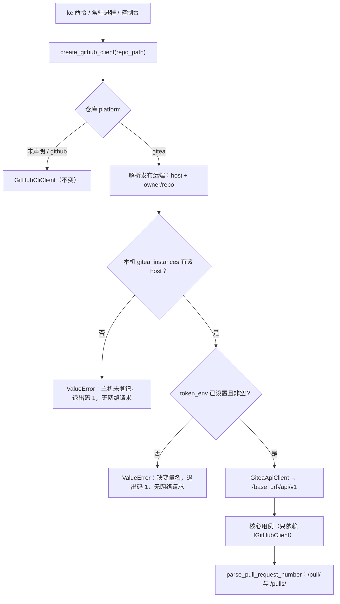

# PRD: Gitea 平台对接（Issue、标签、PR、CI 状态全流程可用）

- GitHub Issue: https://github.com/ZataZhang/keda/issues/416

> ⛔ **交付前置**：排在 `P2-FEAT-20261119-152718-repository-platform-selection-skeleton`（#398）之后开工。本 PRD 接入的就是 #398 定下的平台声明键和唯一分发点；先做本 PRD 就得自己临时造一个分发点，#398 落地时还要再拆掉。
> 结构化声明见 §8 Delivery Dependencies，**那里是唯一事实源**。

> ⏸️ **验收状态**：验证阻塞。
> 本行是 §9 Acceptance Checklist 的投影，**那里是唯一事实源**。

> 本 PRD 分两个 altitude，分别服务不同读者，自上而下阅读：
>
> - **Part A · 人审层 (Review Layer)** — 需求方 / 验收人读这部分，决定"该不该做、做得对不对"，并通过风险地图知道**哪些地方必须亲自确认**。Part A 不出现实现机制、文件路径、命令。
> - **Part B · 执行器层 (Build Layer)** — 实现者（人或 Agent）读这部分动手。人只在 Part A 风险地图**点名处**下钻审查，其余默认交执行器 + 自动门禁。

## Feature Overview (功能一览)

本节是 §10 Functional Requirements 的白话投影，不是第二事实源；行为验收以 §1 的行为样例表为准。

- **声明 `gitea` 的仓库可以真正跑起来**（FR-1、FR-2）：建 Issue、同步标签、领任务、评论、开 PR、改 PR、合并，整条 runner 流程走 Gitea，不再报"平台尚未实现"。
- **Gitea 地址和令牌只由本机配置决定**（FR-3、FR-4）：本机配置登记"哪个 Gitea 地址用哪个环境变量里的令牌"；仓库里提交的配置改不了令牌发往哪里。远端主机没登记、或令牌变量没设，就在发请求前停下并说明。
- **非本机地址必须走 HTTPS**（FR-4）：只有 `localhost` / `127.0.0.1` 允许 `http://`，其它明文地址读配置时就拒绝。
- **草稿 PR 用标题前缀表示**（FR-5）：Gitea 没有独立的草稿状态，kc 开的草稿 PR 标题带 `WIP: `，转正式时去掉前缀。
- **CI 结果从 Gitea 的提交状态读取**（FR-6）：PR 的检查是否通过，按 head 提交的合并状态判断，供现有 CI 交付与自动修复流程使用。
- **核心流程能认出 Gitea 的 PR 链接**（FR-7）：Gitea 的 PR 地址是 `/pulls/<编号>`，核心流程里从链接取 PR 编号的地方统一兼容。
- **GitHub 仓库完全不受影响**（FR-8）：未声明平台或声明 `github` 的仓库，命令、输出、退出码都不变。
- **文档同步**（FR-9）：配置指南写明 Gitea 的本机登记写法、令牌要求和已知差异。
- **不含**（§11）：批量接管、预览环境模板、容器模式凭据转交、证据分支索引与清理、Forgejo/GitLab。

---

# Part A · 人审层 (Review Layer)

## 1. Introduction & Goals

### Problem Statement

#398 交付后，仓库可以把平台声明成 `gitea`，但 kc 碰到这样的仓库只会报"平台尚未实现"然后停下，仓库实际上还是用不了。托管在自建 Gitea 上的仓库，至今没法交给 kc 的 runner 来跑。

从仓库确认到的现状：

1. kc 和代码平台的所有交互都通过一套"代码平台客户端"约定完成，大约 35 个操作，覆盖 Issue、标签、评论、PR、合并和检查状态。现在只有一个实现，它整套建立在 GitHub 官方命令行工具 `gh` 之上，`gh` 不能对 Gitea 发请求。
2. 核心流程里至少 8 处用"链接里的 `/pull/<编号>`"来取 PR 编号。Gitea 的 PR 链接是 `/pulls/<编号>`（复数），这些地方拿到 Gitea 的链接会取不到编号。
3. 令牌的去向是新的风险点。GitHub 的令牌由 `gh` 自己保管，只会发往 github.com。Gitea 是自建地址，地址如果能由仓库里提交的配置决定，那么任何能往仓库推一个配置改动的人，都能让运行 kc 的机器把令牌发到他指定的服务器。

受影响的是想把 kc 用在自建 Gitea 仓库上的团队。

### Interpretation (解读回显)

这是你**前置批准**的对象，也是唯一能拦住"解读错了"的关卡。下面先给可以逐格修改的具体样例。

| 验证方式 | 输入 / 操作 | 期望观察到的结果 |
|---|---|---|
| 👀 人审 + 自动验证 | 本机已登记一个 Gitea 实例及其令牌变量；仓库声明 `gitea`、远端指向该实例；建一个就绪 Issue 后让 runner 跑一轮（执行器用确定性替身） | Gitea 网页上能看到：标签已同步、Issue 被认领并收到评论、出现一个标题以 `WIP: ` 开头且链接回该 Issue 的 PR；转正式后标题前缀消失；合并后 Issue 关闭。全程没有调用 `gh` |
| 🤖 自动验证 | 仓库声明 `gitea`，远端指向一个本机**没有登记**的主机 | 命令在发出任何网络请求前停止，退出码 1；提示里出现该主机名，并说明要在本机配置里登记什么；一个本地监听端口收到的请求数为 0 |
| 🤖 自动验证 | 本机登记了实例，但登记里指定的令牌环境变量没有设置或为空 | 发请求前停止，退出码 1；提示指出缺的是哪个变量名；输出里不出现任何令牌内容 |
| 🤖 自动验证 | 本机登记的 Gitea 地址是 `http://git.example.com`（非本机明文地址） | 读本机配置时就报错，退出码 1，提示要求改用 `https://`；`http://127.0.0.1:3000` 这种本机地址允许 |
| 🤖 自动验证 | Gitea 上该 PR 的 head 提交有一个失败的状态检查 | kc 读到的检查结论为失败，并带上该检查的名称；没有任何状态时结论为"未知"，不当作通过 |
| 🤖 自动验证 | 仓库未声明平台（现有所有 GitHub 仓库） | 行为与本次改动前完全一致；仓库现有自动测试不经修改全部通过 |

`👀 人审 + 自动验证` 表示自动断言之外还需人查看呈递的结果；`🤖 自动验证` 表示自动断言加 verifier 复核就足够。表中每一行都会原样成为 Part B 的验收 oracle，所以改这里的一格就是改验收标准。

#### 我默默定了这些

- 和 Gitea 怎么通信 → 直接调 Gitea 的 HTTP 接口，不依赖 Gitea 的命令行工具 `tea`（`tea` 不覆盖改 PR 目标分支、读提交状态等操作，还会多一个要装的程序）。
- 仓库的"所有者/仓库名"从哪来 → 和现在一样，从发布用的远端地址解析；Gitea 实例按远端地址的主机名匹配本机登记。
- 支持的 Gitea 最低版本 → 1.21，验证使用固定的 1.21 版本容器。Forgejo 是 Gitea 的分支，本次不承诺。
- 合并方式 → 沿用 kc 现有的合并方式参数，映射到 Gitea 同名的合并方式；Gitea 实例禁用了该方式时，原样报出 Gitea 的错误。
- 限流 → Gitea 默认不限流；收到 HTTP 429 时按现有"平台限流"错误处理，不新增类别。
- 本机锁（状态板初始化、Issue 监督权）→ 继续用现有的本机文件锁，锁名带上主机名，避免和同名的 GitHub 仓库撞锁。
- 控制台面板 → 不新增界面；PRD 链接里的"在 GitHub 打开"对 Gitea 仓库不显示（现有逻辑在非 github.com 远端时本来就返回空）。
- #398 里"平台尚未实现"的报错 → 首批平台全部实现后不再有触发点，随本次删除；以后加新平台时再加回来。

#### 我理解为不做

- 批量接管仓库（`kc takeover`）、预览环境模板、容器模式下的凭据转交：它们直接调用 `gh`，继续只面向 GitHub。在 Gitea 仓库上使用时的行为不在本次保证范围内。
- 证据分支索引、过期证据清理、PRD 里"在 GitHub 打开"链接：对 Gitea 仓库保持现在的"找不到就跳过"。
- GitLab、Forgejo，以及把内部以 GitHub 命名的接口改名。

读成：在 #398 定下的分发点上，接入一个**完整实现现有代码平台客户端约定**的 Gitea 实现，令牌去向只由本机配置决定。让声明 `gitea` 的仓库能走通 runner 的完整流程。不是：做一个只能建 Issue 的半成品；也不是：把 GitHub 侧的周边工具（接管、预览、容器）一并移植。

四条关键边界，少了任何一条都会变成另一种实现：

1. 令牌只发往本机配置里登记过的地址；仓库内配置**不得**影响令牌发往哪里。
2. Gitea 路径上**不得**调用 `gh`，也不得在取不到 Gitea 信息时退回 GitHub。
3. 读不到 CI 状态时结论是"未知"，**不得**当作通过。
4. 未声明平台的仓库行为不变。

**实现前确认：** 请直接在本 PRD 中确认；若内容不准确，先修改再勾选。
- [ ] 我确认这段解读与行为样例准确表达了我的需求。

> 确认记录：需求方已于 2026-11-20 在对话中确认本段解读与行为样例。复选框保留给本人补勾，执行工具不代勾。

### What The User Gets

- **自建 Gitea 仓库的维护者**：在本机登记一次 Gitea 地址和令牌变量，仓库声明 `gitea`，之后建 Issue、看就绪队列、让 runner 跑任务、开 PR、合并，用的都是和 GitHub 仓库一样的 `kc` 命令。
- **运行 kc 的机器所有者**：令牌只会发往自己登记过的地址；仓库里任何人提交的配置都改不了这一点。
- **现有 GitHub 仓库的使用者**：什么都不用改，什么都不会变。

### Measurable Objectives

- 在本地 Gitea 1.21 容器上，runner 用确定性执行器替身完整跑一轮：同步标签、认领、评论、开带 `WIP: ` 前缀的 PR、转正式、合并、关闭 Issue。每一步都能从 Gitea 的接口独立查到结果；进程执行器记录的 `gh` 调用数为 0。
- 远端主机未登记时，本地监听端口收到的请求数为 0，退出码 1。
- 令牌变量缺失时退出码 1，提示里有变量名；全部证据文件里搜不到测试令牌的值。
- 非本机 `http://` 地址读配置即失败；本机 `http://` 地址可用。
- 仓库现有自动测试不经修改全部通过。

---

## 2. Human Review Map (介入与风险地图)

这一节只列需要人判断的决策。HTTP 调用、字段映射、链接解析和回归测试由执行器完成，不要求逐项阅读实现细节。

### 决策一：令牌发往哪里，由谁说了算

建议**只由运行 kc 的这台机器决定**：本机配置里登记一条"Gitea 地址 + 存放令牌的环境变量名"，kc 用仓库远端地址的主机名去匹配这些登记。匹配上才带令牌发请求，匹配不上就在发出任何请求之前停下，并告诉你要登记什么。仓库里提交的配置只能声明"我是 Gitea 仓库"，不能写地址，也不能写令牌变量名。另外，非本机地址必须是 `https://`，防止令牌明文走网络。

为什么要你确认：这是一条信任边界。更省事的做法是把 Gitea 地址直接写在仓库配置里，新人克隆下来就能用。但那样任何能往仓库推配置改动的人（包括一个被合并的外部 PR），都能把地址改成自己的服务器，下一次 runner 运行时就会把你的令牌送过去。代价是每台机器要多登记一次。

远端地址本身存在你本机的 git 配置里，不随仓库提交，所以用它匹配不会被别人改掉。

**请确认：** 是否同意"Gitea 地址和令牌变量只在本机配置登记、按远端主机名匹配，仓库配置不能指定；非本机地址只允许 `https://`"？

**实现前选择：**
- [ ] （推荐）只在本机配置登记，按远端主机名匹配；仓库配置不能指定地址或令牌变量
- [ ] 仓库配置可以写 Gitea 地址，令牌变量名仍由本机配置决定（上手更快，但仓库配置能改变令牌去向）

> 确认记录：需求方已于 2026-11-20 在对话中选择**推荐项**（只在本机配置登记，按远端主机名匹配）。复选框保留给本人补勾，执行工具不代勾。

**验收：** 远端指向未登记主机时，命令在发请求前停下，本地监听端口一个请求都没收到（行为样例第 2 行）；令牌变量缺失、明文地址时分别给出第 3、4 行的结果；所有证据文件里搜不到令牌值。

### 决策二：Gitea 没有"草稿 PR"，用什么代替

kc 的流程依赖草稿 PR：实现阶段先开草稿，审核通过后再转为正式 PR，草稿状态下不能合并。Gitea 没有独立的草稿状态，它用标题前缀表示"进行中"：标题以 `WIP:` 开头的 PR 在 Gitea 网页上显示为进行中，并且不能合并。

建议 kc 开草稿 PR 时在标题前加 `WIP: `，转正式时去掉，读 PR 时把带这个前缀视为草稿。效果和 GitHub 的草稿最接近，包括"不能合并"这条保护。风险是：有人手动改标题、删掉前缀，PR 就会被当作已转正式；Gitea 管理员如果改了实例的前缀设置，前缀也会失效。

另一种做法是在 Gitea 上直接开正式 PR，靠 kc 自己的标签区分阶段。更简单，但失去了"草稿不能合并"的平台级保护，有人可能在审核前就把 PR 合并掉。

**请确认：** 是否同意用标题前缀 `WIP: ` 表示草稿 PR？

**实现前选择：**
- [ ] （推荐）草稿 PR 标题加 `WIP: ` 前缀，转正式时去掉
- [ ] 直接开正式 PR，阶段只靠标签区分

> 确认记录：需求方已于 2026-11-20 在对话中选择**推荐项**（草稿 PR 标题加 `WIP: ` 前缀）。复选框保留给本人补勾，执行工具不代勾。

**验收：** 在本地 Gitea 上，kc 开出的草稿 PR 标题带前缀、网页显示进行中、合并按钮不可用；转正式后前缀消失并可以合并（行为样例第 1 行）。

### 自动门禁，不需要逐项人工审阅

- 约 35 个客户端操作与 Gitea 接口的对应关系，由对着本地 Gitea 容器跑的自动测试逐项断言。
- CI 状态的汇总规则（失败、成功、未知）由自动测试断言。
- 核心流程里从链接取 PR 编号的兼容，由自动测试分别用 GitHub 和 Gitea 的链接断言。
- "GitHub 仓库行为不变"由仓库现有测试不经修改全部通过来证明。
- 文档由严格构建检查。

### 本次明确不涉及

不涉及数据库结构、计费与配额、破坏性数据操作；不改动前端界面；不新增命令、参数或退出码类别；不改变任何 GitHub 仓库的行为。

---

## 3. Usage And Impact After Implementation

### 自建 Gitea 仓库的维护者

一次性准备：在 Gitea 上生成一个有仓库读写权限的令牌，放进自己选的环境变量；在本机 kc 配置里登记 Gitea 地址和这个变量名；仓库配置身份段写 `platform = "gitea"`。之后的用法和 GitHub 仓库相同：`kc init`、建 Issue、看就绪队列、跑一轮、后台常驻。PR 会出现在 Gitea 上，草稿阶段标题带 `WIP: `。

### 运行 kc 的机器所有者

令牌只会发往本机登记过的地址。拉到一个远端指向陌生主机的仓库时，kc 不会发请求，只会提示"这个主机没有登记"。

### 现有 GitHub 仓库的日常使用者

入口、命令、输出、退出码全部不变，不需要修改任何配置。

### 后台常驻进程的运维者

同一个常驻进程可以同时轮询 GitHub 仓库和 Gitea 仓库。Gitea 仓库配置有误（主机未登记、令牌缺失）时，该仓库每轮都报同一条清楚的错误，不影响其它仓库。

### 控制台面板的使用者

面板不新增界面。Gitea 仓库的任务和 PR 链接按 Gitea 地址显示；"在 GitHub 打开"链接和证据分支索引对 Gitea 仓库不显示。

### Impact On Existing Behavior

- GitHub 仓库零变化；新增的本机登记段是可选的，不写不影响任何现有行为。
- 仓库配置不新增键；`platform` 键沿用 #398 的定义。
- 不新增命令、参数、退出码类别，因此随包 operator skill 的命令表面不变；只在其中补一句 Gitea 支持说明。

---

## 4. Requirement Shape

- Actor: 自建 Gitea 仓库的维护者；运行 kc 的机器所有者；现有 GitHub 仓库的使用者；后台常驻进程的运维者；控制台面板的使用者。
- Trigger: kc 需要为一个声明了 `gitea` 的仓库访问代码平台时。
- Expected behavior: 按远端主机名匹配本机登记的 Gitea 实例，用登记的令牌变量通过 HTTP 接口完成现有客户端约定的全部操作；匹配不到或缺令牌时在发请求前停止并说明。
- Scope boundary: 只实现现有客户端约定；不移植直接调用 `gh` 的周边工具；不改 GitHub 路径。

---

# Part B · 执行器层 (Build Layer)

> 以下供实现者（人或 Agent）使用。人只在 Part A 风险地图点名处下钻审查；其余默认交执行器 + 自动门禁。

## 5. Repository Context And Architecture Fit

- Existing path: 所有平台客户端由 `create_github_client`（`src/backend/engines/agent_runner/factories/__init__.py`）构造。#398 交付后，它会在构造前读取仓库的 `platform` 并分发，`gitea` 分支当前抛"平台尚未实现"。本 PRD 把这个分支替换为构造 Gitea 客户端。
- CLI auth guard: `src/backend/api/cli_helpers.py::_ensure_gh_auth_or_prompt` 在 `issue create`、`run`、`supervise` 等真实入口调用客户端的 GitHub 专属 `check_auth_status()`；Gitea 客户端没有该接口，必须让这层只对支持 GitHub CLI auth 的客户端执行检查，Gitea 的登记与令牌检查由工厂完成。
- Init path: `kc init` 在写入仓库声明后立即同步标签；声明初值原为 `github`，会在用户手动改成 `gitea` 前调用 `gh`。机器已登记的 Gitea remote host 必须在 init 生成配置时被识别为 `platform = "gitea"`，这样标签同步直接经过 Gitea 客户端，GitHub remote 行为保持原样。
- Interface: `IGitHubClient`（`src/backend/core/shared/interfaces/agent_runner.py`），约 35 个抽象方法；返回的领域模型 `IssueSummary`、`PullRequestSummary`、`PullRequestContext`（`src/backend/core/shared/models/agent_runner_config.py`）与平台无关，可直接复用。
- GitHub 实现参考：`src/backend/infrastructure/github_client.py` 与 `github_issue_ops.py`、`github_pr_ops.py`、`github_labels.py`、`github_helpers.py`、`github_models.py`（合计约 2700 行，大部分是 `gh` 输出解析，Gitea 的 JSON 接口不需要这部分）。本机锁 `presence_creation_lock` / `issue_supervision_lock` 用 `file_lock` + `state_home()`，可原样复用。
- HTTP 依赖：`requests` 已在 `pyproject.toml` 依赖中，不新增依赖。
- 机器级配置：`resolve_registry_config_toml_path()`（`src/backend/infrastructure/config/settings_sources.py`）解析的状态目录 `config.toml`，其 `[agent_runner]` 段已承载机器级设置。Gitea 实例登记放在这里。按 CLAUDE.md 约定，令牌**变量名**进配置，令牌**值**由环境注入。
- 链接耦合：`rg -n "/pull/" src/backend/core --type py` 命中 `review_once.py`、`agent_runner_merge_queue.py`、`pr_supervisor.py`、`agent_runner_monitor.py`、`agent_runner_verdict_pr_effects.py`、`github_marker_migration.py`、`agent_runner_structured_evidence.py`、`agent_runner_validation.py`、`agent_runner_validation_publication.py` 等，均只认 `/pull/`。
- 直接调用 `gh` 的周边（本次不改）：`takeover.py`、`templates/preview/scripts/_apply.py`、`runner_credential_handoff.py`、`agent_runner_evidence_prune.py`（只处理 github.com 远端，其它跳过）、`agent_runner_evidence_branch.py`（同上）、`agent_runner_monitor.py::_check_gh_available`（只作为健康信息上报）。
- Architecture pattern to preserve: 四层依赖 `api → core → engines → infrastructure`。Gitea 客户端属于 `infrastructure`；分发留在 `engines` 工厂；PR 编号解析 helper 放 `core/shared`。
- Frontend impact: `No frontend impact`。面板通过现有接口读取 Issue/PR 数据，模型与平台无关；本次不新增界面。
- Existing PRD relationship: 依赖 `tasks/pending/P2-FEAT-20261119-152718-repository-platform-selection-skeleton.md`（#398，hard，via-main）。已检查 `tasks/pending/` 与 `tasks/archive/`：`rg -n -i "gitea" tasks/` 只命中 #398 的 PRD，没有重复或下游 PRD。
- Redundancy risks: 不要为 Gitea 复制一份 `gh` 输出解析层；不要把 PR 编号正则在各处再写一遍 `/pulls?/`，必须收敛到一个 helper；不要引入平台注册表或插件机制。

---

## 6. Recommendation

### Recommended Approach

- Approach: 在 `infrastructure` 新增一个基于 `requests` 的 `GiteaApiClient`，实现 `IGitHubClient` 全部方法；机器级配置新增 Gitea 实例登记；#398 的分发点 `gitea` 分支改为构造它；核心流程的 PR 编号解析收敛到一个兼容两种链接的 helper。
- Why this is the best fit: 现有接口与领域模型已经平台无关，实现一个新客户端即可覆盖所有命令、常驻进程和控制台，不需要改任何调用方。
- Rejected redundancy: 不用 `tea` 命令行；不新增客户端抽象基类或适配层；不改 `IGitHubClient` 方法签名；不改 GitHub 客户端。

### Proposed Solution Summary (实现机制)

1. **机器级登记**：状态目录 `config.toml` 新增 `[[agent_runner.gitea_instances]]` 数组表，每项含 `base_url`、`token_env`。加载时校验：`base_url` 必须是 `https://`，或 host 为 `localhost` / `127.0.0.1` 的 `http://`；`token_env` 为非空变量名。仓库级 `.kedacode.toml` 与 `.kedacode.local.toml` 中出现该段时报配置非法，防止通过仓库配置注入。
2. **实例解析**：工厂对 `platform == "gitea"` 的仓库，从发布远端 URL（支持 `https://host/owner/repo(.git)`、`git@host:owner/repo(.git)`、`ssh://git@host:port/owner/repo(.git)`）取 host 和 `owner/repo`，按 host（忽略大小写和端口）匹配登记的 `base_url`。匹配不到 → 抛 `ValueError`，信息含 host 与登记写法示例；匹配到但环境变量缺失或为空 → 抛 `ValueError`，信息含变量名、不含任何值。两者都在构造客户端之前发生，因此没有网络请求。
3. **客户端**：`GiteaApiClient` 以 `Authorization: token <值>` 调 `{base_url}/api/v1/...`；令牌只存在于会话头中，`__repr__` 与所有日志、异常信息都不输出它。HTTP 429 → `GitHubApiRateLimitError`；连接失败或 5xx → `GitHubApiUnavailableError`；其它错误原样带出 Gitea 返回的 `message`。
4. **操作映射**（实现时以容器自带的 `/swagger.v1.json` 为准逐项核对）：Issue 列表与筛选、创建、编辑正文、关闭、按 Issue 列出 PR → `/repos/{o}/{r}/issues`、`/pulls`；标签同步与增删 → `/labels`、`/issues/{n}/labels`（按名称解析为 ID）；评论增删改查 → `/issues/{n}/comments`、`/issues/comments/{id}`；草稿 PR → 标题前缀 `WIP: `；转正式 → `PATCH /pulls/{n}` 去掉前缀；改目标分支 → `PATCH /pulls/{n}` 的 `base`；合并 → `POST /pulls/{n}/merge`；按 head 分支查 PR → 列表后按 `head.ref` 过滤；检查状态 → `GET /commits/{sha}/status` 汇总；`get_remote_base_sha` 沿用 git 命令。
5. **PR 编号解析**：在 `core/shared` 新增 `parse_pull_request_number(url)`，同时接受 `/pull/<n>` 与 `/pulls/<n>`，替换核心流程中各处的局部正则。
6. **清理**：#398 引入的"平台尚未实现"异常没有触发点后删除；平台词表保持 `github`、`gitea`。
7. 刻意避免的复杂度：不新增依赖、不改接口签名、不改调用方、不新增 CLI 子命令或退出码、不为 Gitea 做 API 预算账本（Gitea 默认不限流）。

### Alternatives Considered (Only When Useful)

- Alternative: 通过 `tea` 命令行实现，结构与 `gh` 版对称。
- Why not chosen: `tea` 不覆盖改 PR 目标分支、读合并后的提交状态等操作，最终还要直接调 HTTP；还多了一个要安装和鉴权的外部程序。
- Alternative: Gitea 地址写在仓库配置里（Part A 决策一的备选）。
- Why not chosen: 仓库配置可以被任何有推送权限的人修改，会让令牌去向受仓库内容控制。

---

## 7. Implementation Guide

This section is a living implementation guide based on current repository analysis. If implementation discovers additional affected files, hidden dependencies, edge cases, or a better path, update this PRD before proceeding.

### 7.1 Core Logic

- 配置：状态目录 `config.toml` → `[[agent_runner.gitea_instances]]` → 校验 → 机器级设置对象。仓库级配置文件出现该段 → 配置非法。
- 分发：任意调用方 → `create_github_client(repo_path, ...)` → 读仓库 `platform` → `github`：现有构造不变；`gitea`：解析远端 → 匹配实例 → 读令牌变量 → 构造 `GiteaApiClient`。
- 运行：核心用例只依赖 `IGitHubClient`，拿到 Gitea 客户端后流程不变；PR 链接经 `parse_pull_request_number` 取编号。

### 7.2 Change Impact Tree

```text
.
├── Core
│   ├── src/backend/api/cli_helpers.py
│   │   [修改]
│   │   【总结】GitHub 专属认证预检仅对支持 check_auth_status 的 GitHub 客户端运行，避免 Gitea 入口调用 gh
│   ├── tests/test_gh_auth_check.py
│   │   [修改]
│   │   【总结】验证没有 GitHub auth 方法的 Gitea 客户端不会触发 gh 认证检查
│   ├── src/backend/engines/agent_runner/repository_local.py
│   │   [修改]
│   │   【总结】kc init 的发布 remote 命中机器级 Gitea 登记时生成 platform = "gitea"，让首轮标签同步走 Gitea
│   ├── src/backend/core/shared/models/pull_request_url.py
│   │   [新增]
│   │   【总结】从 GitHub 或 Gitea 的 PR 链接解析编号的唯一实现
│   │   └── parse_pull_request_number(url) -> int | None：接受 /pull/<n> 与 /pulls/<n>
│   ├── src/backend/core/use_cases/{review_once,agent_runner_merge_queue,pr_supervisor,agent_runner_monitor,agent_runner_verdict_pr_effects,github_marker_migration,agent_runner_structured_evidence,agent_runner_validation,agent_runner_validation_publication}.py
│   │   [修改]
│   │   【总结】局部 /pull/ 正则替换为上面的 helper；带 owner/repo 捕获的正则同步改为 pulls? 兼容
│   └── src/backend/core/shared/models/repository_platform.py
│       [修改，#398 新增的文件]
│       【总结】删除"平台尚未实现"异常；词表不变
│
├── Infrastructure
│   ├── src/backend/infrastructure/gitea_client.py
│   │   [新增]
│   │   【总结】GiteaApiClient：IGitHubClient 的 Gitea HTTP 实现（Issue、标签、评论、锁、通用请求）
│   ├── src/backend/infrastructure/gitea_pr_ops.py
│   │   [新增]
│   │   【总结】PR 相关操作与提交状态汇总，拆出以保持单文件不超过 1000 非空行
│   └── src/backend/infrastructure/config/agent_runner_settings_models.py（或机器级设置所在文件，以实现时 rg 结果为准）
│       [修改]
│       【总结】新增 GiteaInstanceSettings(base_url, token_env) 与校验；仓库级配置出现该段时报错
│
├── Engines
│   └── src/backend/engines/agent_runner/factories/__init__.py
│       [修改]
│       【总结】gitea 分支：解析远端 → 匹配实例 → 读令牌 → 构造 GiteaApiClient；返回类型标注改为 IGitHubClient
│
├── Tests
│   ├── tests/test_pull_request_url.py            [新增] 两种链接、非 PR 链接、空串
│   ├── tests/test_gitea_instance_settings.py     [新增] https / 本机 http / 明文拒绝 / 仓库级注入拒绝 / 主机匹配
│   └── tests/test_gitea_client_live.py           [新增] 对着本地 Gitea 1.21 容器逐项断言客户端操作；无 Docker 时 skip 并在输出里写明
│
└── Docs
    ├── docs/guides/configuration.md               [修改] gitea_instances 写法、令牌权限要求、https 规则
    ├── docs/guides/agent-runner.md                [修改] Gitea 支持范围与已知差异（WIP 前缀、不支持的周边命令）
    └── src/backend/engines/agent_runner/templates/skills/kedacode-operator/SKILL.md
                                                   [修改] 一句 Gitea 支持说明与登记写法指引

Frontend: No frontend impact（见 §5）。
```

该列表是起点，不是完整集合，见 7.3。

### 7.3 Risk Classification Register 与 Executor Drift Guard

| change point | tier | decisive dimension / override | intervention | oracle / gate |
|---|---|---|---|---|
| 令牌去向只由本机登记决定、明文地址拒绝 | R3 | 安全：凭据外泄；override：信任边界 | 人工确认（决策一） | rv-2、rv-3、rv-4 |
| 草稿 PR 用 `WIP: ` 前缀表示 | R2 | 正确性：合并保护与阶段流转；对外可见 | 人工确认（决策二） | rv-1 |
| GiteaApiClient 实现全部接口操作 | R2 | 影响面：runner 全流程 | 执行器 + 强 oracle | rv-1、rv-6 |
| 检查状态汇总（未知不当通过） | R2 | 正确性：错误放行合并 | 执行器 + 强 oracle | rv-5 |
| PR 编号解析收敛 | R1 | 正确性：有明确测试 oracle | 执行器 + 自动门禁 | rv-6、rv-7 |
| 文档与随包 skill 同步 | R0 | 仅文档 | 执行器 + 自动门禁 | rv-8 |

R2/R3 oracle 共 6 条，超过 3 条的范围信号已按 Phase 3.4 评估：rv-2/3/4 同属决策一的同一条信任边界，rv-5/6 同属客户端实现；拆成"凭据登记"和"客户端实现"两份 PRD 会让前者没有可验证的使用者，因此保持一份（D-06）。

| Check | Command | Expected Result | If It Fails, Inspect First |
|---|---|---|---|
| Gitea 路径不调 gh | `rg -n "\"gh\"" src/backend/infrastructure/gitea_*.py` | 无结果 | 是否复用了 github_helpers 里的命令拼装 |
| PR 编号正则已收敛 | `rg -n 'pulls\?' src/backend/core/shared/models/pull_request_url.py` | 只命中共享解析 helper | 遗漏的局部正则 |
| 令牌不进日志 | `rg -n "token" src/backend/infrastructure/gitea_*.py` | 仅出现在请求头构造与变量名处 | `__repr__`、异常信息、debug 日志 |
| 调用方用了非接口成员 | `rg -n "create_github_client\([^)]*\)\.\w+" src/backend` 后人工检查；并跑仓库类型检查 | 不存在 `IGitHubClient` 之外的成员访问 | `check_auth_status` 等 GitHub 专有方法的调用点 |
| #398 落地形态 | `rg -n "gitea|not implemented" src/backend/core/shared/models/repository_platform.py src/backend/engines/agent_runner/factories/__init__.py` | 与本 PRD §5 描述一致 | #398 若改了分发位置或命名，先更新本 PRD |

### 7.4 Flow Or Architecture Diagram



### 7.5 ER Diagram (Only When Data Model Changes)

- `No data model changes in this PRD.`

### 7.6 Realistic Validation Plan (Oracle 块)

所有命令在仓库根目录执行，使用 `uv run kc`。需要 Gitea 的条目共用证据目录下的 `scripts/gitea_up.sh`：启动 `gitea/gitea:1.21` 容器（`INSTALL_LOCK=true`，端口 `127.0.0.1:3300`），用 `gitea admin user create` 建管理员、经接口生成令牌写入 `RV_GITEA_TOKEN`，建测试仓库并生成本地克隆。脚本幂等，重复执行先删旧容器。执行器替身按 `references/rv-harness-cookbook.md` 编写。证据和脚本放在 `tasks/evidence/P2-FEAT-20261120-170035-gitea-platform-client/`，不进入代码 diff。需要 Docker；本机已有 Docker 29.x。

```yaml
- id: rv-1
  behavior: 声明 gitea 的仓库在真实 Gitea 上走完一轮 runner：标签同步、认领、评论、开 WIP 草稿 PR、转正式、合并、关闭 Issue
  reviewer: human
  real_entry: "bash tasks/evidence/P2-FEAT-20261120-170035-gitea-platform-client/scripts/rv1_full_loop.sh"
  expected: "脚本依次调用 uv run kc 的 init、issue create、run once（确定性执行器替身）及后续阶段；每步后用 curl 独立查询 Gitea 接口并打印：标签存在、Issue 有认领评论、PR 标题以 'WIP: ' 开头且正文链接该 Issue、无状态时仍未合并、转正式后前缀消失、成功状态后 PR merged=true、Issue state=closed；进程执行器探针记录的 gh 调用数为 0；最后一行 RESULT=PASS"
  mock_boundary: "只替换编码执行器（确定性替身，按计划提交固定改动）；kc CLI、配置加载、工厂、GiteaApiClient、Gitea 服务端、git 推送全部真实"
  tier: R2
  test_layer: sandbox
  required_for_acceptance: true
  presentation: "rv-1-gitea-full-loop.txt（完整终端输出）+ rv-1-gitea-pr-wip.png、rv-1-gitea-pr-merged.png（Gitea 网页上同一个 PR 在草稿与合并后的真实截图）。自查：截图一的 PR 标题以 'WIP: ' 开头、合并按钮不可用；截图二显示 Merged"
  critical_value_source: "kc 的终端输出不包含创建 PR 的响应链接；kc run 返回后，首个独立 Gitea GET /pulls 响应按 head.ref=issue-<编号> 与 WIP 标题识别刚创建的 PR，并以该响应的 number/html_url 为源，后续断言再用独立 curl 按编号读取"
  must_cross: "kc CLI → 配置加载 → create_github_client → GiteaApiClient → Gitea HTTP 接口 → Gitea 数据库 → curl 独立读取"
  forbidden_bypasses: "直接调用 GiteaApiClient 方法代替 kc 命令；用脚本自己调 Gitea 接口建 PR 或合并；调用 gh"
  fresh_state_probe: "每一步后由独立 curl 进程按编号查询 Gitea 接口，不复用 kc 进程内的任何状态"
  final_tree_evidence: "脚本首行记录 git rev-parse HEAD^{tree}；最后一次修改 src/ 后必须重跑"
  negative_control: "PR 创建后不写入任何状态，先运行真实 `kc supervise`；PR 必须保持 open 且 merged=false、Issue 保持 open。若未知状态被当作通过，该断言会变红；随后写入成功状态并再次运行 supervise 验证合并路径"
  expected_fail: "无状态时 Gitea status API 返回 200 且 total_count=0，独立 PR / Issue 查询仍显示 merged=false、Issue state=open；任何已合并结果都使负对照失败"
- id: rv-2
  behavior: 远端主机未在本机登记时，发请求前停止，且没有任何网络请求
  reviewer: verifier
  real_entry: "bash tasks/evidence/P2-FEAT-20261120-170035-gitea-platform-client/scripts/rv2_unregistered_host.sh"
  expected: "脚本在 127.0.0.1:3399 起一个记录请求数的监听；仓库声明 gitea、远端为 http://127.0.0.1:3399/o/r.git、本机不登记该主机；uv run kc --repo <仓库> issue list 退出码 1，输出含 127.0.0.1 与 gitea_instances；监听收到请求数为 0"
  mock_boundary: "不允许 mock：真实 CLI、真实配置加载与工厂；监听器只计数"
  tier: R3
  test_layer: smoke
  required_for_acceptance: true
  critical_value_source: "请求数来自监听进程自身写出的计数文件"
  must_cross: "kc CLI → 配置加载 → create_github_client 实例匹配"
  forbidden_bypasses: "在单元测试里直接调用匹配函数代替 CLI"
  fresh_state_probe: "kc 进程退出后读取监听器计数文件"
  final_tree_evidence: "同 rv-1"
  negative_control: "在同一脚本里把该主机登记进临时状态目录的 config.toml 后重跑，监听计数应大于 0"
  expected_fail: "负对照一行显示 requests>0，证明计数能变红"
- id: rv-3
  behavior: 令牌环境变量缺失或为空时发请求前停止，输出不含令牌
  reviewer: verifier
  real_entry: "bash tasks/evidence/P2-FEAT-20261120-170035-gitea-platform-client/scripts/rv3_missing_token.sh"
  expected: "登记 token_env=RV_ABSENT_TOKEN 且不设置该变量时，退出码 1、输出含 RV_ABSENT_TOKEN；设为空串时结果相同；对整个证据目录执行 rg -F \"$RV_GITEA_TOKEN\" 无结果"
  mock_boundary: "不允许 mock"
  tier: R3
  test_layer: smoke
  required_for_acceptance: true
  critical_value_source: "令牌值取自 gitea_up.sh 生成的 RV_GITEA_TOKEN"
  must_cross: "kc CLI → 配置加载 → 工厂令牌读取"
  forbidden_bypasses: "直接调用工厂函数"
  fresh_state_probe: "在全部 rv 跑完后对证据目录做一次独立的 rg 扫描"
  final_tree_evidence: "同 rv-1"
  negative_control: "not needed — 断言比较具体退出码与变量名；令牌扫描若误写入会直接命中"
- id: rv-4
  behavior: 非本机 http 地址在读配置时被拒绝，本机 http 地址允许；仓库级配置不能声明实例
  reviewer: verifier
  real_entry: "bash tasks/evidence/P2-FEAT-20261120-170035-gitea-platform-client/scripts/rv4_url_policy.sh"
  expected: "base_url=http://git.example.com 时 uv run kc agent lifecycle list --scope repository 退出码 1 且输出含 https；base_url=http://127.0.0.1:3300 时退出码 0；在仓库 .kedacode.toml 写入 [[agent_runner.gitea_instances]] 时退出码 1 且输出指出该段只能在本机配置"
  mock_boundary: "不允许 mock"
  tier: R3
  test_layer: smoke
  required_for_acceptance: true
  critical_value_source: "退出码与输出来自真实 CLI 进程"
  must_cross: "kc CLI → 机器级与仓库级配置加载"
  forbidden_bypasses: "只跑设置模型的单元测试"
  fresh_state_probe: "每种配置单独起新进程"
  final_tree_evidence: "同 rv-1"
  negative_control: "not needed — 同一脚本中合法与非法配置的退出码互为对照"
- id: rv-5
  behavior: 检查状态汇总：失败带名称、成功为通过、无状态为未知
  reviewer: verifier
  real_entry: "uv run pytest tests/test_gitea_client_live.py -k status -q"
  expected: "在本地 Gitea 上对同一 head 提交分别写入 failure、success、无状态三种情形，get_pull_request_context 返回的 checks_state 依次为失败（checks_summary 含该检查名）、成功、None"
  mock_boundary: "Gitea 服务端真实；状态通过 Gitea 接口真实写入"
  tier: R2
  test_layer: integration
  required_for_acceptance: true
  critical_value_source: "状态由测试经 Gitea POST /statuses 写入，结论由客户端重新读取"
  must_cross: "Gitea 接口写入 → Gitea 存储 → GiteaApiClient 读取与汇总"
  forbidden_bypasses: "直接构造 JSON 喂给汇总函数"
  fresh_state_probe: "每种情形用新建的客户端实例读取"
  final_tree_evidence: "同 rv-1"
- id: rv-6
  behavior: GiteaApiClient 对接口约定中的每个操作在真实 Gitea 上都能完成
  reviewer: verifier
  real_entry: "uv run pytest tests/test_gitea_client_live.py -q"
  expected: "退出码 0；测试按 IGitHubClient 的抽象方法列表逐个覆盖，测试里有一条断言比较已覆盖方法集合与 IGitHubClient.__abstractmethods__ 完全相同"
  mock_boundary: "Gitea 服务端真实；无 Docker 时整文件 skip 并打印原因，此时本条视为未通过"
  tier: R2
  critical_value_source: "被测方法集合取自 IGitHubClient.__abstractmethods__，各操作结果由测试用 requests 独立查询 Gitea 接口得到"
  must_cross: "GiteaApiClient → Gitea HTTP 接口 → Gitea 存储 → 独立 HTTP 读取"
  forbidden_bypasses: "用 requests-mock 或录制回放代替真实 Gitea；只测部分方法"
  fresh_state_probe: "每个写操作后用独立的 requests 会话按 ID 重新读取"
  final_tree_evidence: "同 rv-1"
  test_layer: integration
  required_for_acceptance: true
- id: rv-7
  behavior: PR 编号解析兼容两种链接，GitHub 仓库行为不变
  reviewer: verifier
  real_entry: "bash tasks/evidence/P2-FEAT-20261120-170035-gitea-platform-client/scripts/rv7_pytest.sh"
  expected: "退出码为 0；定向 URL/config 测试通过；全量测试只收集仓库的 tests/ 套件、关闭 testmon 且每个收集 node id 恰好执行一次；仅更新原先断言 Gitea 未实现的工厂 dispatch 与 kc init 行为测试，使其验证新分发和配置错误行为；其余既有测试保持未修改"
  mock_boundary: "现有测试各自的替身不变"
  tier: R1
  test_layer: unit
  required_for_acceptance: true
- id: rv-8
  behavior: 配置指南、runner 指南与随包 skill 写明 Gitea 登记方式和已知差异，文档严格构建通过
  reviewer: verifier
  real_entry: "uv run mkdocs build --strict && rg -n \"gitea_instances\" docs/guides/configuration.md src/backend/engines/agent_runner/templates/skills/kedacode-operator/SKILL.md"
  expected: "构建退出码 0；两个文件都有命中"
  mock_boundary: "无"
  tier: R0
  test_layer: smoke
  required_for_acceptance: true
```

Failure triage:
- 容器起不来：先 `docker logs`，确认 `127.0.0.1:3300` 没被占用（不要按端口区间批量 kill）。
- rv-1 卡在 run once：先看执行器替身是否真的提交并推送到 Gitea 远端；推送用的是 git 凭据，与令牌无关。
- 某个接口返回 404/405：对照容器 `http://127.0.0.1:3300/swagger.v1.json` 核实路径与方法，修正后在 §7.9 记录差异。
- Gitea 1.21 在 `WIP:` 草稿阶段返回 `mergeable=false`；草稿状态下将该值视为未判定，转正式后再读取真实 mergeability，避免把 WIP 门禁误判为分支冲突。
- 全量测试大面积失败且耗时暴涨：先检查是否有 iar daemon 在并发写状态目录。
- 禁止为了让 oracle 能变红去改生产代码。

### 7.7 Low-Fidelity Prototype (Only When Required)

- `No low-fidelity prototype required for this PRD.`

### 7.8 Interactive Prototype Change Log (Only When Files Actually Changed)

- `No interactive prototype file changes in this PRD.`

### 7.9 External Validation (Only When Web Research Was Used)

- 本 PRD 编写时（2026-11-20）未做联网检索。§6 的操作映射、"WIP 前缀表示进行中且不能合并"、提交状态接口等关于 Gitea 的描述，来自作者对 Gitea 的既有了解，属于**待核实的推断**。
- 核实方式：实现时以 `gitea/gitea:1.21` 容器自带的 `/swagger.v1.json` 与网页行为为准；rv-1、rv-5、rv-6 在真实容器上运行，会直接暴露差异。发现差异时更新本节与 §6，若影响 Part A 的决策二，须重新请人确认。

---

## 8. Delivery Dependencies

工具中立的排期元数据，不是工具专属队列语法。

- Depends on tasks/issues:
  - P2-FEAT-20261119-152718-repository-platform-selection-skeleton
- Gate type: hard
- Sequence: via-main
- Notes: 上游即 Issue #398。本 PRD 修改 #398 新增的平台词表文件和工厂分发分支，必须在 #398 合入主线后从主线开分支。

---

## 9. Acceptance Checklist

本节分两层读者：**9.1 是给人看的**，验收时只看这一层；**9.2 起是给 verifier 和未来回溯用的机器证据**。每项必须带证据，不是裸勾。

### 9.1 人读呈递区（Human Review Surface）

主演示脚本（录屏 `rv-1-demo.mp4`，每步带字幕；执行器为确定性替身，字幕标注"执行器替身，非真实模型"）：

1. 本机配置里登记本地 Gitea 实例，仓库声明 `gitea`，执行 `kc init`：Gitea 网页的标签页出现 kc 的标签（真实 Gitea）。
2. `kc issue create` 建一个就绪 Issue：Gitea 上出现该 Issue 及就绪标签（真实 Gitea）。
3. `kc run once`：Issue 收到认领评论，Gitea 上出现标题以 `WIP: ` 开头、合并按钮不可用的 PR（真实 Gitea；执行器替身）。
4. 审核通过、转正式：PR 标题前缀消失，可以合并（真实 Gitea）。
5. 合并：PR 显示 Merged，Issue 关闭（真实 Gitea）。

| # | 你要看什么 | 呈递物（交付时填实际路径） | 想自己复核？ |
|---|---|---|---|
| 1 | 演示录屏里 Gitea 上的 Issue、标签、PR 是否和用 GitHub 时一致 | `rv-1-demo.mp4`；打开方式：`just prd review tasks/pending/P2-FEAT-20261120-170035-gitea-platform-client.md` | 看第 3 步画面：PR 标题以 `WIP: ` 开头 |
| 2 | 草稿 PR 的 `WIP: ` 前缀与合并保护（决策二） | `rv-1-gitea-pr-wip.png`、`rv-1-gitea-pr-merged.png` | 截图一合并按钮不可用；截图二显示 Merged |
| 3 | 令牌去向保护（决策一）的结论摘要 | `rv-2-unregistered-host.txt` 中 `requests=0` 一行与负对照 `requests>0` 一行原文 | 两行对比即可 |

未在本区展示（verifier 已复核，失败时才呈递）：rv-3 令牌缺失、rv-4 地址规则、rv-5 检查状态、rv-6 接口逐项、rv-7 回归、rv-8 文档。

### 9.2 Acceptance Evidence Package（机器证据 · verifier 入口，人默认跳过）

1. **人审决策与 R3 证据**：rv-2 → `rv-2-unregistered-host.txt`；rv-3 → `rv-3-missing-token.txt`；rv-4 → `rv-4-url-policy.txt`（决策一）；rv-1 → `rv-1-gitea-full-loop.txt` 与两张截图（决策二）。
2. **R2 证据**：rv-5 → `rv-5-status.txt` 与本 PRD 的截图格式要求；rv-6 → `rv-6-client-live.txt`。
3. **风险地图对账 Predicted → Reconciled**：交付时填写。
4. **对 Gitea 接口推断的核实结果**（§7.9）：交付时列出与 swagger 不一致之处及处理。
5. **低风险门禁（折叠）**：rv-7 → `rv-7-pytest.txt`；rv-8 → `rv-8-docs.txt`；`just lint` 结果。

### Human-Confirmed (来自 Part A 风险地图)

> 本组条目归**人**回答，执行工具不得代勾，也不得改写成 `[~]`。本组不拦归档。

- [ ] 决策一：令牌只发往本机登记地址，观察到的未登记主机零请求、令牌缺失与明文地址报错（rv-2、rv-3、rv-4 输出）符合预期
- [ ] 决策二：草稿 PR 的 `WIP: ` 前缀与合并保护（rv-1 截图）符合预期
- [ ] §9.1 呈递区各项已亲眼看过

### Architecture Acceptance

- [ ] `rg -n "\"gh\"" src/backend/infrastructure/gitea_*.py` 无结果，证据：`arch-search.txt`
- [ ] `rg -n 'pulls\?' src/backend/core/shared/models/pull_request_url.py` 只命中共享解析 helper，证据：`arch-search.txt`
- [ ] 未新增依赖：`git diff -- pyproject.toml uv.lock` 为空，证据：`arch-search.txt`
- [ ] `gitea_client.py`、`gitea_pr_ops.py` 各自非空行不超过 1000，证据：`arch-search.txt`

### Dependency Acceptance

- [ ] `IGitHubClient` 方法签名无改动：`git diff -- src/backend/core/shared/interfaces/agent_runner.py` 为空，证据：`arch-search.txt`
- [ ] GitHub 客户端文件无改动：`git diff --stat -- src/backend/infrastructure/github_*.py` 为空，证据：`arch-search.txt`

### Behavior Acceptance

- [ ] 真实 Gitea 上完整跑通一轮，零 `gh` 调用，证据：`rv-1-gitea-full-loop.txt`
- [ ] 未登记主机零请求且退出码 1，负对照能变红，证据：`rv-2-unregistered-host.txt`
- [ ] 令牌缺失退出码 1，证据目录中搜不到令牌值，证据：`rv-3-missing-token.txt`
- [ ] 地址规则与仓库级注入拒绝，证据：`rv-4-url-policy.txt`
- [ ] 检查状态三种情形结论正确，证据：`rv-5-status.txt`
- [x] 接口逐项覆盖且覆盖集合等于抽象方法集合，证据：`rv-6-client-live.txt`

### Documentation Acceptance

- [ ] 配置指南、runner 指南、随包 operator skill 已同步，严格构建通过，证据：`rv-8-docs.txt`

### Validation Acceptance

- [ ] rv-1 至 rv-4 经真实 `uv run kc` 入口执行，rv-1 对着真实 Gitea 容器，证据：各 `rv-*.txt` 首行命令
- [x] 全量测试（关闭 testmon）通过；仅原先断言 Gitea 未实现的工厂 dispatch 与 `kc init` 行为测试更新为新行为，其余既有测试未修改，证据：`rv-7-pytest.txt`
- [ ] 全部证据在最后一次影响相关代码的改动之后采集，证据报告记录 `git rev-parse HEAD` 与 `HEAD^{tree}`

### Delivery Readiness

- [ ] §7.9 的推断已逐项对照 swagger 核实，差异已写回 §6/§7.9，证据：证据报告第 4 节
- [ ] §9.1 呈递物路径已回填，录屏与截图在证据报告中内嵌展示，完成回复原样带上呈递表内容
- [ ] 证据报告首节是「人审导航」

---

## 10. Functional Requirements

- FR-1: 平台声明为 `gitea` 时，`create_github_client` 返回 Gitea 客户端，不再抛"平台尚未实现"。
- FR-2: Gitea 客户端实现 `IGitHubClient` 的全部抽象方法，全程不调用 `gh`，取不到信息时不退回 GitHub。
- FR-3: Gitea 实例只能在机器级配置的 `[[agent_runner.gitea_instances]]` 中登记（`base_url`、`token_env`）；仓库级配置出现该段时报配置非法。按发布远端的主机名匹配实例；匹配不到或令牌变量缺失/为空时，在任何网络请求之前以退出码 1 停止，提示含主机名或变量名，不含令牌值。
- FR-4: `base_url` 必须为 `https://`，或主机为 `localhost` / `127.0.0.1` 的 `http://`；否则读配置时报错。
- FR-5: 草稿 PR 以标题前缀 `WIP: ` 表示；转正式时去掉；读取时有该前缀即 `is_draft=True`。
- FR-6: 检查状态取 head 提交的合并状态：存在失败或错误 → 失败并列出名称；全部成功 → 成功；无状态或读取失败 → 未知（`None`），不得视为通过。
- FR-7: 核心流程从 PR 链接取编号统一经一个 helper，同时接受 `/pull/<n>` 与 `/pulls/<n>`。
- FR-8: 未声明平台或声明 `github` 的仓库行为不变，现有测试不经修改通过。
- FR-9: 配置指南、runner 指南与随包 operator skill 写明 Gitea 登记方式、令牌权限要求、`https` 规则与已知差异。

## 11. Non-Goals

- `kc takeover`、预览环境模板、容器模式凭据转交对 Gitea 的支持。
- 证据分支索引、过期证据清理、"在 GitHub 打开"链接对 Gitea 的支持。
- GitLab、Forgejo；内部 GitHub 命名的接口改名。
- Gitea 的 API 用量预算账本。
- 控制台新增界面。

## 12. Risks And Follow-Ups

- Gitea 接口细节未联网核实（§7.9），实现时可能发现个别操作需调整映射；若影响 WIP 前缀方案，须回到决策二。
- 有人手动删掉 PR 标题的 `WIP: ` 前缀，PR 会被当作已转正式；已在文档中写明。
- Gitea 管理员修改了实例的进行中前缀配置时，合并保护失效；已在文档中写明，本次不读取实例配置。

## 13. Decision Log

| # | 决策问题 | 选择 | 放弃的方案 | 理由 |
|---|---|---|---|---|
| D-01 | 令牌发往哪里由谁决定 | 机器级登记 + 远端主机匹配（需求方 2026-11-20 确认） | 仓库配置写 Gitea 地址 | 仓库配置可被任何有推送权限的人修改，不能决定凭据去向 |
| D-02 | 草稿 PR 的表示 | 标题前缀 `WIP: `（需求方 2026-11-20 确认） | 直接开正式 PR、只靠标签 | 前缀能保留 Gitea 平台级的"不能合并"保护 |
| D-03 | 与 Gitea 的通信方式 | `requests` 直调 HTTP 接口 | `tea` 命令行 | `tea` 覆盖不全，且多一个外部程序 |
| D-04 | PR 链接兼容放在哪 | `core/shared` 一个 helper，替换各处局部正则 | 各处正则分别改成 `pulls?` | 9 处分别改会继续漂移 |
| D-05 | "平台尚未实现"异常 | 删除 | 保留备用 | 首批平台全部实现后没有触发点，保留即死代码 |
| D-06 | 是否拆成两份 PRD | 保持一份 | 凭据登记与客户端实现分开 | 凭据登记单独交付没有使用者，无法做真实入口验证 |

### Final Reconciliation (Archive Only)

- Interpretation: 保持 Part A 已确认的范围与信任边界；Gitea 使用机器级实例登记，GitHub 默认行为保留。
- Public behavior and contracts: 新增 Gitea REST 客户端、Gitea 1.21 的 WIP 标题约定和提交状态读取；真实 CLI 流程覆盖标签、Issue、评论、PR、未知状态阻止合并、成功后合并并关闭 Issue。
- Related PRD status: 本 PRD 仍依赖 #398；runner 负责归档，当前按验证阻塞路径交接。
- Requirements and risks: rv-2 至 rv-4、rv-6 至 rv-8 的自动证据通过；rv-6 在隔离系统级 credential.helper 后重新通过真实 Gitea 1.21 验证（2 passed）。rv-7 执行完整收集的 5663 个 tests/ node id，四个文件级分片合计 5660 passed、3 skipped；最长分片 196.67 秒，整条可复跑命令低于 300 秒，未使用 xdist 或 marker 排除。rv-5 的真实 Gitea 状态测试通过，但其截图格式标记未满足。rv-1 的 API 流程通过且记录 0 次 gh 调用，但必须由真实 Gitea UI 截图证明 WIP 合并保护并呈现最终合并状态，当前缺少所需截图和主演示视频。
- Reconciled differences:
  - `kc run` 不输出 PR 创建响应 URL，rv-1 在真实 `kc run` 后通过独立 Gitea GET `/pulls` 按 head branch 与 WIP 标题识别 PR，再按编号独立复读。
  - `kc init` 在本机登记命中发布 remote 时直接生成 `platform = "gitea"`，以支持首次标签同步且不经过 GitHub auth 检查。
  - Gitea 1.21 在 WIP 状态返回的 `mergeable=false` 被解释为未知，转正式后再读取实际合并性，避免把草稿门禁误判为分支冲突。
  - rv-7 为遵守 300 秒复跑上限，完整收集一次 `tests/` 后按测试文件划分四个并行 pytest 进程；每个 node id 执行一次，不使用 xdist、testmon 选择或 marker 排除。
- Validation blocker: 无法生成 rv-1 要求的 Gitea UI 截图与 `rv-1-demo.mp4`，也无法满足 `<!-- kc:evidence-format item=5 kind=screenshot -->` 要求的 rv-5 图片证据。CUA 浏览器宿主不可用且 Edge 未获桌面控制授权；隔离 Chromium 因 `MachPortRendezvousServer` 权限拒绝中止，WebKit 也以 `Abort trap: 6` 退出。真实 rv-5 状态测试已通过，但 `.txt` 输出不能替代截图。未伪造截图或视频。
- Validation follow-up: 在 #416 上跟进；待桌面浏览器宿主可用或隔离渲染器获得启动权限后，运行 `RV_CAPTURE_BROWSER=1 bash tasks/evidence/P2-FEAT-20261120-170035-gitea-platform-client/scripts/rv1_full_loop.sh`，生成两张真实 UI 截图和字幕主演示；重新运行 `rv5_status.sh` 后截取真实 Gitea 提交状态页面为 `rv-5-gitea-status.png`。随后更新证据 manifest、独立复核并重新运行交付验证。

## Change Log

### 初始版本
- Type: scope
- Before: 无
- After: 新建本 PRD，范围为 Gitea 客户端完整实现、机器级实例登记与 PR 链接兼容
- Reason: #398 只建立了平台声明与分发骨架，声明 gitea 的仓库仍不可用
- Impact: 依赖 #398 合入主线；不影响 GitHub 仓库
- Review: 待人在 §1 与 §2 的实现前确认框中确认

### 记录实现前确认
- Type: doc
- Before: §1 解读与 §2 两项决策均未确认；D-01、D-02 标注为待确认
- After: 三处确认框下方各加一条确认记录；D-01、D-02 改为已确认
- Reason: 需求方于 2026-11-20 在对话中回复"可以"，同意解读并对两项决策选择推荐项；未直接编辑本文件，按对话回复记录
- Impact: 不改变范围、行为、oracle 与验收项
- Review: 确认框本身未被勾选，保留给需求方本人补勾

### 记录实现期验证适配
- Type: validation
- Before: rv-7 要求所有既有测试文件保持未修改；工厂 dispatch 与 `kc init` 测试断言 Gitea 必须作为未实现平台失败
- After: rv-7 允许且仅更新这两项既有行为测试，使其验证新的 Gitea 工厂分发与无效发布 remote 报错；其余既有测试文件保持不变，并继续运行关闭 testmon 的全量测试
- Reason: 原测试 oracle 对应 #398 骨架阶段的“平台尚未实现”行为；本 Issue 删除该异常并实现 Gitea 后，保留旧 oracle 会与需求冲突。验证发现 `kc init` 会吞掉客户端装配错误，因此本次以专用配置异常保留失败退出码
- Impact: 不改变用户可见范围或任何 Realistic Validation 行为；全量回归仍覆盖 GitHub 行为，配置错误现在会明确返回非零退出码
- Review: 执行期适配，需求方待复核

### 记录 Gitea CLI 认证预检边界
- Type: scope
- Before: `issue create`、`run`、`supervise` 的 CLI 认证预检对所有平台客户端调用 GitHub 专属 `check_auth_status()`，Gitea 入口无法通过该预检且可能调用 `gh`
- After: 认证预检仅对提供 `check_auth_status()` 的 GitHub 客户端执行；Gitea 客户端仍在工厂构造时完成本机实例登记与令牌变量校验
- Reason: rv-1 真实入口必须覆盖 Issue 创建与 runner 全流程，并满足 Gitea 路径不调用 `gh`；实现地图检查发现此 auth guard 位于平台客户端工厂之前
- Impact: 不改变 GitHub 路径；补齐 Gitea CLI 入口的既有平台抽象边界
- Review: 执行期适配，需求方待复核

### 记录 kc init 的 Gitea remote 识别
- Type: scope
- Before: `kc init` 总是生成默认 `github` 平台配置并立即用 GitHub 客户端同步标签；已登记的 Gitea 仓库在用户手动编辑声明前会调用 `gh`
- After: init 生成配置时若发布 remote 的主机名命中机器级 `gitea_instances`，写入 `platform = "gitea"`；未命中的 remote 继续使用默认 `github`
- Reason: rv-1 要求用真实 `kc init` 首次同步 Gitea 标签，且整条 Gitea 路径零 `gh` 调用；无需新增命令或参数
- Impact: 已登记 Gitea 主机上的仓库由 init 显式写入 Gitea 声明；未登记与 GitHub 主机的 init 行为不变
- Review: 执行期适配，需求方待复核

### 记录 rv-1 的 PR 链接取值方式
- Type: evidence
- Before: rv-1 要求 PR 编号与链接直接取自 kc 创建 PR 时 Gitea 接口的返回值
- After: `kc run` 成功后由独立 Gitea `GET /pulls` 响应按 `head.ref` 与 `WIP:` 标题识别该次运行创建的 PR；后续断言仍以新请求按编号读取
- Reason: 真实 CLI 输出不包含创建接口响应中的 PR URL；调用方没有公开该返回值，且证据脚本不得绕过 CLI 调用客户端方法
- Impact: 只调整验证值的可观察来源；PR 创建仍由真实 `kc run` 完成，脚本不创建或合并 PR
- Review: 执行期适配，需求方待复核

### 记录 Gitea WIP 合并性处理
- Type: scope
- Before: Gitea 客户端直接采用响应中的 `mergeable=false`；真实 WIP PR 因此被核心监督守卫当作冲突，连续请求 rebase 并阻塞 Issue
- After: WIP 标题仍表示草稿；Gitea 1.21 的草稿态 `mergeable=false` 映射为未知，转正式后重新读取 mergeability 并按真实值处理
- Reason: rv-1 真实流程发现 Gitea 1.21 的 WIP PR 返回 `mergeable=false`，与明确无冲突的 git 分支状态不一致；未区分草稿不可合并和分支冲突会让正常 runner 流程卡死
- Impact: 仅调整 Gitea 草稿态的 mergeability 映射；GitHub 客户端和非草稿 Gitea PR 的冲突处理不变
- Review: 执行期适配，需求方待复核

### 记录 PR 链接搜索验收命令
- Type: validation
- Before: §7.3 与 §9 的收敛检查搜索 `/pull/(`，而实际共享解析表达式接受 `/pull/` 与 `/pulls/`，在 helper 中以 `pulls?` 表示
- After: 检查命令直接搜索 `pulls?` 并限定到唯一共享解析 helper
- Reason: 旧搜索锚点与最终正则书写不同，执行时无法精确证明正则已收敛到 helper
- Impact: 只修正代码搜索的验证命令，不改变实现范围或行为 oracle
- Review: 执行期适配，需求方待复核

### 记录 rv-1 浏览器验证阻塞
- Type: validation
- Before: rv-1 预期交付真实 Gitea WIP 与 merged 页面截图及主演示视频
- After: 保留原视觉验收要求；真实 CLI/API 全流程证据通过，但视觉证据因浏览器宿主与隔离渲染器启动受限而未生成，Acceptance Status 设为 `⏸️ 验证阻塞`
- Reason: CUA 浏览器宿主不可用、Edge 桌面控制未获批准，Chromium 和 WebKit 隔离进程均无法启动；不能用 API 数据或伪造图像替代网页呈递
- Impact: rv-1 与人审呈递相关 checklist 保持未完成；其余证据不受影响，阻塞与跟进写入 Final Reconciliation
- Review: 验证环境阻塞，待需求方后续复核

### 记录 rv-7 的 pytest 收集范围
- Type: validation
- Before: rv-7 对仓库根目录执行 `uv run pytest -o addopts='' -q`，并将其称为全量测试
- After: rv-7 显式对 `tests/` 执行 pytest 并关闭 testmon；独立定向命令也关闭 testmon
- Reason: 根目录收集还会进入 `tasks/evaluation-suites/**/held_out/tests` 的历史评估夹具，产生重复模块名和与当前代码不兼容的导入错误；仓库 `just test all` 的权威收集范围是 `tests/`
- Impact: 测试覆盖范围保持仓库全套自动测试；避免将归档评估夹具误当作当前产品测试
- Review: 执行期适配，需求方待复核

### 记录 rv-5 截图格式门禁阻塞
- Type: validation
- Before: rv-5 有真实 Gitea 状态聚合测试与文本输出；但本 PRD 的 `kc:evidence-format item=5 kind=screenshot` 另外要求图片后缀的证据文件。
- After: 保留截图格式要求；真实状态测试仍记录为通过，但因浏览器无法启动而缺少 `rv-5-gitea-status.png`，Acceptance Status 维持 `⏸️ 验证阻塞`。
- Reason: CUA 浏览器宿主不可用，Edge 未获桌面控制授权，隔离 Chromium/WebKit 均不能启动；文本断言不能代替标记要求的 Gitea 页面截图。
- Impact: rv-5 的状态逻辑结果已有真实服务端测试证据，但截图门禁未完成；不改变状态汇总行为、范围或验收要求。
- Review: 环境阻塞，待取得真实截图后由 verifier 复核

### 记录 rv-7 全量复跑时限
- Type: validation
- Before: rv-7 的单命令复跑默认上限为 300 秒；最终全量 `tests/` 套件耗时 427.80 秒。
- After: 当前 worktree 的 gitignored 个人覆盖将 `agent_runner.validation.reexecute_timeout_seconds` 设为 540 秒；仓库配置与产品默认值未修改。
- Reason: 保持全量测试与自终止命令要求，同时给门禁复跑留出有限余量。
- Impact: 仅本机该 worktree 的证据复跑时限变化；提交内容和其他仓库的默认复跑上限不变。
- Review: 执行期验证环境适配，需求方待复核

### 让 rv-7 全量复跑满足交付时限
- Type: validation
- Before: 关闭 testmon 的完整 `tests/` 回归顺序运行需要 427.80 秒，超过 runner 的 300 秒单命令复跑上限；忽略配置的本地时限覆盖不被 runner 复跑采用。
- After: rv-7 在完整收集一次 `tests/` 后，按测试文件分到四个 pytest 子进程并行执行；每个收集到的 node id 仅执行一次，关闭 testmon，不按 marker 排除用例，也不增加依赖。
- Reason: runner 按 300 秒硬上限复跑 Realistic Validation 命令，需要保持全量范围且让命令自终止。
- Impact: 完整测试范围与既有用例保持不变；实跑 5660 passed、3 skipped，最长分片 196.67 秒。文件内顺序保留，文件间并行是此验证方式的风险边界。
- Review: 执行期验证适配，证据通过，需求方待复核
