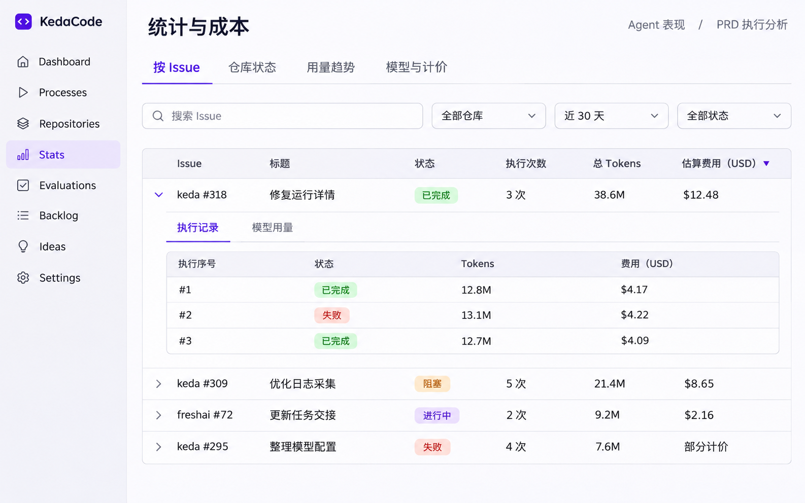
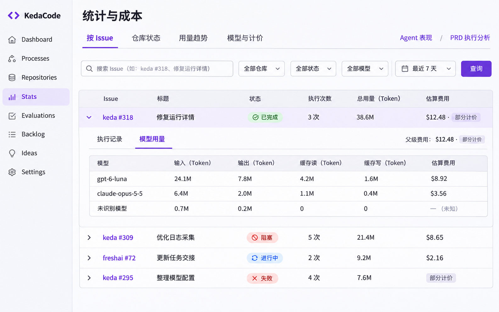
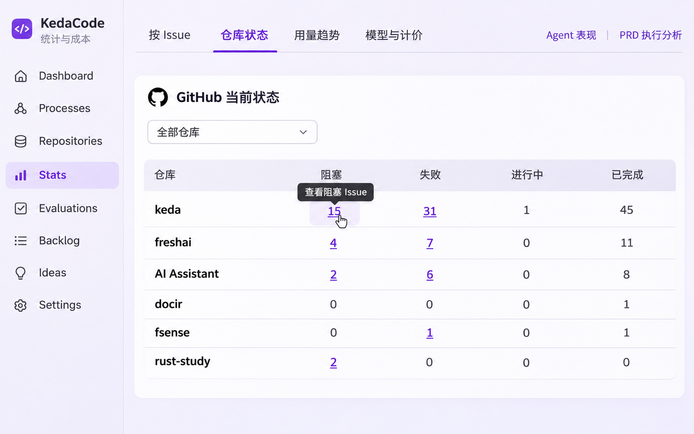
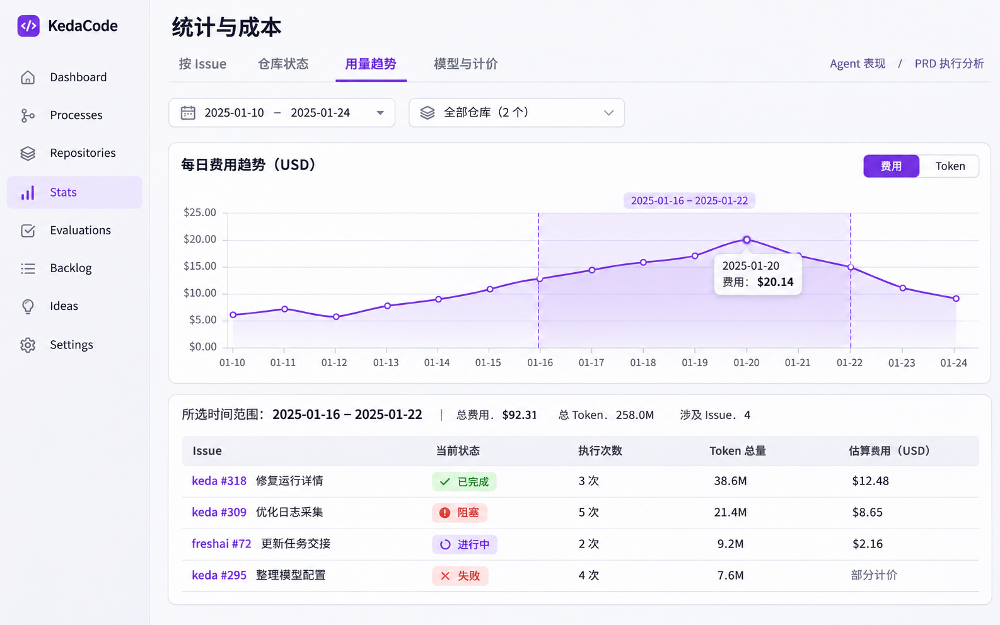
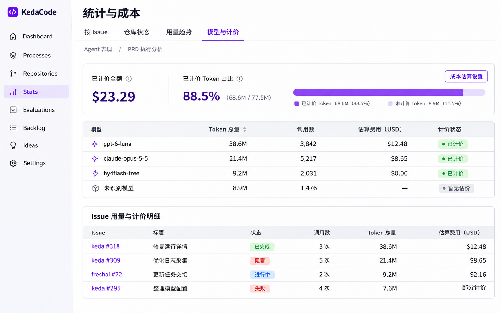

> 2026-11-26 补验已完成，独立复核 PASS。最新结果与实现树见 [补验报告](2026-11-26-browser-revalidation.md)。以下保留历史记录。

## 2026-11-25 审查复验与可复现绑定

RV-1 在当前实现树重跑，原始标准输出如下（完整本地产物 `rv-1-cost-api.txt` 由 runner 按证据发布流程上传）：

```text
$ UV_CACHE_DIR=/private/tmp/uv-cache-issue-449 uv run pytest tests/test_agent_runner_console_api.py::test_issue_cost_stats_reads_sqlite_and_console_http_with_repo_issue_key -q --no-testmon
.                                                                        [100%]
1 passed in 0.39s
```

实现树 SHA-256：`f219ac97d68894ee007135562bc27bf435006a2104dae133db756ce00c1b2311`，1996 个文件。以下命令从 Git 已跟踪和未忽略的未跟踪文件重算；排除该 PRD、证据目录和 runner 请求，按路径排序并对路径与文件内容分别加入 8 字节大端长度及原始字节：

```bash
python3 - <<'TREE'
import hashlib
import subprocess
from pathlib import Path
root = Path.cwd()
paths = subprocess.check_output(['git', 'ls-files', '--cached', '--others', '--exclude-standard', '-z']).split(b'\0')
excluded = b'tasks/pending/P1-FEAT-20261125-175656-console-issue-cost-stats.md'
h = hashlib.sha256()
selected = sorted(p for p in paths if p and p != excluded and not p.startswith((b'tasks/evidence/', b'.agent-runner/')))
for path in selected:
    content = (root / path.decode('utf-8')).read_bytes()
    for value in (path, content):
        h.update(len(value).to_bytes(8, 'big'))
        h.update(value)
print('SHA-256:', h.hexdigest(), 'Files:', len(selected))
TREE
```

RV-2/RV-3 重试 `just e2e tests/smoke/stats-issue-cost-ledger.no-auth.spec.ts` 退出 1：后端启动因默认 uv 缓存 `Operation not permitted` 失败，Next Watchpack 报 `EMFILE`；测试体未执行且无截图。完整本地日志为 `rv-2-browser-launch.txt`。筛选、跳转、趋势、覆盖率和美元展示仍未验证；须在可用环境重跑并由 runner 发布原始证据与截图。独立 verifier 未运行，验收仍阻塞。

> 2026-11-25 修复复验：下方历史树摘要和历史测试结果已过期，以本段为准。实现树 SHA-256：`f219ac97d68894ee007135562bc27bf435006a2104dae133db756ce00c1b2311`（原摘要脚本，排除 PRD、evidence 和 .agent-runner）。
>
> RV-1 原始输出：`UV_CACHE_DIR=/private/tmp/uv-cache-issue-449 uv run pytest tests/test_agent_runner_console_api.py::test_issue_cost_stats_reads_sqlite_and_console_http_with_repo_issue_key -q --no-testmon` → `. [100%]`，`1 passed in 0.81s`。真实临时 SQLite、Console HTTP 和独立重复读取；仅 GitHub 客户端替身。手算：Issue #7 为 100+50+80+40+20+10 = 300 输入输出 Token，加缓存读取 10+5 与创建 5，共 320；model-a 290、unknown 30。跨午夜 Issue #10 为 40+15=55，归属前一日；次日仅两条真正未关联调用，无 model-a。关闭 Issue 带 blocked 和 failed 标签仍仅列入 completed。此测试不证明美元展示。
>
> RV-2/RV-3 未通过：真实路由重试因 Next Watchpack EMFILE 无法进入测试体；独立 Chromium 启动复现 `bootstrap_check_in ... Permission denied (1100)`，无截图。已终止测试并停止服务。独立 verifier 未运行；本环境和本次授权不允许启动独立代理。截图、美元展示、最终树独立验收仍阻塞。原始产物外部发布须由 runner 完成，本任务禁止 push / 创建 PR。
>
> 检查：`just lint --reuse`、`SKIP=check-test-flag just lint --full` 通过（格式化后重跑）；`just test` 报告 90 passed、123 deselected。最后新增的测试断言已用上述定向测试重跑。

## 人审导航 / Human Review Navigation

PRD：[P1-FEAT-20261125-175656-console-issue-cost-stats.md](../../pending/P1-FEAT-20261125-175656-console-issue-cost-stats.md)
Issue：[GitHub #449](https://github.com/ZataZhang/keda/issues/449)
PR/CI：Draft PR 与 CI 由 runner 创建；本次执行没有生成 PR/CI 链接。
实现树 SHA-256：e21e9ad9e4ac45d305d2f4a09ea2d0f32a2a32bc89f15f8fc8a967b420dbdeee（排除当前 PRD、tasks/evidence/ 与 .agent-runner/；摘要脚本位于本地忽略路径 tasks/evidence/P1-FEAT-20261125-175656-console-issue-cost-stats/scripts/tree_digest.py）。

### RV-2 · Issue 表、执行与模型明细、仓库状态

目标原型（仅原型图，不是生产页面截图）：







- 图集：[docs/prototypes/issue-cost-stats/index.html](../../../docs/prototypes/issue-cost-stats/index.html)
- 在仓库根目录打开：open "docs/prototypes/issue-cost-stats/index.html"
- 生产截图目标：tasks/evidence/P1-FEAT-20261125-175656-console-issue-cost-stats/rv-2-issue-stats.png、rv-2-issue-models.png、rv-2-repository-status.png。当前均未生成。
- 自检预期：keda-main#318 显示 3 次执行（含失败）、3,000,000 Token 和 $2.000000 · 部分计价；另一个仓库同号 Issue 独立显示；确认免费模型显示 $0.000000，纯未计价模型显示「暂无估价」；仓库阻塞状态能打开无期间运行的 Issue。
- 执行者已交叉核对原型目标和当前静态 /app/stats 产物。Chromium 在测试体开始前退出，未交叉核对用户交互或视觉差异；状态为 REVIEW_INCIDENT / INCONCLUSIVE。

### RV-3 · UTC 趋势选区与计价覆盖率

目标原型（仅原型图，不是生产页面截图）：





- 图集：[docs/prototypes/issue-cost-stats/index.html](../../../docs/prototypes/issue-cost-stats/index.html)
- 在仓库根目录打开：open "docs/prototypes/issue-cost-stats/index.html"
- 生产截图目标：tasks/evidence/P1-FEAT-20261125-175656-console-issue-cost-stats/rv-3-trend-and-coverage-trend.png、rv-3-trend-and-coverage-pricing.png。当前均未生成。
- 自检预期：选择 2026-11-23 后账本与趋势只含该 UTC 日；Issue #318 为 1 次执行、2,000,000 Token；模型覆盖率为 0%，未知模型显示「暂无估价」，并保留 /app/settings/ 价格设置入口。
- 执行者已交叉核对目标原型、E2E fixture 与生产静态路由构建。日期输入和页面断言没有运行，不能作为行为通过；状态为 REVIEW_INCIDENT / INCONCLUSIVE。

人审状态：页面 screenshot 缺失，以上原型图仅帮助定位预期。不得将其视为实现对照；需由 runner 在可启动 Chromium 的授权环境重跑 RV-2/RV-3 并补齐真实截图，再提交独立 verifier 与人工验收。

## 证据与验证结果

### RV-1 · SQLite 与 Console HTTP

- 最终树目标命令：UV_CACHE_DIR=/private/tmp/uv-cache-issue-449 uv run pytest tests/test_agent_runner_console_api.py::test_issue_cost_stats_reads_sqlite_and_console_http_with_repo_issue_key -q
- 结果：1 passed in 0.63s。
- 证据文件：本地忽略的 rv-1-cost-api.txt，含原始 pytest 输出、断言摘要和最终实现树摘要。
- 真正跨越的边界：固定运行/调用数据写入临时 Console SQLite，经 Console store 读取和 FastAPI 路由返回 JSON；重复 HTTP 请求重新读取并比较。仅 GitHub 客户端被替换。
- 手算核对：同仓 Issue #7 为 3 次执行（含失败）、320 Token，model-a 为 290、unknown 为 30；跨仓同号为 10 Token 独立行；无 usage 执行保留；单日窗口排除期间外运行，跨 UTC 午夜调用仍随运行开始日计入；离线 GitHub 状态为 unknown。
- 局限：该 API oracle 不返回美元费用，因此没有证明页面估价；免费、缺价格与未知模型的 USD 呈现依赖 RV-2/RV-3，仍未通过真实页面执行。

### RV-2 / RV-3 · 页面验证 incident

- frontend-public 生产静态构建成功，路由表包含 /app/stats；本机静态 HTTP 探测返回 HTTP 200、text/html。
- Next dev 在本 worktree 报 Watchpack Error: EMFILE，页面路由未稳定提供。
- 切到最终静态导出后，Playwright 发现 3 个测试，但 Chromium 进程在测试体执行前退出：FATAL:base/apple/mach_port_rendezvous_mac.cc:159 Check failed: kr == KERN_SUCCESS. bootstrap_check_in org.chromium.Chromium.MachPortRendezvousServer: Permission denied (1100)。浏览器没有执行页面断言，也没有生成截图。原始诊断摘要位于本地忽略的 rv-2-browser-launch.txt。
- 已尝试 CUA 浏览器：browser access host 不可用；Microsoft Edge 请求被拒绝，因此没有改用未经授权的自动化路径。
- 分类：REVIEW_INCIDENT / INCONCLUSIVE，不是产品 BLOCKER，也不是 PASS。

### 其他质量检查

- SKIP=check-test-flag UV_CACHE_DIR=/private/tmp/uv-cache-issue-449 just lint --full：通过；UV_CACHE_DIR=... just lint --reuse：通过。
- 完整本地核心测试：5689 passed, 3 skipped, 1 deselected in 470.89s。前端纯展示修复后的 just test 调用报告 no tests ran in 0.06s；后端 Python 源码没有在完整测试通过后变化。
- frontend-public：lint 0 errors / 105 warnings，typecheck 通过，静态构建通过。
- 新 E2E spec 定向 ESLint 通过。E2E 包级 lint/typecheck 此前报告 17 个旧文件 lint errors 及 tests/smoke/idea-inbox.spec.ts:124 一个既有类型错误；新 Stats spec 未出现在错误中。
- 代码复核发现并修正纯未计价 Issue 行误显示 $0 的边界；现在已知计价覆盖为零时显示「暂无估价」，并增加 E2E 夹具断言。该浏览器断言因启动 incident 尚未执行。
- UV_CACHE_DIR=... uv run mkdocs build --strict：通过，存在仓库既有未纳入导航页提示。
- just lint --full 中 reuse、架构、指南一致性、最大行数、PRD checklist、工作树检查均通过。

## 人工和 runner 后续

自动实现已完成，但验收仍阻塞。runner 需在授权浏览器可用的执行环境重跑 just e2e tests/smoke/stats-issue-cost-ledger.no-auth.spec.ts，生成 5 张截图，与以上目标原型配对，然后运行独立 verifier。未生成的页面截图和 PR/CI 链接不会由本报告虚构。

### Pre-PR 审查修复后续

审查修复补充了未关联调用的覆盖披露和执行明细的未知估价处理。上述实现树摘要及先前验证结果不适用于此修复后的代码；SQLite + Console HTTP 定向测试和前端类型检查已重新运行。RV-2/RV-3 的真实浏览器证据及独立 verifier 仍需针对最终树重新执行，验收继续阻塞。
