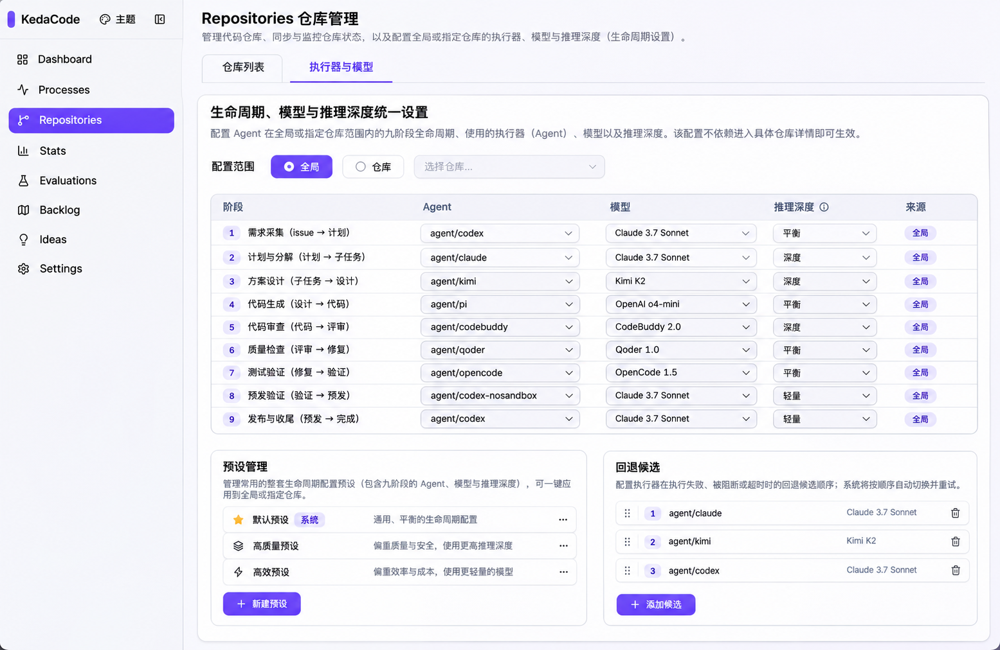
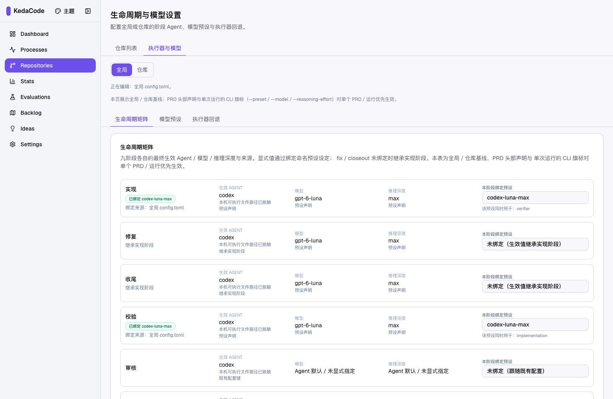
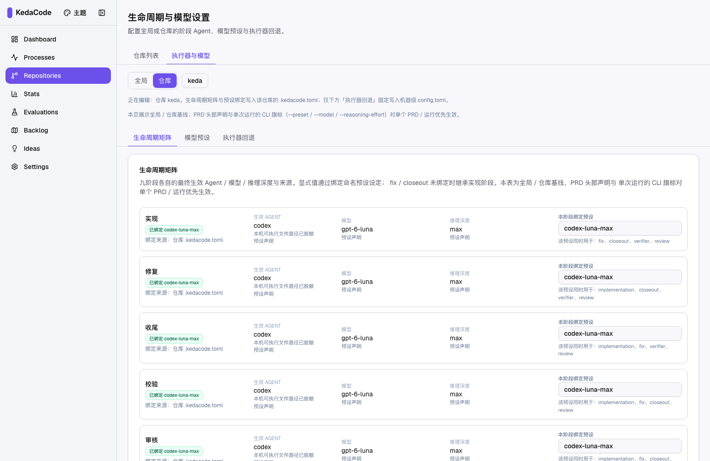

# Evidence Report

## 人审导航 / Human Review Navigation

- Pull request: [#370 — expose lifecycle settings at top level](https://github.com/ZataZhang/keda/pull/370)
- Required CI: **passed on implementation head `3a370a79e30c296989c9105e564f91eadcbf9f37`** — [Frontend Build / Validate Template](https://github.com/ZataZhang/keda/actions/runs/43387293118), [Install smoke](https://github.com/ZataZhang/keda/actions/runs/43387292955), [Realistic Validation sign-off](https://github.com/ZataZhang/keda/actions/runs/43387293042). The archive-record commit will trigger the same gates again before merge.
- Human decisions: [interactive review checklist](https://github.com/ZataZhang/keda/blob/prd-evidence/tasks/evidence/P2-FEAT-20261113-140659-repositories-lifecycle-settings-entry/human-review-checklist.md) · [HTML checklist](https://raw.githubusercontent.com/ZataZhang/keda/prd-evidence/tasks/evidence/P2-FEAT-20261113-140659-repositories-lifecycle-settings-entry/human-review-checklist.html)
- Primary demo: [15-second real-browser walkthrough](https://raw.githubusercontent.com/ZataZhang/keda/prd-evidence/tasks/evidence/P2-FEAT-20261113-140659-repositories-lifecycle-settings-entry/rv-1-primary-demo.mp4)

| Selected concept · design intent | Runtime capture · real Repositories route |
|---|---|
|  |  |

Repository scope from the real Backlog gear: 

- PRD: `tasks/archive/P2-FEAT-20261113-140659-repositories-lifecycle-settings-entry.md`
- Verified head: `3a370a79e30c296989c9105e564f91eadcbf9f37`
- Verified record-excluded tree: `1e73c64b5d05a265aaad0432fe8afa572ad24184`
- Media branch: `prd-evidence`
- Media manifest SHA-256: `f7d568eb6946ad7943fc9ec771b62c27bb8445d37457bdc95fb97a33136358ea`
- Evidence record fields: `verified_head_sha=3a370a79e30c296989c9105e564f91eadcbf9f37`; `verified_tree_sha=1e73c64b5d05a265aaad0432fe8afa572ad24184`; `evidence_manifest_sha256=f7d568eb6946ad7943fc9ec771b62c27bb8445d37457bdc95fb97a33136358ea`.
- Secret scan: passed for the code evidence package and published media.

## Browser validation

Command: `just e2e tests/workflows/lifecycle-settings.spec.ts`

Result: **11 passed (19.1s)** — one authentication setup and ten Chromium browser cases. The test used the real authenticated Next.js routes and local backend APIs. It did not save settings or call a model provider.

- **rv-1:** verified the Repositories tabs, lifecycle entry, global default, nine-stage settings, and Settings Agent-label editor / lifecycle-card removal.
- **rv-2:** verified the legacy route preserves scope and repository ID, missing IDs stay in repository scope, invalid IDs show an error with no write request, and the Backlog gear opens the selected repository.
- **rv-3:** verified the Agent-label editor remains available, the old card is absent, and the documentation build passes.
- **Narrow viewport:** the 400 px browser case found all nine matrix rows visible and wider than 300 px.

### Negative control

For rv-2, the Backlog gear's `repo_id` parameter was temporarily removed in the worktree and the real test was run with `just e2e "tests/workflows/lifecycle-settings.spec.ts --grep Backlog"`. It failed at the URL assertion as expected: expected `/app/repositories/lifecycle/?scope=repository&repo_id=...`, received `/app/repositories/lifecycle/?scope=repository`. The committed source was restored immediately; the current worktree has no product-code diff.

## Build, tests, and lint

| Command | Result |
|---|---|
| `pnpm --dir frontend-public typecheck` | Passed |
| `pnpm --dir frontend-public build` | Passed; static output includes `/app/repositories/lifecycle` and the legacy `/app/settings/lifecycle` redirect route |
| `just test` | An earlier complete local suite executed **5,289 passed, 1 skipped**. A fresh marker-refresh run executed **5,288 passed, 1 skipped, 1 failed**: `test_a_second_diagnosis_chance_after_a_failed_one` timed out waiting for its writer marker. The isolated rerun passed in 0.76s; the next `just test` reused testmon, executed 0 tests, and refreshed the hook marker. The required hosted CI test suite passed. |
| `just lint --repo` | Final rerun passed all pre-commit and reuse checks, skipped tests against the fresh test marker, and built MkDocs in 8.55s. MkDocs emitted INFO-only notices for existing unlinked pages / an anchor and missing optional signature formatter; no build error. |
| `pnpm --dir tests/playwright-e2e exec eslint tests/workflows/lifecycle-settings.spec.ts tests/workflows/lifecycle-agent-matrix.spec.ts` | Passed |
| `git diff --cached --check` and implementation commit hooks | Passed |

An additional, non-gating `pnpm --dir tests/playwright-e2e typecheck` probe reports a pre-existing TypeScript error in untouched `tests/smoke/idea-inbox.spec.ts:124`: `Property 'text' does not exist on type '{}'`. The required browser workflow and the product frontend typecheck/build pass; the CI workflow does not typecheck the separate Playwright package.

## Published media

The dedicated evidence branch contains a manifest, three PNG files, and the MP4. SHA-256 values are recorded in its `media-manifest.json`:

- Prototype concept PNG: `da78974e92f2dcbad21b4589deb2a1511413441852f7cfc1dfedbc3b4c829330`
- Runtime global-scope PNG: `bc1590f8a44deb38ffc9550911fc0bc5afa1651b45487b322088e062b8e81225`
- Runtime repository-scope PNG: `b0f14d2e62aaf31bdb0190f36bde7656b26372f09a804a079c391927cb833b71`
- Primary demo MP4: `604ba2e7a52efa4f61c5fa12d2be28a6ee3b3e61b18d91281df988f9c922fd26`

Screenshots use a 1555 × 1012 viewport in the light theme. The demo is 15.2 seconds. Local absolute paths and non-public repository labels were redacted in presentation media; the live routes and API responses were not rewritten. The repository used for the displayed repository-scoped state, `keda`, is public.

Raw evidence branch: `prd-evidence` (retain for the repository audit horizon). After the retention period, the branch can be removed with `git push zata --delete prd-evidence`.
