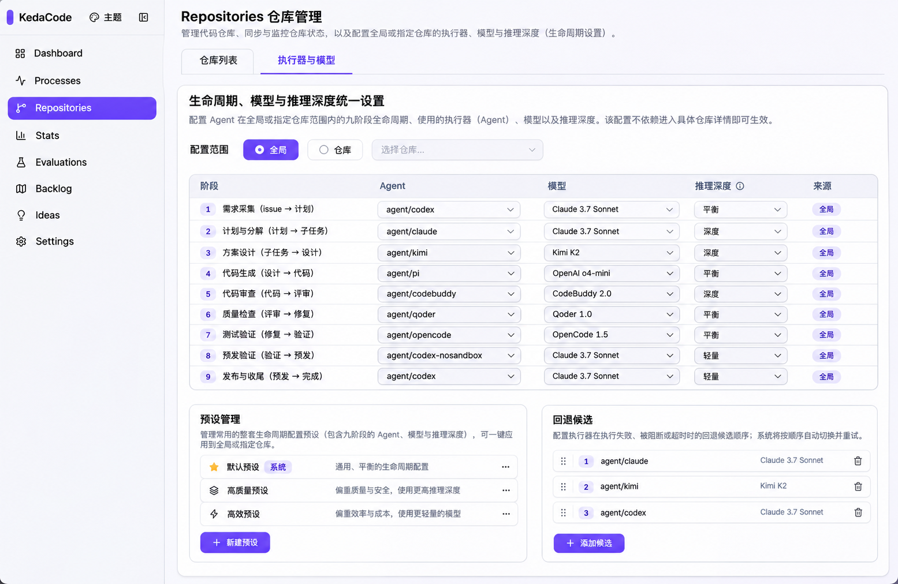
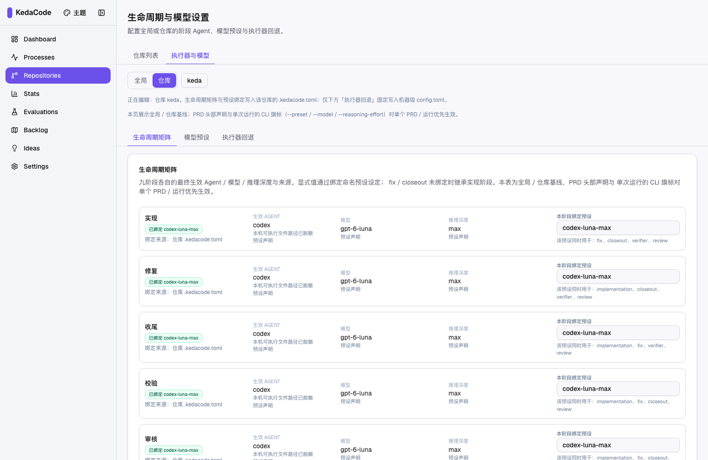

# 人工审查结果 · Repositories 生命周期与模型设置

PRD：`tasks/archive/P2-FEAT-20261113-140659-repositories-lifecycle-settings-entry.md`。请对照真实页面证据逐项回答“同意”或“不同意并说明差异”。当前对话已确认采用方案一；这些人审项会在 PR 合并后按实际结果记录。

运行 `just prd review tasks/archive/P2-FEAT-20261113-140659-repositories-lifecycle-settings-entry.md` 可打开本交互清单。登录后真实入口为 `/app/repositories/`；完整 gate 状态见同目录 `P2-FEAT-20261113-140659-repositories-lifecycle-settings-entry.evidence-report.md`。

**主演示：**[观看 15.2 秒真实页面演示（MP4）](rv-1-primary-demo.mp4)。它展示 Repositories 列表、全局设置、选择公开仓库 `keda`，以及从 Backlog 齿轮返回仓库范围的四步流程。非公开仓库名与本机路径在呈递媒体中脱敏；真实路由、API 与页面状态未改写。

## 第 1 项 · Repositories 顶层入口位置和页面层级

**你在确认什么：**“执行器与模型”是否与“仓库列表”并列放在 Repositories 顶层。若判断不符合预期，统一设置入口会继续藏在 Settings，或出现在错误的仓库详情层级。

**PRD 原文（§9.2 Human-Confirmed item 1）：**

> - [ ] 人工确认 Repositories 顶层入口位置、两个标签名称和页面层级符合已选方案一；证据为 PR 内原型 / 真实页面截图配对及主演示。

| 目标原型：设计意图 | 实现页面：真实入口验证 |
|---|---|
|  |  |

真实浏览器摘要：`11 passed (19.1s)`，含 Repositories 标签、设置页、九阶段、Settings Agent 标签编辑器与窄屏断言。概念图不是生产截图。

**回复格式：**“同意第 1 项”；或“不同意第 1 项：<需要调整的位置 / 层级>”。

## 第 2 项 · 仓库范围、Backlog 深链和旧 URL

**你在确认什么：**Backlog 齿轮和旧链接是否都保留目标仓库范围。若判断不符合预期，仓库配置可能误显示为全局设置，导致用户在错误的范围里操作。

**PRD 原文（§9.2 Human-Confirmed item 2）：**

> - [ ] 人工确认范围选择、Backlog 仓库深链与旧 URL 兼容表现符合预期；证据为真实入口画面和地址栏 / 仓库选择器。

| 目标原型：默认全局设计意图 | 实现页面：真实仓库深链状态 |
|---|---|
|  |  |

真实浏览器还验证了旧 `/app/settings/lifecycle/` URL 保留参数、无效 `repo_id` 显示错误且不发送任何写请求。负向验证临时删掉齿轮链接的 `repo_id` 后，Playwright 在预期 URL 断言失败；源码已恢复。

**术语：**“深链”是带 `scope=repository` 和仓库 ID 的页面链接；“范围选择器”显示设置属于全局还是某个仓库。

**回复格式：**“同意第 2 项”；或“不同意第 2 项：<入口、参数或选择器的差异>”。
