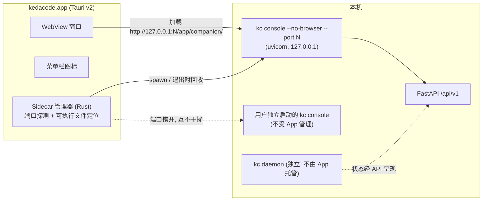

# PRD: macOS 菜单栏状态面板与悬浮窗

> 🟡 **执行状态**：实现已落地，等待真实菜单栏交互验收。用户于 2026-10-20 明确提出需要菜单栏图标、点击展开状态面板，并可切换为悬浮窗；据此解除暂缓并收窄本期交互范围。

> ✅ **交付前置**：无；构建上不依赖其它 PRD，解除暂缓后即可开工。上游 `P1-FEAT-20260913-204530-console-prd-content-reader.md` 已归档（`tasks/archive/`），本 PRD 立项动机所需的"读 PRD 原文"能力已在代码库可用。
> 结构化声明见 §8 Delivery Dependencies，**那里是唯一事实源**。

> 🟡 **验收状态**：构建与 sidecar 已验证；菜单栏点击、失焦收起和固定切换仍待真实 UI 验收。
> 本行是 §9 Acceptance Checklist 的投影，**那里是唯一事实源**；只有全部验收项完成后才可改为 `✅ 可归档`。

本 PRD 分两层阅读：**Part A（人审层）** 供人决定"做不做、怎么做才对"，不含实现细节；**Part B（执行器层）** 供执行者（人或 Agent）落地实现。人只需审 Part A，并按 Part A 的指引在需要时下钻 Part B。

## Feature Overview (功能一览)

> 本块是第 10 节 Functional Requirements 的通俗投影，不是第二事实来源；行为验收以第 1 节的行为样例表为准。

- **构建与安装**（FR-1）：运行 `just desktop-install`，把本机自用的 `KedaCode.app` 放进 `~/Applications`。
- **菜单栏状态面板**（FR-4）：启动 App 后图标常驻菜单栏；点击图标展开同源任务状态，按「固定悬浮」后切成置顶原生窗口，再点「取消固定」返回图标面板。
- **复用现有看板**（FR-6）：面板内容使用 `kc console` 提供的任务数据，不另建业务状态；后端拉不起来时显示明确错误页。
- **生命周期清楚**（FR-3）：显式退出 App 时自动回收它拉起的后台服务；用户独立运行的 `kc console` 不受影响。
- **分发边界**（FR-7、§11）：本期只做 macOS 本机构建自用；不签名、不公证、不公开分发，也不改 PyPI / Homebrew tap 流程。

# Part A · 人审层 (Review Layer)

## 1. Introduction & Goals

### Problem Statement

要看 PRD 或 agent 任务执行情况，目前的路径是：开终端 → 敲 `kc console` → 等浏览器打开。这条链路每次都要走一遍，而且**需要先知道有这条命令**——这一点在 2026-09-13 的一次真实对话里被直接印证：用户（本项目开发者本人）在功能已经交付并发布之后，仍需要问"我要怎么打开可视化界面"。命令行入口的可发现性本身就是摩擦。

另一个已核实的现状事实：仓库有一条正式记录的分发决策（已归档的 `tasks/archive/P1-FEAT-20260910-125248-iar-package-manager-distribution.md`，D-01）——"不做 macOS / Windows 原生安装包，不做代码签名与公证"，依据是公开分发绕不开 $99/年的 Apple 开发者账号。该决策的适用范围是**向公开用户分发签名安装包**，并未覆盖"开发者在本机用源码构建、自己用"这条路径。这条路径的成本为零：本机构建的产物不经过互联网下载，不带 `com.apple.quarantine` 扩展属性，Gatekeeper 不拦截。

### Interpretation (解读回显)

**行为样例**（下表每一行会被逐字转录为 Part B 的验收判据——改正任何一格，就等于改正验收标准）：

| 输入 / 操作 | 期望观察到的结果 |
|---|---|
| 本机执行构建命令（`just desktop-install`） | 产出 `~/Applications/KedaCode.app`；双击启动后只在菜单栏显示 KedaCode 图标 |
| 启动 App 后点击菜单栏图标 | 图标下方弹出紧凑状态面板，显示真实任务数据；点击「固定悬浮」后变为有原生标题栏、始终置顶的窗口 |
| 点击「取消固定」或面板外区域 | 悬浮窗回到图标弹出模式；未固定面板失焦后自动隐藏，菜单栏图标仍在 |
| 从菜单栏菜单选择退出 | App 及其自启的 Console sidecar 退出；独立运行的 `kc console` 不受影响 |
| 边缘情况：本机已有独立运行的 `kc console` 占着默认端口 | App 自带的 sidecar 自动用其它端口，两者互不干扰、各自可用 |
| 边缘情况：机器上装了 `kc` 但只在 Homebrew 路径（`/opt/homebrew/bin/kc`），且从 Finder 双击启动 | App 仍能找到并拉起 sidecar（Finder 启动的 App 拿不到登录 shell 的 PATH，必须显式枚举安装位置） |
| 失败情况：机器上根本没装 `kc` | 面板显示明确的安装引导文案，不是白屏、不是静默失败 |
| 失败情况：sidecar 进程意外退出 | 窗口显示"后端未运行"错误页，不是白屏或永久转圈 |
| 退出 App | 它拉起的 sidecar 随之退出（`pgrep` 查不到）；用户独立启动的 `kc console` 仍存活 |

**我默默定了这些**（有异议请直接指出）：

- 壳里加载的是 **frontend-public 的控制台界面**（`kc console` 服务的就是它），不是 frontend-admin——后者仍是未接任何 agent-runner 接口的模板。
- 壳拉起的后台进程是 **`kc console` 的 HTTP 服务**（已有 `--no-browser` 参数），不是 `kc daemon`（那是 agent 轮询循环，不提供 HTTP），也不是在 Rust 里内嵌 Python。
- 窗口直接加载本机 HTTP 地址（界面与 API 同源），而不是把前端静态文件打包进 `.app`。
- 分发只走"本机构建自用"：不签名、不公证、不上 Homebrew cask、不进 Release 流水线。
- 菜单栏图标、锚定式状态弹出面板、固定/取消固定悬浮窗纳入本期范围。
- **全局热键不纳入本期**：用户确认的是菜单栏点击交互；暂不增加额外快捷键与权限面。
- 只做 macOS。Windows / Linux 桌面包不在本期。

**我理解为不做**：

- 不推翻"不签名、不上 cask"的**公开分发**结论——本 PRD 只覆盖本机构建自用。
- 不替换 `kc console` 浏览器入口，两者并存。
- 不做 PRD 原文浏览功能本身——那由另一份 PRD（`P1-FEAT-20260913-204530-console-prd-content-reader.md`）交付，壳因同源加载会自动获得它。注意这不代表两者无关：**本 PRD 排在它后面做**（§8 声明为 hard 门禁）。壳单独跑得起来，但先做壳只会得到一个读不了 PRD 的窗口——恰好是本 PRD 立项时最想要的那件事没有。

**文字版解读**：把这件事读作"给 KedaCode 加一个 Tauri 菜单栏壳，先以图标下方的 popover 呈现现有状态面板，再允许固定为原生悬浮窗"，而不是"从浏览器启动另一个无菜单栏的 WebView"。壳只做进程管理、窗口模式和状态面板加载，不拥有业务状态；不引入签名/公证/cask。非目标：跨平台包、全局热键、替换浏览器控制台、重写任务数据接口。

### What The User Gets

启动 App 后，菜单栏出现 KedaCode 图标。点击图标，任务状态面板从图标下方展开；点击「固定悬浮」后，面板变成带原生标题栏的置顶窗口；取消固定或点面板外部，再回到菜单栏弹出面板。退出菜单栏 App 会回收它自己启动的 `kc console`，原有浏览器控制台流程保持可用。

### Measurable Objectives

- 本机执行构建命令后产出 `.app`，从 Finder 启动后菜单栏图标可见，点击会展开任务面板。
- 窗口内显示的控制台数据与同端口 `curl /api/v1/agent-runner/...` 的返回一致。
- 与预先独立运行的 `kc console` 并存时互不抢端口，双方均可用。
- 退出 App 后 `pgrep` 查不到它拉起的 sidecar；独立启动的 console 进程仍存活。
- 在**只有 Homebrew 路径装了 `kc`** 的条件下从 Finder 双击，仍能拉起 sidecar。
- 以上均经真实入口验证（真实构建产物 + 真实双击 + 真实后端 + 真实数据），不接受开发服务器或纯单元测试充数。

## 2. Human Review Map (介入与风险地图)

用户本轮反馈确认了菜单栏入口和悬浮窗切换的价值；实现采用本 PRD 已推荐的 Tauri v2，并移除未被请求的全局热键。剩余改动走自动门禁。

### 决策一：修订"不做原生 .app"的旧决策（仅限本机构建自用）

已归档的分发 PRD 明确写下"不做原生安装包、不签名不公证"，理由是公开分发需要额外承担签名与公证成本。本 PRD 不推翻公开分发边界，而是补充源码构建、本机自用的菜单栏 App 路径。

风险在于：这条缝如果被误读成"可以向公众分发未签名的 .app"，拿到产物的用户会在 Gatekeeper 上被硬阻断。所以新决策必须把"仅限本机构建自用；公开分发仍需签名"写成**显式边界**，并落到文档里。

**请确认：** 同意将旧决策修订为"不做签名安装包的公开分发；允许本机构建自用的未签名 .app"？

**验收：** roadmap 与相关文档同步记录修订后的边界；本机构建出的 `.app` 可在本机启动，并在菜单栏提供状态面板。

### 决策二：为菜单栏 popover 和悬浮窗切换引入 Rust 工具链

这是本 PRD 真正的成本项，值得单独确认。开工前仓库**没有任何 Rust 源码**（当时不存在 `Cargo.toml`）。做这个壳意味着新增 `desktop/` 子项目及其独立依赖树、把 Rust + Xcode CLT 写进开发环境要求、并长期承担 Tauri v2 的 API 演进。

换来的是：原生菜单栏图标、锚定式 popover、固定为置顶窗口的交互。面板继续复用现有控制台界面和数据。这是一次纯体验投入。

反面事实要一并摆出：`kc console` 本身已经会自动打开浏览器，浏览器也能加书签。所以如果只是"少敲一条命令"，成本收益是不划算的。2026-10-20 用户明确提出需要菜单栏常驻图标、点击查看状态并固定为悬浮窗，现已确认这套交互确有价值。

**已确认的范围：** 接受为菜单栏 popover + 悬浮窗，长期在仓库里维护一个 Rust/Tauri 子项目；本期不做全局热键。

**验收：** 用真实构建出来的 App（不是开发服务器）启动，点击菜单栏图标后显示任务状态，并能固定为悬浮窗；数据与 Console API 一致，壳本身不持有业务状态。

**自动门禁，不需要逐项人工审阅：** Tauri 脚手架与构建配置、popover / floating 窗口切换、sidecar 进程生命周期（端口共存、退出回收、可执行文件定位）、justfile 构建与安装 recipe、文档与导航同步。这些改动失败时局限在本功能内、可回滚，由针对性验证与构建门禁拦截。

**本次明确不涉及：** 无数据库结构变更；不改动 `kc daemon` 轮询循环；不改动 PyPI / Homebrew tap 既有分发链路；不做 Windows / Linux 包；不改动 frontend-admin。frontend-public 增加固定/取消固定窗口控件，状态数据仍来自既有 Console API。

## 3. Usage And Impact After Implementation

- **本机开发者（主要用户）：** 构建一次后 `~/Applications/KedaCode.app` 双击即用；日常从菜单栏图标直接展开任务状态，需要常驻时固定为悬浮窗。
- **CLI / 浏览器控制台用户：** 完全不变。`kc console` 照旧启动并打开浏览器；桌面 App 与浏览器面板只是同一后端的两个客户端。
- **分发维护者：** `just desktop-install` 仅影响本机 `~/Applications`；发布流水线（PyPI + tap）不受影响，Release 产物不新增任何安装包。

### Impact On Existing Behavior

- 无破坏性变更；不引入新的必填配置；不改动任何后端接口。`kc console` 的 CLI 语义（`--no-browser`、端口顺延、监听地址硬编码 `127.0.0.1`）保持原样，桌面 App 只是它的又一个 HTTP 客户端。

## 4. Requirement Shape

- **actor:** 本机 macOS 开发者；次要：分发维护者
- **trigger:** 用户希望从 macOS 菜单栏直接查看任务状态，并可将状态面板固定为置顶窗口
- **expected behavior:** 本机构建出免签名可用的 `.app`；图标点击展开现有任务面板，固定按钮切换为悬浮窗；App 自带 sidecar，退出无残留，与独立 console 并存
- **explicit scope boundary:** 仅 macOS 本机构建自用；不签名/公证/cask；壳内不做任何界面功能；不托管 agent daemon

# Part B · 执行器层 (Build Layer)

## 5. Repository Context And Architecture Fit

**现有模块与最近路径：**

- HTTP 服务入口：`src/backend/api/cli_typer_console.py`。`kc console` 用 uvicorn 跑 `backend.api.app:app`；监听地址由 `CONSOLE_HOST = "127.0.0.1"` **硬编码且不可配置**（settings 里没有 `host` 字段，有回归测试守着）；端口由 `resolve_console_port` 决定——未显式指定时从配置默认端口起在 `_PORT_SCAN_WINDOW` 范围内顺延，显式指定则占用即失败；**已有 `--no-browser` 参数**。
- 注意：`kc daemon` 是 agent 轮询循环，**不**提供 HTTP。壳的 sidecar 是 console 服务，不是 daemon。
- 界面：frontend-public 的 Next.js 静态导出，由 `src/backend/api/app.py` 的 `_mount_console_static()` 在所有 router 之后挂到 `/`；静态产物随 wheel 分发（`pyproject.toml` 的 `"backend.api.static" = ["console/**/*"]`）。
- frontend-admin 是未接 agent-runner 的模板，本期不动。
- 分发：PyPI 与 Homebrew tap 在外部由既有流程维护；本 PRD 新增的菜单栏 App 仅通过 `just desktop-install` 本机构建安装，不修改通用安装脚本或 Release 流程。
- **仓库目前没有任何 Rust 源码**（不存在 `Cargo.toml`）。

**架构约束：**

- 壳不进入后端四层架构：`desktop/` 是与 `tests/playwright-e2e/` 同类的独立子项目，遵循自己的工具链，不受 Python SSA 命名规范约束。
- 壳不得持有任何业务状态，只做进程管理与窗口加载。
- `just desktop-install` 只拷贝到当前用户的 `~/Applications`，无需 sudo，不碰系统包管理器。

**相关 PRD 关系：**

- 已归档 `P1-FEAT-20260910-125248-iar-package-manager-distribution.md`：本 PRD **修订**其 D-01 的适用边界（该结论仅约束公开分发）。其 §7.10 关于签名/Gatekeeper/cask 的外部核实事实被继承引用，不重复核实。
- 已归档 `P1-FEAT-20260910-111901-iar-console-bundled-web-terminal.md`：其交付的 `kc console`（wheel 内置控制台 + 一键启动）是本 PRD 的直接底座——sidecar 复用它，界面复用它服务的静态导出。
- 已归档 `P1-FEAT-20260913-204530-console-prd-content-reader.md`（`tasks/archive/`）：原 `hard` 交付顺序门禁已随其交付而满足。需要分清两种依赖：**构建上不依赖**——壳同源加载控制台，对方没落地壳照样能跑通；**交付顺序上曾依赖**——本 PRD 的立项动机含「读 PRD 原文」，那块能力由对方交付，壳先落地会交出一个读不了 PRD 的窗口且本 PRD 验收仍全绿。对方已归档，故 §8 现声明为 `none`。
- 本 PRD 与原 `P1-FEAT-20260912-181533-tauri-desktop-gui.md` 是拆分关系：那份把"读 PRD 原文"与"做桌面壳"绑在一起，二者成本与价值差一个数量级且可独立交付，已按 Scope Cohesion 拆为两份，原文件删除。

## 6. Recommendation

**Recommended Approach：Tauri v2 菜单栏壳 + 子进程拉起既有 `kc console` + 同源加载回环地址 + 本机构建分发。**

1. 新增 `desktop/` Tauri v2 子项目：Rust 侧分配空闲端口、spawn sidecar（`kc console --no-browser --port N`）、健康探测、创建隐藏窗口加载状态面板、菜单栏图标点击锚定面板、固定按钮切换到有标题栏的置顶窗口、退出回收子进程。
2. `just desktop-build` 构建 `.app`，`just desktop-install` 把产物拷到 `~/Applications`（无 sudo）；不修改通用安装脚本。
3. 文档与 roadmap 同步记录修订后的分发决策边界。

**为什么最贴合现有架构：** sidecar 就是现成的 `kc console`，界面就是现成的静态导出；后端继续只提供数据，新增的只有原生窗口壳和少量 Tauri 状态控件，不改变四层架构。

**拒绝的冗余抽象：** 不新建 GUI 技术栈（PyQt/PySide6 需重写全部界面）；不把静态文件打包进 `.app` 走自定义协议；不在 Rust 内嵌 Python 运行时；不新增 WebSocket（现有轮询已够）。

### Proposed Solution Summary (实现机制)

壳启动时先探测一个空闲端口，再以该端口显式启动 sidecar（显式 `--port` 时 console 占用即失败，不会悄悄换端口，因此端口由壳单方面决定、可预测）。窗口加载该回环地址，界面与 API 天然同源，前端 `baseURL: "/api"` 的相对路径无需任何改动。sidecar 生命周期绑定 App 生命周期：App 退出时回收；用户独立启动的 console 进程不在管理范围。分发形态：`just desktop-install` 本地构建并拷贝至 `~/Applications`。popover 与悬浮模式只保存在进程内，不新增持久配置。刻意避开的复杂度：无新增数据库、无全局热键、无签名流水线。

**一处需要说准的机制：** "前端更新后壳免重建"成立，但更新路径是"更新已安装的 `kedacode` 包"——静态产物打在 wheel 里，不是 `pnpm build` 完就生效。壳解耦掉的是"壳与界面的构建耦合"，不是"界面与后端包的耦合"。

### Alternatives Considered

| 备选 | 结论 | 理由 |
|---|---|---|
| 什么都不做，用浏览器书签 | 曾是应认真对待的基线 | 零成本；`kc console` 已自动开浏览器。用户当前确认菜单栏状态 popover 与悬浮窗切换有价值，故采用本期最小原生壳 |
| PyQt / PySide6 原生重写 | 拒绝 | 抛弃已有前端全部重写；打包 150MB+；$99 签名问题一分不省；PyQt 另有 GPL/商业许可问题 |
| pywebview（纯 Python 壳） | 拒绝 | 可开独立 WebView 窗口，但现有实现无法提供本期要求的原生菜单栏 popover 与固定/取消固定窗口切换 |
| Electron | 拒绝 | 产物体积与内存占用大，相对 Tauri 无能力增益 |
| 静态文件打包进 `.app`（自定义协议） | 拒绝 | 前端每次更新都要重建壳；同源加载零代价获得更新 |
| 立即签名 + brew cask 公开分发 | 拒绝（暂缓） | $99/年成本对"自用"阶段无收益；将来补签名只是流水线加步骤，架构不返工 |

## 7. Implementation Guide

> This section is a living implementation guide based on current repository analysis. If implementation discovers additional affected files, hidden dependencies, edge cases, or a better path, update this PRD before proceeding.

### Core Logic

数据流：`desktop/` 壳 → 探测空闲端口 → spawn `kc console --no-browser --port <N>` → uvicorn 服务 `backend.api.app:app` → WebView 加载 `http://127.0.0.1:<N>/app/companion/` → 静态导出页面经同源 `/api/*` 调后端。

控制流：壳负责端口分配与 sidecar 可执行文件定位、健康探测（轮询 `/api/v1/agent-runner/console/version` 直到返回版本或超时）、退出时回收子进程。托盘左键点击打开锚定在图标下方的 popover；点击固定按钮时切换原生标题栏和置顶状态，失焦隐藏仅适用于 popover 模式。sidecar 定位失败或健康探测超时，均显示明确错误文案。

### Change Impact Tree

```text
.
├── desktop/（新增 Tauri v2 子项目，独立 package，参照 tests/playwright-e2e/ 的独立包模式）
│   ├── src-tauri/src/（main.rs / lib.rs）
│   │   [新增]
│   │   【总结】壳逻辑：端口探测 → spawn sidecar → 健康探测 → 托盘 popover ↔ 悬浮窗 → 退出回收
│   │   ├── **sidecar 可执行文件定位（本 PRD 最易出错处）**：从 Finder 双击启动的 .app
│   │   │   拿到的是最小 PATH（约 /usr/bin:/bin:/usr/sbin:/sbin），**不继承登录 shell 的 PATH**，
│   │   │   因此"在 PATH 里找 kc"这一档在真实场景下基本命不中。必须显式枚举候选：
│   │   │     ~/.local/bin/kc         （uv tool / pipx 默认）
│   │   │     /opt/homebrew/bin/kc    （Apple Silicon Homebrew）
│   │   │     /usr/local/bin/kc       （Intel Homebrew / 手工安装）
│   │   │     $PATH 查找              （保底，命中率低但无害）
│   │   │   全部落空时渲染"未找到 kc"引导页，不得静默失败
│   │   ├── 健康探测轮询 /api/v1/agent-runner/console/version，超时显示"后端未运行"（不白屏）
│   │   └── 菜单栏图标使用 Tauri positioner 定位 popover；本期不注册全局热键
│   ├── src-tauri/tauri.conf.json
│   │   [新增]
│   │   【总结】应用标识、bundle 目标（macOS app）、窗口配置、安全策略仅允许 127.0.0.1 回环
│   └── package.json
│       [新增]
│       【总结】tauri CLI 脚本（dev/build），并通过 just recipe 集成，遵循仓库既有前端工具链习惯
├── justfile
│   [修改]
│   【总结】新增 desktop-build / desktop-install recipe；install 只复制到 ~/Applications
├── docs/
│   [修改]
│   【总结】新增桌面 App 使用与构建前置条件文档页
├── mkdocs.yml
│   [修改]
│   【总结】登记新文档页导航
├── README.md
│   [修改]
│   【总结】安装段补一条本机构建说明，并写明"仅限本机自用，公开分发仍需签名"
└── ROADMAP.md
    [修改]
    【总结】把"不做原生 .app"修订为"不做签名安装包公开分发；允许本机构建自用"，并登记桌面壳能力
```

以上为起点而非穷尽清单；发现隐藏引用时按下方 Drift Guard 处理。

### Risk Classification Register

| change point | tier | decisive dimension/override | intervention | oracle/gate |
|---|---|---|---|---|
| 修订分发决策的文档边界 | R1 | 文档语义，可即时回滚 | 人工确认（决策一）+ rv-1 佐证 | rv-1 |
| 引入 Rust/Tauri 子项目 | R1 | 新工具链，但失败局限本功能且可整体删除 | 人工确认（决策二，成本承诺） | rv-1 |
| sidecar 生命周期：端口共存 + 退出回收 | R2 | 跨组件运行行为：孤儿进程与端口冲突会影响本机其它服务 | 执行器 + 强判据 | rv-2 |
| sidecar 可执行文件定位 | R2 | 决定 App 能否在真实安装方式下启动；Finder 最小 PATH 极易漏 | 执行器 + 强判据（含 Homebrew-only 场景） | rv-3 |
| 本地构建与安装 recipe | R1 | 仅新增 `just desktop-build` / `just desktop-install`，不改变既有安装路径 | 执行器 + 真实构建 | rv-1 覆盖 |
| justfile / docs / roadmap 更新 | R0 | 机械新增 | 执行器 + 构建/lint 门禁 | `just lint`、`mkdocs build --strict` |

### Executor Drift Guard

- console 端口与监听常量：`rg -n "resolve_console_port|_PORT_SCAN_WINDOW|CONSOLE_HOST" src/backend/`
- console CLI 既有参数：`uv run kc console --help`（确认 `--no-browser` 与 `--port` 语义未变）
- 健康端点路径：`rg -n "health" src/backend/api/routes/`
- 既有前端/工具链 recipe 风格：`rg -n "frontend|pnpm" justfile`
- 若上述搜索暴露清单外文件，先更新本 PRD 的 Change Impact Tree 再动手。

### Flow / Architecture Diagram



### ER Diagram

No data model changes in this PRD.

### Low-Fidelity Prototype

```text
macOS 菜单栏: 其他系统图标 ... [KedaCode 图标]
                              │ 点击
                              ▼
                 ┌──────────────────────────┐
                 │ KedaCode 运行时           │
                 │ [固定悬浮] [暂停] [隐藏]  │
                 │ ┌──────────────────────┐ │
                 │ │ 任务状态与实时数据   │ │
                 │ └──────────────────────┘ │
                 └──────────────────────────┘
                              │ 固定悬浮
                              ▼
                 ┌──────────────────────────┐
                 │ 原生标题栏 · 始终置顶     │
                 │ [取消固定] [暂停] [隐藏]  │
                 │      任务状态列表        │
                 └──────────────────────────┘

错误页：未找到 kc 显示安装提示；Console 启动失败显示日志位置。
```

### Realistic Validation Plan

```yaml
- id: rv-1
  behavior: 本机一条命令构建并安装免签名 .app；菜单栏图标点击后弹出任务状态，固定后切换成置顶悬浮窗
  real_entry: "执行 just desktop-install 后，从 Finder 启动 ~/Applications/KedaCode.app，点击菜单栏图标，再操作固定/取消固定"
  expected: "菜单栏图标可见；点击后面板锚定在图标下方并显示真实任务；固定后出现带原生标题栏的置顶窗口，取消固定返回菜单栏面板"
  mock_boundary: "构建、App、后端、tasks/ 与进程数据全部真实；不 stub 任何 HTTP"
  tier: R2
  test_layer: manual
  required_for_acceptance: true
  presentation: "tasks/evidence/P1-FEAT-20260913-204531-tauri-desktop-shell/rv-1-menubar-popover-and-pin.webm；自检：真实构建的 App 菜单栏图标、锚定面板、悬浮固定切换与任务数据"
  critical_value_source: "面板中显示的任一任务标题与状态，必须与同一 sidecar 的 /api/v1/agent-runner/console/runtime/tasks 响应逐字比对；端口取自壳日志"
  must_cross: "Finder 启动 -> 菜单栏图标 -> 锚定 popover -> Tauri 壳启动 sidecar -> WebView 加载 -> 同源 /api 请求 -> 真实任务数据"
  forbidden_bypasses: "禁止用 tauri dev 开发服务器代替正式构建产物；禁止用浏览器独立窗口或组件预览冒充菜单栏真实入口；Finder 启动测试不得由终端继承 shell PATH 代替"
  fresh_state_probe: "完全退出 App 后重新从 Finder 启动，列表数据与当时 Console API 返回一致"
  final_tree_evidence: "证据须来自最终 desktop/ 与 frontend-public 静态产物构建的 App；相关代码变更须重建重验"
  negative_control: "关闭 sidecar 后重新打开面板，应显示 Console 断连提示而非伪造或缓存成实时状态"
  expected_fail: "壳未正确配置加载地址或 CSP 时窗口白屏/错误页即红"
- id: rv-2
  behavior: App 退出回收 sidecar 子进程，且与独立运行的 kc console 并存不抢端口
  real_entry: "先独立运行 kc console（占用默认端口），再启动 KedaCode.app；随后从菜单栏菜单退出 App"
  expected: "App 内功能正常且 sidecar 用了其它端口；退出 App 后 pgrep 查不到 App 拉起的 sidecar；独立 console 进程仍存活且 curl 可访问"
  mock_boundary: "全部真实进程；不允许用 mock 进程代替 uvicorn"
  tier: R2
  test_layer: manual
  required_for_acceptance: true
  critical_value_source: "App 实际使用的端口须取自壳日志；独立 Console 的存活以 curl 返回 200 为准，不以 ps 输出为准"
  must_cross: "壳端口探测 -> sidecar 绑定该端口 -> App 退出信号 -> 回收 sidecar -> 进程表验证 -> 独立进程 curl 验活"
  forbidden_bypasses: "禁止用 pkill 无差别清理后声称无残留；必须按 pid 区分 App 子进程与用户独立进程"
  fresh_state_probe: "退出后新开一个 shell 执行 pgrep 验证；独立 Console 另用 curl /api/v1/agent-runner/console/version 验活"
  final_tree_evidence: "证据采集于最终 sidecar 生命周期代码；回收逻辑任何改动须重验"
  negative_control: "临时注释掉退出回收逻辑后重建，退出 App 时 pgrep 应查到残留 sidecar —— 证明该判据能判负"
- id: rv-3
  behavior: 在只有 Homebrew 路径装了 kc 的机器上从 Finder 启动，App 仍能定位并拉起 sidecar
  real_entry: "确保 ~/.local/bin/kc 不存在（或临时移走）、仅 /opt/homebrew/bin/kc 可用，然后从 Finder 启动 .app"
  expected: "菜单栏面板正常加载控制台（不是'未找到 kc'引导页）；壳日志显示命中的是 Homebrew 路径"
  mock_boundary: "真实安装、真实 Finder 启动；不得从终端启动"
  tier: R2
  test_layer: manual
  required_for_acceptance: true
  critical_value_source: "命中的可执行文件路径取自壳自身的定位日志，而非事后推断"
  must_cross: "Finder 启动（最小 PATH）-> 壳的候选路径枚举 -> spawn 命中的 kc -> uvicorn 监听 -> 菜单栏面板加载"
  forbidden_bypasses: "禁止从终端 open 或直接跑二进制来通过本条（那会继承 shell PATH，掩盖真实缺陷）；禁止在 .app 里写死单一绝对路径充数"
  fresh_state_probe: "把 kc 从全部候选路径移走后重开 App，应显示'未找到 kc'引导页而非白屏 —— 同时验证正反两向"
  final_tree_evidence: "证据采集于最终定位逻辑实现之后；候选路径列表改动须重验"
  negative_control: "全部候选路径都无 kc 时必须出现引导页（见 fresh_state_probe），证明定位失败被正确识别而不是静默卡住"
```

失败排查提示：rv-1 先查菜单栏点击事件、面板定位和 WebView 同源请求；rv-2 查 sidecar 端口、退出回收与独立 Console 是否存活；rv-3 查看壳日志记录的 `kc` 命中路径及 Finder 启动时的 `PATH`。

### Interactive Prototype Change Log

No interactive prototype file changes in this PRD.

### External Validation

本 PRD 未新增联网核实。公开签名 / Gatekeeper / Homebrew cask 的分发边界继承自已归档的 `P1-FEAT-20260910-125248-iar-package-manager-distribution.md` §7.10（核实日期 2026-09-10）；本地 App 只用于源码构建自用，不调整公开分发决策。

## 8. Delivery Dependencies

- Depends on tasks/issues:
  - none
- Gate type: none
- Notes: 曾声明对 `P1-FEAT-20260913-204530-console-prd-content-reader.md` 的 `hard` 交付顺序门禁；该上游已归档（`tasks/archive/`），门禁已满足，故现声明为 `none`。历史理由保留如下，供回溯：这是**交付顺序依赖，不是构建依赖**——技术上本 PRD 不碰对方的任何产物（壳加载回环地址，控制台服务什么它就显示什么，先做壳也能跑通），但本 PRD 的立项动机含"读 PRD 原文"，若壳先落地而对方没有，等于交付一个读不了 PRD 的原生窗口且本 PRD 验收仍全绿。底座 `kc console`（已归档 PRD `P1-FEAT-20260910-111901`）能力已在代码库可用，不构成额外依赖。

## 9. Acceptance Checklist

本节分两层读者：**9.1 是给人看的**——验收时只看这一层，目标是几分钟内看完；**9.2 起是给 verifier 和未来回溯用的机器证据**，默认不用打开，出问题再下钻。所有证据须在最终代码树上采集；相关代码后续改动使对应证据失效，须重验后方可归档。

### 9.1 人读呈递区（Human Review Surface）

| # | 你要看什么（对应 oracle） | 呈递物（交付时填实际路径） | 想自己复核？ |
|---|---|---|---|
| 1 | 本机构建的 `.app` 双击后菜单栏出现 KedaCode 图标；点击后面板贴在图标下方展开 | `<rv-1 菜单栏图标与 popover 录屏 / 截图绝对路径>` | 从 Finder 双击 `~/Applications/KedaCode.app`，点击顶部图标 |
| 2 | popover 显示现有任务状态；点击「固定悬浮」变成带原生标题栏的置顶窗口；取消固定返回图标面板 | `<rv-1 popover 与悬浮窗截图绝对路径>` | 分别操作固定、取消固定、点面板外收起 |
| 3 | 状态内容与 `kc console` 同源 API 返回一致；壳不持有业务状态 | `<rv-1 同源数据对照记录>` | 对比任一任务标题与 `curl /api/v1/agent-runner/runtime/tasks` 响应 |

**以下项不需要你看**（`reviewer: verifier`，agent 自验 + verifier 复核，挂了会自己红）：sidecar 端口共存与退出回收、Finder 最小 PATH 定位、两类错误文案区分、`kc console` 既有行为回归、lint 与文档构建。它们的证据在 §9.2。

### 9.2 Acceptance Evidence Package（机器证据 · verifier 入口，人默认跳过）

1. **人审项的 oracle 跑绿证据**：rv-1（manual，真实构建产物 + Finder 双击）逐项通过，附命令与观察记录。
2. **verifier-only 项结果**：sidecar 端口共存、进程退出回收、Finder 最小 PATH 定位的正反两向记录。
3. **风险地图对账 Predicted → Reconciled**：Finder 最小 PATH 定位、sidecar 孤儿进程两类已预测风险是否实际触发，如何处理。
4. **对抗自检**：负向对照（未监听端口、注释掉回收逻辑）实际变红，证明判据非恒真。
5. **对锁定契约的 diff**：`kc console` CLI 语义（`--no-browser` 与端口顺延）保持不变；菜单栏窗口复用 Console 现有只读任务 API。
6. **低风险门禁结果（折叠）**：`just lint`、`uv run mkdocs build --strict`。

### Human-Confirmed

- [ ] （决策一）ROADMAP.md 与文档记录修订后边界——"不做签名安装包公开分发；允许本机构建自用"；rv-1 证据显示本机构建 `.app` 可在本机启动
- [ ] 用户确认 rv-1 录屏呈现了预期菜单栏 popover 与固定/取消固定悬浮窗体验
- [ ] rv-1 证据显示状态面板数据与同源 API 一致；`desktop/` 不持有业务状态

### Architecture Acceptance

- [ ] `desktop/` 不引入任何业务状态，仅做进程管理与窗口加载
- [ ] Tauri 壳不另建任务 API 或业务状态；菜单栏面板使用 Console 现有只读任务接口
- [ ] `tauri.conf.json` 的安全策略只允许访问 `127.0.0.1` 回环地址

### Behavior Acceptance

- [ ] sidecar 证据：与独立 `kc console` 并存不抢端口；退出 App 后按 pid 确认无残留 sidecar，且独立进程 curl 仍 200
- [ ] rv-2 负向对照实跑记录：注释掉回收逻辑后退出 App 能查到残留进程
- [ ] Finder 证据：仅 Homebrew 路径有 `kc` 时从 **Finder 双击**仍能拉起 sidecar，壳日志显示命中路径
- [ ] 反向：全部候选路径无 `kc` 时显示"未找到 kc"引导页（非白屏、非静默失败），附截图
- [ ] sidecar 启动失败时显示"后端未运行"错误页，与"未找到 kc"文案可区分，附截图
- [ ] `kc console` 默认行为（自动开浏览器、端口顺延）不变

### Documentation Acceptance

- [ ] docs/ 新增桌面 App 使用页（含 Rust + Xcode CLT 前置条件）并登记 `mkdocs.yml` 导航；`uv run mkdocs build --strict` 通过
- [ ] README 安装段补充本机构建说明，并写明"仅限本机自用，公开分发仍需签名"
- [ ] ROADMAP.md 完成决策修订表述更新
- [ ] `just desktop-install` 只影响当前用户的 `~/Applications`，无需 sudo

### Validation Acceptance

- [ ] rv-1（manual，真实构建产物 + Finder 双击）通过，截图证据标注验证层级为真实入口验证
- [ ] rv-2（manual，真实进程）通过，含负向对照记录
- [ ] rv-3（manual，真实安装布局 + Finder 启动）通过，含正反两向记录
- [ ] `just lint` 与后端测试套件全绿（本 PRD 不应改动后端，绿色即佐证）

### Delivery Readiness

- [ ] 推荐方案全部落地，无遗留临时兼容层或"二期再补"项
- [~] 独立 verifier Agent 审查通过 — runner-owned gate: verifier review
- [~] 归档前完成 Section 13 Final Reconciliation，正文无与最终实现矛盾的表述 — runner-owned gate: archive

## 10. Functional Requirements

- FR-1: 提供 `just desktop-build` / `just desktop-install`，构建并安装 `KedaCode.app` 至 `~/Applications`，不使用 sudo；缺少 Rust / Xcode CLT 时给出明确前置条件提示。
- FR-2: App 启动时自动拉起 `kc console --no-browser --port <壳分配的空闲端口>` 作为 sidecar，窗口加载其回环地址。sidecar 可执行文件的定位必须显式枚举候选路径（至少覆盖 `~/.local/bin`、`/opt/homebrew/bin`、`/usr/local/bin` 与 `$PATH`），因为从 Finder 启动的 App 不继承登录 shell 的 PATH。
- FR-3: App 退出时回收其拉起的 sidecar 子进程；用户独立启动的 console 进程不受管理、不受影响；两者端口不冲突。
- FR-4: App 提供菜单栏图标；左键点击展开锚定在图标下方的 popover，点击「固定悬浮」切换为带标题栏、始终置顶的原生窗口；取消固定返回 popover，popover 失焦自动隐藏。关闭窗口只隐藏到菜单栏，显式选择退出才退出 App。
- FR-5: 两类失败必须有可区分的可视反馈：未找到 `kc` 时显示安装引导页；sidecar 启动失败或健康探测超时时显示"后端未运行"错误页。任何情况下不得白屏或永久加载。
- FR-6: 桌面 App 与浏览器控制台共享同一后端与数据，互不干扰；`kc console` 既有行为不变；Tauri 壳不新增任务 API 或业务状态，frontend-public 仅增加窗口模式控制。
- FR-7: 文档（docs/、mkdocs.yml、README）同步记录菜单栏 App 用法、构建前置条件与本机自用边界。

## 11. Non-Goals

- 不做代码签名与公证；不上 Homebrew cask；不在 Release 流水线产出任何安装包。
- 不做 Windows / Linux 桌面包。
- 不在壳里实现新的任务业务功能；现有 companion 页面只增加固定/取消固定控制。
- 不托管或改造 `kc daemon` 轮询循环；不改动 agent runner 执行机制。
- 不改动 frontend-admin；不改动 PyPI / Homebrew tap 既有分发链路。
- 不增加全局热键。
- 不引入 WebSocket/SSE（沿用现有轮询）。

## 12. Risks And Follow-Ups

| 风险 | 影响 | 缓解 |
|---|---|---|
| **Finder 启动的 App 不继承 shell PATH** | 用 uv/pipx 或 Homebrew 装的 `iar` 找不到，App 首次双击即失败——这是本 PRD 最可能的翻车点 | FR-2 要求显式枚举候选路径；rv-3 专门在"仅 Homebrew 路径"条件下从 Finder 双击验证，并禁止用终端 `open` 代替 |
| 首次把 Rust/Tauri 引入仓库 | 构建环境要求上升（Rust + Xcode CLT）；长期承担 Tauri v2 API 演进 | 决策二显式确认这笔成本；CI 不构建 `.app`，只本机构建；`desktop/` 可整体删除而不影响任何其它功能 |
| "本机构建自用"被误读为可公开分发 | 拿到未签名产物的用户被 Gatekeeper 硬阻断 | 决策一要求把边界写进 roadmap 与 README；Release 流水线不产出任何安装包 |
| 本机 App 与公开 CLI 分发边界混淆 | 用户可能误以为未签名 `.app` 可公开分发 | README 与桌面使用页明确本机自用边界，Release 不产出 `.app` |
| sidecar 孤儿进程 | 反复开关 App 后残留多个 uvicorn 占用端口 | rv-2 要求按 pid 验证回收，并要求实跑"注释掉回收逻辑就能查到残留"的负向对照 |

**Follow-ups（不阻塞本 PRD）**：

- 若将来要向他人公开分发 GUI，回到 $99 签名 + 公证 + cask 决策；届时仅在构建流水线加步骤，架构不返工。
- Raycast 扩展可作为第二个 HTTP 客户端另行立项，与本 PRD 无依赖。
- 自动更新提示（App 内提示 `kedacode` 有新版本）可后续单独评估。

## 13. Decision Log

| ID | 决策问题 | Chosen | Rejected | Rationale |
|---|---|---|---|---|
| D-01 | 是否为原生窗口引入 Rust 工具链 | 引入 Tauri v2 子项目 | 维持现状用浏览器书签 | 用户明确提出菜单栏状态入口与悬浮窗切换；新增成本由本机自用 App 覆盖，不改公开分发流程 |
| D-02 | 桌面壳技术选型 | Tauri v2 | PyQt/PySide6 重写；pywebview；Electron | 现有界面整体复用，产物小，sidecar 模型与 console 天然契合 |
| D-03 | 壳内界面载体 | 同源加载 sidecar 地址（frontend-public 控制台） | frontend-admin；静态文件打包进 .app | 真实控制台 UI 全在 frontend-public；同源加载让界面更新不必重建壳 |
| D-04 | sidecar 形态 | 子进程 `kc console --no-browser` | Rust 内嵌 Python 运行时；App 托管 daemon | console 已有 `--no-browser` 与端口语义，复用既有服务；daemon 不提供 HTTP，不是壳的对象 |
| D-05 | 分发策略 | `just desktop-install` 本机构建自用，不签名不上 cask | 立即 $99 签名 + cask 公开分发 | 用户需求是本机菜单栏入口；公开分发保持原有边界与流程 |
| D-06 | 修订旧分发决策的方式 | 新 PRD 显式修订其适用边界 | 静默绕过旧决策 | 旧决策是正式记录，边界变化必须留痕，否则后人无法判断哪条有效 |
| D-07 | sidecar 可执行文件如何定位 | 显式枚举候选路径 + `$PATH` 保底 | 只依赖 `$PATH` | Finder 启动的 App 只有最小 PATH，依赖 `$PATH` 在真实安装方式下基本命不中 |
| D-08 | 与 PRD 原文浏览的关系 | 拆为两个 PRD；上游交付前声明为 `hard` 交付门禁，上游归档后 §8 已改为 `none` | 合并为一个 PRD；拆开但不声明依赖（`none`） | 拆分理由：二者可独立实现、独立回滚，成本与价值差一个数量级，合并会让低成本高价值改动被高成本改动拖住。拆开后仍曾声明顺序——本 PRD 构建上不依赖对方，交付上曾依赖：壳先落地会交出一个读不了 PRD 的窗口而验收全绿。两种写错的代价不对称：`none` 会让执行器先啃需要引入 Rust 的壳却没解决原始诉求；`hard` 若确需先做壳，改一行即可解开。上游已归档，门禁满足，故现为 `none` |

### Final Reconciliation

- 待归档前填写。须按模板核对：Interpretation、Public behavior and contracts、Related PRD status、Requirements and risks，以及 `Feature Overview (功能一览)` 与 §10 的一致性。

## 14. Change Log

### 按用户反馈实现菜单栏图标与固定悬浮窗（2026-10-20）

- Type: behavior
- Before: 本 PRD 暂缓；网页看板里的 pywebview 独立窗口没有菜单栏常驻入口，和用户期望的状态栏交互不一致。
- After: 解除暂缓并新增 Tauri v2 macOS 菜单栏 App：图标点击打开锚定状态面板，固定按钮切为置顶悬浮窗；独立 Console 仍作为 sidecar，pywebview 路径保留为浏览器看板的独立窗口入口。
- Reason: 用户明确要求“挂在上面的图标”，点击查看任务状态，并能切换为悬浮窗。
- Impact: 增加 `desktop/` 原生壳、构建安装 recipe 和前端窗口模式控件；更新 README、ROADMAP、使用文档与导航。真实菜单栏点击、失焦收起和固定切换仍需人工验收，因此 PRD 保持 pending。
- Review: `just desktop-build`、`just desktop-install` 已成功，进程日志确认 sidecar 就绪且 `/app/companion/` 与任务 API 返回 200；GUI 自动化无法连接无普通窗口的菜单栏进程，待从真实菜单栏图标完成 UI 复核。

### 对齐 runner 解析契约与上游交付状态

- Type: doc
- Before: Realistic Validation 的 YAML oracle 用 `oracles:` 键包裹成 mapping，runner 的 `_extract_rv_oracle_entries` 要求顶层为 list，实测解析出 0 项；§8 的 `Depends on tasks/issues` 指向 `tasks/pending/P1-FEAT-20260913-204530-console-prd-content-reader.md`，该上游已归档到 `tasks/archive/`，含 `/` 的引用走 repo-relative 解析会抛 `ValueError`，建 Issue 即失败；banner 仍为 `⛔ 交付前置`；§9 无 9.1 人读呈递区 / 9.2 机器证据分层，§3 无 Impact On Existing Behavior，且缺 `验收状态` 横幅。
- After: oracle 块改为顶层 `- id: rv-1` 列表并补 `presentation` 字段；§8 改为 `Depends on: none` / `Gate type: none` 并在 Notes 保留历史理由；banner 改为 `✅ 交付前置`，补 `⬜ 验收状态` 横幅；§9 增加 9.1/9.2 两层，verifier 与归档门禁改写为 `[~] ... — runner-owned gate`；§3 增补 Impact On Existing Behavior；§5 与 D-08 同步上游归档状态。
- Reason: 上游 PRD 已交付归档，且现行 runner 对 RV oracle 与 Delivery Dependencies 的解析契约要求顶层 list 与字段直挂 §8；两处都会让本 PRD 开工即失败或在验收中静默失效。
- Impact: RV oracle 恢复可解析（3 项），依赖解析不再抛错，验收清单结构与现行模板一致；不改变任何行为要求或验收判据内容。
- Review: 自审通过；复跑 `extract_realistic_validation_items` 与 `parse_delivery_dependencies` 确认解析结果符合预期。

### 修正 Change Impact Tree 两处错误路径

- Type: doc
- Before: §7 影响树有两处路径解析不到。① 节点写成 `├── docs/ + mkdocs.yml`：解析器按"目录节点 + 裸文件名"规则把两段一律按前缀拼接，得到 `docs/mkdocs.yml`；该路径**父目录存在因而被判为"讲得通"**，进分母却永远匹配不上真实文件（`mkdocs.yml` 在仓库根），会长期压低 FILES 触达率。② 节点写成 `└── package.json / just 集成`：被"一行多文件"规则按 ` / ` 拆开，生成假节点 `desktop/just 集成`。③ 该节点摘要提到的 README 安装段没有对应节点，改动不被 FILES 列统计。
- After: 拆成三个独立顶层节点 `docs/`、`mkdocs.yml`、`README.md`，各自带 `[修改]【总结】`；`package.json` 的 `just 集成` 改为写进 `【总结】` 文案，不再冒充路径。复跑 `parse_impact_tree` 仍为 9 个节点：假节点消失、`docs/mkdocs.yml` 变为可命中的根 `mkdocs.yml`、新增 `README.md`；3 个 `desktop/...` 的 `[新增]` 节点按设计继续显示为"无法判定"（父目录尚未落盘，达标后自动计入）。
- Reason: `docs/mkdocs.yml` 是"讲得通但永远匹配不上"的节点，是本仓库 FILES 列最隐蔽的失真来源；`just 集成` 与缺失的 README 节点则让分母不准。
- Impact: FILES 触达列对本 PRD 的统计恢复准确；不改行为要求、验收判据或 RV oracle（仍为 3 项）。
- Review: 自审通过；以 `parse_impact_tree` + `RepoPathIndex.is_plausible_path` 复跑确认节点集合与期望一致。

### 暂缓执行（移入 tasks/hold/）

- Type: doc
- Before: PRD 位于 `tasks/pending/`，横幅为 `✅ 交付前置：无，可立即开工`，在待执行队列中参与排期。
- After: `git mv` 至 `tasks/hold/`，顶部新增 `⏸ 执行状态：已暂缓（Hold，2026-10-05）` 横幅；`✅ 交付前置` 改为注明"构建上不依赖其它 PRD，解除暂缓后即可开工"。
- Reason: 需求仍成立，但当前没有紧迫的使用场景，主动从待执行队列移出，避免占用排期与给人"待办"的错觉。`tasks/hold/` 有意不被 `just prd status`、PRD 领锁与验收 hook 扫描（见 `tasks/hold/README.md`）。
- Impact: 本 PRD 不再出现在 PRD 看板的 `PENDING` 段；不改变任何行为要求、验收判据或 RV oracle。解除暂缓时移回 `tasks/pending/` 并把横幅恢复为 `⬜ 未开工`。
- Review: 自审通过；确认移动后其余 `tasks/pending/` PRD 不受影响，且 `tasks/hold/` 不被现有工具识别为待办。

### 清理 §8 旧版 Group 字段（工具兼容层移除，2026-10-11）

- Type: doc
- Before: §8 含旧版 `- Group: none` 字段，依赖 runner 解析器对任务组旧字段的静默忽略才能建 Issue。
- After: 删除 `- Group: none`；依赖声明保持 `Depends on tasks/issues: none` / `Gate type: none` 不变。
- Reason: 任务组依赖已从 runner 移除，解析器不再接受 `Group` / `Depends on groups` 旧字段（改为显式报错），本 PRD 解除暂缓后须能正常建 Issue。
- Impact: 不改变任何行为要求、验收判据或 RV oracle；解除暂缓后 `kc issue create` 不再因旧字段失败。
- Review: 自审通过；以 `parse_delivery_dependencies` 复跑确认 §8 解析无报错。
