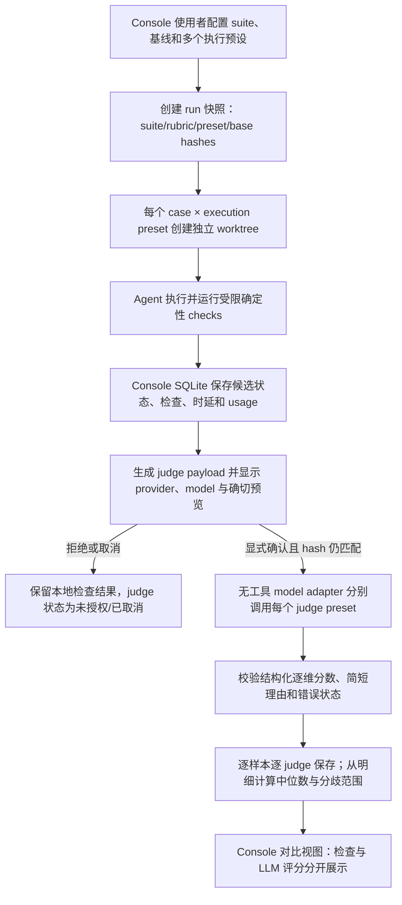
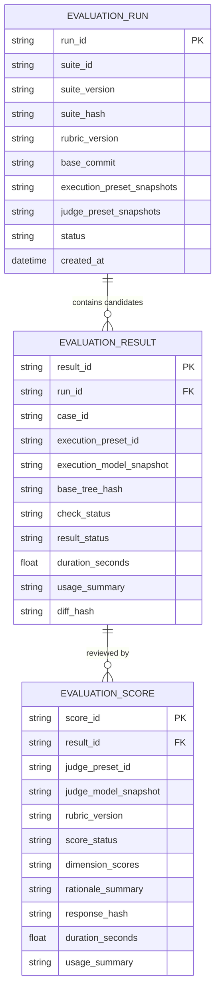

# PRD: 多评审模型的 Agent 与模型效果评测

- GitHub Issue: https://github.com/ZataZhang/keda/issues/284

> ✅ **交付前置**：无，可立即开工。
> 结构化声明见 §8 Delivery Dependencies，**那里是唯一事实源**。
> ⬜ **验收状态**：未开工。
> 本行是 §9 Acceptance Checklist 的投影，**那里是唯一事实源**。

本文分为人审层与执行器层：前四节确认评分的含义、用户可见结果与数据边界；后九节定义评测集、评审器、持久化、执行隔离和验收证据。

## Feature Overview (功能一览)

> 本节是 §10 Functional Requirements 的白话投影；行为验收以 §1 的行为样例为准。

- **公平比较执行模型与 Agent**（FR-1、FR-2）：选择同一版本评测集、同一基线和多个执行预设，对每个固定样本独立执行。
- **配置多个评审模型**（FR-3）：使用者可设置多个评审模型预设，在一次评测中选择一个或多个评审器；保留每个评审器对每个样本的原始评分结果。
- **评分与确定性检查分开展示**（FR-4）：LLM 评分、自动检查通过率、失败率、时延与可得成本分别展示；评审分歧可见，不默认折算成单一总分。
- **评审前检查外发内容**（FR-5）：候选执行结束后，用户先检查将发送给评审模型的内容、目标提供方和费用信息，再明确授权调用；默认不自动评分。
- **可追溯的本地历史**（FR-6）：本地保存评测配置快照、样本结果、每位评审者的评分与状态，支持查看和删除；不保存密钥或完整原始对话。

# Part A · 人审层 (Review Layer)

## 1. Introduction & Goals

### Problem Statement

目前项目有 Agent / 模型预设和按历史 attempt 汇总的 Stats，但两者回答不了“在同一组任务、同一个基线上，哪个执行模型或 Agent 的产出更好”。项目的评测指南已建议使用黄金样本、记录模型与 Prompt 版本、观察成功率/时延/成本；评测集格式和自动化入口仍待建立。单次运行的历史统计不能控制样本和输入差异，也没有多位评分者对同一个结果的逐样本判断。

用户希望比较不同预测模型与 Agent 实现，并允许多个评分模型各自评审。LLM 评分会受主观偏差、评审模型差异、提示注入和外发代码内容影响；因此本功能必须把每位评审者的结果单独保留、与确定性测试分开，并在任何外部模型调用前让用户检查实际发送内容。

### Interpretation (解读回显)

| 验证方式 | 输入 / 操作 | 期望观察到的结果 |
|---|---|---|
| 👀 人审 + 自动验证 | 在评测页选择一个已版本化样本集、固定基线、至少两个执行预设，并启动对比。 | 每个执行预设的每个样本都从同一基线的独立 worktree 开始；页面列出样本、执行预设、确定性检查、运行时间和结果状态。 |
| 👀 人审 + 自动验证 | 选择两个或更多评审模型预设，并对已完成候选结果发起评审。 | 在调用前展示每个提供方/模型将收到的确切任务说明、执行摘要、差异与检查结果，并展示可用的 token / 成本估计；只有明确确认后才发送。 |
| 👀 人审 + 自动验证 | 多个评审模型分别完成同一批结果的打分。 | 每个模型对每个样本、每个评分维度的分数和简短依据单独可查；汇总显示各维度中位数、有效评审数及分歧范围，不隐藏失败评审或离群分数。 |
| 🤖 自动验证 | 评审模型超时、拒答、返回无法解析的结果，或确定性检查失败。 | 对应记录标为超时 / 拒答 / 无效 / 失败 / 未评分；不把未评分写成 0 分，也不丢失同批其他结果。 |
| 🤖 自动验证 | 使用者拒绝外发评审内容或取消评测。 | 不发生对应评审请求；已得到的执行结果和确定性检查仍保留，评审状态为未授权 / 已取消。 |

**我默默定了这些**

- 一次对比固定评测集版本、基线 commit、执行预设快照和评分 rubric 版本；每个执行预设与样本组合从干净隔离 worktree 启动，避免前一个候选结果污染后一个。
- 执行模型从已有 Agent / 模型预设中选择；评审模型使用多个独立的命名评分预设，通过只处理文本、不使用代码工具的评分调用与执行器隔离。
- 候选 Agent 执行会按用户选择的执行预设联系其配置的模型提供方；开始运行前列出执行预设、provider/model 和可得费用估算。此运行启动动作与候选完成后对评分模型 payload 的逐次授权分开，评审未授权时不发送任何 judge 请求。
- 默认 rubric 采用 1–5 分锚定量表，按正确性/任务要求、完整性与范围、实现质量、验证证据分别给分和简短理由；不默认生成加权总分。若某维度少于两位有效评审者，不展示“多数意见”或合成结论。
- 汇总以各维度的中位数、最小—最大范围和有效评分数呈现；单个评审者、单个样本与任何无效/失败状态都可展开查看。
- 自动化确定性检查、Agent 最终状态、运行时长、稳定性和实际可得的 token/成本是独立指标。不能从不完整 usage 或未知价格推算精确成本。
- 评审请求只包含完成评分所需的样本任务、执行摘要、代码差异与确定性检查摘要；不自动发送环境变量、密钥、原始工具日志、完整终端历史或整个仓库。代码差异仍可能含敏感内容，所以发送前要能查看确切 payload。
- 评测默认由人显式启动，执行结束后暂停在“等待评审授权”；不后台自动评分、不在 CI / 合并 / Agent 路由中使用分数。

**我理解为不做**

- 不把 LLM 评分当作测试、独立 verifier、人工验收或发布门禁，不自动据此选择默认模型或修改执行路由。
- 不为任意仓库自动生成黄金集、不从历史任务中静默抽取 Prompt / Diff，也不提供大规模基准托管和跨组织排行榜。
- 不在 v1 中做通用 rubric 编辑器、统计显著性检验、模型价格抓取或 token 价格推断。
- 不允许评审模型调用工具、访问被评代码仓库或更改候选产物；不将评测任务提交 PR、写回正式 Issue 生命周期或影响实际 Agent Runner 队列。

请把它读成：使用者用固定且可追溯的样本与基线并行比较执行 Agent / 模型预设；候选执行结果先经过确定性检查，再由用户选择的多个纯文本评审模型独立评分。网页按样本呈现自动检查和每个评审者的结果，按评分维度呈现中位数与分歧。评分可以帮助比较，但永不代替测试或验收。执行结束后，系统先呈现确切外发内容，用户确认后才联系评审模型。

### What The User Gets

使用者可以比较多个 Agent / 模型预设在同一固定样本集上的表现，而不是从不相同的历史任务中猜测模型优劣。多位用户选定的评审模型会逐项独立打分；页面会保留每位评审者的评分、依据和缺失状态，并把它们与检查通过率、稳定性、耗时及成本分开展示。使用者可查看这次评测实际比较了什么、评审模型收到什么、结果如何产生，以及删除本地评测记录。

### Measurable Objectives

- 开始候选执行前，页面准确列出每个执行预设对应的 provider/model 与可得费用估算；未知费用明确显示为未知。
- 一个评测 run 内的每个执行预设 × 样本组合都记录相同 suite version、rubric version 和 base commit；worktree 从该基线独立创建。
- 多个评审预设均能对同一执行结果独立评分；逐评审的字段、理由和失败态可查，汇总值能从留存明细重新计算。
- 确定性检查状态与 LLM 评分分开展示；超时、拒答、无效 JSON、未授权和未评分永不伪装为 0 分。
- 未经明确确认时评审请求发送数为 0；确认后的请求内容与预览内容 hash 一致，provider、model 和有效评分数有记录。
- 删除评测 run 后，其 SQLite 结果与暂存 payload 一并删除；API key、环境变量和完整原始执行 transcript 不写入评测表。

## 2. Human Review Map (介入与风险地图)

### 决策一：评审分数是比较参考，不是任务验收

不同评审模型可能对同一产出意见不一；确定性测试也有范围边界。最小有效交付是把每位评审者的逐样本打分留在原处，按评分维度汇总中位数与分歧，并同时显示可重复的检查结果。该做法能支持模型间比较，但不能宣称评分是客观真值或单一总分。若之后需要质量门禁，应另行定义有明确校准数据的 rubric 和独立验收协议。

**请确认：** 评审分数只用于同批结果的辅助比较；逐评审结果与确定性检查分开展示；本功能不会将评分用于 CI、合并、发布或自动模型路由。

**验收：** 页面显示各评审模型、各维度分数、依据、中位数与分歧范围；确定性检查独立列示；任一有效分数、失败状态或样本明细可追溯，且没有由 LLM 分数驱动的通过 / 失败门禁。

### 决策二：代码差异外发前必须逐次预览并授权

为了让模型判断实现效果，评审器通常需要看到任务要求和候选代码差异。它们可能含用户代码或敏感文本；一旦发给所选模型提供方，无法由本机撤回。本方案只在候选执行完成后显示逐模型发送目标与完整 payload 预览，用户每次评测主动确认；拒绝时保留本地检查结果但不打分。这里的授权专用于评分请求：候选 Agent 可能在执行期间调用其选定 provider，这是用户在启动运行时选择并确认的行为；启动前页面需单列执行 provider/model 与可得费用估算。评测 run 的评分和配置快照保存在本地 Console SQLite，供本机对比和删除。

**请确认：** 候选执行按启动时显示并选择的 Agent provider/model 运行；评分模型只有当前页面确认的评审模型会接收预览中列明的内容，确认前不发起 judge 请求。评测暂存 payload 只在等待授权 / 评分期间本地保存，完成、拒绝或取消后删除；长期保留结构化分数、简短依据、来源快照与 hash，不保留 API key、原始工具日志或完整代码差异。

**验收：** 拒绝/取消的负控中没有发出评分请求；确认的实际请求逐字节对应预览 payload；用户可读到目标 provider、模型和费用信息（费用未知时明确标为未知）；本地记录删除后，run、分数与临时 payload 均消失。

### 自动门禁，不需要逐项人工审阅

Executor 与 verifier 负责评测样本格式和版本校验、干净 worktree 隔离、并发上限、确定性 check recipe 执行、每位评审响应解析与错误态、汇总重算、SQLite 重启读取/删除、日志和密钥不落库、窄屏布局以及默认无外发的网络边界。真实入口覆盖 Console 页面、API、SQLite 和真实模型 provider adapter；只有外部模型本身可以在常规自动验证中替换为边界 fixture，live provider 只在用户 opt-in 沙箱中运行。

## 3. Usage And Impact After Implementation

### Console 使用者

使用者进入 Console 的「模型评测」页面，选一个已版本化 suite、相同基线 commit、两个或更多执行预设、评分 rubric 和一个或多个评审预设。开始前页面逐项显示执行预设将使用的 provider/model 与可得费用估算；用户明确开始后，这些 Agent 预设可按原有配置调用各自 provider。系统为每个组合创建独立 worktree，显示排队、执行、检查与失败状态。评测运行不改变 Issue、PR 或主工作区。

候选执行结束后，页面分开呈现检查结果与 Agent 运行信息，并进入“等待评审授权”。使用者逐项展开外发内容，看到 provider、模型、任务、执行摘要、Diff、检查结论及当前可得费用；确认后，评审模型只返回结构化分数和短理由。结果页允许按样本或执行预设过滤，查看每个评审者、分歧、失败记录和成本缺口；使用者可删除整次本地 run。

### 评测集维护者

维护者在仓库中的版本化 suite 文件里定义稳定样本 id、任务说明、仓库 fixture/base ref 和获准的验证 recipe。新版本产生新的 suite hash；已执行历史仍保留原版本与基线快照。维护者可用文档化的 suite 校验入口发现格式错误和不安全 check 配置。系统不自动把真实 Issue 或私有仓库内容加入 suite。

### Agent / 模型配置维护者

维护者继续在现有 Agent Runner 设置中定义执行预设；评测页面从该清单选择执行候选。评审模型使用独立的命名模型预设，引用已有 provider / model 配置；页面允许配置多个默认评审者，也允许单次 run 覆盖。实际密钥仍只从既有环境注入，不通过浏览器或评测数据库回显。

### 兼容与迁移影响

- Console SQLite 增加独立的 evaluation run、case result 和 judge score 记录；启动时沿用现有 `PRAGMA user_version` 路径做向前兼容 schema 升级，不改已有运行日志、Issue、Stats 或 invocation 表。
- 原有 Agent 执行、Stats 成功率、Verifier/验收流程和 `kc` 命令行为不变；评测是新的手动 Console 页面/API，不作为 daemon 队列任务。
- 新增的是评测集 YAML 格式与评审模型 preset 引用，不新增密钥变量或复制一份 provider 凭据；空评测配置仍允许 Console 正常启动，评审调用需用户显式配置。
- 每次 run 按明确动作创建本地隔离工作区；已完成/已取消 run 自动清理临时工作区和暂存 payload，结果数据库按用户选择删除。

## 4. Requirement Shape

- **Actor：** Console 使用者、评测集维护者、Agent / provider 配置维护者、开发者与独立 verifier。
- **Trigger：** 使用者从 Console 明确创建一次模型 / Agent 对比；候选执行结束后再确认是否将具体 payload 发给评审模型。
- **Expected behavior：** 同一版本样本与基线下隔离执行多个预设；独立展示确定性检查和逐评审分数；允许配置/选择多个评审模型，并把外发授权、持久化和删除范围呈现清楚。
- **Scope boundary：** 固定本地 suite 的手动批量评测、逐样本评审和本地对比历史；不把分数接入发布门禁、正式 Agent 生命周期或远端排行榜。

# Part B · 执行器层 (Build Layer)

> 以下供实现者使用；Part A 的公平对比、逐评审保留、授权边界与“分数非验收”语义是行为契约。

## 5. Repository Context And Architecture Fit

### 当前可复用路径

- `docs/dev/evaluation.md` 已写黄金样本、版本跟踪、质量/时延/稳定性/成本指标，当前 TODO 明确缺 suite 格式与自动入口；本 PRD 需要把建议变成一条本地 Console 产品路径。
- 执行 Agent / 模型选择已有 `AgentModelPreset`，形态为 `(agent, model, reasoning_effort)`，来源为 `[agent_runner.presets.<name>]`；评测候选复用此快照，不重新定义执行模型目录。
- infrastructure 已有 `create_chat_model`、provider 配置解析及环境变量密钥加载，适合构造无工具的评分模型调用。评审预设只命名并引用模型 id，不把 Agent CLI 当作评审 API，不向评分模型绑定仓库工具。
- Console 持久层是 SQLite 独立账本并使用 `PRAGMA user_version` 管理 schema；评测新增表要按该存储自身版本增量升级，不能修改或假设 Alembic 版本。
- 历史 Agent / 预设 Stats PRD `tasks/archive/P2-FEAT-20261009-171037-agent-preset-performance-stats.md` 汇总不受控的历史 attempt；它回答频次、结果与时长，不提供相同样本的对照实验。本 PRD 新建受控评测，不重算或覆盖其统计。

### 架构边界与相关 PRD

- suite 解析、样本约束、状态迁移、评分校验与汇总放 `core`；HTTP 与 DTO 在 `api`；执行器适配和只读评审调用在 `engines`；SQLite/provider 调用等基础设施留在 `infrastructure`。依赖方向保持 `api -> core -> engines -> infrastructure`。
- `tasks/pending/P1-FEAT-20261012-103222-unified-runtime-dashboard.md` 添加 Dashboard 与导航入口，可能与评测页使用同一导航/前端 API 类型文件，但两者交付无前后置行为依赖；实施时协调共享文件。
- `tasks/archive/P1-FEAT-20261009-133425-lifecycle-agent-model-settings.md` 与当前 lifecycle settings 提供执行预设定义；本 PRD 只读取执行预设，并增加评审模型 preset 引用配置，不更改生命周期九阶段绑定。
- `tasks/archive/P1-FEAT-20261010-011714-unified-auto-concurrency-ceiling.md` 定义现有 runner 并发资源约束；离线评测必须尊重同一主机 capacity，不能另开一组无界 worker。
- `frontend-admin/` 不承载 Console 用户入口；改动仅落在 `frontend-public/` 与 Console API。

## 6. Recommendation

### Recommended Approach

在现有 Console 增加手动、版本化的对照评测闭环：suite 以仓库内 YAML 固定样本与检查 recipe；每个执行 preset × case 组合都从固定 base commit 的干净隔离 worktree 启动，结束后独立运行检查。候选结果先本地持久化并展示确定性数据，默认暂停，不调用任何 judge。用户确认具体 payload 和选定评审模型后，用现有 `create_chat_model` provider 工厂逐个执行无工具请求；结构化校验每位评审的量表、依据和错误态。页面比较每个执行预设、样本和评审模型，并显示维度中位数与分歧范围。

执行侧继续读取已有 `[agent_runner.presets.<name>]`。评审侧在 `config.toml` 中新增命名 judge preset 清单（model id + 可选温度/参数），只引用现有 provider 注册和 `OPENAI_API_KEY` 等环境密钥；允许配置多个默认评审预设，并可在每次运行时覆盖选择。Provider 不可用、API key 缺失或模型不在 provider registry 时启动前 fail-fast，不写入 0 分。

Suite 文件只接受明确结构：稳定 suite id / semver、版本、repo fixture、固定 base ref、rubric id / version、case id / task prompt 和命名 validation recipe。Recipe 映射到受限 argv，不允许 shell 拼接；限制超时、并发、环境继承与输出大小。评测工作区只允许写在运行专用根目录，不提交 PR/commit，也不触碰用户主工作区；完成、取消、失败恢复后按策略清理。Console 全局退出或崩溃后的 run 标为 interrupted，由用户显式恢复或删除，不自动重跑可能产生外部副作用的 Agent。

### 为什么该方案适合当前架构

项目已有执行预设、provider 模型构造器、只读 Console 和本地 SQLite，成本主要在固定样本格式、隔离执行与新的结果记录。把 benchmark 控制在本地 YAML、手动启动、小并发和用户授权的评审请求范围，可以首先得到可重复比较，又避免建设云端数据集服务、模型计费系统或 CI 门禁。历史 Stats 仍独立回答日常运行表现。

**ROI 判断：现在做一个受控 v1。** 使用者能在需要选型或改 prompt 时重复运行同一批样本，收益来自可复验的同条件差异、逐评审分歧和失败证据；成本主要是隔离 Agent 执行、Console SQLite 新表与 provider 授权 UI。更便宜的替代是手工跑一份固定任务并把结果贴进表格，但它不能绑定基线/执行配置、不方便保留多评审者的失败态，也不能从历史记录重算比较。为限制维护负担，先采用仓库 YAML、手动触发、多个文本 judge 与本地历史；只有 suite 被持续复用、人工复核量明显上升时再评估自动排程或 CI 阈值。

### Proposed Solution Summary (实现机制)

1. Suite registry 从固定仓库目录加载和校验 suite；内容 hash + 版本进入 run 快照。
2. 创建 run 时固定 case、基线 ref、执行 preset 的解析快照、rubric 版本和所选 judge presets；空 suite / 失效 preset / dirty base 等问题在执行前阻止启动。
3. `evaluation_run` 排程 `evaluation_result`；每个 case/preset 对应独立 worktree，运行 Agent 时使用已有 runner adapter，但评测 run 不进入 Issue lifecycle。完成后记录 agent exit/status、命名验证 recipe 结果、wall time 和可得 usage/cost。
4. Agent 完成后生成分评审模型的 payload。精确待审 payload 存在 Console 私有临时目录且仅在 waiting-consent/judging 期间保留；数据库留 hash。预览后用户确认，服务端重新核对 run/payload hash，再调用无工具的 `create_chat_model`。拒绝/取消不发出请求。
5. 每个 `evaluation_score` 存 judge preset 与解析后模型快照、prompt/rubric 版本、每维分数、短理由、状态、耗时、usage、response hash。中位数/范围从数据库明细实时派生，避免保存双份统计事实。
6. UI 提供 suite、执行 preset、judge 多选和基线配置；比较页展示每个候选、case 检查、每位 judge 和维度汇总；运行删除操作级联删除本地结果并清理该 run 的残余临时 payload/worktree。

### Scope Cohesion Gate

执行预设公平对照、多个评审器评分、检查结果对照和评分本地留存共同构成一次评价闭环：单独交付其中任一部分，都无法回答“同一任务条件下哪个实现效果更好”。所以保留在同一 PRD。默认 Dashboard / 桌面窗口 PRD 只需提供导航入口和可选摘要，不依赖本评测工作流，可独立交付。

### Alternatives Considered

- **直接把历史 Stats 增加 LLM 分数：** 不采用。历史 attempt 样本、基线和提示不一致，不可作为同条件实验；也会混淆运营统计与主观评审。
- **将任务 Diff 自动发给默认强模型并在后台评分：** 不采用。代码外发不可撤回，成本受数据规模影响；每次发送都必须展示目标和准确内容并经用户确认。
- **用平均总分替代逐评审结果：** 不采用。平均可能隐藏分歧和评审失败；当前没有用户确认的权重或校准样本。
- **评审模型复用能运行 repo tools 的 Agent CLI：** 不采用。评分调用读取的是显式摘要和 Diff，不需要命令/文件工具；无工具模型请求减少权限边界和提示注入面。
- **云端基准、自动 CI 回归门槛：** 暂缓。现阶段先验证固定样本的本地对照是否能帮助用户选型；只有同一套样本被持续复用、人工评审成本明显时，再评估自动调度或 CI 阈值。

## 7. Implementation Guide

This section is a living implementation guide based on current repository analysis. If implementation discovers additional affected files, hidden dependencies, or a better persistence/provider boundary, update this PRD before proceeding.

### 7.1 Core Logic

1. 创建 run 前验证 suite 版本、case id 唯一性、repo fixture/base commit 可达、checks 属于允许的 recipe，执行 preset/judge preset 全部可解析；没有满足条件的配置时 fail-fast。
2. 运行矩阵键为 `(run_id, case_id, execution_preset_snapshot_id)`；任何两个候选不得共享 worktree 或上一候选生成的文件。固定同一基线树 hash、工作目录映射、允许的环境变量和超时；遵守既有 Runner 并发 ceiling。
3. 检查结果记录命名 recipe、exit code、通过/失败、超时或未运行及有限输出摘要。检查命令只允许 argv + 受限 cwd，禁止 `shell=True`、suite 提供任意解释器脚本、继承完整用户环境或访问主工作区。
4. 评分 rubric v1 具备稳定 id/version、四个 1–5 分维度、每档含义和短文本证据字段。模型响应必须过 schema 和数值范围校验；缺项、额外格式无法解析、拒答、timeout、provider error 分别留状态，结果不能化为零分。
5. 汇总只按 `valid` judge scores 计算每维中位数 / min / max / N；任何未完成候选均带状态，页面不得把未完成矩阵排除后仍称全批次完成。单个有效 judge 只显示其分数和 `1 位评审`，不显示“评审一致”。
6. 审批边界：浏览器先取得 payload manifest/hash 与可读完整预览；批准 API 绑定 run id、judge preset 集与 manifest hash，服务端重新校验当前待审 payload hash 后才向 provider 发出请求。过期 hash 返回冲突并要求重新查看。
7. 临时 payload、worktree 生命周期与 run state 一致。评分完成、拒绝或取消后删除暂存 payload；持久层不存 raw prompt、完整 patch、token、环境变量或密钥。评审摘要限制长度且写入本地账本；run 删除级联清除其结果和缓存文件。
8. 自动评分默认为 false；评测开始 API 不能同时触发模型评审。只能通过单独的授权动作推进 `awaiting-judge-consent -> judging`；无网络调用结果是该默认值的可验证条件。

### 7.2 Change Impact Tree

以下路径是实现起点，不是完整文件清单；开工前搜索 `create_chat_model`、`AgentModelPreset`、`ConsoleStore`、`stats`、`PRAGMA user_version` 和模型评测页面入口的现有引用，结合同一分支的并行 PRD 更新此树。

```text
.
├── tasks/evaluation-suites/README.md [新增]
│   【总结】定义版本化评测集的目录、样本字段和受限 validation recipe 维护方法
├── tasks/evaluation-suites/example.yaml [新增]
│   【总结】提供不含私有 Issue 内容、可在隔离仓库中运行的 suite 样例
├── config.toml [修改]
│   【总结】增加可选的多个默认评审预设名称及 model-id 引用示例，不写密钥
├── src/backend/core/shared/models/model_evaluation.py [新增]
│   【总结】定义 suite、run、case、rubric、judge 结果与阶段状态的领域值对象
├── src/backend/core/shared/interfaces/evaluation_store.py [新增]
│   【总结】定义 run/result/score 的查询、保存、授权状态 CAS 与级联删除端口
├── src/backend/core/use_cases/model_evaluation.py [新增]
│   【总结】校验评测矩阵、隔离执行编排、显式评分授权、逐评审解析与维度汇总
├── src/backend/engines/model_evaluation/ [新增目录]
│   【总结】用现有 Agent Runner 执行候选，用 create_chat_model 发送无工具结构化 judge 请求
├── src/backend/infrastructure/config/ [修改]
│   【总结】解析评审模型 preset 引用并复用现有模型/provider 凭据加载，不持久化密钥值
├── src/backend/infrastructure/persistence/console_store.py [修改]
│   【总结】为 run、候选结果、逐评审评分增添独立 SQLite 表并安全推进 PRAGMA user_version
├── src/backend/api/routes/agent_runner_console.py [修改]
│   【总结】提供 suite/run/result/judge-preview/explicit-consent/delete API DTO 和错误状态
├── frontend-public/app/(app)/app/evaluations/page.tsx [新增]
│   【总结】提供从样本集/基线/执行候选/多个评审模型到结果对比的 Console 页面
├── frontend-public/components/evaluations/ [新增目录]
│   【总结】呈现运行矩阵、外发 payload 确认、逐评审理由、确定性结果及差异视图
├── frontend-public/lib/api/console.ts + frontend-public/lib/api/types.ts [修改]
│   【总结】为评测 suite/run/score 接口增加共享类型与请求客户端
├── frontend-public/components/layout/ [修改]
│   【总结】将模型评测页面加入 Console 导航并从导航 registry 生成真实入口
├── tests/backend/test_model_evaluation.py [新增]
│   【总结】覆盖隔离矩阵、rubric 解析、状态迁移、分歧汇总及取消语义
├── tests/backend/test_console_evaluation_store.py [新增]
│   【总结】覆盖 schema 版本升级、fresh SQLite 读取、run 删除级联和临时 payload 清理
├── tests/backend/test_console_evaluation_api.py [新增]
│   【总结】覆盖真实路由、授权前零 provider 调用和过期 payload hash 拒绝
├── tests/playwright-e2e/tests/console/model-evaluations.spec.ts [新增]
│   【总结】从生产 Console 路由验证评测创建、payload 预览、拒绝与逐评审结果查看
├── docs/dev/evaluation.md [修改]
│   【总结】记录 suite schema、可复验对照口径、judge授权、结果解释和限制
├── docs/api/references.md [修改]
│   【总结】记录评测 APIs、状态机、版本与外发确认契约
└── mkdocs.yml [修改]
    【总结】把新增评测集维护指南纳入文档导航（若现有导航未覆盖）
```

### 7.3 Risk Classification Register

| Change point | Tier | Decisive reason / intervention | Oracle / gate |
|---|---|---|---|
| 同基线执行矩阵、逐评审分数与“只作比较不作验收”的语义 | R2 | core 评价语义是固定区；需要人确认样本公平性与指标展示 | rv-1，真实 Console + fresh SQLite 同样本执行矩阵、逐模型结果与汇总对照 |
| 外部 judge payload、网络调用、成本及本地暂存/删除 | R3 | 用户代码跨越本机 provider 边界且不可撤回；须人确认并用拒绝授权负控 | rv-2，预览 hash 与实际请求一致；拒绝时 provider 调用数为零 |
| suite 校验、模型响应解析、失败状态和页面过滤 | R1 | 受限于新功能路径，有明确可注入 provider/store 边界 | rv-3，超时/拒答/坏 schema/取消用例与生产页面空态 |
| Console SQLite 新实体与用户删除 | R2 | 持久状态与级联删除可能遗留数据；由人审数据图和 fresh DB 证据 | rv-1/rv-2；迁移、重启读取及 run 删除验证 |

### 7.4 Executor Drift Guard

实现前用以下搜索重定位同层能力并查隐藏使用方；若由 concurrent PR 已创建同名模块或更新路由，先合并其当前边界再继续。任何新增文件、存储字段、公共 API 或 preset 注册路径须回写此 PRD 与 Change Impact Tree。

```bash
rg -n "create_chat_model|AgentModelPreset|PRAGMA user_version|class .*ConsoleStore|stats/agent-performance" src/backend
rg -n "agent_runner\.presets|model_loader|api_key_env|ChatModelSettings" src/backend/infrastructure config.toml
rg -n "app/stats|/app/dashboard|sidebar|navItems|ConsoleNav" frontend-public
rg -n "agent-preset-performance|evaluation-suites|model-evaluation" docs tasks
```

### 7.5 Flow Diagram



#### 本地评测数据关系

评测集是 Git 管理的版本化 YAML 文件，不复制成另一套长期数据表。Console SQLite 只保存 run 与本次执行/评分快照；精确 judge payload 只在审批与评分期间位于受限临时目录，数据库保留其 hash。



### 7.6 Realistic Validation Plan

```yaml
- id: rv-1
  behavior: "在同一版本 suite / rubric / base commit 下比较多个执行预设；真实 Console 页面展示逐候选检查结果、多个 judge 的逐维分数和可从明细重算的中位数/分歧。"
  reviewer: human
  real_entry: "启动 `uv run kc console`，打开命令输出的 loopback origin 下 `/app/evaluations/`，以隔离的 sanitized fixture suite 启动一轮至少两个 execution preset × 两个 judge preset 对照。"
  expected: "开始前页面准确显示每个 execution preset 的 provider/model 与可得费用估算（未知即明确显示未知）；用户确认运行后，每个 case/preset 均从同一 base tree 独立 worktree 开始；run 与结果在真实 Console SQLite 中 fresh connection 可读；相同 fixture judge 结果按逐维数值算出的中位数、范围、有效数与页面一致；确定性 checks、耗时、LLM 分数分别列示；拒答/坏结果不计为 0 分。"
  mock_boundary: "Console route/page、SQLite、状态迁移、suite/base/worktree 隔离、矩阵和 rubric 汇总都必须真实；运行 Agent/provider 与 chat model 可在 engines/provider 接口替身稳定返回，不连接真实模型；suite 和 repo 使用小型本地隔离 fixture。真实模型调用另经 opt-in sandbox，不把 fixture 结果称 live。"
  tier: R2
  test_layer: e2e
  required_for_acceptance: true
  presentation: "目标对比页与实际结果截图：tasks/evidence/P1-FEAT-20261012-103909-multi-judge-agent-evaluation/rv-1-evaluation-results.png；10 秒检查：两个候选、同一 suite/base、两个独立 judge、确定性状态与每维分歧同时可见。"
  critical_value_source: "suite version/content hash、base commit/tree hash、preset snapshots、`evaluation_result` 检查状态、`evaluation_score` per-judge 维度和状态，以及 fresh SQLite 查询。"
  must_cross: "Console 真实导航 → `/app/evaluations/` → suite/run API → 干净 worktree 与 Agent adapter → 命名 checks → SQLite schema/保存 → fresh process 读取 → 两个 judge adapter → SQLite score → UI 汇总。"
  forbidden_bypasses: "从不同 base/sample 拼装伪对比；共享 worktree；仅用前端 fixture 截图；只 mock store / 页面组合；以平均单总分替代 per-judge/per-dimension rows；从 SQLite 缓存而非 fresh read 证明持久化。"
  fresh_state_probe: "关闭并重开 Console，以新的 SQLite connection 和浏览器加载同一 run；核对 suite/rubric/model snapshots、case/judge 明细、聚合值和失败状态保持一致。"
  final_tree_evidence: "保存 run JSON、SQLite fresh-read、worktree base tree 清单、页面截图和 `git rev-parse HEAD` / working tree tree stamp；任何矩阵、schema、聚合、API 或页面变化后重采 rv-1。"
  negative_control: "使用隔离 fixture 的两个 base commit 或人为改变一位 judge 的单维分数后重跑 rv-1；将其中一个候选 worktree 改成共享/污染基线仅在 test boundary 验证时注入。"
  expected_fail: "错误候选基线必须在 run 创建前被拒绝，或明细中检测出 tree hash 不一致；改变一个 judge 分数必须改变对应明细与中位数/范围。若 UI 汇总不变，rv-1 应失败。"
- id: rv-2
  behavior: "每次外部评审只发送用户当前预览过并明确批准的 payload；拒绝、取消、payload 过期或 provider 未配置时不得联系 judge。"
  reviewer: human
  real_entry: "在真实 Console `/app/evaluations/` 完成一个 sanitized local run，打开 judge payload preview，选择一个已配置远端 judge preset 后分别执行拒绝与批准流程；live provider 仅 opt-in。"
  expected: "拒绝时 provider spy/request count 为零；批准要求当前 run 和 manifest hash 匹配，外发模型/提供方与预览一致；真实 opt-in 请求返回后留下评分与 usage（如 provider 给出），拒绝/取消后临时 payload 清除。"
  mock_boundary: "真实 UI、授权 API、payload manifest/hash 校验、SQLite、临时文件生命周期、配置解析与批准状态 CAS 必须真实；网络 provider 在 no-credential 验证中由 test boundary spy 替代；live sandbox 用真实已配置模型且发送 sanitized payload，不作为无凭据 fallback 的替代。"
  tier: R3
  test_layer: e2e
  required_for_acceptance: true
  presentation: "授权确认截图、拒绝路径 provider-call-count 报告与可选 live 请求摘要：tasks/evidence/P1-FEAT-20261012-103909-multi-judge-agent-evaluation/rv-2-payload-consent.png / rv-2-consent-negative-control.txt；10 秒检查：预览中可读见目标模型、任务、Diff 和 checks；拒绝后调用数为 0。"
  critical_value_source: "浏览器收到的 payload manifest/hash、Console 授权请求中的 run id/judge preset/hash、provider adapter 收到的 exact serialized content hash 与最终请求模型。"
  must_cross: "Console 页 payload preview → 用户确认/拒绝 → 授权 API → 当前 payload hash fresh compare → provider adapter → 同一 run 的 judge score 保存/拒绝状态 → fresh UI/API 读取。"
  forbidden_bypasses: "run start 时隐式打分；浏览器直接调用 provider；用预览摘要替代实际发送 payload；不校验过期 manifest；向 provider 发送 API key/raw environment/tool transcript；拒绝后仍异步排队评分。"
  fresh_state_probe: "先在新浏览器 session 用与页面同源真实 API 拒绝一次并查看 spy count；再创建另一 run 批准一次，换 fresh Console process 查询对应 score/状态与 payload 文件清理状态。"
  final_tree_evidence: "保存预览截图、request hash 对照、负控调用数、临时目录前后清单、相关配置名（不含密钥）和最终 working tree stamp；授权、序列化、provider 路由或清理变化后必须复跑。"
  negative_control: "经真实页面点击拒绝后检查 test-boundary provider spy 请求数；另在 test boundary 让 payload 在预览后变化再批准。"
  expected_fail: "拒绝流程任何 judge 请求数大于 0 即判失败；payload 改变后批准必须返回 conflict 且 provider 请求数仍为 0。"
- id: rv-3
  behavior: "评测被取消、超时、suite 不可用或模型输出不符合 rubric schema 时保留可解释的独立状态，不污染正式 Agent Runner 数据或产生零分。"
  reviewer: verifier
  real_entry: "`uv run kc console` → `/app/evaluations/`；通过真实 run API 启动隔离 fixture suite，并在 engines 边界注入 timeout、refusal、malformed JSON、cancel 与缺 provider。"
  expected: "对应 case/judge 按实际状态结束；其他候选和 judge 仍可完成；非 score 状态不参与分布统计；正式 Issue、PR、生命周期日志和主工作区均不变；Console restart 后未完成 run 标记 interrupted，不自动重新调用 Agent。"
  mock_boundary: "真实 suite parser、状态机、SQLite、HTTP route、临时 worktree cleanup 和 Console 页面必须真实；provider/Agent 响应只在其专属 adapter boundary 可模拟。"
  tier: R1
  test_layer: integration
  required_for_acceptance: true
  presentation: "结构化失败状态报告：tasks/evidence/P1-FEAT-20261012-103909-multi-judge-agent-evaluation/rv-3-degraded-states.json"
```

失败分诊：rv-1 先核对 suite/base hash 与 worktree 创建/清理，再看 Console store user_version 和 SQLite fresh connection，最后对照 summary reducer 与页面类型；rv-2 检查 preview manifest 生成、hash 复核位置、授权状态迁移与 provider adapter 的首次调用点；rv-3 对照具体 run/case/judge 状态和进程退出路径，确保只替换 provider adapter、不绕过真实路由/状态持久化。

### 7.7 Low-Fidelity Prototype

本 PRD 的高保真交互目标已由既有 Console 原型承载：[`docs/prototypes/prd-lifecycle-observability.html#evaluations`](../../docs/prototypes/prd-lifecycle-observability.html#evaluations)。目标状态包括多执行预设对照、评审模型设置、多位评审者分维度结果与分歧、checks 与评分分离。该原型只使用静态 fixture，不连接 provider、API 或 SQLite；交付实现截图必须与同状态原型图配对，不能用它证明 provider 授权或真实数据持久化。

### 7.8 Interactive Prototype Change Log

| File Path | Change Type | Before | After | Why |
|---|---|---|---|---|
| `docs/prototypes/prd-lifecycle-observability.html` | Modify | 无执行预设横向对比和 judge 明细视图 | 加入评测设置、多 judge 分项评分/理由/分歧及明细弹窗 | 在实现前评审多个执行模型和多个评分模型的比较关系 |
| `docs/prototypes/assets/runtime-board.css` / `runtime-board-prototype.js` | Add/Modify | 无评测结果与配置交互 | 展示静态 suite、多个预设、独立指标和评分理由 | 让评审可点击走查目标态 |
| `docs/prototypes/assets/prototype-hub.js` | Modify | 原型未登记本次评测入口 | registry 提供评测状态链接、目标图和来源 sidecar | 保持 Hub 是唯一原型目录 |
| `docs/prototypes/assets/runtime-evaluation-preview.png` / `.source.md` | Add | 无目标截图来源 | 保存浏览器目标图及 viewport/state/provenance | 与最终 Console 用户流截图配对 |
| `docs/prototypes/assets/runtime-consent-preview.png` / `.source.md` | Add | 无评审前授权目标图 | 保存完整 payload 预览、接收模型和默认未授权状态 | 评审代码外发与逐次授权边界 |

### 7.9 External Validation

| Topic | Source | Checked On | Relevant Finding | Impact On Recommendation |
|---|---|---|---|---|
| 同样本的多版本比较 | [Langfuse: Compare experiments](https://langfuse.com/docs/evaluation/experiments/compare-experiments) | 2026-10-12 | 实验比较以同一 dataset runs 对齐，并可查看逐样本差异、分数、成本和延迟；只看聚合可能遮住单项退化。 | 固定 suite/version，保留逐 case 明细并单列指标，不只放一个总分。 |
| 多个独立模型评分与 reducer | [Inspect: Multiple scorers](https://inspect.aisi.org.uk/multiple-scorers.html) | 2026-10-12 | 一个样本可保留多个独立 scorer 输出，再用显式 reducer 派生汇总。 | 保留每个 judge 的原始结构化结果；中位数/范围从明细派生而不是覆盖票数。 |
| 模型评分异常 | [Inspect: Model graded evaluations](https://inspect.aisi.org.uk/model-graded.html) | 2026-10-12 | model grader 是可配置评分者；不能解释的答案可以标 abstain/unscored。 | 拒答、解析失败和超时单独留状态，不把它们压成 0 分。 |
| Agent 基准样本与任务执行 | [SWE-bench](https://github.com/SWE-bench/SWE-bench), [OpenHands Benchmarks](https://github.com/OpenHands/benchmarks) | 2026-10-12 | 开源 Agent benchmark 以固定 issue/task 样本和执行环境评估 Agent 解题，而不是仅比较裸模型名称。 | suite 必须固定任务和 base/environment；项目先提供本地、可维护的小型 YAML 版本，不照搬大型托管 benchmark。 |

上述开源实践只支持“同数据对照、保留单项评分和执行证据”的设计选择；将中位数、授权预览、临时 payload 保留期与不设总分用于本项目，是结合本机 Console 单用户/本地 SQLite/用户代码外发边界作出的推断，不是这些项目的原样要求。

## 8. Delivery Dependencies

### Delivery Dependencies

- Depends on tasks/issues:
  - none
- Gate type: none
- Sequence: via-main
- Notes: 与运行时看板 PRD 的导航文件软重叠，无 API、数据或构建顺序依赖；评测功能无需等待独立桌面窗口交付。

## 9. Acceptance Checklist

### 9.1 人读呈递区（Human Review Surface）

| 要看什么 | 呈递物（实现后填真实截图；当前图是 design intent） | 约 10 秒自检 |
|---|---|---|
| 同 suite/base 下多个执行预设、多个 judge 的分样本结果与分歧 | Prototype: `docs/prototypes/assets/runtime-evaluation-preview.png`；production capture: `tasks/evidence/P1-FEAT-20261012-103909-multi-judge-agent-evaluation/rv-1-evaluation-results.png` | 核对 suite/base 一致，两个 execution preset 与两个 judge 可展开；checks 与评分不同列，逐维分数、理由及范围可见。 |
| 外部评审授权前的准确数据、提供方和拒绝结果 | Prototype: `docs/prototypes/assets/runtime-consent-preview.png`；production capture/负控: `tasks/evidence/P1-FEAT-20261012-103909-multi-judge-agent-evaluation/rv-2-payload-consent.png` 与 `rv-2-consent-negative-control.txt` | 核对预览包含实际发送 Diff 与 provider/model；拒绝后调用数为零、暂存 payload 已删除。 |

**当前目标图（component preview / design intent；不是生产入口证明）**


> 验证层级：**component preview / design intent**；候选结果、评分和统计均为静态 fixture。
> 本地打开：`open docs/prototypes/assets/runtime-evaluation-preview.png`


> 验证层级：**component preview / design intent**；授权/拒绝仅切换页面状态，不连接模型 provider。
> 本地打开：`open docs/prototypes/assets/runtime-consent-preview.png`

交付时每行须提供同状态生产截图/报告，目标图为设计意图，不能替代 run API、SQLite 或实际 payload 授权证据。从真实 Console `/app/evaluations/` 进入；验收材料可用 `just prd review tasks/pending/P1-FEAT-20261012-103909-multi-judge-agent-evaluation.md` 查看。

`reviewer: verifier` 的 rubric/schema/failure 单测、状态机与 interrupted 重启断言、并发限流、模型密钥不落库、文档构建和 suite parser 负例属于自动验证，故不列入人读呈递区。

### 9.2 Acceptance Evidence Package

#### Human-Confirmed

- [ ] 确认分数语义按 §2 决策一：不同 judge 的独立判断和 deterministic checks 分开展示，不计算默认加权总分；任何分数不成为 CI、合并、发布或自动路由门禁。（对照 `rv-1` 与 prototype/production 配对。）
- [ ] 确认外发和本地数据范围按 §2 决策二：模型调用前逐次查看实际 payload 并确认；评测结果本地保存，拒绝/完成后临时 payload 清除；API key 和完整 transcript 不落库。（对照 `rv-2` 预览、真实请求 hash、拒绝负控和 fresh deletion 证据。）

#### Behavior Acceptance

- [ ] 同一 run 固定 suite version/hash、rubric version/hash、base commit/tree hash 和执行/评审模型快照；执行矩阵的每个组合都从干净 worktree 开始，checks 用受限 recipe 执行。（`rv-1` tree manifest 与 run JSON。）
- [ ] 每个 judge 在每个 candidate/case 单独留分、维度依据、model/prompt snapshot、耗时、usage/成本可用性和结果状态；修改逐评审值能改变重算摘要。（`rv-1` fresh DB 与 aggregation 重算。）
- [ ] deterministic check、执行结果、稳定性、latency/cost 与模型评分分区呈现；没有 usage/价格事实时标注未知，不填补估算。（页面截图与 DTO。）
- [ ] timeout、拒答、无效/缺字段 JSON、取消、provider error、suite 错误、未授权和 interrupted 各自可解释；未评分既不进入评分中位数也不成为 0 分；其他 case/judge 不因单一失败丢失。（`rv-3`。）
- [ ] 评测 run 不触发正式 Issue / PR /生命周期状态变更，Agent 不接触主工作区；执行 worktree、缓存 payload 和 database run 均能按结束/删除策略清理。（`rv-2`/`rv-3` 清单。）

#### Frontend Acceptance

- [ ] 从真实 Console 导航进入 `/app/evaluations/` 可选 suite、基线、多个执行预设、多个 judge preset，显示矩阵状态与逐项结果；浏览器刷新后能从 fresh API 读取持久 run。（Playwright user flow + `rv-1-evaluation-results.png`。）
- [ ] Payload preview 具备 provider/model、任务、summary、Diff 与 check 结果的可读展开、敏感字段提示、费用/usage 可得性和单独确认/拒绝；过期内容需重新确认；拒绝在生产 composition 里可验。（`rv-2`，不以直接渲染 modal 代替页面入口。）
- [ ] 结果页可以定位 case、execution preset、judge、缺失/失败项；小屏 390×844 可滚动，无横向溢出且不会把表格裁成不可操作。（Playwright viewport 断言与截图。）

#### Architecture Acceptance

- [ ] 依赖方向维持 `api -> core -> engines -> infrastructure`；suite 规则、rubric 验证、分数 reducer 属 core；React 页面不自行计算评分口径。
- [ ] Judge adapter 使用 `create_chat_model` 或经审查等价的无工具 model call；评审请求不复用可运行 shell/仓库工具的 Agent task profile。credential、provider、model 在服务端解析，不由客户端提交密钥。
- [ ] suite recipe 不拼 shell 字符串，不继承任意用户环境、不在主工作区执行；Agent/模型调用数量受预算和既有并发上限限制；run 创建、授权和删除有幂等/并发状态约束。
- [ ] SQLite schema 迁移遵守 ConsoleStore `PRAGMA user_version` 路径，升级后现有 Console 日志、Stats、Invocation 查询保持原样；run 删除级联清除相关行和临时文件。

#### Documentation Acceptance

- [ ] `docs/dev/evaluation.md` 记录 suite YAML 字段、版本/hash、授权流程、rubric v1、逐评审解读、删除/保留和无凭据验证入口；`mkdocs.yml` 若新增长期页面则同步导航。
- [ ] `docs/api/references.md` 记录 suite/run/result/preview/approve/delete APIs，状态枚举、Conflict/error 语义、默认不开启 judge 和 secret/payload 边界。
- [ ] 如新增 config key，`config.toml`、settings loader 和配置参考文档同步；密钥仍仅由现有 env 注入、`.env.example` 只保留未注释空密钥项，不把预设模型值写为秘密。
- [ ] Prototype Hub registry、原型返回入口、截图 sidecar、说明页和窄屏行为一致；现有 `/app/stats` 统计仍为单独的历史执行数据入口。

#### Validation Acceptance

- [ ] `rv-1` 通过真实 `kc console` 与页面/API、真实 SQLite store/schema、隔离 fixture repo/worktree 采集同批矩阵、fresh process 查询、逐评审记录和摘要重算；provider 在自动测试边界替身可用。
- [ ] `rv-2` 做拒绝/批准两条真实页面路径；负控用 provider spy 核实拒绝后请求数为零、payload 改变后 approval 失败；live provider run 使用 sanitized suite 与用户 opt-in 凭据，保存 provider/model 与 usage，不提交任何秘密。
- [ ] `rv-3` 用 suite/provider boundary 注入 timeout/refusal/schema 错误/cancel/restart，在真实 store/API 中证明未评分为非 score 状态、未自动重试、其余结果仍可读取。
- [ ] 配套 targeted Python 与 Playwright 用户流程、`uv run mkdocs build --strict`、前端 typecheck/build 按 `docs/ai-standards/testing.md` 分类记录；若无法访问真实模型服务，明确披露 live provider 未覆盖，不把 mock 称为 live。
- [~] 独立 verifier 对 R2/R3 证据、同基线矩阵和外发授权负控复核 PASS — runner-owned gate。
- [~] PR 证据发布、主线归档与最终 tree 等价复核 — runner-owned gate。

#### Delivery Readiness

- [ ] §9.1 每行都由相同状态的原型/生产配对及可读产物支撑；completion message 内嵌目标图与实现图，并携带表格内容。
- [ ] 所有非 Human-Confirmed 项勾选或标 `[~]` runner gate，证据对应具体 run/hash/final tree；§13 Final Reconciliation 完成且 banner 与 §9 状态一致。

## 10. Functional Requirements

- **FR-1**：用户可从 Console 导航启动一轮手动评测；选择一个版本化 suite、固定 base ref/rubric、两个或更多 execution preset；suite version、内容 hash、base commit/tree 和解析 preset snapshot 在 run 创建时固定。
- **FR-2**：run 为每个 execution preset × case 建立独立干净 worktree，运行 Agent 和 suite 声明的命名 deterministic check recipe；结果包含状态、exit/check outcome、wall time 与真实可得 usage/cost，不改正式 Issue/PR/main worktree。
- **FR-3**：可配置多个有名 judge presets 并为单个 run 选择一个或多个；judge 使用无工具的文本模型调用，按 rubric v1 独立评审每个 candidate/case，逐 judge 保存模型版本、维度评分、短依据、耗时、usage、hash 与错误态。
- **FR-4**：结果页将确定性 check、Agent 运行指标与 LLM 评分分开展示；同一维度从有效 judge 明细动态计算中位数、min/max 分歧范围和 N；无效/失败/未授权结果永不变为零分，页面不生成默认 weighted total 或 pass gate。
- **FR-5**：Agent 运行结束默认停在 `awaiting-judge-consent`；预览显示每个目标 provider/model 及准确 payload。用户批准后服务端检查 preview hash 一致才调用 judge；拒绝、取消、过期 hash 不发请求。运行开始、CI、CLI、daemon 不触发自动评分。
- **FR-6**：Console SQLite 持久保存 run、case result 和逐 judge score 快照，支持 fresh read、按条件过滤与删除；暂存 payload/worktree 有限生命周期，密钥和原始工具 transcript 不落库。Console 重启后未完成任务标记 interrupted，不自动执行重复的 Agent/provider 请求。

## 11. Non-Goals

- 不改已有历史 Stats 统计口径、现有 Agent Runner 生命周期、Verifier 判定或 PR merge gate。
- 不新增 `kc` CLI 子命令/旗标、CI 自动评分、自动选择模型、主观总分权重或质量门槛。
- 不导入任意外部 benchmark 服务、不自动采集 Issues、不建设 suite Web CRUD 编辑器/多租户共享/排行榜。
- 不在 judge prompt 或本地持久层放原始 API key、完整环境、全部 Agent tool transcript 或 entire repository archive。
- 不支持评审模型 tool calling / function calling，不让 judge 在 candidate worktree 内执行；不因评分重跑已完成的 Agent。

## 12. Risks And Follow-Ups

- **同样本仍可能有环境差异**：固定 base tree、依赖安装规则、超时和 worktree；在 run 详情显示运行环境快照，不能把一次随机波动描述为稳定优劣。
- **LLM judge 自身偏差**：每位评审者独立展示；每维中位数与范围不能代替原始判断。用户可增加评审者或人工复核，不做统计显著性承诺。
- **代码外发和提示注入**：payload 视为不可信代码文本，仅由无工具 model call 读取；无自动发送，展示精确内容与接收 provider，每次 run 重新授权；用户批准前显示内容可能含机密的提示。
- **并发/成本增长**：候选数量 × case 数 × judge 数构成调用上界；创建 run 前显示请求数、并发限制及能获取到的成本信息，单 run 有最大矩阵大小/超时，不以未知价推断金额。
- **Console SQLite 成长**：默认只保留短评分理由和结构化指标；run 删除级联清理，提供列表中本地数据大小或记录数量，以触发清理策略后续评估。
- **历史重评与 rubric 改版**：v1 不用新 rubric 悄悄覆盖旧分数；如要比较历史产物需独立“重新评审”用户动作和新的 consent/payload hash，留待实际用户需要后再做。
- **模型 registry 一致性**：judge alias 引用 provider 已知 model id；缺凭据或 model/provider 无法解析时显示不可用，不用执行 Agent preset 回退。

## 13. Decision Log

| ID | Decision | Chosen | Rejected | Rationale |
|---|---|---|---|---|
| D-01 | 执行效果比较单位 | 同一 suite version × base tree 的隔离 case/preset 矩阵 | 不同时间的历史 attempt 汇总 | 控制任务难度与代码基线，结果更可解释并可复验。 |
| D-02 | 评审模型配置 | 多个命名 judge preset 引用现有 provider/model registry 与 env 凭据 | 复用有 shell / repo tool 的执行 Agent 评审 | judge 只需文本推理；独立模型调用避免把任务工具权限交给评审者。 |
| D-03 | 分数聚合 | 每位评审者原始结果 + 每维中位数/范围/N | 默认加权总分或 pass/fail | 让用户看到分歧，避免把尚未校准的主观值当作真值。 |
| D-04 | 外发时机 | 单次 run 的 payload 预览后显式授权 | 自动后台评分 | 代码外发不可撤回且可能产生费用，需要明确逐次确认。 |
| D-05 | 结果用途 | 辅助比较，人工结合确定性证据解释 | 自动进入 CI/合并/路由决策 | 项目当前没有经校准的评分阈值，自动门禁会放大 judge 偏差。 |

### Final Reconciliation

- Interpretation: 待实现后确认 — 对照固定 suite/base、多个 execution/judge preset、逐项评审和授权决策。
- Public behavior and contracts: 待实现后确认 — 核对 `/app/evaluations/`、run 状态、payload manifest/consent 与结果 DTO。
- Related PRD status: 待归档前复核 — 核对运行时 Dashboard 导航、历史 Stats 和 model settings 的当前主线行为。
- Requirements and risks: 待实现后确认 — 检查数据保留、外发边界、judge 错误态、并发/成本及评分非门禁语义。
- Reconciled differences:
  - none（开工前无已知实现差异；agent preset registry 与文本 provider model registry 是不同职责，实施时不得把两者混为一个执行命令。）

## Change Log

### 初始 PRD
- Type: scope / architecture / acceptance
- Before: 无受控 Agent/模型效果对照评测 PRD；`docs/dev/evaluation.md` 仅有建议与格式/入口 TODO。
- After: 定义版本化本地样本集、同基线多执行预设、多评审模型、逐样本可追溯评分、外发前用户授权及本地结果生命周期。
- Reason: 用户提出不仅要评价“预测模型”，还要评价不同 Agent 实现效果，并指出评分模型应可配置多个。
- Impact: 建立与运行时 Dashboard 松耦合的评测闭环；历史 Stats 继续服务日常运行观测，judge score 不影响发布/合并/路由。
- Review: 初稿完成；评分非门禁和逐次外发授权待 PRD 人工评审。
