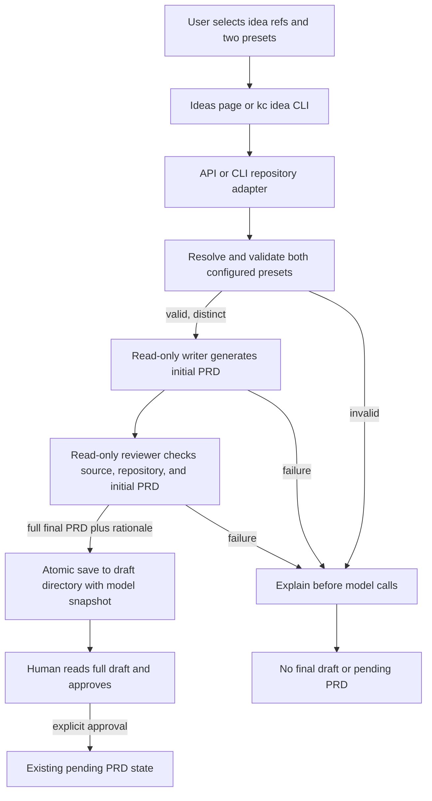

# PRD: 双模型复核的 Idea Inbox PRD 生成与 CLI

> ✅ **交付前置**：无，可立即开工。（有依赖时改用 ⛔ 并指明上游 PRD 与顺序原因）
> 结构化声明见 §8 Delivery Dependencies，**那里是唯一事实源**。

> ⬜ **验收状态**：未开工。（归档时与 §9 对齐：Human-Confirmed 仍有空框 → 🧍 待人工验收，全部由人确认后 → ✅ 已验收）
> 本行是 §9 Acceptance Checklist 的投影，**那里是唯一事实源**。

> 本 PRD 分两个 altitude，分别服务不同读者，自上而下阅读：
>
> - **Part A · 人审层 (Review Layer)** — 需求方 / 验收人读这部分，决定“该不该做、做得对不对”，并通过风险地图知道哪些地方必须亲自确认。Part A 不出现实现机制、文件路径、命令。
> - **Part B · 执行器层 (Build Layer)** — 实现者（人或 Agent）读这部分动手。人只在 Part A 风险地图点名处下钻审查；其余交执行器与自动门禁。

## Feature Overview（功能一览）

- `FR-1`：用户为每份 Idea Inbox PRD 明确选择写作模型与复核模型；复核模型接收原始想法、仓库依据和初稿，并生成最终草稿。
- `FR-2`：复核模型替用户处理有依据的常规取舍，在 PRD 中写明决定与理由；只有会改变目标或带来重大风险、且没有安全默认项的问题才交给用户。
- `FR-3`：网页与 CLI 共享同一生成流程；草稿仍待人审，用户明确批准后才进入正式待办。
- `FR-4`：每个草稿记录两阶段所用的模型预设快照；任一阶段失败时明确失败，不生成伪装成已复核的草稿。
- `FR-5`：网页呈现可用预设、最终 PRD 全文和模型来源；签名 inbound 草稿请求也遵循成对预设规则。
- `FR-6`：CLI 可列出 Idea ID、生成草稿并在人工审阅后批准。
- `FR-7`：旧草稿仍可读取和批准，并明确显示未记录模型来源。
- `FR-8`：指南、API/CLI reference 与随包 operator skill 同步新流程和命令契约。

---

# Part A · 人审层 (Review Layer)

## 1. Introduction & Goals

### Problem Statement

Idea Inbox 当前只调用一个内容生成 Agent，网页没有写作模型或复核模型选择。调用失败时会静默退回简单模板，因此目前无法确认一份草稿是否经过独立复核。这个流程容易留下结构和实现依据不足的 PRD，也会让模型把本来能基于仓库事实做出的常规选择继续抛给用户。

现有 Idea Inbox 已有网页草稿、人确认后进入待办的流程；Keda 也已有命名模型预设和只读内容生成接口。缺少的是两者之间的有序复核步骤、复核理由的呈现，以及网页之外可复用同一流程的 CLI 入口。

### Interpretation (解读回显)

这是你前置批准的行为解读。下面每行都可以被实际结果否证；人审项对应 §7.6 的 oracle。

| 验证方式 | 输入 / 操作 | 期望观察到的结果 |
|---|---|---|
| 👀 人审 + 自动验证 | 用户选取一条或多条想法，并为写作和复核分别选择已配置的模型预设后生成草稿。 | 写作模型先产出初稿，复核模型再读取原始想法、初稿和目标仓库依据，输出一份最终 PRD；草稿显示两个实际使用的预设，仍处于待审阅状态。 |
| 🤖 自动验证 | 复核发现几个可行方案，但仓库依据和用户目标支持其中一个方案。 | 最终 PRD 采用有依据的推荐方案，在决策记录中写明依据和放弃的方案；不把这个选择列为待用户回答的问题。 |
| 🤖 自动验证 | 复核发现需求存在会改变产品目标或重大风险的歧义，且没有安全、可逆的默认选择。 | 草稿说明推荐项、影响和待用户确认之处；没有把未确认事项描述成已经确定的事实。 |
| 🤖 自动验证 | 任一模型预设无效、写作模型失败、复核模型超时或输出为空。 | 调用明确标出失败阶段，不留下空文件、半成品或标记为已复核的草稿；原始想法保持不变。 |
| 🤖 自动验证 | 用户在网页或 CLI 查看最终草稿并显式批准。 | 只有批准动作会把草稿移入正式待办；生成命令本身不会自动批准。 |

**我默默定了这些**

- 首期固定为“一次写作调用 + 一次复核调用”，顺序运行。复核模型直接修订并输出最终 PRD，不启动多轮辩论，也不要求用户阅读内部讨论记录。
- 写作和复核使用用户为本次生成选择的命名模型预设。系统展示配置中的 Agent、模型 ID 和推理档；系统不声称能自动判断哪个模型在绝对意义上“更高级”。两个选择必须解析为不同的 Agent / 模型组合，避免同一模型被误呈现为独立复核。
- 复核模型看到原始想法与初稿，并按目标仓库的 Agent 说明、PRD 规范、架构文档和相关待办/归档任务检查依据；它不能只评价初稿是否“看起来完整”。
- 可从仓库和需求中得出充分结论、且选择可逆的事项，由复核模型直接决定并记录理由；只有目标本身有实质歧义、授权/敏感信息/破坏性影响/重大成本等风险没有安全默认方案时，才保留给用户确认。
- 网页和 CLI 共享这个两阶段流程。CLI 默认操作当前仓库，并沿用既有仓库选择方式支持指定路径或已登记的 repo ID。
- 签名 inbound 仍可追加想法；如果 inbound 请求要求立即生成 PRD，也必须带上写作与复核预设。缺少预设时保留已追加的想法并返回草稿错误，不退回单模型生成。
- 每阶段沿用现有单次内容生成的超时设置；两阶段顺序运行，因此整体耗时可能接近当前单次调用的两倍。首期不增加后台队列或流式对话。

**我理解为不做**

- 不让三个或更多低阶模型并行撰写，不安排多个审稿模型投票或仲裁。
- 不改 `deliberate` 的 Issue Phase 0 讨论流程，也不改其他 Issue、PR 或 Issue→PRD 内容生成 target。
- 不自动把生成结果写入正式待办，不自动发布 Issue/PR，不替代最终人工审阅。
- 不新增模型质量排行榜、评分基准、费用估算面板或对“高级模型”的自动分级。
- CLI 首期处理已有 Idea Inbox 条目 ID；不在 CLI 内另建一套想法存储或自由文本采集流程。

本 PRD 将 Idea Inbox 的 PRD 草稿从一次生成扩展为两次有序调用：用户指定写作者，用户指定的独立复核模型基于原始需求和仓库事实做判断并交付最终草稿。模型能给出有依据的选择时，它直接选并写理由；没有安全默认项的真实阻塞问题才进入人工确认。网页、CLI 与要求立即生成草稿的签名 inbound 都执行相同选择和失败规则。草稿仍需用户单独批准才进入正式待办。其他生命周期讨论和内容生成 target 保持当前行为。

### What The User Gets

用户可以在 `/ideas` 选择两种模型，看到完整的最终 PRD、模型来源、决策理由和真正待确认的问题；也可以从终端列出想法、生成同一类草稿并在审阅后批准。明显更优且有依据的常规方案会由复核模型先选定，用户能看到它为何这么选。

### Measurable Objectives

- 新网页、CLI 和 inbound 草稿路径各执行一次写作与一次复核，顺序固定，输出记录实际预设和解析后的模型信息。
- 复核输入包含原始选中想法与写作初稿，并要求重新核对目标仓库规则、架构与相关任务。
- 对有明确推荐项的取舍，最终 PRD 包含所选方案、理由和放弃项；不得只留下“请用户决定”。
- 两阶段中任一调用失败时不保存最终草稿，不走简单模板兜底，也不把初稿标成复核通过。
- 网页与 CLI 生成结果都只进入草稿区；只有独立的人类批准动作才能写入正式待办。
- 写作和复核解析到相同 Agent / 模型组合时，在任何模型调用开始前拒绝请求并解释原因。

## 2. Human Review Map (介入与风险地图)

这一节只列确实需要人确认的产品决策。自动门禁负责验证其余实现路径。

### 决策一：两阶段决策权、模型选择与草稿批准边界

推荐把首期定为用户指定写作模型、再由用户指定的不同模型复核并改写最终 PRD。复核模型可以替用户处理有证据支持、影响可逆的常规选择，同时必须在最终 PRD 中给出理由；它只把真正没有安全默认项的问题交给用户。两个预设都需要显式提供，不能在请求缺项、模型不可用或复核失败时假装已经完成复核。inbound 缺少成对预设时只保留想法，不创建单模型草稿。所有入口生成后都留在草稿区，仍由人单独批准进入正式待办。

这会让正常生成比现在多一次模型调用，增加耗时和模型费用；它保留了需求方的最终控制，也避免把明显可判断的问题反复交回。首期不使用三份初稿加多评审者仲裁，因为现阶段没有证据证明额外调用能带来足以抵消费用、延迟与决策整合复杂度的收益。

**请确认：** 首期采用这一组统一规则：网页、CLI 和 inbound 草稿必须显式指定不同模型预设；复核模型对有依据的常规方案直接作决定并说明理由；失败时不降级为单模型；草稿经人单独批准后才进入待办。若你希望 inbound 继续单模型兜底，或希望 CLI 只负责生成不负责批准，请在确认时指出。

**验收：** 真实网页和 CLI 流程都能呈现最终 PRD 与决定理由，预设和失败状态准确可查，草稿不会绕过人类批准。

### 自动门禁，不需要逐项人工审阅

- 预设解析、不同模型校验、调用顺序、超时和失败分支由针对真实入口的验证证据证明。
- Markdown 元数据、来源想法 ID、草稿状态和批准目标由 fresh filesystem read 验证。
- 前端展示、CLI help/JSON 输出和随包 skill / docs 的一致性由真实入口和构建检查验证。

### 本次明确不涉及

本次不新增数据库表、不持久化原始模型 transcript、不增加模型供应商 SDK、不调整鉴权或公开发布行为；模型调用继续使用现有只读 Agent 执行边界。

## 3. Usage And Impact After Implementation

### Idea Inbox 使用者

从 `/app/ideas` 选择仓库和想法，查看可用预设的实际 Agent / 模型 / 推理档，分别指定写作与复核模型，生成草稿后打开完整 PRD。用户能读到复核后的决定记录和待确认问题，再决定是否确认进入正式待办。现有原话追加和 summary 编辑流程不变。

### CLI 使用者

在目标仓库查看想法 ID，为写作和复核分别选择模型后生成草稿。CLI 返回草稿位置、标题、状态和两个模型预设。用户打开完整内容审阅后，再单独发起批准，草稿才会进入正式待办。默认目标为当前仓库，也可指定其他已登记仓库。

### 仓库 / 模型配置维护者

在现有模型预设配置中维护两个明确模型 ID 的预设；无需新增 provider 或密钥配置。网页按目标仓库已加载的配置列候选项，CLI 可用现有模型预设列表查看配置。预设未定义、缺少显式模型、Agent 不支持模型参数或两者解析成相同 Agent / 模型时会在运行前失败。

### Inbound 采集方

签名 inbound 继续把原始想法追加到对应仓库。若请求还要求直接生成草稿，需一并传入两个预设名；想法已成功采集但模型预设缺失或生成失败时，响应保留采集成功结果并说明草稿未生成的原因，不会隐式使用默认模型。

### Impact On Existing Behavior

- 原始想法记录仍只追加、不改写；AI 总结仍是可重写的派生背景。
- 草稿命名、pending 批准状态机和正式 PRD 命名保持不变；新增的模型来源元数据写在草稿文件头，不引入数据库。
- Idea Inbox 网页和 inbound 自动草稿的请求新增成对预设要求；旧的只传单个 Agent / 未传模型的草稿请求会被提示补齐模型选择，不再默默产生单模型草稿。仅追加想法的 inbound 请求不变。已存在的旧草稿仍可读取和批准，页面标明其模型来源未记录。
- 其他 `content_generation` 生命周期 target 与 Phase 0 `deliberate` 行为不变。

## 4. Requirement Shape

- Actor: Idea Inbox 用户、CLI 使用者、目标仓库的模型预设配置维护者、已签名 inbound 采集方。
- Trigger: 用户在网页或 CLI 对一条或多条已有想法发起 PRD 草稿；签名 inbound 请求明确要求同步生成草稿。
- Expected behavior: 用两个显式且不同的预设先写后审；复核模型检查原文、初稿和仓库依据，直接决策并改写最终 PRD，理由进入 PRD Decision Log；真实阻塞项保留给用户；两阶段成功后生成待审草稿。
- Scope boundary: 只覆盖 Idea Inbox PRD 草稿的生成、查看、批准和对应 CLI；不改变其他内容生成、Issue 讨论、模型评测、自动发布或多 Agent 并行执行。

---

# Part B · 执行器层 (Build Layer)

> 以下供实现者（人或 Agent）使用。人只在 Part A 风险地图点名处下钻审查；其余默认交执行器与自动门禁。

## 5. Repository Context And Architecture Fit

- Existing path: `/ideas` 页面调用 `POST /api/v1/agent-runner/idea-inbox/repositories/{repo_id}/drafts`；`core/use_cases/idea_prd_drafts.py::create_prd_draft` 当前通过一个 `IContentGenerator.generate()` 生成草稿，并在失败时使用 fallback 模板。
- Reuse candidates: `IContentGenerator.generate(..., model_selection=...)` 已接受 `ModelSelection`；`SubprocessContentGenerator` 已将其传给 `build_agent_invocation`。`agent_model_preset.py::resolve_model_selection` 解析现有命名预设。`get_console_launch_options` 已按目标仓库返回 agent 与 preset 名称。现有 `read_idea_inbox`、`approve_prd_draft` 与仓库 CLI selector 可直接扩展。`frontend-public/components/backlog/prd-content-view.tsx` 使用现有 `react-markdown` / `remark-gfm` 及 `.prd-markdown` 样式；该组件还绑定 Backlog 读取和 Agent Override，复用渲染依赖与样式即可，不应把整组件搬到 Idea Inbox。
- Architecture pattern to preserve: API / Typer parser 处理输入、仓库上下文与输出；核心编排及文件状态规则留在 `core/use_cases/`；通过现有 `IContentGenerator` 调 Agent CLI，不让 `core` 依赖 provider SDK 或具体 subprocess 实现；使用命名预设而不是前端传任意模型字符串。
- Frontend impact: `frontend-public` Next.js / React 管理终端；真实页面是 `frontend-public/app/(app)/app/ideas/page.tsx`。只扩展现有 Idea Inbox 页面与其 API wrapper / types，不新增前端应用。前端开发入口由 `just run frontend-public`；真实 E2E 使用 `just e2e`。
- Existing PRD relationship: `tasks/archive/P1-FEAT-20260614-203810-frontend-idea-inbox-cross-platform.md` 已交付 Idea Inbox；`tasks/archive/20260523-161546-prd-ai-generated-issue-and-pr-content.md` 定义通用内容生成背景；`tasks/archive/P1-FEAT-20260930-130445-agent-model-preset-switching.md` 提供模型预设。`tasks/pending/P1-FEAT-20261012-103909-multi-judge-agent-evaluation.md` 是模型效果评测，与 PRD 生成编排独立，不是依赖。未发现直接重复或硬依赖。
- Redundancy risks: 不复制模型预设解析，不新增另一套 Idea Inbox 状态存储，不为这两个 Agent 增加单独的 conversation/session 框架，不把模型复核实现成通用评测 judge。

## 6. Recommendation

### Recommended Approach

- Approach: 扩展当前 `idea_prd_drafts` 用例为共享两阶段编排。写作和复核各调用一次只读内容生成器，保存复核后的最终 Markdown 和模型预设快照；网页、签名 inbound 和 `kc idea` CLI 都调用此用例。把模型选择和草稿审阅 UI 放入 Idea Inbox 的聚焦组件。
- Why this is the best fit: 现有 `IContentGenerator` 已支持命名模型选择，草稿文件状态机已经负责待审和批准。只需增加第二次有上下文的生成调用、模型来源记录、完整草稿查看和 CLI 命令，不引入数据库、通用多 Agent runtime 或新 provider。当前 `/ideas` 页面有 489 行，新增控件与全文面板应由小型组件承担，避免继续扩张页面。
- Rejected redundancy: 不复制模型调用适配器或 preset resolver；不新建数据库；不把写作与复核包装成有独立 session 历史的讨论系统。

### Scope Cohesion

网页、CLI 与签名 inbound 是同一 Idea Inbox 草稿用例的入口，依赖同一组模型和批准契约。把 CLI 或 inbound 拆成后续 PRD 会让入口暂时绕过已确认的复核规则；三者合并交付，不形成单入口兼容阶段。

### Proposed Solution Summary (实现机制)

1. 在请求边界接收 `writer_preset` 与 `reviewer_preset`。API 根据目标仓库配置解析真实三元组并校验两者都指定模型、Agent 生成 profile 只读、Agent 支持模型选择、最终 Agent / model 不相同；CLI 使用相同 resolver。错误在调用写作模型前返回。
2. 第一阶段把选中想法的原文、AI summary（标明为派生背景）与仓库 PRD 生成指引交给写作模型，要求它检查目标仓库的 `AGENTS.md`、规范地图、架构和相关 PRD，生成完整初稿。
3. 第二阶段把原始想法、同一仓库依据和完整初稿交给复核模型。它检查遗漏、虚构路径、错误假设、方案 ROI、验证计划与待确认项，直接修订整份 PRD；最终文档按目标仓库的 PRD 规范包含决策及其理由，并把真正阻塞项显式放到人审层。
4. 不新增 semantic PRD linter 或模型投票机制。复核使用现有 PRD Skill / 仓库规范指导，并依赖现有 PRD 接收门禁；对 Agent 偏差先调整 prompt 与上下文，不为追求“100% 规范”增加新程序硬门禁。
5. 仅当两次调用都成功且输出非空后，原子写入草稿。任何阶段失败均返回带阶段标识的错误、不保存 writer 中间稿、无模板降级。元数据写入 workflow 版本和两组预设 / Agent / model / reasoning effort 快照。
6. `/ideas` 增加两个明确无默认值的预设选择、可查看预设实际配置、生成状态和完整 PRD 阅读面板。列表仍显示摘要，用户打开详情后可检查完整内容，再单独确认批准。
7. CLI 新增 `kc idea list`、`kc idea draft`、`kc idea approve`。`draft` 的两个 preset 旗标必填；`approve` 独立执行，避免生成命令把未读草稿直接送入待办。命令默认当前仓库，复用已有 `--repo` / `--repo-id` / `--config` 和 table/JSON 输出约定。
8. 签名 inbound 扩展成对的 `draft_writer_preset` / `draft_reviewer_preset` 字段。请求只采集想法时行为不变；请求触发草稿生成但缺少一项时，已追加想法不回滚，响应说明 draft 未创建。

### Alternatives Considered (Only When Useful)

- Alternative: 三个或更多低阶模型并行写稿，再由多个高级模型讨论、投票或合并。
- Why not chosen: 每次生成增加模型调用、费用、延迟和合稿规则；多份输出有分歧时仍需模型裁决，首期没有可比数据证明它比一个独立复核模型更好。达到持续可观察的质量瓶颈后，再用独立评测任务比较 ROI。
- Alternative: 复用 `deliberate` 启动讨论会话，让用户等待对话和综合结论。
- Why not chosen: Phase 0 `deliberate` 的入口和生命周期用于异步讨论；本需求已有选中输入，需要直接产出可批准的 PRD 草稿。一次有序写作/复核更短、更容易失败隔离，也不把讨论问题重新交还给用户。

## 7. Implementation Guide

This section is the implementation starting point from current repository evidence. If implementation finds a different composition boundary or additional entry point, update the tree and this PRD before proceeding.

### 7.1 Core Logic

- Inputs: target repo root, ordered idea refs, priority/type, explicit writer/reviewer preset names, existing timeout budget.
- Selection validation: resolve each name from target repo's merged config; reject unknown preset, missing explicit model ID, unsupported read-only generate profile/model argument template, or identical resolved `(agent, model)` before launching either stage. Do not infer model superiority from names or vendor lists.
- Prompt context: preserve selected source idea text as the requirement of record; pass the AI summary only as explicitly derived context. Each model must inspect the target repo's `AGENTS.md`, local PRD / architecture instructions, and related pending/archive PRDs when those files exist. Use the installed PRD skill when discoverable; otherwise supply the canonical two-altitude PRD contract in the prompt. Do not assume another repo has Keda's `docs/ai-standards/` tree, and ground every asserted file/path in files actually found.
- Stage order: `writer.generate(writer_selection)` returns in-memory initial Markdown; only then `reviewer.generate(reviewer_selection)` gets the complete initial Markdown and the original/context again. No parallel calls and no intermediate final-looking artifact.
- Reviewer instruction: critique for correctness, coverage, scope, architecture reuse, ROI, test realism, failure semantics and avoidable user questions; settle defensible choices and document selected option + evidence-based concise reason + rejected option (not a private reasoning transcript); preserve only true blockers in the human review map; output the entire final PRD and no commentary wrapper.
- Success: parse title from reviewer output, attach existing draft metadata plus writer/reviewer selection snapshots and workflow identifier, then atomically write once to `tasks/inbox/prd-drafts/`.
- Failure: return writer/reviewer stage and actionable failure cause; do not write a fallback template, partial file or `tasks/pending/` file. Keep idea source immutable. A later retry is a fresh pair of calls; no resume/session state is added.
- `timeout_seconds` applies to each model process as it does today; the maximum wall time becomes up to twice the value because calls are sequential. UI remains in a single “生成并复核中” state; first-release streaming/progress events are out of scope.
- Approval: retain `approve_prd_draft` as the sole transition to pending. The CLI approval command and web button both call the same use case and preserve source/model metadata.

### 7.2 Change Impact Tree

```text
.
├── src/backend/core/shared/models/idea_inbox.py
│   [修改]
│   【总结】为草稿领域结果和读取视图增加两阶段模型来源及工作流版本字段
│
│   ├── 保持模型信息为非密钥的文件元数据，不新增数据库实体
│   └── 让 API、CLI 与网页共用同一份模型来源结构
│
├── src/backend/core/use_cases/idea_prd_drafts.py
│   [修改]
│   【总结】复用当前草稿创建和批准状态机，加入预设校验、顺序写作/复核、最终稿原子写入
│
│   ├── 复用已有 idea refs、slug、draft/pending 路径和 atomic write
│   ├── 复用 IContentGenerator 与 ModelSelection，不新增 provider 接口
│   └── 去掉新两阶段请求的 fallback 草稿行为，区分阶段错误
│
├── src/backend/api/routes/agent_runner_idea_inbox.py
│   [修改]
│   【总结】接收两组 preset，扩展只读候选信息与完整草稿详情，并更新签名 inbound 草稿输入
│
│   ├── 生成端解析目标仓库配置并调用 core use case
│   ├── 详情读 API 使用现有草稿路径越界保护
│   └── inbound 先保留 append 成功，再报告缺少模型或生成阶段错误
│
├── src/backend/api/routes/agent_runner_console_issues.py
│   [修改]
│   【总结】在现有 launch-options 中增加非密钥 preset 配置详情，维持已有 agent/preset 字段
│
├── src/backend/api/cli_typer_app.py
│   [修改]
│   【总结】从 side-effect import 列表注册 `idea` Typer 命令模块
│
├── src/backend/api/cli_typer_idea.py
│   [新增]
│   【总结】实现 `kc idea list|draft|approve` 参数、help 与 table/JSON 入口
│
├── src/backend/api/cli_typer.py
│   [修改]
│   【总结】导出新命令组符号供历史调用方与 CLI 测试使用
│
├── src/backend/api/cli_parser.py
│   [修改]
│   【总结】装配新的 idea 子命令 parser，保持 direct argparse 与 Typer 入口共享命令语义
│
├── src/backend/api/cli_parser_idea_commands.py
│   [新增]
│   【总结】声明 `kc idea list/draft/approve` 的位置参数、双 preset 旗标与机器输出选项
│
├── src/backend/api/cli_parsed_commands/idea.py
│   [新增]
│   【总结】解析 repository context 后调用共享 Idea Inbox 读取、生成和批准用例
│
├── src/backend/api/cli_parsed_commands/__init__.py
│   [修改]
│   【总结】将 idea list/draft/approve 注册到现有 parsed-command dispatch table
│
├── frontend-public/app/(app)/app/ideas/page.tsx
│   [修改]
│   【总结】组合 Idea Inbox 的双模型草稿工作流组件并传入页面状态 / actions
│
├── frontend-public/components/ideas/prd-draft-workflow.tsx
│   [新增]
│   【总结】承载双 preset 选择、生成状态、草稿来源、全文 Markdown 阅读和显式批准
│
│   ├── 复用现有 `react-markdown` / `remark-gfm` 依赖和 `.prd-markdown` 样式，不加渲染依赖
│   ├── 对所选仓库加载非密钥 preset tuple；不预选模型
│   └── 用户读完完整 Markdown 后仍需单独批准
│
├── frontend-public/lib/api/ideaInbox.ts
│   [修改]
│   【总结】传递双预设请求并获取单份完整草稿
│
├── frontend-public/lib/api/types.ts
│   [修改]
│   【总结】同步预设详情、草稿来源元数据、请求和详情响应类型
│
├── tests/test_idea_inbox.py
│   [修改]
│   【总结】覆盖模型顺序、理由输入、元数据、失败无落盘、原话保持和批准行为
│
├── tests/test_idea_prd_generation_api.py
│   [新增]
│   【总结】通过真实 FastAPI 路由边界检查 preset 校验、详情读取和 inbound 错误响应
│
├── tests/test_cli_typer_idea.py
│   [新增]
│   【总结】通过实际 Typer/共享 parser 覆盖 idea list/draft/approve 与 JSON 输出
│
├── tests/playwright-e2e/tests/workflows/idea-prd-generation.no-auth.spec.ts
│   [新增]
│   【总结】从生产 `/app/ideas` 页面验证两模型选择、完整草稿阅读与显式批准
│
├── docs/guides/idea-inbox.md
│   [修改]
│   【总结】更新草稿模型选择、决策理由、失败和 CLI/批准说明
│
├── docs/guides/agent-runner.md
│   [修改]
│   【总结】同步 Idea Inbox 草稿 API、详情查看与 inbound preset 契约
│
├── docs/guides/model-presets.md
│   [修改]
│   【总结】说明 PRD writer/reviewer 如何复用命名模型 preset
│
├── docs/guides/lifecycle-agent-matrix.md
│   [修改]
│   【总结】标注 Idea Inbox 双模型草稿与 lifecycle content_generation / deliberate 的边界
│
├── docs/api/references.md
│   [修改]
│   【总结】同步 Idea Inbox 双 preset、草稿详情和 inbound 请求响应
│
├── src/backend/engines/agent_runner/templates/skills/kedacode-operator/SKILL.md
│   [修改]
│   【总结】在 operator skill 主入口加入 Idea Inbox CLI 路由和命令索引
│
└── src/backend/engines/agent_runner/templates/skills/kedacode-operator/references/idea-inbox.md
    [新增]
    【总结】记录 `kc idea list/draft/approve` 示例、preset 旗标、输出和审批约束
```

The listed locations are implementation anchors, not permission to add a parallel model orchestration or state store. Reuse the current `IContentGenerator` / preset resolver and update the tree if the composition root reveals a more direct owning module.

### Risk Classification Register

| Change point | Tier | Decisive reason | Intervention | Oracle / gate |
|---|---|---|---|---|
| Core two-stage ordering, reviewer decision authority, no fallback and human approval boundary | R2 | Core orchestration is a fixed human-confirm zone; an incorrect transition could persist an unreviewed PRD or ask users to decide routine issues | Human confirmation plus stage-aware executable oracle | rv-1, real Idea Inbox end-to-end with fresh draft/pending read |
| Model preset API and signed inbound draft contract | R2 | Crosses configured model invocation and an external request contract; no credential or model string may be trusted from arbitrary payload | Human confirmation as part of D-01; executor verifies signatures, preset resolution and failure behavior | rv-3, real signed inbound route with configured distinct presets and missing-pair case |
| CLI list/draft/approve contract and machine output | R2 | New CLI entry and file-state transition; downstream agents depend on stable flags and JSON shape | Executor + real CLI gate | rv-2, actual `kc idea` commands against isolated repo and fresh filesystem read |
| Markdown detail panel, selection and loading/error states | R1 | One existing page and deterministic API contract; production route E2E catches rendering and wiring errors | Executor + E2E; present user-visible output in §9.1 | rv-1, production `/app/ideas` real-entry E2E |

### 7.3 Executor Drift Guard

Before implementation, search these anchors to find callers and shared contracts that can be missed by the initial tree:

| Check | Command | Expected Result | If It Fails, Inspect First |
|---|---|---|---|
| All PRD draft producers | `rg -n "create_prd_draft\(|draft_priority|draft_idea_refs|agent_name" src/backend frontend-public` | API, inbound and CLI producers are all assigned explicit new semantics; no new official entry silently stays single-model | `agent_runner_idea_inbox.py`, inbound schema, API wrapper and tests |
| Preset/model selection | `rg -n "resolve_model_selection|model_selection|agent_presets" src/backend/core/use_cases src/backend/api/routes src/backend/engines/agent_runner` | Both stages use the existing preset selection path; no raw arbitrary model field or duplicated resolver appears | target repo config merge, generate profile, model argument template |
| Draft detail and approval | `rg -n "PrdDraftSummary|parse_draft_header|approve_prd_draft|drafts/" src/backend frontend-public` | Metadata parser, serializer, UI types, detail route and approval preserve one status source | Markdown header parser and safe relative-path resolution |
| CLI surface sync | `rg -n "issue create|agent presets|kc issue|kc idea" src/backend/api docs src/backend/engines/agent_runner/templates/skills/kedacode-operator` | Typer, shared parser, docs and packaged skill agree on flags and output | Typer side-effect imports and parser dispatch handler |
| Existing behavior boundary | `rg -n "content_generation|deliberate|idea-inbox" docs/guides/lifecycle-agent-matrix.md docs/guides/idea-inbox.md` | Idea Inbox flow is accurately distinguished; unrelated content targets and Phase 0 remain unchanged | lifecycle matrix scope and old Idea Inbox guide statements |

### 7.4 Flow Or Architecture Diagram



### 7.5 ER Diagram (Only When Data Model Changes)

- `No database or relational data model changes in this PRD.`
- Persist only non-secret workflow/model metadata in the existing Markdown draft header; keep source idea references and existing status transition.

### 7.6 Realistic Validation Plan (Oracle 块)

These are the source oracles for §9 evidence. The required front-end run crosses the production page, API, core use case, configured Agent command boundary, and repository file state. Test executables may be deterministic fakes at the provider-process boundary; the API, core, CLI, UI, configuration parser, argv construction and filesystem remain real.

```yaml
- id: rv-1
  behavior: 网页使用两个不同的模型预设生成最终 PRD，展示决策理由，并且只有显式批准才进入正式待办
  reviewer: human
  real_entry: "`just e2e tests/workflows/idea-prd-generation.no-auth.spec.ts`；从真实 `/app/ideas` 页面进入"
  expected: "页面调用写作进程后再调用复核进程；完整草稿含复核修订、模型来源、决策记录；失败时无最终草稿；批准前 pending 目录为空，批准后新文件与草稿状态一致"
  mock_boundary: "允许使用测试目录中的确定性假 Agent 可执行文件替代外部模型 provider；不得 mock Idea Inbox 页面、HTTP route、配置/preset 解析、core use case、Agent argv 构造、Markdown 读写或批准状态机"
  tier: R2
  test_layer: e2e
  required_for_acceptance: true
  critical_value_source: "所选 idea ID 和两个预设名从页面输入读取；测试从真实响应/配置加载出的模型 tuple 复核最终 metadata，不硬编码替代 UI 值"
  must_cross: "Next.js `/app/ideas` -> public API -> repository context -> core two-stage use case -> configured writer subprocess -> configured reviewer subprocess -> atomic draft write -> fresh page/API read -> explicit approve API -> fresh pending directory read"
  forbidden_bypasses: "禁止直接调用 use case/helper、mock API、把 final Markdown 直接写入 fixture、跳过 reviewer、从测试常量替代页面提交值或直接创建 pending 文件"
  fresh_state_probe: "生成与批准后使用新的 HTTP 请求和新文件读取分别检查草稿 frontmatter、final body、status 与 tasks/pending 文件；批准前先独立断言 pending 为空"
  final_tree_evidence: "记录最终测试命令、fixture repo commit/tree 和 relevant source tree；任何影响页面->API->usecase->Agent argv->文件状态链的改动后重跑 rv-1"
  presentation: "任务证据目录中的真实 `/app/ideas` 截图：模型选择状态、完整 PRD 的 Decision Log、待审/批准后状态；截图标注 real user flow，不用组件预览替代"
  negative_control: "将测试中的 reviewer 假可执行文件改为非零退出，重跑同一页面用例"
  expected_fail: "页面显示 reviewer 阶段错误；不会出现已复核草稿，`tasks/pending/` 保持无新文件"
- id: rv-2
  behavior: CLI 可列出 Idea ID，使用双 preset 生成草稿，用户单独批准后才进入 pending
  reviewer: verifier
  real_entry: "`kc idea list --repo <fixture-repo>`、`kc idea draft <idea-id> --writer-preset <writer> --reviewer-preset <reviewer> --repo <fixture-repo> --output json`、`kc idea approve <draft-path> --repo <fixture-repo> --output json`"
  expected: "实际 CLI parser / dispatch 使用同一 core use case；JSON 输出只含约定字段且 stdout 不混入提示；模型 tuple 不同；draft 命令后 pending 为空，approve 后 fresh read 可见唯一符合命名规范的 pending 文件"
  mock_boundary: "允许用 fixture PATH 中的假 Agent 程序代替 provider；真实 kc 入口、parser、repo selection、config、argv 模型注入、core 和文件 I/O 不 mock"
  tier: R2
  test_layer: sandbox
  required_for_acceptance: true
  critical_value_source: "idea-id 从 `kc idea list --output json` 原样读取；draft-path 从 draft JSON 原样读取并传给 approve，不从测试预知路径"
  must_cross: "kc entry point -> Typer -> shared parser dispatch -> repository context/config -> core use case -> both Agent subprocesses -> draft file -> separate approve command -> pending file -> fresh filesystem read"
  forbidden_bypasses: "禁止只测 Typer callback 或 invoke helper、直接调用 use case、手工填充 draft path、绕过 repo config、由 fixture 直接写最终文件"
  fresh_state_probe: "每条命令结束后用新进程重新读取对应 JSON/Markdown；approve 前后分别检查 pending 目录与 draft 状态"
  final_tree_evidence: "记录 `kc --version`、三个真实命令退出码、fixture repo tree 和 relevant source tree；任何影响 CLI dispatch/config/usecase/批准的改动后重跑 rv-2"
  negative_control: "将 reviewer preset 改为未知名称，或把 reviewer fake binary 设为失败后运行同一 draft 命令"
  expected_fail: "命令返回非零并指出无效 preset 或 reviewer 阶段；不输出成功 JSON，不创建最终 draft/pending 文件"
- id: rv-3
  behavior: 签名 inbound 采集不受模型选择影响；立即生成草稿只接受两个有效且不同的 preset
  reviewer: verifier
  real_entry: "向真实 `/api/v1/agent-runner/idea-inbox/inbound` 发送签名请求；一次只采集想法，一次带两组 draft preset 请求生成"
  expected: "采集请求仍成功追加原话；带双 preset 的草稿请求走 writer->reviewer；要求草稿但缺失或错误 preset 时返回 `draft_error`，保留已追加想法且不生成草稿"
  mock_boundary: "允许替代 provider 进程；不得 mock HMAC 校验、FastAPI route、repository context、preset resolution、core、append-only 文件或草稿写入"
  tier: R1
  test_layer: integration
  required_for_acceptance: true
```

Failure triage: 预设列表错误先查目标 repo 的 config merge 和已启用仓库上下文；模型参数错误查 agent 的 read-only generate profile 与 model argument template；写作成功而复核无稿先查 reviewer argv/退出码；草稿与 pending 不一致查 header parser 与批准路径保护。真实 provider smoke 可在部署后用用户已配置的两个预设做一次 opt-in 检查，不作为无凭据环境的阻断项。

### 7.7 Low-Fidelity Prototype (Only When Required)

此功能是在现有 `/ideas` 页面增加两个选择器和一个完整稿件审阅面板，属于受限的现有页面增量。以下线框与 PRD 一起作为目标态低保真原型；实现交付时应把这一状态渲染成原型图，并与同视口的真实 `/app/ideas` 页面截图成对提供。

```text
+----------------------------------------------------------------------------------+
| Idea Inbox · 仓库 [keda-main ▼]                                                  |
| 选中想法: 2 条   Priority [P2 ▼]   Type [FEAT ▼]                                |
| 写作模型 [writer / model-id / effort ▼]   复核模型 [reviewer / model-id / effort ▼]|
|                                                  [生成并复核 PRD]                 |
+----------------------+----------------------+----------------------------------+
| 原话日志              | AI 总结               | PRD 草稿                          |
| [x] idea-...         | 可编辑摘要             | [待审] 完整 PRD…                   |
| [ ] idea-...         |                      | 写作: writer / model-id            |
|                      |                      | 复核: reviewer / model-id          |
|                      |                      | [查看完整 PRD]                     |
+----------------------+----------------------+----------------------------------+
| 完整 PRD 面板：解释与选择、实现方案、验收计划、Decision Log、未决阻塞项           |
|                                                              [确认进入 pending] |
+----------------------------------------------------------------------------------+
```

### 7.8 Interactive Prototype Change Log (Only When Files Actually Changed)

- `No interactive prototype file changes in this PRD; the §7.7 low-fidelity state is the implementation target.`

### 7.9 External Validation (Only When Web Research Was Used)

- `No external validation required; repository evidence and existing model preset contracts are sufficient.`

## 8. Delivery Dependencies

- Depends on tasks/issues:
  - none
- Gate type: none
- Sequence: via-main
- Notes: `P1-FEAT-20261012-103909-multi-judge-agent-evaluation.md` is independent model benchmarking, not a prerequisite for a single reviewer in this product flow.

## 9. Acceptance Checklist

### 9.1 人读呈递区（Human Review Surface）

交付时填入真实页面截图和可直接打开方式；截图必须来自生产 `/app/ideas` 路由，标注 `real user flow`，并与 §7.7 目标原型在同一状态、视口和主题下成对呈现。

| # | 你要看什么（对应 oracle） | 呈递物（交付时填实际路径） | 想自己复核？ |
|---|---|---|---|
| 1 | 两个不同模型依次生成完整 PRD；Decision Log 给出采用方案和理由；真正阻塞项可见；审批前仍是草稿 | `tasks/evidence/two-stage-prd-generation/rv-1-idea-review.png`（交付时替换为真实截图；本地图片，GitHub 上不显示） | 打开 `/app/ideas` 目标仓库，查看草稿的完整 Decision Log 与模型来源，并确认批准前没有 pending 新文件 |

**以下项不需要你看**（`reviewer: verifier`，失败时由 verifier 呈现）：rv-2 CLI list/draft/approve 命令和机器输出；rv-3 inbound 签名、双 preset 与缺项响应；配置解析、路径安全、静态/架构门禁及文档构建结果。

### 9.2 Acceptance Evidence Package（机器证据 · verifier 入口，人默认跳过）

1. **人审项的 oracle 跑绿证据**：rv-1 完整截图 + 页面/API、模型调用顺序和 fresh filesystem 证据；负控证明 reviewer 失败不会落盘。
2. **verifier-only 项结果**：rv-2 三个真实 CLI 命令及机器输出；rv-3 签名 inbound 成功、缺少 preset 失败语义。
3. **风险地图对账 Predicted → Reconciled**：核对最终实现是否触达其他草稿生产者、preset route 或 parser 入口；发现的边界回写本 PRD。
4. **对抗自检**：确认同一实际模型不能被计作独立复核；复核失败不被 fallback 掩盖；直接 inbound 不会绕过双模型规则；draft 不会未经批准进入 pending。
5. **对锁定契约的 diff**：审阅 request/response、CLI flags/JSON、草稿 frontmatter 和审批状态转换与本 PRD 约定一致。
6. **低风险门禁结果（折叠）**：相关 Python 测试、前端 lint/typecheck、E2E、文档 strict build 与架构检查结果。

### Human-Confirmed (来自 Part A 风险地图)

- [ ] §2 决策一已确认：显式双 preset、一次写作后一次独立复核、由复核先决定有依据的常规方案、失败不降级、草稿需单独人审批准；inbound 草稿缺少一组 preset 时只保留想法并返回错误。
- [ ] §9.1 呈递物已亲眼看过（截图 / 自验，二选一或都做）。

### Architecture Acceptance

- [ ] 页面、CLI 和 inbound 均进入共享 core 草稿编排；API / CLI 层不复制模型编排与文件状态逻辑。
- [ ] core 仅依赖 `IContentGenerator` / `ModelSelection` 等 shared port/value object，不导入 provider SDK 或具体 subprocess infrastructure。

### Dependency Acceptance

- [ ] 写作与复核都走现有只读 Agent `generate` profile 和模型参数模板；所用预设解析来自现有 `agent_presets`。
- [ ] 未新增平行模型 resolver、session store、数据库或单独 PRD judge runtime。

### Behavior Acceptance

- [ ] 所有正式草稿生成入口校验两个显式且不同的 `(agent, model)` 选择，并按 writer → reviewer 顺序调用。
- [ ] reviewer 输入含原始想法、AI 派生 summary 标识、完整初稿和目标仓库规则；最终 PRD 的选择和理由与原始需求、仓库证据相符。
- [ ] 常规且可逆的方案由 reviewer 直接选定并说明依据；只有没有安全默认项的真实阻塞问题进入 Human Review Map。
- [ ] 模型选择、生成错误和阶段失败不产生 fallback / 半成品草稿；sources 与模型配置快照写入草稿 metadata。
- [ ] 初始生成保持 `pending-review`；只有单独的网页批准或 `kc idea approve` 才进入 `tasks/pending/`，并保留现有防止重复批准/覆盖的状态规则。
- [ ] 原始 `ideas.md` 仍 append-only；没有数据库迁移，也未改变其他 `content_generation` 与 `deliberate` target。

### Frontend Acceptance

- [ ] `/app/ideas` 对目标仓库展示可用 writer/reviewer 预设及非密钥模型 tuple；两项都无隐式默认值且不允许选择同一解析模型。
- [ ] 用户能在生产页面查看最终 PRD 全文、Decisions / Human Review Map、模型来源和阶段失败；完整阅读面板中的批准动作仍需显式点击。
- [ ] 前端请求和类型与双 preset、preset detail、draft detail、模型来源 metadata API 契约一致。
- [ ] 真实 E2E 证据保留页面、HTTP route、core、configured Agent process 和 filesystem 边界；不以组件预览或 mock API 代替。

### Documentation Acceptance

- [ ] `docs/guides/idea-inbox.md`、Agent Runner / model preset 文档和 API reference 描述两阶段、失败、inbound 和批准语义。
- [ ] 新增 `kc idea` 命令的 help、flags、退出码 / JSON output、随包 `kedacode-operator` skill 和 docs 完全一致。
- [ ] `lifecycle-agent-matrix.md` 明确此流程属于 Idea Inbox PRD 草稿路径；`deliberate` Phase 0 与其他内容生成 target 没有被扩大或误述。
- [ ] 被修改的 docs 页面已在现有 MkDocs 导航中；如新增独立页面则同步 `mkdocs.yml`；`uv run mkdocs build --strict` 通过。

### Validation Acceptance

- [ ] `just test` 通过相关核心 / API / CLI 测试。
- [ ] `just e2e tests/workflows/idea-prd-generation.no-auth.spec.ts` 从真实 public `/app/ideas` 入口跑通两阶段草稿与批准状态。
- [ ] rv-1 / rv-2 / rv-3 按其真实入口与 mock boundary 采集 fresh-state 证据；所有证据绑定最终相关代码树，最后一次影响 oracle 链的改动后重跑。
- [ ] `kc idea --help`、`kc idea list --help`、`kc idea draft --help`、`kc idea approve --help` 与 `kc schema --json` 中的命令契约一致。
- [ ] `uv run mkdocs build --strict` 通过；定向 `rg` 检查无只传旧 `agent_name` 的正式生成入口。

### Delivery Readiness

- [ ] 推荐方案完整实现；未增加未批准的多 writer/多 judge、session 或存储抽象。
- [ ] 没有未解决的回归或 rollout blocker；provider 无凭据时仍可通过 deterministic fake executable 跑通自动证据。
- [ ] §9.1 呈递物路径已回填实际页面截图，且完成回复原样带上本表内容。
- [ ] 每个呈递物都带可直接打开方式与逐项期望值；所有截图均有真实验证层级标记。
- [ ] evidence report 首节是同一份人审导航，嵌入原型图与真实页面图、给出打开方式、逐项预期值、PR/CI 链接和执行者已核对事项。

## 10. Functional Requirements

- FR-1: `/ideas`、CLI 和签名 inbound 草稿入口接收并验证用户显式指定的 writer/reviewer 命名预设；两者解析到相同 Agent / model 时拒绝运行。
- FR-2: 共享 core workflow 串行运行一次 writer 和一次 reviewer；reviewer 可读取原始输入、writer 初稿和目标仓库上下文，输出完整修订版 PRD。
- FR-3: reviewer 把有依据的常规决定与理由写入 PRD Decision Log，仅把真正缺少安全默认值的阻塞问题留给用户。
- FR-4: 只有两阶段成功后才保存一个原子、`pending-review` 草稿；记录 idea refs、workflow 与 writer/reviewer 实际模型快照；任何阶段失败均不 fallback、不留下最终文件。
- FR-5: Idea Inbox 网页能选择模型、查看完整稿件及来源，并在单独的人类操作后批准；批准前不创建 pending PRD。
- FR-6: CLI 提供 `kc idea list|draft|approve`，使用既有 repo selection、输出契约与共享状态用例，可从 CLI 完成“查找→生成→人工审阅→批准”。
- FR-7: 签名 inbound 的只采集行为保持不变；直接生成草稿时必须携带两组预设；失败保留已采集原话并返回清楚的草稿错误。
- FR-8: 更新 Idea Inbox / Agent Runner / model preset 文档、API reference、CLI reference、随包 operator skill 与必要的 MkDocs 导航。

## 11. Non-Goals

- 多 writer 并行起草、多 reviewer 投票/辩论、按模型身份自动排序能力等级。
- 通用模型 benchmark、评分数据集、自动模型选择、token/费用预算器。
- 把 `deliberate`、Issue→PRD、Issue/PR 描述或生命周期模型设置迁移为双模型管线。
- 后台任务队列、长任务恢复、模型对话 transcript、实时 streaming。
- 新增 provider SDK、数据库、外部发布或自动批准。
- CLI 自由文本 idea 采集、IDE 插件或独立 dashboard。

## 12. Risks And Follow-ups

- 两次模型调用使总耗时和 token 成本上升。采用单 reviewer、串行无讨论回合；仅在单模型生成造成的 PRD返工/无谓追问持续出现时才值得继续增加模型数量。
- 不同预设能保证请求路由不同模型，不能证明 reviewer 一定比 writer 更强或判断必然正确。UI 显示实际选择和完整理由，所有结果仍是待审草稿；若需要比较质量，应新建 benchmark / multi-judge 评测任务，而不是把分数当产品门禁。
- reviewer 可能遗漏仓库上下文或把猜测写成事实。它必须看到原始输入，读取目标 repo 约束，并重写实现影响树/验证计划；用户能看到最终全文、决定和真正待确认项。真实 provider spot check 可使用用户已配置模型做 opt-in 复核。
- 同一时间配置可能被管理员修改。文件 metadata 保存调用时 resolved tuple 快照；页面显示历史选择，不因后续 config 改动重算旧草稿。
- 用户可能把“高级模型”理解成系统自动判定。产品文案应明确这是用户选择的 reviewer preset，而不是 Keda 的客观能力认证。
- 如果实际使用证明最常见的失败是 reviewer 失联，可再评估是否支持重试 reviewer 而不重跑 writer；首期不引入中间产物持久化和恢复状态。

## 13. Decision Log

| # | 决策问题 | 选择 | 放弃的方案 | 理由 |
|---|---|---|---|---|
| D-01 | 如何提升 Idea Inbox PRD 的质量 | 一次 writer + 一次用户指定的独立 reviewer；reviewer 产出最终完整文档 | 三个以上 writer 与多个 judge 投票 | 先以最少新增调用获得独立检查、方案选择和理由；成本、延迟、质量均可观察后再决定是否扩展 |
| D-02 | 常规方案不确定时谁作决定 | 有证据且可逆时由 reviewer 选推荐项并记录依据；无安全默认值的重大阻塞项留给人 | 默认将每个差异都作为追问 | 用户明确希望模型先完成判断；该边界减少无谓追问，同时不掩盖会改变目标或重大风险的选择 |
| D-03 | 选择模型的配置方式 | 每次生成选择两个现有命名 preset，保存 resolved model snapshot，缺失/重复/失败均显式拒绝 | 自动找“最强模型”、将单 preset 默认为两阶段、按名称推测能力等级 | 仓库已有 preset 解析器和 Agent 参数模板；明示实际选择，不发出无法兑现的能力排序承诺 |
| D-04 | CLI 范围和批准语义 | `kc idea list/draft/approve` 复用现有草稿状态机，默认当前仓库并支持既有 repo selector | 只新增不可审阅的单步写文件命令，或生成即批准 | 保持 Web / CLI 能走完查找、生成、审阅和显式批准的同一流程 |
| D-05 | 生成失败时如何处理 | 任一阶段失败都不存最终草稿、不使用模板降级；inbound 保留已追加 idea 并返回 `draft_error` | 保留 writer 初稿并标成可批准，或静默退回单模型 | 不把未复核产物误标为完整结果；错误阶段明确、重跑可恢复 |

### Final Reconciliation (Archive Only)

- Interpretation: [confirmed / corrected — summary]
- Public behavior and contracts: [confirmed / corrected — summary]
- Related PRD status: [confirmed / corrected — summary]
- Requirements and risks: [confirmed / corrected — summary]
- Reconciled differences:
  - [none，或列出已经反向修正到正文的差异]
