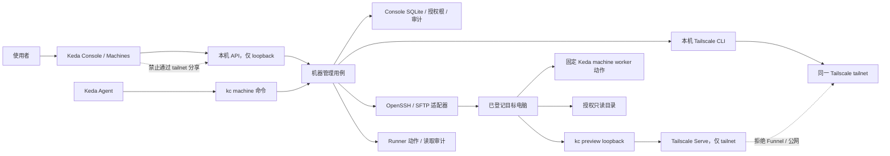
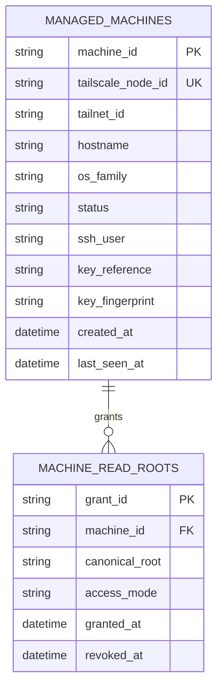

# PRD: Keda 跨设备连接、文档访问与机器管理

> ✅ **交付前置**：无，可立即开工。
> 结构化声明见 §8 Delivery Dependencies，**那里是唯一事实源**。
> ⬜ **验收状态**：未开工。
> 本行是 §9 Acceptance Checklist 的投影，**那里是唯一事实源**。

本 PRD 分成两层：Part A 供人确认目标行为与权限边界；Part B 供执行者按现有 Keda 架构实现并验证。

## Feature Overview (功能一览)

本节是 §10 Functional Requirements 的短说明；验收行为以 §1 的行为样例表为准。

- **流程化连接电脑**（FR-1、FR-2）：Keda 检查当前设备、引导 Tailscale 安装与登录，并在用户完成目标电脑的必要授权后自动发现和验证连接。
- **跨电脑查看已授权文档与图片**（FR-3）：Agent 只能读取用户明确授权的目录，文件浏览与预览保持只读。
- **私有网页预览**（FR-4）：可在另一台机器上查看 Keda 管理的项目预览；访问只限同一 Tailscale 网络，不公开 Keda Console。
- **集中查看和管理电脑上的 Agent**（FR-5）：按机器显示连接与 Runner 状态，启动或停止 Runner 前展示目标和影响范围并要求确认。
- **Agent 可按统一流程代办**（FR-6）：随包 `kedacode-operator` 指南说明检查、连接、文件读取、远程预览、Runner 操作和不可代办的人类步骤。
- **机器访问可撤回且可追溯**（FR-7）：用户可撤销文档目录与 Keda 远程管理授权，查看每次远程操作的结果；删除 Keda 登记不冒充从 Tailscale tailnet 移除设备。

# Part A · 人审层 (Review Layer)

## 1. Introduction & Goals

### Problem Statement

用户希望在家中和公司等不同网络里的电脑之间查看文档，并让 KedaCode Agent 管理多台电脑上的 Agent Runner。普通网络地址在不同地点会变化或根本无法从外网访问；用户需要手动安装 VPN 客户端、完成账号登录和系统授权，也要单独解决远程文件与进程访问权限。

Keda 当前已有多机协作说明：各机器通过 GitHub Issue 队列协作，机器本地的进程与控制台数据库彼此独立。管理终端固定监听 `127.0.0.1`；本机网页面板不能直接开放到另一台机器。现有 `kc preview` 也强制项目服务只监听回环地址，因此不能简单把 Keda Console 或本机预览端口暴露到网络。

### Interpretation (解读回显)

我把请求理解为：Keda 提供一个小白式的机器连接流程；Agent 尽可能检测、安装、验证并继续配置；人只做没有其他远程通道就无法代办的首次登录、系统网络授权、设备审批、开启系统远程登录和选择文件范围。连接完成后，Keda 可以在受限权限下读取已授权的文档、查看 Keda 管理的网页预览，并管理目标电脑上的 Keda Agent Runner。

**行为样例**

| 验证方式 | 输入 / 操作 | 期望观察到的结果 |
|---|---|---|
| 👀 人审 + 自动验证 | 我在公司电脑上开始添加一台没有公网 IP 的笔记本，并在那台电脑登录同一个 Tailscale 账号 | Keda 不要求填写公网 IP；完成目标电脑登录和系统授权后，它自动发现这台设备并显示在线状态。 |
| 👀 人审 + 自动验证 | 目标电脑还没有安装 Tailscale，或还没完成设备审批 | 向导明确显示“等待你在目标电脑完成登录 / 审批”，Agent 自动检测并等待；不会提前显示已连接或要求用户输入网络地址。 |
| 👀 人审 + 自动验证 | 我只允许 Agent 读取目标电脑的 `Documents`，然后打开一份 Markdown、PDF 或图片 | Agent 能浏览授权范围内的文件并在 Keda 中只读预览；尝试访问未授权目录、路径逃逸或写入文件时被拒绝。 |
| 👀 人审 + 自动验证 | 我在另一台电脑查看目标电脑上由 Keda `kc preview` 管理的项目页面 | 页面只对 Tailscale 网络内的授权设备开放；结束预览或撤销共享后，远程入口失效，Keda Console 从不出现在这个入口后面。 |
| 👀 人审 + 自动验证 | 我在机器列表中停止某台电脑上的 Agent Runner，随后取消一次确认 | 首次确认框指出目标电脑、仓库和当前任务；确认后只影响指定 Runner；取消不产生进程状态变化。 |

表中有效行为会转成 §7.6 的验收 oracle；修改一行的操作或预期结果，就等于修改对应验收标准。

**我默默定了这些**

- 首期连接的电脑属于同一个 Tailscale tailnet；Keda 不代替用户创建账号，也不读取或保存 Tailscale 管理 API 密钥。
- 如果目标电脑尚未加入 tailnet，Agent 没有既有远程通道可用；必须由人在目标电脑完成首次安装、登录和系统授权。
- Keda 只管理用户明确登记的设备，并默认关闭远程文件范围；Tailscale 在线不等于 Keda 已获得文件或 Runner 权限。
- 文档目录只读；网页预览只分享 Keda 自己启动和登记的项目预览；Agent Runner 的启停是逐次确认的操作。
- 任何不支持的系统组合、受公司 IT 限制的电脑或失败的身份验证都要显示明确原因与恢复步骤，不自动降级成广泛访问。

**我理解为不做**

- 不远程查看另一台电脑当前打开的浏览器标签、完整桌面、屏幕录制或键鼠输入。
- 不读取用户没有明确选定的目录，不远程编辑、删除或上传个人文件。
- 不开放任意 shell、RDP/VNC、所有局域网端口或公开互联网服务。

**可证伪的范围理解**：交付结果是一个通过明确授权连接的机器列表、受限的远程文档 / Keda 项目预览和 Keda Runner 管理入口。它不会把“装好 Tailscale”误当成“已授权读文件或控制电脑”，不会要求用户输入公网 IP，也不会将本机控制台变成 tailnet 服务。人不需要编写命令或配置路由器，但首次加入目标电脑、接受系统权限和设备审批仍需人完成。

### What The User Gets

- 个人电脑使用者在一个向导里看到 Agent 正在做什么、还需要自己完成什么，以及下一步能否继续；不再猜 IP、手写远程命令或反复切换排障文档。
- Keda Agent 得到可调用的机器发现、远程文档只读读取和受限 Runner 管理入口；随包说明会明确指出哪一步必须交还给人。
- 机器所有者能逐台电脑撤销访问，知道 Agent 获得了哪些目录权限、当前是否在线，以及远程 Runner 正在做什么。
- 公司的 IT 管理者可以要求设备审批或拒绝管理；Keda 不绕过设备策略，也不将设备审批权藏在向导后面。

### Measurable Objectives

- 用户可以在没有公网 IP 的情况下完成同一 tailnet 内的电脑发现；向导全程不要求输入 IP 或修改路由器。
- 所有非自动化动作都有明确的人类说明和完成状态；Agent 检查、等待、发现及连接诊断无需用户输入命令。
- 文件读取只命中明确授权根目录；越界路径、符号链接逃逸、写入和删除都失败，并且不改变远端文件。
- 远程网页预览经过 Tailscale Serve 私有入口；验证确认 Funnel 未启用、Console 未共享，撤销后远端页面不可访问。
- Runner 管理请求绑定单一机器与单一仓库；取消确认不会产生状态写入，任意命令或未登记机器请求被拒绝。

## 2. Human Review Map (介入与风险地图)

### 决策一：首次连接时，哪些步骤必须由电脑使用者完成

推荐让 Agent 自动检测当前设备、启动官方安装流程、等待登录结果、发现新设备、检查在线状态，并继续发起后续的 Keda 配置；目标电脑没有既有连接时，使用者必须在目标电脑本地安装 / 登录 Tailscale、接受系统网络权限、按需批准设备，并开启系统允许的远程访问。若公司策略禁止其中任一步，向导应明确停止并指导联系设备管理员。

用户不能把“Agent 代办”理解为远程绕过身份验证或管理员授权；越过这些边界会把用户的 tailnet 和公司设备暴露给未授权访问。首期应验证 Keda 当前支持的 macOS、Windows、Linux 控制端 / 目标端组合，并只对通过验证的组合显示完整管理能力。

**请确认：** 是否接受“用户不需要 IP 或命令，但第一次必须在目标电脑本人登录并接受系统权限 / 设备审批”的连接模型？同时请指出你的首要设备组合（例如 Mac → Mac、Mac → Windows）；默认建议先覆盖仓库已有 Keda 运行环境可支持且经双机验证的组合，对其余组合显示“暂不支持远程管理”。

**验收：** 未登录或待审批设备保持等待状态；登录且授权后自动出现在机器列表；页面逐项区分 Agent 已完成与仍需本人操作。

### 决策二：Agent 可以读取什么，以及网页预览分享给谁

推荐新机器默认没有文件权限。机器所有者勾选允许读取的文件夹后，Agent 只能列出、读取和预览选中范围；用户也可以显式分享 Keda 管理的项目预览，但入口只对同一 tailnet 的访问策略开放。目录范围和网页分享都可以随时撤销。

主要风险是用户把尾网内可达误解为个人文件全部可读，或把私有预览误变成公网服务。Keda 必须用私有 Tailscale Serve 分享 Keda 管理的预览，不得把 Keda Console 或任意端口放进共享路径，也不得启用公开的 Funnel。

**请确认：** 是否接受“明确选目录、默认只读、网页只分享 Keda 管理的预览且仅限 tailnet”的内容访问边界？如需要 Agent 修改远程文件或分享任意服务，请指出具体用途，首期默认不授予。

**验收：** 被选中文档与预览可从另一台已授权设备查看；未选目录、写入操作和公网访问均被拒绝；取消授权后旧入口不可继续访问。

### 决策三：Keda 可以远程管理 Agent 到什么程度

推荐首期管理机器在线状态、Keda 安装 / 配置状态、已登记仓库的 Runner 状态，以及明确的 Runner 启动、停止和重启操作。每个有副作用的操作在执行前显示机器、仓库和当前任务并要求确认。机器间通信使用结构化、固定动作，不提供任意终端或整机桌面控制。

风险是一个模糊的“管理”按钮可能被理解为完整远程控制，或错误地停止另一台机器上的任务。Keda 应对每个请求重新确认机器身份与当前 Runner 状态，拒绝任意命令，并把执行结果写入现有操作审计记录。

**请确认：** 是否接受 Keda 只提供上述固定 Runner 管理动作，所有启动 / 停止 / 重启逐次确认，并把远程 shell、桌面控制留在首期范围之外？

**验收：** 确认后只有目标机器的目标 Runner 改变状态；取消或伪造任意命令不会产生远程副作用，并可查看机器、操作、结果和时间记录。

### 自动门禁，不需要逐项人工审阅

机器状态解析、SQLite 迁移回滚保护、SSH / SFTP 越权拒绝、Tailscale Serve / Funnel 区分、Console 回环地址不变、API 契约、CLI 与随包 skill 同步、所有受支持 OS 组合的构建与集成检查均由执行者自动验证。面向用户的向导、目录选择、文档预览、私有网页预览和 Runner 操作确认会进入最终的人读呈递区。

**本次明确不涉及：** 通过 Tailscale Admin API 管理 tailnet 账户或自动批准设备、把不同 tailnet 的电脑拼接成一个网络、远程浏览用户当前浏览器标签、通用远程桌面 / shell、任意目录同步与写入，以及把 Keda Console 直接暴露到任何网络接口。

## 3. Usage And Impact After Implementation

### 个人 Keda 使用者

打开 Keda Console 的机器管理页或使用 Agent 提供的自然语言入口，选择“添加电脑”。Agent 先检查当前电脑，若缺 Tailscale 就打开与系统匹配的官方安装入口并在安装后继续检测。使用者在目标电脑登录同一个账号、接受系统弹窗、按需批准设备，再根据向导开启系统允许的远程登录并选择需要共享的文档目录。完成后，机器卡片显示在线 / 离线、已授予的文件夹、网页预览可用状态与 Keda Runner 状态。以后可以在该卡片浏览文件、打开 Keda 项目预览或管理 Runner。

### Keda Agent

收到“看看另一台机器上的文档”时，先询问或解析用户指定的已登记机器，再用 Keda 机器能力列出已授权根目录和匹配文件。请求超出授权时，Agent 解释需要机器所有者调整范围，不会尝试直接 SSH、扫描网络或自行组合命令。需要启动 / 停止 Runner 时，Agent 提供目标摘要并等待人确认。

### 公司电脑使用者与 IT 管理者

如公司设备要求 Tailscale 设备审批、系统管理员安装或禁止远程登录，用户在原生 Tailscale / 操作系统管理页面完成人类批准。Keda 展示等待审批或 IT 策略限制并停止继续配置；Keda 不会创建或保存公司管理员凭据，也不会把个人电脑加入公司 tailnet。

### 仓库维护者与文档贡献者

在随包 `kedacode-operator` 指南中阅读机器操作步骤与权限边界；指南只调用公开的 `kc machine` 能力，不能让 Agent绕开产品入口自行运行 SSH 命令。仓库既有的 Issue → Agent → PR 工作流不变，远程机器只增加一个可选择的执行节点。

### 开发与运维

在本机通过现有 `kc console` 启动管理终端；Keda 使用本机 `~/.kedacode/console.db` 管理机器登记、授权范围与操作记录，并从控制端连接目标电脑。用户可在机器页撤销 Keda 授权；移除 Keda 登记不会自动从 Tailscale Admin Console 删除机器，因此要分开说明这两个动作。

### 对现有行为的影响

- `kc console` 继续仅绑定 `127.0.0.1`；它不监听 Tailscale IP，也不能被 `tailscale serve` 作为 Keda 机器预览分享。
- 已有本机 Dashboard、Processes、Repositories、Backlog、Settings 与现有 `kc preview` 回环安全校验继续有效。
- 机器登记与授权保存在本机 Console 数据库，不自动同步到另一台运行 Keda 的控制电脑；每台控制电脑独立维护其授权登记。
- 现有多机 GitHub Issue 协作仍然可用；本 PRD 不替换队列归属、claim 协调或仓库工作区隔离策略。
- 未登记或未通过连接验证的机器不会改变现有 Agent 运行、文件浏览或网络配置行为。

## 4. Requirement Shape

- **actor**：Keda 使用者、目标电脑所有者、Keda Agent、公司 IT 管理员、Keda 仓库维护者。
- **trigger**：用户希望添加另一台电脑、读取该电脑上的授权文档 / 项目网页，或查看和操作其 Keda Agent Runner。
- **expected behavior**：Keda 以分步流程完成可自动执行的安装检查、设备发现和连接验证；人完成目标设备身份与系统授权；机器登记后按人授予的最小范围提供只读内容访问和固定 Runner 管理能力。
- **explicit scope boundary**：同一个 Tailscale tailnet 内，管理经验证支持的电脑；访问仅限用户登记的机器、明确授权的文件夹、Keda 管理的项目预览与 Keda 定义的 Runner 动作；不实现通用远程桌面、任意 shell、跨 tailnet 组网、任意文件读写或 Console 网络开放。

# Part B · 执行器层 (Build Layer)

## 5. Repository Context And Architecture Fit

### 现有路径

- `src/backend/api/cli_typer_console.py` 中 `CONSOLE_HOST` 固定为 `127.0.0.1`；源码注释明确该绑定是当前无认证写操作面板的安全边界。保持此事实，不新增 `--host 0.0.0.0`、Tailscale Serve 或其他逃生配置。
- `docs/guides/agent-runner.md` 的“多机部署与操作指南”已描述多台电脑通过 GitHub Issue 队列协调；`~/.kedacode/console.db` 是每台机器自己的历史账本，当前不跨机器聚合。
- `src/backend/api/cli_typer_preview.py` 与 `src/backend/core/use_cases/agent_session_preview.py` 已提供受控 `kc preview start|status|stop`；服务必须绑定回环地址且监听进程属于 Keda 启动的进程组。
- `src/backend/infrastructure/persistence/console_store.py` 和其 mixin 负责 Keda Console 的 SQLite 账本与附加式迁移；现有 `audit_logs` 表可记录操作结果。
- `frontend-public/app/(app)/app/processes/page.tsx` 已展示 Runner 进程、启动 / 停止确认与日志；`frontend-public/components/layout/app-sidebar.tsx` 是 Console 主导航来源；`frontend-public/lib/api/console.ts` 与 `lib/api/types.ts` 是现有 API 调用和类型约定。
- `src/backend/api/routes/agent_runner.py` 及分拆的 Console routes 承载 Agent Runner API；`src/backend/api/app.py` 注册 FastAPI router。前端请求通过现有同源 `/api/v1/agent-runner/*` 入口。
- 随包 Agent skill 的事实源是 `src/backend/engines/agent_runner/templates/skills/kedacode-operator/SKILL.md`；它在 wheel 安装时附带。CLI 新增后要在 skill、操作指南和命令帮助中同步说明。

### Reuse Candidates

- 复用 `CONSOLE_HOST` loopback 约束、现有 SQLite `ConsoleStore` 与 `audit_logs`、Runner 状态和操作模型、`kc preview` 的回环进程验证、Console 的 API 客户端和通知 / 确认交互。
- 新增受限的机器管理用例与 Tailscale / OpenSSH 外部适配器，不复用通用 subprocess shell；所有命令使用固定可执行文件 + 参数数组。
- 复用已有 Machines 页面设计原型目录 `docs/prototypes/tailscale-machine-management/` 与 Prototype Hub，不另建第二个页面登记表。

### 架构约束

- 遵循 `src/backend/api/ → src/backend/core/ → src/backend/engines/ → src/backend/infrastructure/`；API 解析请求，core 校验身份 / 授权 / 状态，engines 运行外部 CLI 或远程访问，infrastructure 保存机器记录与审计。
- SQLite 仅保存机器身份、显示元信息、远程访问能力、文件授权范围、密钥引用 / 指纹和操作结果，不保存 Tailscale auth key、SSH 私钥明文、用户登录密码或远程文件内容。
- 远程文件的真实信任边界必须由后端验证；UI 路径隐藏或禁用不算授权。解析目录根和每个文件请求都要 canonicalize，拒绝 `..`、绝对路径逃逸、符号链接跨出授权根、越权写入和伪造机器 ID。
- 远程 Runner 操作只接受机器 ID、仓库 ID 和固定动作枚举；禁止自由格式 shell / argv；请求与执行结果复核对应机器和进程身份。
- `kc preview` 仍绑定回环。仅对确认为 KedaCode 创建的 preview 进程，显式调用 Tailscale Serve 私有转发；确认状态是 tailnet-only 且 Funnel 未启用，禁止把 `/api`、Console 端口或任意服务放进分享配置。
- 不能假设任意 OpenSSH、Tailscale 版本或 OS 都支持相同能力；首版必须记录已通过真实双机验证的 OS / 客户端矩阵，并对未验证组合 fail closed。

### Frontend Impact

**Frontend impact: `frontend-public/`.** 新增受保护的机器管理页面 `/app/machines/`；在 `app-sidebar.tsx` 增加导航入口。页面展示设备列表、连接状态和授权摘要；分步对话框覆盖 Tailscale 安装等待、远程登录、文件范围选择；详情页含只读文档 / 图片 / PDF 预览、Keda 私有项目网页预览、Runner 状态和确认操作。新增 `lib/api/machines.ts` 与 `lib/api/types.ts` 类型，并通过现有同源 Console API 读写。原有 `Processes` 页面不迁移或删除。`frontend-admin/` 冻结且不属于本次范围。

### Related PRDs

- `tasks/pending/P1-FEAT-20261009-161453-kc-hosted-runner-deployment.md` 是云端托管 Docker runner、多客户认证和清理，目标机器与信任边界不同；本 PRD 可独立实施，不复用其对外 Console，不构成前置依赖。
- `tasks/pending/P1-FEAT-20261013-013037-two-stage-prd-generation.md` 是 PRD 生成流程，无机器连接或远程访问依赖。
- `tasks/archive/` 中已有 Keda 进程托管、预览与远程文件浏览决策可复用；不新增容器化或远程 Console 方案。
- 已有多机使用说明只是 GitHub Issue 协调，不是机器登记、授权文件浏览或远程操作的重复实现。

### Scope Cohesion Assessment

三项可独立审阅的决定是目标机首次授权、远程内容读取 / 私有预览、Runner 管理范围。它们共享一个机器身份、一次性连接建立和可撤销授权记录；拆开后会先交付只有网络、没有可用内容或操作能力的半成品，并在后续 PRD 重复构建授权与机器列表。因此作为同一个端到端目标状态交付；§2 的三项决策分别验收。

## 6. Recommendation

### Recommended Approach

在现有本机 Console 旁边扩展一个受保护的 Machines 页面和 `kc machine` 命令组。使用已安装的 Tailscale 客户端做本机状态查询与设备发现；用户必须在未加入的目标电脑本机完成官方安装、登录和 OS 权限提示。连接后，用标准 OpenSSH / SFTP 在 Tailscale 网络上建立 Keda 的受限访问；一次性远程凭据只用来登记专属 Keda key，密码不落盘。Keda 机器操作由固定的结构化 worker 动作执行，不提供任意 shell。

对文件访问使用 SFTP 列举与读取用户授权目录，服务端在每次读取时重新校验路径和 scope。读取内容在控制端以短期临时数据供 Agent / Console 预览，操作完成后清理；不把远程文件复制进仓库或永久缓存。对 `kc preview` 项目页面，复用其已验证的 loopback URL，并由 Tailscale Serve 私有转发到 tailnet；绝不启用 Funnel，也不共享 Console。

机器登记和授权元数据写在该控制端的 Console SQLite 与现有审计路径。Tailscale 节点身份、Keda 连接状态、Machine file scopes 和远程 Runner 状态由一份机器领域用例协调。`kedacode-operator` skill 只调用公开的 `kc machine` 命令，不直接拼接 SSH / Tailscale shell 命令。

### Proposed Solution Summary (实现机制)

- **产品入口**：现有 `kc console` → `/app/machines/`，并提供 `kc machine setup|list|docs|runner` 机器操作子命令。普通用户只运行向导，不需要手工提供 IP、主机名或 shell 片段。
- **人类输入**：目标设备上的 Tailscale 账号登录与原生网络权限、需要时的 tailnet 管理员审批、OS 远程登录许可、一次性 SSH 账号授权，以及明确选中的只读目录；若对目标电脑已有授权远程通道，向导可以复用并跳过本地步骤。
- **Agent 输入 / 输出**：OS 与 Tailscale 状态、可见设备标识、SFTP / 远程 worker 可用性、Keda Runner 状态、授权根路径、`kc preview` 已验证的 loopback URL；状态以可区分的“等待本人授权 / 等待设备审批 / 在线未授权 / 已登记 / 不支持”呈现。
- **持久化变化**：控制端 Console SQLite 新增机器与授权根记录；敏感 key 使用 OS 密钥存储或现有 SSH agent，库内只存引用 / 公钥指纹。远端文件内容只在请求期间传输，不留长期副本。
- **简化与安全控制**：单一向导自动做检测 / 轮询 / 连通性诊断 / 权限范围展示；不收集 Tailscale 管理 token、不修改 tailnet ACL、不自动批准设备、不暴露 Console、不运行任意远程命令。

### Alternatives Considered

- **直接用 Tailscale Admin API 管理设备**：需要额外创建和轮换全网管理密钥，超出个人电脑连接的最小权限；本 PRD 只读本机 CLI 状态，并把设备审批留给有权用户。
- **使用 Tailscale SSH 完成所有访问**：该能力与客户端 / 平台存在限制，并依赖 tailnet SSH policy。首期建议以标准 OpenSSH over Tailscale 做远程机器通道，对具体 OS 组合进行验证；未来可为已验证平台提供 Tailscale SSH adapter。
- **将 Console 通过 Tailscale Serve 分享**：不接受。Console 是无完整认证的本机写操作面板；只允许分享 Keda 受管的项目 preview 服务。
- **提供通用远程 shell 或桌面**：权限过宽，审计、命令范围和文件边界难以向 Agent 用户清楚呈现；固定机器动作覆盖 Keda Runner 的当前管理需要。

## 7. Implementation Guide

This section is a living implementation guide based on current repository analysis. If implementation discovers additional affected files, hidden dependencies, edge cases, or a better path, update this PRD before proceeding.

### Core Logic

1. `kc machine setup` / Console 向导先识别本机 OS 和 Tailscale CLI；未安装时打开官方系统安装入口并等待安装完成。禁止从非官方站点下载二进制或默认以 root / 管理员静默提升权限。
2. 控制端读取 Tailscale 支持的 machine-readable 状态并探测目标；如目标不在 tailnet，状态进入“需在目标电脑登录”；如设备待审批，提示有权管理员到 Tailscale Admin Console 批准。禁止在产品中保存管理 API token 或伪造审批结果。
3. 连接成功后探测目标 SSH / SFTP。目标 OS 未启用远程登录时，给出对应图形设置路径；用户确认后再进行一次性身份验证。Keda 创建专用 key pair，私钥在控制端 OS 密钥存储 / SSH agent，向目标登记公钥；密码不进入数据库、日志、命令行或操作记录。
4. 目标电脑若已有 Keda CLI，调用专用 `kc machine worker` 固定动作以查询 Keda Runner；否则在明确登录授权后安装已验证的 Keda CLI / worker。worker 只接受版本化 JSON 动作枚举和仓库标识，不启动通用 shell，也不接受调用端提供 executable 或 argv。
5. 人在目标机器卡片中勾选文件夹；后端把绝对路径解析为 canonical root 并保存在 `machine_read_roots`。每次 SFTP 列举 / 读取都要求该 root，递归解析时不能跟随越界 symlink；请求完成后清理临时文件。对 Agent 暴露 `kc machine docs list|read` 的稳定入口。
6. `kc preview share` 只读取已经由现有 PreviewProcessManager 登记且验证为 loopback 的 URL；经显式确认后配置 Tailscale Serve 私有代理。读取 Serve 状态，验证该服务属于目标机器、port 与 process owner 匹配、Funnel 关闭。撤销或 `kc preview stop` 后关闭对应 Serve 路径。
7. Runner `start|stop|restart` 请求在 Console 前端显示目标 machine / repo / 当前任务确认；API 重新读取 machine identity、授权和 runner 状态后调用固定 worker action。取消确认不发请求；机器不在线、身份变更或状态不明时 fail closed。
8. 每个连接、授权变更、目录读取摘要、预览分享 / 撤销、Runner 操作写入现有 `audit_logs`。审计只保存动作、资源 ID、操作者、结果和时间，不保存文件内容、密码或 key 值。

### Change Impact Tree

以下是当前实现路径的起点，不假定文件清单穷尽；如果执行发现更合适的扩展点，先修订本树与 Drift Guard。

```text
Database / Persistence
├── src/backend/infrastructure/persistence/console_store.py [修改]
│   【总结】扩展 SQLite 迁移入口并以附加式方式创建机器与授权根表。
│   ├── 保留既有 Console 数据与迁移兼容性
│   └── 不保存明文口令、密钥或远程文档内容
├── src/backend/infrastructure/persistence/console_store_machines.py [新增]
│   【总结】持久化机器登记、授权根与现有审计事件。
│   ├── 提供 managed_machines / machine_read_roots 存取
│   └── 列举机器和授权时支持 fresh-state read

Domain / Core
├── src/backend/core/shared/interfaces/machine_management.py [新增]
│   【总结】定义机器发现、文件 scope、私有 preview 与固定 Runner 动作的接口。
├── src/backend/core/use_cases/machine_management.py [新增]
│   【总结】编排设备状态、访问授权、文件路径校验、操作确认与审计。
│   ├── 授权判断服务端执行
│   ├── 路径始终限制在 canonical roots 内
│   └── 机器或 Runner 身份变化时拒绝执行

Engines / Infrastructure
├── src/backend/engines/machine_access/ [新增目录]
│   【总结】提供本机 Tailscale / OpenSSH / SFTP / Tailscale Serve 的外部适配器。
│   ├── 子进程参数数组与固定命令 allowlist
│   ├── 解析状态并验证 tailnet-only Serve
│   └── 禁止 Funnel、通用 shell、任意本机服务端口与 Console URL
├── src/backend/infrastructure/security/machine_key_store.py [新增]
│   【总结】封装 OS SSH agent / 系统密钥存储并只向 SQLite 暴露 key reference 与 fingerprint。
└── src/backend/core/use_cases/agent_session_preview.py [修改]
    【总结】只在用户确认后将已校验的 Keda preview loopback URL 私有分享至 tailnet。
    └── 保留监听进程所属验证与 `kc console` 禁止共享规则

API / CLI
├── src/backend/api/routes/agent_runner_machines.py [新增]
│   【总结】提供机器登记、状态、授权目录、远程文档和 Runner 操作 API。
├── src/backend/api/app.py [修改]
│   【总结】注册机器管理路由到既有本机 Console API。
├── src/backend/api/cli_typer_machine.py [新增]
│   【总结】提供 `kc machine setup|list|docs|preview|runner|forget` 用户入口。
├── src/backend/api/cli_typer_app.py [修改]
│   【总结】将 machine 命令组注册到 Typer CLI。
└── src/backend/api/cli.py / src/backend/api/cli_typer.py [修改]
    【总结】保持 Typer 与兼容 CLI parser / help 树一致。

Frontend (`frontend-public/`)
├── frontend-public/app/(app)/app/machines/page.tsx [新增]
│   【总结】呈现机器列表、首次连接向导、授权文档、私有 preview 和 Runner 状态。
├── frontend-public/components/agent-runner/machine-connection-wizard.tsx [新增]
│   【总结】逐步显示 Agent 自动动作、必须本人完成的操作、等待 / 失败 / 成功状态。
├── frontend-public/components/agent-runner/remote-file-browser.tsx [新增]
│   【总结】在已授权根目录内浏览并只读预览 Markdown、PDF 与图片。
├── frontend-public/components/layout/app-sidebar.tsx [修改]
│   【总结】将机器管理页接入现有 Console 导航。
├── frontend-public/lib/api/machines.ts [新增]
│   【总结】通过同源 Agent Runner Console API 访问机器能力。
└── frontend-public/lib/api/types.ts [修改]
    【总结】同步机器状态、文件元信息、权限与固定 Runner action 类型。

Docs / Packaged Agent Skill
├── docs/guides/agent-runner.md [修改]
│   【总结】补充人类引导、Agent 自动代办、机器权限、远程文档和私有网页预览流程。
├── src/backend/engines/agent_runner/templates/skills/kedacode-operator/SKILL.md [修改]
│   【总结】指导随包 Agent 调用 `kc machine` 并停止于需人授权的步骤。
├── docs/prototypes/tailscale-machine-management/index.html [新增]
│   【总结】提供 Console 机器管理和首次连接的可点击目标态。
├── docs/prototypes/tailscale-machine-management/style.css [新增]
│   【总结】匹配现有 Console 视觉并适配桌面 / 窄屏展示。
├── docs/prototypes/tailscale-machine-management/prototype.js [新增]
│   【总结】模拟连接步骤、文件预览和 Runner 确认交互。
├── docs/prototypes/tailscale-machine-management/prototype.md [新增]
│   【总结】记录原型入口、交互状态、来源与不承诺事项。
├── docs/prototypes/assets/prototype-hub.js [修改]
│   【总结】将多机连接原型加入唯一 Prototype Hub registry。
└── docs/prototypes/index.md [修改]
    【总结】从原型索引链接到新说明页与 Hub。

Tests (to be added by implementation)
├── tests/backend/ [修改]
│   【总结】验证连接等待、授权边界、路径隔离、Serve 私有状态和 Runner allowlist。
└── tests/playwright-e2e/ [修改]
    【总结】验证 Console 页面到后端机器能力的主要用户旅程。
```

### Risk Classification Register

| Change point | Tier | Decisive dimension / override | Intervention | Oracle / gate |
|---|---|---|---|---|
| 新机器第一次入网、身份信任和 SSH key 登记 | R3 | 凭据 / 身份验证与权限边界；失败可能授予未授权访问 | Human confirmation + executable negative control | rv-1；待登录 / 待审批必须 fail closed |
| 远程文件授权根与网页分享范围 | R3 | 敏感文件访问、越界读取、公网意外暴露 | Human confirmation + executable negative control | rv-2；symlink 越界与 Funnel 状态不能成功 |
| 远程 Runner 操作目标绑定与副作用 | R3 | 远程代码执行、错误机器 / 任务受影响 | Human confirmation + executable negative control | rv-3；任意命令与取消操作无副作用 |
| Tailscale / SSH / OS 支持矩阵与失效提示 | R2 | 多系统兼容与外部客户端行为 | Executor + real-pair integration gate | rv-1 的 opt-in OS matrix run + deterministic adapter tests |
| Console 页面和命令说明 | R1 | 可见入口和可理解的引导 | Executor + UI oracle | rv-1 / rv-2 / rv-3 与文档一致性 |

### Executor Drift Guard

现有代码常见隐藏边界是本机 Console 不能远程访问、Preview URL 必须回环，以及本机状态库不跨机同步。实施前后搜索这些语义和所有新机器入口；本清单不是穷尽表。

```bash
rg -n "CONSOLE_HOST|127\\.0\\.0\\.1|ssh -L|kc preview|ready_url|resolve_preview_command|多机部署与操作|console.db" src/backend/api src/backend/core src/backend/engines src/backend/infrastructure docs/guides/agent-runner.md
rg -n "kc machine|machine_read_roots|managed_machines|Tailscale Serve|Funnel|/app/machines|agent_runner_machines" src/backend frontend-public docs
rg --files src/backend/engines/agent_runner/templates/skills/kedacode-operator docs/prototypes tests
```

失败排查先确认：Console 服务是否仍只监听回环；Serve target 是否是 Keda preview registry 中当前进程的 loopback URL；远端机器身份 / key fingerprint 是否与数据库中的登记一致；浏览器请求是否经过同源 Console API 而非直连 SSH；新 CLI help 与 packaged skill 是否版本同步。

### Flow / Architecture Diagram



### ER Diagram



`audit_logs` 复用现有表保存 `machine_id`、固定 action、结果与时间；不新增重复的机器审计表。机器登记在控制端本地，不跨 Keda Console 自动同步。

### Realistic Validation Plan

```yaml
- id: rv-1
  behavior: "从机器管理向导添加没有公网 IP 的目标电脑；本人完成 Tailscale 登录 / 系统授权 / 必要审批后，Keda 自动发现设备并显示连接状态；未完成这些步骤时明确等待并禁止继续。"
  reviewer: human
  real_entry: "在开发环境运行 `uv run kc console`，打开 Console 的 Machines 页面并执行完整添加向导；双机 Tailscale 真实联通运行用 `KEDA_MACHINE_E2E_TARGET=<test-machine> just e2e` 显式开启。"
  expected: "完整向导显示已自动完成的检查、仍需人的系统动作和真实机器在线状态；不需要输入公网 IP；待审批设备不能标为已连接。"
  mock_boundary: "默认无真实凭据回退只可在 Tailscale/OpenSSH 子进程适配边界使用 fixture；Console 页面、真实 FastAPI router、core 授权逻辑、SQLite 持久化与 fresh read 必须真实。双机验收时 Tailscale、SSH/SFTP 和目标 OS 必须是真实测试设备。"
  tier: R3
  test_layer: e2e
  required_for_acceptance: true
  presentation: "实现阶段在 `tasks/evidence/P1-FEAT-20261018-034216-kc-tailscale-machine-onboarding/rv-1-onboarding.png` 保存真实 Console 向导结果，并在 `tasks/evidence/P1-FEAT-20261018-034216-kc-tailscale-machine-onboarding/rv-1-connected-device.png` 保存双机连通后的机器卡片；人工核对页面分别显示本人待办和实际在线设备。"
  critical_value_source: "目标 machine_id / hostname 必须来自本次向导展示且由真实 `tailscale status --json` 发现的 peer；不得从 fixture 或测试常量重建后提交机器登记。"
  must_cross: "Console UI → 同源机器 API → core machine identity / approval check → Tailscale CLI 与 OpenSSH → Console SQLite commit → 新 API request / 新 ConsoleStore instance fresh read。"
  forbidden_bypasses: "禁止直接写 ConsoleStore 代替 API 写入；禁止 fixture 充当真实双机验证；禁止因 SSH port reachable 就视为 Tailscale 与机器身份验证通过；禁止读取 Tailscale Admin API key 或直接批准设备。"
  fresh_state_probe: "提交连接后从新的 API request 与新 SQLite 连接读取机器状态；待审批控制组提交后必须仍为 awaiting_approval，只有实际批准并完成连接后才是 online。"
  final_tree_evidence: "保存 `git rev-parse HEAD`、目标 OS/Tailscale/OpenSSH 版本、双机 e2e 报告和截图 SHA256；任何相关 API / core / adapter 变更后重跑。"
  negative_control: "在 `KEDA_MACHINE_FIXTURE=approval-required` 下通过真实 Console 向导继续添加，并以 `KEDA_MACHINE_E2E_TARGET=<test-machine>` 执行已登记的双机脚本；记录任何在批准前成功的尝试。"
  expected_fail: "机器写入被拒绝或保留 awaiting_approval；UI 不出现在线状态；测试在“批准前不能成为已连接”断言处变红。"

- id: rv-2
  behavior: "读取只包含在已授权目录内的文档 / 图片 / PDF，并通过私有 Tailscale Serve 查看目标电脑上由 Keda `kc preview` 管理的页面；未授权路径、文件写入、Funnel 公网入口和 Keda Console 共享均被拒绝。"
  reviewer: human
  real_entry: "在 `uv run kc console` 的 Machines 页面选择目标设备，分别打开只读文档浏览和“预览网页”；双机网络路径用 `KEDA_MACHINE_E2E_TARGET=<test-machine> just e2e` 显式开启。"
  expected: "人可阅读目标授权目录中的 Markdown / PDF / 图片，并打开仅 tailnet 可达的 Keda 项目预览；远程原文件未改变，Console API / UI 不出现在 Serve 路由中。"
  mock_boundary: "默认无凭据回退可在 SSH/SFTP、Tailscale CLI 外部适配器边界使用 fixture，但 UI、同源 API、授权根 canonicalization、core policy、ConsoleStore、PreviewProcessManager 所有权检查必须真实。双机验收时读取路径与 Serve 必须走实际目标设备和 Tailscale tailnet。"
  tier: R3
  test_layer: e2e
  required_for_acceptance: true
  presentation: "实现阶段在 `tasks/evidence/P1-FEAT-20261018-034216-kc-tailscale-machine-onboarding/rv-2-remote-documents.png` 和 `rv-2-private-preview.png` 保存真实 Console 文档 / 私有网页预览截图；人工确认只读标记、来源机器和 tailnet-only 状态。"
  critical_value_source: "机器 ID、授权 root、选中的文件名和 preview URL 必须原样来自本次机器列表 / 文件 API / Keda preview API；禁止前端拼出授权 URL 或用固定 fixture root。"
  must_cross: "Console UI → canonical machine / file API → core grant + canonical path validation → real SFTP / PreviewProcessManager → Tailscale Serve status → fresh SFTP / remote-tailnet browser read after commit。"
  forbidden_bypasses: "禁止绕过 API 读取控制端本地路径；禁止 path traversal、跨根 symlink、任意 `tailscale serve` target、Funnel、Console API / Console UI share，以及在无授权时复用既有 Tailscale 在线状态。"
  fresh_state_probe: "授权写入后用新 SQLite 连接读取 grant；从第二台已授权 tailnet 设备读取同一文件和 Serve URL；撤销后重新请求必须拒绝，远程源文件 hash 前后相同。"
  final_tree_evidence: "保存授权数据库行摘要（不含内容）、远端文件 hash、第二 peer 的 URL / HTTP 结果、`tailscale serve status` 与 `tailscale funnel status` 记录和 `git rev-parse HEAD`；任何路径 / Serve / API / UI 变更后重跑。"
  negative_control: "在测试 target 的授权 root 下放置指向 root 外文件的 symlink，试图用浏览 UI 读取；再为该测试 machine 注入 `funnel-enabled` 状态尝试启用 preview 分享。"
  expected_fail: "越界文件被拒绝且不泄漏其内容；Funnel 状态下 Serve 开启请求被拒绝且不会调用 share 命令；任何失败均不能回退到公开或 Console 入口。"

- id: rv-3
  behavior: "从机器卡片查看目标电脑 Runner 状态；明确确认后只对显示的机器 / 仓库启动、停止或重启 Runner，取消确认或提交任意 shell 命令均无远程副作用。"
  reviewer: human
  real_entry: "在 `uv run kc console` 的 Machines 页面打开指定机器的 Agent Runner 卡片，测试环境中执行一次启动 / 停止确认并取消另一次。"
  expected: "状态变更仅发生在确认的目标 machine_id / repo_id；确认框展示当前任务；取消不发送 mutation；操作结果出现在现有审计历史。"
  mock_boundary: "Console 页面、API、core machine identity / operation allowlist、SQLite 与审计必须真实。默认无凭据运行可在实际远程 worker 进程边界 mock；archive 前的双机运行须使用 test runner 与真实 SSH / machine worker。"
  tier: R3
  test_layer: e2e
  required_for_acceptance: true
  presentation: "实现阶段在 `tasks/evidence/P1-FEAT-20261018-034216-kc-tailscale-machine-onboarding/rv-3-runner-confirmation.png` 保存包含目标机器 / 仓库 / 当前任务的真实确认界面，并在 `rv-3-operation-result.png` 保存目标机器状态与审计结果；人工确认取消路径没有状态变化。"
  critical_value_source: "machine_id、repo_id、run_id / 当前任务和动作枚举必须直接来自机器卡片本次 API 响应与用户确认控件；远程 worker 回应必须校验同一 machine_id / repo_id。"
  must_cross: "真实 Console 详情卡 → 同源 Runner action API → core permission + typed action validator → 真实 SSH remote worker → 目标 ConsoleStore / managed process → 目标 fresh status read 和控制端 audit fresh read。"
  forbidden_bypasses: "禁止只执行 CLI 子进程测试来替代真实前端确认；禁止发送自由 shell / argv；禁止基于显示文本重建 machine identity；禁止把旧状态或另一个机器的成功响应显示为本次结果。"
  fresh_state_probe: "对目标机新开 status request 查询 exact machine_id / repo_id，并用新的 SQLite connection 读取该操作审计；取消路径比对操作前后远端进程身份与状态。"
  final_tree_evidence: "保存操作前后远端 process identity / 状态、拒绝请求响应、audit 行摘要和最终 `git rev-parse HEAD`；相关 core / worker / API / UI 变更后重跑。"
  negative_control: "在 e2e API 边界向同一机器操作入口提交 `action=run_command` 且 payload 包含 `rm -rf` 字符串，同时从确认框选择取消。"
  expected_fail: "无效 action 返回验证错误且远程 worker 调用次数为零；取消请求不产生网络 mutation、进程状态变化或 accepted audit event。"
```

**Decision mapping:** Section 2 决策一、二、三分别由 rv-1、rv-2、rv-3 锁定；Section 9 使用相同编号关联证据，不在其他段落复制 oracle 表格。

**失败排查：** 先区分 tailnet 在线、SSH 可达、Keda worker 可用、文件 grant 有效、preview 私有服务和 Runner 状态这六层；不要仅凭 Tailscale ping 成功判断 Keda 功能可用。光标状态不一致时，从新 API request 与新数据库连接复查。

### Low-Fidelity Prototype

- 已提供 code-native interactive prototype：[原型入口](docs/prototypes/tailscale-machine-management/index.html)、[原型说明](docs/prototypes/tailscale-machine-management/prototype.md)。可通过 `open docs/prototypes/tailscale-machine-management/index.html` 查看；如从 Prototype Hub 进入，打开 `docs/prototypes/hub.html` 并搜索“Keda 多机连接”。
- 已覆盖机器列表、首次加入和人机分工、待启用远程登录、文件范围选择、只读文档 / 图片 / PDF 预览、tailnet-only 网页预览、Runner 操作确认。
- 实现时要为验收关键状态生成原型截图与实际前端截图对：连接向导（第 1 步）、授权范围 / 只读文档、私有网页预览、Runner 操作确认。目标输出放在 `tasks/evidence/P1-FEAT-20261018-034216-kc-tailscale-machine-onboarding/`。
- 原型数据全部静态，不证明 Tailscale、SSH、API 或权限校验已实现；用作目标态图，不代替生产入口验收。

### Interactive Prototype Change Log

| File Path | Change Type | Before | After | Why |
|---|---|---|---|---|
| `docs/prototypes/tailscale-machine-management/index.html` | Add | 无多机连接目标态 | 新增机器列表、向导、文档、预览与 Runner 页面 | 为多步交互提供评审入口 |
| `docs/prototypes/tailscale-machine-management/style.css` | Add | 无对应页面样式 | 按现有 Console 视觉建立响应式页面 | 可检查桌面 / 窄屏目标布局 |
| `docs/prototypes/tailscale-machine-management/prototype.js` | Add | 无流程演示 | 加入向导推进、预览切换、操作确认与反馈 | 评审可点击完整用户路径 |
| `docs/prototypes/tailscale-machine-management/prototype.md` | Add | 无来源和使用说明 | 记录入口、状态、点击语义与模拟限制 | 原型可发现、可复核 |
| `docs/prototypes/assets/prototype-hub.js` | Modify | Hub 无该入口 | 登记多机交互原型、形式、验证层级和流程 | 维持 Hub 唯一 registry |
| `docs/prototypes/index.md` | Modify | 索引未链接该原型 | 链接新说明页与 Hub | 文档目录可导航 |

No AI-generated images were used; image provenance sidecars are not applicable.

### External Validation

| Topic | Source | Checked On | Relevant Finding | Impact On Recommendation |
|---|---|---|---|---|
| Tailscale installation paths | [Install Tailscale](https://tailscale.com/docs/install) | 2026-10-18 | Tailscale documents separate installation / update paths for macOS, Windows, Linux and other platforms. | Agent must detect OS and use official platform instructions; do not assume one installer or one permission flow. |
| macOS first launch | [Install Tailscale on macOS](https://tailscale.com/docs/install/mac) | 2026-10-18 | Installation is followed by the Tailscale onboarding / VPN configuration and identity provider sign-in; the standalone app is recommended by vendor docs. | These system and account actions remain human-visible gates on an unconnected target. |
| Device approval | [Device approval](https://tailscale.com/docs/features/access-control/device-management/device-approval) | 2026-10-18 | Approval can be required before a device sends or receives tailnet traffic; an Owner / Admin / IT admin approves it from the admin console. | Keda detects / waits; it must not present an unapproved device as connected or attempt approval with a stored admin credential. |
| Machine-readable status | [Tailscale CLI](https://tailscale.com/kb/1080/cli) | 2026-10-18 | `tailscale status --json` returns machine-readable state. | Use the installed local CLI for discovery/status rather than requiring an Admin API token. |
| SSH and SFTP over tailnet | [SSH over Tailscale](https://tailscale.com/docs/reference/ssh-over-tailscale) | 2026-10-18 | Standard SSH supports remote command execution and SFTP / SCP transfer over the tailnet; the SSH service still has to be enabled on the target. | Tailscale supplies network reachability only; Keda separately authorizes the remote service and its commands. |
| Private web preview | [Tailscale Serve](https://tailscale.com/docs/features/tailscale-serve), [Serve CLI](https://tailscale.com/docs/reference/tailscale-cli/serve), [Funnel](https://tailscale.com/docs/features/tailscale-funnel) | 2026-10-18 | Serve shares local services with tailnet devices and may request consent to enable HTTPS; Funnel instead exposes a service to the broader internet. | Only explicit Serve actions can share a Keda-managed preview; treat HTTPS consent as a human step, detect and reject Funnel, and never proxy the Console. |

**Inference from sources:** A user can reach a remote web preview without a public IP if the preview runs on a Tailscale-connected machine and a private Tailscale Serve route is configured. This does not grant file or Runner access, which require their own authorization.

## 8. Delivery Dependencies

### Delivery Dependencies

- Depends on tasks/issues:
  - none
- Gate type: none
- Sequence: via-main
- Notes: Hosted runner and two-stage PRD-generation PRDs are adjacent but independent; they do not provide a prerequisite for a personal Tailscale-connected device manager.

## 9. Acceptance Checklist

### 9.1 人读呈递区（Human Review Surface）

| 要看什么 | 呈递物 / 如何打开 | 约 10 秒自检 |
|---|---|---|
| 新电脑连接向导区分 Agent 自动动作与本人登录 / 系统授权 / 审批；设备完成后真实显示在线。 | 原型：[docs/prototypes/tailscale-machine-management/index.html](../../docs/prototypes/tailscale-machine-management/index.html)，`open docs/prototypes/tailscale-machine-management/index.html`。交付截图：`tasks/evidence/P1-FEAT-20261018-034216-kc-tailscale-machine-onboarding/rv-1-onboarding.png` 与 `rv-1-connected-device.png`；在完成消息或 PR 评论中内嵌两张实现截图。 | 看第 1 步：不要求 IP；看连接后的卡片：目标设备名与真实在线状态一致。 |
| 远程文档只读范围和 tailnet 私有网页预览看起来清楚；未选范围、公网与 Console 不共享。 | 原型：[docs/prototypes/tailscale-machine-management/index.html](../../docs/prototypes/tailscale-machine-management/index.html)，`open docs/prototypes/tailscale-machine-management/index.html`。交付截图：`tasks/evidence/P1-FEAT-20261018-034216-kc-tailscale-machine-onboarding/rv-2-remote-documents.png` 与 `rv-2-private-preview.png`；在完成消息或 PR 评论中内嵌两张实现截图。 | 文档页标记“只读”；网页预览页标记“仅限 Tailscale 网络”。 |
| Runner 操作确认准确显示目标电脑、仓库、任务，取消不会影响运行。 | 原型：[docs/prototypes/tailscale-machine-management/index.html](../../docs/prototypes/tailscale-machine-management/index.html)，`open docs/prototypes/tailscale-machine-management/index.html`。交付截图：`tasks/evidence/P1-FEAT-20261018-034216-kc-tailscale-machine-onboarding/rv-3-runner-confirmation.png` 与 `rv-3-operation-result.png`；在完成消息或 PR 评论中内嵌两张实现截图。 | 看确认框中的机器 / 仓库 / 当前任务；取消后状态与操作记录不变。 |

以上原型只是目标图；实现截图必须来自真实 Console 入口，不能用静态原型替代。交付消息 / PR 评论需内嵌每张截图并列出本表内容；只放在证据目录或单独给出 `open` 命令不算呈递。

本区刻意不呈递 `reviewer: verifier` 的 SQLite migration、CLI help、API schema、路径 traversal / symlink deny、Funnel deny、OS 构建矩阵、secret log scan 和 `git diff` 证据；这些由 Agent 与 verifier 自动核对，只有失败需要交由用户查看。

### 9.2 Acceptance Evidence Package

#### Human-Confirmed

- [ ] **决策一 — 人类引导边界与支持系统组合：** Section 2 决策一得到用户回复；首要机器组合已确认；rv-1 截图与真实双机结果证明待登录 / 待审批状态不会被当成连接成功。对应 §2 决策一 / rv-1。
- [ ] **决策二 — 远程内容范围：** Section 2 决策二得到用户回复；人审文档范围、只读预览、私有网页预览和撤销路径。对应 §2 决策二 / rv-2。
- [ ] **决策三 — Runner 远程操作范围：** Section 2 决策三得到用户回复；人审机器 / 仓库 / 任务确认和取消语义。对应 §2 决策三 / rv-3。
- [ ] **Human Review Surface：** 查看 9.1 的全部实现截图与结论，确认原型图和真实实现图是同一状态 / 视口配对。

#### Architecture Acceptance

- [ ] `src/backend/api/cli_typer_console.py` 的 `CONSOLE_HOST == "127.0.0.1"`；机器路由只进入本机 Console API，没有绑定 Tailscale IP / `0.0.0.0` 的配置逃逸口。
- [ ] `src/backend/core/` 执行身份、文件范围、机器状态和结构化 Runner action 校验；API 层不自行授权。
- [ ] `managed_machines` / `machine_read_roots` 使用附加式、可重复迁移；旧 `console.db` 的 run、audit、queue 与 evaluation 数据保持原样。
- [ ] key 明文、密码、文件内容不在 SQLite、config、shell argv、日志、审计或 PR artifacts 中；OS 密钥存储只通过 key reference 接入。

#### Dependency Acceptance

- [ ] 新增依赖没有引入 Tailscale Admin API 密钥、后台数据库、Docker socket、公共反向代理或远端 Keda Console。
- [ ] 若运行环境缺少 `tailscale`、OpenSSH、目标权限或受支持的 OS 组合，命令和页面区分未安装 / 未认证 / 待审批 / 在线未授权 / 远程登录未开 / 不支持，不假报成功。

#### Behavior Acceptance

- [ ] `kc machine setup` 自动完成当前电脑预检、官方安装后状态轮询和 tailnet peer 发现；无公网 IP 工作流可以完成。
- [ ] `kc machine docs list|read <machine>` 只浏览人授权的根，遍历 / symlink 不出界；`read` 操作结束后清理临时内容。
- [ ] `kc machine preview share <machine>` 只分享 Keda PreviewProcessManager 登记的 loopback preview；`tailscale serve status` 显示 tailnet-only；Funnel、Console 路由和 arbitrary target 都被拒绝。
- [ ] `kc machine runner status|start|stop|restart <machine>` 只接受固定动作和登记仓库；身份冲突、目标离线、确认取消、自由 shell 请求均 fail closed。
- [ ] `kc machine forget <machine>` 撤销 Keda key / scope / preview / 登记，并说明 Tailscale Admin Console 上的设备需要另外移除；离线目标无法确认远端 key 删除时明确标记待撤销而非成功。

#### Frontend Acceptance

- [ ] 新路由 `frontend-public/app/(app)/app/machines/page.tsx` 从现有 Console 主导航到达，并通过 `/api/v1/agent-runner/machines/*` 同源 API；所有错误与等待状态都有可理解的下一步。
- [ ] 向导成功、待本人授权、待管理员审批、远端 SSH 未启用、文件 root 为空、越界文件、私有 preview 分享失败、机器离线和 Runner 确认取消均在真实页面可区分。
- [ ] 生产 `frontend-public` 的宽屏和窄屏入口通过 `just e2e`；实现状态逐一配对 prototype target 图。

#### Documentation Acceptance

- [ ] `docs/guides/agent-runner.md` 与 `src/backend/engines/agent_runner/templates/skills/kedacode-operator/SKILL.md` 一致说明先检查 `kc machine list`，使用 `kc machine docs list|read` 读取文件、用 `kc machine preview` 打开私有项目预览、用 `kc machine runner` 执行固定管理动作；均说明人类授权边界。
- [ ] `kc --help`、`kc machine --help`、机器向导文案与随包 skill 的公开命令逐项一致；指南明确“`kc console` 不通过 Tailscale 共享”。
- [ ] Prototype Hub 可从 `docs/prototypes/hub.html` 直接打开新原型，registry 仍是唯一原型清单；`mkdocs.yml` 继续使用现有原型索引入口。

#### Validation Acceptance

- [ ] rv-1、rv-2、rv-3 全部通过；至少一次真实双机 Tailscale + SSH/SFTP + tailnet peer 测试，不把 fixture 结果当作双机交付；按 §7.6 记录 opt-in 凭据验证及无凭据回退。
- [ ] 真实 UI 入口 `uv run kc console` → Machines 页面覆盖添加、文件读取、私有网页预览、Runner 确认；验证值按 oracle 的来源与边界流转，并在最终代码树上 fresh read。
- [ ] 为每个 R3 oracle 保存 negative control；控制组确实可使对应断言失败，未增加 production fault-injection 开关。
- [ ] 记录支持的 OS / Tailscale / OpenSSH 版本矩阵、`git rev-parse HEAD`、e2e 报告、`tailscale serve status` / Funnel 状态和截图 SHA256；机器范围或安全边界改动后重跑相关 oracle。

#### Delivery Readiness

- [ ] 推荐方案完整实现；没有把安装、远程文档、私有网页预览或机器 Runner 操作留成需要下个 PRD 才能完成的阻塞工作。
- [ ] 最终回复或 PR evidence comment 含 §9.1 全部内容，并内嵌目标原型与真实 Console 实现截图；本地区域截图不能作为 PR 最终呈递替代。
- [ ] PRD Part A / FR / Feature Overview / Risk Register / Decisions / Dependencies / §9 Banner 与最终实现和 fresh evidence 一致；没有未经声明的公开入口、凭据、文件范围或 OS 能力。

## 10. Functional Requirements

- FR-1: **Beginner onboarding** — Console 和 `kc machine setup` 提供一步步机器连接向导。自动检测 OS、Tailscale 安装 / 登录状态、可见设备和连接错误；目标机不在 tailnet 时说明用户必须在目标机完成官方安装、登录、原生 OS 权限，并按需管理员审批。所有错误说明动作和结果；不要求用户输入 IP、编写命令或配置路由器。
- FR-2: **Machine inventory** — 在控制端维护同一 tailnet 内的本机及明确登记的目标设备；显示 machine id、主机名、OS、在线 / 上次出现、Tailscale 状态、远程登录 / Keda worker 可用状态、文件根数量、Preview 状态和 Runner 状态。未知、离线、awaiting approval、在线但未登记分开呈现。
- FR-3: **Authorized document access** — 用户逐根勾选远程目录；默认无 root。Agent 可使用 `kc machine docs list|read` 列出并读取 Markdown / text / PDF / 常见 raster image 文件，Console 可预览这些类型；所有读取只读、服务端每次验证授权、禁止跨根 symlink / traversal / 写入 / 删除，临时副本在请求完成后清理。大文件、二进制不支持类型和在线不可达须返回明确结果。
- FR-4: **Private Keda web preview** — 用户明确发起分享时，Keda 仅通过 Tailscale Serve 转发已登记的 Keda `kc preview` loopback 服务。每次展示访问范围并允许停止；验证 Serve 路径 tailnet-only、Funnel 关闭；不得分享 Console、API、任意本地端口或用户浏览器 tab。停止 preview / 撤销 sharing 后远程 URL 不可继续访问。
- FR-5: **Bounded remote Runner management** — 机器页与 CLI 显示远端 Runner 状态并提供 `status|start|stop|restart` 固定动作；启动 / 停止 / 重启逐次确认 machine + repo + current task；API 绑定 machine_id / repo_id / 当前 worker process identity，并写入审计。不得调用自由 shell、任意进程 kill、桌面控制、重启系统或修改非 Keda Runner。
- FR-6: **Agent-ready package skill** — `kedacode-operator` 随包指南说明命令、前置条件、机器状态含义、权限边界、常见恢复步骤和用户确认点。Agent 使用实际已安装命令，不自行拼 SSH / Tailscale / shell payload；如果需要目标机登录、系统授权、审批、目录选择或 Runner 动作确认，等待并把控制权交给人。
- FR-7: **Revocation and audit** — 用户可通过 Console / CLI 撤销一个目录 root、preview share、Keda remote key 或机器登记；撤销后 fresh 请求被拒绝。审计记录操作者、机器、固定动作、资源 ID、时间、结果和失败分类，不记录文件内容或凭据。Keda 移除机器不等于从 tailnet 移除设备，分别引导用户操作。
- FR-8: **Safe local boundary** — `kc console` 继续固定 loopback；新的机器页面与机器 API只由该本机面板使用；网络访问另一台电脑只通过受限 SSH/SFTP / private Serve 目标服务，不增加 Console host 配置选项。

## 11. Non-Goals

- 远程观看 / 控制完整桌面、浏览器 session、键盘鼠标、用户当前屏幕或摄像头。
- 对任意 shell、任意 executable / argv、RDP、VNC、进程 kill 或 OS shutdown 的远程控制。
- 远程写入、删除、上传、同步、索引或永久缓存未明确授权的文档。
- 将任意用户本地网站 / 端口或 Keda Console / API 共享到 tailnet；启用 Tailscale Funnel 或公开 HTTP endpoint。
- 通过 Tailscale Admin API 创建用户、创建 key、修改 tailnet ACL、设备审批、设备移除或跨 tailnet networking。
- 绕过公司 MDM、管理员安装限制、系统扩展 / VPN 权限或企业网络政策。
- 作为两台 Keda Console 的分布式数据库或将不同机器的所有运行历史自动聚合到中央服务。
- 面向任意 SSH 主机的通用文件管理器或服务器管理平台。

## 12. Risks And Follow-Ups

- **平台差异**：Tailscale 安装、管理员权限、OpenSSH server / SFTP 能力和 Keychain 行为随 OS / 发行版不同。实现必须先给出可验证的 controller → target 矩阵；未通过实机组合只展示“已连 tailnet，但 Keda 管理未就绪”。
- **公司设备限制**：设备可能要求审批或禁用远程登录。Keda 不能解决公司策略冲突，应保留等待 / 拒绝状态和 IT 联系说明。
- **共享网页配置漂移**：Tailscale Serve / Funnel 共用状态需要验证配置来源；每次启用、变更、停止后重新读取 status 并比较实际 route，未知状态 fail closed。
- **SSH key 泄露**：使用专用、可撤销的 Keda key；数据库保存 key reference / fingerprint；离线移除机器时说明远端 key 在重新连通前可能仍存在，并将其状态标成 revoke pending。
- **被读取文件的内容**：读取到的文档按用户请求送入 Agent 上下文；向导及 skill 应告诉用户 Agent 会接触被授权文件内容，并限制读取大小与调用范围。
- **本机状态不共享**：远程机器由发起连接的 Keda 控制端登记；在另一台本地控制电脑上需要重新建立信任与授权。该行为与现有 `console.db` 本机存储模式一致。

## 13. Decision Log

| Decision | Chosen | Rejected | Evidence / Reason |
|---|---|---|---|
| 连接与控制入口 | 继续从 loopback Console + `kc machine` 管理远端机器 | 直接把 Console 绑定 Tailscale IP / 调用 Tailscale Admin API | 当前 Console 无认证；Tailscale CLI 已提供状态；目标身份仍由用户授权 |
| 远程访问协议 | 标准 OpenSSH / SFTP over Tailscale + 固定 Keda worker action | 用任意 SSH shell 或把 Taildrop / 文件分享当作 Keda 授权 | 需要文档只读和结构化 Runner 控制；SSH service 的启用与 key 操作可分别验证 |
| 网页预览 | 仅将 Keda `kc preview` loopback service 显式映射到 tailnet-only Serve | 分享 Console / 任意端口 / Funnel | 复用既有 PreviewProcessManager 和回环归属校验，缩小公网误暴露面 |
| 机器与授权元数据 | 写入控制端现有 Console SQLite；密钥值留给 OS key store / SSH agent | 跨机共享数据库或将 key 明文写进 SQLite | 继续遵守现有状态归属和本机 ConsoleStore 模式 |
| PRD scope | 首次连接、文档访问、Keda preview 与 Runner 管理按统一机器授权流程合并交付 | 只交付安装向导后再补最小可用读 / 管理能力 | 拆分会形成只有网络没有目标价值的中间状态，并重复机器授权流程 |

### Final Reconciliation

这是新建待实施 PRD，尚无生产实现或实现期 fresh evidence 可供核对。初稿已和仓库当前边界、已有 Preview 规则、Console loopback 设置、包内 Agent skill 与 pending PRD 列表对齐；Section 1 的行为表与 Section 10 FR、Feature Overview 锚点一致，Section 2 三项人工决策对应 rv-1..rv-3 和 §9 `Human-Confirmed`。实施后、归档前须按最终代码与 fresh evidence 重做叙事核对，并更新状态横幅与 §9。
