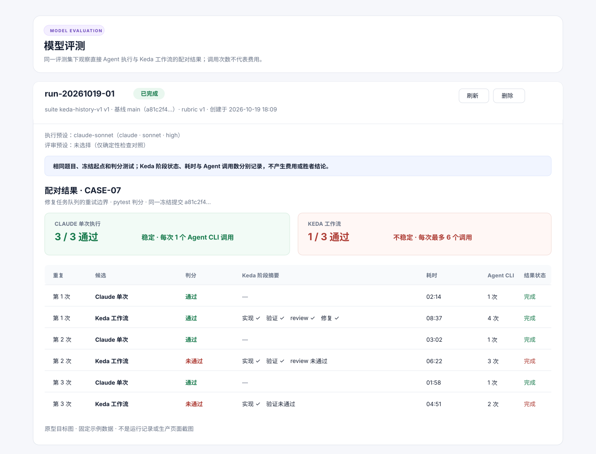

# PRD: M13 Keda 工作流与 Claude 单次执行对照评测

> ⛔ **交付前置**：排在 P1-FEAT-20261019-140531-m13-golden-eval-baseline 之后开工。该 PRD 先交付隔离执行、题目校准与重复账本；本 PRD 依赖这些能力复用同一把可靠的判分尺子。
> 结构化声明见 §8 Delivery Dependencies，**那里是唯一事实源**。

> ⬜ **验收状态**：未开工。
> 本行是 §9 Acceptance Checklist 的投影，**那里是唯一事实源**。

> 本 PRD 分两个 altitude，分别服务不同读者，自上而下阅读：
>
> - **Part A · 人审层 (Review Layer)** — 需求方 / 验收人读这部分，决定“比较的问题是否正确、范围是否合适”。
> - **Part B · 执行器层 (Build Layer)** — 实现者读这部分，按现有评测与 Agent Runner 架构实现并收集证据。

## Feature Overview (功能一览)

> 本节是 §10 Functional Requirements 的白话投影；行为验收以 §1 的行为样例为准。

- **同题配对比较**（FR-1、FR-2）：同一 Claude 配置分别走 Keda 工作流和 Claude 单次执行，使用相同题目、代码起点与隐藏判分测试。
- **复用黄金评测集**（FR-3）：使用已校准的 keda-history-v1，开发集用于观察与调试，留出集单独运行并明确披露公开仓库泄漏限制。
- **比较 Keda 的完整本地工作流**（FR-4、FR-5）：Keda 候选运行实现、确定性验证、review 与受限修复；Agent 完成前看不到隐藏判分材料。
- **展示每题结果和运行代价信号**（FR-6、FR-7）：并列展示测试通过情况、重复稳定性、Keda 流程状态、耗时和 Agent 调用次数，不推导费用或“胜者”。
- **配置可复现且旧记录可读**（FR-8）：冻结 Claude 与 Keda 工作流配置；扩展现有本地账本，已有评测记录继续可读。
- **Console 与 M13 文档同步**（FR-9）：沿用现有 Evaluations 页面和 API，记录比较口径、边界及后续路线。

# Part A · 人审层 (Review Layer)

## 1. Introduction & Goals

### Problem Statement

M13 的黄金评测基线能回答“直接运行 Claude 时，同一道题是否通过判分测试”，但不能回答“把相同的 Claude 放进 Keda 的实现、验证、review 和修复流程后，结果有何变化”。当前评测候选执行路径对每个题目和预设调用一次直接 Agent 执行器；Keda 的 Issue 工作流由另一条编排路径运行。两者尚未在同一任务、同一起点和同一隐藏判分规则下形成配对结果。

这使团队在调整 Keda 的生命周期提示、验证策略或 review / 修复流程时，无法用同一组任务观察这些编排是否改变了最终代码正确性、完成稳定性和运行时间。

### Interpretation (解读回显)

这是本 PRD 的解释锁定区。请先核对行为样例；改动任一行的期望结果，等于改动 §7.6 对应验收 oracle。

| 验证方式 | 输入 / 操作 | 期望观察到的结果 |
|---|---|---|
| 👀 人审 + 自动验证 | 在 Evaluations 选择已校准的 keda-history-v1 开发集、一个 Claude 预设、3 次重复，并启动“Keda 工作流 vs Claude 单次执行”对照。 | 每道题出现 Keda 与 Claude 两组配对结果；两组使用同一冻结起点和隐藏判分测试；详情显示各自通过次数、稳定性、运行时间与 Agent 调用次数。 |
| 👀 人审 + 自动验证 | 对同一题运行 3 次，其中 Keda 组有一次 review / 修复后测试通过，另外两次未通过；Claude 组三次均通过。 | 页面逐题展示 Keda 1/3、Claude 3/3 以及各自稳定性；Keda 的流程阶段状态单独显示；页面不标“胜者”、不计算合成总分，也不把该结果称为费用对比。 |
| 🤖 自动验证 | 创建 run 时选中未校准题、漏选 Claude 预设、Keda 的 Claude 阶段配置不一致，或最坏情况调用次数超过上限。 | 创建被拒绝并说明具体原因；没有候选运行、Agent 调用或外部写入。 |
| 🤖 自动验证 | 任一候选尝试读取判分测试、修复后提交、其他评测候选的工作目录或历史对象。 | 候选看不到隐藏测试和后续提交；每个候选使用独立快照；隔离探针记录结果并使违规运行失败。 |
| 🤖 自动验证 | Keda 达到流程调用上限、超时、需要人工处理或遇到本地 GitHub 替身故障。 | 流程状态分别记录为预算耗尽、超时、需人工或执行故障；它们不被伪装成测试失败，另一组和同题其他重复继续保留结果。 |

### Decisions taken silently (我默默定了这些)

- **比较对象** → 同一个 Claude CLI 预设：直接组对题目只运行一次 Claude；Keda 组由 Keda 使用同一 Claude agent / model / reasoning 配置运行自身生命周期阶段。Keda 的额外阶段提示与编排就是本次被测变量。
- **执行资源边界** → 两组使用相同的单候选总超时；Keda 每个候选最多调用 Agent 6 次。创建页显示执行单元数与最坏 Agent 调用数；不把调用次数当作金额，也不声称两组成本相同。
- **Keda 流程终点** → 运行到本地验证、review 与受限修复完成并产出待发布代码；不创建真实 Issue、PR，不推送、不合并。
- **评测对象** → 复用前置 PRD 交付并校准的 keda-history-v1；8 道开发集用于试跑，4 道留出集需显式选择且单独显示。
- **主要结论口径** → 确定性隐藏测试是正确性主信号；运行时间、Agent 调用数与 Keda 阶段状态是辅助信号。模型使用量覆盖不完整，因此本 PRD 不显示费用估算。
- **未校准或配置漂移处理** → 创建前 fail-fast；运行时若冻结的 Claude 预设或 Keda 生命周期配置变化，停止相应候选并记录配置漂移，不用新配置继续执行。

### Read as out of scope (我理解为不做)

- 不比较 Claude 与其他模型，也不比较多个 Claude 模型或 reasoning 档位。
- 不把真实 GitHub Issue 创建、远程 PR、CI、合并或发布结果纳入本次对照。
- 不采集一次通过合并率、人工介入时长或货币成本；这项指标账本仍由 M13 的独立度量数据工作负责。
- 不比较 Claude Web / 桌面客户端；直接组指一个 Claude CLI 预设的一次候选调用。

读成：**用同一批任务与判分材料，观察 Claude 单次执行和 Keda 多阶段本地工作流的最终代码表现差异**。两组固定同一 Claude 配置、题目、代码起点和单候选总超时；Keda 可以在其预算内调用多个阶段，阶段编排及提示属于 Keda 方案的一部分。对照必须通过同一 Evaluations 入口启动，不能另写一套评测器或复制 Keda 阶段逻辑。隐藏判分测试只能在两组候选都结束后放入判分环境。结果仅说明这批公开历史任务上的观察，不构成普遍模型能力排名、成本对照或 GitHub 交付效果证明。

### What The User Gets

评测维护者可以用一份已校准的历史任务集，启动一轮“Keda 工作流与 Claude 单次执行”对照。运行者可以逐题看到两组是否通过相同测试、结果是否稳定、Keda 流程停在哪个阶段，以及两组实际耗时和 Agent 调用次数。维护者可以据此判断是否值得继续调整 Keda 的流程或提示，同时知道这批公开历史题能支持什么结论、不能支持什么结论。

### Measurable Objectives

- 在 keda-history-v1 的开发集上，创建 3 次重复的配对 run 后，每道题均有同起点的 Keda 与 Claude 结果，且每组各有 3 条重复记录。
- 任一候选均无法读取后续提交、隐藏测试和其他候选目录；判分材料只在两组候选结束后注入。
- 页面逐题展示两组通过数、稳定性、Keda 流程状态、耗时和 Agent 调用次数；不显示费用、合成总分或自动胜负结论。
- 未校准、预设漂移、配置不匹配、留出集未明确选择及执行预算超限均在零候选执行时被拒绝。
- 从 v16 账本迁移后，既有 run / result / score 继续可读；同一题、同一组、同一重复序号只能有一条结果。

## 2. Human Review Map (介入与风险地图)

### 决策一：这项对照要测 Keda 编排，还是要比较模型

建议固定同一个 Claude 预设作为两组底层模型：Claude 单次组只接收任务并执行一次；Keda 组运行 Keda 的多阶段实现、验证、review 和修复流程。这样观察到的差异主要来自 Keda 的工作流组织，而不是换了模型。Keda 可以有更多 Agent 调用，因此页面报告实际调用次数与耗时，但不声称费用相同或证明“Claude 本身更强 / 更弱”。

**请确认：** 是否同意把本次结论限定为“同一 Claude CLI 配置下，Keda 工作流相对 Claude 单次执行的配对效果”，并接受 Keda 每个候选最多调用 Agent CLI 6 次？

**验收：** 页面逐题展示两组结果及调用次数，不输出模型能力排名或费用结论。

### 决策二：是否接受本地隔离工作流作为 Keda 候选

建议在独立快照中运行 Keda 的真实本地编排、验证、review 和修复代码；GitHub Issue / PR 写入边界使用仅本机的临时替身，不触达真实 GitHub。这样能安全地重复运行并真实观察 Keda 的核心本地工作流，但不覆盖远程 PR、GitHub Actions CI、合并和发布行为。若将这些远程行为也纳入，需另行增加真实沙箱仓库、凭据和外部写入授权，成本与验证范围会明显扩大。

**请确认：** 是否接受“真实 Keda 本地工作流 + 本机 GitHub 替身 + 停在待发布结果”的范围？

**验收：** 探针证据显示实现、验证、review / 修复阶段来自现有 Keda 编排路径；GitHub 请求只到临时替身，不创建真实 Issue、PR 或远程分支。

### 决策三：是否接受为配对结果升级本地账本

建议在前置基线 PRD 的 v16 账本上增量升到 v17：每条结果标记 direct 或 Keda 组别，并为 Keda run 保存配置指纹和受限阶段摘要。现有单 Agent 结果迁移后归为 direct 组，保留原有 run、result 和 judge score。这个改动让同题重复结果可以成对保存；代价是 SQLite 迁移需重建结果唯一键。

**请确认：** 是否接受保留既有记录的 v16 → v17 增量迁移和新的候选组唯一键？

**验收：** 旧 run 详情仍可读；同题同一重复序号可分别保存两种候选，但同组重复写入会被拒绝。

~~~mermaid
erDiagram
    EVALUATION_RUN ||--o{ EVALUATION_RESULT : has
    EVALUATION_RESULT ||--o{ EVALUATION_SCORE : scored_by
    EVALUATION_RUN {
        text run_id PK
        text keda_workflow_snapshot_json "新增配置快照"
        text keda_workflow_hash "新增配置指纹"
    }
    EVALUATION_RESULT {
        text result_id PK
        text run_id FK
        text case_id
        text execution_preset_id
        text candidate_kind "direct_agent / keda_workflow"
        int repeat_index
        text workflow_trace_json "新增阶段摘要"
    }
    EVALUATION_SCORE {
        text score_id PK
        text result_id FK
    }
~~~

### 自动门禁，不需要逐项人工审阅

- 每个比较 run 冻结 suite hash、题目起点、Claude 预设快照、Keda 生命周期配置摘要、超时与调用上限。
- 两组使用独立隔离快照；Agent 退出后才恢复依赖清单、注入隐藏判分测试并运行相同判分配方。
- 创建阶段验证校准状态、留出集选择、Claude agent 类型、Keda 阶段配置一致性及最坏调用预算。
- Keda 流程状态、测试判分结果和基础设施执行故障分开记录；单组失败不丢弃另一组结果。
- 前端从真实 Evaluations 页面创建和启动对照 run，并逐题展示配对结果。

### 本次明确不涉及

本次不调用真实 GitHub 写接口，不做 PR 发布或合并；不做跨模型对照、自动选型或 M14 自进化；不将运行结果变成合并门禁或 PRD 验收证据；不声称成本相等或测得货币成本。

## 3. Usage And Impact After Implementation

### 评测维护者

维护者继续在 tasks/evaluation-suites/ 维护版本化 suite。对照 run 仅允许使用已校准题目；新增或变更题目沿用前置 PRD 的校准流程。维护者在 suite 文档中记录 12 道题的提交、分组、prompt 与判分材料来源。

### Console 评测运行者

运行者从 Console 的 Evaluations 页面选择 keda-history-v1、开发集或显式包含留出集、一个 Claude 执行预设和重复次数。页面固定创建两组配对候选，并显示候选单元数、最大 Agent 调用数与候选超时。运行者确认并启动后，可以在详情页逐题查看两组结果、Keda 阶段状态、稳定性与耗时。

### Keda / Agent Runner 维护者

维护者可按题检查 Keda 流程阶段与单次 Claude 结果的差异，并在开发集调试。配置和提示发生变化时创建新 run；历史 run 仍显示创建时冻结的配置摘要。留出集结果仅在最终观察时使用，不据此反复调参。

### 兼容性影响

现有单 Agent 评测和多评审功能保持可用；本 PRD 不更改评审评分、授权或 API / CLI 命令面。既有账本记录在新增候选组字段后默认解释为直接 Agent 候选。新建对照记录存储组别、Keda 流程摘要和实际调用数。

## 4. Requirement Shape

- **Actor：** Console 评测运行者、评测集维护者、Keda Agent Runner 维护者。
- **Trigger：** 运行者在 Console Evaluations 页创建一轮 Keda 与 Claude 单次执行的对照评测并显式启动。
- **Expected behavior：** 相同的冻结题目、代码起点、Claude 模型配置和隐藏测试分别作用于两种候选流程；结果按题、按重复配对展示。
- **Scope boundary：** 只测 Keda 的本地实现、验证、review 与修复流程；不测真实 GitHub 发布、CI、合并或跨模型能力。

# Part B · 执行器层 (Build Layer)

## 5. Repository Context And Architecture Fit

- **Existing Path：** 已归档的多评审模型评测 tasks/archive/P1-FEAT-20261012-103909-multi-judge-agent-evaluation.md 建立了 Console Evaluations 页面与本地账本。候选执行从 src/backend/api/routes/agent_runner_console_evaluation.py 进入 core.use_cases.model_evaluation_runtime，由 src/backend/engines/model_evaluation/service.py 创建 / 启动，再在 src/backend/engines/model_evaluation/execution.py 为每个 case × execution preset 调用 agent_adapter.run_candidate 和确定性判分。run_once 与 _process_single_issue 所在的 src/backend/core/use_cases/agent_runner_orchestrate.py、agent_runner_orchestration_runtime.py、agent_runner_issue_handlers.py 组成 Keda 的 Issue 工作流。
- **Reuse Candidates：** 复用前置 PRD P1-FEAT-20261019-140531-m13-golden-eval-baseline 交付的单提交快照、每题基线冻结、延后判分材料、uv-pytest、校准裁决、重复序号和旧库 v16 迁移；复用现有 suite registry、run 生命周期、Agent CLI adapter、固定 check recipes、并发闸门与汇总路径；Keda 工作流必须使用现有 run_once / Issue 处理编排，不复制阶段流程。
- **Architecture Constraints：** api → core → engines → infrastructure 依赖方向不变；core 保存比较规则、候选类型和端口，进程 / 文件 / git / 隔离 GitHub 替身由 engines / infrastructure 边界提供；API 路由只处理 DTO 和错误映射。不得让 engines/model_evaluation 静态导入 core 实现模块，也不得让 API 直接导入 engines。若现有 Keda 编排入口不能由评测入口安全调用，应先抽出窄的 core-owned workflow port 并在现有组装路径中接线，不复制 _process_ready_issue 或 review / repair 阶段代码。
- **Frontend Impact：** 只涉及 frontend-public/（Next.js + TypeScript，pnpm）。目标页是 app/(app)/app/evaluations/page.tsx，结果展示在 components/evaluations/run-detail-panel.tsx，API client 和类型位于 lib/api/console.ts、lib/api/types.ts。本地开发通过 just run all 启动栈，单独启动管理终端前端可用 just run frontend-public。现有 console-evaluations.no-auth.spec.ts 会 mock Evaluation API，只能覆盖前端请求契约；新增 paired E2E 用例走真实页面、真实 API 和 SQLite，Agent CLI 才允许替换成探针。
- **Runtime Constraints：** Console 使用本地 SQLite；Agent CLI 沿用现有凭据和执行器配置。执行为人工启动的本机评测，Keda 候选必须运行在临时工作目录，GitHub 写入边界仅连本地替身。当前 evaluation 的单次 Agent 超时默认 900 秒；对照 run 需冻结并共享单候选总超时。
- **Existing PRD Relationship：** 本 PRD 硬依赖待办中的 tasks/pending/P1-FEAT-20261019-140531-m13-golden-eval-baseline.md。它是其后续消费者，不能重复实现 suite 隔离、校准或重复账本。tasks/archive/P1-FEAT-20261012-103909-multi-judge-agent-evaluation.md 是现有评测页面与账本的基础；P2-FEAT-20261009-171037-agent-preset-performance-stats 与本功能口径互补，不负责配对实验。当前未找到独立的 M13 成本 / 人工事件入账 PRD；本 PRD 不依赖或代替该工作。
- **Potential Redundancy Risks：** 不新建 Keda 第二套 issue orchestrator；不复制 baseline harness；不创建第二个 run registry 或独立候选调度系统；阶段追踪放在评测结果已有的 run/candidate 关系中，不扩展成通用事件平台。

## 6. Recommendation

### Recommended Approach

在现有 Evaluations run 中增加一组固定的候选类型：直接 Claude 单次执行与 Keda 本地工作流。一次 run 必须同时包含两组，并使用同一 suite、Claude preset、基线 commit / tree、重复序号和隐藏测试。Keda 候选通过现有 Issue 编排入口运行到本地验证、review / 修复完成；只替换 GitHub 外部写入边界，不替换 Agent CLI 或 Keda 的阶段逻辑。

选择这条路径，是因为比较对象和判分流程已经存在；新增的是第二种候选执行方式及逐题配对展示。通过复用现有 run、suite、结果、check 和 Console 页面，可以把工作限定在候选执行 adapter、结果快照与 UI 展示，不需要另建 benchmark service 或另起 kc eval 命令。

本 PRD 有三个可独立回答的问题：比较变量、Keda 执行边界、配对结果的账本兼容性。它们仍属于一个不可拆的目标态：不实现任一项就无法产出可解释、可复现且能在 Console 中查看的配对结果；拆分会留下不能完整运行的半成品入口，并要求临时兼容状态或重复迁移。

### Proposed Solution Summary (实现机制)

1. **创建配对快照：** Console 页面只允许选择一个 agent 为 Claude 的现有执行 preset；系统生成直接组与 Keda 组的冻结配置快照。Keda 的实现、fix、review 等 Agent 阶段绑定同一 agent / model / reasoning preset；生命周期 prompt、review 策略、修复上限与相关 skill 内容摘要纳入 Keda workflow fingerprint。
2. **验证创建条件：** 仅允许所选题全部校准通过；留出题需要显式包含；比较组必须成对；两组最大候选超时相同；Keda 每候选最多 6 次 Agent CLI 调用；矩阵候选单元总量沿用 baseline 的 48 上限。页面显示最坏调用数，超出 168 次 Agent CLI 调用上限的 run 在启动前拒绝。
3. **运行直接组：** 在该题的隔离单提交快照中，将 suite prompt 发给 Claude preset 一次。候选目录不含 Keda operator skill 或可调用的 Keda 控制入口；不含隐藏测试。
4. **运行 Keda 组：** 为同一题生成本地 Issue 输入，在同一冻结起点的独立快照里驱动现有 Keda issue orchestration，执行实现、项目验证、review 与修复。生命周期 Agent 阶段都使用同一 Claude preset。GitHub 交互经本机临时替身记录，不联网、不创建真实 Issue / PR；候选只产出待发布本地结果。
5. **延后判分：** 两组候选均结束后，还原依赖清单、注入 suite 的 held-out 判分文件，并以同一 uv-pytest recipe 判分。不能运行判分时记为 not_run / infrastructure failure，不混成测试失败。
6. **记录结果：** 每个 case × candidate_kind × repeat_index 产生一条结果，保存 workflow snapshot hash、阶段状态摘要、CLI invocation count、整体 duration、最终 diff hash 和 check 结果。不保存完整 transcript、密钥或原始环境变量。
7. **呈现配对结果：** build_evaluation_summary 同族的纯函数从结果明细派生每组通过次数、稳定性和配对差异；不保存重复汇总，不显示合成总分、费用或自动排名。
8. **账本升级：** baseline PRD 交付 v16 后，本 PRD 推进到 v17：结果表增加 candidate_kind 与受限 JSON workflow_trace_json；run 表增加 Keda workflow 配置快照 / 指纹。唯一约束从 v16 的 (run_id, case_id, execution_preset_id, repeat_index) 调整为 (run_id, case_id, candidate_kind, execution_preset_id, repeat_index)；既有结果默认映射到 direct_agent，所有旧行保留。

### Alternatives Considered

- **把 Keda 流程另写成评测专用的阶段序列：** 不采用。这样测到的是第二套简化实现，而不是 Keda 当前的 Issue 工作流；Keda 阶段行为变化还要双处同步。
- **创建真实 GitHub Issue / PR 后评测：** 不作为本 PRD 默认路径。每轮重复会产生外部持久副作用和凭据要求，也把 GitHub / CI 噪声混入对 Keda 本地编排的比较。若未来需要测发布链路，应作为独立的 live sandbox 验证。
- **只比较页面上的直接 preset，不运行 Keda 生命周期：** 不采用。无法回答本 PRD 的核心问题。
- **新增 kc eval CLI：** 不采用。现有 Console 页面和评测 API 已有 run 生命周期，额外命令会产生重复入口、状态和文档。

## 7. Implementation Guide

This section is a living implementation guide based on current repository analysis. If implementation discovers additional affected files, hidden dependencies, edge cases, or a better path, update this PRD before proceeding.

### 7.1 Core Logic

~~~text
创建 run
  → load 已校准 suite → 解析所选 case 的冻结 commit/tree
  → 冻结 Claude preset + Keda lifecycle config/prompt fingerprint
  → 校验成对候选、留出集、单元上限、最坏 CLI 调用数
  → 明确 start
      → 每个 (case × repeat) 建直接 Claude 与 Keda 两个独立快照
      → Claude 直接组：单次 Agent CLI 调用
      → Keda 组：现有 Issue 编排 → 验证 → review/修复（本地 GitHub 替身）
      → 候选都结束后还原依赖、放入 held-out、运行同一判分 recipe
      → 按 candidate_kind / repeat_index 保存结果与阶段摘要
  → 从逐条结果派生配对通过数、稳定性和耗时/调用数视图
~~~

**候选执行边界：**

- 两组使用相同 suite prompt、基线 commit/tree、Claude CLI 预设、判分 recipe 和候选总超时。
- Keda 阶段 prompt 与编排属于 Keda 候选本身；不能复制到直接 Claude prompt。
- 直接组不能调用 Keda CLI 或读取 Keda operator skill；Keda 组由评测控制面驱动 Keda 编排，不由候选 Agent 自行启动 Keda。
- Keda 的本地 issue/GitHub 适配不得连接公共网络；每个候选的本地状态、工作目录、Git 状态都独立。
- 超过 6 次 Agent CLI 调用或整体超时后立即收敛为对应执行状态，不启动隐藏判分，不把尚未完成的 Keda 流程当作测试失败。
- Keda workflow 任何阶段需人工决策时记为 needs_human，该候选不自动等待人工，也不把它算作完成。
- 所有结果仅是评测观察，不得作为 PRD 验收、PR 合并或自动路由门禁。

### 7.2 Change Impact Tree

以下路径建立在 baseline PRD 已交付的目标态上；若其实现改变了这些扩展点，按 Executor Drift Guard 重新搜索，不要并行复制模块。

~~~text
.
├── src/backend/core/shared/models/model_evaluation.py [修改]
│   【总结】增加候选类型、配对配置快照、Keda 流程阶段状态与调用预算的数据契约。
│   ├── EvaluationRunRecord 冻结 Keda lifecycle fingerprint 与 workflow limits
│   ├── EvaluationResultRecord 增加 candidate_kind 与 workflow_trace
│   └── 配对汇总按 case / candidate_kind / repeat_index 派生
├── src/backend/core/shared/interfaces/ [修改]
│   【总结】为评测运行调用现有 Keda Issue 编排定义窄端口，不让 engines 反向导入 core。
│   └── 复用现有 Issue / Runner 抽象，避免新增另一套候选执行协议
├── src/backend/core/use_cases/model_evaluation.py [修改]
│   【总结】校验配对 run、Claude preset 一致性、校准状态与预算上限。
├── src/backend/core/use_cases/agent_runner_orchestrate.py [修改]
│   【总结】仅在确有必要时暴露受控的 Keda 评测调用入口，继续走现有生命周期编排。
│   └── 不改常规 run_once / daemon / CLI 行为
├── src/backend/engines/model_evaluation/execution.py [修改]
│   【总结】调度直接 Claude 与 Keda 候选，隔离工作目录并在候选结束后统一判分。
├── src/backend/engines/model_evaluation/service.py [修改]
│   【总结】冻结比较 run 配置，执行创建门禁并读取配对结果摘要。
├── src/backend/engines/model_evaluation/ [修改]
│   【总结】新增本机 GitHub 写入替身与 Keda 候选 adapter，仅用于评测运行且不访问公网。
│   ├── 替身只实现评测需要的 issue / label / PR 状态交互
│   └── 复用现有 Agent CLI、ProcessRunner 与 Git 隔离能力
├── src/backend/infrastructure/persistence/console_store_evaluation.py [修改]
│   【总结】实现 v17 增量迁移、配对结果唯一约束与 workflow trace 持久化。
├── src/backend/api/routes/agent_runner_console_evaluation.py [修改]
│   【总结】扩展创建请求与响应 DTO，暴露候选组、配置不匹配和预算错误。
├── frontend-public/app/(app)/app/evaluations/page.tsx [修改]
│   【总结】添加配对模式、重复与留出集选择、预计候选数 / CLI 调用数和启动前错误。
├── frontend-public/components/evaluations/run-detail-panel.tsx [修改]
│   【总结】并列呈现两组逐题结果、Keda 阶段摘要、重复稳定性、耗时和调用数。
├── frontend-public/components/evaluations/evaluation-format.ts [修改]
│   【总结】格式化候选组与 Keda 阶段终态。
├── frontend-public/lib/api/console.ts [修改]
│   【总结】提交配对 run 参数并读取候选组与阶段摘要。
├── frontend-public/lib/api/types.ts [修改]
│   【总结】同步 v17 后端的请求、run、result 和 summary DTO。
├── docs/prototypes/assets/keda-vs-claude-paired-evaluation.svg [新增]
│   【总结】提供逐题配对详情的静态目标态图，并明确它只是设计意图。
├── docs/prototypes/assets/keda-vs-claude-paired-evaluation.source.md [新增]
│   【总结】记录目标图的手工来源、代码依据、示例数据与失效条件。
├── docs/prototypes/assets/prototype-hub.js [修改]
│   【总结】在现有 Prototype Hub 登记目标图并关联 Console 评测原型。
├── docs/prototypes/assets/README.md [修改]
│   【总结】列出配对结果目标图及其来源旁车。
├── tests/test_model_evaluation_domain.py [修改]
│   【总结】覆盖配对候选校验、Claude profile 一致性、预算边界与汇总口径。
├── tests/test_model_evaluation_execution.py [修改]
│   【总结】覆盖真实 Keda 编排调用边界、隔离候选、阶段调用计数与延后判分。
├── tests/test_console_store_evaluation.py [修改]
│   【总结】覆盖 v16 → v17 迁移、旧结果映射、配对唯一约束和外键行为。
├── tests/playwright-e2e/tests/workflows/console-evaluations-paired.no-auth.spec.ts [新增]
│   【总结】从真实 Evaluations 页面走真实 API / SQLite，使用 fixture Claude CLI 验证配对创建、启动与详情展示。
│   ├── 现有页面、路由、API 与结果 DTO 不 mock
│   └── fixture 仅替代外部 CLI；GitHub 交互使用本机临时替身
├── docs/dev/evaluation.md [修改]
│   【总结】记录 Keda vs Claude 的比较口径、隔离边界、指标解释与限制。
├── tasks/evaluation-suites/README.md [修改]
│   【总结】说明开发 / 留出题如何用于配对评测以及禁止将比较结果当成验收证据。
└── ROADMAP.md [修改]
    【总结】链接本 PRD 并区分评测基线、Keda 工作流对照和度量数据入账。
~~~

### 7.3 Executor Drift Guard

开工前搜索当前分支中 run_once、_process_single_issue、_process_ready_issue、EvaluationResultRecord、MAX_EVALUATION_MATRIX_CELLS、candidate_kind 与 workflow_trace。确认 baseline 已落地的 candidate snapshot / held-out 注入 / migration 形态后再更新影响树。

若实现只能通过复制 Keda 生命周期阶段才能接入，先停下并把实际调用边界写回本 PRD；不得直接调用私有阶段函数拼出“近似 Keda 流程”。不改 kc CLI 表面，不改 tests/guards/ 守卫测试，不引入新的模型 SDK 或依赖。

### 7.4 Flow Or Architecture Diagram

~~~mermaid
flowchart TD
    UI["Console Evaluations 页面"] --> API["Evaluation API"]
    API --> CORE["配对规则 / run 快照"]
    CORE --> ENGINE["评测调度器"]
    ENGINE --> DIRECT["Claude 单次候选"]
    ENGINE --> KEDA["Keda Issue 工作流候选"]
    KEDA --> KCORE["现有实现 / 验证 / review / 修复编排"]
    KCORE --> GHF["本机临时 GitHub 替身"]
    DIRECT --> JUDGE["候选结束后注入隐藏测试并判分"]
    KEDA --> JUDGE
    JUDGE --> STORE["本地 evaluation_run / evaluation_result"]
    STORE --> UI
~~~

### 7.5 ER Diagram

v16 → v17 的 ER 图见 Part A §2「决策三」。旧结果没有 candidate_kind 的行映射为 direct_agent；保留 evaluation_score 经 result_id 的外键关系和级联语义。

### 7.6 Realistic Validation Plan (Oracle 块)

~~~yaml
- id: rv-1
  behavior: Keda 与 Claude 两组在隔离的同起点快照中运行，隐藏判分材料在候选结束后才注入；Keda 阶段通过本机替身运行，不产生公共 GitHub 写入。
  reviewer: human
  real_entry: "启动本机 Console，通过 /app/evaluations 创建并启动一个仅含 fixture case 的配对 run；fixture agent 记录每个 CLI 调用的 cwd、Git 状态和可见文件，并检查本机 GitHub 替身收到的动作。"
  expected: "直接组只有一次 Claude 调用；Keda 组经过实现、确定性验证、review / 修复且总调用不超过 6；两组都看不到 held-out 文件和后续修复对象；替身记录所有 GitHub 交互且真实网络没有 Issue / PR 写入；候选完成后相同隐藏测试才被注入。"
  mock_boundary: "允许替换 Claude CLI 为可记录的 fixture executable，并以本机 GitHub adapter 代替外网 API；真实 Console 页面、Evaluation API、suite 加载、快照 Git 操作、Keda core orchestration、候选状态持久化和判分命令必须真实。"
  tier: R3
  test_layer: e2e
  required_for_acceptance: true
  presentation: "tasks/evidence/P1-FEAT-20261019-180938-m13-keda-vs-claude-workflow-evaluation/rv-1-isolated-paired-run.png；自验：页面详情能看到两组结果，fixture 记录显示 Keda phases 已执行且隐藏测试仅在 Agent 退出后出现。"
  critical_value_source: "Claude 调用配置来自创建 API 响应冻结快照；隐藏测试路径与内容来自本次 suite fixture；GitHub 动作来自 adapter 写出的事件记录；候选结论来自 evaluation_result。"
  must_cross: "真实页面 → 创建 API → 冻结 suite / Claude / Keda 配置 → 启动 API → 候选调度 → direct 与现有 Keda orchestration → 本机 GitHub adapter → 延后注入 → 固定判分 → SQLite 持久化 → 页面详情读取"
  forbidden_bypasses: "直接调用 _execute_cell；手工构造 EvaluationResult；在 Agent 开始前复制 held-out；调用 detached worktree 共享主仓库对象库；mock Keda 阶段编排；访问真实 GitHub 写 API。"
  fresh_state_probe: "运行结束后用新后端进程 / 新 SQLite 连接读取 run、所有 result 与 candidate trace，并检查 fixture agent 的独立记录文件和 GitHub 替身事件日志。"
  final_tree_evidence: "证据记录被验证实现的 Git tree hash、suite hash 与两个候选配置 hash；execution.py、Keda adapter、held-out 注入或配置冻结变化后重跑。"
  negative_control: "实现前直接候选执行存在但 Keda candidate mode 不存在；在旧代码上调用该配对创建入口应返回 404 / 422 且无候选进程。"
  expected_fail: "配对创建入口不可用，或 run 中缺少 Keda candidate result。"

- id: rv-2
  behavior: Console 展示按题配对的重复结果、稳定性、Keda 阶段状态、耗时和 Agent 调用次数，不展示费用、总分或自动胜者。
  reviewer: human
  real_entry: "本机启动真实 Console 栈后，从 /app/evaluations 运行 fixture-backed 配对评测；执行新增的 tests/playwright-e2e/tests/workflows/console-evaluations-paired.no-auth.spec.ts：cd tests/playwright-e2e && npm run test:no-auth -- tests/workflows/console-evaluations-paired.no-auth.spec.ts。"
  expected: "真实页面中每题有 direct_agent 与 keda_workflow 两组、通过次数和稳定状态；Keda 阶段摘要与调用次数来自详情 API；页面不存在成本数值、总分或胜者徽标。"
  mock_boundary: "默认 E2E 允许通过现有 agent registry 的 bin 配置把 claude CLI 指向本机 fixture executable，并使用本机 GitHub 替身；真实 Claude CLI 是凭据可用时的 opt-in。页面路由、后端 API、SQLite、result DTO 与真实布局不得 mock。"
  tier: R2
  test_layer: e2e
  required_for_acceptance: true
  presentation: "tasks/evidence/P1-FEAT-20261019-180938-m13-keda-vs-claude-workflow-evaluation/rv-2-paired-results.png，与 docs/prototypes/assets/keda-vs-claude-paired-evaluation.svg 成对呈现；自验：详情页同一道题可见 direct / Keda 两行及各自 1/3 或 3/3 状态。"
  critical_value_source: "展示值必须从本次真实详情 API 响应和页面 DOM 读取；截图取自 /app/evaluations 真实页面路径。"
  must_cross: "浏览器真实页面 → 页面创建请求 → canonical Evaluation API → 结果 SQLite → 新详情请求 → 页面渲染"
  forbidden_bypasses: "直接渲染 RunDetailPanel；手工注入 result props；仅用组件预览截图；以 fixture API 替代真实后端请求。"
  fresh_state_probe: "刷新页面后重新请求详情 API；核对新响应的 candidate_kind、repeat_index、check_status、workflow_trace、duration 和 invocation_count 与 DOM 一致。"
  final_tree_evidence: "证据记录最终 Git tree hash、E2E 输出与浏览器截图；run-detail-panel、types.ts 或 API DTO 变化后重跑。"
  negative_control: "not needed — 配对结果行数、candidate_kind 与具体 DOM 文案均来自响应字段比较；缺任一组时具体断言必然失败。"

- id: rv-3
  behavior: 本地 evaluation 账本从 v16 升级到 v17 后，旧记录可读，同一题可以分别保存 direct 与 Keda 结果，但同一组 / 重复序号不能重复写入。
  reviewer: verifier
  real_entry: "准备一份升级前真实 v16 console.db 副本，启动本机 Console 触发迁移，查询旧 run 详情，然后通过配对 Evaluation API 创建并启动一个 fixture run。"
  expected: "user_version 为 17；旧 run / result / score 行数及详情不变；旧 result 映射为 direct_agent；新 run 同一题可写入两种 candidate_kind 和 repeat_index 0–2；相同组与重复序号的重复写入被唯一约束拒绝，score 外键级联仍有效。"
  mock_boundary: "SQLite 文件、迁移、API 和结果写入必须真实；Claude CLI 可以用 fixture executable；不得用新建空库代替 v16 副本。"
  tier: R2
  test_layer: integration
  required_for_acceptance: true
  critical_value_source: "迁移前旧记录计数与行内容摘要取自 v16 副本的 SQL 查询；迁移后由新的 SQLite 连接重新查询。"
  must_cross: "v16 数据库副本 → Console 启动迁移 → 旧 run 详情 API → 配对 run 创建 / 启动 → result 持久化 → fresh SQLite 查询"
  forbidden_bypasses: "新建空数据库；直接运行手写 SQL 代替应用迁移；跳过 result 唯一约束或 score 级联检查。"
  fresh_state_probe: "迁移和配对写入后使用新 SQLite 连接核对 user_version、旧行摘要、candidate_kind、repeat_index、唯一约束与外键级联。"
  final_tree_evidence: "证据记录最终 Git tree hash 与 v16 副本 sha256；console_store_evaluation 迁移步骤变化后必须重跑。"
  negative_control: "not needed — 旧实现 user_version 是 16 且 evaluation_result 不含 candidate_kind；新 oracle 的版本号与列检查在实现前必然不符。"

- id: rv-4
  behavior: 创建时拒绝未校准题、未显式选择的留出集、非 Claude preset、Keda 阶段 Claude 配置不一致及超过最大 CLI 调用数的 run；已创建 run 若冻结配置漂移，则 start 被拒绝且零候选执行。
  reviewer: verifier
  real_entry: "向 Console Evaluation API 提交以上各类无效创建请求；另创建后修改 Claude / Keda 冻结相关配置，再调用 start，并检查 run 列表、SQLite 与 fixture CLI 调用记录。"
  expected: "无效创建返回 400 并逐条指出原因，且不新增 run / candidate / CLI invocation；配置漂移的已创建 run 保留原 run 但 start 返回配置漂移错误、不新增 candidate 或 CLI invocation；边界内请求被接受且响应包含候选数与最大调用数。"
  mock_boundary: "API、校验、账本必须真实；fixture CLI 仅作为候选启动的观测器，不执行模型调用。"
  tier: R1
  test_layer: integration
  required_for_acceptance: true

- id: rv-5
  behavior: Keda 达到 Agent 调用上限、候选超时、需要人工处理或本机 GitHub 替身故障时，流程状态与判分失败分开记录，并保留同题另一组和其他重复结果。
  reviewer: verifier
  real_entry: "通过 Console Evaluation API 启动 fixture-backed paired run；由 fixture CLI 与本机 GitHub 替身分别产生 budget_exhausted、timeout、needs_human 和 infrastructure_failure 场景，然后使用详情 API 读取结果。"
  expected: "每种场景具有对应的非测试失败终态；未完成的 Keda 候选不运行隐藏判分；direct 组和其他重复行仍存在且状态未被覆盖。"
  mock_boundary: "Evaluation API、候选状态机、配对账本和结果查询必须真实；只允许 fixture CLI 与本机 GitHub 替身控制外部执行结果。"
  tier: R1
  test_layer: integration
  required_for_acceptance: true
~~~

Failure triage：

- rv-1 失败先查候选工作目录树 hash、Keda 调度入口是否仍然进入现有 run_once 路径、以及本机 GitHub adapter 是否漏接外部写接口。
- rv-2 失败先核对 API 响应字段、前端类型与结果组件映射；只有截图不同不能替代 API / DOM 断言。
- rv-3 失败先检查 v16 → v17 结果表重建和外键恢复，再确认历史行的默认 candidate kind 映射。
- 所有真实 Claude CLI 运行都为 opt-in；无凭据时 fixture CLI 是完整 fallback。默认验收不得要求外部 GitHub 凭据或真实 PR。

### 7.7 Low-Fidelity Prototype (Only When Required)

配对详情页目标图：docs/prototypes/assets/keda-vs-claude-paired-evaluation.svg；从 Prototype Hub 的「Keda 工作流与 Claude 单次执行配对评测」条目打开。验收需要将其与 /app/evaluations 的真实配对结果页截图成对呈现；关键状态为同一题的 direct / Keda 两行、通过次数、稳定性、Keda 阶段摘要及调用数。

### 7.8 Interactive Prototype Change Log (Only When Files Actually Changed)

| File Path | Change Type | Before | After | Why |
|---|---|---|---|---|
| docs/prototypes/assets/keda-vs-claude-paired-evaluation.svg | Add | 无目标图 | 单状态、手工绘制的配对详情目标图 | 锁定同题、两组、重复稳定性、阶段、耗时和调用数的目标层级 |
| docs/prototypes/assets/keda-vs-claude-paired-evaluation.source.md | Add | 无来源记录 | 记录依据文件、示例数据、限制与失效条件 | 让目标图可追溯，避免被误读为运行证据 |
| docs/prototypes/assets/prototype-hub.js | Modify | Hub 没有此目标图 | 登记 image-state 条目，并关联现有 Console 评测原型 | 从唯一 Prototype Hub 可发现和打开目标图 |
| docs/prototypes/assets/README.md | Modify | 资源说明未列出此图 | 列出目标图和来源旁车 | 让维护者能找到静态目标图资产 |

该 SVG 是单状态低保真图，没有点击交互，不称为可运行的 interactive prototype。

### 7.9 External Validation (Only When Web Research Was Used)

- No external validation required; repository evidence was sufficient.

### 7.10 Risk Classification Register

| 变更点 | 档位 | 决定性维度 / 覆盖规则 | 介入 | oracle / 门禁 |
|---|---|---|---|---|
| 隐藏测试时序、单提交隔离与本机 GitHub 写入替身 | R3 | 信任边界：Agent 看答案或发生外部写入会污染对照 / 触达用户仓库 | 人工确认（决策二） | rv-1 |
| 同 Claude profile 下的两组比较契约与 UI 结论 | R2 | 正确性：输入不一致或界面给出过度结论会误导 Keda 改进决策 | 人工确认（决策一） | rv-2 |
| evaluation_result v17 迁移和候选组唯一键 | R2 | 固定区：持久化结构变更、历史行需可读 | 人工确认（决策三）+ verifier | rv-3 |
| 预算 / 资格创建门禁 | R1 | 局部：只控制创建前拒绝，不改变运行中的旧评测 | 执行器 + 判别性测试 | rv-4 |
| Keda 终态与判分状态分离 | R1 | 局部：失败分类和配对结果保留可由 fixture 明确断言 | 执行器 + 判别性测试 | rv-5 |
| Keda 阶段摘要与配对稳定性呈现 | R1 | 局部：从逐条结果派生且可回退 | 执行器 + 页面 E2E | rv-2 |
| Prototype Hub 配对目标图与来源链接 | R0 | 仅评审资产目录，错误可本地立即修复 | 执行器 + Hub 入口核对 | Prototype Hub 条目打开 SVG、来源旁车链接可访问 |
| 文档与 ROADMAP 同步 | R0 | 仅文字 | 执行器 | 文档一致性检查 |

R2 / R3 oracles 共 3 条。无新增独立服务、无新的外部 API / CLI 表面。

## 8. Delivery Dependencies

### Delivery Dependencies

- Depends on tasks/issues:
  - tasks/pending/P1-FEAT-20261019-140531-m13-golden-eval-baseline.md
- Gate type: hard
- Sequence: via-main
- Notes: 需要前置 PRD 已将 suite 校准、快照隔离、延后判分、重复结果账本及 v16 schema 落到主线；本 PRD 之后将账本推进到 v17。

## 9. Acceptance Checklist

### 9.1 人读呈递区（Human Review Surface）

| # | 你要看什么（对应 oracle） | 呈递物（交付时填实际路径） | 想自己复核？ |
|---|---|---|---|
| 1 | 两组在隔离起点运行，隐藏测试延后注入，Keda 阶段经本机替身执行且无真实 GitHub 写入（rv-1） | tasks/evidence/P1-FEAT-20261019-180938-m13-keda-vs-claude-workflow-evaluation/rv-1-isolated-paired-run.png；交付时补 fixture / adapter 记录。打开：open "tasks/evidence/P1-FEAT-20261019-180938-m13-keda-vs-claude-workflow-evaluation/rv-1-isolated-paired-run.png" | 页面详情同题有 direct 与 Keda 结果；fixture 记录显示 Keda 阶段执行，隐藏测试在候选结束后才出现，GitHub 动作只写入本机记录。 |
| 2 | 同题配对结果、稳定性与 Keda 阶段信息真实显示，页面没有费用或自动排名（rv-2） | 目标图：docs/prototypes/assets/keda-vs-claude-paired-evaluation.svg；交付截图：tasks/evidence/P1-FEAT-20261019-180938-m13-keda-vs-claude-workflow-evaluation/rv-2-paired-results.png。打开目标图：open "docs/prototypes/assets/keda-vs-claude-paired-evaluation.svg" | 在真实 /app/evaluations 的同一题下核对 direct / Keda 两行、各自通过次数与稳定性、Keda 调用数；页面不出现费用、总分或胜者标记。 |

设计意图目标图（不是运行证据）：

交付时将真实页面截图与该目标图按相同题目、状态、视口、浅色主题及代表数据并排呈现。

以下由 verifier 复核，不需要人工逐项查看：rv-3 v16 → v17 迁移、rv-4 创建门禁与零执行断言、rv-5 Keda 终态映射、配置冻结与依赖方向检查、旧评测回归。

### 9.2 Acceptance Evidence Package（机器证据 · verifier 入口，人默认跳过）

1. **R3 / 人工决策证据：** rv-1 隔离 / 外部写入边界；包含最终 tree hash、suite hash 与两个候选配置 hash。
2. **R2：** rv-2 真实页面与 API 字段证据；rv-3 真实 v16 数据库副本、迁移前后行摘要、新连接查询与级联删除结果。
3. **R1：** rv-4 配对创建请求响应、run / result 行数与 fixture CLI 零调用记录；rv-5 各类 Keda 终态以及配对结果保留。
4. **隔离反方检查：** 两组 canonical case-task payload hash 与 base tree hash 一致；Keda 生命周期 prompt 分别由冻结的 workflow fingerprint 证明；direct 组无 Keda skill / 控制入口；Keda 组不接触隐藏测试；agent probe 尝试读取后续 commit、held-out 路径和其他候选目录均失败。
5. **常规回归：** 架构依赖方向、后端评测回归、前端类型 / lint、Playwright Evaluations 用户流程与文档一致性结果。

### Human-Confirmed (来自 Part A 风险地图)

- [ ] 决策一：已确认比较的是同一 Claude CLI 配置下的 Keda 工作流与 Claude 单次执行，接受 Keda 每个候选最多 6 次调用且不据此声称费用相同。
- [ ] 决策二：已确认 Keda 候选使用真实本地编排及验证 / review / 修复阶段，由本机 GitHub 替身隔离远程写入，并在待发布代码处结束。
- [ ] 决策三：已确认 v16 → v17 迁移、旧结果映射到 direct_agent，以及同题配对结果唯一键变更。
- [ ] §9.1 两项配对结果呈递已亲眼查看（截图 / 自验，二选一或都做）。

### Architecture Acceptance

- [ ] 评测候选 adapter 经 core-owned 端口调用现有 Issue 编排；没有复制实现、验证、review / 修复阶段，也没有 engines → core 静态反向依赖。
- [ ] /api/v1/agent-runner/console/evaluation/* 路由只依赖 core facade；未新增 kc CLI 命令或执行旁路。
- [ ] Keda GitHub 替身不能连接公网；直接组无 Keda operator skill / Keda CLI 入口。

### Dependency Acceptance

- [ ] 未新增 Python / 前端依赖；固定 check recipe 不接受 suite 提供 shell 命令。
- [ ] 执行矩阵最多 48 个候选单元；每个 Keda 候选最多 6 次 CLI 调用；整轮最多 168 次，创建响应先展示最坏调用数。

### Behavior Acceptance

- [ ] 仅可运行已校准 case；留出集必须显式选择；每个 run 必须含 direct 与 Keda 两组。
- [ ] 两组冻结相同 suite / case prompt / base commit+tree / Claude preset / check recipe / candidate timeout。
- [ ] Keda phase failure、needs_human、budget exhaustion、timeout、check failure 各自可区分；一组失败不删除另一组或其他重复结果。
- [ ] 结果只展示配对测试、稳定性、Keda 阶段状态、耗时和 CLI 调用数；无成本、总分、阈值或自动胜者。
- [ ] 旧单 Agent run 与评分记录继续可读，原有 judge consent、取消、删除及清理行为不变。

### Frontend Acceptance

- [ ] frontend-public/app/(app)/app/evaluations/page.tsx 可创建配对 run，页面显示 suite split、Claude preset、repeat、候选单元数与最坏调用数。
- [ ] components/evaluations/run-detail-panel.tsx 展示每题两组状态、稳定性、Keda 阶段摘要、耗时和调用数；刷新后内容与详情 API 一致。
- [ ] lib/api/console.ts 与 lib/api/types.ts 同步后端 candidate_kind、workflow trace、预算和配对汇总字段。

### Documentation Acceptance

- [ ] docs/dev/evaluation.md 与 tasks/evaluation-suites/README.md 记录比较语义、开发 / 留出集用法、外部 GitHub 隔离和公开题目泄漏限制。
- [ ] Prototype Hub 的 m13-keda-vs-claude-paired-evaluation 条目可打开目标 SVG、显示“设计意图（静态目标图）”验证层级，并能关联回现有 Console 评测原型；来源旁车与 assets README 一致。
- [ ] ROADMAP.md 将本 PRD 链接到 M13 工作流对照，不把成本或人工事件入账误标为本 PRD 交付。
- [ ] mkdocs.yml 无需改动：本 PRD 更新已有导航页面，没有新增文档站点页面。

### Validation Acceptance

- [ ] rv-1：Console → API → 隔离快照 → 真实 Keda 编排 / direct 候选 → 本机 GitHub 替身 → 延后判分 → SQLite → 页面，且每个实际边界均有记录。
- [ ] rv-2：新增 Playwright 用例从真实 /app/evaluations 入口走完真实后端配对 run 和结果查看；证据含目标 SVG 与真实页面同状态截图。
- [ ] rv-3：真实 v16 数据库副本迁移至 v17，旧行可读、两候选类型可并存、重复键冲突和外键级联均符合预期。
- [ ] rv-4：未校准、holdout、非 Claude profile、配置漂移与预算上限的错误请求均零候选执行。
- [ ] rv-5：调用上限、超时、需人工和本机替身故障均映射到独立终态，不误记成判分失败，并保留配对结果。
- [ ] 证据文件位于 tasks/evidence/P1-FEAT-20261019-180938-m13-keda-vs-claude-workflow-evaluation/，并绑定最后一次相关实现 tree hash。

### Delivery Readiness

- [ ] 推荐方案完整实现，Keda 工作流运行经过现有主编排路径，没有复制生命周期，也没有未授权 GitHub 写入。
- [ ] 9.1 呈递物路径、打开方式和逐项期望值已回填；完成回复原样带上呈递内容，而不是只给 evidence 目录链接。
- [ ] 若交付走 PR，PR 唯一关联本 PRD 并说明合并即验收后果；PR evidence comment 展示 9.1 内容、目标图与真实页面截图。
- [ ] Final Reconciliation 已完成；交付前检查器通过；非人工验收项全部完成后随交付将 PRD 归档，横幅与 Human-Confirmed 状态一致。

## 10. Functional Requirements

- **FR-1 — 固定配对候选：** 每个比较 run 必须为同一 case / repeat 创建 direct_agent 和 keda_workflow 两个候选结果，不允许单臂对照。
- **FR-2 — 控制 Claude 配置：** 两组都冻结同一 Claude agent、model、reasoning preset 和候选总超时；Keda 各 Agent 阶段使用该 preset。Keda 阶段提示与编排保留为实验变量。
- **FR-3 — 复用已校准 suite：** 只从前置 PRD 的 suite registry 读取 case；每题使用同一 prompt、冻结 base commit/tree、判分配方及 held-out；开发集和留出集分开呈现，留出集需显式选择。
- **FR-4 — 运行 Keda 本地工作流：** Keda 候选经过现有 issue orchestration 的实现、确定性验证、review 与修复；最多 6 次 Agent CLI invocation；达到预算上限或总超时即收敛，不继续发起调用。
- **FR-5 — 无外部 GitHub 写入：** Keda candidate 只能访问 run 隔离的本机 Issue / GitHub 替身；禁止真实 Issue / PR / comment / label / push / merge / CI 写入。
- **FR-6 — 隔离与判分时序：** 两组分别在互不共享文件和 Git 对象的单提交快照里执行，Agent 结束后才恢复依赖并放入隐藏判分文件；之后按同一白名单 check recipe 判分。
- **FR-7 — 调用预算与运行状态：** 创建时校验校准、split、候选成对、profile 一致、最多 48 候选单元及最坏 168 Agent CLI 调用；预算超限请求返回逐项原因，且零候选执行。
- **FR-8 — 配对结果与兼容迁移：** 每个结果持久化 candidate kind、repeat index、check、workflow trace、耗时和 invocation count；v16 → v17 增量迁移保留旧 run / result / score，并将旧结果归为 direct_agent。
- **FR-9 — Console 呈现与文档：** 现有 Evaluations 页面展示配对创建和逐题结果；同步 docs/dev/evaluation.md、tasks/evaluation-suites/README.md 与 M13 Roadmap；不新增 CLI 和外部依赖。

## 11. Non-Goals

- 不开发通用候选插件框架或第二套 Keda workflow engine。
- 不执行真实 GitHub Issue / PR / CI / merge / 发布，也不评价远程交付链路。
- 不比较 Claude 与其他 Agent / 模型，不做模型排行榜或自动模型路由。
- 不实现 M13 的合并指标、人工事件、Token 覆盖率或成本账本。
- 不做 LLM judge 评分的新 rubrics；已有 judge 功能保持可选且不参与主要正确性结论。
- 不设“通过率达标”阈值，不生成总分、胜者标签、显著性结论或自动合并门禁。
- 不将评测结果用作 PRD 验收证据，也不从公开题结果推断一般化能力。
- 不新增 kc eval 命令、不新增独立服务、不引入模型 SDK 或其他依赖。

## 12. Risks And Follow-Ups

- **公开任务可能泄漏：** keda-history-v1 来自公开仓库，虽然隔离能阻止读取本地后续 Git 历史和隐藏判分文件，但不能消除模型记忆或联网获取公开修复的可能。结果仅适用于这批题的相对比较；将来若要对外宣称泛化能力，需要独立授权并准备未公开任务。
- **本机替身不覆盖远程发布：** 本 PRD 测 Keda 的本地 issue 编排、实现、验证、review 和修复，不测真实 GitHub API、CI 或 merge queue。后者应单独建立带沙箱凭据与外部副作用审批的验证方案。
- **调用数不是成本：** CLI invocation count 与 wall-clock 可以观察，但 Token / 金额信号覆盖不足；不要用调用数等价为费用，也不要对两组成本作结论。
- **小样本限制：** 首批 12 题仅 8 开发 + 4 留出；不做统计显著性检测，不把个别 run 的差异解释为普遍能力差异。
- **Keda 阶段配置快照：** 如果当前 lifecycle prompt / preset resolver 缺少可稳定哈希的来源，需要把实际来源补入 snapshot；不可只冻结显示名称而不冻结运行行为。

## 13. Decision Log

| # | 决策问题 | 选择 | 放弃的方案 | 理由 |
|---|---|---|---|---|
| D-01 | 怎样隔离模型差异并观测 Keda 价值 | 同一 Claude preset；直接单次 vs Keda 多阶段；展示调用数和耗时，不声明成本等价 | 不同模型或多个预设混跑 | 让实验变量聚焦在 Keda 编排，同时保留额外阶段资源开销的可见性。 |
| D-02 | Keda 候选应运行到哪里 | 真实本地编排到验证 / review / 修复完成；GitHub 交互只进本机替身，不创建真实 Issue / PR | 每个重复都创建真实 GitHub 任务和 PR | 防止评测产生持久外部写入，并避免 GitHub / CI 波动掩盖工作流差异。 |
| D-03 | 是否另建 Keda 评测实现 | 在现有 Evaluation 执行矩阵中添加固定候选类型，复用现有 Issue orchestrator | 复制一套评测专用 Keda 阶段序列或新服务 | 只有真实主编排路径才能回答 Keda 工作流是否产生差异；复制会造成行为漂移。 |
| D-04 | 是否将对照结果转成“胜负” | 展示逐题配对结果、重复稳定性、耗时与调用数，不设胜者或阈值 | 单一总分 / 自动排名 / 合并门槛 | 当前样本量和成本遥测不足以支持稳健排名或自动决策。 |

### Final Reconciliation

- Interpretation: not yet implemented.
- Public behavior and contracts: not yet implemented.
- Related PRD status: blocked on the M13 golden evaluation baseline PRD.
- Requirements and risks: not yet implemented.
- Reconciled differences:
  - none; update this section against the shipped implementation and fresh evidence before archive.
