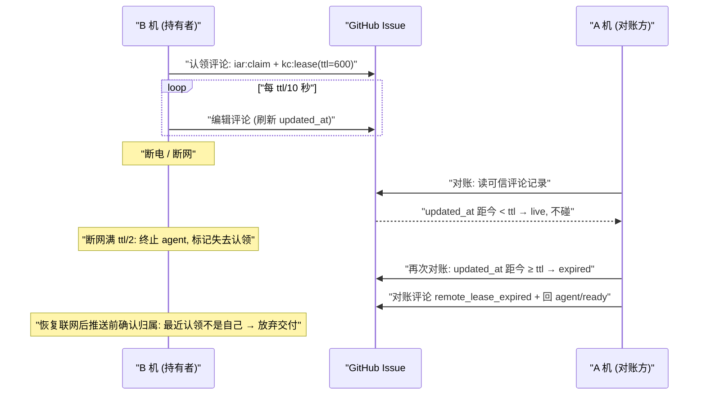

# PRD: 跨机器可见性与认领租约（只依赖 GitHub 的多机协作）

> ⛔ **交付前置**：建议排在 `P1-REFACTOR-20261020-021715-purge-residual-iar-naming` 之后开工（soft，不阻塞构建）。两份 PRD 改的是同一批认领标记的格式化与解析代码；先完成命名清理，本 PRD 直接在新前缀的认领标记上加租约，避免两边反复改同一组函数、合并时冲突。
> 结构化声明见 §8 Delivery Dependencies，**那里是唯一事实源**。
> ⬜ **验收状态**：未开工。
> 本行是 §9 Acceptance Checklist 的投影，**那里是唯一事实源**。

本 PRD 分两层：Part A（§1–4）供人确认目标行为与两项关键决策；Part B（§5–13）供执行者按现有架构实现并验证。

## Feature Overview (功能一览)

以下是 §10 Functional Requirements 的通俗摘要，不替代其验收定义；行为验收以 §1 的行为样例表为准。

- **每台机器有稳定身份**（FR-1）：首次运行自动生成机器编号并保存在本机，主机名只用来显示，两台同名电脑不再被混为一台。
- **每个仓库一块"机器状态"公告板**（FR-2、FR-3）：kc 自动在仓库里维护一条状态 Issue，每台机器原地更新自己那条评论，写明在线、版本和手上的 Issue；不装 kc 的人在 GitHub 网页上也能看。
- **一条命令看全部机器**（FR-4）：`kc peers` 列出在这个仓库上活动的机器、各自在做什么，以及持有者没有上报状态的认领（通常是旧版本）。
- **认领带租约并自动续期**（FR-5）：认领 Issue 后持有进程在后台定期续期，续期信息附在认领评论里，旧版 kc 的认领解析不受影响。
- **远端宕机的 Issue 不再永久卡住**（FR-6）：远端认领的租约过期后，任何一台机器都可以按现有对账流程把它放回队列重跑；没有租约的旧认领仍然不碰。
- **断网的持有者主动让位**（FR-7）：持有者续不了期时先停掉自己的 agent、不再推送，推送和开 PR 前还会确认认领仍归自己，防止两台机器同时交付。
- **本机判定按机器编号**（FR-8）：带租约的认领用机器编号判断"是不是本机"，不再依赖主机名。
- **可关闭、可调、文档同步**（FR-9、FR-10）：状态上报可按仓库关闭，租约时长可配置；用户文档与随包 operator skill 同步说明新命令和新行为。

# Part A · 人审层 (Review Layer)

## 1. Introduction & Goals

### Problem Statement

用户在多台电脑上运行 KedaCode：有的电脑只建 Issue、看 PR，有的常驻 daemon 执行任务。现在只要装好 kc、登录 GitHub 就能协作，但各机器之间互相看不见，而且某台机器一旦宕机，它手上的任务会永久卡住。

仓库里能观察到的现状：

- 跨机器没有任何状态汇总。调用账本、运行历史和日志都只存在本机（`docs/guides/agent-runner.md` 明写"A 机起的调用不会出现在 B 机的清单里"）。要知道另一台机器在做什么，只能逐条翻 Issue 评论里的认领记录。
- 判断远端持有者是否还活着时，系统一律当作还活着：崩溃对账遇到"认领来自别的机器"直接跳过，定向 `kc run --issue N` 返回冲突，并且"系统没有强制接管远端认领的入口"。远端机器宕机后，它的 Issue 会停在 `agent/running`，要等那台机器重启 daemon 才能回收；如果它不再开机，就只能人手改标签。
- "是不是本机"只按主机名判断。两台主机名相同的电脑会把对方的认领当成本机认领，并用本机 PID 去探测对方的进程，可能误判为已死而重复执行。
- 现有认领标记由严格的正则解析，属性顺序固定。往现有标记里加字段，会让还没升级的 kc 认不出新认领，进而在这条 Issue 上重复执行。所以租约信息要放在单独的标记里，不碰认领标记本身。认领标记的命名迁移（去掉残留的 `iar` 前缀）由另一份待办 PRD 负责，本 PRD 不做。

### Interpretation (解读回显)

我把需求读作：**不增加任何服务器或网络配置**，只靠每台机器已经登录的 GitHub，让同一仓库上的各台机器互相看到在线状态和在做的任务，同时让远端宕机的任务在安全前提下可以被别的机器接手。

**行为样例**

| 验证方式 | 输入 / 操作 | 期望观察到的结果 |
|---|---|---|
| 👀 人审 + 自动验证 | A、B 两台电脑都对同一仓库运行 daemon，B 正在执行 #42；在 A 上运行 `kc peers` | 输出两行机器：A 和 B 的主机名、kc 版本、在线状态、最后上报时间；B 一行写明正在做 #42、所用 agent、开始时间。仓库里的"机器状态" Issue 网页上有 A、B 各一条评论，内容一致。 |
| 🤖 自动验证 | B 认领 #42 后直接断电，A 的 daemon 继续运行 | 租约到期前（默认 10 分钟）A 不碰 #42；到期后 A 的下一轮对账在 #42 留下一条写明"远端租约过期"的对账评论，并把它放回 `agent/ready`，随后由某台机器重新认领、从远端分支已有的状态重跑。 |
| 🤖 自动验证 | B 正在执行 #42 时断网 6 分钟，进程一直活着 | 断网满 5 分钟（租约时长的一半）时，B 主动终止自己这次 agent 运行，不推送、不开 PR、不改标签；网络恢复后 B 发现最近一条认领已不是自己，同样不推送。 |
| 🤖 自动验证 | C 运行旧版 kc 认领 #43（认领评论没有租约信息）后宕机 | A 永远不接手 #43，行为与今天相同；`kc peers` 把 #43 列为"持有者未上报状态（可能是旧版本）"，并显示认领评论里的主机名。 |
| 🤖 自动验证 | 两台主机名都叫 `macbook` 的电脑分别认领不同 Issue，其中一台的 kc 进程退出 | 另一台不会把对方的认领当成本机认领，也不会因为本机查不到对方 PID 就回收它。 |
| 🤖 自动验证 | 一个从未用过本功能的仓库里，两台机器在同一分钟首次启动 daemon | 最终只有一条带状态标签的"机器状态" Issue；多建出来的那条被移除标签，并留言指向保留的那条。 |

上表的行为行就是验收依据（会原样转成 §7.6 的验收 oracle）；改一个格子就等于改对应的验收标准。

**我默默定了这些**

- 状态 Issue 的标签名固定为 `kedacode/presence`，不做成可配置项；它不带 `agent/ready`，所以不会被当成任务认领。
- 每个持续运行的 kc 进程（daemon、`kc run`、supervise-daemon）各占一条状态评论；同一台机器上已退出进程留下的评论会被本机新进程复用，避免评论无限增长。
- 状态评论超过 5 分钟没有更新就显示为"离线"；离线评论不自动删除。
- 新命令叫 `kc peers`，支持表格和 `--json` 两种输出；不改现有 `kc daemon status`（它继续只看本机进程）。
- 租约时长由持有者写进认领评论，接手方按持有者声明的时长判定，不用自己的配置，避免两台机器配置不同导致误判。
- 续期间隔为租约时长的 1/10（默认 60 秒），自我隔离阈值为租约时长的 1/2（默认 5 分钟）。
- 接手方用"评论在 GitHub 服务器上的最后更新时间"与本机 UTC 时间比较；两台机器的时钟偏差在租约一半以内（默认 5 分钟）时判定依然安全，超出这个偏差不在本期保护范围内。
- 远端接手一律是"放回队列从头跑"：远端未推送的本地进度（WIP checkpoint 只存在本地分支）和会话都拿不到，因此不尝试续传；恢复次数预算沿用现有设置。
- 有租约且仍处于"等待返工"状态的远端认领过期后，保留 `agent/running`，交给现有返工通道重新认领，与本机崩溃对账的规则一致。
- 续期属于必须执行的调用：daemon 因 GitHub API 预算暂停时，续期照常进行，但仍计入用量；真被限流导致的失败按"续期失败"处理。

**我理解为不做**

- 不做 `kc hub`、Tailscale 或任何需要额外服务器、网络配置的方案（用户已明确留到以后）。
- 不做跨仓库的全局机器名单：一台机器只能看到"在我关心的这些仓库上活动的机器"。
- 不做 agent 之间的消息传递，也不做 Console 网页上的机器页面（`kc peers` 和 GitHub 网页即本期的查看入口；Console 机器页面留给 Tailscale PRD）。
- 不提供"强制接管一个租约仍有效的远端认领"的入口。

**可证伪的解读**：本期读作"在现有 GitHub 共享状态上加两样东西：每仓一条状态 Issue、认领评论附带可续期的租约"，而不是"引入新的协调服务"。所有新判定只在认领评论带有新租约标记时生效；没有租约标记的认领（旧版本或本功能关闭前的历史认领）保持今天"远端一律当作还活着"的行为。不读作"把接手做成续传"，远端接手一律从远端分支的已推送状态重跑。

### What The User Gets

- **在任意一台装了 kc 的电脑上**：运行 `kc peers`，就能看到这个仓库上有哪几台机器、哪些在线、各自在跑什么 Issue。
- **不装 kc 的人**：打开仓库里的"机器状态" Issue，网页上就能看到同样的信息。
- **daemon 机器的操作者**：一台执行机宕机、断网或被收走以后，它手上的任务会在约 10 分钟后自动回到队列，由还活着的机器接着做，不用再人工改标签。
- **所有人**：同名电脑和断网恢复不会造成同一条 Issue 被两台机器同时交付。

### Measurable Objectives

- 两台机器（两个独立的 KedaCode 状态目录）对同一仓库运行时，任一台上的 `kc peers --json` 都包含这两台机器，在做的 Issue 编号也正确。
- 带租约的远端认领：服务器端最后更新时间距今不到声明时长时，对账 0 次接手；超过声明时长后的第一次对账恰好把 Issue 放回 `agent/ready`，并留下 1 条对账评论。
- 无租约标记的远端认领：任意时长后对账都是 0 次接手。
- 续期连续失败达到租约时长一半时，持有者的 agent 子进程被终止，之后 0 次 `git push`、0 次开 PR、0 次标签写入。
- 推送前回读发现最近一条认领不是自己时，0 次 `git push`。
- 两台机器同时首次启动后，带 `kedacode/presence` 标签的 open Issue 恰好 1 条。

## 2. Human Review Map (介入与风险地图)

### 决策一：允许接手"租约已过期"的远端认领

这一项改变了一个现有的安全承诺。今天跨机器的认领一律当作还活着，代价是远端宕机后任务永久卡住；本期改为远端认领如果带租约，并且超过持有者声明的时长（默认 10 分钟）没有续期，就视为失效，可以由任何机器放回队列。为了不出现两台机器同时干活，持有者这边配了两道刹车：一是续期连续失败满一半时长（默认 5 分钟）就停掉自己的 agent，不推送、不开 PR；二是每次推送和开 PR 之前，回读确认最近一条认领仍是自己。

主要风险有两个。一是两台机器时钟偏差超过 5 分钟时，接手可能早于持有者自停，造成短时间双跑；第二道刹车（推送前确认认领归属）可以挡住其中一方的交付，但挡不住双方都消耗 agent 调用。二是接手方拿不到远端未推送的进度，只能从远端分支已推送的状态重跑，上一台机器没推送的工作会重做一遍。没有租约标记的旧认领完全保持现状，混用新旧版本时不会更不安全。

**请确认：** 是否接受"远端认领租约过期（默认 10 分钟）即可由其他机器放回队列重跑，持有者 5 分钟续不上期就自停"这一规则，以及默认时长？

**验收：** 在本机模拟两台机器：一台认领后被强杀，另一台在到期前不接手、到期后接手并留下对账评论；另一组模拟断网，持有者在一半时长时自停，并且全程没有推送。

### 决策二：每个仓库默认创建一条公开的"机器状态" Issue

状态 Issue 是本期唯一的共享查看面，所有能读这个仓库的人都看得到：每台机器的主机名、kc 版本、最后在线时间、手上的 Issue 编号与所用 agent。今天的认领评论已经公开了主机名和 PID，新增暴露的主要是 kc 版本、在线时间，以及空闲机器的存在。公开仓库也适用同样的规则。我建议默认开启，仓库可以在配置里关闭状态上报；关闭后租约续期与远端接手照常工作，只是看不到状态汇总。

**请确认：** 是否接受状态 Issue 默认开启（包括公开仓库），并且只提供按仓库关闭的开关，不提供"隐藏主机名"之类的细分选项？

**验收：** 新仓库首次运行后出现一条状态 Issue，网页上能看到本机的一条评论；把开关关掉后再运行，状态 Issue 不再被创建或更新，租约续期仍照常写入认领评论。

### 自动门禁，不需要逐项人工审阅

机器编号的生成与保存、`kc peers` 的输出格式、状态评论的复用与离线判定、重复状态 Issue 的收敛、按机器编号判定"是否本机"、续期计入 API 用量、配置项读取、文档与 operator skill 同步：这些由执行者实现，并由针对性的单元测试、隔离的端到端场景和既有门禁覆盖。

**本次明确不涉及**：没有数据库结构变化（只新增一个本机机器编号文件）；不改变现有标签状态机和认领仲裁规则；不改认领标记本身的格式与前缀（前缀迁移归命名清理 PRD）；不改前端。本 PRD 新增的标记一律使用 `kc:` 前缀，不新增任何 `iar` 命名。

## 3. Usage And Impact After Implementation

**执行端操作者（跑 daemon 的电脑）**
照常运行 `kc daemon`，不需要新配置。升级后 daemon 自动生成机器编号，在仓库状态 Issue 里维护自己的评论，认领 Issue 后在后台续期。日志里会多出续期失败和自我隔离的告警行。本机进程崩溃后的对账规则不变；新增的是：别的机器宕机后，它手上的 Issue 会在租约到期后被本机的对账放回队列。

**管理端（只建 Issue、看 PR 的电脑）**
运行 `kc peers` 就能看到这个仓库上有哪些机器、各自在做什么：

```bash
kc peers            # 当前仓库
kc peers --json     # 给脚本或 Agent 用
```

不用 kc 时，在 GitHub 上打开带 `kedacode/presence` 标签的 Issue 也能看。

**定向运行者（`kc run --issue N`）**
远端认领租约仍有效时，行为和今天一样：返回冲突并点名持有者。不同的是，提示里会写明租约剩余时间。租约已过期时，先执行与 daemon 相同的接手对账，再继续正常的认领流程。

**仓库的其他读者（未必用 kc 的协作者、公开仓库的访客）**
会多看到一条"机器状态" Issue；它不带任何任务标签，不会出现在任务队列里。

**通过 operator skill 操作 kc 的 Agent**
skill 新增"看别的机器"路由，指向 `kc peers --json`。

**对现有行为的影响**
- 没有租约标记的认领（旧版本或历史认领）：所有判定与今天完全一致。
- 旧版 kc 与新版混跑：旧版读不到新标记，按今天的方式工作；新版对旧版的认领一律不接手。
- 新增配置项都有默认值，未配置时状态上报开启、租约时长 10 分钟。关闭状态上报只影响状态 Issue，不影响租约。

## 4. Requirement Shape

- **Actor**：执行端操作者、管理端使用者、定向运行者、仓库其他读者、通过 operator skill 调用 kc 的 Agent、配置仓库的开发者。
- **Trigger**：kc 长驻进程启动与运行期间（状态上报、租约续期）；daemon 每轮对账与定向运行的准入（远端租约判定）；推送与开 PR 之前（认领归属确认）；用户运行 `kc peers`。
- **Expected behavior**：各机器通过状态 Issue 互相可见；带租约的远端认领过期后可被放回队列；断网的持有者先自停，不交付；"是否本机"按机器编号判定。
- **Scope boundary**：只使用 GitHub Issue 与评论；不新增服务、数据库表或网络配置；不改认领标记本身的格式与前缀、不改标签状态机；不改前端。

# Part B · 执行器层 (Build Layer)

## 5. Repository Context And Architecture Fit

**当前相关模块**

- 认领仲裁：`src/backend/core/use_cases/agent_runner_claim_arbitration.py`（`arbitrate_first_claim`、`format_claim_comment`、`concurrent_bids`；跨机投标"按有效计入"）。
- 认领标记解析与回收：`src/backend/core/use_cases/agent_runner_reclaim.py`（`_CLAIM_MARKER_PATTERN` 严格按 `host → pid → started_at → agent` 顺序匹配，结尾要求 `\s*-->`；`classify_claim_staleness`）。
- 崩溃对账：`src/backend/core/use_cases/agent_runner_reconcile.py`（`_reconcile_one_issue` 中 `if claim.host != pass_context.host: return None` 是远端跳过点）与 `agent_runner_stale_attempt.py`（`decide_stale_attempt_disposition` 三出口）。
- 定向准入：`src/backend/core/use_cases/run_target_admission.py`（`require_explicit_target_claimable`、`_claim_is_active`）。
- daemon 主循环：`src/backend/core/use_cases/run_agent_daemon.py`（`_run_daemon_loop`：Phase -1 对账 → Phase 0/1 → Phase 2 `run_once`；`run_once` 在执行 Issue 期间阻塞，因此续期不能挂在 tick 上）。
- 认领入口：`src/backend/core/use_cases/agent_runner_issue_handlers.py`（`_process_ready_issue`、`_process_running_rework`、`_process_running_publish_recovery`、blocked 恢复路径）与 `recover_publish.py`，全部调用 `arbitrate_first_claim`。
- 推送：`src/backend/core/use_cases/agent_runner_publish.py` 的 `push_changes`；开 PR 在同一发布路径上。
- 本机进程终止：`src/backend/infrastructure/attempt_process_registry.py`（停滞监督使用的、带身份复核的在册进程终止能力）。
- GitHub 访问：`src/backend/core/shared/interfaces/agent_runner.py` 的 `IGitHubClient`（已有 `comment_issue`、`edit_issue_comment`、`list_issue_comment_entries(trusted_only=...)`、`create_issue`、`list_issues_by_label`、`edit_issue_labels`）；实现在 `src/backend/infrastructure/github_issue_ops.py` 与 `github_client.py`。评论列表读的是 REST `issues/{n}/comments`，响应里本来就有 `updated_at`，但当前被丢弃。唯一的测试替身是 `tests/conftest.py` 的 `FakeGitHubClient`。
- API 预算：`src/backend/core/shared/interfaces/github_api_budget.py`（`IGitHubApiBudget.record_call`）。
- 状态目录：`src/backend/core/shared/models/product_identity.py` 的 `state_home()`（`~/.kedacode`，容器内由 `KEDACODE_HOME` 指定）。
- 版本：`src/backend/api/version_info.py` 的 `resolve_keda_version`。
- CLI：Typer 命令分布在 `src/backend/api/cli_typer_*.py`；`kc daemon status` 在 `cli_typer_runner.py`。
- operator skill：`src/backend/engines/agent_runner/templates/skills/kedacode-operator/SKILL.md` 及其 `references/`。

**要遵循的架构模式**

- 四层依赖方向 `api → core → engines → infrastructure`：判定逻辑（租约是否过期、状态评论渲染与解析、重复状态 Issue 的收敛选择）放 `core/use_cases`，是纯函数并可注入时钟；GitHub I/O 走 `IGitHubClient`；本机文件（机器编号）走 infrastructure，经接口注入。
- 沿用"证据只读现成事实"的对账风格：租约信息写在已有的认领评论里，不新增数据库表或心跳文件；只新增本机机器编号文件，它是身份，不是第二状态源。
- 沿用 `FakeGitHubClient` 与注入 `now` / `pid_alive` / `host` 的测试风格（见 `tests/test_agent_runner_reclaim.py`、`tests/test_agent_runner_reconcile.py`、`tests/test_agent_runner_claim_arbitration.py`）。

**前端影响**：`No frontend impact`。本期的查看入口是 CLI 与 GitHub 网页；Console 机器页面属于 Tailscale PRD 的 `/app/machines/` 范围。

**约束**

- 本 PRD 不改认领标记本身的文本格式：往里加属性会让未升级的 kc 把新认领当成"无认领"，在准入和仲裁中重复执行同一 Issue。认领标记的前缀迁移（`iar:claim` → `kc:claim`、不再识别旧名）由 `P1-REFACTOR-20261020-021715-purge-residual-iar-naming` 负责；无论两份 PRD 哪个先合入，本 PRD 的 `kc:lease` 都不需要再改名。下文凡写 `iar:claim` 的地方，都指"交付时代码里实际写出的认领标记"；若命名清理已先合入，就是它的新前缀版本。
- 本 PRD 新增的所有标记、常量、函数和文件名都不得带 `iar`；命名清理 PRD 的回潮守卫测试（若已合入）必须保持通过。
- 新增 runner 配置字段需要同步 domain dataclass、pydantic settings 和 factory 映射三处（仓库已有的配置双类结构），否则会被相同的默认值掩盖、看起来生效其实没生效。
- 改动 `kc` CLI 表面必须同步 `kedacode-operator` skill 与 `docs/`（`docs/ai-standards/tooling.md` 的 CLI Surface And Packaged Skill Sync）。
- 机器可读输出中的时间统一用带偏移的 UTC，人读输出按本机时区展示（`docs/ai-standards/time-display.md`）。

**相关 PRD**

- `tasks/pending/P1-REFACTOR-20261020-021715-purge-residual-iar-naming.md`：soft 顺序依赖。它把认领等协作标记的读写统一改成 `kc:` 前缀、不再识别 `iar:`，并提供一次性迁移和回潮守卫；两份 PRD 都改 `agent_runner_reclaim.py` 与 `agent_runner_claim_arbitration.py` 里的认领标记格式化和解析。建议它先合入，本 PRD 再基于新前缀实现；如果顺序反过来，命名清理只需替换认领标记的前缀，`kc:lease` 与 `kc:presence` 已经是新前缀，不受影响。
- `tasks/pending/P1-FEAT-20261018-034216-kc-tailscale-machine-onboarding.md`：独立。它规划经 Tailscale 与 SSH 管理机器，并新建 `kc machine` 命令组与 Console `/app/machines/` 页面。本 PRD 不占用 `kc machine` 命名；本 PRD 的机器编号文件今后可以被它复用，但两边互不依赖。
- `tasks/pending/P1-FEAT-20261009-161453-kc-hosted-runner-deployment.md`：独立。托管 runner 运行在容器里，状态目录由 `KEDACODE_HOME` 指定，本 PRD 的机器编号随之落在容器的状态目录中。
- `tasks/archive/P1-FEAT-20260930-225000-daemon-crash-reconciliation-session-resume.md`：前序工作，定义了"不引入心跳表或租约库"和三出口对账。本 PRD 在它之上新增"远端租约过期"这一证据来源，租约信息依然写在 Issue 评论里，没有引入第二个状态源。
- 除上述与命名清理 PRD 的 soft 顺序关系外，没有重复或阻塞关系。

## 6. Recommendation

### Recommended Approach

在现有"GitHub Issue 即共享状态"的模型上做最小扩展：

1. **机器编号**：首次需要时在状态目录写入 `machine.json`（含 UUID）。
2. **认领租约**：认领评论在 `iar:claim` 之后追加一个独立的 `kc:lease` 标记。持有进程启动一个后台续期线程，定期编辑这条评论刷新续期时间。接手方读取评论的服务器端 `updated_at` 判定是否过期。
3. **远端接手**：对账在"认领来自别的机器"的分支里，对带租约且已过期的认领走新的"远端接手"出口：放回队列，预算耗尽则判失败。
4. **自我隔离**：续期线程连续失败达到一半时长时，终止本 attempt 的 agent 子进程，并给本次领取打上"已失去认领"标志；推送和开 PR 前回读确认认领归属。
5. **状态 Issue**：同一个后台线程在每个仓库维护状态评论；`kc peers` 读取并汇总。

**为什么最贴合现有架构**：所有共享事实仍然只在 GitHub 上，判定仍然只读现成事实；认领入口、对账出口、标签状态机、进程终止都复用现有实现。

**拒绝的冗余抽象**：不新建租约表、心跳文件或本机状态数据库；不新建"集群协调"模块层；不把续期挂到 daemon tick 上（`run_once` 执行期间阻塞，tick 间隔还会随空闲退避拉长，无法保证续期频率）。

### Proposed Solution Summary (实现机制)

- **核心机制**：GitHub 评论充当带服务器时间戳的租约。持有者编辑评论即续期，接手方读服务器端 `updated_at` 判定过期；持有者用本机单调时钟统计"距上次续期成功的时间"来决定是否自停，因此持有者侧不依赖墙钟。
- **谁提供什么**：租约时长由持有者的配置决定，并写进标记；接手方只读取标记里的时长，不做推断。机器编号由 kc 首次运行时生成，用户不需要提供。
- **接入点**：认领成功后的处理边界（`arbitrate_first_claim` 返回之后、各 handler 的 `finally` 之前）启动和停止续期；对账 `_reconcile_one_issue` 的远端分支；准入 `_claim_is_active`；发布路径 `push_changes` 与开 PR 之前；daemon 与 `kc run` 进程的生命周期（启动和停止状态上报）。
- **状态与可见变化**：认领评论多一行"最后续期"文字和一个隐藏标记；仓库多一条状态 Issue；新增 `kc peers`；对账新增 `remote_lease_expired` 原因。
- **刻意避免的复杂度**：新服务、新表、标签状态机变更、`iar:claim` 格式变更、续传式远端接手。

### Alternatives Considered

- **把新字段加进 `iar:claim` 标记**：实现更少，但旧版解析器的正则要求属性顺序固定、结尾紧跟 `-->`，加字段会让旧版认不出新认领，进而在准入时放行、在仲裁时把对方投标排除，造成双跑。因此拒绝。
- **`kc hub` + Tailscale 的中心服务**：实时性更好，但违背"只装 kc 和登录 GitHub"的最简配置目标，用户已明确暂缓。
- **用 git ref 做心跳（推送隐藏 ref）**：不占 REST 配额，但网页上看不到，`kc peers` 还要额外 fetch，且没有服务器端时间戳。因此拒绝。

## 7. Implementation Guide

This section is a living implementation guide based on current repository analysis. If implementation discovers additional affected files, hidden dependencies, edge cases, or a better path, update this PRD before proceeding.

### 7.1 Core Logic

**机器编号**
`machine_identity()` 读取 `state_home()/machine.json`；文件不存在时用原子写（临时文件 + rename）生成 `{"machine_id": "<uuid4>", "created_at": "<UTC>"}`。文件损坏时重新生成并告警。主机名每次实时读 `socket.gethostname()`，只用于显示。

**租约标记**
认领评论正文变成：

```text
  ## Agent Runner Claimed（评论标题，原样）
- Host / PID / Agent / Started at（原样）
- Lease: renews every 60s, expires 600s after the last renewal（人读）
- Last renewed: `<UTC ISO>`（人读，每次续期改写，保证正文变化从而刷新 updated_at）

<!-- iar:claim host=... pid=... started_at=... agent=... -->   ← 原样，不得改动
<!-- kc:lease machine="<machine_id>" ttl="600" renewed_at="<UTC ISO>" v="1" -->
```

解析 `kc:lease` 用新的独立正则，属性顺序宽松。`iar:claim` 的正则与格式化函数不改。

**续期线程（每个 kc 进程一个 `CoordinationHeartbeat`）**
- 进程内维护"本进程持有的认领"集合：`(repo, issue_number, comment_id, ttl)`。认领入口成功后登记，handler 结束（`finally`）时注销。
- 每 `ttl/10` 秒对每个持有的认领执行一次 `edit_issue_comment`（只改续期时间文字与 `renewed_at`）。成功后记录单调时钟时间。
- 某个认领"距上次续期成功"达到 `ttl/2`：将其标记为已失去认领，通过 attempt 进程登记簿终止该 Issue 当前在册的 agent 子进程（复用停滞监督的身份复核与终止回调），写一条 WARNING 日志。不改标签、不写评论（此时很可能本来就写不了）。
- 同一线程每 60 秒刷新本进程的状态评论（见下文"状态 Issue"）。
- 续期调用计入 `IGitHubApiBudget.record_call`，但不受预算暂停跳过；遇到限流异常按续期失败计。

**推送与开 PR 前的认领确认（第二道刹车）**
在 `push_changes` 与开 PR 之前调用 `assert_claim_still_owned(issue, own_comment_id)`：用 `trusted_only=True` 读评论，取最近一条可解析的 `iar:claim`。如果它不是本进程那条评论（按 comment id 比较），或本进程已被续期线程标记为失去认领，就抛出 `ClaimLeaseLost`。调用方按"放弃本次交付"处理，不改标签、不写失败评论（标签归新的持有者）。只对带租约的认领做这一检查；本进程的认领一定带租约。

**远端租约判定（纯函数）**
`classify_remote_lease(claim_comment_updated_at, lease, now) -> "live" | "expired" | "no_lease"`：
- 认领评论里没有 `kc:lease`，返回 `no_lease`，调用方保持现状（远端一律有效）。
- `now - updated_at >= lease.ttl`，返回 `expired`；否则返回 `live`，同时给出剩余秒数供提示使用。

**"是否本机"判定**
`is_local_claim(claim, lease, this_machine_id, this_host)`：有 `kc:lease` 时比较 `machine_id`；没有时退回比较主机名（旧行为）。对账、准入、仲裁（`concurrent_bids` 中"本机已死 PID 剔除"的判断）三处统一改用这个函数。

**对账新出口**
`_reconcile_one_issue` 的远端分支：读取带 `updated_at` 的评论记录（新接口），用 `trusted_only=True` 只信任有写权限作者的评论；对 `expired` 的远端认领构造证据，worktree 与会话一律视为不可用（不在本机），交给 `decide_stale_attempt_disposition` 新增的远端规则：
- 有未消费的返工标记：保留 `agent/running`（与本机规则一致）；
- 恢复预算未耗尽：放回 `agent/ready`（重新入队，不续传）；
- 预算耗尽：判 `agent/failed`。
对账评论的原因写作 `remote_lease_expired`，附上持有者的主机名、机器编号、最后续期时间和声明的时长。去重 hash 额外折入持有者的 `machine_id`。

**定向准入**
`_claim_is_active` 对远端带租约的认领：`live` 视为有效，冲突提示里附上剩余时间；`expired` 视为无效。`kc run --issue N` 在认领前对该 Issue 调用同一个对账函数（单 Issue 版），让它先走"远端接手"出口，再进入正常认领。

**状态 Issue**
- 查找：`list_issues_by_label("kedacode/presence")`，取 open 状态里编号最小的一条为正本。如果有多条，对其余各条移除标签（`edit_issue_labels`）并留言指向正本；这个操作幂等。
- 创建：找不到时用 `create_issue` 新建（标题"KedaCode 机器状态"，正文说明用途与"请勿手动编辑"），创建后立刻重新查找并收敛，处理同时创建的竞争。
- 评论槽位：评论里带 `<!-- kc:presence machine="<id>" slot="<pid>@<process_start>" v="1" -->` 加一段 JSON 隐藏块，以及人读表格（主机名、kc 版本、进程角色、在线状态、最后上报时间、手上的 Issue：编号、阶段、agent、开始时间）。进程启动时，在本机文件锁保护下，复用一条"同一 `machine_id`、记录的 PID 在本机已不存在或标记为已退出"的评论；没有可复用的就新建。正常退出时把评论改为"已退出"。
- 离线：读取方按评论服务器端 `updated_at` 判断，超过 5 分钟没有更新即为离线。
- 开关：`presence_enabled = false` 时，不查找、不创建、不写状态评论。

**`kc peers`**
读取正本状态 Issue 的评论，按 `machine_id` 归组，每台机器取最新的一条。再列出 `agent/running` 的 Issue，取各自最近的认领：持有者的 `machine_id`（或旧认领的主机名）不在状态里的，列为"持有者未上报状态"。输出表格（时间按本机时区显示）或 `--json`（时间为 UTC 带偏移）。找不到状态 Issue 时提示"该仓库还没有机器上报状态"，退出码为 0。

### 7.2 Change Impact Tree

本树是起点，不保证穷尽；请配合 §7.4 Executor Drift Guard 的搜索命令。

```text
.
├── Infrastructure
│   ├── src/backend/infrastructure/machine_identity_store.py
│   │   [新增]
│   │   【总结】在状态目录原子读写 machine.json，提供稳定机器编号。
│   │   ├── 首次生成 uuid4 并原子写入，损坏时重建并告警
│   │   └── 实现 core 侧的机器身份读取接口
│   ├── src/backend/infrastructure/github_issue_ops.py
│   │   [修改]
│   │   【总结】评论读取新增带 updated_at 与作者信息的记录形态，复用现有分页与可信作者校验。
│   │   └── 新增 list_issue_comment_records（与 list_issue_comment_entries 共用请求与 trusted_only 逻辑，不复制粘贴）
│   └── src/backend/infrastructure/github_client.py
│       [修改]
│       【总结】把新的评论记录读取暴露为 IGitHubClient 方法。
│
├── Domain / Core
│   ├── src/backend/core/shared/interfaces/agent_runner.py
│   │   [修改]
│   │   【总结】IGitHubClient 增加 list_issue_comment_records；新增机器身份读取接口。
│   ├── src/backend/core/shared/models/agent_runner.py
│   │   [修改]
│   │   【总结】新增 IssueCommentRecord（id、body、updated_at、author）值对象。
│   ├── src/backend/core/use_cases/agent_runner_claim_lease.py
│   │   [新增]
│   │   【总结】kc:lease 标记渲染与解析、远端租约判定、is_local_claim、assert_claim_still_owned、ClaimLeaseLost。
│   ├── src/backend/core/use_cases/coordination_heartbeat.py
│   │   [新增]
│   │   【总结】进程级后台线程：按 ttl/10 续期持有的认领、超过 ttl/2 自我隔离、每 60 秒刷新状态评论。
│   ├── src/backend/core/use_cases/machine_presence.py
│   │   [新增]
│   │   【总结】状态 Issue 查找/创建/收敛、评论槽位复用、状态评论渲染与解析、peers 汇总。
│   ├── src/backend/core/use_cases/agent_runner_claim_arbitration.py
│   │   [修改]
│   │   【总结】认领评论追加 kc:lease 与续期文字；concurrent_bids 的本机判定改用 is_local_claim。
│   │   ├── format_claim_comment 接收 machine_id 与 ttl
│   │   └── iar:claim marker 文本保持逐字节不变
│   ├── src/backend/core/use_cases/agent_runner_reclaim.py
│   │   [修改]
│   │   【总结】旧 reclaim 路径的本机判定改用 is_local_claim；_CLAIM_MARKER_PATTERN 不改。
│   ├── src/backend/core/use_cases/agent_runner_reconcile.py
│   │   [修改]
│   │   【总结】远端分支新增 remote_lease_expired 出口，读带 updated_at 的可信评论记录，hash 折入 machine_id。
│   ├── src/backend/core/use_cases/agent_runner_stale_attempt.py
│   │   [修改]
│   │   【总结】判定与评论渲染支持远端出口（不续传、预算耗尽判失败、返工保持 running）。
│   ├── src/backend/core/use_cases/run_target_admission.py
│   │   [修改]
│   │   【总结】_claim_is_active 支持租约判定；冲突提示附剩余时间；过期时先走单 Issue 对账。
│   ├── src/backend/core/use_cases/agent_runner_issue_handlers.py
│   │   [修改]
│   │   【总结】各认领入口成功后向 CoordinationHeartbeat 登记、finally 注销；收到 ClaimLeaseLost 时放弃交付且不写标签。
│   ├── src/backend/core/use_cases/recover_publish.py
│   │   [修改]
│   │   【总结】发布恢复的认领同样登记续期并在推送前确认归属。
│   ├── src/backend/core/use_cases/agent_runner_publish.py
│   │   [修改]
│   │   【总结】push_changes 与开 PR 前调用 assert_claim_still_owned。
│   ├── src/backend/core/use_cases/run_agent_daemon.py
│   │   [修改]
│   │   【总结】daemon 启动时启动 CoordinationHeartbeat（按仓库上下文登记状态评论），退出时停止并标记"已退出"。
│   └── src/backend/core/use_cases/run_agent_once.py
│       [修改]
│       【总结】kc run 与 supervise 进程同样启停 CoordinationHeartbeat。
│
├── Config
│   ├── src/backend/infrastructure/config/agent_runner_settings_models.py
│   │   [修改]
│   │   【总结】[agent_runner.daemon] 增加 presence_enabled（默认 true）与 lease_ttl_seconds（默认 600，最小 120）。
│   ├── src/backend/core/shared/models/agent_runner.py
│   │   [修改]
│   │   【总结】对应 domain dataclass 字段同步。
│   └── src/backend/engines/agent_runner/factories/__init__.py
│       [修改]
│       【总结】settings → domain 的字段映射同步（避免默认值掩盖漏映射）。
│
├── API / CLI
│   ├── src/backend/api/cli_typer_peers.py
│   │   [新增]
│   │   【总结】kc peers 命令：表格/--json，复用 --repo / --repo-id 选择器与现有输出与退出码约定。
│   └── src/backend/api/cli_typer.py
│       [修改]
│       【总结】注册 peers 命令。
│
├── Tests
│   ├── tests/test_agent_runner_claim_lease.py [新增]
│   │   【总结】标记往返、旧解析器对新评论的兼容、远端判定边界、is_local_claim、归属确认。
│   ├── tests/test_coordination_heartbeat.py [新增]
│   │   【总结】续期节奏、失败计时、ttl/2 自我隔离触发终止、预算记录与暂停豁免。
│   ├── tests/test_machine_presence.py [新增]
│   │   【总结】状态 Issue 创建与重复收敛、槽位复用、离线判定、关闭开关、peers 汇总含"未上报认领"。
│   ├── tests/test_agent_runner_reconcile.py [修改]
│   │   【总结】远端过期/未过期/无租约/预算耗尽/返工保持 running 五种情形。
│   ├── tests/test_run_target_admission.py [修改]
│   │   【总结】远端租约有效时冲突带剩余时间、过期时放行。
│   ├── tests/test_agent_runner_claim_arbitration.py [修改]
│   │   【总结】同名主机不同机器编号时不剔除对方投标；iar:claim 文本逐字节不变。
│   └── tests/conftest.py [修改]
│       【总结】FakeGitHubClient 实现 list_issue_comment_records，支持注入评论 updated_at。
│
└── Docs / Skill
    ├── docs/guides/agent-runner.md [修改]
    │   【总结】多机部署、崩溃对账、定向准入、首次领取仲裁四节同步租约、远端接手、状态 Issue 与 kc peers。
    ├── src/backend/engines/agent_runner/templates/skills/kedacode-operator/SKILL.md [修改]
    │   【总结】Routes 表新增"看别的机器"路由。
    └── src/backend/engines/agent_runner/templates/skills/kedacode-operator/references/watch.md [修改]
        【总结】说明 kc peers --json 字段与"未上报认领"的含义。
```

### 7.3 Risk Classification Register

| change point | tier | decisive dimension / override | intervention | oracle / gate |
|---|---|---|---|---|
| 远端租约过期接手 + 持有者自我隔离 + 推送前归属确认 | R3 | 正确性：同一 Issue 双重执行；固定区：core 编排 + 并发 | 人工确认（决策一） | rv-2、rv-3 |
| 状态 Issue 默认开启并公开 | R2 | 安全/隐私：公开仓库暴露机器信息；外部可见行为 | 人工确认（决策二） | rv-4 |
| `iar:claim` 格式保持不变、新标记独立 | R3 | 兼容：旧版误判导致双跑 | 执行者 + 判别性测试（归入决策一的证据） | rv-2 中旧解析器对新评论的断言 |
| 按机器编号判定本机 | R2 | 正确性：同名主机误回收 | 执行者 + 强 oracle（并入 rv-4 场景） | rv-4 |
| `kc peers` 输出 | R1 | 单一只读入口 | 执行者 + 端到端 | rv-1 |
| 配置项与三处映射 | R1 | 局部；漏映射被默认值掩盖 | 执行者 + 非默认值的配置往返测试 | 单测：设置 `lease_ttl_seconds=900` 后标记里出现 `ttl="900"` |
| 文档与 operator skill 同步 | R0 | 文档 | 执行者 + 搜索断言 | §9 Documentation Acceptance |

### 7.4 Executor Drift Guard

文件清单是起点。动手前先跑：

```bash
rg -n "arbitrate_first_claim\(|format_claim_comment|parse_claim_marker|_CLAIM_MARKER_PATTERN" src/backend
rg -n "claim\.host|this_host|socket\.gethostname\(\)" src/backend/core
rg -n "def push_changes|create_pull_request|gh pr create" src/backend/core src/backend/infrastructure
rg -n "class FakeGitHubClient|def list_issue_comment_entries" tests src/backend
rg -n "reclaim_ttl_seconds|reconcile_stale_attempts" src/backend docs
```

- 第二条命令列出的每个"按主机名判定本机"的位置，都要改用 `is_local_claim`，否则同名主机问题只修了一半。
- 第一条命令列出的所有认领入口，都必须登记续期；漏登记的入口在长时间运行后会被别的机器误接手。
- 交付前必须确认 `iar:claim` 的格式化输出与改动前逐字节一致（rv-2 中的兼容断言）。

### 7.5 Flow Diagram



### 7.6 Realistic Validation Plan

各场景在一个隔离的端到端环境中运行：两个独立的 `KEDACODE_HOME` 目录模拟两台机器，PATH 上放一个假的 `gh`，它用 JSON 文件模拟 Issue、评论、标签，并由服务器端维护 `updated_at`，支持注入时间偏移；agent 用确定性的假 agent；git 与 kc CLI 都是真实的。所有 RV 脚本放在 `tasks/evidence/<prd-stem>/scripts/`。真实 GitHub 场景作为可选项，用 `KC_RV_SANDBOX_REPO=<owner/repo>` 开启；没有凭据时跑上面的假 `gh` 场景。

```yaml
- id: rv-1
  behavior: 两台机器对同一仓库运行时，任一台上的 kc peers 都能看到两台机器以及各自在做的 Issue
  reviewer: human
  real_entry: "KEDACODE_HOME=$HOME_A kc peers && KEDACODE_HOME=$HOME_A kc peers --json（A、B 两个 daemon 由 RV 脚本启动，B 正在执行 #42）"
  expected: "表格两行机器（A 空闲、B 在做 #42 并显示 agent 与开始时间）；--json 的 machines 数组长度为 2，B 的 issues[0].number == 42；假 gh 的状态 Issue 有 A、B 各一条状态评论"
  mock_boundary: "只替换 gh（文件模拟 GitHub）与 agent CLI；kc CLI、daemon、git、状态目录全部真实"
  tier: R1
  test_layer: e2e
  required_for_acceptance: true
  presentation: "tasks/evidence/<prd-stem>/rv-1-kc-peers.txt（表格与 JSON 原样输出）+ 可选的真实 GitHub 沙箱状态 Issue 网页截图 rv-1-presence-issue.png；自检：表格中 B 一行的 Issue 列是 #42"
- id: rv-2
  behavior: 带租约的远端认领到期前不被接手、到期后被放回队列；无租约的旧认领永不被接手；iar:claim 格式与旧解析器兼容
  reviewer: verifier
  real_entry: "RV 脚本：B 用 kc run --issue 42 认领后 kill -9；A 运行 kc daemon，假 gh 依次把时间推进到 ttl-30s 与 ttl+30s；另取一条只有 iar:claim、没有 kc:lease 的旧格式认领 #43，推进 24 小时"
  expected: "ttl-30s 时 #42 仍是 agent/running、对账评论 0 条；ttl+30s 后 #42 恰好 1 条含 remote_lease_expired 的对账评论并回到 agent/ready；#43 始终 agent/running、对账评论 0 条；把新认领评论正文交给改动前版本的 parse_claim_marker_detail，能解析出相同的 host/pid/started_at/agent"
  mock_boundary: "只替换 gh 与 agent CLI；对账、准入、认领评论渲染走真实 kc 代码；时间推进只发生在假 gh 的 updated_at 与注入的 now 上"
  tier: R3
  test_layer: e2e
  required_for_acceptance: true
  critical_value_source: "假 gh 存储的评论 updated_at（服务器端时间）与评论正文中的 kc:lease ttl"
  must_cross: "kc daemon 进程 → reconcile_stale_attempts → IGitHubClient(list_issue_comment_records, trusted_only) → gh 子进程 → 文件存储 → 标签写回"
  forbidden_bypasses: "直接调用 classify_remote_lease 代替 daemon；在测试里手写对账评论；用客户端本地时间伪造 updated_at"
  fresh_state_probe: "对账结束后用一个新的 gh 进程读取 #42/#43 的标签与评论数"
  final_tree_evidence: "rv-2 输出记录 git rev-parse HEAD^{tree}；任何 core/use_cases 下的改动后重跑"
  negative_control: "在改动前的代码树上跑同一脚本：ttl+30s 后 #42 仍停在 agent/running（远端一律跳过）"
  expected_fail: "断言 '#42 恰好 1 条 remote_lease_expired 对账评论' 失败，实际为 0 条"
- id: rv-3
  behavior: 持有者续期连续失败满 ttl/2 时终止自己的 agent 且不交付；恢复联网后发现认领已易主同样不推送
  reviewer: verifier
  real_entry: "RV 脚本：B 用 kc run --issue 42 认领（假 agent 长时间运行并在结束时请求提交），假 gh 对 B 的评论编辑请求返回网络错误（模拟断网）；随后恢复网络，并预先让 A 在 #42 写入一条更新的认领"
  expected: "断网满 ttl/2 后 B 的假 agent 进程被终止（PID 不再存活）；B 的日志出现失去认领的告警；整个过程中远端仓库的分支 ref 未变化、假 gh 记录的 pr create 调用 0 次、B 发起的标签写入 0 次"
  mock_boundary: "只替换 gh 与 agent CLI；续期线程、进程登记簿与终止、push_changes 前的归属确认走真实代码；git 远端是本地裸仓库"
  tier: R3
  test_layer: e2e
  required_for_acceptance: true
  critical_value_source: "本地裸仓库的 refs/heads/issue-42 与假 gh 的调用日志"
  must_cross: "kc run 进程 → CoordinationHeartbeat → attempt_process_registry 终止 → handler 捕获 ClaimLeaseLost → push_changes 前置确认"
  forbidden_bypasses: "在测试中直接设置失去认领标志；绕过 push_changes 调用 git push；用 monkeypatch 替换终止函数"
  fresh_state_probe: "B 进程退出后，用新进程执行 git ls-remote 与 ps 检查"
  final_tree_evidence: "rv-3 输出记录 git rev-parse HEAD^{tree}；任何 coordination_heartbeat / agent_runner_publish 改动后重跑"
  negative_control: "在改动前的代码树上跑同一脚本：断网期间 agent 不会被终止，结束后执行 git push"
  expected_fail: "断言 '远端分支 ref 未变化' 失败，ls-remote 显示新提交"
- id: rv-4
  behavior: 状态 Issue 默认创建且重复时收敛为一条；关闭开关后不写状态但租约照常；同名主机按机器编号区分
  reviewer: verifier
  real_entry: "RV 脚本：两个 KEDACODE_HOME、同一主机名，同时首次启动 kc daemon；随后在其中一台的仓库配置里设置 presence_enabled = false 并重启；再让一台认领后正常退出、另一台运行对账"
  expected: "带 kedacode/presence 标签的 open Issue 恰好 1 条，另一条被移除标签并有指向正本的留言；关闭后该机状态评论的 updated_at 不再变化，但其新认领评论仍含 kc:lease 且持续续期；对账方不把同名主机的认领当本机，对账评论 0 条"
  mock_boundary: "只替换 gh 与 agent CLI；配置读取走真实 settings → domain 映射"
  tier: R2
  test_layer: e2e
  required_for_acceptance: true
  critical_value_source: "假 gh 中 Issue 的标签集合与评论 updated_at"
  must_cross: "kc daemon 进程 → machine_presence → IGitHubClient → gh 子进程 → 文件存储"
  forbidden_bypasses: "在测试里直接构造 AppConfig 跳过 TOML 解析；手动删除重复 Issue"
  fresh_state_probe: "两个 daemon 停止后，用新的 gh 进程按标签列出 Issue 并读取评论"
  final_tree_evidence: "rv-4 输出记录 git rev-parse HEAD^{tree}；machine_presence 或配置映射改动后重跑"
```

**失败排查**：rv-1、rv-4 先检查两个进程是否真的使用了不同的 `KEDACODE_HOME`（`machine.json` 是否不同）以及假 `gh` 是否在 PATH 最前面；rv-2 先检查假 `gh` 返回的评论 JSON 是否带 `updated_at`、认领评论是否带 `kc:lease`；rv-3 先检查假 agent 是否经过 attempt 进程登记簿（只有走 `Popen` 的路径会登记），以及 `push_changes` 前的确认是否用了本进程的 comment id。

### 7.7 ER Diagram

No data model changes in this PRD.（只新增本机文件 `~/.kedacode/machine.json`，它是机器身份，不是数据库结构。）

### 7.8 Low-Fidelity Prototype

不需要：没有前端改动。CLI 输出示意：

```text
$ kc peers
机器                  版本     状态   最后上报        正在处理
studio-mac (a1b2…)    0.42.0   在线   16:31:05        —
office-mbp (c3d4…)    0.42.0   在线   16:30:58        #42 实现 · claude · 15:02 开始
持有者未上报状态的认领：
#43  host=old-runner  可能是旧版本 kc，或该机器已关闭状态上报
```

### 7.9 Interactive Prototype Change Log

No interactive prototype file changes in this PRD.

### 7.10 External Validation

No external validation required; repository evidence was sufficient.（GitHub REST 评论对象含 `updated_at`，这一点由仓库现有 `gh api .../issues/{n}/comments` 的调用路径可直接验证；实现时用一次真实 `gh api` 调用确认字段存在。）

## 8. Delivery Dependencies

### Delivery Dependencies

- Depends on tasks/issues:
  - P1-REFACTOR-20261020-021715-purge-residual-iar-naming
- Gate type: soft
- Sequence: via-main
- Notes: 建议顺序而非构建依赖：两份 PRD 改同一组认领标记的格式化与解析函数，先做命名清理可避免重复改动和合并冲突；本 PRD 单独先做也能构建和交付。与 `P1-FEAT-20261018-034216-kc-tailscale-machine-onboarding` 无顺序依赖；它今后可以复用本 PRD 的 `machine.json` 机器编号。与 `P1-FEAT-20261009-161453-kc-hosted-runner-deployment` 无依赖。

## 9. Acceptance Checklist

### 9.1 人读呈递区（Human Review Surface）

| 看什么 | 呈递物 | 10 秒自检 |
|---|---|---|
| 在一台机器上看到两台机器及各自在做的 Issue（rv-1） | `tasks/evidence/<prd-stem>/rv-1-kc-peers.txt`（交付时填入）；打开：`just prd review tasks/archive/<prd-file>` 或 `open tasks/evidence/<prd-stem>/rv-1-kc-peers.txt`；可选沙箱网页截图在交付时内嵌 | 表格里 B 那一行的"正在处理"列是 `#42`；JSON 中 `machines` 长度为 2 |

未在此展示的是 `reviewer: verifier` 的证据组：rv-2（远端接手与旧认领不受影响）、rv-3（自我隔离与推送前确认）、rv-4（状态 Issue 收敛、开关、同名主机）。这三组结论在 9.2 中，只在失败时需要人看。

### 9.2 Acceptance Evidence Package

按风险排序：决策一（rv-2、rv-3，R3）→ 决策二（rv-4，R2）→ rv-1 与 R1/R0 门禁。交付时在此附各 rv 的结果摘要、验证时的 Git tree 与证据文件路径。

### Human-Confirmed (来自 Part A 风险地图)

- [ ] 决策一：接受"远端认领租约过期（默认 10 分钟）即可被放回队列，持有者 5 分钟续不上期就自停"及默认时长 — 依据 rv-2、rv-3 结果
- [ ] 决策二：接受状态 Issue 默认开启（包括公开仓库），只提供按仓库关闭的开关 — 依据 rv-4 结果
- [ ] 已查看 9.1 呈递区，`kc peers` 的输出内容与格式符合预期

### Architecture Acceptance

- [ ] 判定逻辑（租约解析与判定、状态评论渲染与解析、重复状态 Issue 的收敛选择）位于 `src/backend/core/use_cases/`，GitHub I/O 只经 `IGitHubClient`；`rg -n "import subprocess|gh api" src/backend/core/use_cases/agent_runner_claim_lease.py src/backend/core/use_cases/machine_presence.py src/backend/core/use_cases/coordination_heartbeat.py` 无结果
- [ ] 没有新增数据库表或迁移：`git diff --name-only main... | rg "alembic|migrations"` 无结果
- [ ] 本机判定统一经 `is_local_claim`：`rg -n "claim\.host\s*[!=]=" src/backend/core` 只剩 `is_local_claim` 内部的旧版回退分支

### Behavior Acceptance

- [ ] rv-2 通过：到期前不接手、到期后恰好 1 条 `remote_lease_expired` 对账评论并回到 `agent/ready`、旧认领永不接手（证据：`rv-2-remote-lease.txt`）
- [ ] rv-3 通过：ttl/2 时 agent 被终止，远端分支 ref 未变化，`pr create` 0 次，标签写入 0 次（证据：`rv-3-self-fence.txt`）
- [ ] rv-4 通过：状态 Issue 恰好 1 条、关闭开关后状态停止更新但租约照常、同名主机不被误对账（证据：`rv-4-presence.txt`）
- [ ] `iar:claim` 文本与改动前逐字节一致，旧解析器能解析新认领评论（证据：rv-2 输出中的兼容断言）
- [ ] 租约有效的远端认领，`kc run --issue N` 返回退出码 5，提示中包含剩余时间（证据：`tests/test_run_target_admission.py` 新用例输出）

### Dependency Acceptance

- [ ] 未新增第三方依赖：`git diff main... -- pyproject.toml uv.lock` 无依赖变更

### Validation Acceptance

- [ ] 最高保真入口：rv-1 至 rv-4 均通过真实 `kc` CLI 与 daemon 进程执行，只替换 `gh` 与 agent CLI；每份证据记录了生成时的 `git rev-parse HEAD^{tree}`，且与最终交付的 tree 一致
- [ ] 配置三处映射：设置 `lease_ttl_seconds = 900` 后，新认领评论中出现 `ttl="900"`（证据：配置往返单测输出）
- [ ] 全量相关测试：`uv run pytest -o addopts="" tests/test_agent_runner_claim_lease.py tests/test_coordination_heartbeat.py tests/test_machine_presence.py tests/test_agent_runner_reconcile.py tests/test_run_target_admission.py tests/test_agent_runner_claim_arbitration.py tests/test_agent_runner_reclaim.py` 全部通过（不依赖 testmon 增量）

### Documentation Acceptance

- [ ] `docs/guides/agent-runner.md` 的多机部署、崩溃对账、定向准入、首次领取仲裁四节已更新；`rg -n "kc peers|kedacode/presence|remote_lease_expired|lease_ttl_seconds" docs/guides/agent-runner.md` 四个词都能命中
- [ ] 文档中旧的"系统没有强制接管远端认领的入口"等表述已改为准确描述（带租约且过期可被接手；租约有效时仍不能接手）：`rg -n "跨机器的认领无法探测远端进程" docs` 的命中处已同步改写
- [ ] operator skill 新增路由：`rg -n "kc peers" src/backend/engines/agent_runner/templates/skills/kedacode-operator` 有命中

### Delivery Readiness

- [ ] 推荐方案已完整实现，没有遗留的 Phase 2 或临时兼容层
- [ ] 如果交付走 PR，PR 证据评论包含 9.1 呈递区的内容；否则完成消息原样附上 9.1 内容
- [ ] `just lint --full` 与上述 pytest 通过，单文件非空行均少于 1000 行

## 10. Functional Requirements

- **FR-1**：**机器编号**：kc 首次需要时在状态目录生成并保存 `machine.json`（uuid4），之后一直复用；文件损坏时重建并告警。主机名只用于显示。
- **FR-2**：**状态 Issue**：开启状态上报的仓库里，kc 维护一条带 `kedacode/presence` 标签的 open Issue。找不到就创建；有多条时保留编号最小的一条，其余移除标签并留言指向正本。
- **FR-3**：**状态评论**：每个持续运行的 kc 进程（daemon、`kc run`、supervise-daemon）在状态 Issue 中占一条评论，每 60 秒原地更新。内容包括人读表格（主机名、kc 版本、进程角色、最后上报时间、手上的 Issue 编号/阶段/agent/开始时间）和机器可读的隐藏标记与 JSON。本机已退出进程的评论会被复用；正常退出时标记为已退出；超过 5 分钟未更新即为离线。
- **FR-4**：**`kc peers`**：读取当前仓库的状态 Issue，按机器汇总在线状态和手上的 Issue，并列出"持有者未上报状态"的运行中认领；支持表格与 `--json`；仓库没有状态 Issue 时给出说明，退出码为 0。
- **FR-5**：**认领租约**：新的认领评论在认领标记之后追加独立的 `kc:lease` 标记（机器编号、声明时长、最后续期时间）以及人读的续期说明；认领标记本身的文本保持不变（其前缀迁移归命名清理 PRD）。本 PRD 新增的标记与标识符一律不带 `iar`。持有进程每 `ttl/10` 秒编辑该评论续期，直到本次处理结束。续期计入 API 用量，但不受预算暂停跳过。
- **FR-6**：**远端接手**：对账遇到来自别的机器、带 `kc:lease` 的认领时，用评论的服务器端 `updated_at` 判断是否过期（以持有者声明的时长为准，只信任有写权限作者的评论）。过期时：有未消费的返工标记则保持 `agent/running`；恢复预算未耗尽则放回 `agent/ready`；预算耗尽则判 `agent/failed`。每种处置都写一条原因为 `remote_lease_expired` 的对账评论，并保持幂等。没有 `kc:lease` 的远端认领一律不碰。定向 `kc run --issue N` 在租约有效时返回冲突并提示剩余时间，过期时先执行同一对账再认领。
- **FR-7**：**自我隔离**：持有者某个认领"距上次续期成功"达到 `ttl/2` 时，终止该 Issue 当前在册的 agent 子进程，标记失去认领，之后不推送、不开 PR、不改标签。每次推送和开 PR 之前，回读确认最近一条可信认领仍是本进程那条评论，否则放弃交付。
- **FR-8**：**本机判定**：带 `kc:lease` 的认领用机器编号判断是否本机；没有的退回主机名。对账、准入、仲裁三处统一使用同一判定。
- **FR-9**：**配置**：仓库级 `[agent_runner.daemon]` 新增 `presence_enabled`（默认 `true`）和 `lease_ttl_seconds`（默认 `600`，低于 `120` 时按 `120` 处理并告警）。关闭状态上报不影响租约与远端接手。
- **FR-10**：**文档与 skill 同步**：更新 `docs/guides/agent-runner.md` 中相关章节与 `kedacode-operator` skill，说明 `kc peers`、状态 Issue、租约、远端接手和自我隔离。

## 11. Non-Goals

- `kc hub`、Tailscale 或任何需要额外服务器、网络配置的协调方式（后续可能需要，本期不动）。
- 跨仓库的全局机器名单。
- agent 之间的消息传递或任务拆分协作。
- Console 网页上的机器页面。
- 强制接管租约仍有效的远端认领。
- 远端接手时续传对方的会话或未推送的本地进度。
- 自动删除离线状态评论或关闭状态 Issue。

## 12. Risks And Follow-Ups

- **时钟偏差**：接手方用本机 UTC 时间对比服务器时间戳；偏差超过 `ttl/2` 时，可能在持有者自停之前接手。推送前确认归属可以挡住其中一方的交付，但两边的 agent 调用都会被消耗。文档会写明这一前提。
- **未推送的进度会重做**：远端接手只能从远端分支已推送的状态开始，上一台机器未推送的 WIP 会被重新实现。
- **API 用量**：每个持有的认领每分钟 1 次编辑，每个进程每分钟 1 次状态编辑，外加 `kc peers` 和对账的读取。默认配置下，单机三个并发 Issue 约为每小时 240 次，远低于每小时 5000 次的配额；多台机器共用同一个 GitHub 账号时要合计。
- **混跑期**：旧版 kc 的认领没有租约，宕机后仍然会卡住，直到所有执行端都升级。`kc peers` 会把它们列为"持有者未上报状态"，便于定位。
- **后续（不在本期）**：Tailscale PRD 的机器页面可以把 `kc peers` 的数据源作为在线状态来源；`kc hub` 落地后，可以把续期和状态上报迁移到 hub，GitHub 继续作为账本。

## 13. Decision Log

| ID | Decision | Chosen | Rejected | Rationale |
|---|---|---|---|---|
| D-01 | 共享状态放哪 | 继续只用 GitHub Issue 与评论 | `kc hub` + Tailscale 中心服务 | 用户要求"只装 kc 和登录 GitHub"即可使用，中心服务需要额外部署和网络配置。 |
| D-02 | 租约字段放哪 | 同一认领评论里的独立 `kc:lease` 标记 | 给认领标记加属性 | 现有解析器要求属性顺序固定且紧跟 `-->`，加属性会让未升级的 kc 认不出新认领并重复执行；独立标记还让本 PRD 与命名清理 PRD 的前缀迁移互不干扰。 |
| D-09 | 与命名清理 PRD 的顺序 | soft 依赖，建议命名清理先合入 | 两份并行开发 | 两份都改同一组认领标记函数，并行开发必然冲突；本 PRD 的新标记已用 `kc:` 前缀，无论先后都不用返工命名。 |
| D-03 | 过期判定用哪个时间 | 评论的服务器端 `updated_at` + 持有者声明的时长 | 评论正文里由持有者写入的时间戳 | 正文时间来自持有者的时钟，服务器时间戳只需要信任接手方一侧的时钟。 |
| D-04 | 续期挂在哪 | 进程级后台线程 | daemon tick | `run_once` 执行 Issue 期间阻塞，tick 间隔还会随空闲退避拉长，无法保证续期频率。 |
| D-05 | 远端接手方式 | 放回队列从已推送状态重跑 | 续传远端会话 | 远端的 worktree、会话和 WIP checkpoint 只存在于那台机器，接手方拿不到。 |
| D-06 | 防双交付 | 持有者 ttl/2 自停 + 推送前确认归属 | 只靠接手方等待更长时间 | 等待再久也挡不住"断网但进程还活着"的持有者在恢复后推送，只有持有者侧检查才能堵住。 |
| D-07 | 查看入口 | `kc peers` + 状态 Issue 网页 | Console 机器页面 | 本期保持后端改动；Console 机器页面已在 Tailscale PRD 中规划，避免两份页面设计。 |
| D-08 | 状态评论粒度 | 每个 kc 进程一条，复用本机已退出进程的评论 | 每台机器一条、多个进程共同写 | 多个进程写同一条评论会互相覆盖；复用槽位把评论数控制在单机并发进程数以内。 |
