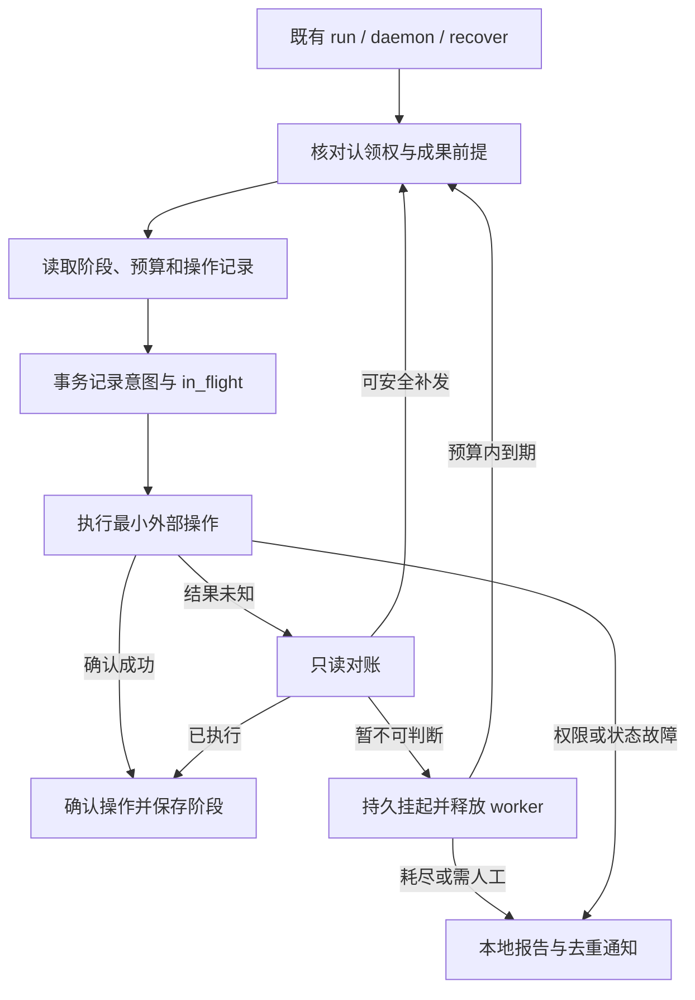
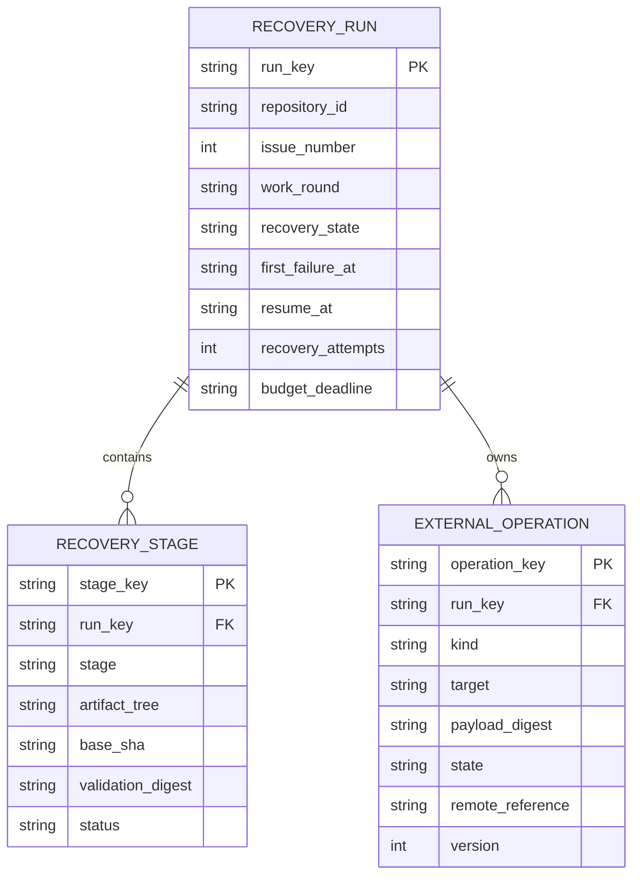

# PRD: Agent Runner 分域故障恢复、阶段续跑与副作用账本

> ✅ **交付前置**：无，可立即开工。
> 结构化声明见 §8 Delivery Dependencies，那里是唯一事实源。

> ⬜ **验收状态**：未开工。
> 本行是 §9 Acceptance Checklist 的投影，那里是唯一事实源。

Part A 用于核对行为与验收结果；Part B 用于实施。本次只编写 PRD，尚未实施或取得运行证据。

## Feature Overview (功能一览)

本节是 §10 的投影；行为验收以 §1 的样例为准。

- **识别故障再恢复**（FR-1）：区分外部网络、限流、权限、内容错误、Agent 停滞与状态损坏。
- **保留完成的工作**（FR-2）：外部操作失败只恢复受影响步骤，已有验证结论必须匹配当前成果才可复用。
- **记住对外写入并自动补发**（FR-3、FR-4）：成功不重发，确定没执行则补发，未知结果先查询或可靠去重，无法安全恢复才找人。
- **短重试后挂起恢复**（FR-5）：等待不占住 worker；重启不重置恢复预算，丢失认领权就停止写入。
- **向人交代清楚**（FR-6）：报告保留成果、失败步骤、未知副作用、已做处理与可执行的恢复办法；通知失败也留本地记录。
- **真实入口验证与兼容**（FR-7、FR-8）：保留现有运行与恢复入口，通过测试侧假服务验证断连，不往生产代码加注入开关。

# Part A · 人审层 (Review Layer)

## 1. Introduction & Goals

### Problem Statement

使用者希望 runner 遇到网络故障时继续完成任务，而不是把已经完成的实现再做一遍。讨论稿记录的 #73 事故为本次需求来源，其中“白烧约三小时”属于现场报告，本次未重测该耗时。

仓库当前确实存在两个缺口：普通网络错误只短暂尝试三次；部分允许返回失败结果的调用不会进入相同的重试路径。现有发布恢复和崩溃恢复已经能利用部分成果，但尚未统一记录每次外部写入的意图和未知结果。因此，恢复可能重复执行外部动作，或把外部故障归入实现、验证失败。

### Interpretation (解读回显)

让 keda runner 尽可能自动恢复；只有需要人提供权限、修复状态或消除无法判断的写入风险时才交给人。

**行为样例**

| 验证方式 | 输入 / 操作 | 期望观察到的结果 |
|---|---|---|
| 🤖 自动验证 | 实现和验证已完成，发布时网络连续断开；任务挂起后 runner 重启，随后网络恢复 | 从未完成的发布步骤继续；不再次调用实现 Agent，不把故障记成验证失败；已经通过的验证仅在成果未变时复用。 |
| 🤖 自动验证 | 创建评论或 PR 时连接断开，分别出现“对端已创建”“对端未创建”“始终查不清” | 已创建则复用；确认未创建则自动补发；查不清且不能可靠去重则暂停并转人工。重启及重复调度不会造成重复创建。 |
| 👀 人审 + 自动验证 | 持续网络故障耗尽预算、明确权限不足或恢复记录损坏；GitHub 同时无法接收通知 | 停止相关自动推进，保留已有成果，在本地留下待人工处理报告；通知渠道恢复后再投递同一报告，不伪称通知成功，报告写明失败步骤、已尝试动作和恢复办法。 |

上表有效行为行原样成为 §7.6 的验收 oracle；修改一个行为格即修改对应验收标准。

**我默默定了这些**

- 自动补发以“不会产生不可判断的重复副作用”为边界；这延续用户已同意的上一轮说明。
- “通知人”使用现有日志、运行报告与 Issue 评论渠道，不新增邮件、Slack 或外部通知服务。
- 生产环境不要求先复现故障才能自动恢复或转人工；是否转人工取决于恢复能力和预算。
- 本期约束 runner 自己发起的操作，不承诺接管任意 Agent 在 shell 中私自发起的全部写请求。
- 默认恢复时长由本 PRD 给出有界值；属于执行侧默认选择，可依据实测调整并同步主文与证据。

**我理解为不做**

- ai-assistant 的 Run Kernel、A2A 与远端 SSE 重订阅。
- 新的工作流引擎、完整分布式事务补偿体系。
- 对每次线上网络故障成因的精确复现保证。

恢复单位是失败步骤。写入结果未知时先查事实，再补发；不能以“发生了网络错误”为由盲目重复写入，也不能以“本地无法复现”为由直接放弃恢复。

### What The User Gets

普通瞬时故障尽量自行消化，长时间故障保留现场等待；确实需要人时，一次交付足够行动的信息。使用者仍从原有运行、日志与恢复入口操作。

### Measurable Objectives

- 发布断网恢复场景的实现 Agent 调用次数保持为一次。
- 已执行但响应丢失的创建操作，最终远端对象数量为一个；确认未执行的操作自动完成补发。
- 恢复进程重启后，步骤、预算、写入身份与未知状态仍在；无认领权时零业务写入。
- 人工处理报告在通知网络不可用时仍持久存在，恢复后不重复投递。

## 2. Human Review Map (介入与风险地图)

### 自动恢复失败时，交接信息是否足够行动

范围、补发原则和分类交由自动恢复或人工处理的方向，用户已在本次对话确认。交付时仍需看实际报告，确认它能指导人继续处理，而不是只显示“失败”。错误地省略未知写入会使人工补发造成重复。

**请确认：** 最终报告是否明确说明卡住哪一步、已经完成什么、哪些写入还查不清，以及你下一步该做什么？

**验收：** 在无法通知 GitHub 的场景查看本地真实报告，随后恢复通知渠道，观察同一报告只投递一次。

**自动门禁，不需要逐项人工审阅：** 网络错误分类、预算持久化、写入对账、并发去重、认领权复查、成果匹配、既有验证门禁、数据迁移和日志脱敏，由 executor 与独立 verifier 验证。

**本次明确不涉及：** ai-assistant、任意 shell 写请求拦截、前端页面改版和新通知服务。

## 3. Usage And Impact After Implementation

- **运行者 / daemon 运维者：** 继续使用 `kc run --issue <N>` 和既有 daemon；短暂断网自动重试，较长故障退出当前 worker 并保留待恢复记录，后续调度继续。单次运行没有后台进程时，输出说明需要再次运行，不能承诺自行后台恢复。
- **人工处理者：** 从运行日志或 Issue 报告得知原因；处理权限或网络后，用原有运行入口继续，发布恢复继续支持 `kc recover --issue <N>`。涉及未知写入时先按报告确认对端事实，不能靠重新排队清空风险。
- **PR 审查者 / 需求方：** 实现、验证和发布故障分别呈现；外部故障不产生虚假的验证失败结论，已有 PR 被复用。
- **CLI 调用者 / 集成者：** 不新增子命令或旗标，不重用已有成功结果表示挂起；实施前核对现有退出码和机器输出契约，新增必需字段只能向后兼容，并同步随包 skill。
- **Console 使用者：** 继续查看既有运行日志与报告；本期不新增等待状态的页面组件或交互。不能把挂起任务显示成成功或验证失败；如既有展示无法容纳，实施者须先修订本 PRD 明确前端影响。

旧记录没有账本时先检查现存 commit、PR 和评论；不得凭缺少记录判定远端未执行，也不得伪造旧验证结论。已有历史与配置无需人工清空。

## 4. Requirement Shape

- **actor：** runner 运行者、daemon 运维者、人工处理者、PR 审查者、CLI 集成者、Console 日志查看者。
- **trigger：** Agent、外部调用、进程或持久化故障，以及后续调度和人工重启。
- **expected behavior：** 分类处理、有限自动恢复、按成果匹配的阶段续跑、外部写入对账和可行动的人工交接。
- **explicit scope boundary：** keda runner 管理的执行与交付链；不替代第三方系统的幂等能力，不承诺所有网络故障可精确复现。

# Part B · 执行器层 (Build Layer)

## 5. Repository Context And Architecture Fit

### 已核实路径与复用点

- `src/backend/infrastructure/github_client.py`：`_run_with_retry` 当前三次、固定一秒间隔；`check=False` 非零结果仅检查限流后返回，未统一进行网络重试。不能只在异常分支加 EOF。
- `src/backend/infrastructure/github_helpers.py`：`_RETRYABLE_GH_ERROR_PATTERNS` 已覆盖部分 DNS、TLS、5xx 和具体边缘页，未列 EOF / connection reset。保留窄匹配，不能把全部 400 / 403 一概视为同类。
- `src/backend/infrastructure/github_issue_ops.py`、`github_pr_ops.py`：外部读写入口，可明确提供操作语义；不要只靠命令字符串推断副作用。
- `src/backend/core/use_cases/agent_runner_issue_handlers.py`：已有 WIP checkpoint、已有 commit 的复用与 `_process_running_publish_recovery`。
- `agent_runner_publish.py` 的 `push_changes`、`publish_changes`，以及 `recover_publish.py` 的 `recover_publish_issue`：扩展现有发布恢复，不另开发布管线。
- `agent_runner_failure_marking.py`：已有 best-effort 标签与评论报告；通知投递也必须进入去重语义，不能递归产生通知失败报告。
- `agent_runner_reconcile.py`、`run_agent_daemon.py`、`agent_runner_claim_arbitration.py`：复用调度、崩溃对账和认领仲裁。
- `src/backend/infrastructure/persistence/console_store.py`：已有 stdlib SQLite、WAL 与版本迁移。本地审计写失败是 best-effort；新的恢复事实写入必须是严格路径，不能沿用吞错语义。

core 只定义模型、接口与决策；基础设施执行 gh、Git 与持久化，engine factory 装配现有 runner，不引入独立服务。

### Frontend Impact

**No frontend impact**：本期通过既有 CLI、日志、Issue 评论呈现，复用现有 Console 日志查看能力，不新增 Web API 状态枚举或页面。

仓库前端已检查：`frontend-admin/` 为 Vite + React，`pnpm --dir frontend-admin dev` / `pnpm --dir frontend-admin test`；`frontend-public/` 为 Next.js + React，`pnpm --dir frontend-public dev`，端到端入口为 `just e2e`。这些不属于本期预定改动；若发现必须修改 UI，先补齐设计与真实入口验证再继续。

### Existing PRD Relationship

已搜索 pending 中恢复、网络、崩溃与副作用相关工作，未发现同一目标的待执行 PRD。

- `P1-FEAT-20261024-161425-cross-machine-presence-and-claim-lease`：soft 关联，涉及相同认领和恢复位置；不依赖其新租约格式。本期复用现有认领权核验，若租约已落地必须同时遵守其失权停止规则，不另加心跳。
- `P1-FEAT-20261019-180938-m13-keda-vs-claude-workflow-evaluation`：独立评测工作，可复用隔离方法，不是交付依赖。
- archive `20260521-192533-prd-agent-runner-publish-recovery`：发布恢复的既有契约，扩展而非替换。
- archive `P1-FEAT-20260930-225000-daemon-crash-reconciliation-session-resume`：复用崩溃对账与可用会话恢复，不重建会话续传体系。

## 6. Recommendation

### Recommended Approach

在现有链路增加统一恢复决策、持久化步骤与写操作记录。错误分类、阶段恢复、账本共同解决一次断网的完整生命周期；拆分交付会留下“能续跑但可能重复写”或“有账本却从头重跑”的中间状态，因此作为一个目标交付。

ROI：直接减少发布抖动导致的重复实现，并避免补发重复对象。成本主要在写入语义盘点、跨进程持久化与对账测试；只覆盖 runner 受控写入口，复用本地 SQLite 与现有恢复入口控制复杂度。

### Proposed Solution Summary (实现机制)

由调用方显式提供操作类别、稳定业务键、目标与载荷摘要，底层不从自由文本猜幂等性。core 定义 `RecoveryDecision`、`OperationIntent` 和严格存储端口，基础设施适配器负责具体请求及对账。

首次外部写入前持久化意图；发送前置为 `in_flight`；收到确认后置为 `confirmed`。崩溃遗留的 `in_flight` 一律按 `unknown` 恢复。步骤成功与相关操作确认应在同一本地事务中提交；外部系统与本地事务之间的空窗靠对账处理，不声称 exactly-once。

阶段记录绑定仓库身份、Issue、工作轮次、阶段、代码 tree、base 与验证契约摘要；只在对应前提匹配时复用。发布网络故障不清除实现产出、不消耗模型修复预算、不改写验证结论。代码或验证前提变化时从受影响的验证阶段继续。

存储复用既有本地 SQLite 文件，新建严格读写的恢复表与端口；不把关键账本塞进 best-effort 审计。旧版无记录时保守对账。没有数据模型变更的远端数据库，不需要 Alembic；本地 schema 迁移跟随既有 SQLite 约定。

### Alternatives Considered

- 只给重试正则加 EOF：无法解决写入未知、跨重启预算或错误阶段回退，拒绝。
- 只分类与续跑，不记副作用：恢复可能重复创建，用户已选择包含账本，拒绝。
- 引入 Temporal / 通用 Outbox 投递服务 / Saga：本期不需要新运行设施；本地严格账本与现有调度已足够。

## 7. Implementation Guide

本节是基于当前仓库分析的动态实现指南。实施中发现更多受影响文件、隐藏依赖、边界情况或更好路径时，先更新本 PRD 再继续。

### 7.1 Core Logic

1. 盘点 runner 发起的 GitHub、Git 和其他外部请求，记录每个写入口的稳定身份、对账办法与安全补发条件。没有对账能力的写入也要记账，未知结果转人工，不能漏掉高风险入口。
2. 在适配器边界把异常和非零返回统一归一化；保留原命令类别、状态码、脱敏诊断、结果确定性。`check=False` 保持返回契约，但也经过安全重试策略。
3. 分类决定动作，禁止上层把外部故障包装成验证失败。`403` 必须区分限流与明确权限不足；5xx 写请求也可能结果未知，不能一概直接重发。
4. 操作身份不含 retry 次数或进程 PID；同一工作轮次重启后保持相同。载荷变更必须产生新修订，不能让旧成功记录吞掉新写入。
5. 并发恢复用本地事务 CAS 防止同机重复发送；每次恢复与实际写入前重新核对现有远端认领。远端核验不可用时挂起，不能假定仍拥有任务。跨机器没有共享本地账本时依靠远端对象身份对账，不能声称本地锁解决跨机并发。
6. 通知作为独立、带稳定身份的待投递操作。GitHub 不可用时先写本地报告并输出路径，恢复后投递；报告投递失败不递归生成新报告。

| 分类 / 条件 | 动作与边界 |
|---|---|
| `transient_network`（读或可安全重试操作） | 指数退避与抖动，单次调用最多 5 次且总耗时不超过 60 秒；每次 timeout 不得越过剩余 deadline。耗尽后挂起。 |
| `rate_limited` | 使用可获得的服务端恢复时间；未知时复用已有保守等待。等待到期再调度，不占 worker，不以重试风暴试探。 |
| `outcome_unknown` | 先只读对账；已成功记确认，确定未执行自动补发；查询失败 / 暂未可见不等于未执行。不能可靠去重则人工处理。 |
| `auth` / 明确权限不足 | 不自动改变凭据或提权，报告需要人处理；限流的 403 不走此分支。 |
| `semantic_rejected` / `agent_invalid_output` | 沿用既有有限修复与 Agent fallback；不当作网络重试。 |
| `agent_stalled` / 推理进程中断 | 复用已有监督、WIP 与支持 resume 的 Agent 路径；不把外部发布失败送入该路径。 |
| `fatal_state` | 关键记录写入失败或恢复记录冲突时，停止后续副作用；不能假装保存成功或覆盖未知状态。 |
| 自动恢复总预算耗尽 | 默认首次故障后累计 30 分钟，最多 6 次调度恢复，以先到者为准；含重启和对账尝试，不因轮询刷新。转人工并停止自动业务写入。 |

长限流超过总预算时直接说明服务端等待时间并转人工，不绕过限制。人工修复后显式运行可以开启新恢复周期，但保留同一未知操作身份与历史，仍先对账。用户中断遵循既有停止语义，不能被重试循环吞掉。

### 7.2 写操作覆盖与对账

| 操作族 | 对账与补发 |
|---|---|
| Issue / PR 评论、认领与报告 | 复用现有标记，必要时增加独立操作标记；分页完整读取并校验目标、作者、操作键与载荷修订。未查到或超时不能直接证明未创建；存在延迟可见或并发不确定性时暂停。 |
| Issue / PR 创建 | 使用现有 Issue 关联、head/base 或独立标记，覆盖 open / closed / merged，不能仅查 open 后新建；歧义转人工。 |
| 标签、正文、状态、PR ready / base 变更 | fresh read 比较目标状态；只重复可安全收敛的目标写入，防止覆盖其他参与者的新修改。 |
| Git push | 查询远端 ref 与预期 commit；已到达则确认，否则仅走原有安全 push。分叉、保护拒绝和禁止 force 的约束不放宽。 |
| PR merge / close 等高风险动作 | 查询目标终态与指定 head 等既有前提；保留签核、分支保护与 merge gate。未知状态不因账本存在就获准再执行。 |
| 其他 runner 受控写入口 | 实施盘点逐项归入以上语义或明确记录“未知结果需人工”；不扩展到任意 Agent shell 拦截。 |

不假设 GitHub 支持通用幂等键；没有经过核实的服务端去重保证时使用远端业务事实。账本本身不能提供第三方 exactly-once 保证。

### 7.3 Change Impact Tree

以下新增路径为提议；已有路径为核实结果。文件清单是起点，遗漏按 Drift Guard 补齐。

```text
.
├── Infrastructure
│   ├── src/backend/infrastructure/github_client.py [修改]
│   │   【总结】统一非零结果与异常分类，按操作语义重试。
│   ├── src/backend/infrastructure/github_helpers.py [修改]
│   │   【总结】补充窄匹配的 EOF 与断连诊断，保留原始类别。
│   ├── src/backend/infrastructure/github_issue_ops.py [修改]
│   │   【总结】Issue 写入口提供稳定身份和对账路径。
│   ├── src/backend/infrastructure/github_pr_ops.py [修改]
│   │   【总结】PR 写入口按远端事实确认并安全补发。
│   ├── src/backend/infrastructure/persistence/console_store.py [修改]
│   │   【总结】接入兼容迁移，与 best-effort 记录隔离。
│   └── src/backend/infrastructure/persistence/runner_recovery_store.py [新增]
│       【总结】实现严格事务、操作 CAS、预算与阶段持久化。
├── Domain
│   ├── src/backend/core/shared/models/runner_recovery.py [新增]
│   │   【总结】定义故障、恢复决定、操作与阶段记录。
│   ├── src/backend/core/shared/interfaces/runner_recovery.py [新增]
│   │   【总结】定义严格持久化与恢复协作端口。
│   ├── src/backend/core/use_cases/agent_runner_recovery_policy.py [新增]
│   │   【总结】集中分类升级规则，避免各层分别判断字符串。
│   ├── src/backend/core/use_cases/agent_runner_issue_handlers.py [修改]
│   │   【总结】根据匹配的阶段成果恢复，隔离外部故障。
│   ├── src/backend/core/use_cases/agent_runner_publish.py [修改]
│   │   【总结】push 与 PR 步骤确认后推进，保留原发布门禁。
│   ├── src/backend/core/use_cases/recover_publish.py [修改]
│   │   【总结】人工恢复入口复用相同账本与决策。
│   ├── src/backend/core/use_cases/agent_runner_reconcile.py [修改]
│   │   【总结】崩溃恢复先读严格记录并重新对账。
│   ├── src/backend/core/use_cases/run_agent_daemon.py [修改]
│   │   【总结】调度到期待恢复任务，等待时释放 worker。
│   └── src/backend/core/use_cases/agent_runner_failure_marking.py [修改]
│       【总结】呈现故障类别与人工处理报告，通知失败可续投。
├── Engines
│   └── src/backend/engines/agent_runner/factory.py [修改]
│       【总结】在现有装配中注入严格存储与恢复协作者。
├── Tests
│   ├── tests/test_github_client.py [修改]
│   │   【总结】覆盖 EOF、非零返回、写入未知与权限限流分支。
│   ├── tests/test_agent_runner_recovery.py [修改]
│   │   【总结】覆盖跨重启预算、阶段前提变化与人工接续。
│   ├── tests/test_agent_runner_publish.py [修改]
│   │   【总结】确认发布恢复不重跑实现，不绕过验证与认领。
│   └── tests/test_runner_recovery_store.py [新增]
│       【总结】验证迁移、事务失败、并发 CAS 与崩溃窗口。
└── Docs
    ├── docs/guides/agent-runner.md [修改]
    │   【总结】说明挂起、补发、人工报告和恢复流程。
    ├── docs/architecture/system-design.md [修改]
    │   【总结】说明严格恢复事实与旁路审计的职责差异。
    └── src/backend/engines/agent_runner/templates/skills/kedacode-operator/references/triage.md [修改]
        【总结】同步故障分类与既有恢复入口的操作语义。
```

不新增长期文档页，沿用既有导航；实施若新增页面必须同步 `mkdocs.yml`。随包 skill 主文件如摘要受影响也需同步；不修改本机安装副本冒充随包更新。

### 7.4 Risk Classification Register / Executor Drift Guard

| 变更点 | 风险 | 证据 |
|---|---|---|
| 阶段复用、跨重启与预算 | R2 | rv-1：真实运行入口、持久化与 fresh process |
| 写入未知、去重与认领权 | R3 | rv-2：远端对象计数、负控、失权零业务写入 |
| 分类升级与人工交接 | R2 | rv-3：实际报告与离线通知恢复；映射 §2 人工项 |
| 文档、兼容迁移、分类局部分支 | R1 | 定向测试与文档构建，附对应 oracle 报告 |

实施前搜索：`rg -n 'CalledProcessError|check=False|PushChangesError|PublishFailureError|GitHubApiRateLimitError' src/backend`，以及 `rg -n 'comment_issue|create_draft_pr|merge_pull_request|edit_issue_labels|push_changes' src/backend`。沿调用关系检查直接 `_runner.run`、Git push、通知 fallback 和 merge queue，不能只覆盖讨论稿中的两个调用。

核对 pending 租约 PRD 与最新分支，保留失权停止、人工取消、验证、归档和合并门禁。不得增加生产故障开关、计数器或旁路。实施前读 code-reuse、testing、naming、comments-docstrings、tooling、time-display 标准，完成复用自检。机器时间用 UTC 带偏移，人读展示用执行机器本地时区。

### 7.5 Flow / Data Model



持久结构为提议，实际列名可调整但必须保留以下语义：



操作状态至少包含 `pending / in_flight / confirmed / unknown / rejected`。通知原文与必要的可重建载荷需严格持久化或引用不可变本地文件，不只存 hash 而丢失补发内容；不持久化凭据。阶段与账本记录不随普通运行历史清理删除，直到无未决操作；破坏性重置不能作为恢复路径。

### 7.6 Realistic Validation Plan

采用隔离临时仓库、真实 Git 本地 bare remote、真实 CLI / daemon 与 SQLite；只在测试侧替换外部 Agent 和 gh 网络边界。至少一组必须穿过真实 gh 子进程与测试侧 TCP / HTTP 代理，实际断开 socket，不能仅用假 gh 打印 EOF 冒充网络验证。代理路由方式在 harness 中先做能力探测；若当前 gh 难以重定向，允许测试侧传输适配器调用真实本地 socket 并另测真实 gh 返回的错误分类，必须披露未穿透边界，不能把较低保真度当成完整验收通过。

执行者实现前阅读 skill 的 `references/rv-harness-cookbook.md`。为本 PRD 生成忽略提交的 `tasks/evidence/P1-FEAT-20261024-162357-agent-interruption-recovery/scripts/run_recovery_rv.py`，支持以下命令与 scene；其职责是准备现场、启动真实入口并做独立探测，不直接调用被测恢复 helper。该脚本当前尚未创建。

```yaml
- id: rv-1
  behavior: "实现和验证已完成，发布时网络连续断开；任务挂起后 runner 重启，随后网络恢复"
  reviewer: verifier
  real_entry: "uv run python tasks/evidence/P1-FEAT-20261024-162357-agent-interruption-recovery/scripts/run_recovery_rv.py --scene stage-resume"
  expected: "从未完成的发布步骤继续；不再次调用实现 Agent，不把故障记成验证失败；已经通过的验证仅在成果未变时复用。"
  mock_boundary: "脚本启动真实 kc run --issue 73 与 daemon；真实 worktree、Git、SQLite、恢复决策；外部 Agent 和 GitHub 服务可替换，至少包含实际 socket 断连场景。"
  tier: R2
  test_layer: e2e
  required_for_acceptance: true
  critical_value_source: "真实本地 commit/tree、runner 保存的验证前提、代理请求记录、Agent 子进程调用日志及持久化 deadline。"
  must_cross: "CLI -> 认领 -> 实现/验证 -> 发布 -> 严格存储 -> 新 daemon 进程 -> 远端 ref 与 PR 查询。"
  forbidden_bypasses: "不得预写成功阶段、直接调用恢复 helper、模拟 SQLite 或把网络错误注入生产配置。"
  fresh_state_probe: "独立进程读取最终远端 ref、PR、阶段与预算；再改变代码/验证前提，证明旧验证不再复用；失权和人工取消分支禁止继续写。"
  final_tree_evidence: "rv-1-stage-resume.txt 记录最终源码 tree、scene 参数与非零断言数；相关源码或 harness 变化须重跑。"
- id: rv-2
  behavior: "创建评论或 PR 时连接断开，分别出现“对端已创建”“对端未创建”“始终查不清”"
  reviewer: verifier
  real_entry: "uv run python tasks/evidence/P1-FEAT-20261024-162357-agent-interruption-recovery/scripts/run_recovery_rv.py --scene unknown-write"
  expected: "已创建则复用；确认未创建则自动补发；查不清且不能可靠去重则暂停并转人工。重启及重复调度不会造成重复创建。"
  mock_boundary: "真实 CLI、分类、账本与 gh 适配器；测试侧服务控制提交后断连、明确未提交、延迟可见、分页、永久不可查与并发。"
  tier: R3
  test_layer: e2e
  required_for_acceptance: true
  critical_value_source: "服务端实际落地对象与请求 ID、持久 operation_key 和 payload_digest；不以客户端异常推断未执行。"
  must_cross: "CLI -> 意图事务 -> 外部请求 -> socket 断连 -> 新进程 -> fresh 对账 -> 确认/补发/人工。"
  forbidden_bypasses: "不得直接预填 confirmed、只统计客户端调用、把单次查无对象视为未执行，或在无认领权时补发。"
  fresh_state_probe: "服务端独立新会话读取全部状态对象，已创建和安全补发最终均为一个；未知分支无第二次写；并发本机、跨机失权、载荷更新与持久化失败分支分别断言。"
  final_tree_evidence: "rv-2-unknown-write.txt 保存最终 tree、远端对象列表、负控与恢复后观察。"
  negative_control: "同一 harness 的 --scene unknown-write --negative-control 在测试侧绕过对账并重复发送同一创建请求；不改 src。"
  expected_fail: "远端出现两个对象，唯一对象断言必须失败；正常场景还必须验证真正完成目标，避免零操作假绿。"
- id: rv-3
  behavior: "持续网络故障耗尽预算、明确权限不足或恢复记录损坏；GitHub 同时无法接收通知"
  reviewer: human
  real_entry: "uv run python tasks/evidence/P1-FEAT-20261024-162357-agent-interruption-recovery/scripts/run_recovery_rv.py --scene human-handoff"
  expected: "停止相关自动推进，保留已有成果，在本地留下待人工处理报告；通知渠道恢复后再投递同一报告，不伪称通知成功，报告写明失败步骤、已尝试动作和恢复办法。"
  presentation: "tasks/evidence/P1-FEAT-20261024-162357-agent-interruption-recovery/rv-3-human-handoff.txt；open tasks/evidence/P1-FEAT-20261024-162357-agent-interruption-recovery/rv-3-human-handoff.txt，检查明确原因、未知操作及恢复入口。"
  mock_boundary: "真实 CLI/daemon 与报告存储；外部网络、凭据拒绝由测试侧服务控制，严格存储失败由测试侧注入；不新增生产开关。"
  tier: R2
  test_layer: e2e
  required_for_acceptance: true
  critical_value_source: "实际 runner 的原始故障、严格恢复记录、保存的报告正文及服务端通知对象。"
  must_cross: "故障 -> 分类 -> 持久挂起/人工决定 -> 本地报告 -> 重启 -> 通知补投。"
  forbidden_bypasses: "不得手写报告替代实际产物、离线时记通知成功、重启清零预算或递归生成通知失败报告。"
  fresh_state_probe: "新进程读取同一报告和预算；网络恢复后独立读取唯一通知；人工修复后既有入口仍先对账未知操作。"
  final_tree_evidence: "rv-3-human-handoff.txt 记录最终 tree 与真实报告原文，相关改动后重采。"
  negative_control: "测试侧服务保持权限拒绝/网络失败，持续调度越过预算，断言业务写入停止且本地报告存在；删除测试副本报告后，完整性断言必须失败。"
  expected_fail: "缺少报告或预算耗尽后仍业务重试时失败；实际存储不可写时必须明确输出不能持久化并停止，不能伪造落盘成功。"
```

排障顺序：先看临时仓库配置与 gh 路由是否命中本地服务，再看认领事实、严格存储事务、操作键、预算与报告投递。fixture 时间压缩只能发生在测试边界，至少另测默认值和 deadline 计算，不要求等待真实 30 分钟。

定向回归用 `uv run pytest tests/test_github_client.py tests/test_agent_runner_recovery.py tests/test_agent_runner_publish.py tests/test_recover_publish.py tests/test_runner_recovery_store.py -q --no-testmon`。日常 `just test`，交付 `just lint --repo` 与 `uv run mkdocs build --strict`；记录实际执行数，零用例不能作为证明，不默认本机运行 `just test all`。

保真度披露：离线故障注入证明恢复行为，不证明 GitHub 内部状态传播、真实 DNS/TLS 或运营商链路成因。真实 GitHub 沙箱只作为 opt-in 补充，不向真实项目自动制造断网写入。若 oracle 的必要边界无法运行，交付报告写 INCONCLUSIVE，不能以“通知人机制存在”代替开发期验收。

### 7.7 Prototype / External Validation

No interactive prototype file changes in this PRD. 无新增视觉交互，不需要原型图。

No external validation required; repository evidence was sufficient. 本设计不依赖第三方幂等键、A2A 或框架参数的外部结论；讨论稿相关未核实项不作为实施依据。若实施选择新的第三方行为保证，须查官方资料并补充来源与日期。

## 8. Delivery Dependencies

### Delivery Dependencies

- Depends on tasks/issues:
  - none
- Gate type: none
- Sequence: via-main
- Notes: 租约 PRD 为 soft 关联，无交付顺序要求；开工和交付前核对其最新状态，适配已落地认领规则。

## 9. Acceptance Checklist

### 9.1 人读呈递区（Human Review Surface）

| 要看的结果 | 呈递入口（交付时必须可用） | 十秒自查 |
|---|---|---|
| 无法自动恢复时，报告能指导人处理；离线通知不会假成功 | `open tasks/evidence/P1-FEAT-20261024-162357-agent-interruption-recovery/rv-3-human-handoff.txt`；交付报告摘录真实报告关键段。归档后用 `just prd review tasks/archive/P1-FEAT-20261024-162357-agent-interruption-recovery.md` 集中查看 | 找到“失败步骤、已完成成果、结果未知操作、已尝试处理、需要人做什么、恢复入口”；通知未送达明确标注。 |

rv-1 阶段恢复与 rv-2 副作用去重由 verifier 审核；迁移、分支矩阵、lint 与文档构建不要求人逐条查看。当前没有运行产物，表内为交付要求。

### 9.2 Acceptance Evidence Package

#### Human-Confirmed

- [ ] §2 人工交接报告可指导操作，未知副作用和通知失败没有被隐藏；依据 rv-3 实际报告确认。
- [ ] 已查看 §9.1 人读呈递区的实际产物，结果符合预期。

#### Behavior Acceptance

- [ ] rv-2 证明未知写入三分支、重启、分页、延迟可见、并发、载荷变更和失权行为；负控能检出重复对象，正常路径实际完成目标。
- [ ] rv-1 证明发布故障不重跑实现、不产生验证失败，当前成果变更则重新验证，预算跨进程不清零。
- [ ] rv-3 证明权限、持续网络、关键存储失败与人工恢复路径；429 / 限流 403 与权限拒绝分开，取消不会被吞掉。

#### Architecture Acceptance

- [ ] 严格恢复存储不吞事务失败，与 best-effort 审计隔离；迁移保留旧记录，定向存储测试报告含实际执行数。
- [ ] 写入口盘点表随证据报告交付，runner 管理的写入均有记录与明确恢复策略；无通用 shell 拦截、无独立服务、无生产注入开关。
- [ ] core 只依赖接口，现有认领、验证、签核、分支保护、归档与合并门禁保持有效，证据见定向回归和静态边界检查。

#### Documentation Acceptance

- [ ] `docs/guides/agent-runner.md`、架构说明和随包 operator skill 与实际行为一致；如有新页面同步 `mkdocs.yml`，严格文档构建通过。
- [ ] CLI 退出码与机器输出兼容性已经实测记录；若必须改公开契约，先修订 PRD 再实施并同步文档与 skill。

#### Validation Acceptance

- [ ] 三条 oracle 均通过真实入口，证据包含关键值来源、实际边界、fresh process 探测、最终源码 tree 与 harness hash；至少一组实际 socket 断连。
- [ ] 定向 pytest 使用 `--no-testmon` 且非零用例，`just lint --repo` 与文档检查通过；不以 local 档退出码代替执行证据。
- [ ] verification-plan、evidence-report、独立 verifier-report 三份报告齐备，verifier 有效结论为 PASS；review infrastructure 故障记 INCONCLUSIVE 而非产品失败或通过。

#### Delivery Readiness

- [ ] 无未解决阻断问题，§13 Final Reconciliation 完成，主文、功能一览、实际实现与证据一致。
- [ ] 完成消息呈递 §9.1 的实际报告；若另获授权创建 PR，PR 内发布相同呈递与证据，不把文件落盘当作交付。
- [ ] 独立 verifier PASS 后勾选有证据的执行侧项目，随交付归档，横幅与人工待验收项一致；本 PRD 创建不等于功能完成。

## 10. Functional Requirements

- **FR-1**：统一故障域、类别、结果确定性和恢复决定；异常与非零结果一致处理，保留原始诊断，不误归验证失败。
- **FR-2**：实现、评审、验证、发布与收尾保留可核验产出；外部故障从失败步骤继续，成果或验证前提变化使对应结论失效。
- **FR-3**：runner 受控外部写操作发送前持久化意图、稳定身份、目标与载荷修订；保存确认、未知和拒绝，支持并发 CAS 与重启。
- **FR-4**：未知写入先对账；确认成功复用，安全条件满足则自动补发；不可可靠去重或事实冲突转人工，不能把查不到等同未执行。
- **FR-5**：按 §7.1 的有界预算短重试、持久挂起与到期恢复，等待释放 worker；跨重启保留预算、失权停止副作用、用户取消及时退出。
- **FR-6**：无法自动恢复时保留成果与可行动的脱敏报告；离线先本地报告，通知可续投且去重，报告失败不递归。
- **FR-7**：通过真实 CLI/daemon、持久化、Git 与测试侧网络故障验证；明确真实网络成因的不可覆盖部分，不新增生产注入能力。
- **FR-8**：兼容旧记录与既有运行/恢复入口，保持验证和合并安全边界，同步用户文档、架构与随包 skill；不扩大到 ai-assistant。

## 11. Non-Goals

- ai-assistant Run Kernel / A2A / SSE 恢复。
- 通用 Durable Execution、完整 Saga、独立投递服务和远端中心数据库。
- 捕获任意 Agent shell 的所有外部副作用，或对第三方系统保证 exactly-once。
- 新前端面板、新通知服务、每一种真实网络成因的精确复现。

## 12. Risks And Follow-Ups

- 远端传播延迟、分页和认领竞态可能使对账无法确定；本期必须保守转人工，不能以增加重试次数冒充幂等。
- 本地账本不能自动跨机器同步，机器丢失后的接管只能依据远端事实；证据不足需人处理，不凭空恢复本地验证成果。
- 旧客户端不会理解新恢复记录；不得并发在同一状态目录混跑新旧版本；文档说明升级与运行实例停止顺序。
- 严格存储不可写时可能连报告也无法落盘；必须停止写操作并明确 stderr / 日志交代落盘失败，不能保证磁盘故障下存在持久报告。
- 租约 PRD 同期落地会改变恢复准入；交付前重新核对其实现，不能用规划中的租约能力代替当前有效认领事实。

## 13. Decision Log

| ID | 问题 | Chosen | Rejected | Rationale |
|---|---|---|---|---|
| D-01 | 范围 | 仅 keda runner | 同时覆盖 ai-assistant | 用户明确限定本期 keda，两者传输恢复不同。 |
| D-02 | 完整度 | 分类、阶段续跑和账本同时交付 | 只补 EOF 或只做续跑 | 仅续跑不能控制未知写入的重复副作用。 |
| D-03 | 补发 | 尽量自动，未知先对账，无法可靠去重才人工 | 对账失败后盲目自动补发 | 用户已同意安全补发边界，不能把网络错误当成未执行。 |
| D-04 | 人工介入 | 按类别、可恢复性和持久预算判断 | 所有错误立即找人 / 无限重试 | 瞬时故障自动消化，权限与无法判断的风险需要人。 |
| D-05 | 验证 | 测试侧假服务与实际断连，加真实 runner 入口 | 生产注入开关 / 只打印 EOF | 遵守项目边界，并证明恢复链而非错误文本匹配。 |
| D-06 | 存储 | 复用本地 SQLite，新增严格端口和恢复表 | best-effort 审计或新工作流服务 | 已有持久化可承载事实，但吞错审计无法保证发送前记账。 |
| D-07 | 是否拆分 | 一个完整恢复目标 | 分阶段留下未完成写入安全机制 | 三部分共享故障生命周期，拆开会交付危险中间态。 |
| D-08 | 预算 | 单调用 5 次/60 秒；累计 6 轮/30 分钟 | 每次进程重启清零预算 | 有界成本与跨重启一致性可实测，默认值可随实测修订。 |

### Final Reconciliation

- Interpretation: 待实施后核对；当前依据用户已同意的讨论结论。
- Public behavior and contracts: 待核对最终 CLI 退出码、报告与兼容性实测。
- Related PRD status: 待交付前复查租约 PRD。
- Requirements and risks: 待最终实现、三条 oracle 与独立 verifier 核对。
- Reconciled differences:
  - 尚未实施，不宣称完成。

## Change Log

### 从中断讨论形成正式执行计划
- Type: scope
- Before: 讨论稿列有范围、账本、补发、人工判断和验证方式待决问题。
- After: 限 keda，纳入分类、阶段续跑、账本、安全自动补发、分类人工介入与测试侧故障注入。
- Reason: 用户逐项回答并同意收敛结论。
- Impact: 创建本 pending PRD；不修改生产代码、不创建外部 Issue、不执行 Git 变更。
- Review: 需求方向已确认；具体默认值与实施细节由本 PRD 显式记录，尚无交付证据。
