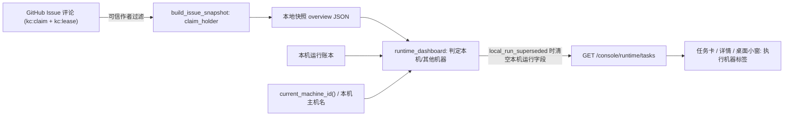

# PRD: 值守看板任务卡显示执行机器（本机 / 其他机器）

> ✅ **交付前置**：无，可立即开工。
> 结构化声明见 §8 Delivery Dependencies，**那里是唯一事实源**。

> ⬜ **验收状态**：未开工。
> 本行是 §9 Acceptance Checklist 的投影，**那里是唯一事实源**。

本文分两层：Part A（§1–§4）给人审阅，只讲问题、解读和需要你拍板的决定；Part B（§5–§13）给执行者，包含机制、文件、命令和验证。

## Feature Overview (功能一览)

> 本节是 §10 Functional Requirements 的通俗投影，不是第二份需求；行为验收以 §1 行为样例表为准。

- **每张活动任务卡标出执行机器**：运行中、失败、阻塞的任务卡在状态胶囊旁多一个机器胶囊，如 `其他机器 · host-b.local`（FR-1、FR-2）。
- **一眼区分本机和其他机器**：机器名旁标「本机」或「其他机器」；新版认领按机器编号判断，同名电脑不会被误认成本机（FR-3）。
- **旧版认领如实说明判断依据**：还没升级 kc 的机器留下的认领只能按主机名判断，胶囊带「?」，悬停说明「按主机名判断」（FR-3）。
- **不拿本机旧记录冒充别人的进度**：任务正由其他机器执行、而本机运行记录早于这次认领时，卡片不再显示本机旧的「最近执行 / 开始时间 / 耗时 / 失败原因」，改为「本机无这一轮运行记录」（FR-4）。
- **伪造评论无法冒充执行机器**：只认有仓库权限的人或 kc 自己写下的认领记录（FR-2）。
- **不增加 GitHub 负担、不新增页面**：机器信息随现有看板同步一起读取，不新开机器页面，不改认领协议（FR-5、§11）。

# Part A · 人审层 (Review Layer)

## 1. Introduction & Goals

### Problem Statement

多人共用同一个仓库队列时，每个人的管理终端「值守看板」都会列出这个仓库所有正在跑、失败或阻塞的任务，但卡片上没有任何「谁在做」的信息。用户原话：

> 「现在是不是有问题，就是我的电脑上面看不见那个任务是本机再做，还是别的机器在做」
> 「我最近在多人写作，有时候A的电脑上面显示的是B在做的任务」

仓库中可以确认的现状：

- 看板任务列表来自 GitHub 标签快照（整个仓库共享），运行细节（最近执行的 agent、开始时间、耗时、失败原因）来自**本机**运行记录。两者拼在同一张卡上，没有标明来源机器。结果是：B 在跑的任务出现在 A 的看板上，如果 A 以前跑过同一个 Issue，卡片还会显示 A 本机的旧运行信息，看起来像 A 在做。
- 机器信息其实已经存在：每次认领都会在 Issue 评论里写下主机名，新版还会写机器编号；`kc peers` 命令已经在用这些信息。但前一份跨机器可见性 PRD 明确把「在管理终端上显示机器」列为不做，所以看板从未接入。

### Interpretation (解读回显)

**行为样例**

| 验证方式 | 输入 / 操作 | 期望观察到的结果 |
|---|---|---|
| 👀 人审 + 自动验证 | A 打开看板；Issue #12 正由 A 自己这台电脑运行（新版认领） | 「运行中」胶囊旁显示绿色胶囊 `本机 · <A 的主机名>`，悬停提示「执行机器」 |
| 👀 人审 + 自动验证 | A 打开看板；Issue #13 正由 B 的电脑运行（新版认领） | 「运行中」胶囊旁显示蓝色胶囊 `其他机器 · <B 的主机名>` |
| 👀 人审 + 自动验证 | Issue #14 已失败，最近由 B 认领；A 本机记录里有一条更早的 #14 运行（agent codex、有失败原因） | 「失败」胶囊旁显示 `其他机器 · <B 的主机名>`（悬停提示「最近认领」），元信息行显示「本机无这一轮运行记录」；不显示 A 本机旧的 agent、开始时间、耗时和失败原因 |
| 🤖 自动验证 | A、B 两台电脑主机名都叫 `MacBook-Pro.local`，B 用新版认领了 #15 | A 的卡片标 `其他机器`，不会因为主机名相同标成本机 |
| 🤖 自动验证 | 旧版 kc 认领了 #16（评论里只有主机名，没有机器编号），主机名和 A 相同 | 胶囊显示 `本机? · <主机名>`，悬停说明「旧版认领，按主机名判断」；主机名不同则为 `其他机器? · <主机名>` |
| 🤖 自动验证 | 一个没有仓库权限的人在 #17 下贴了一条伪造的认领评论，主机名写成 A 的 | 卡片不采信这条评论；没有其他可信认领时不显示执行机器 |
| 🤖 自动验证 | #18 在 `agent/ready` 排队，从未被认领；或读取认领评论失败 | 卡片不显示机器胶囊，其他内容照常显示，看板不报错 |

上表每一行都会原样变成 §7.6 的验收用例：改一个格子，就等于改了验收标准。

**我默默定了这些**

- 只在「运行中 / 失败 / 阻塞」三类卡片上显示机器；排队、已完成、已关闭的卡片不显示（见 §2 决定一，可改）。
- 机器胶囊紧挨状态胶囊，格式 `本机 / 其他机器 · 主机名`，不单独占一行；运行中悬停提示「执行机器」，失败和阻塞提示「最近认领」，因为失败的任务已经没人在跑了。
- 新版认领按机器编号判断本机，旧版认领按主机名判断，胶囊带「?」并在悬停里注明「按主机名判断」，与现有回收、仲裁逻辑完全一致。
- 只采信可信作者（当前用户本人或有仓库 triage 及以上权限的人）写的认领评论，与 `kc peers` 和崩溃回收的读取口径一致。
- 是否本机在**读取看板时**判断，不写进本地快照，避免机器编号变化后显示错误。
- 本机旧运行记录的判定：认领评论记录的开始时间晚于本机最近一次运行开始时间，就认定本机记录不属于当前这一轮（见 §2 决定二）。
- 详情面板和桌面小窗沿用同一字段，显示同样的机器标签。
- 主机名只在本机管理终端显示，管理终端只监听 `127.0.0.1`，不产生新的对外暴露；主机名本来就写在 GitHub 认领评论里。

**我理解为不做**

- 独立的「机器」页面、机器在线 / 离线状态、机器列表（属于 Tailscale 机器管理 PRD 的范围）。
- 按机器筛选看板（例如「只看本机任务」）。
- 修改认领评论格式，或把其他机器的运行详情（日志、失败原因）同步到本机。

**解读**：本 PRD 读作「在现有看板任务卡上加一行执行机器标签，并阻止本机旧记录冒充他人进度」，**不是**「做一个多机管理视图」或「跨机器汇总运行记录」。机器信息只来自 GitHub 上已有的认领评论，不新增协议、不新增存储表、不额外请求 GitHub。读取失败时只是不显示这一行，不能让整张卡或整个看板出错，也不能把「读不到」显示成「本机」。

- [ ] 我确认这段解读与行为样例准确表达了我的需求。

### What The User Gets

多人协作时，打开自己的管理终端，每张活动任务卡都直接告诉你「这活是哪台电脑在干、是不是你这台」。看到「其他机器」就知道不用在本机排查或接手；看到「本机」就知道该去本机日志里找原因。卡片也不会再把你这台电脑以前的旧运行信息，当作别人正在跑的进度显示出来。

### Measurable Objectives

- 行为样例表全部 7 行在自动化测试中通过（§7.6 rv-1、rv-2、rv-3）。
- 主机名相同、机器编号不同的两条认领，看板判定结果不同（同名机器不误判为本机）。
- 无权限作者写的伪造认领不会出现在卡片上。
- 一次看板同步对 GitHub 的请求数只多出「每个运行中 / 失败 / 阻塞 Issue 一次可信评论读取」，排队和已关闭的 Issue 不增加请求。

## 2. Human Review Map (介入与风险地图)

### 决定一：哪些任务卡显示机器

建议只在运行中、失败、阻塞三类卡片上显示。运行中的卡片显示「执行机器」，这是用户最关心的「现在谁在做」；失败和阻塞的卡片显示「最近认领」，解释「这个失败是谁那边出的、该谁去处理」，你截图里那张失败卡片正是这种情况。排队中的任务还没人认领，已关闭的任务已经结束，显示机器意义不大，还要为每个 Issue 多读一次 GitHub，所以不显示。风险是：如果你希望已关闭任务也能看到「最后是谁做完的」，这个方案不覆盖。

**请确认：** 只在运行中 / 失败 / 阻塞卡片上显示机器，可以吗？

- [ ] 同意：运行中 / 失败 / 阻塞三类显示（推荐）
- [ ] 只在运行中卡片显示
- [ ] 所有带认领记录的卡片都显示（含已关闭；每个已关闭 Issue 也要多读一次 GitHub）

**验收：** 在看板截图里，运行中和失败卡片的状态旁有机器胶囊（悬停分别显示「执行机器」「最近认领」），排队卡片没有。

### 决定二：本机旧运行记录与他人认领冲突时怎么显示

建议：任务的最近认领来自其他机器，且本机最近一次运行早于这次认领时，卡片隐藏本机的「最近执行 / 开始时间 / 耗时 / 失败原因」，在元信息行显示灰字「本机无这一轮运行记录」。不这样做，卡片就会把你几天前跑过的旧结果，当作 B 现在的进度显示，这正是「A 电脑上显示 B 的任务」最容易误导人的地方。代价是：这种情况下你在卡片上看不到自己的历史记录，需要点开详情面板的运行记录查看（详情面板的历史记录不受影响）。另一个可选方案是保留旧信息，但加上「本机旧记录」的标注，信息更全，但卡片更挤，也更容易被误读。

**请确认：** 冲突时隐藏本机旧运行信息，还是保留并加标注？

- [ ] 隐藏，并显示「本机无这一轮运行记录」（推荐）
- [ ] 保留，并标注「本机旧记录（早于当前认领）」

**验收：** 行为样例第 3 行的截图里，失败卡片只有其他机器胶囊和「本机无这一轮运行记录」，没有本机旧的 agent 名和失败原因。

**自动门禁，不需要逐项人工审阅：** 认领评论解析、可信作者过滤、机器编号与主机名判定、读取失败降级、同步请求数不扩大、API 字段序列化、前端类型同步、桌面小窗与详情面板一致性、文档同步，都由执行者用自动测试验证，结果交给独立验证者复核。

**本次明确不涉及：** 数据库结构变化、认领 / 租约协议变化、管理终端监听地址变化、对 GitHub 的任何写操作。

## 3. Usage And Impact After Implementation

**多人协作中的看板使用者（直接用户）**：照常运行 `kc console` 打开管理终端，进入「值守看板」。运行中、失败、阻塞卡片的状态胶囊旁多一个机器胶囊，如 `其他机器 · MacBook-B.local`；悬停可看「执行机器」或「最近认领」。如果标的是其他机器，而本机记录比这次认领更早，原来的「最近执行 / 开始 / 耗时 / 失败原因」不再显示，元信息行显示「本机无这一轮运行记录」。详情面板和桌面小窗显示同样的胶囊。

**单机用户**：所有卡片都显示 `本机`，其他内容不变。

**还没升级 kc 的协作者**：他们留下的认领仍会显示，但胶囊带「?」（按主机名判断）。他们自己的看板不变。

**仓库维护者 / 运维**：无需配置。不需要打开 `presence_enabled`（机器状态上报），因为信息来自每次认领都会写的认领评论。

**兼容性**：旧的本地快照没有机器字段，升级后第一次远端同步之前，卡片不显示机器胶囊（不会报错）；同步之后自动出现。API 只新增字段，不改已有字段。

## 4. Requirement Shape

- **actor**：多人协作下使用管理终端值守看板的人；单机用户；仍在用旧版 kc 的协作者（作为认领记录的产生方）。
- **trigger**：看板同步（定时或点击「立即远端同步」）后打开或刷新值守看板、任务详情面板或桌面小窗。
- **expected behavior**：运行中 / 失败 / 阻塞任务卡显示最近一次可信认领的机器名和「本机 / 其他机器」判定；本机运行记录早于他人认领时不冒充当前进度；读不到认领时不显示机器胶囊。
- **explicit scope boundary**：只读 GitHub 上已有的认领评论；不新增页面、筛选、存储表或协议；不写 GitHub；不改管理终端监听地址。

# Part B · 执行器层 (Build Layer)

## 5. Repository Context And Architecture Fit

**当前相关模块**

- `src/backend/core/use_cases/agent_runner_monitor.py`：`build_issue_snapshot` 为每个队列 Issue 构建 `IssueMonitoringSnapshot`，已经通过 `list_issue_comments` 读取评论（不过滤作者）；`build_repository_overview` 用线程池并发构建快照；结果经 `monitor_snapshots.persist_monitoring_result` 作为 overview JSON 写入本地快照库。
- `src/backend/core/use_cases/runtime_dashboard.py`：`_snapshot_task` 把快照条目映射成 `RuntimeTask`，`_enrich_from_attempt` 等函数用**本机**运行账本补齐 agent / preset / 开始时间 / 耗时 / 失败原因。模块约束是「不打开 GitHub」。
- `src/backend/core/shared/models/runtime_task.py`：`RuntimeTask` 冻结 dataclass；API `GET /api/v1/agent-runner/console/runtime/tasks`（`src/backend/api/routes/agent_runner_console_runtime.py`）通过 `asdict(task)` 序列化，新增字段会自动出现在响应里。
- `src/backend/core/use_cases/agent_runner_claim_lease.py`：`latest_claim_record`（返回最近可解析认领、认领详情和租约）、`is_local_claim`（有租约按机器编号判断，无租约回退主机名）。
- `src/backend/core/use_cases/agent_runner_reclaim.py`：`ClaimMarkerDetail`（host / pid / started_at / agent）。
- `src/backend/core/use_cases/coordination_heartbeat.py`：`current_machine_id()` 返回本机稳定机器编号（心跳优先，否则读持久化的 `machine.json`）。
- `src/backend/api/cli_parsed_commands/peers.py`：`kc peers` 已用 `list_issue_comment_records(trusted_only=True, body_contains="<!-- kc:claim ")` + `latest_claim_record` 读取认领持有者——这就是要复用的读取方式。

**要遵循的架构模式**：四层依赖方向 `api → core → engines → infrastructure`。认领解析和本机判定都在 `core/use_cases`，不需要碰 `engines` / `infrastructure`；GitHub 读取继续通过注入的 `IGitHubClient`。

**前端影响**：前端改动集中在 `frontend-public/`（Next.js 静态导出，经 `just console-sync` 打包进 `src/backend/api/static/console`）。最接近的组件：`frontend-public/components/dashboard/runtime-task-list.tsx`（任务卡，含「最近执行」行和 `runtime-task-failure-reason`）、`runtime-task-detail.tsx`（详情面板「最近执行」）、`desktop-companion.tsx`（桌面小窗「最近执行」），类型在 `frontend-public/lib/api/types.ts` 的 runtime task 接口（含 `evidence_page_available`）。

**运行与测试约束**：后端 `just test`（testmon 增量，关键改动用 `uv run pytest -o addopts="" <files>` 全量跑）；前端 e2e 在 `tests/playwright-e2e/`（独立 npm 包），现有 `tests/smoke/runtime-dashboard.no-auth.spec.ts` 用 `page.route` 替换 tasks 端点锁定渲染契约。

**相关 PRD**

- `tasks/archive/P1-FEAT-20261024-161425-cross-machine-presence-and-claim-lease.md`：前序。引入了认领租约、机器编号和 `kc peers`，并把 Console 机器显示列为非目标（D-07）。本 PRD 只消费它的认领 / 租约读取函数，不改协议。
- `tasks/pending/P1-FEAT-20261018-034216-kc-tailscale-machine-onboarding.md`：独立。它规划 Console `/app/machines/` 机器管理页；本 PRD 不做机器页面，只改任务卡，两者互不依赖。
- 其余 pending PRD 均与看板任务卡无关；没有重复或前置工作。

## 6. Recommendation

**Recommended Approach**：在现有看板同步链路上，给运行中 / 失败 / 阻塞的 Issue 快照多带一份「最近可信认领持有者」（主机名、机器编号、认领开始时间）；在读取看板组装任务摘要时，用 `current_machine_id()` 和本机主机名算出「本机 / 其他机器」，并在本机运行记录早于他人认领时清空本机运行字段；前端三个展示位置渲染同一组字段。

**为什么最贴合现有架构**：快照同步本来就逐个 Issue 读 GitHub，认领读取放在这里不破坏 `runtime_dashboard`「不打开 GitHub」的约束；认领解析和本机判定直接复用 `latest_claim_record` / `is_local_claim`，和崩溃回收、仲裁、`kc peers` 用的是同一套规则，不会出现「看板说本机、回收说远端」的分歧。

**拒绝的冗余抽象**：不新建机器表或缓存；不从 presence Issue 读取（它默认关闭，而且需要额外请求）；不新增 API 端点（`asdict` 已自动序列化新字段）；不在前端自己解析评论。

### Proposed Solution Summary (实现机制)

- **核心机制**：快照阶段对活动状态 Issue 调一次 `github_client.list_issue_comment_records(issue.number, trusted_only=True, body_contains="<!-- kc:claim ")`，用 `latest_claim_record` 取最近认领，把 `{host, machine_id, claim_started_at}` 作为可选的 `claim_holder` 写进 `IssueMonitoringSnapshot`（随 overview JSON 一起落到本地快照）。
- **谁提供数据**：认领评论由执行机器上的 kc 写入（已有行为）；本机编号由 `current_machine_id()` 提供；系统不推断任何未写在评论里的信息。
- **接入点**：`build_issue_snapshot`（写）→ `runtime_dashboard._snapshot_task`（读并判定）→ `RuntimeTask` 新字段 → 现有 tasks API → 前端任务卡 / 详情 / 小窗。
- **状态变化**：`RuntimeTask` 新增 `executor_host`、`executor_is_local`（`bool | None`）、`executor_basis`（`"machine_id"` / `"hostname"`）、`executor_role`（`"running"` / `"last_claim"`）、`local_run_superseded`（`bool`）。`local_run_superseded=True` 时，后端把 agent / preset / model / started_at / finished_at / duration_seconds / last_outcome / last_error_summary / failure_stage / failure_reason / failed_executors 置空，避免前端各处各自判断。
- **刻意避免的复杂度**：不新增存储表、不改认领协议、不改状态机、不新增端点、不新增配置项。

**Alternatives Considered**

- **从 presence Issue 读机器状态**：presence 默认关闭（`presence_enabled = false`），开启后也只描述「进程在跑哪些 Issue」，不覆盖失败 / 阻塞卡片；还要多读一个 Issue。拒绝。
- **复用快照已读取的未过滤评论**：省一次请求，但任何能评论的人都能伪造认领冒充执行机器，与回收 / `kc peers` 的可信口径不一致。拒绝。

## 7. Implementation Guide

> This section is a living implementation guide based on current repository analysis. If implementation discovers additional affected files, hidden dependencies, edge cases, or a better path, update this PRD before proceeding.

### 7.1 Core Logic

1. `build_issue_snapshot`：当 `primary_label` 属于 running / supervising / failed / blocked（用 `config.labels` 的对应名称判断，不硬编码标签文字；supervising 在看板上同属「运行中」）时，调用可信评论读取；`latest_claim_record` 返回值存在则构造 `claim_holder = {"host": detail.host, "machine_id": lease.machine_id if lease else None, "claim_started_at": detail.started_at ISO 或 None}`。读取抛异常时记 warning、`claim_holder=None`，**不得**把异常写进 `scan_errors`（否则一条 Issue 会冻结整仓快照，参考 `_collect_tracked_issues` 的同类说明）。
2. `_minimal_issue_snapshot` 保持 `claim_holder=None`（队列外历史 Issue 不读评论）。
3. `runtime_dashboard._snapshot_task`：读 `issue_entry.get("claim_holder")`，类型不对就当作缺失。判定 `executor_is_local`：有 `machine_id` → 与 `current_machine_id()` 比较（本机编号为 `None` 时判 `None`，前端显示「无法判断」而不是本机）；无 `machine_id` → 比较 `socket.gethostname()`，`executor_basis="hostname"`。为测试注入，判定函数接收 `machine_id` 与 `host` 参数，由 `build_runtime_task_summary` 传入（默认值取 `current_machine_id()` / `socket.gethostname()`），不要在深层直接调全局函数。
4. 本机旧记录判定放在所有 `_enrich_*` 之后：`executor_is_local is False` 且 `claim_started_at` 与任务 `started_at` 都可解析、且 `started_at < claim_started_at` → `local_run_superseded=True` 并清空本机运行字段（字段清单见 §6）。任一时间缺失时不清空。
5. 前端：在 `runtime-task-list.tsx` 首行状态 `Badge` 之后紧挨着渲染机器胶囊（`data-testid="runtime-task-executor"`，不新增独立行），`title` 属性给出悬停说明；`local_run_superseded` 为真时，隐藏「最近执行 / 开始 / 耗时 / 失败原因」，并在元信息行内显示 `data-testid="runtime-task-local-run-superseded"` 的「本机无这一轮运行记录」。`runtime-task-detail.tsx` 与 `desktop-companion.tsx` 复用同一个小组件（放进现有 `runtime-task-phase.tsx` 同目录的新导出或现有文件内，按 code-reuse 规范避免复制三份）。标签文案：

| executor_is_local | executor_basis | 胶囊文案 | 颜色 |
|---|---|---|---|
| true | machine_id | `本机 · <host>` | 绿 |
| true | hostname | `本机? · <host>` | 绿 |
| false | machine_id | `其他机器 · <host>` | 蓝 |
| false | hostname | `其他机器? · <host>` | 蓝 |
| null | 任意 | `未知 · <host>` | 灰 |

悬停 `title`：`executor_role="running"` → `执行机器：<host>`；`"last_claim"` → `最近认领：<host>`；`hostname` 依据追加「（旧版认领，按主机名判断）」；`null` 追加「（无法判断是否本机）」。主机名按纯文本渲染（React 默认转义，不用 `dangerouslySetInnerHTML`）。

### 7.2 Change Impact Tree

```text
.
├── src/backend/core/use_cases/agent_runner_monitor.py
│   [修改]
│   【总结】活动状态 Issue 快照多读一次可信认领评论，带出 claim_holder。
│   ├── IssueMonitoringSnapshot 新增可选字段 claim_holder（默认 None）
│   ├── build_issue_snapshot：running/failed/blocked 时调用 list_issue_comment_records(trusted_only=True, body_contains="<!-- kc:claim ")
│   └── 读取失败只降级该字段，不进 scan_errors
│
├── src/backend/core/use_cases/runtime_dashboard.py
│   [修改]
│   【总结】组装任务摘要时判定本机/其他机器，并清空被他人认领取代的本机运行字段。
│   ├── _snapshot_task 解析 claim_holder，复用 is_local_claim 的判定规则
│   ├── build_runtime_task_summary 接收可注入的 machine_id / host
│   └── enrich 之后执行 local_run_superseded 判定
│
├── src/backend/core/shared/models/runtime_task.py
│   [修改]
│   【总结】RuntimeTask 新增 executor_host / executor_is_local / executor_basis / executor_role / local_run_superseded 并补 docstring。
│
├── frontend-public/lib/api/types.ts
│   [修改]
│   【总结】runtime task 类型同步五个新字段（均可选）。
│
├── frontend-public/components/dashboard/runtime-task-executor.tsx
│   [新增]
│   【总结】机器胶囊小组件，任务卡/详情/小窗共用一份文案与颜色逻辑。
│
├── frontend-public/components/dashboard/runtime-task-list.tsx
│   [修改]
│   【总结】任务卡状态胶囊旁渲染机器胶囊，local_run_superseded 时替换本机运行信息为提示语。
│
├── frontend-public/components/dashboard/runtime-task-detail.tsx
│   [修改]
│   【总结】详情面板状态旁显示同一机器胶囊。
│
├── frontend-public/components/dashboard/desktop-companion.tsx
│   [修改]
│   【总结】桌面小窗状态旁显示同一机器胶囊。
│
├── tests/test_dashboard_executor_machine.py
│   [新增]
│   【总结】经真实同步→快照库→tasks 路由覆盖可信认领、同名主机、旧版认领、读取失败降级、本机编号未知与本机记录被取代。
│
├── tests/playwright-e2e/tests/smoke/runtime-dashboard.no-auth.spec.ts
│   [修改]
│   【总结】新增执行机器标签与本机记录被取代提示的渲染断言和截图。
│
└── docs/guides/agent-runner.md
    [修改]
    【总结】「多机器可见性与认领租约」一节补充看板执行机器标签的含义与判断依据。
```

文件清单是起点，不保证穷尽；见 7.4。

### 7.3 Risk Classification Register

| change point | tier | decisive dimension/override | intervention | oracle/gate |
|---|---|---|---|---|
| 快照读取可信认领（含伪造评论过滤、失败降级） | R2 | 安全/信任边界：错误采信会让人误判谁在执行；跨同步链路与持久快照 | executor + strong oracle | rv-2 |
| 本机 / 其他机器判定（机器编号优先、主机名回退） | R2 | 正确性：同名主机误判会诱导错误接手 | executor + strong oracle | rv-2 |
| 本机旧运行字段被取代时清空（决定二） | R1 | 单一摘要组件，显示行为，可回滚 | human decision + failure-discriminating test | rv-3 |
| 显示范围（决定一） | R1 | 显示范围选择，可回滚 | human decision + test | rv-1、rv-2 |
| 前端三个位置渲染机器标签 | R1 | 可见展示，单组件复用 | executor + e2e 截图 | rv-1 |
| 文档同步 | R0 | 文档 | executor + mkdocs build | `uv run mkdocs build --strict` |

### 7.4 Executor Drift Guard

开工前运行以下搜索，确认没有漏掉的展示位置或认领解析入口：

```bash
rg -n "最近执行" frontend-public/components frontend-public/app
rg -n "evidence_page_available" frontend-public/lib src/backend --glob '!**/static/**'
rg -n "latest_claim_record|is_local_claim" src/backend
rg -n "def build_issue_snapshot|def _minimal_issue_snapshot|def _snapshot_task|def build_runtime_task_summary" src/backend
```

- 如果 `build_runtime_task_summary` 的调用方（tasks 路由、桌面小窗状态路由）不止 `agent_runner_console_runtime.py`，所有调用方都要拿到同一判定，不要只改一个。
- 改完前端必须 `just console-sync`，否则打包进 wheel 的仍是旧页面。

### 7.5 Flow Diagram



**ER Diagram**：No data model changes in this PRD.（快照 overview 是 JSON 列，只多一个可选键；无表结构变化。）

### 7.6 Realistic Validation Plan

```yaml
- id: rv-1
  behavior: 看板任务卡对本机运行、其他机器运行、他人最近认领且本机记录过期三种情况在状态旁显示正确的机器胶囊与提示语；排队卡片无机器胶囊（行为样例 1-3、7）
  reviewer: human
  real_entry: "cd tests/playwright-e2e && npx playwright test tests/smoke/runtime-dashboard.no-auth.spec.ts"
  expected: "runtime-task-executor 位于状态 Badge 同一行，文本分别为『本机 · host-a.local』『其他机器 · host-b.local』『其他机器 · host-b.local』，title 分别以『执行机器』『执行机器』『最近认领』开头；第三张卡出现 runtime-task-local-run-superseded，且无 runtime-task-failure-reason 与『最近执行』；排队卡片无 runtime-task-executor"
  mock_boundary: "只替换 tasks 端点响应（沿用现有 spec 的 page.route 方式）；前端组件、路由、类型必须真实"
  tier: R1
  test_layer: e2e
  required_for_acceptance: true
  presentation: "tasks/evidence/P1-FEAT-20261120-132533-dashboard-task-executor-machine/rv-1-dashboard-executor.png（看板整页截图，含三张卡）；10 秒自检：看第三张失败卡片，『失败』旁应是蓝色『其他机器 · host-b.local』，元信息行是『本机无这一轮运行记录』，不应出现 agent 名或红色失败原因"
  negative_control: "not needed — 新 data-testid 在实现前不存在，断言必然先红"

- id: rv-2
  behavior: 一次真实看板同步后，tasks API 对新版认领按机器编号判定（同名主机不误判）、对旧版认领按主机名判定并标注依据、不采信无权限作者的伪造认领、排队 Issue 不额外读评论、认领读取失败只丢该字段（行为样例 4-7）
  reviewer: verifier
  real_entry: "uv run pytest -o addopts='' tests/test_dashboard_executor_machine.py"
  expected: "API JSON 中 executor_is_local/executor_basis 与样例一致；伪造评论场景 executor_host 为 null；fake GitHub 客户端记录的 list_issue_comment_records 调用只针对 running/failed/blocked Issue 且 trusted_only=True；读取抛错场景快照 sync_error 为空、该任务 executor_host 为 null"
  mock_boundary: "只在 IGitHubClient 边界用 tests/ 下的 fake（返回带作者的评论记录，并按 trusted_only 过滤）；build_repository_overview → persist_monitoring_result → 快照库 → GET /api/v1/agent-runner/console/runtime/tasks（FastAPI TestClient）全部真实；machine_id/host 通过 build_runtime_task_summary 的注入参数提供"
  tier: R2
  test_layer: integration
  required_for_acceptance: true
  critical_value_source: "fake GitHub 返回的 kc:claim / kc:lease 评论正文；断言值只从 tasks API 响应 JSON 读取"
  must_cross: "build_repository_overview -> persist_monitoring_result（写临时 SQLite 快照）-> 新建 store 读取 -> build_runtime_task_summary -> tasks 路由 asdict 序列化"
  forbidden_bypasses: "直接构造 RuntimeTask 或直接调用 _snapshot_task 作为验收证据；在 fake 里预先算好 is_local；复用未过滤的 list_issue_comments 结果"
  fresh_state_probe: "同步完成后用新的 store 实例和新的 TestClient 请求 tasks 端点读取结果"
  final_tree_evidence: "在最终实现树上运行并把终端输出保存为 rv-2-claim-holder-api.txt；后端相关文件再改动必须重跑"
  negative_control: "把 fake 的同名主机场景改为不带 kc:lease（模拟旧版认领）后，同名主机断言应翻转为本机——证明判定确实读取了机器编号；同时在实现前运行，新字段缺失应 KeyError 失败"
  expected_fail: "同名主机场景 executor_is_local 断言失败（得到 true）"

- id: rv-3
  behavior: 他人认领晚于本机最近运行时清空本机运行字段；时间缺失或本机运行更晚时不清空（决定二）
  reviewer: verifier
  real_entry: "uv run pytest -o addopts='' tests/test_dashboard_executor_machine.py -k local_run_superseded"
  expected: "被取代场景 API 中 agent/started_at/duration_seconds/failure_reason 为 null 且 local_run_superseded=true；claim_started_at 缺失或本机运行晚于认领的场景字段保留且 local_run_superseded=false"
  mock_boundary: "运行账本使用真实 SQLite 实现写入一条更早的本机运行；快照用 rv-2 同一 fake GitHub 路径产生"
  tier: R1
  test_layer: integration
  required_for_acceptance: true

- id: rv-4
  behavior: 真实两台机器协作时，A 的管理终端把 B 正在跑的任务标为其他机器
  reviewer: human
  real_entry: "opt-in / post-merge：B 机器 `kc run --once` 认领某 Issue 后，A 机器 `kc console` 打开值守看板并点击『立即远端同步』"
  expected: "A 看到该卡片胶囊 `其他机器 · <B 主机名>`；B 自己的看板显示 `本机 · <B 主机名>`"
  mock_boundary: "无 mock；需要两台已登录 gh 的机器，非默认验收路径"
  tier: R1
  test_layer: manual
  required_for_acceptance: false
  presentation: "两台机器各一张看板截图 rv-4-two-machines-a.png / rv-4-two-machines-b.png；10 秒自检：同一 Issue 在 A 上是『其他机器』、在 B 上是『本机』"
```

**失败排查**：rv-2 红时先看 fake GitHub 是否真的按 `trusted_only` 过滤、以及 `primary_label` 判定是否用了 `config.labels` 的配置名；rv-1 红时先确认 `just console-sync` 是否只影响打包产物（spec 跑的是 `frontend-public` 开发构建还是静态导出，以 spec 头注释为准）。

### 7.7 Low-Fidelity Prototype

改动只是在现有卡片状态胶囊旁加一个机器胶囊，不新增行，采用聚焦的低保真目标图；无需新增 `docs/prototypes/` 文件。需要原型对照实现截图的验收状态：①本机运行卡 ②其他机器运行卡 ③他人最近认领的失败卡（本机记录被取代）。

```text
┌────────────────────────────────────────────────────────────────────────────┐
│ [运行中] (本机 · host-a.local) AI Assistant#12 修复登录         Issue #12   │
│ 最近执行：claude · …   运行 8m   开始：11-20 13:02   标签：…                │
├────────────────────────────────────────────────────────────────────────────┤
│ [运行中] (其他机器 · host-b.local) AI Assistant#13 新增导出     Issue #13   │
│ 本机无这一轮运行记录   标签：…                                              │
├────────────────────────────────────────────────────────────────────────────┤
│ [失败] (其他机器 · host-b.local) AI Assistant#141 Main CI …     Issue #141  │
│ 本机无这一轮运行记录   标签：…                                  PR #142·草稿│
└────────────────────────────────────────────────────────────────────────────┘
(…) = 机器胶囊：本机绿色、其他机器蓝色；旧版认领带「?」；悬停显示「执行机器 / 最近认领」
```

No interactive prototype file changes in this PRD.

### 7.8 External Validation

No external validation required; repository evidence was sufficient.

## 8. Delivery Dependencies

### Delivery Dependencies

- Depends on tasks/issues:
  - none
- Gate type: none
- Sequence: via-main
- Notes: 前序 `P1-FEAT-20261024-161425-cross-machine-presence-and-claim-lease` 已归档并合入；`P1-FEAT-20261018-034216-kc-tailscale-machine-onboarding` 独立，互不阻塞。

## 9. Acceptance Checklist

### 9.1 人读呈递区（Human Review Surface）

**主演示脚本**（前端用 e2e 夹具即可，不需要真实依赖；真实两机演示为可选 rv-4）：

1. 打开值守看板「活动任务」——画面显示三张卡：本机运行、其他机器运行、他人最近认领的失败卡。
2. 聚焦本机运行卡——状态旁是绿色胶囊 `本机 · …`，下面是本机运行信息。
3. 聚焦其他机器运行卡——蓝色胶囊 `其他机器 · …`，元信息行显示「本机无这一轮运行记录」。
4. 聚焦失败卡——蓝色胶囊，悬停显示「最近认领」，没有红色失败原因。
5. 点开失败卡详情面板——同样显示机器胶囊。

| 要看的结果 | 呈递物 | 10 秒自检 |
|---|---|---|
| 三类卡片的机器标签与提示语正确（rv-1） | `tasks/evidence/P1-FEAT-20261120-132533-dashboard-task-executor-machine/rv-1-dashboard-executor.png`，交付时内联嵌入并附 `open` 命令；与 §7.7 目标图成对展示 | 第三张失败卡「失败」旁是蓝色「其他机器 · host-b.local」，不应有 agent 名和红色失败原因 |
| （可选）真实两机协作（rv-4） | `rv-4-two-machines-a.png` / `rv-4-two-machines-b.png` | 同一 Issue 在 A 上是「其他机器」、在 B 上是「本机」 |

未在此展示、由验证者复核的组：rv-2（认领读取、可信过滤、同名主机判定、失败降级、请求数）、rv-3（本机记录被取代判定）、文档构建。

### 9.2 Acceptance Evidence Package

按风险排序：rv-2（R2）→ rv-3（R1）→ rv-1（R1）→ 文档构建（R0）。每条证据文件按 `rv-<n>-<slug>` 命名，存放在 `tasks/evidence/P1-FEAT-20261120-132533-dashboard-task-executor-machine/`。

### Human-Confirmed (来自 Part A 风险地图)

- [ ] 决定一（显示范围）的实现符合所选项：rv-1 截图中运行中卡和失败卡状态旁有机器胶囊，排队卡没有。
- [ ] 决定二（本机旧记录冲突）的实现符合所选项：rv-1 截图第三张卡的表现与所选方案一致。
- [ ] 已看过 9.1 呈递区（rv-1 截图与目标图对照），认可展示效果。

### Behavior Acceptance

- [ ] 同名主机、不同机器编号的新版认领被判为其他机器（rv-2 输出 `rv-2-claim-holder-api.txt`）。
- [ ] 旧版认领按主机名判定并返回 `executor_basis="hostname"`（rv-2 输出）。
- [ ] 无权限作者的伪造认领不被采信，`executor_host` 为 null（rv-2 输出）。
- [ ] 认领读取失败时快照 `sync_error` 为空，只该任务缺机器字段（rv-2 输出）。
- [ ] 本机记录被取代时运行字段清空，时间缺失或本机运行更晚时保留（rv-3 输出 `rv-3-local-run-superseded.txt`）。

### Architecture Acceptance

- [ ] `runtime_dashboard.py` 仍不直接调用 GitHub：`rg -n "github_client|list_issue" src/backend/core/use_cases/runtime_dashboard.py` 无新增命中。
- [ ] 本机判定与 `is_local_claim` 规则一致（机器编号优先、主机名回退），唯一差异是本机编号缺失时返回未知；由 rv-2 同名主机与旧版认领用例锁定。
- [ ] 认领读取只针对 running/failed/blocked Issue，且 `trusted_only=True`（rv-2 fake 调用记录断言）。

### Frontend Acceptance

- [ ] 任务卡、详情面板、桌面小窗都通过同一组件 `runtime-task-executor.tsx` 渲染机器标签：`rg -n "RuntimeTaskExecutor" frontend-public/components/dashboard` 至少三处使用。
- [ ] `just console-sync` 构建成功，静态产物（gitignore，打包时生成）包含新文案。
- [ ] rv-1 e2e 通过，截图已保存。

### Documentation Acceptance

- [ ] `docs/guides/agent-runner.md`「多机器可见性与认领租约」一节说明看板执行机器标签、判断依据和「按主机名判断」含义；`uv run mkdocs build --strict` 通过。

### Validation Acceptance

- [ ] 最高可行真实入口：rv-2 经真实同步 → 本地快照 → tasks API 的完整链路通过，证据绑定最终实现树。
- [ ] rv-1 经真实前端组件渲染通过（真实前端入口）。
- [ ] `just lint --full` 与相关测试全绿。

### Delivery Readiness

- [ ] 推荐方案已完整实现，没有遗留的回归或发布阻塞。
- [ ] PR 证据评论（或无 PR 时的完成消息）原样呈现 9.1 内容，包括内联截图与目标图对照。
- [ ] 独立验证者结论为 `PASS` — runner-owned gate 之前不得勾选。

## 10. Functional Requirements

- **FR-1**：值守看板中状态为运行中、失败、阻塞的任务卡在状态胶囊旁显示机器胶囊（`本机 / 其他机器 · 主机名`，不新增独立行）；悬停时运行中提示「执行机器」，失败 / 阻塞提示「最近认领」；其他状态不显示。任务详情面板和桌面小窗显示同一胶囊。
- **FR-2**：执行机器只来自该 Issue 最近一条可信作者写的认领评论（与 `kc peers` 相同的可信口径）；没有可信认领或读取失败时不显示机器胶囊，且不影响该任务其他字段和整仓同步状态。
- **FR-3**：认领带机器编号时按机器编号与本机编号比较；不带时按主机名比较，胶囊带「?」并在悬停中注明「按主机名判断」；本机编号不可用时显示灰色「未知」胶囊并悬停注明「无法判断是否本机」，不得默认判为本机。
- **FR-4**：执行机器为其他机器、且本机最近一次运行开始时间早于该认领开始时间时，任务摘要清空本机运行字段并标记 `local_run_superseded`，前端在元信息行显示「本机无这一轮运行记录」。任一时间缺失时不清空。
- **FR-5**：认领读取只在看板同步阶段进行，只针对运行中 / 失败 / 阻塞 Issue，每个这样的 Issue 每次同步最多一次读取；看板读取路径不访问 GitHub；不新增端点、存储表或配置项。

## 11. Non-Goals

- 独立的机器页面、机器在线状态、机器列表（Tailscale 机器管理 PRD 的范围）。
- 按机器筛选或分组看板。
- 修改认领 / 租约评论格式，或把其他机器的运行详情同步到本机。
- 对排队、已完成、已关闭任务显示机器（除非决定一另选）。

## 12. Risks And Follow-Ups

- **旧快照首屏无机器胶囊**：升级后首次远端同步完成前不显示，属预期；文档注明。
- **旧版认领的同名主机误判**：只能按主机名判断，标签已注明依据；彻底消除需协作者升级 kc，不在本 PRD 内处理。
- **同步耗时小幅增加**：每个活动 Issue 多一次评论读取（含可信作者权限查询），活动 Issue 通常很少；若实测明显变慢，再评估复用快照评论加作者过滤。

## 13. Decision Log

| ID | 问题 | Chosen | Rejected | Rationale |
|---|---|---|---|---|
| D-01 | 机器信息来源 | Issue 上最近一条可信认领评论 | presence Issue 机器状态 | presence 默认关闭且不覆盖失败 / 阻塞任务，认领评论每次认领都会写。 |
| D-02 | 评论可信口径 | `list_issue_comment_records(trusted_only=True)` 单独读取 | 复用快照已读的未过滤评论 | 未过滤评论允许任何评论者伪造执行机器，与回收和 `kc peers` 的口径不一致。 |
| D-03 | 本机判定位置 | 读取看板时在 `runtime_dashboard` 判定 | 同步时把 is_local 写入快照 | 判定依赖本机编号，读取时计算避免快照里留下过期结论，也便于测试注入。 |
| D-04 | 本机旧记录处理 | 后端清空字段并给出 `local_run_superseded`（待决定二确认） | 前端各处自行比较时间 | 三个展示位置共用一个后端结论，避免判断逻辑复制三份后漂移。 |
| D-05 | 展示组件 | 新增共用组件 `runtime-task-executor.tsx` | 在三个文件里分别写文案 | 文案表有五种组合，复制三份违反 code-reuse 规范。 |

### Final Reconciliation

（交付前填写。）

## Change Log

### 创建 PRD
- Type: scope
- Before: 无
- After: 新建值守看板执行机器标签 PRD
- Reason: 用户反馈多人协作时看板无法区分本机与其他机器的任务
- Impact: 新增 FR-1 至 FR-5
- Review: 待用户确认 §1 解读与 §2 决定

### 机器标签改为状态旁的紧凑胶囊
- Type: scope
- Before: 机器信息作为卡片里独立一行「执行机器：host · 本机」
- After: 状态胶囊旁一个机器胶囊「本机 / 其他机器 · host」，悬停显示执行机器 / 最近认领；旧版认领带「?」
- Reason: 用户看原型后要求更紧凑，直接放在状态胶囊旁
- Impact: FR-1、FR-3、FR-4 文案与 §7.1 文案表、§7.7 目标图、rv-1 断言同步更新；行为与数据不变
- Review: 用户已提出，待确认新原型

### 用户确认并完成实现
- Type: scope
- Before: 解读与 §2 两个决定待确认；未实现
- After: 用户在对话中回复「同意」，按推荐项执行（决定一：运行中 / 失败 / 阻塞三类显示；决定二：冲突时隐藏本机旧记录）；实现已落在分支 feat/dashboard-executor-machine（未提交）
- Reason: 用户无法在对话外勾选文件，按 PRD 约定以对话明确答复作为首轮确认
- Impact: supervising 标签同属看板「运行中」，一并读取认领；测试合并到 tests/test_dashboard_executor_machine.py；静态导出目录为 gitignore，仅需构建成功；§1/§2 复选框仍由用户本人勾选
- Review: 执行侧自测完成（rv-1 e2e、rv-2/rv-3 集成、反向对照、全量 pytest、pre-commit、mkdocs --strict）；独立验证者尚未运行
