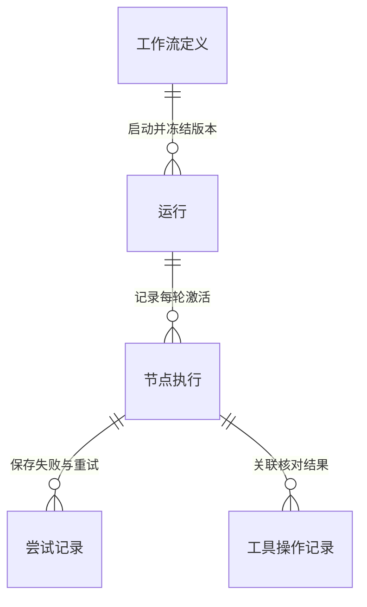
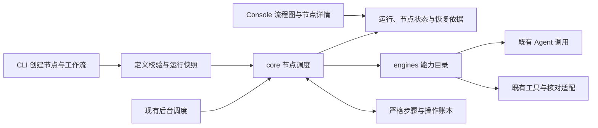
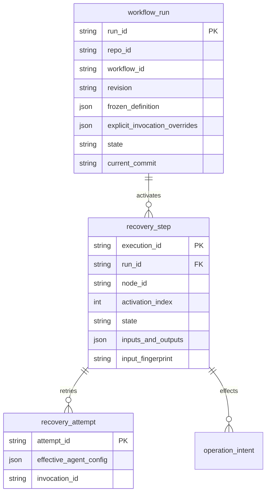

# PRD: CLI 可配置节点与可恢复工作流

- GitHub Issue: https://github.com/ZataZhang/keda/issues/458

> ⛔ **交付前置**需要先完成 `P1-FEAT-20261024-162357-agent-interruption-recovery`。节点执行复用其严格步骤记录与副作用账本，避免重复维护恢复事实。
> 本提示投影自 §8 Delivery Dependencies，该节为顺序声明的唯一事实源。

> ⬜ **验收状态**未开工。用户已明确要求通过 KC 实施，按交付依赖顺序推进。
> 本提示投影自 §9 Acceptance Checklist，该节为验收状态的唯一事实源。

Part A 供需求方审阅行为与选择。Part B 供执行器实施。§1 和 §2 的确认框属于用户，保持原状；2026-11-26 用户在会话中明确要求“帮我用kc 去做吧”，作为本次实施授权记录。节点与工作流以 CLI 创建和管理，用户已明确这一方向。本次按用户指令缩减范围，当前行为与验收聚焦节点编排、现有能力覆盖、监控和恢复。

## Feature Overview (功能一览)

本节投影自 §10 Functional Requirements。行为验收以 §1 样例和 §7.6 为准。

- **添加和复用节点**（FR-1、FR-2）为 Agent 配置预设、指令和输入，为工具选择代码能力和参数。已有类型添加实例即可复用。
- **组合多条工作流**（FR-3、FR-4）通过 CLI 复制模板、添加节点、修改连接与结果分支，页面读取同一份定义，现有全部节点纳入覆盖清单。
- **接续监控与等待**（FR-5）工具保存外部目标、观察游标和下次检查时间，释放 worker，重启后继续同一任务。
- **记住执行到哪里**（FR-6、FR-7）持久记录节点激活、尝试和工具操作。结果未知时先核对，配置版本与预算跨重启保留。
- **查看实际结果与依据**（FR-8、FR-9）展示运行状态、节点历史、有效 Agent 配置及成果版本，验证结论绑定具体代码提交。
- **沿用当前入口和默认语义**（FR-10）Console 与 CLI 使用同一份定义，旧配置映射到默认模板，现有验证与发布政策继续适用。

# Part A · 人审层 (Review Layer)

## 1. Introduction & Goals

### Problem Statement

当前生命周期设置支持给固定角色绑定 Agent 预设，页面中的节点和连接仍是固定定义。增加“安全评审”这样的步骤需要修改流程代码。工具中的检查、监控和人工等待也尚未统一表达为可配置、可接续的节点。新增业务步骤时反复改写固定管线，会提高实现与回归成本。

用户希望把一次已经接好的能力用于多个节点和工作流，并在断线或重启后知道每次工具操作是否执行、执行结果是什么。

### Interpretation (解读回显)

| 验证方式 | 输入 / 操作 | 期望观察到的结果 |
|---|---|---|
| 👀 人审 + 自动验证 | 通过 CLI 复制流程并添加安全评审节点，再运行现有节点覆盖场景，从页面查看保存的流程与实际执行轨迹。 | 新增节点的模型、输入与连接进入真实执行。覆盖清单中的九个 Agent 角色和工具、等待能力分别可调用，原模板与独立问答可继续使用。页面显示 CLI 创建的定义与记录。 |
| 👀 人审 + 自动验证 | 启动一个代码实现的监控工具节点，让它进入等待，再退出并重启 KC 调度。 | 节点沿用原运行、同一外部任务和已保存游标接续，按实际结果进入后续节点。等待预算和历史保留，页面显示等待与恢复依据。 |
| 🤖 自动验证 | 创建 PR 已在远端成功，本地确认前进程退出，两个恢复者尝试接续，同时有人保存了新的工作流版本。 | 恢复者先核对远端事实，复用原 PR。只有取得执行权的一方推进，原运行沿用原版本。无法确认的工具结果进入待核对状态并留下记录。 |

本轮按用户指令缩减范围。旧版已勾选确认记录保留在 §13，当前解读使用新的确认框。以上各行逐字映射到 §7.6 的行为与预期结果。修改表格中的行为单元格会同步改变验收标准。

#### 我默默定了这些

- 截图里的代码交付、讨论与内容生成都提供内置模板。独立问答继续使用已有预设入口。
- 节点可以有任意业务名称与稳定标识。同一种 Agent 或工具能力可在同一工作流中出现多次。
- 工作流结构使用运行启动时的定义版本。执行器设置沿用现有阶段读取规则，每次实际调用记录有效配置，已开始会话按既有恢复语义接续。
- 初始编排能力覆盖顺序、结果分支、有界返工循环和持久等待。执行器逐步调度可执行节点。
- “后台继续”依赖运行着的 KC 后台调度。调度停止期间任务保持待执行，重启后恢复，界面显示调度可用性。
- 本次按 P1 草案整理，尚未指定实施日期。

#### 我理解为不做

- 本次交付不扩展为跨机器分布式调度，节点恢复遵循既有认领范围。
- 本次交付不包含任意第三方系统的免适配接入，新增工具能力需注册其输入、输出与恢复规则。
- 并行汇聚、嵌套子工作流和公开节点市场留待有具体场景时设计。

本需求把节点、连接、输入输出与执行策略变成通过 CLI 管理的工作流定义。页面从定义与运行记录生成流程图和详情。工具节点可承载代码实现的检查、监控和等待。工具恢复需要可核对的外部事实与持久记录。默认模板复现现有行为，工具恢复和监控等待按已记录的状态接续，验收依据实际入口证据。

- [ ] 我确认这段解读与行为样例准确表达了我的需求。

### What The User Gets

通过 CLI 管理多条流程，添加节点、选择模型或工具、配置连接并保存。在已有生命周期设置入口查看定义与节点详情，启动任务时选择合适流程。工具进入等待或故障恢复时，可以看到保存的位置、已完成结果和接续依据。点开节点可以追踪每次尝试和恢复依据。

### Measurable Objectives

- 添加一个已注册类型的节点和一条新工作流，只需修改定义，无需修改执行器分支或固定角色清单。
- 内置流程与新增节点共用能力目录和调度器，真实轨迹与配置中的连接一致。
- §7.1a 中现有九个 Agent 角色及各工具和触发等待都有可调用的映射，监控等待跨重启继续。
- 节点成功或等待状态、输出和后续待办可靠保存，停止并重启后能从记录继续。
- 对具有可靠核对能力的创建 PR 操作，响应丢失与同机并发恢复场景最终复用一个 PR。
- UI 显示的每个验证结论都能对应到代码提交、验证约定和执行记录。

## 2. Human Review Map (介入与风险地图)

CLI 作为节点和工作流的主要创建入口，用户已明确确认。本轮保留一个与运行记录相关的确认点。

### 决策一 · 固定流程结构，并记录每次实际调用与执行结果

每次运行保存工作流结构版本、工具操作身份和等待位置。后来保存的新流程定义用于新运行。Agent 设置按既有阶段读取规则解析，每次实际调用记录其有效配置、来源与回退结果，已开始的会话按既有机制恢复。这样既能核对历史行为，也能继续使用运行中调整后续阶段执行器的能力。

**请确认**这种运行快照与逐次节点记录是否符合你对可恢复、可审计的要求？

- [ ] 确认流程结构按运行固定版本，执行器设置按既有阶段读取规则生效，节点激活、实际调用、工具操作和监控位置分别留痕。



**验收**保存新流程定义后恢复旧运行，沿用其流程结构并显示已完成结果与等待位置。在阶段之间调整执行器设置，后续阶段按原有规则读取，已发生的调用仍显示当时配置，未知工具结果有核对依据。

### 自动门禁，不需要逐项人工审阅

执行器负责配置合法性、输入输出检查、实际调用配置、版本快照、迁移、恢复竞争、未知结果核对、历史兼容与跨平台回归。独立 verifier 核对最终证据。

### 本次明确不涉及

本次范围边界见 §11。默认模板沿用已有验证、修复、发布与权限语义。

## 3. Usage And Impact After Implementation

- **流程配置者**通过 CLI 复制模板、添加或修改节点、配置连接和选择预设，校验后保存。页面用于查看定义、节点能力和运行历史。原始模板与自定义副本可分别选择。
- **任务发起者**从既有 Issue / PRD 启动入口选择流程，或使用 CLI 选择工作流。查看所选流程的节点执行进度、等待状态和恢复结果。
- **运行查看者与 PR 审阅者**从任务详情查看运行状态、当前提交与节点尝试，核对结果的来源和成果版本。
- **本机操作者**通过既有后台调度运行、停止和重启任务。调度不可用时看到持久等待及恢复方式，节点预算和尝试历史跨重启保留。
- **工具开发者与 CLI 集成者**按统一契约注册能力，声明输入输出、结果核对和重试语义。CLI 取得结构化运行状态、节点结果与恢复依据。

兼容策略为现有设置解析成默认模板的有效配置。旧记录继续按原结构查看。升级后发现旧运行缺少节点快照时，先沿既有恢复路径核对，再明确导入续跑点，保留导入依据。

### 兼容性边界

完整承接现有功能和默认行为是交付条件。节点化涉及实际执行编排，实施时需要通过原入口证明兼容。

| 现有使用方式 | 兼容要求 |
|---|---|
| 继续使用原命令与后台队列 | 按现有默认流程执行认领、实现、检查、验证、修复、发布与监督，各阶段的失败和人工接管语义有对应回归。 |
| 在页面编辑模型预设、阶段绑定、时限或回退 | 现有编辑入口继续可用。新工作流图与节点定义采用只读查看，原有设置的保存能力继续承接。 |
| 使用全局、仓库、个人、PRD 或单次运行覆盖 | 按既有优先级和继承规则解析，在后续阶段读取设置的时机沿用现有机制。 |
| 在运行期间调整后续阶段执行器 | 后续阶段按既有规则读取新设置，已开始调用与会话保留其实际执行配置和恢复依据。 |
| 升级后查看历史或恢复活动任务 | 旧配置和历史可读取，已有成果经核对后复用，迁移保留原始数据与执行身份。 |
| 通过脚本调用 CLI 或接口 | 既有参数、退出码和机器字段按原契约消费，扩展字段按兼容规则提供。 |


## 4. Requirement Shape

- actor 为流程配置者、任务发起者、运行查看者、PR 审阅者、本机操作者、工具开发者与 CLI 集成者。
- trigger 为 CLI 创建或修改工作流、选择工作流、启动任务、节点产生结果、监控等待到期、调度恢复和人工重试。
- expected behavior 为按持久定义执行节点、接续监控与等待、可核对地恢复工具调用以及可追溯的状态展示。
- explicit scope boundary 为本机 KC 管理的工作流与已注册能力，首批模板覆盖现有两条流程，独立问答按既有入口保留。

# Part B · 执行器层 (Build Layer)

## 5. Repository Context And Architecture Fit

### 已核实的现状与复用点

| 位置 | 当前职责与复用方式 |
|---|---|
| `frontend-public/components/agent-runner/lifecycle-workflow-graphs.tsx` | 固定 `delivery`、`discussion` 和节点连接，React Flow 已是依赖。改为读取工作流定义。 |
| `src/backend/core/shared/models/lifecycle_agent.py` | `LIFECYCLE_AGENT_KEYS` 是九角色闭集。保留旧配置映射，自定义节点身份脱离该闭集。 |
| `src/backend/core/use_cases/lifecycle_agent_resolution.py`、`core/shared/models/agent_runner_config.py` | 复用覆盖优先级与 `AppConfig.for_next_agent_stage()`，按阶段解析并记录每次实际调用的配置。 |
| `src/backend/core/use_cases/run_agent_once.py` | 复用 Agent 调用和会话恢复，按节点保存会话，保持独立校验会话边界。 |
| `src/backend/core/use_cases/agent_runner_publish.py`、`agent_runner_final_verification.py` | 复用 PR 创建与基于提交的结果复核，将默认交付政策移入模板依赖。 |
| `src/backend/core/shared/models/publish_stage.py` | 现有 NORMAL / FAST / DIRECT 分支。保留旧 CLI 语义，新工作流通过显式选择进入。 |
| `src/backend/infrastructure/persistence/console_store.py` | stdlib SQLite、WAL 和本机迁移。扩展严格运行存储，沿用现有 SQLite 迁移约定。 |
| `src/backend/core/use_cases/run_agent_daemon.py`、`agent_runner_reconcile.py` | 复用调度、认领与恢复，新运行的节点记录交由同一调度入口消费。 |
| `src/backend/api/routes/agent_runner_lifecycle_agents.py` | 已有 `/api/v1/agent-runner/lifecycle-settings` 聚合接口，新接口沿用同一 Console 服务边界。 |

### Frontend Impact

本需求是 full-stack。`frontend-public/` 使用 Next.js、React、Tailwind 与现有 React Flow。设置入口为 `/app/repositories/lifecycle`，任务详情沿用 Dashboard / Backlog 已有入口。复用 `ConsolePage`、`ConsoleSectionTabs`、Button 和 Card，提供流程、节点与运行状态的只读查看。 只读范围针对新增的工作流结构查看，已有模型预设、阶段绑定、时限和执行器回退编辑继续使用原组件与保存接口。

开发命令为 `pnpm --dir frontend-public dev`，类型检查为 `pnpm --dir frontend-public typecheck`，生产构建为 `pnpm --dir frontend-public build`。真实入口验证使用 `just e2e tests/workflows/configurable-workflows.spec.ts`。`frontend-admin/` 为冻结脚手架。

### Existing PRD Relationship

- **hard 前置**为 `P1-FEAT-20261024-162357-agent-interruption-recovery`。其中已定义 `RecoveryDecision`、`OperationIntent`、严格步骤记录与操作核对。本需求扩展其稳定节点身份，复用恢复事实和预算。
- `P2-FEAT-20261120-012205-cli-first-concept-workbench` 明确排除工程节点编排，可独立交付。
- `P1-FEAT-20261024-161425-cross-machine-presence-and-claim-lease` 为相关认领工作。本需求沿用实际落地的认领接口，保持单机范围。
- archive `P1-FEAT-20261009-133425-lifecycle-agent-model-settings`、`P2-FEAT-20261113-140659-repositories-lifecycle-settings-entry` 为预设与设置入口基线，实施前核对其已落地契约。

## 6. Recommendation

### Recommended Approach

在模块化单体内增加定义驱动的节点调度。core 持有节点、连接、结果和调度契约，engines 注册既有 Agent / 工具能力，infrastructure 负责配置文件与严格持久化，CLI 修改定义，API 与前端读取同一份定义和运行记录。

ROI 主要来自复用节点、降低新增步骤成本和避免崩溃后重做。成本集中在旧管线映射、工具输入输出盘点和持久运行迁移。现有两条流程、独立问答配置及工具监控等待构成实际变化轴，足以支持统一定义。独立调度服务和新外部队列没有本次需求依据。

### Proposed Solution Summary (实现机制)

用户或主 Agent 通过 CLI 提供节点、连接、输入来源、执行预算和结果去向，声明文件作为 CLI 的结构化输入。系统校验显式声明并生成只读运行快照。调度器根据前置结果激活节点，节点执行返回结构化输出和结果分支，完成事务同时写入后续待执行记录。节点化沿用现有发布与 PRD 准入语义。监控工具返回 waiting 时持久保存 checkpoint、恢复期限和下次检查时间。

内置模板随包提供 JSON 定义，仓库自定义定义拟保存到 `.kedacode/workflows/<workflow-id>.json`。`.kedacode.toml` 保存默认选择，运行时可显式覆盖。JSON 使用现有解析依赖，无需新增解释语言。文件路径限制在已授权仓库中，CLI 保存使用既有配置编辑方式和预期内容摘要，冲突返回明确的机器可读错误。

新建运行及节点记录扩展前置恢复需求使用的 SQLite 文件。工具操作身份、核对与严格事务共用一个账本，观测事件仍投影到现有历史。首批节点适配器覆盖 §7.1a 全部清单，复用现有实现、监督、检查、发布、讨论与生成行为。长期监控工具返回持久等待状态，保存外部目标与检查位置，再由调度接续。

### Alternatives Considered

- 为每种顺序增加旗标与分支。可以解决单一顺序，仍需修改代码新增节点，无法满足本需求。
- 仅让页面编辑图形。缺少定义到实际调度的消费链，无法满足执行与恢复要求。
- 引入独立工作流服务。会新增部署、存储和运维边界，当前本机调度与 SQLite 已覆盖已确认场景。

### Scope Cohesion

用户已明确 CLI 优先，页面按只读流程与节点详情规划。节点定义、持久激活、工具监控与恢复共用运行快照和事务边界，作为同一目标交付。额外业务流程另行记录。底层通用恢复已由独立前置 PRD 承担，本需求复用它。

## 7. Implementation Guide

本节是基于当前仓库分析的动态实现指南。实施中发现更多受影响文件、隐藏依赖、边界情况或更好路径时，先更新本 PRD 再继续。

### 7.1 Core Logic

1. **定义契约**使用 `schema_version`、`id`、`revision`、`trigger`、`nodes` 与 `edges`。节点实例含稳定 `id`、显示名称、`kind`、能力引用、参数、输入绑定和预算。工具能力可由版本化代码适配器实现，CLI 引用已注册能力来创建实例。未知类型、重复 ID、悬空连接、不可满足输入、无上限回路在 CLI 校验、保存与启动时返回明确定位。
2. **节点能力**提供描述、输入输出结构、执行方法与恢复语义。短任务返回终态，监控或等待返回 waiting、checkpoint、resume_after 与 deadline。Agent 节点配置预设和任务指令，复用现有命令构造、模型覆盖和会话逻辑。工具节点声明只读、可安全收敛或需对账，提供执行、查询结果和恢复策略。监控 checkpoint 保存外部 job/run ID、目标提交、观察游标、最后检查结果、下次检查时间和契约版本。正常等待与执行结果未知分别记录。重启从 checkpoint 继续查询。工具输出不可用时显式等待核对。任意命令缺少恢复能力时，未知结果走人工核对。
3. **数据和连接**支持字面量与显式上游输出引用，例如 `{"node":"implement","output":"commit_sha"}`。连接通过已声明结果名选择，结果必须匹配唯一适用分支。有界循环以新激活序号执行，重试沿用同一激活身份。暂不引入任意表达式求值。
4. **快照与身份**运行冻结流程定义、内容摘要和工具契约版本，保存调用方显式覆盖。Agent 设置沿用 `AppConfig.for_next_agent_stage()` 及当前解析优先级，在每次实际调用时记录所用 Agent、模型、指令与来源。已有会话恢复与 Agent fallback 继续由原机制决定，历史调用配置保持可追溯。每轮节点身份为 `run_id + node_id + activation_index`，尝试使用独立 `attempt_id`。操作业务身份遵循恢复账本，跨尝试保持稳定。新提交和新业务操作形成新激活或载荷修订。
5. **推进事务**完成节点和创建下一节点待办在同一严格事务中落盘。节点终态、输出和下一步待办保持一致，等待状态与 checkpoint 在释放 worker 前提交。若本地提交失败，保留待核对并重启对账。API、worker 及 CLI 的重复调用通过现有认领与本机 CAS 竞争。关键写失败停止后续动作。
6. **后台与等待**使用既有 daemon 拉取待执行节点。进入持久等待的节点可由后台继续领取，接续时沿用同一外部目标与观察位置。没有后台 worker 时显示 `pending` 和恢复入口。等待、退避及人工标记不占 Agent worker。停止、取消、人工接管优先于下一步调度，CLI 退出与显式取消分别处理。
7. **状态与失败分支**运行保存整体 `state`，节点分别记录成功、失败、等待或结果待核对。默认模板沿用已有失败策略，自定义流程按声明分支和预算推进，网络重试与模型修复预算分开。
8. **代码前提**节点成果保留版本，验证目标绑定 `commit_sha + tree + validation_contract_hash`。修复生成新提交后，以新提交执行下游验证。恢复时发现代码漂移则使受影响结果失效，从声明的相关节点继续。工作流版本固定不能成为复用过期结论的理由。
9. **旧入口映射**现有九角色配置继续消费现有解析优先级，供内置节点实例初始化。自定义节点按实例预设解析。默认模板复现当前真实顺序，包括未签核 Draft PR 的创建和后续签核顺序。现有 FAST / DIRECT 旗标和 PRD 准入保持其契约，新增 `--workflow` 与旧旁路旗标冲突时返回用法错误，不隐式转换。
10. **讨论流程**保留现有触发入口与人工标记边界，使用可配置讨论、等待、内容生成、产出工具节点。PRD 文件与 Issue 为输出引用，图中触发与产物使用独立样式表示，执行节点可配置。已有队列和去重能力继续复用。

### 7.1a 现有节点覆盖清单

覆盖依据为当前 `lifecycle-workflow-graphs.tsx`、九角色常量及其真实消费点。以下能力需要逐项映射，默认模板通过这些节点执行。把整条旧管线包成单一工具无法满足覆盖验收。

| 现有节点或能力 | 类型与目标映射 | 已有实现依据 |
|---|---|---|
| 实现、修复、收尾 | 三个独立 Agent 实例，保留实现者继承和作用域 | `run_agent_once.py`、`agent_runner_delivery_closeout.py` |
| 校验、审核、监督 | 三个独立 Agent 实例，保留独立会话、指定提交和监督动作 | `run_verifier_agent.py`、`agent_runner_supervisor.py`、`pr_supervisor.py` |
| 辩论、内容生成 | 两种 Agent 消费配置，保留人工标记与各生成目标 | `run_agent_deliberation.py`、`generated_content.py` |
| 独立问答 planner | 独立入口中的 Agent 节点配置，保留 `kc ask` 上下文 | `lifecycle_agent.py` 中 standalone 分组及其消费点 |
| 认领 Issue | 认领工具与执行前提，返回目标身份和执行权 | `agent_runner_claim_arbitration.py` 的 `arbitrate_first_claim` |
| 执行检查 | 检查工具，返回退出状态、产物和目标提交 | `agent_runner_validation.py` 的 `ensure_validation_commands_pass` 及仓库检查入口 |
| 交付门禁 | 交付条件检查工具，保留真实签核与检查清单语义 | `agent_runner_prd_delivery_gate.py` |
| push、创建或复用 Draft PR | 独立工具动作，使用同一副作用账本恢复 | `agent_runner_publish.py` 的 `push_changes`、`create_draft_pr` |
| 待讨论 Issue、人工标记后继续 | 触发与持久等待工具，保留标签和实际触发来源 | `agent_runner_deliberation_issues.py` 与当前讨论入口 |
| 从提示词创建 Issue、PRD 与 Issue 正文产出 | 创建工具和产物引用，分别记录外部创建与文件写入结果 | `generated_content.py` 和既有 Issue 创建入口 |
| 内容生成的四个消费目标 | 创建 Issue、提示词建 Issue、Issue→PRD、Draft PR 文案按实际配置分别调用 | `lifecycle_agent.py` 的 content_generation 触发声明 |
| CI / PR 值守、检查状态与持续监控 | 代码工具负责查询、checkpoint 与等待，Agent 负责分析和动作决策 | `agent_daemon_loops.py`、`pr_supervisor.py` 及其 checks 消费路径 |

图中的触发条件和产物端点保留可读表达，执行由相应工具节点承接。每个覆盖项需登记能力 ID、消费入口、输入输出、结果分支和恢复策略。实施盘点若发现更多受控步骤，应先补充本表及验证映射。不得省略旧能力后宣称完成覆盖。

监控节点通过代码适配器提供执行和接续能力，返回持久 `waiting` 时释放 worker。checkpoint 记录外部身份、目标提交、观察位置与下次检查时间。进程中断后的接续查询和创建新任务使用不同动作。外部动作结果未知时使用账本对账，正常等待继续使用已知目标查询。

### 7.2 拟新增接口与命令

以下为目标契约，当前尚未实现。使用现有 Console 权限、仓库解析与 `/api/v1` 挂载。

| 入口 | 契约 |
|---|---|
| `GET /api/v1/agent-runner/workflow-capabilities` | 返回已注册节点能力、配置结构与恢复语义。 |
| `GET /api/v1/agent-runner/workflows?repo_id=...` | 返回内置模板、仓库定义、revision 和来源。 |
| `GET /api/v1/agent-runner/workflow-runs/{run_id}` | 返回流程定义版本、运行与节点状态、每次实际调用配置、尝试和脱敏核对记录。 |
| `kc run --issue <N> --workflow <id>` | 在既有认领和 PRD 入口约束下选择工作流，向后兼容添加 JSON 字段。 |
| `kc workflow create <id> --from <template>` | 复制或新建工作流，返回稳定 ID 与 revision。 |
| `kc workflow capabilities --json` | 枚举已注册 Agent 和工具能力、输入输出结构、代码版本及恢复方式。 |
| `kc workflow apply --file <json-file> --expected-revision <revision>` | 原子应用完整定义，支持批量调整或移除节点与连接，明确报告版本冲突。 |
| `kc workflow node add <id> --spec <json-file>` | 从结构化节点定义新增实例，预设和代码能力通过已注册 ID 引用。 |
| `kc workflow node update <id> <node-id> --spec <json-file>` | 按预期 revision 更新配置，冲突显式报错。 |
| `kc workflow connect <id> --from <node> --on <result> --to <node>` | 添加结果连接，校验引用、唯一去向与循环预算。 |
| `kc workflow list`、`kc workflow show <id>`、`kc workflow validate <id>` | 枚举、读取与校验定义，支持 `--repo-id` 和 `--json`。 |
| `kc workflow resume --run <id>` | 显式接续原运行，继续核对未知操作和执行权，不能清空历史。 |

机器时间保持带偏移的 UTC，人读时间按本机或浏览器本地时区展示。执行器必须更新 CLI schema、随包 operator skill 与文档。实际退出码复用现有约定，不能把待验证作为完整成功。

### 7.3 Change Impact Tree

新增名称为提议，实施前按 §7.5 适配前置 PRD 落地契约。下列目录节点用于包含已有入口的实际调用点，新增文件逐个列出。

```text
.
├── Infrastructure
│   ├── src/backend/infrastructure/persistence/console_store.py [修改]
│   │   【总结】挂接工作流快照与激活状态迁移，复用严格恢复事务。
│   ├── src/backend/infrastructure/persistence/console_store_workflows.py [新增]
│   │   【总结】保存运行快照、节点状态、等待位置与推进记录，关联既有恢复步骤与操作。
│   └── src/backend/infrastructure/config/workflow_definitions.py [新增]
│       【总结】读取内置与仓库 JSON 定义，按摘要处理并发保存。
├── Domain
│   ├── src/backend/core/shared/models/workflow.py [新增]
│   │   【总结】定义节点实例、连接、输出引用和运行快照。
│   ├── src/backend/core/shared/interfaces/workflow.py [新增]
│   │   【总结】定义能力执行和严格存储端口，引用恢复账本契约。
│   ├── src/backend/core/use_cases/workflow_execution.py [新增]
│   │   【总结】按结果推进、有界循环、持久等待与接续调度节点。
│   ├── src/backend/core/use_cases/workflow_definitions.py [新增]
│   │   【总结】校验并保存定义，为 CLI 提供原子定义修改，并投影来源与版本。
│   ├── src/backend/core/use_cases/lifecycle_agent_resolution.py [修改]
│   │   【总结】复用预设规则，为自定义节点生成有效配置快照。
│   └── src/backend/core/use_cases/ [修改]
│       【总结】将现有执行、发布、讨论和内容生成调用点接入节点调度，保持默认行为。
├── Engines
│   ├── src/backend/engines/agent_runner/workflow_capabilities.py [新增]
│   │   【总结】注册已有 Agent、工具和等待能力，复用具体执行函数。
│   └── src/backend/engines/agent_runner/templates/workflows/ [新增]
│       【总结】随包提供当前两条流程的声明模板。
├── API
│   ├── src/backend/api/routes/agent_runner_workflows.py [新增]
│   │   【总结】提供能力目录、定义读取和运行详情接口。
│   ├── src/backend/api/app.py [修改]
│   │   【总结】在现有 Console 服务挂载工作流路由。
│   └── src/backend/api/cli_parsed_commands/ [修改]
│       【总结】接入工作流选择、校验、查询、恢复和机器输出契约。
├── Frontend
│   ├── frontend-public/components/agent-runner/lifecycle-settings-page.tsx [修改]
│   │   【总结】在现有设置入口提供模板与自定义工作流切换。
│   ├── frontend-public/components/agent-runner/lifecycle-workflow-graphs.tsx [修改]
│   │   【总结】从后端定义渲染节点与连接，支持选中和运行状态。
│   ├── frontend-public/components/agent-runner/workflow-node-detail.tsx [新增]
│   │   【总结】只读展示 CLI 定义、代码能力、等待位置与恢复契约。
│   ├── frontend-public/components/dashboard/workflow-run-detail.tsx [新增]
│   │   【总结】呈现运行与节点状态、等待位置、激活记录和待核对动作。
│   ├── frontend-public/lib/api/workflows.ts [新增]
│   │   【总结】访问工作流规范路径，复用 API 基址与错误处理。
│   └── frontend-public/lib/api/types.ts [修改]
│       【总结】同步节点配置、定义与运行状态类型。
├── Tests
│   ├── tests/test_workflow_execution.py [新增]
│   │   【总结】覆盖定义校验、输入绑定、循环和默认流程兼容。
│   ├── tests/test_workflow_recovery.py [新增]
│   │   【总结】覆盖推进事务、竞争恢复、未知结果核对和流程版本漂移。
│   └── tests/playwright-e2e/tests/workflows/configurable-workflows.spec.ts [新增]
│       【总结】CLI 创建后从真实页面读取完整流程、节点与监控恢复状态。
└── Docs
    ├── docs/guides/configurable-workflows.md [新增]
    │   【总结】说明定义结构、恢复契约、两种交付顺序和后台运行条件。
    ├── docs/guides/agent-runner.md [修改]
    │   【总结】补充工作流选择与旧发布档位的兼容边界。
    ├── src/backend/engines/agent_runner/templates/skills/kedacode-operator/SKILL.md [修改]
    │   【总结】同步新入口、节点状态与工具恢复约定。
    └── mkdocs.yml [修改]
        【总结】登记工作流指南和目标原型入口。
```

### 7.4 Risk Classification Register 与结构

| change point | tier | decisive dimension/override | intervention | oracle/gate |
|---|---|---|---|---|
| 定义、CLI 定义、页面呈现和实际节点消费 | R2 | 跨 UI、契约与编排，core 固定区 | CLI 方向已明确，执行器验证全节点映射 | rv-1 |
| 监控等待、检查位置与持久调度 | R2 | 持久化事务与跨进程接续正确性 | 执行器验证等待与接续 | rv-2 |
| 工具未知结果、并发与版本恢复 | R3 | 并发、幂等与外部写入 | 复用用户已明确的恢复要求，执行器证明 | rv-3 |





图中 `recovery_step`、`recovery_attempt`、`operation_intent` 是关系语义，实际表名以恢复前置 PRD 落地为准。新增节点属性扩展其既有记录，唯一约束覆盖运行、节点和激活序号。SQLite 就地迁移验证旧库读取、升级幂等与回滚前提。旧版本无法理解活跃工作流快照时，降级前先暂停运行并备份，保留可恢复记录。

### 7.5 Executor Drift Guard

实施前执行以下搜索，补全实际注册、schema、模板打包与状态读取位置。禁止依赖本文行号。

```bash
rg -n 'LIFECYCLE_AGENT_KEYS|PublishStage|direct-pr|fast-merge' src/backend frontend-public
rg -n 'OperationIntent|RecoveryDecision|recovery_step|operation_intent' src/backend tasks/pending tasks/archive
rg -n 'lifecycle-settings|workflow|agent_runner_reconcile' src/backend/api src/backend/core frontend-public/lib
rg -n 'package-data|templates|schema' pyproject.toml src/backend/api
```

核对现有正常模板的真实行为，包括“Draft PR 已创建但 verifier 尚未结束”。核对 `.kedacode.local.toml` 的个人覆盖以及 CLI / PRD 层覆盖，运行快照应记录来源。合并前置恢复工作后修订本文模型与影响树，禁止补一套平行账本。修改 CLI 前重读平台支持与随包 skill 同步规则，使用跨平台文件与进程 API。

### 7.6 Realistic Validation Plan

以下命令从仓库根目录执行。目标 spec / harness 在实施时创建，当前不声称存在。RV 隔离脚本全部位于 `tasks/evidence/P1-FEAT-20261126-214529-configurable-durable-workflows/scripts/`，不进入代码 diff。测试侧 Agent fixture 可固定一次失败和修复，产品路由、调度、SQLite、Git 与进程恢复必须真实。UI API 不得被最终状态 fixture 替换。

```yaml
- id: rv-1
  behavior: 通过 CLI 复制流程并添加安全评审节点，再运行现有节点覆盖场景，从页面查看保存的流程与实际执行轨迹。
  reviewer: human
  real_entry: "just e2e tests/workflows/configurable-workflows.spec.ts --grep 'CLI定义与呈现'"
  expected: 新增节点的模型、输入与连接进入真实执行。覆盖清单中的九个 Agent 角色和工具、等待能力分别可调用，原模板与独立问答可继续使用。页面显示 CLI 创建的定义与记录。
  mock_boundary: "仅 Agent CLI 和外部 GitHub 传输使用测试侧替身。使用能力清单逐项场景覆盖原有九角色及工具、人工等待与监督消费点。实际命令构造、解析和调度真实。"
  tier: R2
  test_layer: e2e
  required_for_acceptance: true
  presentation: "tasks/evidence/P1-FEAT-20261126-214529-configurable-durable-workflows/rv-1-overview.png 与 rv-1-run.png，配对目标原型同视口图。检查安全评审的实际预设、上游输入和执行轨迹。"
  critical_value_source: "从真实 CLI JSON 读取 workflow_id、revision 和 run_id，再从页面原样提取运行链接用于下一步。"
  must_cross: "真实 CLI 创建和修改 -> core 校验 -> 原子文件保存 -> 新进程节点消费 -> 真实页面读取 /api/v1/agent-runner/workflows 与运行详情。"
  forbidden_bypasses: "禁止直接写图 props、重构运行 URL、用固定九角色代替新增节点或让测试直接写运行终态。断言请求不存在 /api/api/v1 重复前缀。"
  fresh_state_probe: "新浏览器上下文读取 CLI 保存的工作流，新进程查询实际调用。覆盖清单每项都需执行证据或明确触发等待证据，全部默认模板跑既有回归。 同时走原有模型设置保存入口，在两个阶段之间修改预设，断言后续阶段按现有刷新规则执行，历史调用继续显示实际配置。"
  final_tree_evidence: "记录最终 Git tree 与工作区 diff、配置摘要和节点版本。变更 CLI、保存、解析、调度后重采。"
  negative_control: "not needed — 变更前入口和自定义节点消费不存在，先运行目标用例保存红灯记录。"
- id: rv-2
  behavior: 启动一个代码实现的监控工具节点，让它进入等待，再退出并重启 KC 调度。
  reviewer: human
  real_entry: "just e2e tests/workflows/configurable-workflows.spec.ts --grep '监控接续'"
  expected: 节点沿用原运行、同一外部任务和已保存游标接续，按实际结果进入后续节点。等待预算和历史保留，页面显示等待与恢复依据。
  mock_boundary: "真实 CLI、Console、Git、SQLite、调度进程及检查命令。仅外部监控服务使用测试侧持久假服务，返回同一任务的处理中和完成状态。"
  tier: R2
  test_layer: e2e
  required_for_acceptance: true
  presentation: "tasks/evidence/P1-FEAT-20261126-214529-configurable-durable-workflows/rv-2-waiting.png、rv-2-resumed.png 和独立 demo.webm。核对同一外部任务、游标、等待预算和接续轨迹。"
  critical_value_source: "从真实工具响应、CLI JSON 和页面读取 run_id、外部任务 ID、checkpoint 与运行链接，保持原样用于后续观察。"
  must_cross: "真实 CLI 启动 -> 代码工具查询 -> 严格 checkpoint 提交 -> worker 释放 -> 进程退出 -> 新 daemon 领取 -> 同一目标查询 -> 后续节点激活 -> 状态 API 和页面。"
  forbidden_bypasses: "禁止重启后重新创建外部任务或清空游标、预算，禁止页面驱动后台推进，禁止在 src 中新增测试用断点开关。"
  fresh_state_probe: "关闭原 writer 连接，用新进程读取等待位置并重启 daemon。第三个消费者读取运行状态、外部任务身份与完整尝试历史。"
  final_tree_evidence: "记录最终生产 tree、配置摘要和外部任务请求序列。等待事务、调度或状态投影变化后重采。"
  negative_control: "测试侧存储替身拒绝 checkpoint 提交，断言节点不能被报告为已可靠等待或继续下游。"
  expected_fail: "若未落盘就报告等待成功、重启后换了外部目标或清空游标，场景断言变红。"
- id: rv-3
  behavior: 创建 PR 已在远端成功，本地确认前进程退出，两个恢复者尝试接续，同时有人保存了新的工作流版本。
  reviewer: verifier
  real_entry: "uv run python tasks/evidence/P1-FEAT-20261126-214529-configurable-durable-workflows/scripts/recover_workflow.py"
  expected: 恢复者先核对远端事实，复用原 PR。只有取得执行权的一方推进，原运行沿用原版本。无法确认的工具结果进入待核对状态并留下记录。
  mock_boundary: "测试侧持久 GitHub HTTP 服务在提交后丢响应，普通 tool fixture 演示无法核对的操作。真实 CLI、调度、Git、SQLite 和两个独立恢复进程。"
  tier: R3
  test_layer: integration
  required_for_acceptance: true
  critical_value_source: "真实 CLI 输出的 run_id、假服务收到的实际操作键以及实际保存的 revision。"
  must_cross: "真实工具适配 -> 严格意图记录 -> 外部服务提交 -> 丢响应/退出 -> 两个 CLI 恢复进程 -> 执行权竞争 -> 查询核对 -> SQLite 提交 -> 新读取。"
  forbidden_bypasses: "禁止直接调用恢复 helper 代替 CLI，禁止仅用 open PR 查询证明未执行，禁止清空意图记录或把新配置覆盖原运行。"
  fresh_state_probe: "第三个独立进程读取 API/CLI 状态，假服务独立枚举所有状态 PR 并检查操作次数。新旧 workflow revision 分别核对。"
  final_tree_evidence: "保存最终生产 tree、两个进程输出与假服务请求序列。修改执行权、核对、SQLite 或快照后重采。"
  negative_control: "在 tests 侧替换核对适配器为错误实现，恢复时盲目再次创建。运行同一 harness，要求远端对象数断言变红。"
  expected_fail: "错误恢复产生第二个对象或双执行，唯一性断言失败，证明正例实际经过创建与恢复。"
```

三个完整证据链对应同一套定义到执行的生命周期，已按 §6 做范围评估。额外覆盖默认顺序兼容、坏定义、取消、调度离线、修复上限、代码漂移、个人预设覆盖、SQLite 旧库升级以及幂等重启，分别归入上述场景与 targeted tests，避免新增重复事实源。

#### 现有功能兼容回归

将默认模板的真实轨迹、配置解析、失败分支、PRD 准入、发布与恢复结果，与改动前基线比较，归入 rv-1 / rv-3 证据。复用现有测试，新增用例仅覆盖现有测试无法判别的具体迁移回归。

```bash
uv run pytest tests/test_lifecycle_agent_resolution.py tests/test_lifecycle_agent_routing.py tests/test_lifecycle_settings_local_override.py tests/test_run_verifier_agent.py tests/test_agent_runner_publish.py tests/test_agent_runner_direct_pr.py tests/test_agent_runner_recovery.py tests/test_generated_content.py tests/test_run_agent_deliberation.py -q --no-testmon
just e2e tests/workflows/lifecycle-settings.spec.ts
just e2e tests/workflows/lifecycle-agent-matrix.spec.ts
```

这些是实施期兼容验证命令。原有 UI 保存、阶段刷新、机器输出和活动任务恢复都需取得判别性证据，不能用新节点演示替代。普通任务按原默认入口执行，新定义选择通过显式入口消费。

失败排查先检查定义 revision、节点输入摘要和执行权，再看严格事务与工具查询。外部故障与业务检查失败分别记录。无凭据时可完成带明确替身边界的真实产品入口验证，不能称为 GitHub live integration。真实 GitHub 与模型试跑仅在 `KC_WORKFLOW_LIVE=1` 且提供测试仓库与凭据时 opt-in，记录实际结果，模型结果不要求固定失败次数。

### 7.7 Low-Fidelity Prototype 与原型变更

目标入口为 `docs/prototypes/configurable-workflows/index.html`，说明见同目录 `prototype.md`，通过现有 Hub 登记。原型直接基于实际生命周期设置页采集的 AppShell、AppSidebar、字体、构建 CSS、范围条、页签和矩阵卡片。初始图使用真实页面 React Flow DOM，新内容放在矩阵内部，详情沿用右侧 Sheet 外观。验证层级为 `interactive prototype / component preview`，数据全部示意。

验收关键配对状态为完整节点映射与只读详情、工具结果待核对、监控等待。实施期应在相同桌面视口与窄视口保存真实入口截图，并与目标原型图并排呈递。通过 CLI 添加节点后，页面重新读取即可显示新的定义。保留现有侧栏、仓库导航与生命周期设置结构，原型背景采用采集时的全局范围。监控节点详情应展示目标、检查位置与下次调度依据。 原型对背景控件的禁用仅用于演示，生产实现继续提供既有阶段绑定、模型预设、时限和回退设置的编辑与保存。既有角色的配置入口及其 Sheet 需要通过原有页面回归验证。

| File Path | Change Type | Before | After | Why |
|---|---|---|---|---|
| `docs/prototypes/configurable-workflows/index.html` | Add | 无目标原型 | 完整节点只读展示与监控恢复目标画面 | 便于确认产品含义 |
| `docs/prototypes/configurable-workflows/prototype.js` | Add | 无状态演示 | 在实际页面框架中展示完整初始图、节点抽屉及监控状态 | 演示交互边界 |
| `docs/prototypes/configurable-workflows/page-shell.js` | Add | 无实际页面装配 | 加载共享真实外壳与生命周期框架 | 与当前页面对照 |
| `docs/prototypes/assets/console-page-shell.html` | Add | 无共享真实外壳 | 保存实际 AppShell 与 AppSidebar 渲染结果 | 统一外壳来源 |
| `docs/prototypes/configurable-workflows/prototype.md` | Add | 无说明 | 状态、入口、限制与来源 | 标明原型验证层级 |
| `docs/prototypes/configurable-workflows/assets/` | Add | 无目标截图 | 浏览器截图及来源旁车 | 对照实施结果 |
| `docs/prototypes/assets/prototype-hub.js` | Modify | 未登记此原型 | 单一 registry 增加入口与来源 | 保持可发现性 |
| `mkdocs.yml` | Modify | 无原型导航 | 链接目标原型说明 | 文档可发现 |

No external validation required; repository evidence was sufficient. 本草案不依赖新增第三方框架行为。

## 8. Delivery Dependencies

### Delivery Dependencies

- Depends on tasks/issues:
  - P1-FEAT-20261024-162357-agent-interruption-recovery
- Gate type: hard
- Sequence: via-main
- Notes: 先落地统一恢复步骤、严格存储和操作账本，再实现工作流激活、监控等待与接续。设计与原型评审可以提前完成。

## 9. Acceptance Checklist

### 9.1 人读呈递区（Human Review Surface）

主演示脚本在实施期单独录制，以下四步每步显示说明并停留可读。受控 Agent 或外部假服务的画面标注 `mock，未验证`，同时说明产品 CLI、API、调度与存储的真实边界。

1. 从真实 CLI 复制流程，添加安全评审节点并设置输入和预设。此步需要真实 CLI 与定义持久化。
2. 用 CLI 修改连接，再从真实设置页打开，查看完整原有节点和新增节点的定义与实际调用。此步需要真实前端和读取 API。
3. 启动代码实现的监控工具，让它保存外部任务、游标和等待预算，页面显示等待。外部状态使用明确标注的假服务或 opt-in 真实依赖。
4. 退出并重启调度，查看同一任务从原位置继续，后续节点按实际结果激活。此步需要真实进程和持久化。

| 人要看的结果 | 实施后呈递入口 | 十秒自查 |
|---|---|---|
| CLI 创建节点，页面显示同一份定义与实际执行 | `tasks/evidence/P1-FEAT-20261126-214529-configurable-durable-workflows/rv-1-overview.png` 与 `rv-1-run.png`，交付时填入相对嵌图并提供 `open` 命令 | 对照安全评审节点的预设、输入和真实轨迹 |
| 监控等待跨重启接续 | 同目录 `demo.webm`、`rv-2-waiting.png`、`rv-2-resumed.png`，交付时嵌图并提供可打开入口 | 对照外部任务、游标、预算和接续记录 |

迁移、并发和工具唯一性由 rv-3 与 verifier 审查，常规构建日志折叠呈递。当前原型的相关节点与监控画面用于目标对照，完整节点能力与真实 CLI / 后台执行的证据在实施时采集。

### 9.2 Acceptance Evidence Package

#### Human-Confirmed

- [ ] 确认 §2 的固定版本与持久执行记录能说明运行采用的配置、每次尝试、等待位置和恢复依据，查看 rv-2 / rv-3 的对应证据。
- [ ] 看过 §9.1 主演示和真实画面，列出差异或确认接受。

#### Behavior Acceptance

- [ ] rv-2 证明监控等待已持久保存，由新进程沿用同一任务、游标与预算接续，证据写入对应报告。
- [ ] rv-3 证明未知结果先核对、并发恢复复用原 PR、版本固定和无法核对时等待，附进程与外部对象断言。
- [ ] rv-1 证明自定义 Agent / 工具节点在实际轨迹中被消费，默认模板与旧配置回归通过。
- [ ] §3 兼容性边界逐项有原入口证据，包括既有设置保存、覆盖优先级、阶段刷新、CLI 契约、默认失败分支、发布准入和历史／活动任务恢复。

#### Architecture Acceptance

- [ ] `uv run python hooks/shared/check_architecture.py` 通过，恢复操作账本仅使用前置需求落地接口，附复用位置清单。
- [ ] 本机 SQLite 旧库升级、重复迁移和活跃运行的降级限制有定向证据，未伪造历史节点完成记录。

#### Frontend Acceptance

- [ ] CLI 修改后从真实页面完成重开、节点查看和状态查询，实际请求路径断言通过，关键状态桌面与窄屏截图可读。
- [ ] 原型与实施截图按同状态、视口、主题配对，明确 prototype 与 real user flow 验证层级。

#### Documentation Acceptance

- [ ] CLI schema、随包 operator skill、工作流指南、旧发布档位说明与导航同步，命令示例匹配实际命令树。
- [ ] `uv run mkdocs build --strict` 与 `uv run python hooks/shared/check_guidelines_consistency.py` 通过。

#### Validation Acceptance

- [ ] 先完成 lint 入口，再运行 `just test` 并记录实际用例数，补跑 `uv run pytest tests/test_workflow_execution.py tests/test_workflow_recovery.py -q --no-testmon`。
- [ ] `just e2e tests/workflows/configurable-workflows.spec.ts` 从真实页面完成 CLI 定义读取和监控接续的 rv-1 / rv-2，明确外部 fixture 边界。
- [ ] 独立 verifier 对最终代码树、三个 oracle 和证据来源给出有效 PASS，附 verifier report。

#### Delivery Readiness

- [ ] 三份证据报告、实际产物入口与 Final Reconciliation 完整，§9.1 的画面和录屏在最终交付消息中呈递。
- [ ] 如授权创建 PR，将 §9.1 内容与验证 tree 发表到该 PR。PR 创建授权、发布与合并授权分别遵循用户指令。

## 10. Functional Requirements

- **FR-1**: 系统提供节点能力目录、稳定类型与输入输出结构，支持任意稳定实例 ID，同类型可重复实例化。§7.1a 现有能力全部逐项映射。扩展工具代码实现注册后可供所有工作流选择。
- **FR-2**: Agent 节点配置预设、模型覆盖、指令和输入来源，工具节点配置已注册能力、参数与预算。每次实际调用保存有效值，错误绑定明确反馈。
- **FR-3**: 工作流定义包含节点、连接、结果分支、等待与有界循环，可复制模板并保存多条定义。未知能力、坏引用与不可终止循环在启动前可定位地拒绝。
- **FR-4**: CLI 提供节点和工作流的创建、复制、修改、连接、校验及查询，支持结构化输入和 JSON 输出。页面从真实读取接口显示定义、版本、节点代码能力与运行状态。
- **FR-5**: 代码实现的监控工具可返回持久等待状态，保存外部任务、目标提交、观察游标和下次检查时间，释放 worker，并由后台调度接续同一任务。
- **FR-6**: 节点激活、尝试、输入输出和工具操作可追溯，执行权与推进事务复用严格恢复机制。监控等待保存外部目标、游标和下次检查时间，重启继续查询。未知结果先核对，无法确认进入待处理。
- **FR-7**: 运行固定流程定义，执行器设置按既有阶段读取规则生效，每次实际调用记录有效配置与来源。重试沿同一操作身份，循环或新成果形成新激活。预算、取消与恢复跨重启保留。
- **FR-8**: 页面展示整体运行与节点状态，提供节点定义、有效 Agent 配置、会话、成果版本、等待位置、操作核对和尝试历史。
- **FR-9**: 验证结论绑定代码提交和验证约定，失败走声明分支。失败分支与预算由工作流声明，默认模板沿用已有策略，预算耗尽后留下可行动的报告。
- **FR-10**: 默认模板完整承接现有功能与默认执行语义。原有命令、退出码、机器字段、模型设置编辑、覆盖优先级、阶段设置刷新、验证发布准入、历史读取和活动任务恢复均纳入兼容验收。新选择入口、机器输出、文档与随包 skill 同步，覆盖已支持平台。

## 11. Non-Goals

“先交付后验证”已单独记入想法收件箱，见 [待处理想法](../inbox/ideas.md)。本 PRD 的目标原型与验收清单仅覆盖节点定义、现有能力、监控与恢复，相关流程探索画面不构成实施要求。

范围边界包括跨机器任务分布、并行汇聚与嵌套子工作流、节点市场，以及未声明的合并或部署目标。工具适配契约覆盖 KC 控制的调用，Agent 内部任意 shell 操作的逐条审计需要独立能力。自行终止调度进程后，任务保持持久等待。

## 12. Risks And Follow-Ups

- 前置恢复 PRD 尚未实现，其实际接口可能与本文语义名称不同。开工前按 §7.5 对齐并更新影响树。
- 旧管线的细节分散在发布、监督、讨论与生成入口。必须以真实调用顺序构造内置模板，并执行现有回归后切换消费点。
- 外部工具无法与本地 SQLite 形成原子事务。结果未知时依赖对账能力，不能可靠确认的操作需要明确待处理记录。
- 未来出现明确的并行或跨机需求时再评估调度模型，不预设该扩展已被本方案验证。

## 13. Decision Log

| ID | Decision | Chosen | Rejected | Rationale | Status |
|---|---|---|---|---|---|
| D-01 | 如何表达新流程 | 单体内定义驱动的节点调度 | 每种顺序增加专用发布旗标 | 自定义节点与多个流程需要共享能力和连接定义 | 用户已确认方向，细节待审 |
| D-02 | 恢复事实归属 | 复用前置恢复 PRD 的严格账本 | 再建一套工具幂等记录 | 同一工具操作需要一个可核对的状态来源 | 评审草案推荐 |
| D-03 | 创建和管理入口 | CLI 创建节点与流程，页面只读呈现 | 页面节点编辑器 | 用户明确主要通过 CLI 创建，优先覆盖现有全部能力与代码监控节点 | 用户已在后续讨论确认 |
| D-04 | 本次业务范围 | 节点编排、现有能力覆盖、监控与恢复 | 原草案附加的交付顺序场景 | 用户要求附加场景只保存到想法收件箱 | 用户已明确缩减 |
| D-05 | 失败策略来源 | 各工作流声明与现有默认策略 | 统一新增固定修复预算 | 节点化覆盖既有策略，额外场景的默认值留待后续讨论 | 范围收敛 |
| D-06 | 存储与运行设施 | JSON 定义、本机 SQLite 与现有 daemon | 独立工作流服务和外部队列 | 已有本机入口和持久化能承接本次场景 | 评审草案推荐 |
| D-07 | 执行器设置何时生效 | 沿用阶段读取规则，并记录每次实际调用配置 | 运行启动时冻结全部阶段的 Agent 设置 | 既有配置支持在下一阶段读取更新，流程版本固定与调用记录需要分别保存 | 根据兼容性要求修正 |

### 历史解读确认

以下勾选保留用户对本次范围缩减前草案的确认。当前解读确认位于 §1。

- [x] 我确认这段解读与行为样例准确表达了我的需求。

### Final Reconciliation

- Status: 尚未实施，等待 §1 / §2 的需求确认及 §8 前置落地。
- Narrative corrections: 实施收尾按真实消费链、兼容行为、节点状态和验证证据回填。
- Evidence: 本次仅提供评审 PRD 与 component preview 原型，生产 oracle 尚未执行。
- Validation blocker: 尚未进入实施验证阶段。
- Validation follow-up: 开工后按 §7.6 建立隔离场景并采集最终树证据。

## Change Log

### 2026-11-26 初始评审草案

- Type: scope
- Before: 讨论固定生命周期节点的配置、扩展与交付顺序。
- After: 整理节点定义驱动的工作流、交付里程碑、后台验证与恢复契约。
- Reason: 用户要求讨论形成可审阅 PRD，并集中提出待拍板问题。
- Impact: 新增评审文档和目标原型，实施范围等待用户选择，复用恢复前置需求。
- Review: 初始草案提出页面编辑范围、交付点和失败策略三个问题。CLI 优先已在后续讨论确认，附加业务场景在最新修订中移入想法收件箱。

### 2026-11-26 按 CLI 优先与完整节点覆盖修订

- Type: scope
- Before: 默认推荐页面添加节点与连接编辑，原型仅展示部分示例。
- After: CLI 创建管理节点与工作流，页面只读展示。增加现有九角色、工具、等待与监控的完整覆盖清单及 checkpoint 语义。
- Reason: 用户明确节点主要通过 CLI 创建，工具节点可能包含监控代码，并要求覆盖现有全部节点。
- Impact: 移除页面编辑器范围，调整命令、前端、验证与原型。监控能力需要真实接续证据。
- Review: CLI 方向按用户说明确认，附加业务场景的选择已随最新范围缩减移出。

### 2026-11-26 以实际 Console 页面重绘原型

- Type: doc
- Before: 独立内容区画布和常驻节点详情。
- After: 复用当前实际生命周期设置页的外壳、导航、范围、页签、字体和初始流程图，节点详情采用右侧抽屉。
- Reason: 用户要求原型基于当前实际页面绘制。
- Impact: 原型共享资源和全部目标截图重新采集，CLI 优先与节点覆盖要求继续成立。
- Review: 按用户本次说明修订，生产执行能力仍待实施验证。

### 2026-11-26 缩减为节点与工作流基础能力

- Type: scope
- Before: 节点化需求同时包含先交付后验证模板、专属状态与默认失败策略。
- After: 当前交付聚焦 CLI 节点编排、现有能力覆盖、监控、恢复和审计。附加业务场景仅保存在想法收件箱。
- Reason: 用户明确要求将该场景从本 PRD 移出，暂时只记录想法。
- Impact: 移除专属模板、字段、待选项与验收要求，监控接续替换原来的第二个行为样例和 oracle，已有用户确认记录保留。
- Review: 本轮范围缩减依据用户指令，当前解读使用新的确认框，原确认保留在历史记录。

### 2026-11-26 明确现有功能兼容边界

- Type: scope
- Before: 兼容要求较概括，运行快照表述同时冻结了全部 Agent 配置，页面只读范围也存在歧义。
- After: 补齐原命令、默认流程、设置编辑、覆盖优先级、阶段刷新、历史与活动任务的兼容要求。流程结构按运行固定，每次实际调用单独记录配置。
- Reason: 用户要求确认节点化后的现有功能兼容性，当前 `AppConfig.for_next_agent_stage()` 已提供下一阶段读取最新执行器设置的能力。
- Impact: 修正快照模型和前端范围，兼容回归纳入 rv-1 / rv-3 与验收清单，复用既有测试。
- Review: 当前仍为 PRD 设计，实施后以真实入口和回归证据证明兼容。

### 2026-11-26 通过 KC 进入实施

- Type: status
- Before: 当前范围等待执行安排。
- After: 按用户明确指令，通过 KC 创建任务，先实施 §8 声明的恢复账本前置，再推进本 PRD。
- Reason: 用户要求“帮我用kc 去做吧”。
- Impact: 发布 PRD 与配套原型，保留既有验证与发布门禁，不包含先交付后验证场景。
- Review: 会话指令作为实施授权记录，人工拥有的确认框与验收项保持原状。
