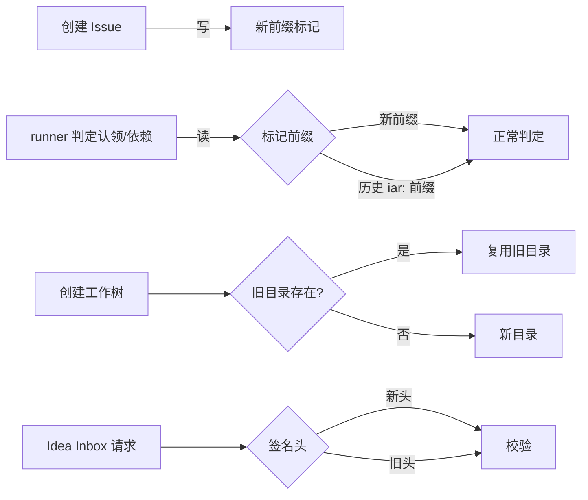

# PRD: 清除残留 IAR 命名 —— 协议标记、工作树目录与代码标识符统一到 kc

> ✅ **交付前置**：无，可立即开工。
> 结构化声明见 §8 Delivery Dependencies，**那里是唯一事实源**。

> ⬜ **验收状态**：未开工。
> 本行是 §9 Acceptance Checklist 的投影，**那里是唯一事实源**。

> 本 PRD 分两个 altitude，自上而下阅读：
> - **Part A · 人审层 (Review Layer)** — 需求方 / 验收人读这部分，决定"该不该做、做得对不对"，并通过风险地图知道**哪些地方必须亲自确认**。Part A 不出现实现机制、文件路径、命令。
> - **Part B · 执行器层 (Build Layer)** — 执行器读这部分做实现、跑验证、收集证据。

## Feature Overview (功能一览)

> 本节是 §10 Functional Requirements 的**平实语言投影**，不是第二事实源；行为验收以 §1 的行为样例表为准。

- **写入的协作标记换成新前缀**（FR-1、FR-2）：新写出的 Issue / PR 标记与 Agent 执行标记不再带 `iar`，但历史标记继续被正确识别。
- **外部签名头新名生效、旧名继续可收**（FR-3）：GitHub Webhook 发送方可以在自己方便的时候切换。
- **工作树与仓库内状态目录改用新名**（FR-4、FR-5）：新仓库看到的是新目录名，已有目录原样继续用、不搬家。
- **代码里的旧名标识符清零**（FR-6）：异常类、解析函数、常量名与模块导出不再让人误以为存在另一套运行时。
- **证据分支与文档同步换名**（FR-7、FR-8）：新证据分支用新前缀，文档与路线图不再出现旧命令示例。
- **回潮被机械挡住**（FR-9）：白名单之外再出现旧名会让守卫测试失败，而不是靠人记得。
- **不动的部分**（§11）：历史 Issue / PR 正文、已有远程证据分支、已有工作树目录、包名与仓库名维持原样。

# Part A · 人审层 (Review Layer)

## 1. Introduction & Goals

### Problem Statement

产品已经改名为 KedaCode、命令是 `kc`，"把 iar 都移除"的改动（提交 `refactor(cli): remove IAR runtime compatibility`）也已经落地：`iar` 命令别名没了，`IAR_*` 环境变量兼容层没了。但改名的收尾没有走完，残留集中在三处，用户仍然能在日常路径上撞见旧名：

- 新建 Issue 时，正文末尾会写上一行 `<!-- iar:depends-on #292 -->`。这是当下最容易看见的一处：任何人打开刚创建的 Issue 都能看到 `iar`，并合理怀疑"说好的改名到底做完了没有"。
- 工作树目录仍叫 `.iar-worktrees/`，仓库内状态目录默认值仍是 `.iar/state`，证据分支仍叫 `iar-evidence/<issue>`。
- 代码里仍有 `IARRepositoryNotInitializedError`、`require_iar_repository_initialized`、`parse_iar_exec_markers`、`<<IAR_EXEC>>`、`IAR_GITIGNORE_SECTIONS` 这类标识符，以及约 30 种 `iar:` 标记常量分散在 `core/use_cases` 的十几个模块里。

已经归档的改名 PRD（`tasks/archive/P1-REFACTOR-20261007-013512-rename-product-surface-to-single-new-name.md`）当初把标记与目录列为"永久保留"，理由是跨版本协议。但后续的兼容层移除已经单方面放弃了新旧混跑，这条理由不再成立：现在既没有 `iar` 命令，也不读 `IAR_*`，旧版本 runner 与当前版本本来就不能协同工作。保留旧前缀只剩成本，没有收益。

### Interpretation (解读回显)

| 验证方式 | 输入 / 操作 | 期望观察到的结果 |
|---|---|---|
| 🤖 自动验证 | 用 `kc issue create` 创建一个带依赖的 Issue，然后读取正文 | 正文里出现新前缀的依赖标记，不出现新写入的 `iar:` 标记 |
| 🤖 自动验证 | 打开一个历史 Issue（例如正文含 `<!-- iar:claim -->` 的旧 Issue），让 runner 判定认领状态 | 仍被识别为"已被占用"，不重复认领 |
| 🤖 自动验证 | 在一个已有 `.iar-worktrees/` 目录的仓库执行工作树创建 | 复用旧目录，不新建平行目录、不搬动已有工作树 |
| 👀 人审 + 自动验证 | 在一个干净仓库执行工作树创建并查看仓库根目录 | 出现新名工作树目录，目录里是该 Issue 的工作树，git 状态正常 |
| 🤖 自动验证 | 向 Idea Inbox 接口发送请求，分别只带旧签名头、只带新签名头 | 两种都能通过签名校验；两者都缺时仍然拒绝 |
| 🤖 自动验证 | 对代码与文档执行机械检查 | 白名单之外没有遗留旧名；白名单项逐条存在 |
| 🤖 自动验证 | 触发一次 Agent 会话，其中包含一条可执行命令 | 命令被识别并执行，结果回填；使用旧写法标记的历史会话仍可解析 |

表中仍成立的行为行即 §7.6 的验收 oracle；修正任一行即修正对应验收标准。

**我默默定了这些**

- 旧前缀的**读取**永久保留：历史 Issue / PR 里已有大量标记，删掉读取等于让老 Issue 全部变成"未被认领"，这是数据损坏级别的行为，不做取舍。
- 白名单按"文件 + 行内容特征"判定，而不是按目录整体豁免；避免整个目录变成回潮避风港。
- 历史 PRD、`tasks/archive/`、`tasks/evidence/` 与已归档原型不改写：它们是历史记录，改写反而破坏证据链。
- `site/` 等构建产物不纳入检查：它们由文档源重新生成。
- 证据分支只对**新建**分支换前缀；已推送的 `iar-evidence/*` 远程分支不重命名。
- 不改 GitHub 仓库名、PyPI 包名与已发布的 Homebrew formula。

**我理解为不做**

- 不重写历史 Issue / PR 正文里的 `iar:` 标记，也不批量刷历史评论。
- 不把用户磁盘上已有的 `.iar-worktrees/`、`.iar/` 自动改名；迁移只在显式命令下发生。
- 不重新引入与旧版本 runner 混跑的能力（不双写旧标记）。

### 读作"旧名退场"，不是"字符串全局替换"

目标是：**新产生的东西一律用新名；已经存在的东西继续被正确理解；两者之间只有读取方向的兼容，没有写入方向的兼容。**

边界条件——漏掉任何一条都会让实现走偏：

- 兼容只发生在**读**：解析旧标记、识别旧目录、接受旧签名头。任何**写**路径都必须只产出新名，否则"清除"没有终点。
- 新旧混跑不是目标：如果为了同时讨好旧版本而双写标记，本 PRD 的核心收益（新 Issue 里看不到 `iar`）立刻归零。
- 目录迁移不能有副作用：改名一个正在被 git 使用的工作树目录会破坏 worktree 元数据，因此已有目录"只认不搬"，只有在显式迁移命令且没有活动工作树时才允许改名。
- 回潮必须机械可判：新增一个 `iar:` 标记常量而没有人发现，是本 PRD 最可能失败的方式，因此要有守卫测试。

## 2. Human Review Map (介入与风险地图)

### 决策一：协作标记只写新名，放弃与旧版本混跑

建议新写入的 Issue / PR 标记统一换成新前缀，读取端同时识别新旧两种；不双写旧标记。理由是兼容层已经在最近一次改动里拆掉了——`iar` 命令不再存在、`IAR_*` 环境变量不再被读，因此"新旧版本 runner 并存"这个前提本身已经不成立。继续双写只会让每个新 Issue 都带着旧名，与本 PRD 的目的直接冲突。真正的风险不在双写，而在读取遗漏：只要有一处解析只认新名，历史 Issue 就会被当成"没人认领"，runner 会重复开工。所以读取端的覆盖面必须由真实历史数据验证，而不是只跑单元测试。

**请确认：** 接受"只写新名 + 永久双读旧名"，并接受当前版本不再保证与旧版本 runner 混跑，可以吗？

**验收：** 新建 Issue 的正文只含新标记；拿一条带旧标记的真实历史 Issue 判定认领，结论仍是"已被占用"。

### 决策二：目录换默认名、已有目录只认不搬

建议工作树目录默认值改为新名，仓库内状态目录默认值同样改新名；检测到旧目录存在时继续使用旧目录，不自动搬家，也不在旁新建一个空的新目录。显式迁移命令可以把当前仓库的旧目录改名，但前提是没有活动的 git 工作树——工作树目录被 git 记录了绝对路径，改名会让 `git worktree` 立刻失效。替代方案是"升级即自动改名"，它会在用户没准备的时候破坏正在跑的工作树，代价远大于收益。

**请确认：** 接受"新仓库用新目录名、老仓库沿用旧目录、只在显式迁移命令且无活动工作树时改名"，可以吗？

**验收：** 干净仓库创建工作树后仓库根出现新名目录且 git 状态正常；已有旧目录的仓库再创建工作树时复用旧目录，没有出现平行目录。

### 自动门禁，不需要逐项人工审阅

- Python 标识符与常量重命名：由 `just lint`、类型检查与全量测试兜住；纯内部改名，无对外契约。
- 文档与路线图文本更新：由文档构建（mkdocs）与机械检查兜住。
- 守卫测试本身：新增白名单检查，任何白名单外的旧名出现即失败。
- 证据分支前缀：仅影响新建分支，由结构化证据测试覆盖。

**本次明确不涉及**：没有数据库结构或迁移变更（工作树目录与状态目录是文件系统布局，不动任何表）；没有安全或权限边界变更（签名头只是新增接受的名称，校验算法与密钥不变）；没有计费；不改 GitHub 仓库名、PyPI 包名与任何已发布产物。

## 3. Usage And Impact After Implementation

### 用 `kc` 建 Issue 的人

新建 Issue 的正文里不会再出现 `iar`，依赖声明、认领标记、证据格式标记都以新前缀书写。命令与参数完全不变。

### 已有仓库与已有工作树的人

仓库里已经存在 `.iar-worktrees/` 的，继续用这个目录——新的工作树仍然建在里面，不会多出一个平行目录；想换名就显式执行迁移命令，命令会先检查有没有活动工作树。

### 旧版本留下的历史数据

历史 Issue / PR 正文里的旧标记继续被识别；已经推送的 `iar-evidence/*` 远程分支继续可读；旧路径下的状态目录继续被使用。用户不需要做任何操作。

### 接收 Idea Inbox Webhook 的集成方

签名头有了新名字，旧名字继续被接受，因此现有发送方不需要同步升级；想切换到新名字可以随时做，切换期间两种都有效。

### Keda Agent（随包 skill 与执行标记）

Agent 侧看到与写出的执行标记改为新名；旧写法仍能被解析，历史会话回放不受影响。随包 `kedacode-operator` skill 里的示例同步更新。

### 维护者

代码里不再需要向新人解释"`iar` 是什么、为什么还在"；文档与路线图不再出现已经失效的 `iar init` 这类示例。

### 对现有行为的影响

唯一可能被感知的行为变化是：若有人手工依赖旧标记字符串做自己的脚本匹配，新写入的正文将不再匹配；这是本 PRD 的预期结果，且在 §12 记录为已知影响。其余行为（命令、退出码、标签语义、签名校验算法、工作树布局）不变。

## 4. Requirement Shape

- **actor**：使用 `kc` 建 Issue / 跑 Issue 的开发者；消费执行标记的 Agent；接收 Idea Inbox Webhook 的集成方；维护本仓库的人。
- **trigger**：创建 Issue（标记写入）、runner 判定认领与依赖（标记读取）、创建工作树、Agent 会话中的可执行命令、Idea Inbox 收到签名请求。
- **expected behavior**：写入路径只产出新名；读取路径新旧都认；文件系统默认值改为新名且旧目录继续可用；文档与路线图不再出现失效旧名；机械检查能挡住回潮。
- **explicit scope boundary**：不重写历史数据、不双写旧标记、不自动搬迁已有目录、不改包名/仓库名。

# Part B · 执行器层 (Build Layer)

## 5. Repository Context And Architecture Fit

### 现有路径

- 标记常量分布在 `src/backend/core/use_cases/` 的十余个模块中，例如 `agent_runner_pr_body_contract.py:50`（`MERGE_ACCEPTANCE_MARKER_TEXT`）、`agent_runner_validation_checklist.py:17`（`_CHECKLIST_END_MARKER`）。依赖标记在 `agent_runner_dependencies.py` 一带物化 `iar:depends-on`。
- Agent 执行标记在 `src/backend/core/use_cases/repl_session.py:51-53`：`IAR_EXEC_OPEN_MARKER`、`IAR_EXEC_CLOSE_MARKER`、`IAR_EXEC_RESULT_OPEN_TAG`，解析函数同为该模块的责任。
- Webhook 签名头在 `src/backend/api/routes/agent_runner_idea_inbox.py:62`：`INBOUND_SIGNATURE_HEADER = "X-IAR-Signature"`，路由参数以 `Header(alias=...)` 绑定。
- 工作树目录默认值在 `src/backend/core/use_cases/worktree_cleanup.py:14`（`DEFAULT_WORKTREE_DIR_NAME`），另在 `worktree_env.py`、`worktree_frontend.py`、`backlog_prd_worktree.py`、`engines/agent_runner/repository_gitignore.py` 出现同名字面量。
- 仓库内状态目录默认值在 `src/backend/core/shared/models/agent_runner.py:881` 与 `src/backend/infrastructure/config/agent_runner_settings_models.py:704`（`findings_artifact_dir = ".iar/state"`）。
- 环境变量前缀与仓库配置文件名**已经**是新名：`product_identity.py:56` 的 `ENV_PREFIX = "KEDACODE_"`、`:53` 的 `REPOSITORY_CONFIG_FILENAME = ".kedacode.toml"`，旧名仅在 `repository_local_migration.py` 作为迁移来源出现。这一层不需要再改，只需在文档与守卫中确认。

### Reuse Candidates

- 迁移能力复用 `src/backend/engines/agent_runner/repository_local_migration.py` 与 `src/backend/api/cli_parsed_commands/config_migrate.py`：目录改名应并入既有 `kc config migrate`，不新增命令。
- 标记解析已有集中入口（各 use case 模块自身的解析函数），改为"新旧双读"时优先在这些函数内部兼容，不需要新的抽象层。
- 守卫测试复用 `tests/guards/` 的既有约定（`tests/guards/README.md` 描述了写法），不新建测试框架。

### 架构约束

- 标记属于**跨进程契约**：写入方（runner）与读取方（同一 runner 的不同次运行、以及用户脚本）不在同一进程内，因此"改写入、留读取"必须在同一版本内一起发布。
- 工作树目录属于**git 拥有**的状态：目录名被记录在 `.git/worktrees/*/gitdir` 里，任何改名都必须先确认无活动工作树。
- 迁移命令属于**破坏性操作**：必须保留既有约定（有 runner 在跑就拒绝、预演不写盘、重复执行无副作用）。

### Frontend Impact

No frontend impact。前端只渲染 Issue / PR 正文与运行记录，标记名称变化对它是透明的；本次不新增页面、不改组件。唯一可能被看到的是设置页里展示的"配置来源文件"文本，而该文件名已经是 `.kedacode.toml`。

### Related PRDs

- `tasks/archive/P1-REFACTOR-20261007-013512-rename-product-surface-to-single-new-name.md`：本次是它的收尾。该 PRD 的 FR-6（"跨进程契约一个字节都不变"）与 FR-7（目录永久保留）被本 PRD 明确取代，取代理由见 §1 与 §13。
- `tasks/pending/P1-FEAT-20261020-011007-agent-availability-and-custom-registry.md`（#292）：改的是 `config.toml` 的 seed 行为与 Agent 注册，与本 PRD 无文件重叠，可并行。
- GitHub #293（console 静态产物）与 #294（`config.toml` 个人仓库路径）：同属"收尾清理"的话题族，但文件与验收互不重叠。

### Scope Cohesion Assessment

独立可批准的决定有三个（标记协议、目录默认值、代码标识符）。它们共享同一个目标状态——"新写入只产出新名"——且任一单独交付都会留下自相矛盾的表面（例如目录换了名但代码里仍叫 `iar`），因此保留为单一 PRD；若拆分，需要为中间状态写临时的兼容说明，反而增加维护成本。

## 6. Recommendation

### Recommended Approach

三件事一次做完：(1) 把所有**写入**路径的标记常量与拼接改为新前缀，把**读取**路径改为新旧双读；(2) 把目录默认值改为新名，并把旧目录识别并入现有解析入口，迁移并入 `kc config migrate`；(3) 重命名遗留的 Python 标识符与模块导出，并用守卫测试锁住白名单。

### Proposed Solution Summary (实现机制)

- **核心机制**：在现有标记常量处引入"新前缀常量 + 旧前缀兼容识别"两层——常量本身改名并改值，解析函数接受一个新旧前缀的匹配集合。写入一侧没有任何分支，只产出新值。
- **谁提供声明**：新前缀由代码内常量决定，不引入配置项；不做"可配置标记前缀"，因为不存在真实的多样化需求。
- **接入点**：Issue / PR 标记在 `core/use_cases` 现有拼接点；执行标记在 `repl_session.py` 的解析函数；签名头在 `agent_runner_idea_inbox.py` 的路由参数；工作树目录在 `worktree_cleanup.py` 等四处字面量收拢为一个常量；状态目录默认值在两处 dataclass 默认值。
- **主要状态/输出变化**：新写入的 Issue / PR 正文、新建工作树目录名、新产生的证据分支名、Webhook 接受的头名称集合。
- **刻意避免的复杂度**：不新增标记注册表或前缀协商机制；不双写；不改数据库；不引入新的迁移命令入口。

### Alternatives Considered

- **保留旧前缀不动（现状）**：成本是持续的解释负担与错误的"未完成"信号；且兼容层已拆，保留已无收益。否决。
- **双写新旧标记**：可以让旧版本"看见"新 Issue，但前提是旧版本还能运行——`iar` 命令与 `IAR_*` 已移除，前提不成立。且双写会让本 PRD 目标归零。否决。
- **升级即自动改名目录**：会破坏正在运行的工作树与 daemon 的文件句柄。否决，改为显式迁移。

## 7. Implementation Guide

### Core Logic

1. **标记常量换值**：把 `iar:` 前缀的常量值改成新前缀，同时保留一个"兼容前缀集合"常量供解析使用。解析函数统一改成"匹配集合"形式，避免每处各写一遍正则。
2. **执行标记**：`repl_session.py` 的三个标记常量改名换值，解析函数同时识别旧标记（历史会话回放）；提示文本同步。
3. **签名头**：路由同时接受新头与旧头（两个 `Header` 参数，前者优先，后者兜底），校验逻辑不变。
4. **工作树目录**：把散落的 `.iar-worktrees` 字面量收拢为一个常量（新名），并提供一个"检测旧目录存在则用旧目录"的解析函数；`.gitignore` 托管块同时包含新旧两行，避免老仓库忽略失效。
5. **状态目录默认值**：`findings_artifact_dir` 等默认值改为新名；读取时若旧目录存在则沿用，逻辑与工作树一致。
6. **标识符重命名**：`IARRepositoryNotInitializedError` → `RepositoryNotInitializedError`（或带产品前缀的等价名）、`require_iar_repository_initialized`、`parse_iar_exec_markers`、`cleanup_iar_worktrees`、`_write_local_iar_config`、`has_local_iar_repo`、`IAR_GITIGNORE_SECTIONS`、`IarExecRequest` 一并改名，并同步 `__all__` 与 re-export 链。
7. **文档**：`docs/guides/agent-runner.md`、`ROADMAP.md`、`docs/guides/migrating-from-iar.md`（保留历史说明但把"当前用法"改为新名）、`mkdocs.yml` 导航文本。
8. **守卫**：新增 `tests/guards/test_residual_iar_naming_guard.py`，扫描代码与文档，白名单（历史标记读取、迁移来源、历史 PRD）之外的旧名命中即失败。

### Change Impact Tree

```
src/backend/
├── core/use_cases/
│   ├── repl_session.py                    [改] 执行标记常量与解析
│   ├── agent_runner_pr_body_contract.py   [改] 合并验收标记
│   ├── agent_runner_dependencies.py       [改] 依赖标记写入/读取
│   ├── agent_runner_validation_checklist.py [改] 清单结束标记
│   ├── agent_runner_structured_evidence.py  [改] 证据标记
│   ├── worktree_cleanup.py                [改] 工作树目录常量
│   ├── worktree_env.py / worktree_frontend.py / backlog_prd_worktree.py [改] 字面量收拢
│   └── pr_supervisor_findings.py          [改] 状态目录解析
├── core/shared/models/
│   ├── agent_runner.py                    [改] findings_artifact_dir 默认值
│   └── product_identity.py                [不改] 已是新名
├── engines/agent_runner/
│   ├── repository_gitignore.py            [改] 托管块加入新目录名
│   └── repository_local_migration.py      [改] 目录改名步骤
├── api/
│   ├── routes/agent_runner_idea_inbox.py  [改] 双签名头
│   ├── cli_parsed_commands/config_migrate.py [改] 目录改名接入
│   └── cli_typer_config.py                [改] 帮助文本
└── infrastructure/config/
    └── agent_runner_settings_models.py    [改] 默认值

tests/
├── guards/test_residual_iar_naming_guard.py [新增]
└── test_*.py（约 15 个）                    [改] 断言随标记与目录新名更新

docs/ 与 ROADMAP.md                            [改] 旧命令示例清零
tasks/archive/**, tasks/evidence/**           [不改] 历史记录
```

### Risk Classification Register

| change point | tier | decisive dimension/override | intervention | oracle/gate |
|---|---|---|---|---|
| 标记写入改新前缀 | R2 | 跨组件契约；写错会让新 Issue 失去依赖门禁 | human（决策一） | rv-1 |
| 标记读取双读 | R2 | 兼容性；漏读会导致重复认领 | executor + 强 oracle | rv-1、rv-2 |
| 工作树目录默认值与迁移 | R2 | 持久状态；改名破坏 git worktree 元数据 | human（决策二） | rv-3、rv-4 |
| 状态目录默认值 | R1 | 单组件、可回滚 | executor | rv-4 |
| 签名头双接受 | R1 | 单适配器、失败可观测 | executor | rv-5 |
| Python 标识符重命名 | R0 | 纯内部、机械可检 | executor | `just lint` + 全量测试 |
| 文档与路线图 | R0 | 呈现层 | executor | 守卫测试 |

### Executor Drift Guard

- 起点文件清单不是全集：以 `grep -rn "iar:" src/backend`、`grep -rn "IAR_" src/backend`、`grep -rn "\.iar" src/backend` 三组搜索结果为准。
- 不要按行号定位，按符号名与常量名定位。
- 任何**写**路径都不允许保留旧前缀分支；发现需要"为了兼容而写旧值"的地方，先停下来核对决策一。
- 迁移相关改动必须保持既有四规则（有 runner 运行则拒绝、预演不写盘、幂等、失败不留半迁移状态）。

### Flow / Architecture Diagram



### ER Diagram

无数据库结构变更，不涉及。

### Realistic Validation Plan

```yaml
- id: rv-1
  behavior: 新创建的 Issue 正文只含新前缀标记，依赖门禁仍生效
  reviewer: verifier
  real_entry: uv run kc issue create --from-prompt "<一句话需求>" --depends-on 292（在测试仓库，opt-in GH_TOKEN）
  expected: 正文出现新前缀依赖标记；不出现新写入的旧前缀标记
  mock_boundary: 无 mock；未提供 GH_TOKEN 时该 oracle 标记为 post-merge，不回退为单元测试冒充
  tier: R2
  test_layer: cli-real
  required_for_acceptance: true
  critical_value_source: 新标记前缀来自代码内常量，不是测试内硬编码字符串
  must_cross: 进程内拼接 → GitHub API → 读回正文
  forbidden_bypasses: 不允许直接断言内部函数返回值或 mock gh 调用
  fresh_state_probe: 用全新创建的 Issue 读取正文，而非复用已存在 Issue
  final_tree_evidence: 证据记录 commit sha，并在该 tree 上重跑一次读取
  negative_control: 用改名前 commit 复现同一命令，正文出现旧前缀
- id: rv-2
  behavior: 历史旧前缀标记仍被判定为已占用，不会重复认领
  reviewer: verifier
  real_entry: uv run kc run --dry-run（对一条正文含旧前缀认领标记的真实历史 Issue）
  expected: 该 Issue 被判为已占用，不进入候选执行队列
  mock_boundary: 默认使用仓库内历史正文样本；提供 GH_TOKEN 时切换为真实 Issue
  tier: R2
  test_layer: cli-real
  required_for_acceptance: true
  critical_value_source: 历史正文取自 tests/support/marker_compat_baseline.json 或真实 GitHub 评论
  must_cross: 读取正文 → 前缀匹配 → 认领判定
  forbidden_bypasses: 不允许只测新前缀解析路径而跳过旧前缀分支
  fresh_state_probe: 每次运行前确认样本 Issue 未被本进程写过标记
  final_tree_evidence: 判定日志与 commit sha 一并记录
  negative_control: 移除双读分支后同一输入被判为空闲
- id: rv-3
  behavior: 干净仓库创建工作树后仓库根出现新名目录，工作树可用
  reviewer: human
  real_entry: uv run kc worktree create <branch>（干净临时 git 仓库）
  expected: 仓库根出现新名工作树目录；git worktree list 可见该工作树
  presentation: 终端 ls -la 与 git worktree list 原始输出截图
  mock_boundary: 无 mock，使用真实 git 仓库
  tier: R2
  test_layer: cli-real
  required_for_acceptance: true
  critical_value_source: 目录名常量在代码中唯一定义，命令行输出直接来自它
  must_cross: CLI → 仓库根目录写盘 → git worktree 元数据
  forbidden_bypasses: 不允许用单元测试里的临时目录断言代替真实仓库布局
  fresh_state_probe: 使用全新初始化仓库，确认创建前不存在同名目录
  final_tree_evidence: 证据附 commit sha 与创建后目录树
  negative_control: 改回旧常量后目录名回落旧名
- id: rv-4
  behavior: 已有旧名工作树目录的仓库继续复用旧目录，不新建平行目录
  reviewer: verifier
  real_entry: uv run kc worktree create <branch>（预置 .iar-worktrees/ 的仓库）
  expected: 新工作树建在旧目录内；仓库根没有出现新名平行目录
  mock_boundary: 无 mock
  tier: R1
  test_layer: cli-real
  required_for_acceptance: true
- id: rv-5
  behavior: Idea Inbox 签名校验同时接受新旧头，缺头仍拒绝
  reviewer: verifier
  real_entry: FastAPI TestClient 走真实路由 POST /api/inbox/...（opt-in 签名密钥）
  expected: 只带旧头通过；只带新头通过；两者都缺返回 401
  mock_boundary: 签名密钥由测试环境变量注入，不 mock 校验算法
  tier: R1
  test_layer: api-route
  required_for_acceptance: true
- id: rv-6
  behavior: 白名单外的旧名残留会让守卫测试失败
  reviewer: verifier
  real_entry: uv run pytest tests/guards/test_residual_iar_naming_guard.py
  expected: 正常通过；人为插入一个旧前缀常量后失败
  mock_boundary: 无 mock
  tier: R0
  test_layer: guard
  required_for_acceptance: true
```

失败处置：rv-1 需要 `GH_TOKEN`，缺失时标记 post-merge 并在证据中说明，不得用单元测试替代；rv-3 的仓库必须是全新初始化，复用旧仓库会让"创建前不存在"的前置条件失真。

### Low-Fidelity Prototype

不适用：本次没有用户可见的布局或交互变化，按 §5 的 Frontend Impact 声明为无前端影响，故豁免原型图。

### External Validation

无需外部服务；rv-1 的 GitHub 调用为 opt-in，无凭据时使用本地样本回退。

## 8. Delivery Dependencies

### Delivery Dependencies

```yaml
delivery_dependencies:
  hard: []
  soft:
    - prd: P1-FEAT-20261020-011007-agent-availability-and-custom-registry
      reason: 同属改名收尾话题族，但文件不重叠，可并行
  blocks: []
```

## 9. Acceptance Checklist

### 9.1 人读呈递区（Human Review Surface）

- 决策一：标记只写新名 + 永久双读；呈递 rv-1 的正文片段与 rv-2 的判定日志。
- 决策二：目录换默认名、已有目录只认不搬；呈递 rv-3 的 `ls -la`、`git worktree list` 与 rv-4 的复用结果。

### 9.2 Acceptance Evidence Package

**Machine-Confirmed**

- [ ] 新创建的 Issue 正文只含新前缀标记（rv-1）
- [ ] 历史 `iar:` 标记仍被识别为已占用（rv-2）
- [ ] 干净仓库创建工作树后使用新名目录（rv-3）
- [ ] 已有旧目录的仓库复用旧目录（rv-4）
- [ ] 双签名头都通过、缺头被拒（rv-5）
- [ ] 守卫测试在白名单外命中旧名时失败（rv-6）
- [ ] `just test`、`just lint`、文档构建通过
- [ ] `docs/` 与 `ROADMAP.md` 中已失效的旧命令示例清零

**Human-Confirmed**

- [ ] 🧍 决策一已确认：接受只写新名与放弃新旧混跑
- [ ] 🧍 决策二已确认：接受目录只认不搬与显式迁移

## 10. Functional Requirements

- **FR-1**：写入 Issue / PR 的协作标记使用新前缀；读取同时识别旧前缀与新前缀，旧前缀永久可读。
- **FR-2**：Agent 执行标记改用新名，解析兼容旧标记与历史会话。
- **FR-3**：Idea Inbox 签名头接受新名，同时继续接受 `X-IAR-Signature`。
- **FR-4**：工作树目录默认使用新名；存在旧目录时复用旧目录，不新建平行目录。
- **FR-5**：仓库内状态目录（findings / evidence 等）默认使用新名；旧目录继续可用。
- **FR-6**：遗留 Python 标识符、常量与导出名去掉旧前缀，re-export 链同步。
- **FR-7**：新建证据分支使用新前缀；已推送的旧前缀分支不改名、继续可读。
- **FR-8**：文档、路线图、随包 skill 文本中已失效的旧命令示例清零，历史 PRD 与 evidence 不改。
- **FR-9**：新增守卫测试锁定白名单，白名单外出现旧名即失败。

## 11. Non-Goals

- 不重写历史 Issue / PR 正文与历史评论。
- 不重命名已推送的 `iar-evidence/*` 分支。
- 不自动搬迁已有工作树目录或状态目录。
- 不恢复与旧版本 runner 的混跑能力，不双写旧标记。
- 不改 GitHub 仓库名、PyPI 包名、Homebrew formula。
- 不改数据库结构。

## 12. Risks And Follow-Ups

- **用户脚本依赖旧标记字符串**：新写入的正文不再匹配，属预期变化；在 release notes 中说明。
- **读取端遗漏**：某处解析只认新前缀会让历史 Issue 变空闲，进而重复认领；由 rv-2 与全量测试兜住，并建议在 code review 时逐处确认"读"与"写"分界。
- **迁移破坏工作树**：由"无活动工作树才改名"的既有规则兜住；若迁移中途失败，保持旧目录不变（不做半迁移）。
- **白名单过宽**：守卫测试可能因白名单过宽而失去意义；白名单需逐条带注释说明原因。

## 13. Decision Log

| 决策 | 结论 | 依据 |
|---|---|---|
| 旧前缀是否永久可读 | 是 | 历史数据不可回收；删读取等于数据损坏 |
| 是否双写 | 否 | 兼容层已拆，混跑前提不存在 |
| 目录是否自动改名 | 否 | 破坏 git worktree 元数据 |
| 是否新增标记注册表 | 否 | 无真实多样化需求，避免过度抽象 |
| 历史 PRD 是否改写 | 否 | 破坏证据链 |

### Final Reconciliation

未开始执行，待交付前填写。
