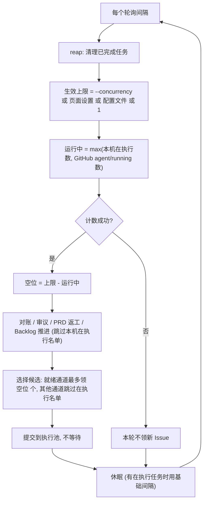

# PRD: 统一并行上限，daemon 执行期间持续补位

- GitHub Issue: https://github.com/ZataZhang/keda/issues/316

> ✅ **交付前置**：无，可立即开工。
> 结构化声明见 §8 Delivery Dependencies，**那里是唯一事实源**。
> ⬜ **验收状态**：未开工。
> 本行是 §9 Acceptance Checklist 的投影，**那里是唯一事实源**。

本 PRD 分两层：Part A（§1–4）供人确认目标行为与两项关键决策；Part B（§5–13）供执行者按现有架构实现并验证。

## Feature Overview (功能一览)

以下是 §10 Functional Requirements 的通俗摘要，不替代其验收定义；行为验收以 §1 的行为样例表为准。

- **只剩一个"并行上限"**（FR-1、FR-2）：每个仓库只有一个数字决定"最多同时跑几个 Issue"。旧的 `max_issues` 配置项不再参与计算，读到时给出弃用提示。
- **页面设置直接生效**（FR-3）：Backlog 页面保存的并行上限就是生效值，不再和配置文件取较小值；没保存时用配置文件里的值。
- **执行期间也会补位**（FR-4、FR-5）：daemon 不再等一轮里的 Issue 全部跑完才看队列，而是每个轮询间隔都检查一次，运行中的 Issue 少于上限就补领新的。
- **不会重复执行本机正在跑的 Issue**（FR-6）：补位、返工恢复和崩溃对账都会跳过本机正在执行的 Issue。
- **界面显示真实数字**（FR-7）：Backlog 控件显示本仓库的"并行上限 N（来源）"；跨仓库的状态栏改显示"默认并行上限"，不再显示误导人的"队列上限"；看板同步间隔写明是"看板同步"，不再和 daemon 轮询混淆。
- **命令行与文档同步**（FR-8、FR-9）：`kc daemon` 只保留 `--concurrency`；`kc run --all-ready --max-issues N` 保持"这次最多跑 N 个"的含义；文档与随包 operator skill 同步新模型。

# Part A · 人审层 (Review Layer)

## 1. Introduction & Goals

### Problem Statement

用户想知道"这个仓库最多同时跑几个 Issue"，现在要同时理解三个参数和一个"轮"的概念才能算对：

- 配置里的 `max_issues`：一轮最多领几个。只有并行数为 1 时起作用，作用是在同一轮里串行跑几个。
- 配置里的 `max_concurrent_issues`：一轮里并行跑几个。大于 1 时，一轮的领取上限变成两者中的较大值。
- Backlog 页面的"并发"：再和上面的结果取较小值。

2026-10-24 的真实情况：keda 仓库配置是 `max_issues = 1`、`max_concurrent_issues = 10`，daemon 日志每轮都打印 `ceiling=10`，但管理终端状态栏显示的是"队列上限 1"（它读的是 `max_issues`）。用户和 Agent 都据此误判为"daemon 只能跑一个"。

第二个问题更影响使用：daemon 每一轮把领到的 Issue 交给线程池并行执行，**要等这一轮的 Issue 全部跑完**才进入下一轮。所以一轮开始之后才进入就绪队列的 Issue，要等这一轮里最慢的那个跑完（可能几个小时）才会被看到，即使并行上限是 10、当前只占用 1 个。当天 16:49 开始的那一轮领走 #313 后，日志一直没有出现下一次轮询。

另外，管理终端顶部的"每 30 分钟"是看板数据同步的间隔，和 daemon 的 120 秒轮询无关，但界面没写清楚，容易被当成 daemon 的节奏。

### Interpretation (解读回显)

我把需求读作：把"最多同时跑几个"收敛成每个仓库一个真实、可见、唯一的数字，并让 daemon 在执行期间按轮询间隔持续补位，使这个数字真的能被用满。

**行为样例**

| 验证方式 | 输入 / 操作 | 期望观察到的结果 |
|---|---|---|
| 👀 人审 + 自动验证 | 仓库并行上限为 2，daemon 正在执行一个要跑很久的 Issue A；此时把 Issue B、C 加入就绪队列 | 下一个轮询间隔内 B 被领取并开始执行，A 仍在跑；C 保持就绪，直到 A 或 B 结束后的下一次轮询才被领取。daemon 日志每次轮询都打印 `Parallel limit ... in_flight=N`。 |
| 🤖 自动验证 | 配置文件写着 `max_issues = 5`、`max_concurrent_issues = 1`，启动 daemon | 日志出现一条 `max_issues` 已弃用的提示；同时运行的 Issue 始终不超过 1 个（与今天的实际行为一致）。 |
| 👀 人审 + 自动验证 | 配置文件 `max_concurrent_issues = 2`，在 Backlog 页面把并行上限保存为 4，再点"恢复为配置文件值" | 保存后 Backlog 控件显示"并行上限 4（页面设置）"，daemon 下一次轮询按 4 补位；恢复后显示"并行上限 2（配置文件）"。 |
| 🤖 自动验证 | 用 `kc daemon run --concurrency 3` 启动，页面设置为 4、配置文件为 2 | daemon 按 3 执行，日志写明来源是命令行参数。 |
| 🤖 自动验证 | daemon 正在本机执行 Issue A 时，A 的线程里出现返工标记，或对账扫描到 A 处于 `agent/running` | 补位与返工通道不会再次领取 A，对账不会把 A 当成僵尸处理；A 只由正在执行它的那个线程推进。 |
| 🤖 自动验证 | 统计正在运行的 Issue 数时 GitHub 查询失败 | 本次轮询不领取新 Issue（宁可少跑也不超发），已在执行的 Issue 不受影响。 |

上表的行为行就是验收依据（会原样转成 §7.6 的验收 oracle）；改一个格子就等于改对应的验收标准。

**我默默定了这些**

- 合并后的配置键沿用 `max_concurrent_issues`（不改名），默认值仍为 `1`。这样现有配置文件不用改，含义也不变。
- `max_issues` 的旧值**不**并入并行上限。今天并行数为 1 时它只是"同一轮串行跑几个"，任何时刻同时运行的 Issue 本来就只有 1 个；把它并入会让升级后的仓库突然多跑。读到时只提示弃用。
- `kc config migrate` 顺带删除配置文件里的 `max_issues` 行（预演时列出，执行时删除），与它现有的配置迁移行为一致。
- 优先级：`kc daemon run --concurrency` > Backlog 页面设置 > 配置文件 `max_concurrent_issues` > 默认 1。
- 页面设置仍存在本机管理终端的数据库里（不写仓库文件，避免把仓库工作区改脏），取值范围仍是 1–10。
- 显式运行不受并行上限约束，保持现状：`kc run --issue N`、`kc run --all-ready`、管理终端里对单个 PRD 点"开始"。
- `kc run`（一次性运行）仍然等本次领到的 Issue 全部跑完才退出；"执行期间补位"只针对常驻的 daemon。
- daemon 执行 Issue 期间，对账、审议、PRD 返工、Backlog 推进这些阶段照常按轮询间隔运行（它们各自已有数量上限）。
- 统计"运行中"的数字以 GitHub 上带 `agent/running` 标签的 Issue 为准（与现有闸门一致），所以别的机器正在跑的 Issue 也计入上限。

**我理解为不做**

- 不跨仓库设置全局上限：每个仓库各自一个数字。
- 不改审议（`max_deliberation_issues`）和 PRD 返工（`max_prd_issues`）各自的数量限制。
- 不改看板同步间隔的取值和下限（5 分钟），只改界面文案。

**可证伪的解读**：本期读作"并行上限只有一个生效值，它来自三个有明确优先级的入口，daemon 按轮询间隔持续把运行中的 Issue 补到这个值"；不读作"再加一个参数"，也不读作"把看板同步与 daemon 轮询合并成一个间隔"。旧的"页面设置与配置文件取较小值"规则被取代（见 §2 决策一）。

### What The User Gets

- **想知道最多能同时跑几个的人**：在 Backlog 页面看到本仓库的一个数字和它的来源；daemon 日志每次轮询都打印同一个数字。
- **daemon 的使用者**：长任务执行期间新加入的、互不相关的 Issue 会在下一个轮询间隔内开工，不用等长任务结束。
- **调整并行数的人**：在 Backlog 页面改一个数，下一次轮询就生效；配置文件里的数字作为默认值。

### Measurable Objectives

- 并行上限为 2、有 1 个长任务在跑时，新进入就绪队列的 Issue 从就绪到被认领的耗时不超过"轮询间隔 + 一次轮询耗时"。
- 任意时刻，daemon 让本仓库同时处于本机执行中的 Issue 数不超过生效并行上限。
- 带 `max_issues` 的旧配置升级后，同时运行的 Issue 数与升级前相同，并输出 1 条弃用提示。
- Backlog 控件显示的并行上限等于 daemon 日志里打印的生效上限（daemon 未用 `--concurrency` 启动时）。
- 本机正在执行的 Issue 被其他通道再次领取的次数为 0。

## 2. Human Review Map (介入与风险地图)

### 决策一：页面设置直接覆盖配置文件，不再取较小值

10 月 10 日归档的 PRD（统一自动执行并发上限）选择了"生效值 = 页面设置与配置文件中的较小值"，理由是配置文件代表本机容量、页面设置代表仓库策略。实际用下来，这个规则要求使用者同时记住两个数字，而且页面上把数字调大不会生效，只能再去改配置文件。

我建议改成"页面保存了就以页面为准，没保存就用配置文件"。代价是失去"配置文件作为本机硬上限"的含义：页面上设成 10，即使配置文件写的是 2，也会跑 10 个。页面仍然限制在 1–10，`kc daemon run --concurrency` 仍可在启动时强制指定。

**请确认：** 是否接受"页面设置优先于配置文件，不再取较小值"，并接受配置文件不再起到本机硬上限的作用？

**验收：** 配置文件写 2、页面保存 4 时，daemon 按 4 补位，界面标明来源是"页面设置"；页面恢复为配置文件值后回到 2。

### 决策二：daemon 执行期间持续轮询并补位

今天 daemon 等一轮跑完才看下一轮。改成每个轮询间隔都检查一次：运行中的 Issue 少于上限就补领，同时对账、审议、PRD 返工、Backlog 推进这些阶段也照常运行。这样并行上限才能真正被用满，但同一时刻在本机运行的 agent 进程会比今天多，资源占用和 API 用量会随之上升。

主要风险是重复执行：本机正在跑的 Issue 被补位、返工通道或崩溃对账再领一次。方案是 daemon 维护一份"本机正在执行的 Issue"名单，这些通道都必须跳过名单里的 Issue；统计运行中数量失败时本次不领新 Issue。

**请确认：** 是否接受"执行期间按轮询间隔持续补位，并且对账、审议、PRD 返工等阶段在执行期间照常运行"，以及由此带来的更多并行 agent 进程？

**验收：** 本机模拟一个长任务在跑时，新加入的 Issue 在一个轮询间隔内被领取，超过上限的 Issue 保持就绪；正在执行的 Issue 在整个过程中只被领取一次。

### 自动门禁，不需要逐项人工审阅

配置解析与弃用提示、命令行参数调整、状态接口返回生效值和来源、状态栏与看板同步文案、`kc config migrate` 删除旧键、文档与 operator skill 同步：由执行者实现，并由针对性测试、隔离的端到端场景和既有门禁覆盖。

**本次明确不涉及**：没有数据库结构变化（页面设置沿用现有的 Backlog 设置表）；不改标签状态机、认领仲裁与依赖门禁；不改显式运行的语义。

## 3. Usage And Impact After Implementation

**daemon 的使用者**
照常运行 `kc daemon run`。并行上限默认取配置文件的 `max_concurrent_issues`；需要临时指定时用 `--concurrency N`。长任务执行期间，日志每个轮询间隔会打印一行 `Parallel limit: limit=N (source) running=M claimable=K`，新 Issue 会在空位出现后的下一次轮询被领取。`kc daemon run --max-issues` 不再接受，命令会报用法错误，并提示改用 `--concurrency`。

**管理终端使用者**
跨仓库的状态栏显示"默认并行上限 N"（全局配置值），不再显示"队列上限"；各仓库的生效值看 Backlog 页面。Backlog 页面的并行上限输入框保存后立即成为生效值，"恢复为配置文件值"清除页面设置。顶部的同步间隔写作"看板同步：每 30 分钟"。

**一次性运行者**
`kc run --issue N` 不变。`kc run --all-ready --max-issues N` 仍表示这次最多领 N 个就绪 Issue、逐个串行执行、跑完退出，不受并行上限约束（与今天一致）。未传时默认 1（不再读配置文件）；`kc supervise` / `kc supervise-daemon` 的 `--max-issues` 默认值同样固定为 1。

**配置维护者**
配置文件里的 `max_issues` 会触发一条弃用提示，不影响行为；运行 `kc config migrate` 可以预览并删除它。`kc init` 生成的新配置不再包含 `max_issues`。

**通过 operator skill 操作 kc 的 Agent**
skill 里关于并发的说明改为"一个并行上限、三个入口、按优先级取值、执行期间补位"。

**对现有行为的影响**
- 配置了 `max_concurrent_issues > 1` 的仓库：同时运行数可能比今天多，因为执行期间也会补位。
- 页面设置高于配置文件的仓库：今天被压到配置文件的值，升级后按页面设置运行。
- 只用默认配置的仓库：同时运行数仍为 1，区别只是执行期间其他阶段照常运行。

## 4. Requirement Shape

- **Actor**：daemon 使用者、管理终端使用者、一次性运行者、配置维护者、通过 operator skill 调用 kc 的 Agent。
- **Trigger**：daemon 每个轮询间隔；管理终端保存或清除并行上限；读取配置；运行 `kc config migrate`；查看 Backlog 控件、状态栏与 daemon 日志。
- **Expected behavior**：每个仓库只有一个生效并行上限，来源按优先级确定并对外可见；daemon 在执行期间持续补位且不重复执行本机在跑的 Issue；旧参数给出弃用提示而不改变实际同时运行数。
- **Scope boundary**：不改显式运行、依赖门禁、认领仲裁、看板同步间隔的取值，不新增数据库结构，不做跨仓库全局上限。

# Part B · 执行器层 (Build Layer)

## 5. Repository Context And Architecture Fit

**当前相关模块**

- 上限解析：`src/backend/core/use_cases/backlog_concurrency.py`（`resolve_execution_ceiling` 取 `min(policy, capacity)`、`describe_ceiling_source`、`read_policy_max_parallel`、`count_live_running_issues`）。
- 领取与执行：`src/backend/core/use_cases/agent_runner_orchestration_runtime.py` 的 `run_once`（`effective_max_issues = max(max_issues, concurrency)`；`concurrency <= 1` 走串行列表；否则 `with ThreadPoolExecutor(max_workers=concurrency)` 阻塞到全部完成；`_process_single_issue` 是单个 Issue 的处理入口）。
- daemon 主循环：`src/backend/core/use_cases/run_agent_daemon.py` 的 `_run_daemon_loop`（每个仓库依次跑 loop、对账、审议、PRD 返工、Backlog 推进、`run_once`，然后 `next_poll_interval` 休眠）。
- 配置：`src/backend/core/shared/models/agent_runner_config.py`（domain dataclass 的 `max_issues`、`max_concurrent_issues`）、`src/backend/infrastructure/config/agent_runner_settings_models.py`（`AgentRunnerRunnerSettings`）、`src/backend/engines/agent_runner/factory_config_builder.py` 与 `factories/__init__.py`（settings → domain 映射）、`src/backend/infrastructure/config/settings.py`（另有一处 `max_issues` 默认值）、`src/backend/engines/agent_runner/repository_local.py`（`kc init` 生成配置时的键说明）。
- CLI：`src/backend/api/cli_typer_runner.py`、`src/backend/api/cli_typer_app.py`（`MaxIssuesOption`、`ConcurrencyOption`）、`src/backend/api/cli_parsed_commands/runner.py`、`src/backend/api/cli_parser_runner_commands.py`。
- 管理终端 API：`src/backend/api/routes/agent_runner_backlog.py`（Backlog 设置读写，返回 `max_parallel` / `effective_max_parallel` / `ceiling_source`）；状态接口返回 `config.max_issues`（前端 `runner-status-bar.tsx` 读取）。
- 前端（`frontend-public/`，Next.js 静态导出，经 `just console-sync` 打进 `src/backend/api/static/console`）：`components/agent-runner/runner-status-bar.tsx`（"队列上限"）、`components/backlog/backlog-autopilot-control.tsx`（并发显示与编辑）、`app/(app)/app/dashboard/page.tsx`（"每 N 分钟"）、`lib/api/types.ts`。
- 配置迁移：`src/backend/api/cli_parsed_commands/config_migrate.py`、`src/backend/engines/agent_runner/repository_local_migration.py`。
- operator skill：`src/backend/engines/agent_runner/templates/skills/kedacode-operator/SKILL.md`（Backlog auto-advance 一段写着 `ceiling = min(...)`）与 `references/daemon.md`。

**要遵循的架构模式**

- 上限解析继续集中在 `backlog_concurrency.py` 一处，所有消费方（daemon、管理终端 API、Autopilot 快照、全局开始）只调用这里的函数。
- daemon 的调度改动留在 core 用例层；单个 Issue 的处理继续复用 `_process_single_issue` 与现有输出路由（每 Issue 日志、实时视图、调用观测上下文），不复制一份。
- 新增或删除 runner 配置字段时同步 domain dataclass、pydantic settings、factory 映射三处。

**前端影响**：`frontend-public/`。状态栏改显示生效上限与运行数；Backlog 并行上限控件的来源文案与"恢复为配置文件值"；看板同步文案；API 类型同步。`frontend-admin/` 不涉及。

**约束**

- 机器可读输出中的时间保持 UTC 带偏移；本 PRD 不新增时间展示。
- 改 `kc` CLI 表面（删除 daemon 的 `--max-issues`）必须同步 operator skill 与 `docs/`。
- 管理终端前端改动后用 `just console-sync` 生成本地静态产物验证；该目录不进 git，发布打包时重新构建。

**相关 PRD**

- `tasks/archive/P1-FEAT-20261010-011714-unified-auto-concurrency-ceiling.md`：本 PRD 取代它的 D-01（`min(设置, 容量)`）。它的 D-02（认领处 fail-closed 预算）、D-03（显式运行不受限）、D-04（沿用 `backlog_settings` 行，恢复 = 删行）、D-06（全局开始不持久化）继续有效。
- `tasks/archive/P1-FEAT-20260625-101522-iar-daemon-parallel-issue-execution-live-view.md`：引入单轮线程池并行与每 Issue 输出路由；本 PRD 复用其输出路由，替换"单轮阻塞"的调度方式。
- `tasks/pending/P1-FEAT-20261024-161425-cross-machine-presence-and-claim-lease.md`（#314）：soft 关系。两者都改 `run_agent_daemon.py`（它要在 daemon 生命周期里启停后台续期线程）。无构建依赖，谁后合入谁处理冲突；它的续期线程需要知道"本进程持有哪些认领"，本 PRD 的"本机正在执行名单"可以作为它的数据来源。
- `tasks/pending/P1-REFACTOR-20261020-021715-purge-residual-iar-naming.md`（#313）：会大范围重命名标识符，可能与本 PRD 有文本冲突，无语义依赖。

## 6. Recommendation

### Recommended Approach

1. **上限解析**：`resolve_execution_ceiling` 改为"页面设置存在取页面设置，否则取配置文件值"，删除 `min`；`describe_ceiling_source` 返回 `policy` / `config`。命令行覆盖由 daemon 自己处理，日志来源记为 `cli_override`。
2. **配置收敛**：`max_issues` 从 domain 与 settings 中移除；读取到时输出弃用警告。`kc config migrate` 删除该键。
3. **daemon 补位调度**：daemon 为每个仓库维护一个常驻的执行池和"本机正在执行"名单。每次轮询计算 `可领取数 = 生效上限 − max(本机在执行数, GitHub 上运行中数)`，只提交新任务、不等待完成；然后照常休眠。任务完成后从名单移除，下一次轮询即可补位。
4. **跳过本机在执行的 Issue**：`run_once` 的返工、发布恢复、blocked 恢复通道，以及崩溃对账，都接收"本机正在执行"名单并跳过其中的 Issue。
5. **一次性运行保持阻塞**：`kc run` 继续走"领取后等全部完成"的路径。
6. **界面与文档**：状态接口返回生效上限、来源与运行数；前端改文案；文档与 operator skill 同步。

### Proposed Solution Summary (实现机制)

- **核心机制**：把"领取"和"等待完成"拆开。daemon 持有每个仓库的 `ThreadPoolExecutor` 与一份线程安全的在执行名单（`issue_number → Future`）。每次轮询先清理已完成的任务，再按空位提交新任务，`run_once` 的并行路径在 daemon 模式下改成"提交后立即返回"。
- **谁提供什么**：并行上限由三个入口提供（命令行参数、页面设置、配置文件），系统只按优先级读取，不做推断。
- **接入点**：`backlog_concurrency.resolve_execution_ceiling`；`agent_runner_orchestration_runtime.run_once` 的领取与执行分支；`run_agent_daemon._run_daemon_loop`；`agent_runner_reconcile.reconcile_stale_attempts`；管理终端状态与 Backlog 设置接口；前端三个组件。
- **状态与可见变化**：daemon 日志的上限行改为显示来源与可领取数；状态栏数字变化；`max_issues` 弃用提示。
- **刻意避免的复杂度**：不新增数据库表或列；不做跨仓库全局调度；不引入独立的调度进程或队列服务。

### Alternatives Considered

- **保留 `min(页面, 配置)`，只改文案和状态栏**：改动最小，但页面调大不生效、两个数字的心智负担依然存在。用户已选择收敛为一个生效值。
- **页面直接写仓库的 `.kedacode.toml`**：真正的单一来源，但管理终端会把仓库工作区改脏、需要处理并发写和提交，10 月 10 日的 PRD 已以同样理由否决。
- **缩短一轮的长度（例如每个 Issue 单独一轮）**：并行数大于 1 时仍然要等，解决不了"长任务堵住队列"。

## 7. Implementation Guide

This section is a living implementation guide based on current repository analysis. If implementation discovers additional affected files, hidden dependencies, edge cases, or a better path, update this PRD before proceeding.

### 7.1 Core Logic

**生效上限**
`resolve_execution_ceiling(policy, config_value)`：页面设置存在取页面设置，否则取配置文件值（下限 1）；`describe_ceiling_source(policy)` 返回 `policy` / `config`。命令行 `--concurrency` 由 daemon 自己判定，日志来源记为 `cli_override`。管理终端拿不到 daemon 进程的 `--concurrency`，因此它显示的是"页面设置 / 配置文件"层面的值；daemon 日志打印包含命令行覆盖的最终值（与现状一致，文档写明）。

**daemon 补位**
- 新增 `DaemonExecutionSlots`（每仓库一个）：持有执行池（`max_workers` = 当前生效上限，上限变化时按新值重建或用信号量控制）、`in_flight: dict[int, Future]`、锁。
- 每次轮询：`reap()` 清理已完成的 Future 并记录结果；`claimable = limit − max(len(in_flight), live_running_count)`（`live_running_count` 来自 `count_live_running_issues`，失败则 `claimable = 0`）；把 `claimable` 和 `in_flight` 的 Issue 编号交给领取逻辑；领取到的 Issue 提交到执行池，立即返回。
- `run_once` 拆出"选择候选"（返回待处理列表）和"执行"两部分；一次性运行串起两部分并等待；daemon 只调用选择部分，再把执行交给 `DaemonExecutionSlots`。
- 空闲退避：`in_flight` 非空时不算空闲，休眠使用基础间隔。
- 退出：SIGTERM 时沿用现有"终止子进程树"逻辑；执行池 `shutdown(wait=False, cancel_futures=True)`。

**跳过本机在执行的 Issue**
领取的 running 通道（返工、发布恢复）、blocked 恢复通道、`direct_pr_cleanup` 通道在构造候选时排除 `in_flight` 中的编号。`reconcile_stale_attempts` 增加 `exclude_issue_numbers` 参数，daemon 传入 `in_flight` 的编号；本进程 PID 本来就活着，这一参数是额外保险。

**配置**
从 `AgentRunnerRunnerSettings`、domain dataclass、factory 映射、`settings.py` 中移除 `max_issues`；settings 层用 `model_validator(mode="before")` 识别旧键，弹出并记录一条 WARNING（每个配置文件只提示一次）。`kc init` 的配置模板与键说明（`repository_local.py`）去掉 `max_issues`，并把 `max_concurrent_issues` 的说明改为"同时运行的 Issue 上限"。`kc config migrate` 增加"删除 `[agent_runner.runner] max_issues`"步骤，复用 `toml_section_editor` 的写锁与预演。

**CLI**
`kc daemon` 与 `kc daemon run` 删除 `--max-issues`（传入时返回用法错误并提示 `--concurrency`）。`kc run --all-ready --max-issues N` 保留原语义：本次最多领 N 个、串行执行；未传时默认 1。

**管理终端**
状态接口的 `config.max_issues` 换成 `config.max_concurrent_issues`（全局默认并行上限；状态栏跨仓库，不显示单仓库生效值）；Backlog 设置与 Autopilot 接口的 `ceiling_source` 取值改为 `policy` / `config`（去掉 `inherited` 与 `capped_by_capacity`），`effective_max_parallel` 按新规则计算，字段名保持不变。前端：
- `runner-status-bar.tsx`：`默认并行上限 {max_concurrent_issues}`。
- `backlog-autopilot-control.tsx`：来源文案更新；清除按钮文案"恢复为配置文件值"。
- `dashboard/page.tsx`：`看板同步：每 {N} 分钟`。

### 7.2 Change Impact Tree

本树是起点，不保证穷尽；请配合 §7.4 的搜索命令。

```text
.
├── Infrastructure
│   ├── src/backend/infrastructure/config/agent_runner_settings_models.py
│   │   [修改]
│   │   【总结】移除 max_issues 字段，识别旧键并发出弃用警告；max_concurrent_issues 注释改为同时运行上限。
│   ├── src/backend/infrastructure/config/settings.py
│   │   [修改]
│   │   【总结】删除另一处 max_issues 默认值。
│   └── src/backend/engines/agent_runner/repository_local_migration.py
│       [修改]
│       【总结】kc config migrate 新增删除 max_issues 的迁移步骤（预演 / 执行 / 幂等）。
│
├── Domain / Core
│   ├── src/backend/core/shared/models/agent_runner_config.py
│   │   [修改]
│   │   【总结】domain runner 配置去掉 max_issues。
│   ├── src/backend/core/use_cases/backlog_concurrency.py
│   │   [修改]
│   │   【总结】上限按优先级取值并返回来源，删除 min 规则与 capped_by_capacity。
│   ├── src/backend/core/use_cases/agent_runner_orchestration_runtime.py
│   │   [修改]
│   │   【总结】run_once 拆成候选选择与执行两步，候选选择接收可领取数与本机在执行名单。
│   ├── src/backend/core/use_cases/daemon_execution_slots.py
│   │   [新增]
│   │   【总结】daemon 每仓库的常驻执行池与在执行名单：清理、计算空位、提交、关闭。
│   ├── src/backend/core/use_cases/run_agent_daemon.py
│   │   [修改]
│   │   【总结】主循环改为每轮补位不等待；空闲退避考虑在执行任务；退出时关闭执行池。
│   ├── src/backend/core/use_cases/agent_runner_reconcile.py
│   │   [修改]
│   │   【总结】对账跳过本机在执行名单中的 Issue。
│   ├── src/backend/core/use_cases/run_agent_once.py / run_agent_repositories_once.py
│   │   [修改]
│   │   【总结】一次性运行沿用"选择后等待全部完成"，--max-issues 语义改为本次领取并并行执行的数量。
│   └── src/backend/core/use_cases/backlog_autopilot_settings.py / backlog_actions.py
│       [修改]
│       【总结】Autopilot 快照与全局开始改用新的上限解析结果。
│
├── Engines
│   ├── src/backend/engines/agent_runner/factory_config_builder.py
│   │   [修改]
│   │   【总结】settings → domain 映射去掉 max_issues。
│   ├── src/backend/engines/agent_runner/factories/__init__.py
│   │   [修改]
│   │   【总结】状态接口的 config.max_issues 换成 config.max_concurrent_issues。
│   └── src/backend/engines/agent_runner/repository_local.py
│       [修改]
│       【总结】kc init 配置模板与键说明去掉 max_issues，更新 max_concurrent_issues 说明。
│
├── API / CLI
│   ├── src/backend/api/cli_typer_runner.py
│   │   [修改]
│   │   【总结】daemon 的 --max-issues 改为隐藏的退役选项（传入即用法错误）。
│   ├── src/backend/api/cli_typer_app.py
│   │   [修改]
│   │   【总结】MaxIssuesOption 帮助文本改为"本次一次性运行最多领取几个"。
│   ├── src/backend/api/cli_parsed_commands/runner.py
│   │   [修改]
│   │   【总结】daemon 拒绝 --max-issues；run / supervise 的默认值改为固定的 DEFAULT_BATCH_MAX_ISSUES = 1。
│   └── src/backend/api/routes/agent_runner_backlog.py
│       [修改]
│       【总结】Backlog 设置响应按新规则计算生效值与来源。
│
├── Frontend (frontend-public)
│   ├── frontend-public/components/agent-runner/runner-status-bar.tsx
│   │   [修改]
│   │   【总结】"队列上限"改为"默认并行上限 N"。
│   ├── frontend-public/components/backlog/backlog-autopilot-control.tsx
│   │   [修改]
│   │   【总结】来源文案按 policy/config 显示，清除按钮改为"恢复为配置文件值：N"。
│   ├── frontend-public/app/(app)/app/dashboard/page.tsx
│   │   [修改]
│   │   【总结】同步间隔文案改为"看板同步：每 N 分钟"。
│   ├── frontend-public/lib/api/types.ts
│   │   [修改]
│   │   【总结】状态与 Backlog 类型同步新字段与来源取值。
│
├── Tests
│   ├── tests/test_backlog_concurrency.py [修改]
│   │   【总结】优先级取值与来源；去掉 min 相关断言。
│   ├── tests/test_daemon_execution_slots.py [新增]
│   │   【总结】空位计算、计数失败不领取、完成后补位、在执行名单排除、退出关闭。
│   ├── tests/test_agent_runner_reconcile.py [修改]
│   │   【总结】在执行名单中的 Issue 不被对账。
│   ├── tests/test_backlog_api.py [修改]
│   │   【总结】生效值与来源新规则；恢复为配置文件值。
│   └── tests/test_agent_runner_settings*.py [修改]
│       【总结】max_issues 弃用警告与旧配置行为不变。
│
└── Docs / Skill
    ├── docs/guides/agent-runner.md [修改]
    │   【总结】并发、daemon 生命周期、全局调度三节改为单一并行上限与执行期间补位。
    ├── src/backend/engines/agent_runner/templates/skills/kedacode-operator/SKILL.md [修改]
    │   【总结】Backlog auto-advance 段的上限规则与 run 参数说明。
    └── src/backend/engines/agent_runner/templates/skills/kedacode-operator/references/daemon.md [修改]
        【总结】Concurrency 一条改为优先级取值、执行期间补位、--max-issues 已从 daemon 移除。
```

### 7.3 Risk Classification Register

| change point | tier | decisive dimension / override | intervention | oracle / gate |
|---|---|---|---|---|
| daemon 执行期间补位、在执行名单排除 | R3 | 正确性：同一 Issue 重复执行；并发 | 人工确认（决策二） | rv-1、rv-2 |
| 上限优先级取代 min 规则 | R2 | 跨组件行为：daemon、管理终端、Autopilot 共用；兼容性 | 人工确认（决策一） | rv-3 |
| 移除 `max_issues`、弃用提示、迁移删除 | R2 | 兼容：旧配置升级后同时运行数不得变化 | 执行者 + 强 oracle | rv-2 中旧配置场景 |
| CLI 参数调整 | R1 | 单一入口 | 执行者 + 端到端 | rv-2 |
| 前端文案与状态字段 | R1 | 呈现层 + 接口字段 | 执行者 + 截图 | rv-3 |
| 文档与 operator skill | R0 | 文档 | 执行者 + 搜索断言 | §9 Documentation Acceptance |

### 7.4 Executor Drift Guard

文件清单是起点。动手前先跑：

```bash
rg -n "max_issues" src/backend frontend-public/lib frontend-public/components "frontend-public/app" docs/guides
rg -n "resolve_execution_ceiling|describe_ceiling_source|capped_by_capacity|CEILING_SOURCE" src/backend frontend-public tests
rg -n "ThreadPoolExecutor" src/backend/core/use_cases
rg -n "max_deliberation_issues|max_prd_issues" src/backend/core/use_cases/run_agent_daemon.py
```

- 第一条的命中除了 `kc run --all-ready` 的 `--max-issues` 选项和迁移步骤里的旧键名，都要处理掉；审议与 PRD 返工的 `max_issues` 形参属于各自阶段，不在本 PRD 范围，改名不是目标。
- 第二条：`capped_by_capacity` 的每个消费方（API、前端文案映射、测试）都要同步删除。
- 不要用"把一次性运行也改成不等待"的方式实现：`kc run` 退出前必须等本次任务结束。

### 7.5 Flow Diagram



### 7.6 Realistic Validation Plan

各场景在隔离的端到端环境中运行：PATH 上放一个文件型的假 `gh`（模拟 Issue、标签、评论），agent 用可控时长的确定性假 agent（通过文件信号结束），git 与 `kc` CLI、daemon 进程、管理终端后端都真实运行。所有 RV 脚本放在 `tasks/evidence/<prd-stem>/scripts/`。

```yaml
- id: rv-1
  behavior: 并行上限为 2、长任务 A 在跑时，新加入的 B 在一个轮询间隔内被领取，C 保持就绪；A 结束后下一次轮询领取 C；A、B、C 各只被领取一次
  reviewer: verifier
  real_entry: "RV 脚本：配置 max_concurrent_issues = 2、run_interval_seconds = 5，启动 kc daemon run；先让 A 就绪并被领取（假 agent 不结束），再把 B、C 置为就绪；随后让 A 的假 agent 结束"
  expected: "B 的 iar:claim 评论时间与 B 就绪时间之差 ≤ 一个轮询间隔 + 一次轮询耗时；A 结束前 C 一直是 agent/ready 且没有认领评论；A 结束后的下一次轮询 C 被认领；每个 Issue 的认领评论各 1 条；日志每次轮询都有 Parallel limit 行"
  mock_boundary: "只替换 gh 与 agent CLI；daemon、调度、认领仲裁、输出路由走真实代码"
  tier: R3
  test_layer: e2e
  required_for_acceptance: true
  critical_value_source: "假 gh 存储中各 Issue 的认领评论时间与标签变化记录"
  must_cross: "kc daemon 进程 → _run_daemon_loop → DaemonExecutionSlots → run_once 候选选择 → arbitrate_first_claim → gh 子进程 → 文件存储"
  forbidden_bypasses: "在测试中直接调用 DaemonExecutionSlots 代替 daemon 进程；把 run_interval 设为 0 让循环空转；手写认领评论"
  fresh_state_probe: "daemon 停止后用新的 gh 进程读取三个 Issue 的评论与标签"
  final_tree_evidence: "rv-1 输出记录 git rev-parse HEAD^{tree}；调度相关代码改动后重跑"
  negative_control: "在改动前的代码树上跑同一脚本：A 结束前 B 不会被领取"
  expected_fail: "断言'B 在一个轮询间隔内被领取'失败"
- id: rv-2
  behavior: 本机在执行的 Issue 不被返工通道与对账再次处理；计数失败时不领新 Issue；旧 max_issues 配置只提示不改变同时运行数；daemon 拒绝 --max-issues
  reviewer: verifier
  real_entry: "RV 脚本：(a) A 在执行时向 A 写入返工标记并触发对账；(b) 让假 gh 对 agent/running 列表查询返回错误一次；(c) 配置 max_issues = 5、max_concurrent_issues = 1 并放入 3 个就绪 Issue；(d) 运行 kc daemon run --max-issues 3"
  expected: "(a) A 的处理线程只有 1 个，A 上没有新增认领或对账评论；(b) 该次轮询日志写明不领新 Issue，已在执行的任务继续；(c) 日志 1 条 max_issues 弃用提示，任意时刻 agent/running 且属于本机的 Issue 不超过 1；(d) 退出码 2，stderr 提示改用 --concurrency"
  mock_boundary: "只替换 gh 与 agent CLI；配置读取走真实 TOML 解析与 settings → domain 映射"
  tier: R3
  test_layer: e2e
  required_for_acceptance: true
  critical_value_source: "假 gh 的调用日志与评论存储；daemon 日志"
  must_cross: "kc daemon 进程 → 配置加载 → 对账 / 返工通道 → gh 子进程"
  forbidden_bypasses: "在测试中直接构造 AppConfig 跳过 TOML；在 gh 之外伪造计数失败"
  fresh_state_probe: "daemon 停止后用新进程读取评论与标签，并统计本机认领评论数"
  final_tree_evidence: "rv-2 输出记录 git rev-parse HEAD^{tree}；配置、对账或调度代码改动后重跑"
  negative_control: "移除对账的 exclude_issue_numbers 传参后重跑 (a)：出现针对 A 的对账或重复领取"
  expected_fail: "断言'A 上没有新增认领或对账评论'失败"
- id: rv-3
  behavior: 管理终端显示真实并行上限与来源；页面保存值覆盖配置文件，恢复后回到配置文件值；看板同步文案明确
  reviewer: human
  real_entry: "kc console 启动管理终端（配置 max_concurrent_issues = 2），在浏览器中打开状态栏与 Backlog 页面，保存并行上限 4，再点'恢复为配置文件值'；同时运行 daemon 观察日志"
  expected: "保存前状态栏显示'并行上限 2（配置文件）· 运行中 M'；保存后显示'并行上限 4（页面设置）'，daemon 下一次轮询日志 limit=4 source=policy；恢复后回到 2（配置文件）；顶部显示'看板同步：每 N 分钟'"
  mock_boundary: "管理终端后端与前端静态产物真实运行；GitHub 侧可用假 gh"
  tier: R2
  test_layer: e2e
  required_for_acceptance: true
  presentation: "tasks/evidence/<prd-stem>/rv-3-status-bar-before.png、rv-3-status-bar-policy.png、rv-3-backlog-control.png、rv-3-dashboard-sync-label.png（真实页面截图）与 rv-3-daemon-log.txt；自检：第二张图状态栏写着'并行上限 4（页面设置）'"
  critical_value_source: "管理终端状态接口与 Backlog 设置接口的 JSON 响应；daemon 日志的 Parallel limit 行"
  must_cross: "浏览器 → 管理终端 API → backlog_settings 存储 → daemon 下一次轮询读取"
  forbidden_bypasses: "直接写数据库代替页面保存；只截组件预览"
  fresh_state_probe: "保存后重新加载页面并新开一个 curl 请求读取状态接口"
  final_tree_evidence: "截图前执行 just console-sync，并记录 git rev-parse HEAD^{tree}"
```

**失败排查**：rv-1 先检查 daemon 日志里每个间隔是否都有 `Parallel limit` 行（没有说明主循环仍被执行阻塞），再检查假 agent 是否经文件信号结束；rv-2 先检查 `in_flight` 名单是否传进了对账与 running 通道；rv-3 先确认静态产物已重新生成（`just console-sync`），再检查状态接口字段。

### 7.7 ER Diagram

No data model changes in this PRD.（页面设置沿用现有 `backlog_settings.max_parallel`，恢复为配置文件值 = 删除该行。）

### 7.8 Low-Fidelity Prototype

验收关键状态（原型与实现截图配对）：

```text
状态栏（配置文件来源）
Runner [gh 正常] [前台模式] 仓库 5 | 并行上限 2（配置文件）· 运行中 1 · 默认 agent claude ...

状态栏（页面设置来源）
Runner [gh 正常] [前台模式] 仓库 5 | 并行上限 4（页面设置）· 运行中 1 · 默认 agent claude ...

Backlog 控制条
并行上限 [ 4 ]（页面设置） [保存] [恢复为配置文件值：2]

顶部
上次同步 2026-10-24 17:09:48 · 看板同步：每 30 分钟   [刷新全部]
```

### 7.9 Interactive Prototype Change Log

No interactive prototype file changes in this PRD.

### 7.10 External Validation

No external validation required; repository evidence was sufficient.

## 8. Delivery Dependencies

### Delivery Dependencies

- Depends on tasks/issues:
  - none
- Gate type: none
- Sequence: via-main
- Notes: 与 #313（命名清理）和 #314（跨机器可见性）都改 daemon 相关文件，但无语义依赖；谁后合入谁处理冲突。#314 的续期线程可以复用本 PRD 的"本机在执行名单"。

## 9. Acceptance Checklist

### 9.1 人读呈递区（Human Review Surface）

| 看什么 | 呈递物 | 10 秒自检 |
|---|---|---|
| 状态栏、Backlog 控件与看板同步文案显示真实并行上限和来源（rv-3） | `tasks/evidence/<prd-stem>/rv-3-*.png` 四张真实页面截图与 `rv-3-daemon-log.txt`（交付时内嵌）；打开：`just prd review tasks/archive/<prd-file>` | 第二张图状态栏写"并行上限 4（页面设置）"；日志同一时段出现 `limit=4 source=policy` |

未在此展示的是 `reviewer: verifier` 的证据组：rv-1（执行期间补位）与 rv-2（不重复执行、计数失败不领取、旧配置兼容、CLI 参数），结论在 9.2 中，只在失败时需要人看。

### 9.2 Acceptance Evidence Package

按风险排序：决策二（rv-1、rv-2，R3）→ 决策一（rv-3，R2）→ R1/R0 门禁。交付时在此附各 rv 的结果摘要、验证时的 Git tree 与证据文件路径。

### Human-Confirmed (来自 Part A 风险地图)

- [ ] 决策一：接受页面设置优先于配置文件、不再取较小值 — 依据 rv-3
- [ ] 决策二：接受 daemon 执行期间持续补位，对账等阶段照常运行 — 依据 rv-1、rv-2
- [ ] 已查看 9.1 呈递区截图，状态栏与 Backlog 控件的数字和来源符合预期

### Architecture Acceptance

- [ ] 上限解析只在 `backlog_concurrency.py` 一处：`rg -n "min\(.*policy|policy_max_parallel.*min" src/backend` 无结果
- [ ] 单个 Issue 的处理只经 `_process_single_issue`，没有复制出第二套处理流程：`rg -n "def _process_single_issue" src/backend` 恰好 1 处
- [ ] 没有新增数据库表或迁移：`git diff --name-only main... | rg "alembic|migrations"` 无结果

### Behavior Acceptance

- [ ] rv-1 通过：B 在一个轮询间隔内被领取，C 在空位出现前保持就绪，每个 Issue 认领评论各 1 条（证据：`rv-1-backfill.txt`）
- [ ] rv-2 通过：在执行的 Issue 不被重复处理、计数失败不领取、旧配置同时运行数不变、daemon 拒绝 `--max-issues`（证据：`rv-2-safety.txt`）
- [ ] rv-3 通过：页面保存与恢复的生效值和来源正确（证据：rv-3 截图与日志）
- [ ] `kc run --all-ready --max-issues 2` 领取 2 个就绪 Issue 并行执行后退出（证据：针对该入口的测试输出）

### Dependency Acceptance

- [ ] 未新增第三方依赖：`git diff main... -- pyproject.toml uv.lock frontend-public/package.json` 无依赖变更

### Frontend Acceptance

- [ ] `rg -n "队列上限" frontend-public` 无结果；`rg -n "并行上限" frontend-public/components/agent-runner/runner-status-bar.tsx` 有命中
- [ ] `rg -n "capped_by_capacity" frontend-public src/backend` 无结果
- [ ] `just console-sync` 构建通过（静态产物不进 git，只用于本地验证与发布打包）

### Validation Acceptance

- [ ] rv-1 至 rv-3 均经真实 `kc` daemon 进程或管理终端执行，只替换 `gh` 与 agent CLI；每份证据记录生成时的 `git rev-parse HEAD^{tree}`，且与最终交付的 tree 一致
- [ ] 配置三处映射：删除 `max_issues` 后，`rg -n "max_issues" src/backend/core/shared/models/agent_runner_config.py src/backend/engines/agent_runner/factory_config_builder.py src/backend/engines/agent_runner/factories/__init__.py` 无结果
- [ ] 相关测试全量通过：`uv run pytest -o addopts="" tests/test_backlog_concurrency.py tests/test_daemon_execution_slots.py tests/test_agent_runner_reconcile.py tests/test_backlog_api.py`

### Documentation Acceptance

- [ ] `docs/guides/agent-runner.md` 不再出现 `min(` 形式的上限规则，并说明优先级与执行期间补位：`rg -n "ceiling = min|min\(Backlog" docs src/backend/engines/agent_runner/templates/skills` 无结果
- [ ] operator skill 的 `SKILL.md` 与 `references/daemon.md` 已同步新模型与 `--max-issues` 的变化

### Delivery Readiness

- [ ] 推荐方案已完整实现，没有遗留的 Phase 2 或临时兼容层（弃用提示除外）
- [ ] 如果交付走 PR，PR 证据评论包含 9.1 呈递区的内容；否则完成消息原样附上 9.1 内容
- [ ] `just lint --full` 与上述 pytest 通过，单文件非空行均少于 1000 行

## 10. Functional Requirements

- **FR-1**：每个仓库只有一个生效并行上限，按 `kc daemon run --concurrency` > Backlog 页面设置 > 配置文件 `max_concurrent_issues` > 默认 1 的优先级取值，并对外报告来源。
- **FR-2**：`max_issues` 配置项不再参与任何计算；读取到时每个配置文件输出一次弃用警告；`kc config migrate` 预演并删除该键；`kc init` 生成的配置不再包含它。
- **FR-3**：Backlog 页面保存的并行上限直接成为生效值（1–10），不再与配置文件取较小值；"恢复为配置文件值"删除页面设置。
- **FR-4**：daemon 每个轮询间隔清理已完成任务、计算空位并提交新领取的 Issue，不等待正在执行的 Issue 完成；有任务在执行时不进入空闲退避。
- **FR-5**：空位 = 生效上限 − max(本机在执行数, GitHub 上 `agent/running` 数)；统计失败时本次不领新 Issue。
- **FR-6**：本机正在执行的 Issue 被就绪、返工、发布恢复、blocked 恢复、`direct_pr_cleanup` 通道与崩溃对账全部跳过。
- **FR-7**：Backlog 设置与 Autopilot 接口的来源取值为 `policy` / `config`；daemon 每次轮询把实际生效的并行上限、来源（含 `cli_override`）与本机在执行数写到单实例锁旁的状态文件，退出时删除；Autopilot 接口据此返回 `daemon_parallel_limit` / `daemon_parallel_limit_source`（无存活 daemon 时为 null）；Backlog 控件在 daemon 运行时显示它实际在用的值，例如"并行上限 5（daemon 命令行 --concurrency；页面设置 4 未生效）"，否则显示"并行上限 N（页面设置 / 配置文件）"，并注明"页面设置仅本机生效，不改 .kedacode.toml"；清除按钮为"恢复为配置文件值：N"；跨仓库状态栏显示"默认并行上限 N"（状态接口 `config.max_concurrent_issues`）；顶部同步间隔写作"看板同步：每 N 分钟"。
- **FR-8**：`kc daemon` 与 `kc daemon run` 删除 `--max-issues`（传入时返回用法错误并提示 `--concurrency`）；`kc run` / `kc supervise` / `kc supervise-daemon` 的 `--max-issues` 保持"本次最多处理几个"的原语义，未传时默认 1；`kc run` 仍等待本次任务全部完成后退出；`kc daemon status` 增加 `parallel_limit` 列，`--json` 每个 daemon 行带 `parallel_limit` / `parallel_limit_source` / `in_flight`（读不到时为 null）。
- **FR-9**：`docs/guides/agent-runner.md` 与随包 operator skill 同步新模型。

## 11. Non-Goals

- 跨仓库的全局并行上限。
- 修改审议与 PRD 返工各自的数量限制。
- 修改看板同步间隔的取值与下限。
- 让管理终端写入仓库的 `.kedacode.toml`。
- 让一次性 `kc run` 在后台继续执行。

## 12. Risks And Follow-Ups

- **资源占用上升**：执行期间补位并照常运行其他阶段，同时运行的 agent 进程会变多；默认配置（上限 1）下只多出审议、PRD 返工等阶段的并行。
- **多机共用上限**：运行中数量按 GitHub 标签统计，别的机器在跑的 Issue 也会占用本仓库的上限；这是现有闸门的既有语义，文档写明。
- **管理终端看不到命令行覆盖**：daemon 用 `--concurrency` 启动时，管理终端显示的值可能和 daemon 实际值不同；以 daemon 日志为准（现有限制，文档沿用）。
- **与 #313、#314 的文本冲突**：三者都改 daemon 相关文件，按合入顺序处理。

## 13. Decision Log

| ID | Decision | Chosen | Rejected | Rationale |
|---|---|---|---|---|
| D-01 | 生效上限的口径 | 按优先级取第一个非空值（命令行 > 页面 > 配置 > 1） | `min(页面设置, 配置容量)`（10-10 PRD 的 D-01） | 取较小值要求同时记两个数字且页面调大不生效，用户明确要求只保留一个数字。 |
| D-02 | 页面设置存哪 | 沿用管理终端数据库的 `backlog_settings` 行 | 写入仓库 `.kedacode.toml` | 写仓库文件会把工作区改脏并需要处理提交，10-10 PRD 已以同样理由否决。 |
| D-03 | `max_issues` 旧值如何处理 | 只提示弃用，不并入上限 | 按 `max(max_issues, max_concurrent_issues)` 并入 | 并行数为 1 时 `max_issues` 只是串行批量，并入会让升级后的仓库突然并行多跑。 |
| D-04 | daemon 如何用满上限 | 常驻执行池 + 每个轮询间隔补位 | 保持单轮阻塞、只改文案 | 单轮阻塞时长任务会挡住所有新 Issue，上限再大也用不满。 |
| D-05 | 一次性 `kc run` 是否改为不等待 | 不改，继续等待全部完成 | 统一成后台执行 | 一次性命令的使用者需要它跑完再退出并拿到退出码。 |
| D-06 | 防重复执行 | 本机在执行名单 + 各通道与对账跳过 | 只依赖 GitHub 标签判断 | 标签变化有延迟，返工标记与对账都可能命中本机正在跑的 Issue，本机名单是最直接的事实。 |

## Change Log

### 状态栏改显示全局默认并行上限
- Type: scope
- Before: FR-7 要求状态栏显示"并行上限 N（来源）· 运行中 M"，状态接口新增 parallel_limit / parallel_limit_source / running_count。
- After: 状态栏显示"默认并行上限 N"（状态接口 config.max_concurrent_issues）；单仓库的生效值与来源只在 Backlog 控件显示；运行中数量沿用看板已有的"运行中"筛选计数。
- Reason: 实现时发现状态栏是跨仓库的（"仓库 5"），没有单一仓库可言，硬塞一个仓库的生效值会再次误导。
- Impact: FR-7、§3、rv-3 预期与 9.1 自检同步改写；不新增状态接口字段。
- Review: 待用户确认（交付消息中说明）。

### kc run 的 --max-issues 保持串行语义，kc daemon status 不显示并行上限
- Type: scope
- Before: FR-8 要求 `kc run --all-ready --max-issues N` 改为并行执行，且 `kc daemon status` 显示生效上限与来源。
- After: `kc run` / `kc supervise` / `kc supervise-daemon` 的 `--max-issues` 保持"本次最多处理几个、串行"的原语义，未传时默认 1；`kc daemon status` 不改。
- Reason: 一次性命令改并行会改变夜间批量与 `--aggregate-pr` 的既有行为，超出本 PRD 的目标；`kc daemon status` 列的是进程记录，加上限需要读管理终端数据库并改 JSON 输出，而 daemon 日志与 Backlog 页面已显示同一个值。
- Impact: FR-8、§3、§7.1 同步改写；operator skill 不涉及 daemon status 变化。
- Review: 待用户确认（交付消息中说明）。

### 来源取值为两态，静态产物不进 git
- Type: doc
- Before: 来源设计为 policy / config / default 三态；验收项要求 `just console-sync` 产物随改动提交。
- After: 来源为 policy / config 两态（默认值 1 归入 config），daemon 日志另有 cli_override；`src/backend/api/static/console` 不在 git 中，验收项改为构建通过。
- Reason: 配置合并后无法区分"显式写了 1"与"默认 1"；静态目录本来就由发布打包生成。
- Impact: §6、§7.1、§9 Frontend Acceptance 同步改写。
- Review: 执行侧更正，无行为影响。

### daemon 上报实际生效的并行上限，页面注明仅本机生效
- Type: scope
- Before: 命令行 `--concurrency` 只存在于 daemon 进程，管理终端显示页面设置 / 配置文件的值，可能与 daemon 实际值不一致；`kc daemon status` 不显示并行上限（见上一条变更）；页面设置只存本机这一点只写在文档里。
- After: daemon 每次轮询把实际值写到 `~/.kedacode/daemon-locks/<repo_id>.parallel-limit.json`（只采信单实例锁存活持有者写的文件，退出时删除）；Autopilot 接口、Backlog 控件与 `kc daemon status`（表格列与 JSON 字段）都显示这个值；控件旁可见地注明"页面设置仅本机生效，不改 .kedacode.toml"；随包 skill 写明读取入口与三层各自的修改方式。
- Reason: 用户 2026-10-25 指出 `--concurrency 5` 与页面设置 4 并存时无处看到真实值，并要求页面设置是否改配置文件说清楚、skill 描述准确便于 agent 使用。
- Impact: FR-7、FR-8 更新；新增 `daemon_parallel_limit_status.py`、rv-4 证据；上一条变更中"kc daemon status 不显示并行上限"被本条取代。
- Review: 用户 2026-10-25 已同意按推荐方案实施。
