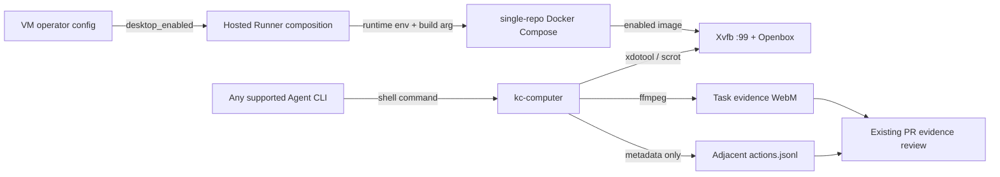

# PRD: KedaCode 托管 Runner 桌面交互与操作录屏

> ⛔ **交付前置**：作为 #269 托管 Runner 的后续能力，沿该 PR 分支叠加交付；没有客户专属 Linux VM 与仓库 Runner 时，桌面操作没有隔离执行边界。
> 结构化声明见 §8 Delivery Dependencies，**那里是唯一事实源**。
> ⬜ **验收状态**：未开工。
> 本行是 §9 Acceptance Checklist 的投影，**那里是唯一事实源**。

本文分两层：Part A 人审层（§1–4）用于确认用户结果与范围；Part B 执行层（§5–13）供实现者构建、验证并交付。

## Feature Overview (功能一览)

以下是 §10 Functional Requirements 的行为摘要，具体验收以 §1 的行为样例为准。

- **按需启用 Linux 桌面**（FR-1）：托管 Runner 可在客户专属 VM 内启动隔离的虚拟屏幕；默认关闭。
- **任何 Agent CLI 共用操作入口**（FR-2）：通过 shell 执行同一组截图、点击、键盘和滚动命令，不依赖浏览器或某个 Agent 厂商。
- **保存真实操作录屏**（FR-3）：Agent 可把屏幕录像和不含输入文本的动作时间线写入任务证据目录。
- **保持 VM 隔离边界**（FR-4）：屏幕只在 Runner 容器内可访问，不开放 VNC/桌面端口，不挂载 Docker socket。
- **不影响原有托管工作流**（FR-5）：未启用桌面时继续使用精简 Runner；现有浏览器 E2E 和 PR/CI 流程保持原样。
- **提供可执行的配置与使用说明**（FR-6）：运营者可为托管部署启用桌面，Agent 按任务需要录屏，评审者可直接查看结果。

# Part A · 人审层 (Review Layer)

## 1. Introduction & Goals

### Problem Statement

托管 Runner 当前运行于 `python:3.13-slim` 容器，没有图形显示服务器、桌面窗口管理器或通用输入设备控制工具。Keda 已有的 `browser_e2e` 入口要求脚本启动浏览器并操作网页，因此不能证明 Agent 在 VM 内实际操作了其他 Linux 图形应用，也没有面向这类操作的录屏入口。

这让需要打开真实应用、检查其界面并留下视频凭据的通用任务只能退回文字描述或项目自建脚本；Agent 本身又已经在客户专属 VM 的 Runner 中执行，图形操作和录屏应留在同一隔离边界内完成。

### Interpretation (解读回显)

我把你的决定理解为：为 KedaCode 托管 Runner 增加一个**可选的 Linux 桌面操作能力**。Agent 在客户 VM 内使用与 Agent CLI 无关的命令观察屏幕并发送点击、键盘和滚动输入；执行图形任务时可以录下实际屏幕，并把视频及动作时间线写入任务证据。它面向任意已在 Runner 环境中可启动的 Linux 图形应用，浏览器只是其中一种应用。

| 验证方式 | 输入 / 操作 | 期望观察到的结果 |
|---|---|---|
| 👀 人审 + 自动验证 | 运营者将托管 Runner 桌面功能设为启用并启动仓库 Runner | 同一客户 VM 内的 Runner 启动虚拟屏幕；从该 Runner shell 发出的截图、点击、按键和滚动作用于屏幕中的真实图形界面，且无需 VNC 端口。 |
| 👀 人审 + 自动验证 | Agent 对一个 Linux 图形应用开始录屏、实际执行至少一次操作并结束录屏 | 任务证据中出现可播放的视频，以及逐条记录动作种类、时间和位置的轨迹；录屏来自 Runner 中的真实屏幕，而不是合成画面或 Playwright 脚本输出。 |
| 🤖 自动验证 | 运营者不启用桌面功能并启动现有 Runner | 不启动虚拟屏幕；桌面命令明确提示功能未启用，原有 daemon/Runner 启动和 CI 验证路径继续工作。 |
| 🤖 自动验证 | Agent 在未录屏时操作图形界面，或在没有活动录屏时请求停止录屏 | 操作仍可运行；停止命令返回明确错误，不伪造视频或空轨迹。 |
| 🤖 自动验证 | Agent 用标准输入向界面输入文本，再停止录屏 | 动作轨迹只记“输入动作”和字符数，不保存文本内容、密钥或口令；视频由任务作者自行检查后决定是否作为证据发布。 |

表中每一行的动作和结果会成为 §7.6 对应 oracle；改动一个行为单元格就是改验收标准。

**我默默定了这些**

- 先支持运行在 Linux 客户 VM 中的 Hosted Runner；不控制开发者 Mac 的宿主桌面，也不远程连接另一台 VM 的桌面。
- `[agent_runner.hosted].desktop_enabled` 默认 `false`；启用后按需构建包含虚拟屏幕、窗口管理器和录屏/输入工具的 Runner 镜像。
- Agent 通过一个供应商无关的命令行工具发起桌面动作；不要求 Claude/Codex/Kimi 各自配置独立的浏览器自动化 SDK 或 MCP。
- 录屏由 Agent 在需要呈递视觉证据的任务中显式开始、停止并指定输出路径；不自动录制每个 Issue 或常驻采集屏幕。
- 录屏输出用 WebM；动作轨迹记录时间、动作类别、点击坐标和输入长度，不记录输入文本。
- 不开启 VNC/noVNC 或其他交互端口；Agent 和 UI 工具通过 Runner 容器内的本地显示会话通信。
- 第一版支持通用 X11 窗口和键鼠操作；目标应用及其自身运行依赖由目标仓库或 VM 预装，本 PR 不猜测、不自动安装应用。

**我理解为不做**

- 不控制 macOS/Windows 宿主屏幕、手机或物理设备，也不提供给人类用户远程桌面入口。
- 不自动安装浏览器或任意产品应用；不把 `browser_e2e` 改造成通用桌面自动化脚本。
- 不自动录制每个 Agent 任务，不自动识别/删改视频里的隐私信息，也不自动上传到公开存储。

具体来说，这项能力运行在托管 Agent 已使用的客户专属 Linux VM 和仓库 Runner 容器内。Agent 使用普通 shell 调用图形操作工具；本地 X11 显示流和录屏都不跨出容器端口。录屏文件由 Agent 保存到任务证据路径，现有 PR 证据流程仍负责筛查并向评审者呈递。配置关闭时，Runner 不启动图形桌面，现有行为保持不变。

### What The User Gets

部署者可以按需给一个 Hosted Runner 配置 Linux 虚拟桌面。Agent 能像操作本地电脑一样观察屏幕、点击、输入和滚动任意可启动的 Linux 图形应用，并在任务要求时保存实际操作视频和动作轨迹。评审者可在 PR 证据中播放这段录屏，看到 Agent 确实经过界面操作得到了观察结果。

### Measurable Objectives

- 默认配置下，Hosted Runner 不启动 Xvfb/Openbox；桌面命令失败并清楚说明如何启用。
- 启用后，从 Runner 真实入口可获取非空 PNG、执行点击/按键/滚动，并生成可由 `ffprobe` 解析且时长大于零的 WebM。
- 操作轨迹与视频同次生成，包含动作类型、时间和坐标/字符数，不含输入文本。
- Hosted Compose 仍无 `ports` 暴露、Docker socket 挂载、项目 DB/Redis/queue 服务；虚拟 X11 server 不监听 TCP。

## 2. Human Review Map (介入与风险地图)

### 在客户 VM 内提供可选的桌面操作与录屏

推荐将虚拟显示、输入控制与录屏放在已按客户隔离的 Hosted Runner 容器内，由 Agent 使用一个通用命令行入口驱动。功能默认关闭，启用后运行时依赖随镜像按需构建；桌面不监听外部网络端口，视频也不会自动传出客户仓库。这样 Agent 能处理浏览器之外的真实图形应用，同时仍遵守现有每客户 VM 边界。

主要风险是图形会话和录屏可能显示客户数据或凭据；如果启用后对外提供桌面服务、默认录制所有工作，或把凭据输入写进动作轨迹，影响范围会明显变大。

**请确认：**接受“托管 Linux VM 内、默认关闭、Agent 显式控制和录制、无 VNC 端口、文本输入不写入轨迹”的交付边界吗？

**验收：**打开录屏能看到 Runner 中实际发生的 GUI 操作；关闭功能时现有 Runner 不启动桌面；Compose 与监听检查证明桌面没有公网/宿主机入口。

**自动门禁，不需要逐项人工审阅：**桌面开/关配置、Linux 容器入口、动作和 WebM 输出、录屏停止语义、Compose 网络/挂载边界及 CLI 文档由执行器通过真实容器运行、产物解析与静态门禁验证。

**本次明确不涉及：**前端页面、远程人类桌面、Mac/Windows 宿主控制、应用自动安装、数据库或 CI required check 语义。

## 3. Usage And Impact After Implementation

### Hosted Runner 运维人员

运维人员在客户 VM 的 `[agent_runner.hosted]` 配置中显式启用桌面能力后，照常从托管 Console 启动仓库 Runner。镜像构建包含虚拟显示与输入/录屏工具，Runner 启动图形会话但不开放端口；未启用时无需变化。运维人员不需要向客户开放 VM shell 或 VNC。

### 运行在 VM 内的 Agent

Agent 仍从现有 Issue/daemon/Runner 流程开始工作。需要实际 GUI 时，它启动目标应用并使用通用桌面命令读取屏幕、点击、按键或滚动；需要交付视觉凭据时，它在操作前开始录屏、完成后停止录屏，并把 WebM 和动作轨迹保存到关联 PRD 的 evidence 目录。Agent CLI 厂商、项目技术栈和目标应用类型不会改变该命令契约。

### PR 评审者

评审者仍通过现有 PR 和 evidence review 入口检查任务结果；当任务包含 GUI 操作时，可以直接播放视频并阅读动作轨迹。视频是否适合公开呈递仍由任务 evidence 发布流程决定，功能不会自动上传它。

### 目标应用的使用者

Agent 以外的产品使用者的页面、API、安装或交付过程均不变化。现有 Runner 默认不运行 GUI，也不改变 `browser_e2e`、Issue/PR 生命周期及 GitHub CI 的验收责任。

## 4. Requirement Shape

- **actor：**Hosted Runner 运营人员、在 Runner 容器中运行的任意受支持 Agent CLI、PR 评审者。
- **trigger：**运营人员选择启用托管桌面；Agent 处理需要观察/操作真实 GUI 的任务，并在需要呈递时显式录屏。
- **expected behavior：**Runner 容器内创建本地 X11 会话；统一 shell 命令驱动实际输入、截图和 WebM 录制；安全动作轨迹与视频保存在任务指定路径。
- **explicit scope boundary：**仅 Hosted Runner 的 Linux 容器；默认关闭；无远程桌面端口和浏览器专用绑定；不控制宿主机、不自动录制、不处理应用安装。

# Part B · 执行器层 (Build Layer)

## 5. Repository Context And Architecture Fit

- **现有路径：**托管 Console 通过 `ComposeRunnerControl.start_runner` 启动单仓库容器；`docker-compose.runner.hosted.yml` 定义无对外端口的 Runner；`Dockerfile.runner` 安装 CLI 工具并通过 `kedacode-runner-entrypoint.sh` 降权后运行 daemon。
- **可复用候选：**Hosted Settings 的默认/校验模式、`ContainerUpRequest.extra_env`/`build`、托管 Compose 的运行时环境、Runner 包资产、`kedacode-operator` skill，以及 Agent Runner evidence 对视频和 JSONL 文本的现有支持。
- **可观察事实：**当前 `Dockerfile.runner` 只安装 Python/Node/agent CLI/gh/uv/just/git；没有 Xvfb、X11 窗口管理器、xdotool、scrot 或 ffmpeg。`browser_e2e` 要求浏览器脚本且不会提供跨应用的键鼠控制。
- **架构约束：**托管隔离单位仍是客户专属 Linux VM 与每仓库容器。沿用既有配置和 Compose 启动链，不新增服务、HTTP/MCP 端口、宿主 Docker socket、数据库或客户项目 middleware；Agent 的现有 shell 子进程环境会透传 `DISPLAY`。
- **Frontend impact：**No frontend impact。功能通过 VM 配置、Runner shell 命令和视频证据交付，不增加用户页面或 HTTP 契约。
- **已有 PRD 关系：**依赖并扩展 `tasks/archive/P1-FEAT-20261009-161453-kc-hosted-runner-deployment.md` / PR #269 的托管 VM Runner；本需求改变功能范围，所以作为关联 follow-up PRD，不原地改写已归档任务。当前 `tasks/pending/P1-FEAT-20261011-160913-verifier-human-takeover.md` 不涉及桌面执行，和本任务独立。
- **潜在冗余：**已有 `browser_e2e` 是验证命令形态而不是 Agent 可交互的显示会话，不应复用/扩张为 OS 桌面 API。多 Agent 的 shell 是通用入口，因此无需再分别维护 Claude/Codex/Kimi 工具适配。
- **分拆评估：**开/关配置、运行时与操作命令、录屏及动作轨迹共同组成一个从隔离桌面到可审查证据的闭环；分别交付会留下“可操作但无证据”或“有录屏但 Agent 无法操作”的中间态，不拆成多个 PRD。

## 6. Recommendation

### Recommended Approach

扩展当前托管 Runner 镜像和启动流程：新配置默认关闭；启用时镜像才安装 Xvfb、Openbox、xdotool、scrot、ffmpeg 等通用 Linux 桌面组件，启动时在容器内创建只使用 Unix socket 的虚拟显示。随包提供供应商无关的 `kc-computer` CLI，Agent 经已有 shell 工具调用截图、点击、输入、按键、滚动、录屏开始/停止；录屏输出 WebM，并生成不含输入内容的 JSONL 动作轨迹。Operator skill 教 Agent 在需要 GUI 证据的任务中显式使用录屏命令。

这条路径复用现有单仓库容器、配置、Compose、entrypoint、shell 能力和 evidence 归档习惯。`kc-computer` 是容器内执行工具，不引入新的 core/API 服务层；图形设备不是某个特定应用或浏览器的职责，因此用标准 X11 命令行实现比复制多个 Agent SDK 更小。

### Proposed Solution Summary (实现机制)

由 VM 运维人员在 `[agent_runner.hosted].desktop_enabled` 显式提供开/关值；系统不从 issue 文案或目标仓库推断是否安装桌面。`ComposeRunnerControl` 把该值传给 Compose 运行环境和 Docker build arg，启用时构建图形依赖；降权后的 Runner entrypoint 启动 Xvfb `:99` 与 Openbox。随镜像的 `kc-computer` 调用 xdotool/scrot/ffmpeg 驱动同一显示会话。录制过程中，CLI 将动作元数据逐行写入与 `.webm` 同目录的 `.actions.jsonl`，不保存键入文本。现有 evidence artifact 验证和 PR 发布路径消费 Agent 所选视频路径；不增加持久化表、远程桌面 API、Agent 专属 adapter 或服务状态机。

### Alternatives Considered

- **用现有 browser_e2e/Playwright：**只能驱动浏览器并把验证脚本当作任务入口，不支持任意 Linux 图形应用；会把通用 Agent 使用与项目 E2E 测试混为一谈。
- **VNC/noVNC + WebSocket/HTTP 控制服务：**能让人远程观看/控制，但增加公网攻击面、反向代理配置、认证与生命周期服务，本任务只需 VM 内的 Agent 操作和视频证据。
- **按 Claude/Codex/Kimi 分别集成 computer-use SDK/MCP：**依赖供应商能力和版本，不能保证其他 Agent CLI 共用；现有 Agent 都能运行 shell 命令，统一 CLI 更小。

## 7. Implementation Guide

This section is a living implementation guide based on current repository analysis. If implementation discovers additional affected files, hidden dependencies, edge cases, or a better path, update this PRD before proceeding.

### Core Logic

1. Hosted Settings 校验 `desktop_enabled`（默认 `false`）。`ComposeRunnerControl` 在启动时把值传入 `KEDACODE_DESKTOP_ENABLED`，并在启用时要求 Compose 依据 build arg 构建桌面镜像。
2. 两份 runner Compose 模板都显式绑定 build arg 与运行时开关默认值；Hosted 模板继续只挂目标仓库、专属认证路径和 named state volume，不增添端口或 host socket。
3. 只有启用的镜像包含 Xvfb/Openbox/xdotool/scrot/ffmpeg。entrypoint 以 runner UID 启动 Xvfb `:99`（`-nolisten tcp`）和 Openbox，等待显示 socket 后才启动 `kedacode daemon`；图形启动失败时 Runner 非零退出。
4. `kc-computer` 验证显示环境及参数后调用实际系统工具。文字只从 stdin 传给 xdotool；动作轨迹记录事件类型、坐标、时间或字符数，不写输入文本。录屏 start/stop 使用本地权限受限的状态文件，并在 stop 后检查 WebM 可解码。
5. Operator skill 说明同一条 shell 命令可被所有已配置 Agent 使用，并要求有视觉呈递需求时由 Agent 显式开始/结束录屏并保存到正确的任务 evidence 路径。现有 browser_e2e 不变。

### Change Impact Tree

```text
.
├── src/backend/infrastructure/config/agent_runner_hosted_settings.py [修改]
│   【总结】增加默认关闭的 Hosted Runner 虚拟桌面开关。
├── src/backend/engines/agent_runner/hosted_console_composition.py [修改]
│   【总结】按配置传递桌面开关，并在启用桌面时触发 Runner 镜像构建。
├── src/backend/engines/agent_runner/templates/runner_container/Dockerfile.runner [修改]
│   【总结】只在桌面 build arg 开启时安装 Linux 图形、输入、截图与录屏组件。
├── src/backend/engines/agent_runner/templates/runner_container/docker-compose.runner.hosted.yml [修改]
│   【总结】把受控的 Hosted 桌面开关接到 build 和 runtime，同时保持无 ports/socket。
├── src/backend/engines/agent_runner/templates/runner_container/docker-compose.runner.yml [修改]
│   【总结】本地 Compose 默认关闭桌面并提供同一镜像 build 参数。
├── src/backend/engines/agent_runner/templates/runner_container/kedacode-runner-entrypoint.sh [修改]
│   【总结】桌面模式下以 runner 用户启动带健康等待的图形进程入口。
├── src/backend/engines/agent_runner/templates/runner_container/kedacode-runner-desktop-entrypoint.sh [新增]
│   【总结】启动本地 Xvfb/Openbox，不开放 TCP，并在失败时阻止 daemon 假绿启动。
├── src/backend/engines/agent_runner/templates/runner_container/kc-computer [新增]
│   【总结】提供供应商无关的键鼠、截图、录屏与安全动作轨迹命令。
├── src/backend/engines/agent_runner/templates/skills/kedacode-operator/SKILL.md [修改]
│   【总结】教 Agent 按任务需要使用桌面命令和将录屏写入任务 evidence。
├── config.toml [修改]
│   【总结】展示默认关闭的 Hosted Runner 桌面配置。
├── src/backend/engines/agent_runner/templates/runner_container/.env.example [修改]
│   【总结】说明直接 Compose 用户的桌面开关和镜像 profile。
├── docs/guides/agent-runner.md [修改]
│   【总结】说明 Hosted 桌面配置、运行边界、操作命令和录屏产物。
├── docs/getting-started/installation.md [修改]
│   【总结】介绍托管 VM 中 Agent 可选桌面操作能力。
├── tasks/evidence/P2-FEAT-20261016-152354-hosted-desktop-interaction/P2-FEAT-20261016-152354-hosted-desktop-interaction.verification-plan.md [新增]
│   【总结】记录 rv-1/rv-2/rv-3 的真实入口、步骤和边界。
├── tasks/evidence/P2-FEAT-20261016-152354-hosted-desktop-interaction/P2-FEAT-20261016-152354-hosted-desktop-interaction.evidence-report.md [新增]
│   【总结】索引配置、负控、真实容器、录屏与残余门禁。
├── tasks/evidence/P2-FEAT-20261016-152354-hosted-desktop-interaction/P2-FEAT-20261016-152354-hosted-desktop-interaction.verifier-report.md [新增]
│   【总结】明确独立 verifier 未运行，作为 pending review incident 留档。
├── tasks/evidence/P2-FEAT-20261016-152354-hosted-desktop-interaction/evidence.json [新增]
│   【总结】为机器检查索引真实 Compose、录屏、负控和隔离证据。
└── tasks/pending/P2-FEAT-20261016-152354-hosted-desktop-interaction.md [新增]
    【总结】记录用户已确认的需求解释、架构决策和验收 oracle。
```

同目录的 `human-review-checklist.html`、原始视频、截图、动作轨迹和命令捕获件遵守 `.gitignore`，只作为本地 review bundle，不进入 Git 影响树或代码 diff。

上述列表是起始清单而非完整影响扫描；任何新增路径都要回填本树并由 Executor Drift Guard 复查。

### Risk Classification Register

| 变更点 | 层 | 等级 | 决定因素 | 介入方式与失败区分门禁 |
|---|---|---|---|---|
| Hosted VM 的显示/输入信任边界与视频采集 | infrastructure / docs | R3 | 屏幕可能包含客户私密数据；错误监听可能变成客户 VM 的远程控制入口 | 人工确认 §2；rv-2 真实 Docker Runner 操作、ffprobe + 视频/图片呈递；rv-3 负控检查无 TCP/VNC/host socket 暴露及默认关闭 |
| Agent CLI 通用键鼠命令 | infrastructure | R2 | 跨 Agent 和任意 X11 程序；显示环境不可用时可能误报动作成功 | rv-2 实际 Runner shell 触发 X11 click/key/scroll 并复读屏幕；rv-1 验证关闭后 fail-closed |
| WebM 与动作轨迹文件 | infrastructure / docs | R3 | artifact 可能含客户资料；文本输入进入日志会导致口令/PII 泄露 | 人工确认 §2；rv-2 录屏真实屏幕并独立解析文件；rv-3 trace 不含键入内容，输入负控可证红 |
| Hosted config 到 Compose build/run 开关 | infrastructure | R1 | 单个 Hosted Settings/Compose 配置路径 | rv-1 用配置模型与真实 Compose 展开输出确认 default-off/opt-in build arg |
| Operator skill 与部署指南 | docs | R0 | 信息同步 | `rg` 对照配置名、命令和证据路径 |

### Executor Drift Guard

实现前/交付前重跑以下语义搜索；实现位置、包资源或托管装配改变时先更新本 PRD：

```bash
rg -n "class AgentRunnerHostedSettings|desktop_enabled|hosted_request|class ComposeRunnerControl" src/backend
rg -n "Dockerfile.runner|docker-compose.runner.hosted.yml|kedacode-runner-entrypoint.sh" src/backend/engines/agent_runner
rg -n "browser_e2e|ArtifactSpec|video/webm|actions.jsonl|ffprobe" src/backend docs/guides/agent-runner.md
rg -n "ports:|docker.sock|KEDACODE_RUNNER_AUTH_DIR" src/backend/engines/agent_runner/templates/runner_container
rg --files tasks/pending tasks/archive | rg 'hosted|desktop|computer|runner'
```

清单只是起点；`just prd status` FILES 列显示为未触达的目标文件时，先定位遗漏再检查分支 diff。

### Flow / Architecture Diagram



### ER Diagram

No data model changes in this PRD.

### 7.6 Realistic Validation Plan

```yaml
- id: rv-1
  behavior: "桌面关闭时不启动图形服务且桌面操作 fail-closed；显式启用后 Hosted Compose 构建带桌面支持的镜像"
  reviewer: verifier
  real_entry: "在仓库根运行 `uv run python -c 'from backend.infrastructure.config.agent_runner_hosted_settings import AgentRunnerHostedSettings; assert not AgentRunnerHostedSettings().desktop_enabled'`，再用 `docker compose -f src/backend/engines/agent_runner/templates/runner_container/docker-compose.runner.hosted.yml config` 展开默认关闭和启用配置"
  expected: "默认值 false；启用配置导出的 build arg/runtime env 为 true；默认 Runner 中桌面命令返回非零且不创建 Xvfb/ffmpeg 进程"
  mock_boundary: "配置解析、Compose 插值、容器 entrypoint 和桌面命令保持真实；不得 mock Compose YAML 或替代显示进程"
  tier: R2
  test_layer: smoke
  required_for_acceptance: true
  critical_value_source: "AgentRunnerHostedSettings.desktop_enabled 的解析结果；Compose 真实读取该开关并由 ComposeRunnerControl 的 extra_env 传入"
  must_cross: "Hosted Settings → ComposeRunnerControl.start_runner → docker compose build args/environment → runner entrypoint → fresh kc-computer process"
  forbidden_bypasses: "直接运行模板中的 Xvfb 而绕过 Compose；在 shell 手工覆盖 runtime 环境后把它算作 config 已生效；只检查 Dockerfile 文本"
  fresh_state_probe: "通过真实 Hosted Compose 启动启用态 Runner，再由新的 `docker exec` 进程运行 `kc-computer status` 并扫描 `/proc`；关闭态用独立 `docker compose run --pull never` 执行状态/截图/录屏命令，确认全部非零失败"
  final_tree_evidence: "记录最终提交 tree 和 Compose config、默认关闭/启用 fresh-container 输出；任何 Dockerfile、Hosted Settings、Compose 或 entrypoint 变更后重跑"
- id: rv-2
  behavior: "Agent 在 Linux GUI 中执行实际屏幕操作，并保存可播放的真实录屏及动作轨迹"
  reviewer: human
  real_entry: "运行 Hosted Compose 桌面 Runner；从 Runner 内用 `kc-computer record start --output <repo>/tasks/evidence/P2-FEAT-20261016-152354-hosted-desktop-interaction/rv-2-desktop-menu-selection.webm` 开始，右键打开 Openbox 菜单并点击 `Reconfigure`，最后 `kc-computer record stop`"
  expected: "真实 Runner 截图显示菜单打开与点击后的关闭状态；新生成的 WebM 可由 ffprobe 解析且时长大于零；相邻 JSONL 有点击时间/坐标且不含键入文本"
  mock_boundary: "Docker daemon、Runner Compose、Xvfb、Openbox、xdotool、scrot 和 ffmpeg 必须真实；不使用浏览器、Playwright、截图合成器或远程桌面旁路"
  tier: R3
  test_layer: manual
  required_for_acceptance: true
  presentation: "`tasks/evidence/P2-FEAT-20261016-152354-hosted-desktop-interaction/rv-2-desktop-menu-selection.webm`（PR evidence 页面内可播放）；`rv-2-desktop-menu.png` 和 `rv-2-desktop-after-action.png` 分别呈递菜单打开与点击后关闭画面。可选 10 秒自检：播放视频并核对 adjacent `.actions.jsonl` 中右键与菜单项点击坐标。"
  critical_value_source: "Compose 展开后的真实 `KEDACODE_DESKTOP_ENABLED=true` 和 Runner 内 `DISPLAY=:99`；Agent 传入的确切录屏输出路径"
  must_cross: "Hosted Settings → Compose build/run →降权 Runner entrypoint → 本地 X11 socket → Openbox 窗口菜单 → kc-computer/xdotool 输入 → ffmpeg X11 capture → WebM/JSONL 文件 → fresh ffprobe/JSONL read"
  forbidden_bypasses: "宿主机屏幕录制、浏览器录屏、Playwright、预制视频/图片、手工写入证据文件、直接在容器外调用 xdotool"
  fresh_state_probe: "停止 recorder 后由新 ffprobe 进程解析 WebM，再以新 Python 进程解析 JSONL 并断言菜单点击/时间条目存在、文本样本不存在；菜单开合另由两张 X11 截图呈递"
  final_tree_evidence: "把命令输出与 artifact SHA-256 记录到 evidence report；绑定最终 record-excluded tree；任何 X11 启动、命令、recorder、输出路径或断言变更后重录"
  negative_control: "先在受控 GUI 输入 `trace-secret-sentinel` 并检查 `rv-2-desktop-operation.actions.jsonl`；另以 `desktop_enabled=false` 启动容器后运行 `status`、`record start` 与 `screenshot`"
  expected_fail: "负控版本若把 stdin 文本写入 trace，则 sentinel 搜索必须命中并使 oracle 失败；关闭配置后 start/screenshot 必须非零，且不能得到新 WebM"
- id: rv-3
  behavior: "桌面只能通过 VM 内 Runner 本地显示访问，且 Compose 不暴露远程桌面或宿主 Docker 权限"
  reviewer: verifier
  real_entry: "使用 `docker compose -f src/backend/engines/agent_runner/templates/runner_container/docker-compose.runner.hosted.yml config` 展开 Hosted Compose；桌面启用后用 `docker inspect` 和 `/proc/net/tcp{,6}` 读取端口/挂载，并从 `/proc` 核对 Xvfb 参数"
  expected: "Compose 没有 `ports` 映射或 `/var/run/docker.sock`；Xvfb 参数含 `-nolisten tcp`；监听列表不含 X11 6000+、VNC 5900+ 或 noVNC web 端口"
  mock_boundary: "实际 Compose 展开、实际 Runner 容器进程参数、socket 与监听端口保持真实；不以静态 grep Dockerfile 替代运行态检查"
  tier: R3
  test_layer: smoke
  required_for_acceptance: true
  critical_value_source: "Runner 实际展开的 compose config、容器的 `/proc` 进程参数/网络表和 `docker inspect` 输出"
  must_cross: "Hosted Settings → Compose build/run → 容器挂载/网络 → Xvfb 启动参数 → fresh `/proc`/`docker inspect` 读取"
  forbidden_bypasses: "只检查 local Compose；用未启用 desktop 的容器代替启用态；忽略宿主 socket 或继承端口映射"
  fresh_state_probe: "从另一条新 `docker inspect` 和容器内 `/proc/net/tcp{,6}` 读取启动后的真实挂载、端口与进程状态；把无进程 owner 的 Docker loopback 网络 socket 和公开服务端口分开记录"
  final_tree_evidence: "记录容器 image id、Compose 展开结果和最终 tree；Compose、entrypoint 或 VM 网络/挂载配置变更后重跑"
  negative_control: "临时将 Docker Compose 检查输入改为一个声明 VNC `ports` 映射的 YAML，并将 Xvfb 参数负控替换为允许 TCP 的启动行"
  expected_fail: "启用远程端口/允许 X11 TCP 的负控必须被边界检查拒绝；实际产品配置恢复无端口/`-nolisten tcp` 后通过"
```

#### Oracle 失败排查

优先检查 Docker daemon 是否可用、Hosted Settings 是否从当前分支加载、Compose `KEDACODE_DESKTOP_ENABLED` 插值、Xvfb `/tmp/.X11-unix/X99` socket、Openbox 启动日志、ffmpeg 的 `x11grab/libvpx` 支持和目标 evidence 目录权限。Docker 不可用时保留无凭据的配置/Compose 检查，但不得把它记作真实 Runner 验证通过。

### External Validation

No external validation required; repository evidence was sufficient.

## 8. Delivery Dependencies

- Depends on tasks/issues:
  - `tasks/archive/P1-FEAT-20261009-161453-kc-hosted-runner-deployment.md` / #269
- Gate type: soft
- Sequence: stack
- Notes: 用户要求把本 follow-up 直接追加到 #269；依赖的是该 PR 的客户专属 Linux VM、容器和 Hosted Compose 边界。当前远端 PR head 已提供这些基础路径；软依赖记录历史与审阅关系，不阻止在同一分支叠加。

## 9. Acceptance Checklist

### 9.1 人读呈递区（Human Review Surface）

| 要看的结果 | 呈递入口 | 约 10 秒自检 |
|---|---|---|
| Agent 在 Linux 桌面菜单中真实点击并录下结果；WebM 可播放，动作轨迹与点击时间相符。 | 本地 review bundle：`tasks/evidence/P2-FEAT-20261016-152354-hosted-desktop-interaction/human-review-checklist.html`。PR #269 的 WIP comment 给出本 worktree 的单条 `open` 命令；也可直接打开视频：`open "<repo>/tasks/evidence/P2-FEAT-20261016-152354-hosted-desktop-interaction/rv-2-desktop-menu-selection.webm"`。 | 看视频菜单打开后被实际点击关闭；再看 `rv-2-desktop-menu-selection.actions.jsonl` 是否有对应右键与菜单项点击。 |

`reviewer: verifier` 的组（rv-1 默认关闭/启用边界、rv-3 Compose/端口/挂载安全、构建与文档门禁）不在此呈递区，只在 §9.2 由执行器/独立 verifier 审阅。

### 9.2 Acceptance Evidence Package

#### Human-Confirmed (来自 Part A 风险地图)

- [ ] Hosted Runner 的桌面能力默认关闭、无 VNC/公开端口、Agent 显式控制录屏、动作轨迹不记录输入文本，且目标是 Linux 图形应用而非浏览器专用流程；人工审阅 rv-2 的实际操作视频及轨迹。— 证据：`rv-2-desktop-menu-selection.webm`、`rv-2-desktop-menu-selection.actions.jsonl`、`rv-2-desktop-operation.actions.jsonl` 哨兵负控与 Hosted Compose 端口检查；请回复“接受”或列出需要修正的边界。
- [ ] §9.1 呈递面已通过 PR comment 指向的本地 review bundle 可播放，并清楚标识运行环境与人工自检路径。— 证据：PR #269 WIP comment 和 `human-review-checklist.html`；人工验收前不发布稳定 verifier evidence marker。

#### Architecture Acceptance

- [ ] Hosted Settings 新字段默认 false；只有 true 才传递桌面 runtime env 和 build arg，相关证据见 `rv-1-hosted-desktop-config.txt`。
- [ ] Hosted Compose 仍是单 Runner service，无 `ports`、Docker socket、DB/Redis/queue；运行态进程只使用本地 X11 socket，证据见 `rv-3-hosted-isolation.txt`。

#### Behavior Acceptance

- [ ] `kc-computer` 实际截图、键鼠与录屏命令正确处理参数、无活动显示/无录制状态，并在失败时非零返回；真实容器入口证据见 `rv-2-desktop-menu-selection.webm`、`rv-2-desktop-menu-selection-cli.txt` 与 `rv-2-hosted-desktop-cli.txt`。
- [ ] 录屏 fresh probe 证明 WebM 可解析、时长大于零，动作轨迹有动作/时间且无文本 sentinel，证据见 `rv-2-desktop-menu-selection.actions.jsonl`、`rv-2-desktop-operation.actions.jsonl` 与 `rv-2-media-probe.txt`。

#### Documentation Acceptance

- [ ] `docs/guides/agent-runner.md`、Hosted config reference 与 `kedacode-operator` skill 使用相同配置名、CLI 用法、证据路径和默认关闭语义；`rg -n "desktop_enabled|kc-computer|rv-2-desktop-menu-selection" docs src/backend/engines/agent_runner/templates` 输出已检查。

#### Validation Acceptance

- [ ] `docker compose ... config` 默认/启用配置与 Hosted Settings 一致；真实 Hosted Compose Runner 在 VM/容器边界启动、完成实际 GUI 操作并产出新鲜 video/trace；证据报告记录原命令、输出、artifact SHA-256、image id 和 record-excluded tree。
- [ ] 负控证明 desktop disabled 不能产生 GUI 证据；输入文本 sentinel 不出现在 actions trace；允许 VNC/TCP 的 Compose/Xvfb 负控被边界 oracle 拒绝。

#### Delivery Readiness

- [ ] 实现、文档及可提交 evidence 文件触达 `just prd status` Change Impact Tree；`just lint --reuse`、静态 hooks（`SKIP=check-test-flag just lint --full`）、目标 Docker build/real-entry smoke 完成并记录；自动化测试套件未运行，待补验证后再判断是否存在未解决产品缺陷。
- [ ] 独立 verifier 对同一最终 tree 的 rv-1/rv-2/rv-3 结论为 PASS；若无法启动独立 verifier，标记 review incident 并保持 PRD 在 pending。
- [ ] PR #269 描述与稳定 evidence comment 呈递 §9.1，并说明合并 #269 表示接受本 PRD 的 §2 决定与可见结果；私有/客户凭据未进入提交或证据。

## 10. Functional Requirements

- **FR-1: Opt-in Linux desktop runtime**：`[agent_runner.hosted].desktop_enabled` 默认 `false`。为 `true` 时 Hosted Runner 按需构建并启动 Xvfb/Openbox；启动失败应使 runner 明确失败，不得假装图形能力可用。目标显示绑定 `:99`，X server 禁止 TCP listen。
- **FR-2: Agent-neutral interaction CLI**：Runner 镜像提供可由所有 shell-capable Agent CLI 使用的 `kc-computer` 命令：status、screenshot、click、从 stdin 读取文本的 `type`、key、scroll。参数范围有界，调用系统命令使用 argv 而不是 shell 拼接；没有活动显示时返回非零。
- **FR-3: Real screen recording and trace**：`kc-computer record start --output <file.webm>` 捕获真实 X11 屏幕；stop 结束录制并检查输出可解码。相邻 `.actions.jsonl` 记录 UTC 时间与 click/key/scroll/screenshot/type 动作元数据；type 仅写长度，不写文本/按键内容。每次录制同时只允许一个 recorder；无活动录制时 stop 明确失败。
- **FR-4: Preserve hosted trust boundary**：Hosted Compose 没有端口暴露、Docker socket、项目 DB/Redis/queue 服务；Agent 与应用在同一客户 VM/Runner 信任边界。视频路径由 Agent 明确指定且不会自动上传。
- **FR-5: Existing path compatibility**：未启用桌面时不安装桌面 OS 包、不启动 Xvfb/Openbox；本地 Runner、Hosted Console、Issue/PR 生命周期及 `browser_e2e` 既有契约不变。
- **FR-6: Operator and Agent instructions**：同步 hosted config reference、Runner guide、Compose/Dockerfile 说明和 `kedacode-operator` skill；文档明确应用自身依赖由目标仓/VM 提供、录屏由任务作者选择并审核。

## 11. Non-Goals

- 直接操控宿主 Mac/Windows、物理桌面、移动设备或另一台 VM；不提供 VNC/noVNC/SSH/网页远程控制端口。
- 不把项目应用、浏览器、项目数据库、消息队列或服务依赖纳入 Runner 基础镜像；不自动发现/安装目标产品。
- 不用 Playwright/browser_e2e 实现桌面控制；不要求某个 Agent provider 的 MCP 或专属 computer-use API。
- 不默认录像所有工作，不自动上传视频，不自动遮挡视频，也不把客户截图当作公开安全数据。
- 不改动 Agent Runner Console 前端、GitHub CI required checks、PR 自动合并或客户凭据协议。

## 12. Risks And Follow-Ups

- 桌面录屏可能显示客户数据或凭据。默认关闭且显式启停可减少无意采集；Operator skill 要提醒 Agent 避免记录秘密屏幕，并在 PR 发布前使用现有 secret/evidence scanner。录屏原始文件遵守 evidence 原始产物不入代码库的约定。
- 可选图形依赖会增加启用桌面后的镜像大小和首次 build 时间；关闭时 build arg 必须保持 false，避免普通 Hosted Runner 为未使用能力承担成本。
- 客户 VM 可能受 seccomp、缺少共享内存或宿主桌面限制，导致 Xvfb/ffmpeg 不可启动；启动错误和失败路径须可诊断，不能静默降级成空录屏。
- 第一版提供 Linux X11 的标准键鼠和屏幕流；目标应用是否能在该镜像中启动取决于目标仓/VM 提供的应用与依赖，不承诺兼容每个 GUI toolkit。

## 13. Decision Log

| ID | 决策问题 | Chosen | Rejected | Rationale |
|---|---|---|---|---|
| D-01 | Agent 如何获得与厂商无关的 GUI 操作能力？ | 在 Hosted Runner 提供 `kc-computer` shell CLI，操作容器内 X11 | 为每个 provider 增加各自 MCP/SDK；依赖仅浏览器 Playwright | 所有当前 Agent 都可调用 shell，CLI 可对任意 Linux X11 程序工作，且不需要新网络服务。 |
| D-02 | 桌面如何进入客户 VM 并暴露给 Agent？ | 默认关闭；启用时条件构建并在 Runner 内用 Xvfb/Openbox；无 TCP/VNC 端口 | 默认全量安装；添加公网 VNC/noVNC 控制面 | 条件安装避免普通 Runner 的体积/启动成本，容器本地显示满足 Agent 访问且保留单客户 VM 边界。 |
| D-03 | 如何保存 Agent 的真实操作证据？ | 显式录制 WebM，并旁写不含文本的动作 JSONL 到 Agent 指定 evidence 路径 | 自动录所有任务；只保存文字摘要；合成截图代替实际屏幕 | 可播放的真实屏幕能证明可见结果，显式启停和只记录元数据降低意外泄密风险。 |

### Final Reconciliation

- Interpretation: implemented as approved — an opt-in Linux desktop inside the Hosted Runner container in the customer VM, operated through the provider-neutral `kc-computer` CLI.
- Public behavior and contracts: `[agent_runner.hosted].desktop_enabled` defaults to `false`; enabled runners receive the separate `iar-runner:desktop` image profile and `DISPLAY=:99`. `kc-computer` provides status, screenshot, click, stdin text input, key, scroll, and explicit WebM record start/stop with a metadata-only JSONL trace.
- Related PRD status: this remains a linked follow-up to the archived Hosted Runner PRD on PR #269. PR #269 is open and draft; this PRD remains in `tasks/pending/` because the independent verifier and remaining validation gates have not completed. The verifier takeover PRD is unrelated.
- Requirements and risks: real Hosted Compose evidence confirms an Openbox menu interaction, screenshots, WebM recording, text-redaction trace, default-off behavior, and the runtime container boundary. It does not prove a customer business application flow. Automated tests and the VNC/TCP mutation negative control were not run; no frontend or data-model changes were made.
- Reconciled differences: the review surface uses a local HTML bundle and a WIP PR comment with a direct `open` command because no authenticated browser surface was available. Raw recordings, screenshots, traces, and command captures remain ignored local evidence; they are not GitHub attachments. The strict documentation build passed after implementation.
