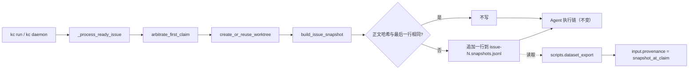

# PRD: 认领 Issue 时留存原始任务输入快照（供数据集样本使用）

> ✅ **交付前置**：无，可立即开工。（与待办中的 M13 评测 PRD 互不依赖：本 PRD 不改数据库，也不碰评测账本。）
> 结构化声明见 §8 Delivery Dependencies，**那里是唯一事实源**。

> ⬜ **验收状态**：未开工。
> 本行是 §9 Acceptance Checklist 的投影，**那里是唯一事实源**。

> 本 PRD 分两个 altitude，分别服务不同读者，自上而下阅读：
>
> - **Part A · 人审层 (Review Layer)** — 需求方 / 验收人读这部分，决定"该不该做、做得对不对"，并通过风险地图知道**哪些地方必须亲自确认**。Part A 不出现实现机制、文件路径、命令。
> - **Part B · 执行器层 (Build Layer)** — 实现者（人或 Agent）读这部分动手。人只在 Part A 风险地图**点名处**下钻审查，其余默认交执行器 + 自动门禁。

## Feature Overview (功能一览)

> 本节是 §10 Functional Requirements 的白话投影；行为验收以 §1 的行为样例为准。

- **认领成功就留一份"当时的任务原文"**（FR-1）：runner 认领一个待实现的 Issue、准备好工作目录之后、Agent 开始干活之前，把 Issue 当时的标题、正文、标签、状态和链接，连同代码起点，写成一条快照记录。
- **正文改了才追加，没改不重复**（FR-2）：同一个 Issue 被重试、换 Agent、续跑时，只要正文没变就不再写；正文被人改过，就追加一条新记录，旧记录原样保留。
- **起点记的是真正的"分叉点"**（FR-3）：复用一个已经有提交的旧工作目录时，记录的代码起点是它与基线分支的分叉点，而不是工作目录当前的最新提交。
- **记录失败不影响交付**（FR-4）：写快照出错（目录不可写、磁盘满）只记一条警告日志，Issue 继续正常执行。
- **数据集导出优先用快照**（FR-5）：导出样本时，任务输入取自最早的快照并标明"认领时快照"；若 Issue 之后又被改过，样本会标出"认领后被编辑"。没有快照的旧 Issue 行为不变。
- **记录格式可演进**（FR-7）：每条快照自带格式版本号；以后加字段只增不改，读取方遇到不认识的版本会跳过并告警，不会读错。
- **文档同步**（FR-6）：运行指南与数据集导出指南说明快照的位置、内容、"只记事实"的边界和限制。

---

# Part A · 人审层 (Review Layer)

## 1. Introduction & Goals

### Problem Statement

用 KedaCode 的执行记录构建 Agent 调优数据集时，每个样本最关键的一项是"任务当时到底是怎么说的"。现在这一项拿不到可靠的值：

- 数据库的运行记录只存了 Issue 标题和链接（`run_records.issue_title` / `issue_url`），**没有正文**；早期运行连标题都是空的。
- 正文只能事后向 GitHub 取（`python -m scripts.dataset_export --with-gh`）。但 Issue 可以被随时编辑，取到的是"现在的样子"，不一定是 Agent 当初看到的样子。
- 对 2026-10 的真实导出（74 个 Issue）而言，70 个靠事后抓取获得原文，0 个能证明它与认领时一致。

结果是：评测题的 prompt 和 Agent 当时做的事可能对不上，而且无法发现。

### Interpretation (解读回显)

我对这个需求的理解：**在 runner 认领一个"待实现"Issue 的那一刻，把 Agent 即将看到的任务输入原样留一份，之后永不改写；任何事后编辑都只能追加，不能覆盖。KedaCode 只负责记录事实（原文、代码起点），不负责判断这条数据好不好——筛选、补验证命令、改写、脱敏由后续的人工与更强的 Agent 在单独的整理层完成。**

#### 行为样例

| 验证方式 | 输入 / 操作 | 期望观察到的结果 |
|---|---|---|
| 👀 人审 + 自动验证 | `kc run` 认领 Issue #7（标题"修复登录页"，正文 B1，当前基线 `abc123`），Agent 随后正常完成 | 本机 KedaCode 状态目录里出现一个按仓库和 Issue 归档的快照文件（Issue #7 一个），恰好 1 行，包含格式版本号、标题、正文 B1 原文、正文的 SHA-256、标签、状态、链接、认领时间和代码起点 `abc123`；被处理的项目目录里没有新增任何文件 |
| 🤖 自动验证 | 同一个 Issue #7 因为失败换了第二个 Agent 重试（正文仍是 B1） | 文件仍然只有 1 行，没有重复 |
| 🤖 自动验证 | 有人在 GitHub 上把 #7 正文改成 B2，之后再次认领运行 | 文件变成 2 行：第 1 行（B1）逐字节不变，第 2 行是 B2 和新的 SHA-256 |
| 🤖 自动验证 | #7 的旧工作目录里已有上次留下的两个提交，runner 复用它再次运行 | 快照的代码起点是该工作目录与基线分支的分叉点，不是工作目录当前最新提交；当前最新提交另存为单独字段 |
| 🤖 自动验证 | 快照目录不可写（例如路径被一个同名文件占住） | 本次运行照常执行并交付；日志里有一条写快照失败的警告；没有产生快照文件 |
| 👀 人审 + 自动验证 | 数据集导出遇到一个有快照、且正文后来被改过的 Issue | 样本里的任务输入是 B1（来自快照），来源标为"认领时快照"，并标出"认领后被编辑 = 是" |
| 🤖 自动验证 | 数据集导出遇到本功能上线前就完成的旧 Issue | 导出结果与现在完全一致（仍走 GitHub 事后抓取或仅标题），不出现错误 |

上表中的行为行会逐字转成 §7.6 的验收口径；纠正表里某一格，就等于纠正验收标准。

#### 我默默定了这些

- 只对"待实现"（ready）类 Issue 留快照；辩论（deliberate）、PRD 重写（rework-prd）、巡检类运行不留。
- 快照只存在本机，放在 KedaCode 自己的状态目录里（不在任何被处理的项目内）；不进任何项目的 git，不上传 GitHub。这样用 KedaCode 处理别的项目时，也不会在那些项目里留下文件，所有项目的快照集中在一处，便于汇总。
- **只记事实，不记评判**：快照里没有"可用作评测""难度""是否巡检"这类标签；这些判断属于整理层，由人工和更强的 Agent 做，并且可以随时重做。
- 数据集会不断优化修改，所以原始记录只增不改；每条记录带格式版本号，字段只增不改，旧记录永远可读。
- 快照写入是"观察性"的：写失败只告警，绝不阻断认领、实现或交付。
- 快照里的正文是**逐字原文**，不做脱敏、不截断；它和 Issue 日志一样留在本机，不引入新的暴露面。
- 以正文的 SHA-256 判断"有没有改"；标题或标签单独变化不触发追加（正文才是 Agent 要读的任务）。
- 已完成的历史 Issue 不回填；没有快照就是没有，导出器如实回退到旧来源。

#### 我理解为不做

- 不记 Issue 评论（认领之后的评论属于过程中的反馈，不是原始输入；是否纳入等有真实需求再议）。
- 不做数据集整理与评判（筛选、补验证命令、改写、脱敏、分难度），也不定义整理层的版本管理；那是后续单独的工作。
- 不新增数据库表或字段，Console 页面本期不展示快照。
- 不改变 Agent 能看到什么：Agent 读到的任务输入与现在完全一致，快照只是留底。

#### 读法

**读作**：认领时刻的只增不改的输入留底，加上导出器优先使用它。**不读作**：新的 Issue 版本管理系统、评论归档、或给 Agent 提供额外上下文。

### What The User Gets

- **运维者（运行 `kc` 的人）**：运行流程不变，只是在本机状态目录里多出一个很小的快照文件；被处理的项目不受影响；写失败不影响任何运行。
- **数据集维护者**：导出的每个新样本都带有"认领时的任务原文"，并能知道它后来有没有被改；评测题的 prompt 与 Agent 当时看到的一致。

### Measurable Objectives

1. 认领一个 ready Issue 后，快照文件存在，且其中最早一行的正文与认领时 GitHub 返回的正文逐字节一致（SHA-256 相等）。
2. 同一正文反复运行 N 次，文件行数恒为 1；正文改动 K 次后，行数恰好为 1+K，且前面的行逐字节不变。
3. 故意让快照写入失败时，Issue 仍然走完整个执行链，退出状态与不失败时相同。
4. 对上线后产生的 Issue，导出样本的 `input.provenance` 为"认领时快照"的比例为 100%；对旧 Issue，导出结果与改动前逐字段相同。

## 2. Human Review Map (介入与风险地图)

### 决策一：快照存放在本机状态目录里，不进项目、不改数据库

我建议把快照存成每个 Issue 一个只追加的文本文件，放在 KedaCode 自己的本机状态目录（与全局配置、`console.db` 同处）下的一个专用区，而不是放进被处理的项目，也不新建数据库表。理由：一是用 KedaCode 处理别的项目时，不会在那些项目里留下文件或弄脏它们的 git；二是所有项目的快照集中在一处，导出脚本一次就能汇总；三是不需要数据库迁移，不会和待办中同样要升级数据库版本的 M13 评测 PRD 争抢版本号。代价是：快照绑定在这台机器上，删除状态目录或换电脑就会丢；Console 页面也暂时看不到它。

本机状态目录只是**采集缓存**，不是长期保存的地方：长期保存的那一份是导出的样本——样本里自带最早快照的任务原文，导出后提交到数据集仓库，本机快照丢了也不影响已导出的样本。风险窗口只在"认领"到"第一次导出"之间，所以建议把导出定期跑起来（该归档动作是单独的后续工作，见 §12）。改成数据库表**不能**解决这个问题（`console.db` 同样绑定本机），只会引入迁移并与 M13 争版本号。

**请确认：** 接受"快照先落本机状态目录作采集缓存，长期保存靠导出样本进入数据集仓库"这一做法吗？

**验收：** 实际运行后，在本机状态目录的专用区能打开该 Issue 的快照文件，看到当时的任务原文；被处理的项目里没有新增文件；数据库版本号与改动前相同。

### 决策二：快照的内容范围

我建议快照只包含"Agent 认领时读到的任务"：标题、正文、标签、状态、链接、认领时间、代码起点和起点所在的分叉信息。不包含 Issue 评论，也不包含 PRD 文件内容（PRD 已在 git 里）。这样快照保持很小、含义单一。风险是：如果任务的关键澄清是在认领前的评论里补充的，快照就缺了这部分上下文。

**请确认：** 是否接受"只记标题、正文、标签、状态和代码起点，不记评论"？

**验收：** 快照文件里的字段只有上述内容，评论文本不出现。

### 自动门禁，不需要逐项人工审阅

- 追加语义（相同正文不重复、改动才追加、旧行不被改写）：自动化测试 + 隔离场景下的真实 `kc run`。
- 复用旧工作目录时记录的是分叉点：真实 git 仓库中的集成测试。
- 写失败不阻断运行：自动化测试。
- 导出器改动与旧 Issue 兼容：导出器测试 + 对真实 `console.db` 的只读比对。
- 文档与 `mkdocs build`：自动检查。

### 本次明确不涉及

数据库结构、Console 页面与接口、`kc` 命令行参数、Agent 看到的输入、评论归档、对已完成历史 Issue 的回填。

## 3. Usage And Impact After Implementation

### 运维者（运行 `kc run` / `kc daemon` 的人）

入口不变。认领一个待实现 Issue 后，本机 KedaCode 状态目录下会多出该 Issue 的快照文件；被处理项目的目录和 git 状态不受影响。他不需要做任何事；若日志里出现"写快照失败"警告，说明状态目录不可写，运行本身不受影响。

### 数据集维护者（运行 `python -m scripts.dataset_export` 的人）

命令不变。新产生的 Issue 在样本里多出"认领时快照"来源与"认领后是否被编辑"标记；没有快照的旧 Issue 行为保持原样。

### 其他角色

终端用户、PR 评审人、GitHub 上的 Issue 作者、`kc` 命令行调用方：他们的入口不经过快照逻辑，行为不变。

### Impact On Existing Behavior

- Issue 认领、worktree、Agent 调用、PR 发布流程完全不变；唯一新增的是一次本地文件追加。
- 无新增配置项、无环境变量；没有开关（始终开启，失败只告警）。
- 数据库版本、`kc` 命令行表面、HTTP 接口均不变，因此无需同步 `kedacode-operator` skill。

## 4. Requirement Shape

- **Actor**：`kc run` / `kc daemon`（认领方，写快照）；数据集维护者（读快照）。
- **Trigger**：runner 在认领一个 ready Issue 成功、工作目录就绪后、启动 Agent 前；以及运行数据集导出命令。
- **Expected behavior**：只增不改地留存任务输入与代码起点；导出优先使用最早快照。
- **Scope boundary**：仅 ready 类 Issue；仅本机文件；不含评论、不含数据库、不含 Console 展示、不回填历史。

---

# Part B · 执行器层 (Build Layer)

## 5. Repository Context And Architecture Fit

### 最近的现有路径

- Issue 任务输入已经以对象 `IssueSummary`（`src/backend/core/shared/models/agent_runner_config.py`，含 `number/title/url/body/labels/state`）流经整条执行链，没有任何地方持久化它的正文。
- 认领与准备发生在 `src/backend/core/use_cases/agent_runner_issue_handlers.py` 的 `_process_ready_issue`：`arbitrate_first_claim` 赢得认领 → `create_or_reuse_worktree` → `before_sha = get_head_sha(...)`。**快照的天然落点是 `before_sha` 之后、Agent 启动之前。**
- `_process_ready_issue` 会被换人阶梯（`run_issue_with_agent_fallback`）对每个候选 Agent 反复调用，因此写入必须幂等（正文不变不重复）。
- worktree 可能是复用的：`create_or_reuse_worktree` 会复用并"修复"旧目录，所以 `get_head_sha` 得到的不一定是基线起点，而是旧目录里最新提交。起点必须另算分叉点。
- 本机状态目录由 `src/backend/core/shared/models/product_identity.py` 的 `state_home()` 解析（`STATE_DIR_NAME = ".kedacode"`），core 层可直接使用；全局配置与 `console.db` 都在这里。
- 不放进被处理项目的 `logs/`：keda 自己的 `.gitignore` 忽略了 `logs/`，但 `kc init` 只替目标项目忽略 `.kedacode/`、`.agent-runner/`、`.iar-worktrees/` 和 `tasks/evidence/**`（见 `src/backend/engines/agent_runner/repository_gitignore.py`），别的项目里的 `logs/` 可能没被忽略。

### 可复用

- 原子写与失败清理的写法：`src/backend/core/use_cases/agent_runner_session_store.py`（core 内已有文件 I/O 先例，tmp + `os.replace`、显式 `encoding="utf-8"`）。
- 导出器 `scripts/dataset_export/export_samples.py` 的 `classify_input`、`collect_gh_facts`、`build_sample`。

### 架构约束

- 依赖方向 `api → core → engines → infrastructure` 不变；本功能只落在 `core/use_cases` 与 `scripts/`，不新增跨层依赖。
- 新代码文件非空行 < 1000；`agent_runner_issue_handlers.py` 目前 898 行，**入口处只加几行调用，逻辑放新模块**。
- 内部注释与 docstring 用中文；文本 I/O 显式 `encoding="utf-8"`；参数超过 4 个收敛到数据类。

### Frontend Impact

`No frontend impact` — 快照只由后端写、由导出脚本读，Console 页面本期不展示。

### Existing PRD Relationship

已检索 `tasks/pending/` 与 `tasks/archive/`：

- `P1-FEAT-20261019-140531-m13-golden-eval-baseline`、`P1-FEAT-20261019-180938-m13-keda-vs-claude-workflow-evaluation`（待办）：同属"评测/样本"主题，但前者给评测题冻结的是**已合并历史提交的起点**，后者对比工作流；二者都不涉及"认领时留存 Issue 正文"，也不改本 PRD 触及的认领路径。**独立**；它们未来可以消费快照，但不依赖本 PRD。M13 计划升级数据库版本，本 PRD 刻意不碰数据库，所以互不冲突。
- `tasks/archive/P1-FEAT-20261012-103909-multi-judge-agent-evaluation.md`（已归档）：评测账本来源，本 PRD 不改它。
- 起源：`tasks/inbox/ideas.md` 中 2026-10-19 的 `sample-construction` 条目（"任务开始时优先保存原始输入快照"）。本 PRD 实现其中"原始输入快照"一项，commit 链与部署结果不在范围内。

### Potential Redundancy Risks

可能重复建设的地方：新建一张数据库表（会与 `run_records` 的 `issue_title/issue_url` 语义重叠）；在 `IssueSummary` 上加字段（会让 Issue 对象承担持久化）。本 PRD 选择独立的只追加文件，不动二者。

## 6. Recommendation

### Recommended Approach

在 `core/use_cases` 新增一个很小的快照模块，提供"构造快照""追加（正文变了才写）""读取全部快照"三个函数；在 `_process_ready_issue` 的 `before_sha` 之后调用一次；导出脚本读取快照并优先使用。快照存为每 Issue 一个 JSON Lines 文件，只追加，放在本机状态目录的专用区。

### Why This Fits

任务输入已在 `IssueSummary` 里，认领与 worktree 准备点已经确定，不需要新通道；文件追加复用 core 内已有的文件 I/O 先例，不引入数据库迁移，也不与 M13 争版本号。

### Rejected Redundant Abstractions

- 新数据库表 `issue_snapshots`：需要迁移，且与 M13 争版本号；当前读者只有导出脚本。
- 给 `IssueSummary` 加持久化方法：混淆数据对象与存储职责。
- 在 Issue 上贴 GitHub 评论存档：对外发布内容，且污染 Issue 讨论。

### Proposed Solution Summary (实现机制)

- **核心机制**：新增 `src/backend/core/use_cases/agent_runner_issue_snapshot.py`，含数据类 `IssueInputSnapshot`（`schema_version`、`captured_at`、`repo_id`、`issue_number`、`title`、`body`、`body_sha256`、`labels`、`state`、`url`、`base_sha`、`head_sha`、`base_ref`）与函数 `build_issue_snapshot`、`append_snapshot_if_changed`、`read_issue_snapshots`。
- **输入由谁提供**：全部来自认领时已在内存里的 `IssueSummary` 与 worktree 的 git 查询；系统不推断、不抓取额外信息。
- **接入点**：`_process_ready_issue` 中 `before_sha = get_head_sha(...)` 之后调用一次，外层 `try/except Exception` 只记 `warning`，不重新抛出。
- **起点计算**：`head_sha` 记 `get_head_sha`；`base_sha` 记 worktree HEAD 与创建该 worktree 所用基线（现有 `_resolve_fork_base` 解析出的分叉基线，含堆叠场景）的 `git merge-base`；解析不出时 `base_sha` 为 `null`，并保留 `head_sha`。
- **文件**：`<product_identity.state_home()>/dataset/issue-snapshots/<repo_id>/issue-<N>.snapshots.jsonl`（目录按需创建）；追加时读取最后一行，`body_sha256` 相同则不写，否则 `open(..., "a")` 追加一行（单行小于管道原子写阈值，使用追加模式；并发重复由"最后一行比对"收敛）。
- **版本与只记事实**：每行带 `schema_version`（本 PRD 为 `1`）；读取时遇到更高或未知版本的行，跳过并告警，不抛错；后续只允许新增可选字段。快照中不含任何评判类字段。
- **导出器**：`scripts/dataset_export/export_samples.py` 读取快照（状态目录解析规则以 `rg -n "def state_home" src/backend/core/shared/models/product_identity.py` 为准）；有快照时 `input.provenance = "snapshot_at_claim"`，正文取**最早**一行，`input.edited_since_claim` 为"最新快照或 GitHub 现状的正文哈希 ≠ 最早快照"；快照里的 `base_sha` 优先于推断值，并在 `code` 里标出来源。无快照则走原逻辑。导出器里的 `eval_ready` / `size_band` / `task_kind` 等属于启发式提示，文档中须明确写作"提示，非结论"。
- **刻意避免的复杂度**：数据库表与迁移、Issue 对象改造、评论归档、Console 展示、历史回填。

### Alternatives Considered

只考虑过一个有实质代价的备选：数据库表。它的好处是可被 Console 查询、不会随日志清理；代价是迁移与版本竞争。在"读者只有导出脚本"的现状下不值得，已写入 Decision Log D-01，并作为 §2 决策一交由人确认。

## 7. Implementation Guide

> This section is a living implementation guide based on current repository analysis. If implementation discovers additional affected files, hidden dependencies, edge cases, or a better path, update this PRD before proceeding.

### 7.1 Core Logic

```text
_process_ready_issue
  ├─ arbitrate_first_claim            （已有：认领赢家才继续）
  ├─ create_or_reuse_worktree         （已有）
  ├─ before_sha = get_head_sha(...)   （已有）
  ├─ [新增] snapshot = build_issue_snapshot(issue, repo_id, worktree, runner)
  ├─ [新增] append_snapshot_if_changed(path, snapshot)   # 失败只 warning
  └─ ……后续 Agent 执行链不变
```

`append_snapshot_if_changed`：读最后一行 JSON → 取 `body_sha256` → 相同返回 `False`；不同或文件不存在则追加一行并返回 `True`。读取到损坏的最后一行时按"不同"处理并追加，不修改已有内容。

### 7.2 Change Impact Tree

```text
.
├── src/backend/core/use_cases/
│   ├── agent_runner_issue_snapshot.py
│   │   [新增]
│   │   【总结】认领时的 Issue 输入快照：数据类、构造、只追加写入与读取
│   │
│   │   ├── IssueInputSnapshot 数据类（含 body_sha256 / base_sha / head_sha）
│   │   ├── build_issue_snapshot：从 IssueSummary 与 git 查询构造
│   │   ├── append_snapshot_if_changed：正文哈希相同则不写
│   │   └── read_issue_snapshots：按文件顺序读回，跳过损坏行
│   │
│   └── agent_runner_issue_handlers.py
│       [修改]
│       【总结】_process_ready_issue 在 before_sha 之后调用快照写入，失败只告警
│
├── scripts/dataset_export/export_samples.py
│   [修改]
│   【总结】导出器优先使用最早快照，标注 snapshot_at_claim 与 edited_since_claim
│
├── tests/test_agent_runner_issue_snapshot.py
│   [新增]
│   【总结】快照追加语义、分叉点、写失败不阻断、日志读取器不误读的测试
│
├── tests/test_dataset_export.py
│   [修改]
│   【总结】新增有快照/无快照/被编辑三类导出用例
│
├── docs/guides/agent-runner.md
│   [修改]
│   【总结】增加"认领时输入快照"小节：位置、字段、限制
│
└── docs/guides/dataset-export.md
    [修改]
    【总结】input.provenance 增加 snapshot_at_claim，说明 edited_since_claim
```

列出的文件是起点，不是穷尽集合；实现中发现的其他引用见 §7.3。

### 7.3 Executor Drift Guard

先搜索，再改：

```bash
rg -n "def _process_ready_issue|get_head_sha\(worktree_path" src/backend/core/use_cases/agent_runner_issue_handlers.py
rg -n "_resolve_fork_base" src/backend/core/use_cases
rg -n "state_home" src/backend --glob '*.py'
rg -n "classify_input|provenance" scripts/dataset_export tests/test_dataset_export.py docs/guides/dataset-export.md
```

- `_resolve_fork_base` 若为模块私有，不要跨模块导入私有名；改为在 `agent_runner_worktree_create.py` 暴露一个公开的小函数，或让调用方传入已解析的基线引用（先 `rg` 确认现有可复用的公开入口）。
- 快照路径由 `state_home(home_path)` 派生，`build`/`append` 函数接收调用方算好的路径或 `home_path` 参数，便于测试注入临时目录（不要在函数内部硬读环境变量）；快照路径必须由 `state_home()` 派生，不得出现被处理项目的仓库路径；以测试保证（被处理项目的 `git status --porcelain` 在运行前后相同）。
- `repo_id` 用作目录名前，先确认它不含路径分隔符（`rg -n "repo_id" src/backend/core/use_cases/agent_runner_output_routing.py` 看现有日志目录如何处理同样问题，复用其做法）。
- 失败排查顺序：状态目录是否存在且可写 → 工作目录是否有基线引用 → `body` 是否为空字符串（空正文也应留快照，哈希照算）。

### 7.4 Flow Or Architecture Diagram



### 7.5 ER Diagram

No data model changes in this PRD.（快照是只追加文件，不是数据库实体。）

### 7.6 Realistic Validation Plan (Oracle 块)

```yaml
- id: rv-1
  behavior: 认领一个待实现 Issue 后，日志目录里出现快照文件，最早一行的正文与认领时 Issue 的正文逐字一致，代码起点正确。
  reviewer: human
  real_entry: "在隔离临时环境（临时 git 仓库 + 一个固定返回 Issue 正文 B1 的假 gh 可执行文件放在 PATH 最前 + 探针 Agent）里执行 kc run --issue 7；按 references/rv-harness-cookbook.md 的隔离场景写法编写 tasks/evidence/<prd-stem>/scripts/rv-1-run.sh"
  expected: "运行结束后本机状态目录（隔离环境中用 HOME 环境变量指向临时目录，`state_home()` 取 `Path.home()`）下 dataset/issue-snapshots/<repo_id>/issue-7.snapshots.jsonl 恰好 1 行，schema_version 为 1，临时被处理项目的 git status --porcelain 为空；该行 body 与假 gh 返回的 B1 逐字节相同、body_sha256 等于 B1 的 SHA-256、base_sha 等于临时仓库基线分支提交、labels/state/url 与假 gh 返回一致。"
  mock_boundary: "只有 gh 命令行和 Agent CLI 可替换（假 gh 对未预期的调用直接失败）；git、worktree、runner 编排、文件系统必须真实。"
  tier: R2
  test_layer: e2e
  required_for_acceptance: true
  presentation: "tasks/evidence/<prd-stem>/rv-1-snapshot-file.md（快照文件原文 + 假 gh 返回的原文并排对照，哈希一致）；自验：打开该文件，左右两栏的 body 应一字不差，base_sha 应等于临时仓库的基线提交。"
  critical_value_source: "B1 取自假 gh 的固定响应文件；快照里的 body/哈希取自 runner 落盘的真实文件，不由断言重建。"
  must_cross: "kc run → 仓库轮询/定向 run → arbitrate_first_claim → create_or_reuse_worktree → build_issue_snapshot → 真实文件追加 → 新进程读取文件"
  forbidden_bypasses: "直接调用 build_issue_snapshot 或 append_snapshot_if_changed；手工写入快照文件；跳过 arbitrate_first_claim；在测试里预先创建快照文件。"
  fresh_state_probe: "运行结束后由新进程（独立 python -I 脚本）读取快照文件并计算 body 的 SHA-256，与假 gh 响应文件比对。"
  final_tree_evidence: "证据记录被验证实现的 git tree hash；agent_runner_issue_snapshot.py、agent_runner_issue_handlers.py 变更后必须重跑。"
  negative_control: "not needed — 实现前 runner 不写任何快照文件，快照文件存在性断言在实现前必然为红。"

- id: rv-2
  behavior: 正文不变不重复，正文被改只追加，复用带提交的旧工作目录时代码起点是分叉点。
  reviewer: verifier
  real_entry: "pytest tests/test_agent_runner_issue_snapshot.py -q（真实临时 git 仓库与真实工作目录；覆盖：同正文两次调用→1 行；改正文后再调用→2 行且第 1 行字节不变；工作目录已有 2 个提交时 base_sha 为分叉点、head_sha 为最新提交）"
  expected: "全部用例通过；追加前后第 1 行的字节哈希相同；base_sha 不等于 head_sha 且等于基线分支提交。"
  mock_boundary: "git 与文件系统必须真实；只有 Issue 对象由测试直接构造。"
  tier: R2
  test_layer: integration
  required_for_acceptance: true
  critical_value_source: "base_sha 取自真实 git merge-base 输出，head_sha 取自真实 HEAD；字节哈希取自磁盘上的文件内容。"
  must_cross: "build_issue_snapshot → git merge-base / rev-parse（真实 git）→ append_snapshot_if_changed → 磁盘文件 → read_issue_snapshots"
  forbidden_bypasses: "用 mock 的 process_runner 伪造 git 输出；把期望值写死在断言里而不从仓库读取。"
  fresh_state_probe: "追加之后重新打开文件（新文件句柄）读取并逐行校验。"
  final_tree_evidence: "证据记录实现的 git tree hash 与 pytest 输出；快照模块变更后必须重跑。"
  negative_control: "not needed — 断言比较的是具体值（行数 1 对 2、base_sha 对 head_sha），任一语义写错都会使对应用例红。"

- id: rv-3
  behavior: 写快照失败时，Issue 仍然完整执行，只留一条警告。
  reviewer: verifier
  real_entry: "pytest tests/test_agent_runner_issue_snapshot.py -q -k snapshot_failure（快照目录路径被一个同名普通文件占住；驱动 _process_ready_issue 的真实编排到 Agent 调用）"
  expected: "Agent 被正常调用且 _process_ready_issue 正常返回；caplog 中有一条包含 snapshot 的 warning；无快照文件产生。"
  mock_boundary: "沿用 tests/test_agent_runner_orchestrate.py 的外部边界替身（GitHub 客户端与 Agent CLI）；快照写入与文件系统必须真实。"
  tier: R1
  test_layer: integration
  required_for_acceptance: true

- id: rv-4
  behavior: 导出器优先用最早快照作为任务输入，并标出认领后被编辑；旧 Issue 导出不变。
  reviewer: human
  real_entry: "python -m scripts.dataset_export --db <fixture console.db> --repo <fixture repo_id> --with-gh --output <out.jsonl>（fixture 含：一个有快照且 GitHub 现状正文已被改的 Issue；一个无快照的旧 Issue；假 gh 返回被改后的正文）"
  expected: "有快照的样本 input.provenance 为 snapshot_at_claim，input.body 为快照里的最早正文，input.edited_since_claim 为 true；旧 Issue 样本与改动前同一 fixture 的导出结果逐字段相同。"
  mock_boundary: "gh 用假可执行文件；SQLite、git、快照文件读取与导出器必须真实。"
  tier: R1
  test_layer: integration
  required_for_acceptance: true
  presentation: "tasks/evidence/<prd-stem>/rv-4-export-sample.md（两个样本的 input 字段摘录，并列显示快照正文与 GitHub 现状正文）；自验：有快照样本的 provenance 应读到 snapshot_at_claim，edited_since_claim 为 true，body 应是旧正文。"
```

失败排查顺序：假 gh 是否在 PATH 最前（rv-1、rv-4）→ `logs/` 目录是否可写 → 临时仓库是否有基线分支引用 → 快照文件名是否被日志读取器误匹配。

### 7.7 Low-Fidelity Prototype

No frontend impact — prototype-image waiver：本变更没有任何可见界面或交互变化。

### 7.8 Interactive Prototype Change Log

No interactive prototype file changes in this PRD.

### 7.9 External Validation

No external validation required; repository evidence was sufficient.

### 7.10 Risk Classification Register

| change point | tier | decisive dimension / override | intervention | oracle / gate |
|---|---|---|---|---|
| 在认领路径 `_process_ready_issue` 插入快照写入 | R2 | 每个 Issue 都会经过；若异常外溢会阻断交付（正确性：不得影响既有路径） | 执行器 + 强 oracle | rv-1、rv-3 |
| 快照追加语义（幂等、只追加、旧行不变）与起点计算 | R2 | 样本正确性：写错会静默污染数据集 | 执行器 + 强 oracle | rv-1、rv-2 |
| 快照存放位置（不入库、随日志可被清理） | R1 | 产品取舍；可逆（可日后迁入数据库） | **人工确认**（§2 决策一） | rv-1 的数据库版本比对 |
| 快照内容范围（不含评论） | R1 | 产品取舍；可逆（追加字段即可） | **人工确认**（§2 决策二） | rv-1 的字段断言 |
| 导出器优先快照 | R1 | 单个只读脚本；回滚即还原脚本 | 执行器 + 失败判别断言 | rv-4 |
| 文档同步 | R0 | 仅说明文字 | 执行器 + 构建检查 | `mkdocs build` |

## 8. Delivery Dependencies

### Delivery Dependencies

- Depends on tasks/issues:
  - none
- Gate type: none
- Sequence: via-main
- Notes: 与 M13 评测 PRD 互不依赖；本 PRD 不改数据库，不占用数据库版本号。

## 9. Acceptance Checklist

### 9.1 人读呈递区（Human Review Surface）

| 要看的结果 | 呈递物 | 10 秒自验 |
|---|---|---|
| 认领后快照里留下了任务原文，与 GitHub 返回的一致，起点正确（rv-1） | `tasks/evidence/<prd-stem>/rv-1-snapshot-file.md`；`open "tasks/evidence/<prd-stem>/rv-1-snapshot-file.md"`（交付时在此处内嵌对照内容） | 左右两栏 body 一字不差；base_sha 等于临时仓库基线提交 |
| 导出样本使用认领时快照并标出被编辑（rv-4） | `tasks/evidence/<prd-stem>/rv-4-export-sample.md`；`open "tasks/evidence/<prd-stem>/rv-4-export-sample.md"` | 有快照样本 provenance 为 snapshot_at_claim、edited_since_claim 为 true、body 是旧正文 |

**不展示给人的 verifier 组**：追加语义与分叉点（rv-2）、写失败不阻断（rv-3）。它们由 Agent 自验、独立 verifier 复核，仅在失败时到达人。

### 9.2 Acceptance Evidence Package

#### Human-Confirmed (来自 Part A 风险地图)

- [ ] 决策一：接受"快照先落本机状态目录作采集缓存，长期保存靠导出样本进入数据集仓库；不进被处理项目、不入数据库"。证据：rv-1 实际运行后快照位于状态目录的专用区、被处理项目的 git 状态无变化、数据库版本号与改动前相同。
- [ ] 决策二：接受"快照只含标题、正文、标签、状态和代码起点，不含评论"。证据：rv-1 快照文件的字段清单。
- [ ] 已查看 9.1 呈递区的两项结果并认可。

#### Behavior Acceptance

- [ ] 认领 ready Issue 后，状态目录专用区下 `issue-<N>.snapshots.jsonl` 存在，`schema_version` 为 1，最早一行 `body_sha256` 等于认领时正文的 SHA-256。证据：`rv-1-snapshot-file.md`。
- [ ] 同正文重复运行行数恒为 1；正文改动后追加且旧行字节不变。证据：rv-2 的 pytest 输出。
- [ ] 复用带提交的旧工作目录时，`base_sha` 为分叉点且不等于 `head_sha`。证据：rv-2 的 pytest 输出。
- [ ] 写快照失败时 Issue 照常执行并有 warning。证据：rv-3 的 pytest 输出。
- [ ] 导出器对有快照的 Issue 输出 `snapshot_at_claim` 与 `edited_since_claim`，对旧 Issue 输出与改动前一致。证据：`rv-4-export-sample.md`、`tests/test_dataset_export.py` 的输出。

#### Architecture Acceptance

- [ ] 新代码仅位于 `src/backend/core/use_cases/` 与 `scripts/`，无新增跨层导入。证据：`rg -n "^from backend\.(engines|infrastructure|api)" src/backend/core/use_cases/agent_runner_issue_snapshot.py` 无输出。
- [ ] `agent_runner_issue_handlers.py` 非空行仍 < 1000。证据：`wc -l` 输出与 `just lint` 无新增文件行数警告。
- [ ] 数据库版本号未改变。证据：`rg -n "_SCHEMA_VERSION = " src/backend/infrastructure/persistence/console_store.py` 仍为 15。
- [ ] 快照路径由 `state_home()` 派生，运行前后被处理项目的 `git status --porcelain` 不变。证据：rv-1 记录的两次 `git status --porcelain` 输出。
- [ ] 读取方遇到未知 `schema_version` 的行时跳过并告警、不抛错。证据：`tests/test_agent_runner_issue_snapshot.py` 对应用例通过。

#### Frontend Acceptance

- [ ] `No frontend impact`：`git diff --name-only` 中不含 `frontend-admin/` 与 `frontend-public/`。

#### Documentation Acceptance

- [ ] `docs/guides/agent-runner.md` 与 `docs/guides/dataset-export.md` 描述快照位置、字段、"只记事实"的边界、格式版本规则、限制与 `provenance` 取值，并说明导出器的 `eval_ready` 等为启发式提示。证据：`rg -n "snapshots.jsonl|snapshot_at_claim" docs/guides` 命中两个文件。
- [ ] `uv run mkdocs build -q` 无报错。

#### Validation Acceptance

- [ ] 通过真实入口（隔离环境中的 `kc run --issue 7`）验证快照落盘。证据：`rv-1-snapshot-file.md`，其中记录关键值来源（假 gh 响应文件）、穿越的边界、新进程读取结果与被验证的 git tree hash。
- [ ] `uv run pytest tests/test_agent_runner_issue_snapshot.py tests/test_dataset_export.py -q` 全部通过。
- [ ] 变更相关实现后重新收集了全部证据，证据记录的 tree hash 等于最终实现树。

#### Delivery Readiness

- [ ] 推荐方案已完整实现，无遗留阻塞项；`just lint` 通过。
- [ ] 完成消息（或 PR 证据评论）逐字携带 9.1 呈递区内容及内嵌的对照内容。

## 10. Functional Requirements

- **FR-1**：runner 认领一个 ready Issue 成功、工作目录就绪后、Agent 启动前，必须在本机状态目录（`state_home()`）下的 `dataset/issue-snapshots/<repo_id>/issue-<N>.snapshots.jsonl` 追加一条快照，含 `schema_version`、`captured_at`、`repo_id`、`issue_number`、`title`、`body`（逐字）、`body_sha256`、`labels`、`state`、`url`、`base_sha`、`head_sha`、`base_ref`。
- **FR-2**：追加前读取文件最后一行；`body_sha256` 与之相同则不写，不同或文件不存在则追加；已有行永不改写、不删除。
- **FR-3**：`base_sha` 必须是工作目录 HEAD 与创建该工作目录所用基线的 merge-base；`head_sha` 记工作目录当前 HEAD；基线无法解析时 `base_sha` 为 `null`。
- **FR-4**：快照写入的任何异常只记 `warning` 日志，不得改变 Issue 的认领、执行、重试或交付结果。
- **FR-5**：数据集导出器在存在快照时，`input.provenance` 为 `snapshot_at_claim`，`input.body` 取最早一行，`input.edited_since_claim` 表示最新已知正文是否不同于最早快照；`code.base_sha` 优先取快照值并标明来源；没有快照时行为与现状一致。
- **FR-6**：`docs/guides/agent-runner.md` 与 `docs/guides/dataset-export.md` 同步说明上述行为与限制。
- **FR-7**：每行快照带整数 `schema_version`（初版为 `1`）；之后只允许新增可选字段，不得改名、改义或删除；读取方遇到无法识别的版本时跳过该行并记 `warning`。快照字段中不得出现评判类标签（可用性、难度、任务类型等）。

## 11. Non-Goals

- 不记 Issue 评论、不记 PRD 文件内容。
- 不新增数据库表或字段，不升级数据库版本。
- 不在 Console 展示或查询快照。
- 不回填本功能上线前已完成的 Issue。
- 不覆盖辩论、PRD 重写、巡检类运行。
- 不记录 commit 链、PR、部署结果（属于数据集样本的其他部分）。
- 不改变 Agent 看到的任务输入。
- 不做数据集整理层（筛选、补验证命令、改写、脱敏、难度分档）及其版本管理。
- 不在被处理的项目里创建任何文件。

## 12. Risks And Follow-Ups

- **快照绑定本机**：删除状态目录或换电脑会丢，风险窗口在"认领"到"第一次导出"之间；已作为 §2 决策一交人确认。后续（单独 PRD）：用 `kc loop` 定期运行导出并把样本归档进数据集仓库，把窗口缩到一个周期以内。
- **数据集会持续优化修改**：本 PRD 只保证原始层可靠——只增不改、带格式版本号、字段只增不改，因此整理层可以随时基于它重新生成。整理层本身的版本管理（每次修改的来源、由谁改、可回滚）不在本 PRD 范围，应在单独的数据集仓库方案里设计。
- **认领前的评论澄清不在快照里**：已作为 §2 决策二交人确认；需要时可在快照里追加字段，向后兼容。
- **并发重复写**：两个进程同时认领同一 Issue 理论上可能各追加一行相同内容；认领仲裁（`arbitrate_first_claim`）只让赢家继续，因此实际不可达；若出现，只会多一行相同哈希，不影响"最早一行"语义。

## 13. Decision Log

| ID | Decision | Chosen | Rejected | Rationale |
|---|---|---|---|---|
| D-01 | 快照存放形式 | 每 Issue 一个只追加的 JSON Lines 文件，放在本机状态目录专用区 | 新增数据库表 `issue_snapshots` | 当前读者只有导出脚本，文件足够；避免数据库迁移，也避免与 M13 评测 PRD 争抢数据库版本号。 |
| D-02 | 是否改动 `IssueSummary` | 不改，快照由独立模块构造与写入 | 给 `IssueSummary` 增加持久化方法 | 数据对象与存储职责分离，避免 Issue 对象承担 I/O。 |
| D-03 | 何时判定"正文变了" | 比较正文 SHA-256 | 同时比较标题与标签 | 正文才是 Agent 读取的任务；标题或标签的单独变化会造成无意义的重复记录。 |
| D-04 | 写失败的语义 | 只告警，不阻断 | 写失败即中止认领 | 快照是观察性数据，不应让数据集需求拖累交付。 |
| D-05 | 起点字段 | 记分叉点 `base_sha` 并另存 `head_sha` | 只记工作目录 HEAD | 复用旧工作目录时 HEAD 含历史提交，不是任务的真实起点。 |
| D-06 | 快照放在哪个目录 | 本机状态目录（`state_home()`）下的 `dataset/issue-snapshots/` | 被处理项目的 `logs/agent-runner/issues/<repo_id>/` | `kc init` 不替目标项目忽略 `logs/`，放进项目会弄脏其 git；放全局目录还能让导出脚本一次汇总所有项目。 |
| D-07 | KedaCode 与数据集质量的分工 | KedaCode 只记录事实，整理与评判留给人工和更强的 Agent | 在 KedaCode 内用规则给样本打"可用/难度"等结论 | 前期抽查已发现启发式规则会出错，评判需要更多信息且应能随时重做。 |
| D-08 | 记录格式如何演进 | 每行带 `schema_version`，字段只增不改，未知版本跳过并告警 | 不带版本号、事后靠推断 | 数据集会持续优化，旧记录必须永远可读，读取方不能在新版本前崩溃。 |
