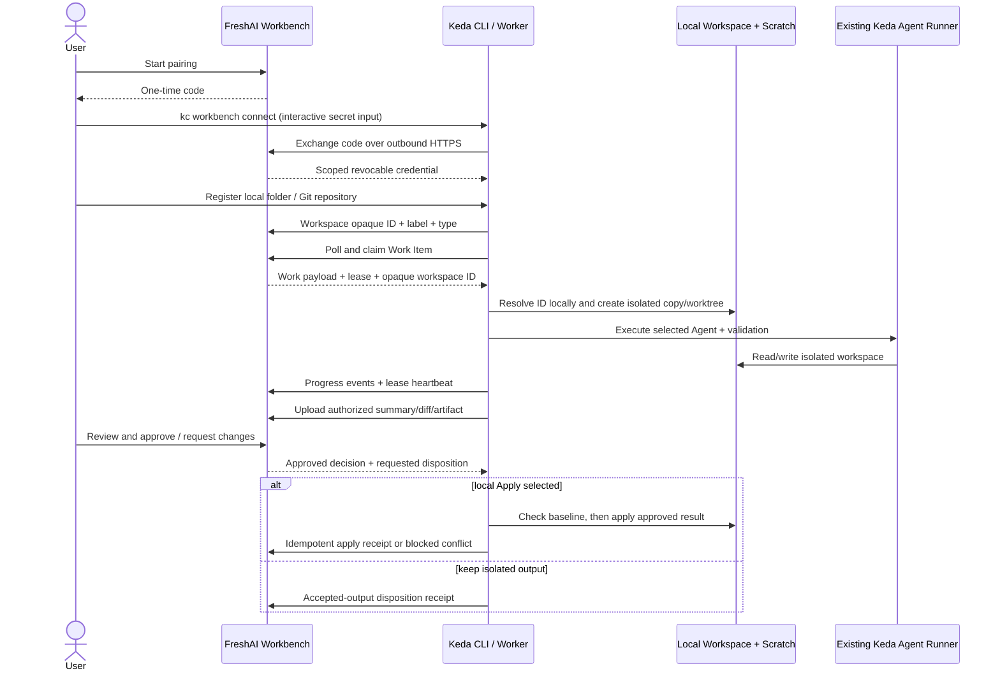
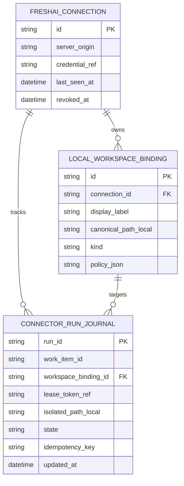

# PRD: Keda FreshAI Workbench 本机执行器连接器

> ⛔ **交付前置**：先完成 FreshAI PRD `P2-FEAT-20261107-162227-freshai-workbench-control-plane` 并将稳定 Worker Contract 落到主线；否则 Keda 无法验证字段、状态与回执语义一致。
> 结构化声明见 §8 Delivery Dependencies，那里是唯一事实源。

> ⬜ **验收状态**：未开工。
> 本行是 §9 Acceptance Checklist 的投影，那里是唯一事实源。

本文分两层：Part A（§1–§4）供产品评审；Part B（§5–§13）供实现、验证与交付使用。

## Feature Overview（功能一览）

本节是 §10 Functional Requirements 的通俗投影；行为验收以 §1 行为样例表为准。

- **从 FreshAI 配对一台 Keda 执行器**（FR-1、FR-2）：授权范围和撤销状态清楚可见，不开放本机入站服务。
- **把普通文件夹和 Git 仓库登记为本机工作区**（FR-3）：路径只保存在 Keda 本机，服务端仅持有工作区 ID 与显示标签。
- **在隔离副本中运行 FreshAI 工作项**（FR-4、FR-5）：复用 Keda 已有 Agent CLI、验证和进程生命周期能力。
- **把执行记录和用户审查连接起来**（FR-6、FR-7）：进度、摘要和选定差异返回 FreshAI；批准、修改、取消能安全到达本机执行器。
- **处理失联、重复请求和本地冲突**（FR-8）：租约丢失不能伪报成功；撤销后不能继续领新工作或上传结果。
- **保留 Keda 当前 GitHub 工作流**（§11）：FreshAI Work Item 是新入口，不改写 GitHub Issue/PR 的现有状态与 kc 队列。

## Part A · 评审层 (Review Layer)

## 1. Introduction & Goals

### Problem Statement

Keda 已有本机 Agent Runner、Agent CLI 适配、隔离 Git worktree 和 GitHub Issue/PR 生命周期，但执行入口围绕 GitHub Issue 与仓库配置。FreshAI 计划提供自己的通用 Work Item 和结果审查；当前 Keda 没有 FreshAI 的连接凭证、work item worker client 或普通非 Git 文件夹工作区路径。

如果把 FreshAI 任务直接伪装成 GitHub Issue，普通文件夹和文档任务会被迫进入 GitHub 流程；如果 Keda 从 FreshAI 接受任意命令或绝对路径，云端 API 就会变成本机远程 shell。连接器必须只理解版本化的有限任务契约，在本机验证用户指定的文件夹，并把 FreshAI 的指令转成 Keda 已有的 Agent 执行能力。

### Interpretation (解读回显)

我把需求理解为：FreshAI 是 Web 控制面，Keda 是首个可替换的本机执行器；Keda 通过出站 HTTPS 拉取已授权工作、在用户选定的普通目录或 Git 仓库中执行，并上报进度与结果。以下行为样例将成为执行侧验收 oracle；修正一格就会修正相应验收标准。

| 验证方式 | 输入 / 操作 | 期望观察到的结果 |
|---|---|---|
| 👀 人审 + 自动验证 | 用户在 FreshAI 创建工作项并选择已登记的普通文件夹，Keda 在线 | Keda 领取工作项；FreshAI 显示 Keda 名称、活动和执行尝试；Keda 服务端请求中没有本机绝对路径 |
| 👀 人审 + 自动验证 | 用户选择一个 Git 仓库并启动代码工作 | Keda 在隔离 worktree 中执行；用户原始 checkout 的 branch、index 与 dirty files 不被覆盖 |
| 👀 人审 + 自动验证 | Keda 执行普通文件夹文档任务并提交 review | 普通文件夹无需 .git；FreshAI 收到路径剥离的摘要与变更列表，用户能审查实际 diff |
| 👀 人审 + 自动验证 | 用户在 FreshAI 批准并选择本机 Apply | FreshAI 先记录批准并显示 Applying；Keda 在本机复核源目录未发生冲突后应用结果并回执，FreshAI 收到回执后才显示 Done。若用户选择保留隔离产物，则按 FreshAI Contract 完成接受状态，不伪称已写回 |
| 🤖 自动验证 | Keda 断网或用户撤销连接后，旧进程恢复并重放结果 | FreshAI 拒绝 revoked credential 或过期租约；Keda 不把任务标为成功，也不自动开始其他任务 |
| 🤖 自动验证 | 选定目录内有指向其外部的 symlink、并发修改或敏感文件 | Keda 不跟随逃逸路径、不静默覆盖新修改；任务进入可诊断阻塞并显示冲突/拒绝原因 |

### 我默默定了这些

- 用户已在 2026-11-07 确认首版需要普通文件夹与 Git 仓库两类工作区；协议与执行路径不得把 Git 作为前置条件。
- 候选职责按 FreshAI Workbench PRD 的推荐：FreshAI 是任务状态和审查决定的事实源；最终归属仍等待 FreshAI PRD 的 §2 决策与 Contract 落地。Keda 保留本机绝对路径、执行进程、隔离目录与本机 apply 结果。
- Keda 对 FreshAI 采用出站 HTTPS，不监听任意公网或局域网端口。
- FreshAI 本身不带新的原生桌面壳；Keda 以 kc 与本机 Runner 接入，后续可根据使用证据评估现有菜单栏应用集成。
- 现有 GitHub Issue/PR 入口和 label 状态机继续工作，FreshAI connector 不自动创建 Issue、PR 或 commit。

### 我理解为不做

- 不把 FreshAI Work Item 转换为 GitHub Issue，不修改当前 GitHub claim arbitration 或 label 流程。
- 不实现远程 shell、任意命令参数、Keda Cloud、文件浏览 RPC 或反向隧道。
- 不在本 PRD 中新增另一个 Agent runtime/provider adapter；优先复用 Keda 已有 Agent 调用、验证与子进程控制。

可证伪的解读：Keda 是一个授权明确、可撤销的本机 Worker。它只处理 FreshAI 分配且绑定到用户本机工作区的工作项；绝对路径不离开机器；任务内容通过固定 JSON 契约通信；文件修改先在隔离副本发生，再按用户选择的策略审查与回写。本地 Apply 的语义和回传数据范围是首要人工决策。

- [ ] 我确认这段解读与行为样例准确表达了我的需求。

### What The User Gets

用户可以从 FreshAI 把一项工作交给在线 Keda，在普通文件夹或 Git 仓库中执行。Keda 不要求在本机开一个可被网络访问的服务；任务执行在 Keda 控制的隔离目录内完成。FreshAI 展示来自真实本机执行的进度、差异和 review 结果。用户撤销连接后，Keda 停止领取新任务并清除本地可续用凭证。

### Measurable Objectives

- 普通文件夹无需 Git 即可登记、在隔离副本执行并生成逐文件差异。
- Git 仓库通过 Keda 管理的 worktree 执行；原 checkout 的现存修改保持不变。
- FreshAI 连接使用出站 HTTPS、短期配对和可撤销凭证；连接使用不要求开放 Keda 入站端口。
- 界面/命令记录不泄漏绝对路径、密钥、未选文件或未授权目录内容。
- 用户撤销连接或租约过期后，旧尝试不能再提交进度、产物或成功结果。

## 2. Human Review Map（人工决策地图）

### 用户批准后，Keda 如何把改动交还给选定工作区？

推荐 Keda 在普通文件夹或 Git worktree 的隔离副本执行。若用户在 FreshAI 批准时授权 Apply，Keda 本机检查源目录自创建快照以来是否变化；没有冲突才应用已批准补丁并回执 FreshAI。FreshAI 的批准事件与 Keda 的写回结果是两个状态：批准先进入 Applying，成功回执后才 Done，冲突则保持 Blocked 并保留批准记录。若用户选择只保留隔离产物，FreshAI 可按已确认的处置契约完成验收，但不能显示本机 Apply 成功。Git 不自动 commit、push 或创建 PR；普通文件夹只写入这次任务改动。成本是保存快照/补丁、处理文件冲突，并实现跨云端与本机的幂等回执。

**请确认：** 批准结果是否授权 Keda 把变更应用回原工作区？

- [ ] 同意推荐：批准即授权本机 Apply；目录冲突时停止并要求用户处理；不自动 commit/push/PR。
- [ ] 只接受隔离输出，不由 Keda 写回原工作区；用户之后自行复制或合并。
- [ ] 允许用户每次单独选择 Apply；默认只保留隔离输出。
- [ ] 其他，请修改本节与 §10。

**验收：** 未批准时原工作区不变；批准事件先被 FreshAI 持久化；选择 Apply 时只有成功回执后才显示 Done，发生并发修改时不覆盖用户新内容、保持 Blocked 并留有本机冲突证据；选择隔离产物时不发生写回且状态按 FreshAI Contract 呈现。

### FreshAI 能看到哪些本机文件内容？

推荐只回传用户明确授权的任务结果：摘要、变更相对路径、差异，以及用户同意分享的文件；默认不上传整个目录、未变更文件或被安全过滤的配置/密钥文件。绝对路径在 Keda 内变成根目录相对路径。这样 FreshAI Web 能展示真正的 review diff，代价是所选变更内容会离开本机，用户仍需要在连接与任务创建时看清楚分享范围。

**请确认：** 首版是否采用“只上传 review 必需且已授权的内容”？

- [ ] 同意推荐：默认仅摘要和路径剥离的差异；附加文件逐项选择；绝不上传整个工作区。
- [ ] 只回传摘要和文件名，不将 diff/文件内容传至 FreshAI；Web 侧无法展示逐行文件审查。
- [ ] 其他，请修改本节、FreshAI Contract 与 §10。

**验收：** 在线路请求、服务端 API、Keda 日志与证据目录里，只有批准上传的内容；扫描到密钥或绝对路径时默认阻止发送。

### 自动门禁，不需要逐项人工审阅

普通实现由协议契约验证、实际 CLI 子进程、隔离普通目录与真实 Git worktree 集成验证完成。人工只需决定本地 Apply 与回传数据边界，并在交付时查看真实目录前后差异、连接撤销和 FreshAI review 实际结果。

**本次明确不涉及**：第二个本机桌面壳、FreshAI Cloud、GitHub Issue/PR 自动桥接、其他 Agent 客户端协议、自动推送/合并。

## 3. Usage And Impact After Implementation

**FreshAI 用户**

1. 从 FreshAI Work Items 开始连接向导，取得有时限的一次性 pairing code。
2. 在本机 Keda 执行对应 kc workbench 配对操作；选择普通文件夹或 Git 仓库并给工作区设置显示标签。
3. 回到 FreshAI 创建工作项并选择该工作区；用户可在连接页随时撤销 Keda。
4. Keda 领取后，FreshAI 展示正在执行、事件和结果；用户批准或要求修改。
5. 若批准触发本机 Apply，Keda 只在连接在线且目标快照未冲突时写回；失联或冲突时工作项保持等待/阻塞，不伪报完成。

**Keda 使用者与维护者**：通过 kc workbench status 查看连接与工作区；disconnect 撤销本机凭证；运行日志只记录 ID、时间、错误类别和相对路径，不写绝对路径、认证密钥、完整文件内容。

**当前 GitHub Issue/PR 用户**：现有 kc run、daemon、Agent Runner、验证、Review、PR 与 supervisor 行为不变；FreshAI connector 不改 Issue 状态机，也不把 GitHub 配置设成前置。

**运维者**：部署 FreshAI API 时也需暴露版本化 Work Item Worker Contract 与上传大小/保留策略；Keda 端只要求到 FreshAI HTTPS 的出站网络。

**开发者**：新增 Keda CLI 子命令时更新 docs 与随包 kedacode-operator Skill，并保持机器输出与退出码稳定。

## 4. Requirement Shape

- **Actor**：本机 Keda 使用者；FreshAI Work Item owner；FreshAI Worker API；Keda CLI/后台 Runner；Keda 运维和维护者。
- **Trigger**：用户完成 pairing、绑定工作区、启动/停止 worker、创建 FreshAI 工作；Worker 收到任务或用户审批/取消/撤销。
- **Expected behavior**：Keda 出站访问有 scope 的 Worker API；仅在授权工作区的隔离副本执行；按契约回传状态、批准产物及本机 Apply 回执；断网、冲突、租约失效均 fail closed。
- **Scope boundary**：只实现 FreshAI Work Item 契约的 Keda 本地连接器与普通文件夹/Git 适配；不修改现有 GitHub Issue 执行路径。

# Part B · 执行器层 (Build Layer)

## 5. Repository Context And Architecture Fit

**当前 Keda 扩展点**

- src/backend/core/shared/interfaces/agent_runner.py 定义 ProcessRunner、AgentRunner 与 GitHub client 等端口；Work Item connector 应在 core 定义有限的 FreshAI Worker client/connector 接口，避免 Core 依赖 httpx 或 REST payload。
- src/backend/core/use_cases/agent_runner_claim_arbitration.py 解决 GitHub Issue 并发领取；FreshAI 的服务端 lease 是另一种拥有者，不要复用 GitHub 评论仲裁或标签作为远端锁。
- src/backend/engines/agent_runner/ 已有 Agent 选择、提示、执行、验证、恢复和运行环境能力；优先复用这些适配，不再新建 Agent CLI provider 注册表。
- src/backend/infrastructure/git/worktree.py 的 WorktreeManager 统一管理 .kc-worktrees/<branch>；可作为 Git workspace 隔离起点，但需定义 FreshAI Run ID 到安全 branch 名的映射和清理策略。
- src/backend/infrastructure/github_issue_ops.py 与 src/backend/api/routes/agent_runner.py 等保持现有 GitHub/monitoring职责，不在其上把 FreshAI WorkItem 模拟成 issue。
- Keda 已有 kc CLI、本机 Runner 状态/事件记录与 desktop/ Tauri companion；本 PRD 先通过 CLI/本机 Worker 运行，不把 Tauri UI 集成列为前置。

**相关任务检查**

- tasks/archive/P1-FEAT-20261024-161425-cross-machine-presence-and-claim-lease.md 已覆盖 GitHub Issue 跨机器 presence/claim lease；本任务复用其可验证的租约经验，但不重复实现 Issue claim。
- tasks/archive/P1-FEAT-20260930-141135-iar-agent-machine-contract.md、tasks/archive/P1-FEAT-20260911-010513-agent-cli-adapter-layer.md 定义 Agent/机器接口经验；本任务消费现有 adapter，不替代 Agent invocation contract。
- tasks/pending/P1-FEAT-20261024-162357-agent-interruption-recovery.md 与本任务在本机执行中断上有交叉；实现前核对其状态路径，若重用路径未交付则明确兼容策略，不复制另一套恢复语义。
- tasks/pending/ 未发现 FreshAI Work Item connector；FreshAI 侧配套 PRD 位于 FreshAI 仓库：tasks/pending/P2-FEAT-20261107-162227-freshai-workbench-control-plane.md。

**前端影响**：本 PRD 首版修改 Keda CLI 与本机 Worker，不增加 FreshAI 前端，也不新建完整 Keda 管理页面。若连接/状态入口进入现有 Tauri companion，应更新其对应 UI 验证与截图，但这不是执行前置。

**CLI/Skill 约束**：新建 kc workbench 命令、参数、退出码或机器输出后，同步 docs 与 src/backend/engines/agent_runner/templates/skills/kedacode-operator/SKILL.md 和引用文档；按 tooling 标准验证 CLI schema/帮助。

## 6. Recommendation

### Recommended Approach

在 Keda 增加独立 FreshAI connector 生命周期，而非改造 GitHub daemon。Connector 负责配对、最小 scope 凭证、本地 workspace registry、HTTPS polling、lease/event/artifact 映射和 revoke/stop；将拿到的 Work Item 交给现有 Agent 调用、验证与进程控制路径。

普通文件夹由 Keda 创建本机隔离副本和 baseline manifest；Git repository 走 Keda WorktreeManager 创建隔离 worktree。两者都不让 FreshAI 读取绝对路径。变更结果先作为 Keda 生成的审查产物；批准动作经 Worker Contract 回到 Keda，Keda 本机复查并按 §2 选择应用或保留隔离输出。不存在任意远端命令通道。

### Proposed Solution Summary (实现机制)

1. 在 core/shared/interfaces 定义 FreshAI Work Item Connector/Worker API client 端口，以及带 WorkItem ID、Run ID、workspace opaque ID、lease 和 idempotency 字段的有限模型。
2. engines/agent_runner 增加 FreshAI contract adapter 与 worker loop；使用已有 Agent CLI selector、验证命令、ProcessRunner cancel 和运行状态记录。
3. Infrastructure 通过 TLS HTTPS 连接 FreshAI，处理版本 negotiation、backoff、retry 与 stable error mapping；认证 token 从操作系统 credential store 读取。
4. 建立 Keda 本地 WorkspaceBinding：仅本机保存 canonical absolute path 与隔离根；FreshAI 只注册随机 opaque ID、显示 label、workspace kind、能力和在线状态。
5. Git workspace 使用 WorktreeManager；plain folder 用复制/快照目录执行，不在源目录工作。symlink 遍历必须限制在 canonical root 内。
6. 用户批准后，Keda 收到确定的批准操作并做本机 Apply/Conflict 检查。过程可重试但必须幂等；Apply 未确认时不能向 FreshAI 声称已完成。
7. 新增 kc workbench connect|workspace|start|status|stop|disconnect（具体命令树以 CLI surface review 为准）；以交互式输入隐藏一次性 code/token，不让 secret 出现在 shell history。
8. 为 packaged operator skill、README/guide 和 mkdocs 导航同步命令语义、权限、退出码与恢复方式。

避免：第二条 Issue label state machine、把网络 handler 加入通用 ProcessRunner、外部 webhook 直连本机、Tailscale/SSH 成为 FreshAI 配对前置、或以远端下发 argv 扩展 capability。

### Alternatives Considered

- **把 FreshAI Work Item 转换为 GitHub Issue**：不能覆盖普通文件夹，并重复用户选择的两个系统状态；拒绝。
- **通过新 MCP/A2A Task server 作为 Worker 连接**：增添外部协议与映射成本；现有 FreshAI Worker Contract 足够稳定时，执行队列不应因 Agent 通用协议而变复杂。
- **所有任务都直接在原始工作区执行**：最少临时目录管理，但运行失败、Agent 中断或 review 前就会污染用户原文件；拒绝作为默认建议。
- **现在集成 Keda Tauri 菜单栏控制**：能简化后台 Worker 的启停，但扩大 UI/platform 范围；先验证 CLI Worker 的持续运行体验，确有使用摩擦后再接入现有 companion。

## 7. Implementation Guide

This section is a living implementation guide based on current repository analysis. If implementation discovers additional affected files, hidden dependencies, edge cases, or a better path, update this PRD before proceeding.

### Core Logic

1. Pairing 时 FreshAI 签发短时一次性授权码；Keda CLI 通过 TLS exchange 得到高熵可撤销 credential。完成后只保存 OS secure storage reference 和非敏感安装 ID。
2. 用户本机为每个工作区选择目录并确认范围；Keda 解析 canonical root，拒绝 root/symlink escape，并只向 FreshAI 发随机 binding ID、显示标签和 workspace kind。
3. 本机 Worker 主动 poll 或 long-poll FreshAI Worker API；同一 Run 只允许一个 lease holder；heartbeat 和所有事件均携带 lease/fencing token 与幂等键。
4. WorkItem contract 中只有 workspace binding ID；Keda 本地映射出路径。FreshAI 请求不能覆盖本机路径、Agent binary、任意 argv 或权限模式。
5. Git 工作区通过已有 WorktreeManager 创建 run-scoped worktree。plain folder 通过文件清单和隔离副本执行；symlink 不跟随到 root 外；文件过滤和 ignore 策略在 workspace 设置中可见。
6. 执行结束生成相对路径差异、摘要和用户选定 Artifact；上传前扫描 secret patterns，剥离绝对路径与用户 home 前缀；上传只走已授权 FreshAI API。
7. FreshAI 的 approve/request-changes/cancel 经 poll/event 回到 Keda。Approve 按 §2 选择的策略做本机 Apply；baseline 与当前目标不一致时阻塞，不做 fuzzy overwrite。
8. 连接 revoke、credential 过期、lease 失效或网络不确定时停止领取；仅取消 Keda 本次归属的 Agent 子进程组，不能误杀其他任务进程。
9. 所有 local journal 记录 run_id、workspace binding ID、阶段、时间、结果摘要和恢复句柄；不落 secret、绝对路径或全文内容。

### Change Impact Tree

跨仓库 Contract 是 FreshAI 所有；Keda 只消费它，不维护第二份 schema：

```text
Keda repo
├── src/backend/core/shared/interfaces/freshai_workbench.py       [新增]
├── src/backend/core/shared/models/freshai_workbench.py           [新增]
├── src/backend/core/use_cases/freshai_workbench_connector.py     [新增]
├── src/backend/engines/agent_runner/freshai_workbench/           [新增]
│   ├── HTTPS client / version negotiation / worker loop
│   ├── workspace binding / normal-folder snapshot adapter
│   └── lease, cancel, artifact and approval event handling
├── src/backend/infrastructure/git/worktree.py                    [复用或最小扩展]
├── src/backend/infrastructure/security/                          [OS credential store adapter]
├── src/backend/api/cli_typer_workbench.py                        [新增 CLI surface]
├── src/backend/api/cli_typer_app.py                               [注册命令]
├── src/backend/engines/agent_runner/templates/skills/kedacode-operator/SKILL.md [同步]
├── docs/guides/freshai-workbench-connector.md                     [新增]
├── desktop/                                                       [不在首版前置范围]
└── FreshAI repo / tasks/pending/P2-FEAT-20261107-162227-freshai-workbench-control-plane.md
    [cross-repo Contract owner; do not resolve its paths against the Keda repository]
```

### Risk Classification Register

| Change point | Tier | Why | Oracle |
|---|---|---|---|
| Pairing credential、撤销、HTTPS worker API | R3 | 网络凭证连接到可读写本机文件的 Agent Runner | rv-1 |
| Plain folder snapshot、Git worktree、symlink containment | R3 | 文件写入范围和用户原始工作区状态 | rv-2 |
| Review artifact上传、approval apply 与冲突恢复 | R3 | 可能外发文件内容或覆盖用户并发修改 | rv-3 |
| CLI help、官方 Skill 和用户说明 | R1 | 用户/Agent 需要按一致命令操作 | rv-4 |

### Executor Drift Guard

- 开工前检查 FreshAI Work Item PRD 已确认并落 main；从 FreshAI 生成的 OpenAPI/schema 摘要用于联调，不在 Keda 手工复制另一个 schema。
- 重新读取 Keda interruption recovery、cross-machine presence/claim lease 和 Agent CLI adapter PRD；已有工作若改变恢复契约，先同步 dependency notes，不叠一套新 attempt 状态。
- 当前 Agent CLI 的 sandbox/permission mode 能力按实际实现验证。若所选 executor 不能把文件操作限制在所选 workspace，不得把“选择工作区”宣传成 OS 安全沙箱；需要 fail closed 或显式告诉用户实际权限边界。
- cross-repo FreshAI Impact Tree 节点按 Keda 项目规范保留清晰前缀，不把它解析成 Keda 根目录里的同名文件。

### Flow Diagram



### ER Diagram

Local tables are implementation candidates; reuse Keda Console SQLite stores if their lifetime and portability fit. Do not persist the FreshAI WorkItem as a second authoritative copy.



canonical_path_local, isolated_path_local and any token reference remain in Keda local storage. The server sees none of these fields.

### Realistic Validation Plan

```yaml
- id: rv-1
  behavior: Keda pairs with a real FreshAI test deployment, registers one workspace, receives a work item, and stops accepting work after revoke
  reviewer: human
  real_entry: "kc workbench connect/status/disconnect against a running FreshAI Work Item API; execute in a real Keda subprocess with real HTTPS and test database"
  expected: "pairing code is single use; Keda receives a scoped credential; FreshAI shows the connection label; disconnect/revoke prevents future claim and old Run result upload"
  mock_boundary: "no mocked HTTP client, auth, database, or worker loop; Agent command may be a fixed test CLI that writes only inside the temporary workspace"
  tier: R3
  test_layer: integration
  required_for_acceptance: true
  presentation: "tasks/evidence/P2-FEAT-20261107-162227-freshai-local-executor-connector/rv-1-pairing-and-revoke.md plus rv-1-freshai-connection.png; real Keda CLI output and FreshAI connection page"
  critical_value_source: "FreshAI RunnerInstallation/revocation record, Keda local secure-store reference, and HTTP result from claim after revoke"
  must_cross: "real kc process -> OS credential storage -> outbound HTTPS -> FreshAI auth/use case/database -> second revoked HTTP claim"
  forbidden_bypasses: "injecting in-memory credential; direct API helper invocation; mocked client; logging one-time secret"
  fresh_state_probe: "new kc process after restart reads secure-store token reference; FreshAI new DB session confirms revoked_at and rejects new claim"
  final_tree_evidence: "run on final Git tree; credential, auth middleware, pairing, revoke or CLI parsing changes require rerun"
  negative_control: "after pairing revoke the installation, then replay previously valid credential from a fresh process"
  expected_fail: "if replay can claim or upload, the live endpoint returns success and this oracle fails"
- id: rv-2
  behavior: the same ordinary folder and Git repository tasks run in isolated workspaces without changing pre-existing source state or escaping the selected root
  reviewer: human
  real_entry: "real kc Work Item worker and existing Agent CLI invocation against temporary directory fixtures and a temporary git repository; inspect filesystem before and after run"
  expected: "plain folder runs without .git; Git task uses Keda-managed worktree; pre-existing dirty files remain byte-identical; outward symlink read/write is rejected; result diff contains relative paths only"
  mock_boundary: "real Keda process, ProcessRunner, git binary, filesystem and Agent CLI test executable; only FreshAI status responses are recorded HTTP responses if the same contract is used by rv-1"
  tier: R3
  test_layer: integration
  required_for_acceptance: true
  presentation: "tasks/evidence/P2-FEAT-20261107-162227-freshai-local-executor-connector/rv-2-workspace-before-after.md and real FreshAI review screenshot; include temporary folder tree diff, not user data"
  critical_value_source: "filesystem hashes of source before/after; git status/branch; generated result manifest; emitted relative path list"
  must_cross: "kc worker -> workspace registry -> canonical path guard -> worktree/copy adapter -> actual child Agent process -> diff collector -> FreshAI upload boundary"
  forbidden_bypasses: "directly invoking snapshot helper; pretending a non-Git folder is a Git repo; checking only mocked Path values; reading a path outside the selected root"
  fresh_state_probe: "close child process and filesystem handles, recompute source hashes and git status from new process; inspect isolated output from independent process"
  final_tree_evidence: "run against final implementation tree; workspace containment, copy/snapshot, worktree or diff code changes require rerun"
  negative_control: "fixture includes symlink from chosen folder to sibling secret file and a dirty tracked file in Git source"
  expected_fail: "correct behavior rejects symlink and leaves dirty source bytes unchanged; implementation that follows it or overwrites source fails the oracle"
- id: rv-3
  behavior: FreshAI review approval is required before any source-workspace Apply; FreshAI records Applying until Keda returns an idempotent receipt, and concurrent modification is not overwritten
  reviewer: human
  real_entry: "full cross-repository local flow: FreshAI browser review action -> real Keda worker receives approval event -> applies to a temporary normal folder and temporary Git workspace -> FreshAI API records final receipt"
  expected: "unapproved result does not change source; local-apply approval is recorded before writing; approved non-conflicting result changes only files in its patch and FreshAI becomes Done only after the receipt; conflict yields Blocked without clobber; keep-output disposition does not write source and follows the confirmed contract"
  mock_boundary: "no mocked Apply adapter, filesystem, browser decision or FreshAI API; use disposable fixture directories and local real FreshAI test stack"
  tier: R3
  test_layer: e2e
  required_for_acceptance: true
  presentation: "tasks/evidence/P2-FEAT-20261107-162227-freshai-local-executor-connector/rv-3-approved-apply.png and rv-3-conflict-blocked.png; open with just prd review tasks/pending/P2-FEAT-20261107-162227-freshai-local-executor-connector.md"
  critical_value_source: "target file content/hash, Keda apply journal, FreshAI Work Item state and latest Run receipt"
  must_cross: "FreshAI production route -> Work Item review/disposition endpoint -> outbound Worker poll -> local conflict check -> filesystem write -> idempotent HTTPS apply receipt -> fresh FreshAI DB read"
  forbidden_bypasses: "writing source before review; direct FreshAI DB edit; returning success before file operation; force overwrite or fallback to original workspace"
  fresh_state_probe: "fresh process reads target file and git state; new FreshAI session checks final work/run state; conflict fixture confirms concurrent bytes remain"
  final_tree_evidence: "record final Git trees for both repositories; any Contract/API/apply change requires rerun"
  negative_control: "mutate target file after Keda took baseline and before clicking Approve"
  expected_fail: "connector returns conflict/blocked and preserves concurrent edit; a green applied result means the oracle fails"
- id: rv-4
  behavior: new user-visible commands, output, errors and recovery instructions match Keda's packaged operator skill and documents
  reviewer: verifier
  real_entry: "uv run kc workbench --help; uv run kc workbench status --help; uv run mkdocs build --strict"
  expected: "help, exit codes, examples, skill and guide agree; secrets are never included in help or sample output"
  mock_boundary: "real CLI parser and static docs build"
  tier: R1
  test_layer: cli
  required_for_acceptance: true
```

### Interactive Prototype

FreshAI Web 的目标 UI 见 FreshAI repository: docs/prototypes/agent-workbench.html。它验证工作项、连接状态和 review 流程，但不代表 Keda 本机 setup、CLI 或文件隔离实现。Keda 本 PRD 的人审证据来自真实 CLI 输出、真实临时目录前后状态和跨仓库联调截图。

### External Validation

| Topic | Official source | Checked | Finding | Impact |
|---|---|---|---|---|
| A2A Task lifecycle | [A2A specification](https://a2a-protocol.org/latest/specification/agent-card/) | 2026-11-07 | A2A 描述 Agent 消息与 Task 交互 | 可用于未来 Agent adapter；Keda Connector 队列身份与 lease 仍按 FreshAI contract |
| MCP async tool tasks | [MCP Tasks extension](https://tasks.extensions.modelcontextprotocol.io/specification/2026-07-28/tasks) | 2026-11-07 | MCP Task 提供异步 tool call handle | 不需要把本地 Worker loop 改造成 MCP server |
| Agent Client Protocol | [ACP v1 overview](https://github.com/agentclientprotocol/agent-client-protocol/blob/main/docs/protocol/v1/overview.mdx) | 2026-11-07 | ACP 面向 client/editor 到本地 coding agent 的会话与更新 | 可供后续 coding-agent interop 评估；本 PRD 还要处理文档/普通目录任务，故不作为外层 Contract |

## 8. Delivery Dependencies

### Delivery Dependencies

- Depends on tasks/issues:
  - `P2-FEAT-20261107-162227-freshai-workbench-control-plane`（FreshAI 仓库；先定义并落地 Worker Contract）
- Gate type: hard
- Sequence: via-main
- Notes: **跨仓库人工硬门禁：** 上方 FreshAI PRD ID 是本依赖的唯一引用。FreshAI repository 的 `tasks/pending/P2-FEAT-20261107-162227-freshai-workbench-control-plane.md` 必须先完成人工决策、定义稳定 Worker Contract 并落到 FreshAI main，再开始 Keda integration。Keda Backlog 只扫描本仓 PRD，因此会把此外部依赖显示为 unresolved；实施前仍须由路线图、PR review 和开工检查人工把关，不能把本地解析结果当作已满足。另检查 Keda interruption-recovery pending PRD 的交付状态与兼容要求。

## 9. Acceptance Checklist

### 9.1 人读呈递区（Human Review Surface）

| 要看的结果 | 呈递物 | 10 秒自查 |
|---|---|---|
| 配对并撤销后，Keda 无法再领取新工作或提交旧结果（rv-1） | tasks/evidence/P2-FEAT-20261107-162227-freshai-local-executor-connector/rv-1-pairing-and-revoke.md 与 FreshAI 连接页真实截图；入口：just prd review tasks/pending/P2-FEAT-20261107-162227-freshai-local-executor-connector.md | 查看同一安装 ID 的 FreshAI 撤销记录与 Keda 新进程请求；确认旧 credential 返回稳定 unauthorized/revoked 错误 |
| 普通目录与 Git 目录都能执行，执行中不改坏源目录（rv-2） | tasks/evidence/P2-FEAT-20261107-162227-freshai-local-executor-connector/rv-2-workspace-before-after.md | 确认普通目录无需 .git，Git 源 branch/index/dirty file 与执行前一致；绝对路径未上传 |
| 批准后的 Apply、回执与并发冲突状态一致（rv-3） | tasks/evidence/P2-FEAT-20261107-162227-freshai-local-executor-connector/rv-3-approved-apply.png、rv-3-conflict-blocked.png 与对应 before/after 记录 | 无冲突只写入批准 patch 且 FreshAI 收到回执后显示 Done；有并发编辑时 FreshAI/Keda 显示 Applying/Blocked，文件保留并发版本；keep-output 不写源目录 |

### 9.2 Acceptance Evidence Package

#### Human-Confirmed

- [ ] §2 决策：批准后是否由 Keda Apply 到原工作区；实现语义与 FreshAI Work Item state/receipt 一致。
- [ ] §2 决策：FreshAI 可收到哪些 review 内容；传输记录只含经授权摘要、相对路径、差异和文件。
- [ ] §9.1 人读呈递区已查看，真实普通文件夹、Git repo 与 FreshAI Web review 证据都能打开。

#### Architecture Acceptance

- [ ] Connector API client 在 Infrastructure/Engine 边界实现，Core 不导入 httpx/ORM/子进程实现。
- [ ] FreshAI Worker Contract 只有一个 schema source；Keda 不重复维护未经生成/核对的状态枚举。
- [ ] FreshAI credential、Run lease 和 local workspace path 三种 ownership 边界分别明确。

#### Behavior Acceptance

- [ ] rv-1 真实配对、重启恢复、scope、revoke 和旧 credential 失败结果通过。
- [ ] rv-2 普通 folder snapshot 与 Git worktree 的隔离、symlink 边界、dirty source 保留和路径剥离通过。
- [ ] rv-3 approval、幂等 Apply、baseline conflict、FreshAI receipt 与 Keda recover/resume 语义通过。
- [ ] FreshAI 不在线、API 版本不兼容、lease 丢失、credential 撤销、Agent 中断和磁盘错误均返回明确本地状态，不吞错、不伪报成功。

#### CLI And Documentation Acceptance

- [ ] 新增 kc 命令的 help、参数、默认值、退出码与 JSON 输出已同步 docs 与 kedacode-operator skill；真实 CLI help 与文档一致。
- [ ] 命令不会将 pairing secret、credential、绝对路径或文件正文输出到 shell history、日志或诊断报告。
- [ ] uv run mkdocs build --strict 通过，CLI 操作、恢复、撤销和不支持情况均有可执行说明。

#### Validation Acceptance

- [ ] just test 通过；新增 FreshAI Connector、工作区与 API client 回归覆盖当前代码路径。
- [ ] rv-1 与真实 FreshAI 测试部署进行 HTTP 联调，rv-2 对实际临时文件系统与 Git binary 运行。
- [ ] rv-3 由真实浏览器 + FreshAI API + Keda worker + 临时文件夹/Git repo 联动；证据绑定两个最终 Git tree。
- [ ] 独立 verifier 复核 R3 负控；BLOCKER 修复后最多重跑一轮。

#### Delivery Readiness

- [ ] PR 正文呈递 §9.1 证据；无 PR 时完成消息逐项呈递每个工作目录的真实结果。
- [ ] 配套 FreshAI PRD/Contract 如因 Keda 决策修改，变更同一组 Contract 与状态示意；交叉依赖 notes 指向最终主线版本。
- [ ] 每个非 Human-Confirmed 项有可复查命令、HTTP 记录、文件系统 before/after 或最终 Git tree 证据。

### Final Reconciliation (执行时填写)

- **Verifier verdict:** PENDING
- **BLOCKER / NON-BLOCKING / SECURITY:** PENDING
- **Accepted oracle ids and evidence:** PENDING
- **Partially supported or not feasible oracles:** PENDING（说明原因与后续）
- **Validation blocker:** none
- **Validation follow-up:** none
- **Final Keda and FreshAI implementation trees:** PENDING

## 10. Functional Requirements

- **FR-1** Keda 通过用户发起的短期 pairing 完成 FreshAI Worker 认证；one-time code 不重复使用，credential 可撤销、范围有限，秘密保存在 OS secure store。
- **FR-2** Keda 只发起到 FreshAI HTTPS 的出站请求；不暴露本机入站 listener；服务不可达时 backoff 并保留可诊断但不含秘密的状态。
- **FR-3** Keda 本地登记普通文件夹或 Git 仓库，维护 canonical root、label、workspace kind、执行策略与 opaque binding id；FreshAI 不接收本机绝对路径。
- **FR-4** Keda Worker 按 FreshAI Contract claim、lease heartbeat、progress、complete、fail、cancel 与 artifact；请求使用幂等键与 fencing/lease 字段。
- **FR-5** Git workspaces 通过现有 WorktreeManager 隔离；普通 folder 在非 Git 临时副本里运行；路径解析、symlink、文件过滤和无空间错误均 fail closed。
- **FR-6** 执行复用 Keda Agent selection、ProcessRunner、验证、取消及恢复路径；FreshAI Worker payload 不能指定 binary、argv、shell、environment secrets 或权限提升。
- **FR-7** Keda 只回传路径剥离的事件、摘要、差异和经批准上传的文件；上传有内容大小上限和本机敏感模式检查。
- **FR-8** 批准决定与本机文件写回分别记录。若按 §2 选择 Apply，必须验证 baseline 与当前源一致、幂等写入并回执 FreshAI；FreshAI 在成功回执前不能显示 Done；冲突不得 force overwrite。若按决策保留隔离产物，Keda 明确回传该 disposition，不能伪报已写回。
- **FR-9** 连接 revoke、过期 lease、无效/不兼容 Contract、进程取消和磁盘错误均有稳定状态、退出码或业务码；不能伪报 Done。
- **FR-10** CLI 变化同步 Keda docs、mkdocs 与官方 operator skill；GitHub Issue/PR existing workflow 的现有命令和行为不变。

## 11. Non-Goals

- 修改 Keda GitHub Issue/PR 的状态机、label、PR 创建、supervisor、claim arbitration 或 kc run 默认行为。
- 把 FreshAI Work Item 转成 Issue/PR 或者反向同步任意 GitHub 状态。
- 在 FreshAI 云端执行本机 shell、文件浏览、终端会话或暴露公网机器。
- 多控制面连接自动调度、跨用户共享工作区、多人共同批准与 Keda Cloud。
- 在首版整合 Tauri companion UI；可以后续按连接器使用量与后台运行摩擦评估。
- ACP/A2A/MCP 通用多协议转换器、executor marketplace 或任意第三方插件框架。
- Auto commit、push、PR 或 merge；GitHub 原生 Keda issue workflow 仍按原配置执行。

## 12. Risks And Follow-Ups

- **跨仓库 Contract 漂移**：Keda PRD 有人工硬门禁但 Keda backlog 不能自动解析 FreshAI 依赖；PR 创建前两边需核对同一 Contract revision，并将该限制写进 Keda roadmap。
- **本机 Worker 持续运行**：CLI daemon/后台进程、更新、崩溃恢复和菜单栏控制的体验可能成为首批摩擦；先交付 CLI 版本，再根据真实使用决定是否接入现有 Tauri companion。
- **Agent CLI 的实际文件权限**：工作副本不自动等于 OS sandbox。必须通过已有 Agent 执行权限配置限制 workspace 外写入，不能仅凭 cwd 假设安全。
- **大文件夹成本**：快照/复制普通目录会占空间和耗时；首版建立最大文件数、总字节和忽略项的明确策略，超限清晰阻塞。暂不增加通用增量快照引擎。
- **敏感信息**：diff 和 artifact 上传会离开本机；必须以明确授权、路径剥离、secret scan、owner scope、对象保留策略和撤销读取作为交付门禁。
- **Apply 两阶段结果**：FreshAI 接受用户批准与 Keda 本机写回不是单事务。需要幂等 apply receipt、pending 状态、冲突恢复与人工核对，不能先显示 Done 再假设文件写成功。
- **CLI skill sync**：任何命令树或 JSON 输出更改必须同步随包 kedacode-operator skill；不通过修改既有 guard test 规避契约。

## 13. Decision Log

| ID | Decision | State | Source / rationale |
|---|---|---|---|
| D-01 | Keda 是 FreshAI Work Item 的首个本机执行器；Web Workbench + Keda 已由用户确认 | 已确认 | 用户选择首版 Web 工作台 + Keda 执行器 |
| D-02 | 普通文件夹与 Git repository 同属首版工作区 | 已确认 | 用户在 2026-11-07 确认不以 Git 为前置 |
| D-03 | 用户批准是否触发本机 Apply | 待 §2 确认；推荐确认后 Apply | 原工作区写入范围与用户的安全预期相关 |
| D-04 | 上传 FreshAI 的审查内容范围 | 待 §2 确认；推荐只上传必要且授权内容 | Web review 需要 diff，但本机内容离开设备 |
| D-05 | Keda Backlog 无法机器解析跨仓库 FreshAI 依赖 | 已核实，需人工实施硬门禁 | 本地 dependency parser 只索引本仓 tasks/pending 与 tasks/archive |
| D-06 | FreshAI 持有 Work Item 与 review 的最终状态；Keda 仅回传执行/Apply 回执 | 待 FreshAI PRD §2 确认并以 Contract 锁定 | 保持单一状态事实源，避免两个仓库各自维护一份队列状态机 |

### PRD Change Log

- 2026-11-07：初稿。复用 Keda Agent Runner、WorktreeManager 和既有 GitHub workflow；把 FreshAI control plane 视为外部契约，把本地 Apply 与回传内容留给用户评审。
