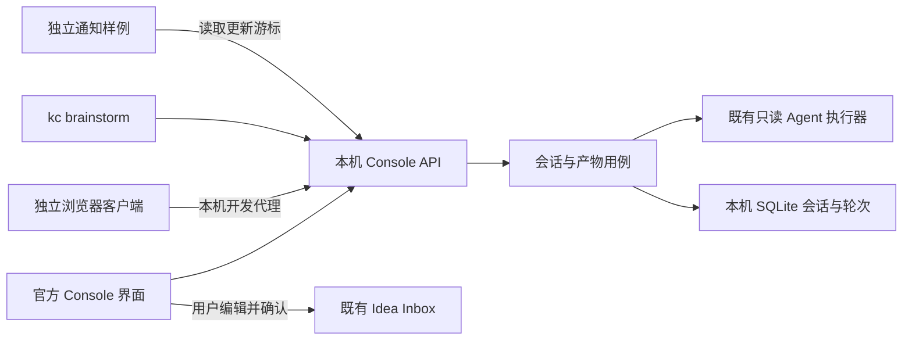
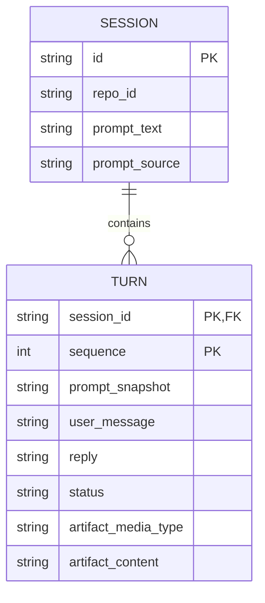

# PRD: CLI 优先的构想工作台与可替换客户端

> ✅ **交付前置**：无，可立即开工。
> 结构化声明见 §8 Delivery Dependencies，**那里是唯一事实源**。

> ⬜ **验收状态**：未开工。
> 本行是 §9 Acceptance Checklist 的投影，**那里是唯一事实源**。

> Part A 供需求方确认行为和关键取舍。Part B 供执行者实施、验证和交付。

- Source Idea Refs: idea-20261119230200-002e76, idea-20261120001900-aead32, idea-20261120002400-55366e

## Feature Overview (功能一览)

本节是 §10 的功能投影。行为以 §1 的样例为准。

- **一条命令开始构想**（FR-1） 从当前仓库打开默认工作台。左侧起初为空，右侧可以开始讨论。
- **用户写自己的产物提示词**（FR-2） 直接用默认提示词，或在会话里换成自己的。左侧可以呈现说明、流程或网页草图。
- **产物跟着对话更新**（FR-3、FR-4） 每轮有可见状态。新产物准备好后替换左侧，追问或生成失败时保留上一份。
- **换一个客户端也能继续**（FR-5） 官方工作台、CLI 和独立前端使用同一会话。刷新或换客户端后可以读取对话和最新产物。
- **用事件接入外部扩展**（FR-6） 随附一个独立通知样例，按游标读取产物更新事件。通知程序停下时，对话可以继续。
- **把成形的想法收进 Ideas**（FR-7） 用户编辑并确认保存的文字，再沿用既有 PRD 草稿流程。

# Part A · 人审层 (Review Layer)

## 1. Introduction & Goals

### Problem Statement

想法还没成形时，用户需要一边讨论，一边看到 Agent 对需求的当前理解。现有原生 Agent 会话把交互交给执行器的终端。KC 的合议会产出讨论记录，Idea Inbox 则从已经记下的想法进入 PRD 草稿。这几种入口之间缺少一个可以在用户对话中持续更新产物、并让不同客户端继续使用的会话。

### Interpretation (解读回显)

| 验证方式 | 输入 / 操作 | 期望观察到的结果 |
|---|---|---|
| 👀 人审 + 自动验证 | 从当前仓库打开默认工作台，用默认提示词聊两轮，再从独立客户端打开同一会话、改用自定义提示词继续一轮。 | 初次打开时左侧为空。发送后出现生成状态，每轮完整产物可用后自动刷新。独立客户端能看到同一会话及最新产物，继续一轮后原工作台读到同样的结果。 |
| 👀 人审 + 自动验证 | 用自己的提示词得到一份网页草图。接着让 Agent 只追问，再遇到一次生成失败或无效产物。 | 工作台展示网页草图内容，预览不能操作 KC 或访问其他文件与网络。只追问时更新对话，失败时说明本轮未完成，两次都保留上一份可用产物。 |
| 🤖 自动验证 | 启动独立通知样例，再停掉它。此时完成一轮有新产物的讨论，随后从上次位置恢复并再次读取。 | 恢复后能读到这一轮的持久化更新，重复读取同一事件不会产生第二条正常通知。样例停用或故障时，对话和产物照常落盘。 |
| 👀 人审 + 自动验证 | 在工作台选择保存到 Ideas，编辑待保存文字后确认，再到 Ideas 查看。 | 目标仓库的收件箱出现用户确认的文字。对话或生成产物本身不会提交想法、生成 PRD 或开始工程任务。 |

这些样例定义验收行为。更正表中任一操作或结果，就需要同步更正对应的验收口径。

#### 我默默定了这些

- 首版面向本机单用户和当前已登记的仓库，每轮发送后显示进展，完整产物准备好后更新。
- 默认给一份整理概念的提示词。用户随时可以改写，在下一轮使用这份提示词。
- 通知样例在本机显示哪次产物更新已完成。示例以工作台事件为输入。

#### 我理解为不做

- 逐字输入触发生成、生成内容逐 token 渲染、多人共享会话、产物版本编辑器。
- 固定六种产物模式、定制前端市场、通用插件安装和热加载。
- 重构 Issue 到 PR 的流程，开放工程任务节点编排，或更换代码托管平台。

用户决定产物怎么写。KC 管理会话、调用 Agent 并交付可读取的产物，客户端决定怎么呈现。默认工作台给用户立即可用的对话和展示界面。用户自建客户端后可以继续同一个会话。讨论期间的网页草图处于隔离预览中，想法入库需要一次明确确认。

- [ ] 我确认这段解读与行为样例准确表达了我的需求。

### What The User Gets

构想者可以把还说不清的需求整理成随讨论演进的草稿。个人或团队可以写自己的生成方法，按需要决定左侧产物应呈现的问题、流程或界面。开发自己的前端或通知工具时，可以在原工作台继续使用的同时接上新客户端。

### Measurable Objectives

- 官方界面和独立客户端使用同一个会话标识，在服务重启后也读到相同的对话和最新产物。
- 默认提示词能生成一份可读的概念说明。替换提示词后，同一个工作区能展示不同内容和受支持的格式。
- 生成失败时保留已有产物。独立通知程序暂停时，主流程仍能完成。

## 2. Human Review Map (介入与风险地图)

### 决策一：使用共同的本机会话

推荐把会话和最新产物保存在本机，由 KC 统一管理。用户可以换客户端、换提示词，已有讨论仍可继续；同一会话同时只接受一轮生成，避免两个客户端互相覆盖。

**请确认：** 是否接受本机持久会话和逐轮更新，作为默认及自建客户端共用的首个能力？

- [ ] 接受本机持久会话、同一会话只运行一轮生成，以及换客户端后继续对话。

**验收：** 官方界面聊两轮，独立客户端接着聊。重启服务重新打开后，两端看到一致的对话与产物。会话、轮次和产物的保存关系见 Part B 的数据图。

### 决策二：限定预览和扩展能做的事

推荐首版展示 Markdown 和静态 HTML。用户提示词控制内容，网页里的内容只用于预览。通知程序只读某个会话的产物更新，按用户选择独立运行。用户要把文本写进 Ideas 时，在现有收件箱能力上明确确认。

**请确认：** 是否接受静态 HTML 的展示限制，以及由独立程序读取事件的扩展方式？

- [ ] 接受静态预览、本机事件通知样例，以及经用户确认才保存到 Ideas。

**验收：** 网页草图可以查看，预览中的脚本和外部资源访问受限。停止通知程序后，讨论仍可生成新产物，恢复时从上次位置读取。

### 自动门禁，不需要逐项人工审阅

错误返回、会话并发、提示词格式、事件顺序、CLI 帮助和机读输出由执行侧验证。

### 本次明确不涉及

本次交付聚焦构想与展示。通用插件管理、跨平台工程流程和第三方消息投递属于其他需求。

## 3. Usage And Impact After Implementation

### 构想者

在登记仓库里打开构想工作台。左侧显示空白提示，右侧接受第一条消息。可以打开提示词编辑区查看默认内容、保存一份会话内自定义提示词，再继续对话。准备好后，点击「保存到 Ideas」，检查并确认文字。

### 自定义客户端开发者与本机操作者

可以使用自己的客户端创建或打开会话、发送消息、读取最新产物和事件。随附可独立运行的简易网页和通知程序。用户可以用默认工作台的会话链接取得标识，在简易网页里继续对话。

### Impact On Existing Behavior

原生 Agent 终端与现有工程任务命令继续保有各自入口。Ideas 继续收录由用户确认的文字，生成和批准 PRD 草稿仍由现有流程承担。

## 4. Requirement Shape

- Actor：登记仓库的构想者、本机操作者和自定义客户端开发者。
- Trigger：打开或继续会话、发送一轮对话、读取更新事件、明确保存想法。
- Expected behavior：会话可从不同客户端延续。用户提示词控制产物生成，真实状态和最近可用的产物可以独立读取。
- Scope boundary：本机单用户的构想功能、官方参考界面与一个独立通知样例。

# Part B · 执行器层 (Build Layer)

## 5. Repository Context And Architecture Fit

- **会话与生成。** `src/backend/api/cli_typer_agent.py::session_command` 把终端交给执行器，`core/use_cases/repl_session.py::run_repl_session` 是终端循环，历史留在进程内。`core/shared/interfaces/agent_runner.py::IContentGenerator` 与 `engines/agent_runner/factories/content_generators.py` 提供逐轮调用原语，返回整轮结果。复用现有调用、超时、执行器解析和输出协议，新增可持久化会话用例。读取 `core/shared/models/agent_spec.py` 的 `read_only_enforced` 语义，核对最终生效调用。
- **运行时与前端。** `src/backend/api/cli_typer_console.py` 支持启动、复用回环 Console 与 `--no-browser`。现有 `--api-only` 只绕过静态资产前置检查，有资产时仍挂载。`api/app.py` 统一装配 API 和随包静态前端。影响面为 `frontend-public`，沿用 `AppShell`、`ConsolePage`、仓库上下文和客户端封装。新路由使用静态导出可承载的查询参数定位会话。
- **复用边界。** `infrastructure/persistence/console_store.py` 已用本机 SQLite 管理 Console 状态。复用其连接、事务和装配约定，新增窄会话存储端口，与工程运行账本分表。HTTP/CLI 走同一用例。随包的网页和独立样例都使用公开接口。`kedacode.agent_output_protocols` 是可替换执行适配的既有先例，事件扩展通过进程外读取。
- **Ideas。** `api/routes/agent_runner_idea_inbox.py` 已有仓库级追加接口，`core/use_cases/idea_inbox.py::append_idea` 保留提交的想法文本。工作台复用前端 `lib/api/ideaInbox.ts`，通过用户确认的文本触发既有接口。

### Existing PRD Relationship

- 归档 `P1-FEAT-20260911-010513-agent-cli-adapter-layer`、`P1-FEAT-20260930-141135-iar-agent-machine-contract` 提供执行器与 CLI 机读契约。归档 `P1-FEAT-20261009-123512-kc-agentic-entry-and-stall-supervision` 定义原生会话及应用预览。`P1-FEAT-20260614-203810-frontend-idea-inbox-cross-platform` 提供 Ideas 入口。
- 待办 `P2-FEAT-20261107-162227-freshai-local-executor-connector` 使用 `kc workbench`，本 PRD 用 `kc brainstorm`，可独立交付。双模型 PRD 草稿 `P1-FEAT-20261013-013037-two-stage-prd-generation` 与 Runner 中断恢复 `P1-FEAT-20261024-162357-agent-interruption-recovery` 也可独立交付。
- 更广泛的前端替换是关联方向。首期验收仅覆盖构想能力的自定义客户端，来源关联使用本场景的三条想法。

## 6. Recommendation

### Recommended Approach

以一个官方客户端和一个独立客户端验证稳定的构想接口。展示效果变化只需编辑提示词，接入方式变化只需换客户端。一个读取产物事件的本机通知样例可同时验证扩展路径和故障隔离。三部分共享同一个会话和交付口径。拆开交付会需要临时私有接口或两套存储，也无法证明替换。通知样例作为同一事件契约的最小消费者，保留为轻量样例。

收益集中在反复讨论含糊需求、需要换自己的表现形式的场景。真实使用频率和节省时间还没有基线。主要维护成本是客户端契约、只读执行路径、持久化与 HTML 展示隔离。一个默认提示词、两种文本格式、一个产物面和一条事件类型足以证明可行。

### Proposed Solution Summary (实现机制)

通过现有 Console 服务提供版本化会话 API。CLI 负责打开默认工作台，也能通过同一 API 在无浏览器时交互。用户提交的提示词以文本保存，会话内生效。Agent 按平台固定的输出约定返回回复和可选产物，KC 校验后提交并投影可增量读取的事件。默认 Console 与独立样例消费相同数据。生成任务在现有服务中按有界请求执行，前端用游标短轮询感知变化。

### Alternatives Considered (Only When Useful)

只在网页做对话会继续把会话留在界面。把所有插件装进 KC 进程会提前引入代码加载、依赖与版本管理。默认客户端和命令同接一个公开接口，可以用更小成本验证替换。SSE 或 WebSocket 在逐 token 输出有真实需求时再评估。可从既有工程运行事件写另一个通知样例，首版围绕构想产物验证同一个契约。

## 7. Implementation Guide

本节是基于当前仓库的实施指南。实施发现额外影响、依赖、边界情况或更好的路径时，先同步本 PRD。

### 7.1 Core Logic

1. **入口。** `kc brainstorm [--session-id ID]` 复用 Console 查找、启动和浏览器打开能力，使用 `/app/brainstorm/` 与会话查询参数。CLI 在自己的工作目录解析登记仓库并把标识带到新页面，已有 Console 被复用时也取本次 CLI 上下文。未命中时用户选择仓库，显式会话 ID 优先。仓库身份在创建时固定，浏览器地址栏保留可重开的会话链接。提供机读的 `kc brainstorm create`、`show`、`send` 作为无浏览器路径。机读命令复用 `--json` 和退出码。用 `--console-url` 指定已运行的本机 Console，`create --repo-id ID` 选择仓库，`show --session-id ID` 和 `send --session-id ID` 选择会话。消息从 stdin 读入，`--prompt-file` 由 CLI 本地读入后提交文本。接入仅面向受信任的本机操作者及客户端。
2. **HTTP 契约。** 在现有 `/api/v1/agent-runner/brainstorm` 下提供 `POST /sessions`、`GET /sessions/{session_id}`、`PUT /sessions/{session_id}/prompt`、`POST /sessions/{session_id}/turns`、`GET /sessions/{session_id}/artifact` 和 `GET /sessions/{session_id}/events?after=…`。请求携带登记仓库标识或会话 ID，路径由服务端解析。会话读取返回提示词及来源、已接受消息和轮次状态、最新产物类型与修订号。产物接口以 JSON 封装 UTF-8 内容。未知会话或未生成产物返回 404。事件分页按会话游标推进，首次读从 0 开始，空页保留游标。独立网页样例在另一个回环进程运行，使用只允许这组公开 API 和已声明方法的本机开发代理，避免改变 Console 的浏览器来源规则。
3. **提示词与 Agent。** 随包提供一份 UTF-8 Markdown 默认提示词，内容是目标、用户、流程与未决问题。仅在创建或用户明确恢复默认时读取，已有会话保存其文本快照。用户可通过工作台编辑并保存，CLI 可选择自己的文件。平台说明包含固定输出约定，用户提示词作为独立文本输入。首版复用经验证的 Codex 只读 `generate` 路径及现有进程超时，权限无法确认时在调用前报错。一次调用返回 `{reply, artifact?}`，其中产物是受支持的 `media_type` 和 `content`。有效产物类型为 `text/markdown` 与 `text/html`。输出前缀、大小和类型按同一套解码定义处理。执行侧以明确的输入、输出和历史上限阻止无界调用，记录约束并用边界用例覆盖。
4. **轮次状态。** 接受消息时事务写入轮次编号、提示词快照、运行标记和截止时间，随后进程调用 Agent。其间读取可见生成中。成功事务同时提交最终回复、状态和可选产物。有效但省略产物时完成回复，保留最近一次有产物的轮次。模型退出失败、超时或整轮格式无效时标为失败，保留用户输入与之前的可用产物。并发发送返回冲突，客户端可重新读取。中断超过截止时间后允许新的一轮，旧调用凭运行标记做条件提交，避免迟到结果覆盖。失败轮次不会自动重放。编辑提示词只影响之后被接受的轮次。
5. **展示。** 复用现有 Markdown 展示依赖和样式，禁用原始 HTML 与外部资源。静态 HTML 在独立沙箱 iframe 展示，禁脚本、同源权限、外部请求、表单、弹窗及顶级跳转。使用限制性的内容安全策略与出站标签/属性限制，不直接把产物当同源网页服务。绘图可用本地样式或静态内容表达。真实工作台继续使用既有 Console 布局和语义色，生成中与失败状态保留已有产物。CLI 和 API 输出遵循机器输出 UTC 约定。
6. **扩展。** 从已提交的生成轮次投影 `artifact.updated`，只返回会话 ID、事件 ID、顺序游标、产物修订号、媒体类型和时间。首版按轮次序号读取即可，避免另建消息队列和事件表。示例独立进程使用明确传入的本机端点与会话 ID，以 `--console-url`、`--session-id`、`--cursor-file` 指定接入后读取公开 API 并向 stdout 发通知。游标绑定端点与会话，支持正常续读去重，`--once` 处理当前积压后退出。异常退出恰落在显示与游标写入之间时允许重送，事件 ID 保持稳定。
7. **收录。** 将最新用户消息作为可编辑的初稿，让用户读过并确认后调用既有 Ideas 追加接口，明确显示保存到哪个仓库。禁用提交期间再次点击，丢失响应时先提示查看 Ideas 再手动重试。会话状态不依赖收录操作，收录不会自动调用 PRD 或 Runner。

### 7.2 Change Impact Tree

```text
.
├── src/backend/infrastructure/persistence/brainstorm_store.py [新增] 【总结】保存会话与轮次，并事务分配轮次编号、提交产物。
├── src/backend/infrastructure/persistence/console_store.py [修改] 【总结】接入本机工作台表的初始化，沿用现有连接规则。
├── src/backend/core/shared/models/brainstorm.py [新增] 【总结】定义会话、轮次、产物状态与公共事件数据。
├── src/backend/core/shared/interfaces/brainstorm_store.py [新增] 【总结】定义有范围的会话持久化和按游标读取接口。
├── src/backend/core/use_cases/brainstorm.py [新增] 【总结】选择提示词、运行只读生成、校验产物与推进轮次。
├── src/backend/core/use_cases/brainstorm_factory.py [新增] 【总结】复用 Console 存储和生成适配的装配入口。
├── src/backend/engines/agent_runner/templates/brainstorm/default-prompt.md [新增] 【总结】提供随包默认提示词。
├── src/backend/api/routes/agent_runner_brainstorm.py [新增] 【总结】公开回环会话、轮次、产物和事件接口。
├── src/backend/api/app.py [修改] 【总结】挂载工作台 API。
├── src/backend/api/cli_typer_brainstorm.py [新增] 【总结】提供默认界面入口与机读命令。
├── src/backend/api/cli_typer_app.py [修改] 【总结】注册构想工作台命令组。
├── src/backend/api/cli_typer_console.py [修改] 【总结】共享 Console 启动与打开指定页面的逻辑。
├── frontend-public/app/(app)/app/brainstorm/page.tsx [新增] 【总结】从真实 Console 路由创建或恢复会话。
├── frontend-public/components/agent-runner/brainstorm-workspace.tsx [新增] 【总结】显示对话、提示词编辑、隔离预览与保存确认。
├── frontend-public/lib/api/brainstorm.ts [新增] 【总结】复用 API 客户端并定义会话、产物、事件类型和读取方法。
├── frontend-public/components/layout/app-sidebar.tsx [修改] 【总结】添加构想工作台导航。
├── examples/brainstorm/client.html [新增] 【总结】独立浏览器客户端读取并继续一个会话。
├── examples/brainstorm/serve_client.py [新增] 【总结】在本机提供独立页面和限定 API 的开发转发。
├── examples/brainstorm/notify_artifact.py [新增] 【总结】用公开 API 读取持久化事件并输出通知。
├── tests/test_brainstorm.py [新增] 【总结】覆盖状态、输出契约、存储及冲突恢复。
├── tests/playwright-e2e/tests/smoke/brainstorm.no-auth.spec.ts [新增] 【总结】覆盖正式工作台与静态预览的浏览器行为。
├── docs/guides/brainstorm.md [新增] 【总结】列出日常用途与完整的自定义客户端接法。
├── docs/api/references.md [修改] 【总结】记录机器契约、游标、错误及限制。
├── src/backend/engines/agent_runner/templates/skills/kedacode-operator/ [修改] 【总结】同步随包命令路由和使用文档。
└── mkdocs.yml [修改] 【总结】链接构想工作台指南。
```

以该树为起点。按包资源现行规则查随包提示词是否还需在构建清单声明，并用已构建安装包证明。多点装配由 core facade 负责，API 不直接依赖存储或执行器。示例是可使用的独立客户端，验证 harness 位于对应 evidence 目录，不随代码差异交付。

### 7.3 Executor Drift Guard

```bash
rg -n 'console_panel_dir_if_available|find_running_console|reopen_running_console' src/backend
rg -n 'IContentGenerator|read_only_enforced|brainstorm|workbench' src/backend frontend-public docs tasks/pending
rg -n 'append_idea|ConsolePage|app-sidebar|kedacode-operator' src/backend frontend-public mkdocs.yml
```

重新核对命令 schema、回环来源规则、静态导出动态路径限制和 Idea Inbox 现有入库语义。API、默认客户端和样例以同一份契约为准。实现期间看见的已有工作区改动需按真实依赖复用，发现冲突再更新本节。

### 7.4 Flow Or Architecture Diagram



### 7.5 ER Diagram



轮次 ID 由会话 ID 与顺序值组成。运行标记、截止时间及失败类型为状态字段。最新产物来自最近一条有成功产物的轮次。较早的产物保留在本机记录中，首版客户端只展示最新产物。增加独立表时遵从 Console SQLite 迁移约定，验证已有数据库升级后原数据可读。

### Risk Classification Register

| Change point | Tier | Decisive dimension / override | Intervention | Oracle / gate |
|---|---|---|---|---|
| CLI、浏览器、独立客户端共享会话，事务和恢复 | R2 | 公共接口、持久化、并发 | 决策一 | rv-1 |
| 用户提示词、只读子进程、静态产物和隔离预览 | R3 | 信任边界与可执行内容 | 决策二 | rv-2 |
| 公共事件游标与独立通知示例 | R2 | 对外契约和恢复 | 决策二 | rv-3 |
| 经确认复用现有 Ideas 追加 | R1 | 现有写入语义与前端入口 | 执行侧验证 | rv-4 |

### 7.6 Realistic Validation Plan

```yaml
- id: rv-1
  behavior: "从当前仓库启动默认工作台聊两轮，独立客户端从同一会话继续，并替换提示词。"
  reviewer: human
  real_entry: "从隔离安装和已登记临时仓库运行 uv run kc brainstorm，在打开的生产工作台发送两轮；以 uv run python examples/brainstorm/serve_client.py 启动独立浏览器客户端，用实际会话标识继续，并用新启动的 kc brainstorm show / send 证明无浏览器读写。"
  expected: "初始产物为空；生成状态可见；提交后的修订更新；另一客户端和一次服务重启后仍能读到同一会话、消息与最新产物；并发请求只被接受一轮。"
  mock_boundary: "仅替代 Agent CLI 子进程；官方与独立浏览器客户端、安装产物、代理、路由、生产提示拼装和 SQLite 持久化都实际运行。"
  tier: R2
  test_layer: e2e
  required_for_acceptance: true
  presentation: "rv-1-session.png 与主演示；画面同时留存能用于打开同一会话的标识。"
  critical_value_source: "由真实工作台生成的会话链接取 ID；自定义提示词来自单独的用户文件；仓库从真实启动目录解析。"
  must_cross: "kc 启动 → Console 静态页面 → canonical HTTP → 只读 Agent 适配器 → SQLite 轮次事务 → 独立浏览器经开发代理读写 → 官方页面及新 CLI 进程读回。"
  forbidden_bypasses: "不直接调用 handler，不注入浏览器响应，不预置会话行或重组会话 ID，排除重复 API 前缀。"
  fresh_state_probe: "新 CLI 进程和干净浏览器重读；重启时复用同一临时数据库；对同时发送、过期轮次及旧写入用受控子进程时序取证。"
  final_tree_evidence: "记录最终验证树、wheel 摘要、浏览器请求与独立读取的会话、轮次、修订对照。接口、持久化或页面入口改动后重采。"
  negative_control: "在测试执行器中保持一轮运行，再从两个客户端向同一会话发送；另用进程中断和出迟结果的测试场景检查回收。"
  expected_fail: "如果两次请求都进入 Agent，或迟到结果覆盖了更晚轮次，则冲突或最终内容断言失败。"
- id: rv-2
  behavior: "用自定义提示词生成静态网页草图；随后只追问或生成失败时保留原产物，草图与 KC 权限隔离。"
  reviewer: human
  real_entry: "从 uv run kc brainstorm 打开的真实页面发送正常、无产物回复与无效产物三轮；用真实浏览器观察隔离预览。"
  expected: "静态内容可见；预览的脚本、网络与 Console 状态写入不可达；失败有明确反馈；只追问和失败前后的产物修订号与内容一致。"
  mock_boundary: "用已声明外部执行器替身生成确定性样本和无效输出；浏览器沙箱、生产提示约定、渲染、请求、存储与失败处理都实际运行。另对生产调用核验实际只读参数和不可用时拒绝调用。"
  tier: R3
  test_layer: e2e
  required_for_acceptance: true
  presentation: "rv-2-preview.png 与 rv-2-failure.png；相同草图在失败前后可见。"
  critical_value_source: "从编辑框提交实际提示词，产物来自所选 Agent 的标准输出；从真实页面可见产物和 API 读到修订号。"
  must_cross: "编辑并发送真实消息 → 生产提示拼装和 Agent 子进程 → 响应解析与事务 → Console iframe → 浏览器权限检查与新客户端读取。"
  forbidden_bypasses: "不模拟预览页面，不禁用浏览器安全策略，不用脚本手工写入成品，不以只检查 iframe 标记代替浏览器观察。"
  fresh_state_probe: "新浏览器上下文或新 CLI 请求读取最新产物；独立回环接收器记录预览相关请求；另查仓库和 Console 状态。"
  final_tree_evidence: "保存最终树、真实请求记录、受支持类型与执行器权限断言、截图和产物修订对照；渲染策略、提示或生成适配改动后重采。"
  negative_control: "自动化在独立受控页面证明沙箱哨兵能触发；真实预览发送同一无害样本。用未知类型和缺少输出字段作为错误输入。"
  expected_fail: "隔离失效时出现哨兵网络请求或脚本可见效果；解码出现静默回退时，失败状态或产物不变的断言失效。"
- id: rv-3
  behavior: "独立通知样例退出期间有新产物，恢复后按上次位置读取；重复读取不重复显示。"
  reviewer: verifier
  real_entry: "在证据 harness 导出的三个输入变量下运行：uv run python examples/brainstorm/notify_artifact.py --console-url \"$KC_CONSOLE_URL\" --session-id \"$KC_BRAINSTORM_SESSION_ID\" --cursor-file \"$KC_BRAINSTORM_CURSOR_FILE\" --once。通过真实工作台或 kc brainstorm send 产生事件。"
  expected: "有产物的轮次提交后可用游标读取；正常重启继续读取且只通知一次；失败轮次无产物事件；样例停止或故障时主流程仍可完成。"
  mock_boundary: "只替代模型调用；真实两进程、HTTP、事件投影与样例本地游标文件。"
  tier: R2
  test_layer: smoke
  required_for_acceptance: true
  critical_value_source: "会话 ID 来自实际客户端，事件 ID 和游标来自运行中的 v1 端点。"
  must_cross: "真实提交通道 → 轮次事务 → 独立读取公开事件 → 样例 stdout 和游标文件 → 重启后的继续读取。"
  forbidden_bypasses: "不向 SQLite 插入事件，不伪造 API 响应，不读取内置模块或监听进程内回调。"
  fresh_state_probe: "结束第一进程，生成另一份产物，启动新进程从原文件读取，最后再跑一次比较输出。"
  final_tree_evidence: "记录最终树、事件请求与响应、两次进程输出和游标文件；事件投影或样例改变后重采。"
  negative_control: "生成失败轮次，故意用同一游标重复查询；正常脚本重启继续用原游标文件。"
  expected_fail: "错误地投影失败轮次、游标不递增或相同事件再次通知时，事件及输出计数断言失败。"
- id: rv-4
  behavior: "用户编辑确认文字后，目标仓库的 Ideas 中出现该条文字。"
  reviewer: human
  real_entry: "用真实工作台的保存确认表单，并导航到同仓库 /app/ideas/。"
  expected: "确认前没有新条目，确认后从新的 Ideas 页面读取到完全相同的用户文字。"
  mock_boundary: "模型可替代，现有 Ideas 写入、仓库目录和前端请求保持真实。"
  tier: R1
  test_layer: e2e
  required_for_acceptance: true
  presentation: "rv-4-idea.png；展示在 Ideas 中定位到用户确认的原文。"
```

待实现后的入口验证使用 `just e2e tests/smoke/brainstorm.no-auth.spec.ts`，发布形态另通过安装 wheel 启动 `kc brainstorm` 和无浏览器 Console。使用 `tasks/evidence/<prd-stem>/scripts/` 中的隔离 harness 绑定临时目录、端口、数据库、Agent 替身和请求记录。契约测试从生产解码定义验证提示词输出约定，拒绝无条件成功的替身。真实模型试跑在操作者显式启用 `KC_BRAINSTORM_LIVE=1` 且准备好凭据后运行，记录实际格式、可用产物和延迟，禁止重跑到恰好得到指定内容。缺凭据时执行无凭据替身路径，明确报告实况未验证。排查时先验证 Console 监听与打包资产，再看规范路径与来源守卫、仓库登记、实际 Agent 参数和数据库是否隔离。

### 7.7 Low-Fidelity Prototype

现有 [网页预览概念图](../../docs/prototypes/live-concept-workbench/assets/01-live-web-preview.png) 对应左侧产物、右侧对话和保存入口。[原型说明](../../docs/prototypes/live-concept-workbench/prototype.md) 列出探索中的其他产物示例。它们是视觉概念。以下状态图是工作台目标补充。实现证据以同状态、视口、主题和样例内容配对，标明生成图与生产流程截图的区别。

```text
构想工作台 | 当前仓库 | 提示词 | 保存到 Ideas
├── 产物区  初始空白 → 可读草稿 → 保留上一份并显示更新状态
└── 对话区  轮次与失败反馈 / 输入 / 发送
    提示词编辑  显示当前文本 / 恢复默认 / 保存
    保存确认    显示目标仓库 / 编辑文字 / 确认
```

沿用已有候选图的分栏，不增加固定产物标签。窄屏以现有 Console 的响应式规则堆叠，输入及错误信息可达。可复用已打开的 UI 图和本节状态规格，本 PRD 编写阶段无需改动原型资产。有新增交互状态的目标图时，实施侧必须随证据一同呈递并注明来源；正式截图不得用静态图代替。

## 8. Delivery Dependencies

### Delivery Dependencies

- Depends on tasks/issues:
  - none
- Gate type: none
- Sequence: via-main
- Notes: 复用已存在的 Agent 适配器、Console 与 Idea Inbox。待办的 FreshAI 连接器、双模型 PRD 草稿和工程中断恢复可独立推进。

## 9. Acceptance Checklist

### 9.1 人读呈递区（Human Review Surface）

主演示脚本，单独录制并配步骤字幕。交付时保存为证据目录下 `primary-demo.mp4`，通过 `just prd review tasks/archive/P2-FEAT-20261120-012205-cli-first-concept-workbench.md` 访问整套呈递材料。

1. 在当前仓库启动真实工作台，停留展示左侧空白、右侧输入和仓库名。
2. 用默认提示词聊两轮，停留展示生成中和更新后的草稿。截取会话标识。
3. 用独立网页打开同一会话，换自定义提示词后继续。切回官方界面展示静态网页，并演示失败保留上一份。
4. 编辑待保存文字，明确确认。打开 Ideas 并停留在新条目上。

模型被替身代替的步骤标注「模型 mock，实况未验证」。用真实 Console、客户端、持久化和浏览器入口验证产品行为。无外部服务依赖。

| 要看的结果 | 交付时提供的呈递物 | 快速核对 |
|---|---|---|
| 默认与独立客户端共用会话 | `rv-1-session.png` 与主演示步骤 1 至 3，随评审入口打开 | 同一 ID，两端看到最后一轮回复和最新修订。 |
| 静态预览与失败保留 | `rv-2-preview.png`、`rv-2-failure.png`，附相同状态的目标图与真实截图 | 失败前后的草图内容相同，右侧说明失败。 |
| 确认后才保存文字 | `rv-4-idea.png` 与主演示步骤 4 | Ideas 原文与确认框中最后一版文字一致。 |

通知事件、并发、浏览器隔离的机器测量和命令契约由 verifier 查看。

### 9.2 Acceptance Evidence Package（机器证据 · verifier 入口）

优先查看 rv-2 隔离与失败对照，其次 rv-1 的同会话交接与重启，接着 rv-3 外部消费者恢复和 rv-4 入库。最终证据目录为 `tasks/evidence/P2-FEAT-20261120-012205-cli-first-concept-workbench/`。用证据报告列出复跑命令、来源值、入口链路、原始产物摘要和最终树身份。提交方如拥有明确授权的 PR，以 PR 的稳定证据评论呈递对应内容。

### Human-Confirmed (来自 Part A 风险地图)

- [ ] 共同本机会话的行为与决策一一致，依据 rv-1 的生成、切换及恢复画面。
- [ ] 静态预览与本机扩展的职责符合决策二，依据 rv-2 前后画面、rv-3 通知证据及保存行为。
- [ ] 已审阅 §9.1 影片和配对截图，可明确辨认空白开场、产物演进、换端继续与 Ideas 记录。

### Architecture Acceptance

- [ ] 接口与装配审查记录确认默认 Console、CLI 和外部样例都使用同一公开会话契约，且未扩展 Runner 的发布权限。CLI schema、HTTP 接口及样例文件各提供实际调用证据。

### Behavior Acceptance

- [ ] rv-1 与 rv-2 记录新建、更新、仅回复、并发拒绝、中断恢复和无效结果的可观察状态与实际产物修订号。
- [ ] rv-3 记录独立样例停止和继续、游标推进及空页后重复读取的实际输出。rv-4 记录确认前后的真实 Ideas 读取。

### Frontend Acceptance

- [ ] 正式 `/app/brainstorm/` 页面在桌面与窄屏都能触达输入和最近产物。证据包含正式入口录屏，记录真实主题、视口、浏览器与 Agent 依赖层级，并将目标图与同状态真实截图配对。

### Documentation Acceptance

- [ ] 文档、MkDocs 导航与随包 operator skill 同步。保存 `kc schema --json`、`kc brainstorm --help`、wheel 资源检查与 `uv run mkdocs build --strict` 的输出。

### Validation Acceptance

- [ ] 实际启动安装版 CLI 和 Console，经过正式浏览器路由及独立进程读写。证据来自真实的会话标识、HTTP 值、事务后最新状态和 SQLite 重启后的重新查询，附最终树及负面对照。运行 `just test` 并记录真实执行的用例数。

### Delivery Readiness

- [ ] 执行侧完成 §9.1 主演示、必要截图和发布就绪的证据包，记录验证层级。PR 已获授权时提供适用于其证据评论的材料，否则在交付信息中直接呈递。执行侧处理完最终叙事对账，移交 runner 自持的 verifier 和归档门禁。

## 10. Functional Requirements

- **FR-1**：从登记仓库一条命令打开或重用默认本机工作台，初始左侧为空，右侧可输入。提供 CLI 的无浏览器入口。
- **FR-2**：提供随包默认提示词。会话可用用户文本替换或显式恢复默认，下一轮使用保存版本，已接收轮次保留原快照。
- **FR-3**：一次接受一轮生成，公开可读的进展和最终状态。只追问、失败与无效输出保留最后一次有效产物。中断后可继续，旧结果无法再次提交。
- **FR-4**：官方界面显示 Markdown 和静态 HTML。HTML 浏览器环境隔离网络、宿主控制和主动执行。实际生成调用使用受运行时约束的只读路径。
- **FR-5**：CLI、默认界面和自定义客户端可通过同一公开接口继续持久化会话，读取相同消息与最新产物。提供可独立运行的浏览器示例。
- **FR-6**：产物成功提交后公开可增量读取的更新事件。附独立通知样例，依靠稳定事件 ID 和持久游标续读，独立运行不阻塞生成。
- **FR-7**：工作台将可编辑文本交给用户确认，复用既有下游收件箱写入。生成、批准 PRD 与开始任务继续由各自入口处理。

## 11. Non-Goals

- 多产物并排、图片生成服务、主动脚本网页、实时 token 流、多人或远程部署。
- 通用插件注册和安装、市场、热加载、替换整个 Console 的安装器。
- 新建工作流引擎、通用工程节点、GitHub 替换、扩展 Runner 权限或改造 PRD 审批。

## 12. Risks And Follow-Ups

- Agent 对结构化输出的遵从度取决于实际模型。规范与解码使用同一字段约定，实况试跑记录格式失败。界面保留最后一份可用产物。
- 持久会话增加本机 SQLite 使用量及跨版本兼容成本。发布前验证已有数据库升级及容量边界，用户自定义客户端明确自己支持的契约版本。
- 用户看到的网页与有执行能力的网页有明显差别。工作台用「静态预览」帮助用户理解边界。
- 有实际第二个业务扩展或频繁分发需求后，可评估独立插件打包及管理。通用 Runner 事件和工作流节点各有不同的协议与失败语义，届时另行评估。

## 13. Decision Log

| # | 决策问题 | 选择 | 放弃的方案 | 理由 |
|---|---|---|---|---|
| D-01 | 本机工作台怎么接入 | 复用 Console，CLI 和独立客户端读取共同持久会话 | 网页独占对话 | 同一 ID 可以跨客户端和服务重启验证。 |
| D-02 | 产物生成方法 | 默认提示词可替换，平台固定小型结果格式 | 六种硬编码产物模式 | 用户可自行改变产物，客户端只依赖格式。 |
| D-03 | 刷新与扩展 | 每轮提交后更新，提供游标读取及独立通知示例 | 通用 Host 插件 Loader 和逐 token 事件总线 | 同一份持久记录可以证明状态、恢复与替换。 |
| D-04 | 草图浏览边界 | 只读生成和隔离静态预览 | 在 Console 中直接运行生成网页 | 预览仍有视觉表达，同时保护管理界面与本机资源。 |

### Final Reconciliation (Archive Only)

- Interpretation: 待按实际交付核对。
- Public behavior and contracts: 待核对最终 CLI、HTTP、界面与样例。
- Related PRD status: 待核对相关任务。
- Requirements and risks: 待按最终树和验证证据核对。
- Reconciled differences: 待记录。
